

> **الوثيقة:** مخططات النشاط للحالات الأساسية (Activity Diagrams) — **النظام:** OptiTime — **التاريخ:** 2026-11-08

# مخططات النشاط للحالات الأساسية — نظام OptiTime

تضم هذه الوثيقة ثمانية مخططات نشاط لأهم حالات الاستخدام في النظام، تتبع الجدول الدراسي من إدخال أوقات التفرّغ إلى بنائه ونشره، ثم تسجيل المقررات وجدولة الامتحانات ونشر العلامات، ومعها المساعد الذكي. ويُظهر كل مخطط سير عمل المستخدم وحده: الخطوات التي يقوم بها والأسئلة التي تحدد خطوته التالية، دون ما يجري داخل النظام.

**الملفات:** كود كل مخطط في مجلد `Src` وصورته في مجلد `Images` بالاسم نفسه، والكود في هذه الوثيقة مطابق حرفياً لملفات `Src`.

## قواعد الرسم

- يُظهر المخطط ما يفعله المستخدم وما يقرره فقط، ولا يُظهر ما يجري داخل النظام.
- كل معيّن سؤال، وعلى كل فرع منه جوابه «نعم» أو «لا».
- كل فرع ينتهي بخطوة أو بنهاية أو يعود إلى خطوة سابقة، فلا فروع فارغة ولا معيّنات بلا سؤال.
- يُذكر الفاعل تحت العنوان، وحين يشارك في سير العمل أكثر من شخص يكون لكل منهم عمود.

| الرمز | معناه |
|---|---|
| دائرة سوداء | بداية سير العمل |
| دائرة بنقطة داخلها | نهاية سير العمل |
| مستطيل بزوايا مستديرة | خطوة يقوم بها المستخدم |
| معيّن أصفر | سؤال يحدد الخطوة التالية |
| سهم يعود إلى خطوة سابقة | تكرار الخطوات حتى يتغير الجواب |

## فهرس المخططات

| الرقم | الحالة | الفاعل |
|---|---|---|
| 1 | UC-27 إدخال أوقات التفرّغ | عضو هيئة التدريس |
| 2 | UC-29 توليد الجدول الدراسي | منسق الجداول والموارد |
| 3 | UC-61 معالجة تعارضات الجدول ومؤشر الجودة | منسق الجداول والموارد |
| 4 | UC-31 اعتماد الجدول ونشره | موظف الشؤون الأكاديمية، ومنسق الجداول والموارد |
| 5 | UC-67 تسجيل المقررات | الطالب |
| 6 | UC-84 جدولة الامتحانات | موظف شؤون الامتحانات |
| 7 | UC-80 الإدخال المزدوج واعتماد الكشوف ونشرها | موظف شؤون الامتحانات |
| 8 | UC-105 محادثة المساعد الذكي | أي مستخدم في النظام |

---

## UC-27: إدخال أوقات التفرّغ

**الفاعل:** عضو هيئة التدريس. **سير العمل:** يختار المدرّس الفصل، فإن كانت نافذة التفرّغ مغلقة اطّلع على أسبوعه دون تعديل. وإن كانت مفتوحة حدد أوقاته على شبكة الأسبوع وسبب كل وقت مغلق، ثم يسلّم الأسبوع إلى المنسق إن اكتمل، أو يحفظه مسودة ليكمله لاحقاً.

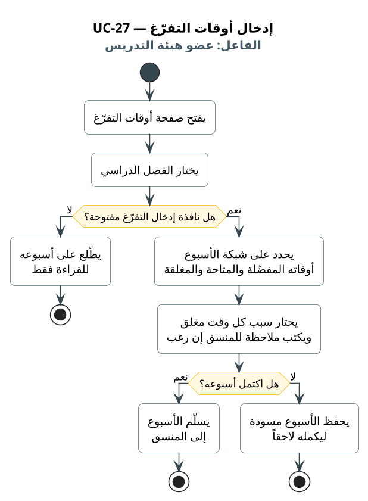

---

## UC-29: توليد الجدول الدراسي

**الفاعل:** منسق الجداول والموارد. **سير العمل:** يختار المنسق نطاق التوليد والخوارزمية ويبدأ التوليد. فإن فشل اطّلع على السبب وراجع الشعب والقاعات وأوقات التفرّغ ثم أعاد المحاولة. وإن نجح راجع الجدول المولَّد وعدّل مواضع محاضراته عند الحاجة، ثم يضيفه إلى نسخة الجدول أو يلغي المعاينة.

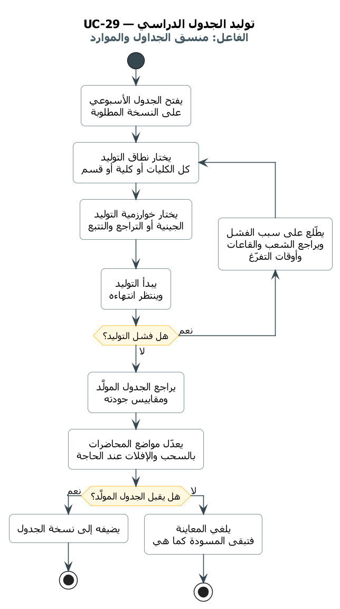

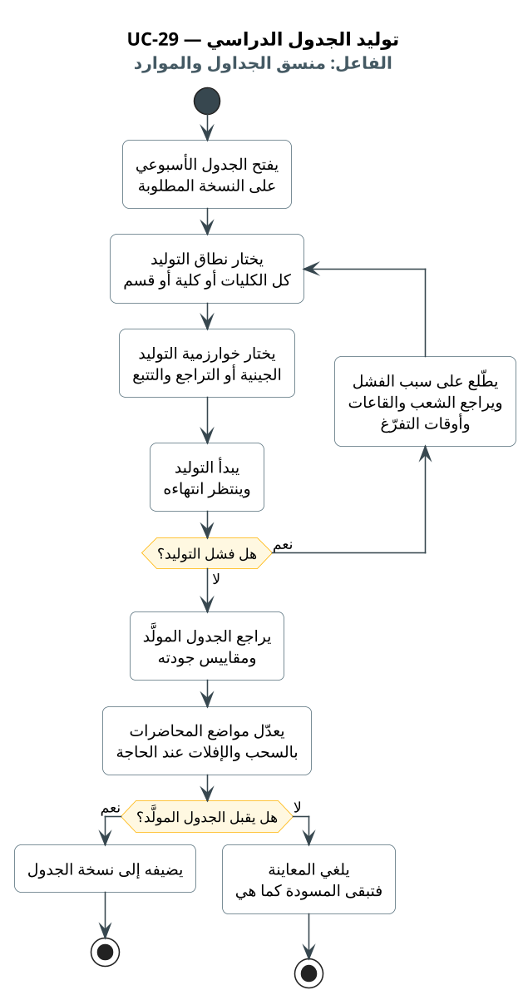

---

## UC-61: معالجة تعارضات الجدول ومؤشر الجودة

**الفاعل:** منسق الجداول والموارد. **سير العمل:** إن خلت النسخة من التعارضات اطّلع المنسق على مؤشر الجودة وانتهى. وإلا عالج التعارضات واحداً بعد آخر بحل مقترح أو بنقل المحاضرة يدوياً، حتى لا يبقى تعارض صلب ويبلغ مؤشر الجودة حدّه الأدنى.

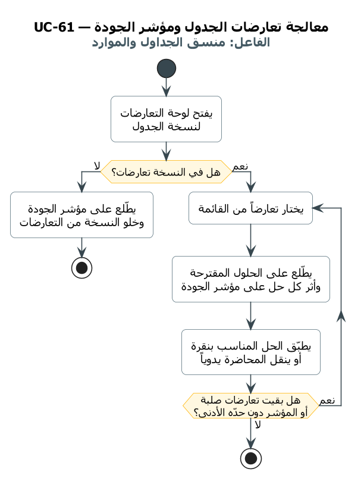

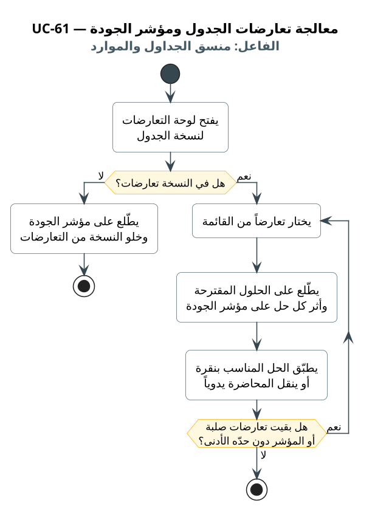

---

## UC-31: اعتماد الجدول ونشره

**الفاعلان:** موظف الشؤون الأكاديمية، ومنسق الجداول والموارد. **سير العمل:** يراجع موظف الشؤون الأكاديمية النسخة المرسلة للاعتماد. فإن كانت لديه ملاحظات أرجعها إلى المنسق فيعالجها ويعيد إرسالها، ويتكرر ذلك حتى لا تبقى ملاحظات، ثم يعتمد الموظف النسخة وينشر الجدول للمدرّسين والطلاب.

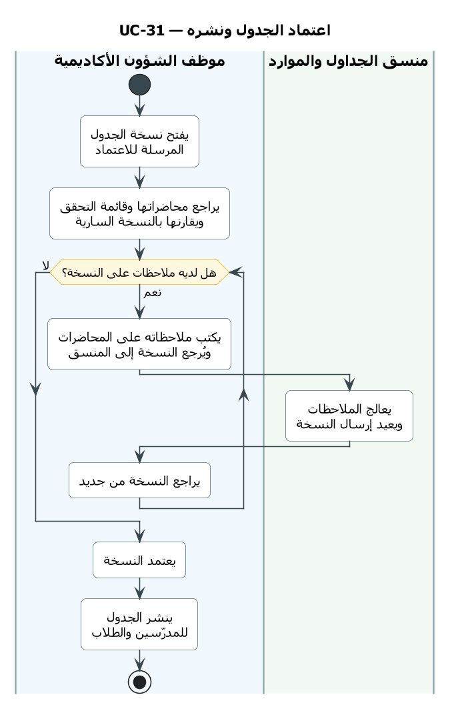

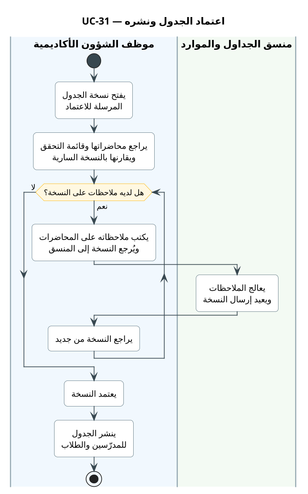

---

## UC-67: تسجيل المقررات

**الفاعل:** الطالب. **سير العمل:** إن منع فحص الأهلية الطالب من التسجيل اطّلع على السبب وانتهى. وإلا أضاف مقرراته إلى السلة واحداً بعد آخر وهو يعاين جدوله الأسبوعي، ثم يؤكد التسجيل ويعالج أي مشكلة تظهر في السلة، حتى يحصل على رقم التأكيد وجدوله وفاتورته.

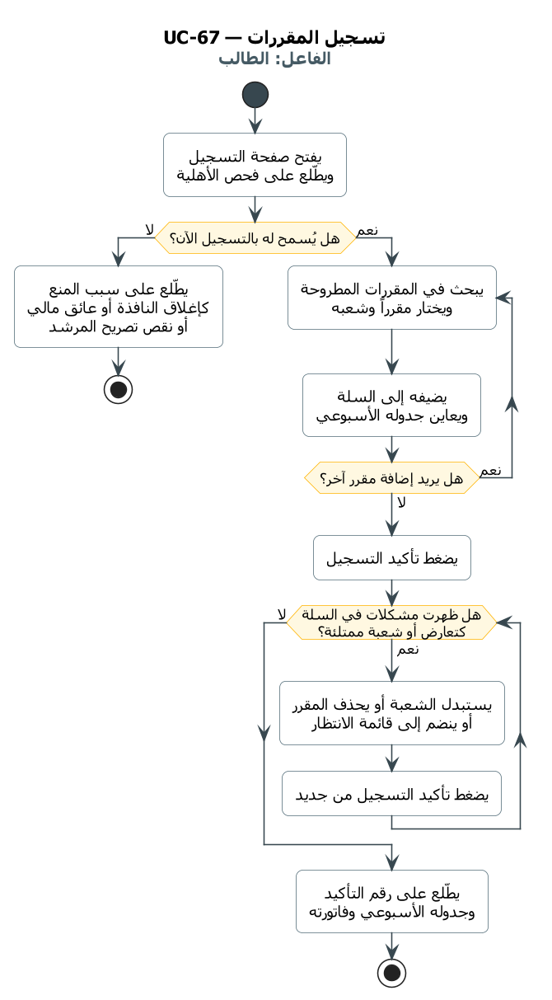

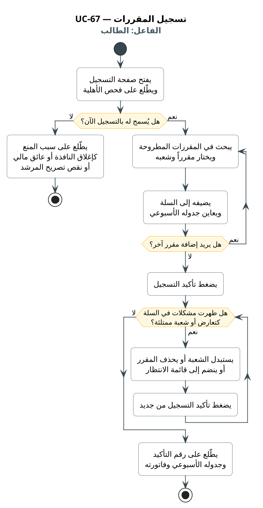

---

## UC-84: جدولة الامتحانات

**الفاعل:** موظف شؤون الامتحانات. **سير العمل:** يعرّف الموظف فترة الامتحانات وفتراتها اليومية وقواعدها ويولّد قائمة الامتحانات، ثم يولّد الجدول ويعيد توليده بعد زيادة الفترات أو تعديل القواعد حتى لا يبقى امتحانان متعارضان لطلاب مشتركين. وبعد مراجعة الجدول يكمل شروط النشر الناقصة ثم ينشره.

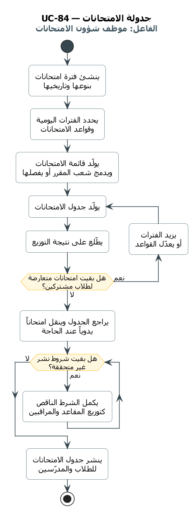

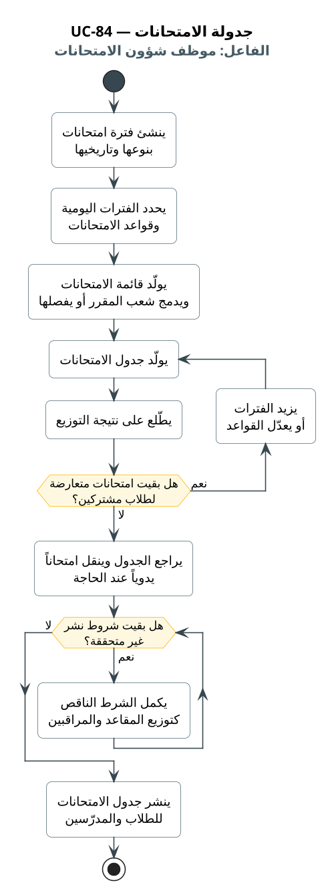

---

## UC-80: الإدخال المزدوج واعتماد الكشوف ونشرها

**الفاعل:** موظف شؤون الامتحانات. **سير العمل:** يُدخل الموظف علامة الامتحان النهائي في كل كشف راجعه القسم، ويحسم كل فرق بين إدخاله وإدخال المدرّس بملاحظة، ثم يعتمد الكشف. وبعد اعتماد الكشوف كلها يختار كشوف قسم أو كلية وينشرها بعد تأكيد هويته.

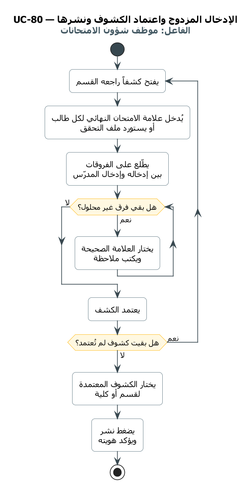

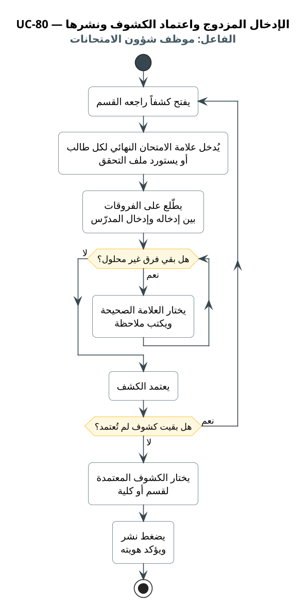

---

## UC-105: محادثة المساعد الذكي

**الفاعل:** أي مستخدم في النظام. **سير العمل:** إن لم يكن المساعد متاحاً للمستخدم أكمل عمله من الشاشات المعتادة. وإلا سأل ما يشاء وقرأ كل إجابة ومصدرها، ثم ينفّذ الإجراء المقترح في شاشته المختصة إن وُجد، أو يغلق المساعد.

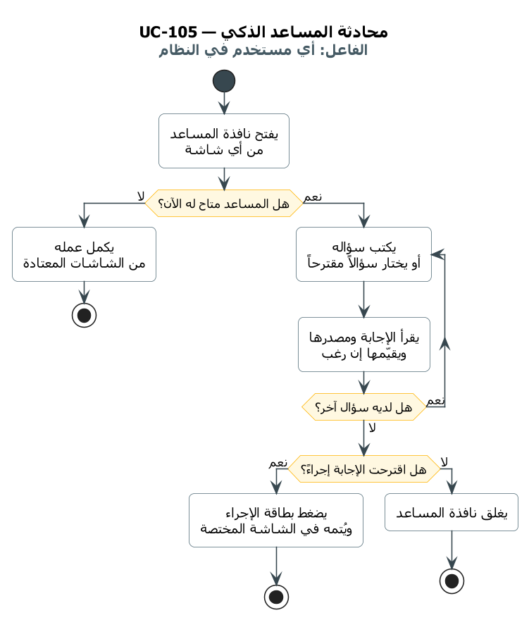

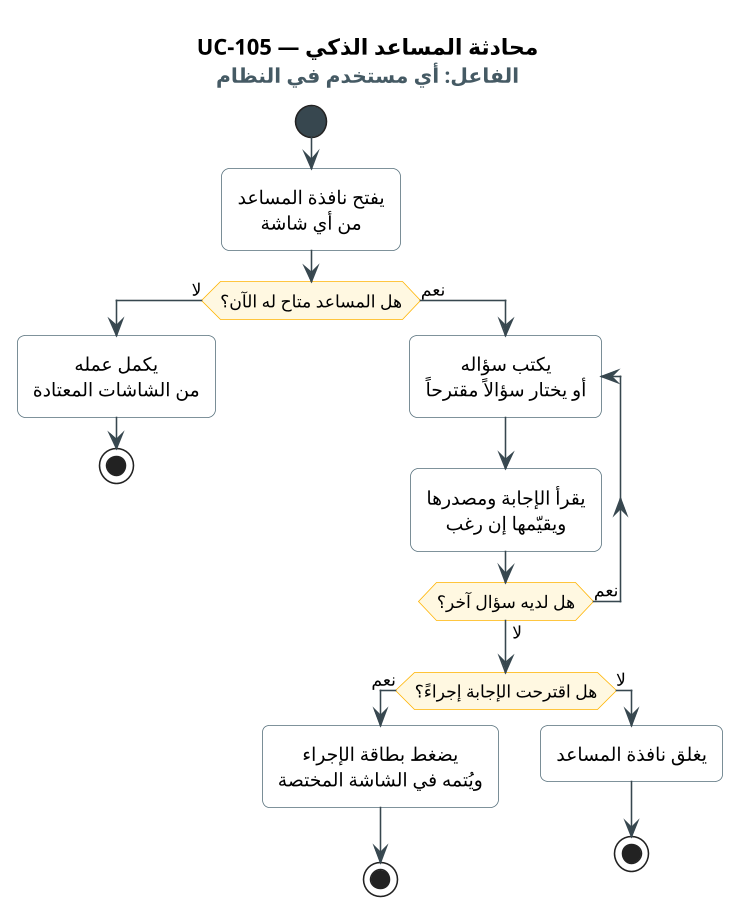

---

