<div dir="rtl">

> **الوثيقة:** مخططات النشاط (Activity Diagrams) — **النظام:** OptiTime — **التاريخ:** 2026-10-15

# مخططات النشاط — نظام OptiTime

تضم هذه الوثيقة أكواد PlantUML لمخططات النشاط التي تغطي حالات الاستخدام الواردة في ملف السيناريوهات (`UseCase Scenario/optitime-usecase-scenarios.md`)، وعددها 113 حالة في سبع عشرة حزمة، بالترقيم والحزم نفسها من UC-01 إلى UC-113، بمخطط واحد لكل حالة؛ فمجموع المخططات 113 مخططاً.

يُوزَّع كل مخطط على مسارات (Swimlanes) في أعمدة متجاورة: مسار لكل فاعل ومسار للنظام، ومسار ثالث أو رابع أحياناً لفاعل آخر أو خدمة كخدمة الذكاء الاصطناعي أو بوابة الدفع. وتتبع الأنشطة المسار الأساسي (Normal Flow) للسيناريو؛ وتظهر الاستثناءات (Exception) قراراتٍ تنتهي برسالة خطأ حمراء، وتعود بالمستخدم إلى الخطوة المناسبة عبر حلقة تكرار أو تُنهي الحالة؛ وتظهر المسارات البديلة (Alternative Flow) أنشطةً برتقالية؛ وتظهر الحالات المضمَّنة أو الموسَّعة في مستطيل بخطين جانبيين. وقد تُدمج في قرار واحد استثناءات متقاربة تقود إلى الخطوة نفسها، وتفاصيلها كاملة في ملف السيناريوهات. وهذه المخططات مكمِّلة لمخططات التسلسل في المجلد المجاور (`Sequence Diagram`) إذ تُظهر تتابع الأنشطة والقرارات بدل تبادل الرسائل بين الأطراف.

## طريقة العرض والتصدير

1. **معاينة Markdown في VS Code (Ctrl+Shift+V):** تعرض إضافة PlantUML (`jebbs.plantuml`) المخططات هنا عبر **خادم PlantUML** يُحدَّد في الإعداد `plantuml.server`؛ فإن لم يُضبط ظهر الكود نصاً مع تنبيه «No PlantUML server». ولك خياران:
   - **الخادم العام (الأسهل):** القيمة `"plantuml.server": "https://www.plantuml.com/plantuml"`؛ وهو يتطلب الإنترنت وتُرسل إليه نصوص المخططات.
   - **خادم محلي دون إنترنت:** شغّل في الطرفية الأمر `java -Dfile.encoding=UTF-8 -jar "%USERPROFILE%\.vscode\extensions\jebbs.plantuml-2.18.1\plantuml.jar" -picoweb:8080:127.0.0.1` واتركها تعمل (وغيّر رقم الإصدار إن اختلف عندك)، ثم اضبط القيمة `"plantuml.server": "http://127.0.0.1:8080"`، ومن قائمة الأوامر نفّذ «Markdown: Change Preview Security Settings» واختر «Allow insecure local content» لتسمح المعاينة بتحميل الصور من الخادم المحلي.
2. **ملف `.puml` منفرد:** انسخ كتلة المخطط كاملة (من سطر `startuml` في أولها إلى سطر `enduml` في آخرها) إلى ملف بامتداد `.puml`، ثم اضغط Alt+D للمعاينة؛ وهذا يعمل بـ Java وحدها دون خادم. ولتصديره من قائمة الأوامر (Ctrl+Shift+P) اختر «PlantUML: Export Current Diagram» لتصديره بصيغة PNG أو SVG. صيغة SVG أنسب للتقرير لأنها تحافظ على جودتها عند التكبير.
3. **بدائل:** لصق الكتلة في موقع PlantUML على الإنترنت (`plantuml.com/plantuml`)، أو إدراجها في draw.io من القائمة Arrange ثم Insert ثم Advanced ثم PlantUML.

كل كتلة مكتفية بذاتها: يبدأ كل مخطط بنمط موحّد (الأسطر التي تبدأ بـ `skinparam`) ثم عنوانه وأطرافه ورسائله، فتُنسخ كتلة واحدة دون الحاجة إلى غيرها. واسم المخطط المكتوب بعد كلمة `startuml` في أول الكتلة هو اسم ملف الصورة عند التصدير.

## دليل الرموز

| العنصر في المخطط | معناه |
|---|---|
| دائرة سوداء | بداية الحالة |
| دائرة بنقطة داخلها | نهاية الحالة بعد إتمام المسار |
| دائرة بعلامة ✕ | انقطاع الحالة عند استثناء دون إتمام |
| مستطيل أبيض | نشاط من المسار الأساسي |
| مستطيل أحمر فاتح | رسالة خطأ أو حالة استثناء |
| مستطيل أخضر فاتح | النتيجة الناجحة (الرسالة النهائية) |
| مستطيل برتقالي فاتح | نشاط في مسار بديل أو اختياري |
| مستطيل بخطين جانبيين | حالة استخدام أخرى تُضمَّن أو تُوسَّع |
| سداسي أصفر | قرار أو شرط، وعلى فروعه الإجابة |
| سهم يعود إلى الأعلى | تكرار حتى يتحقق الشرط |
| أعمدة ملوّنة | مسارات الفاعلين والنظام |
| مستطيل أصفر فاتح بزاوية | ملاحظة |

<div dir="ltr">

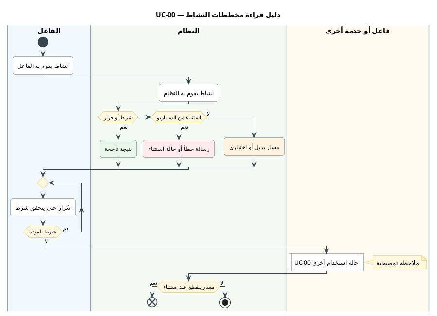

</div>

## فهرس المخططات

| الرقم | حالة الاستخدام | الفاعلون | الحزمة | اسم المخطط |
|---|---|---|---|---|
| UC-01 | تسجيل الدخول | جميع المستخدمين | المصادقة والملف الشخصي | `UC-01_login_activity` |
| UC-02 | تسجيل الخروج | جميع المستخدمين | المصادقة والملف الشخصي | `UC-02_logout_activity` |
| UC-03 | عرض الملف الشخصي | جميع المستخدمين | المصادقة والملف الشخصي | `UC-03_view_profile_activity` |
| UC-04 | تعديل الملف الشخصي | جميع المستخدمين | المصادقة والملف الشخصي | `UC-04_edit_profile_activity` |
| UC-05 | نسيت كلمة المرور | جميع المستخدمين | المصادقة والملف الشخصي | `UC-05_forgot_password_activity` |
| UC-06 | التحقق الثنائي (رمز التحقق) | جميع المستخدمين، خدمة المصادقة | المصادقة والملف الشخصي | `UC-06_otp_verification_activity` |
| UC-07 | تغيير كلمة المرور | جميع المستخدمين | المصادقة والملف الشخصي | `UC-07_change_password_activity` |
| UC-08 | تفعيل التحقق الثنائي عبر تطبيق المصادقة | جميع المستخدمين | المصادقة والملف الشخصي | `UC-08_enable_two_factor_activity` |
| UC-09 | عرض المستخدمين | ADM، EXE (عرض فقط) | المستخدمون والأدوار | `UC-09_view_users_activity` |
| UC-10 | إنشاء مستخدم | ADM | المستخدمون والأدوار | `UC-10_create_user_activity` |
| UC-11 | تعديل مستخدم | ADM | المستخدمون والأدوار | `UC-11_edit_user_activity` |
| UC-12 | حذف مستخدم | ADM | المستخدمون والأدوار | `UC-12_delete_user_activity` |
| UC-13 | تعيين الأدوار | ADM | المستخدمون والأدوار | `UC-13_assign_roles_activity` |
| UC-14 | عرض مصفوفة الصلاحيات (RACI) | ADM، EXE (عرض فقط) | المستخدمون والأدوار | `UC-14_permission_matrix_activity` |
| UC-15 | إضافة دور | ADM | المستخدمون والأدوار | `UC-15_create_role_activity` |
| UC-16 | تعديل دور | ADM | المستخدمون والأدوار | `UC-16_edit_role_activity` |
| UC-17 | حذف دور | ADM | المستخدمون والأدوار | `UC-17_delete_role_activity` |
| UC-18 | إدارة القاعات | CRD | الموارد | `UC-18_manage_rooms_activity` |
| UC-19 | تحديد سعة الامتحان | CRD | الموارد | `UC-19_exam_capacity_activity` |
| UC-20 | إدارة الأجهزة | CRD | الموارد | `UC-20_manage_equipment_activity` |
| UC-21 | إدارة المختبرات | CRD | الموارد | `UC-21_manage_labs_activity` |
| UC-22 | إدارة الصيانة | CRD | الموارد | `UC-22_manage_maintenance_activity` |
| UC-23 | عرض الموارد | INS، EMP | الموارد | `UC-23_view_resources_activity` |
| UC-24 | طلب موارد إضافية | INS | الموارد | `UC-24_request_resources_activity` |
| UC-25 | معالجة طلبات الموارد | CRD | الموارد | `UC-25_process_resource_requests_activity` |
| UC-26 | حجز قاعة دراسية | EMP، LIB | الموارد | `UC-26_book_room_activity` |
| UC-27 | إدخال أوقات التفرّغ | INS | الجدولة | `UC-27_enter_availability_activity` |
| UC-28 | متابعة أوقات تفرّغ المدرّسين وتذكيرهم | CRD، HOD، DEN | الجدولة | `UC-28_follow_availability_activity` |
| UC-29 | توليد الجدول الدراسي | CRD | الجدولة | `UC-29_generate_schedule_activity` |
| UC-30 | إرسال الجدول للاعتماد | CRD | الجدولة | `UC-30_submit_schedule_activity` |
| UC-31 | اعتماد الجدول ونشره | ACO | الجدولة | `UC-31_approve_publish_schedule_activity` |
| UC-32 | عرض الجدول الأسبوعي | STU، INS | الجدولة | `UC-32_view_weekly_schedule_activity` |
| UC-33 | تقديم طلب اعتذار أو تعويض عن محاضرة | INS | الجدولة | `UC-33_lecture_request_activity` |
| UC-34 | رصد علامات الامتحان | EXM | الامتحانات والدرجات | `UC-34_enter_exam_marks_activity` |
| UC-35 | عرض الدرجات | STU | الامتحانات والدرجات | `UC-35_view_grades_activity` |
| UC-36 | نقل الفصل الدراسي بين مراحله | ACO | التقويم والتقارير والنظام | `UC-36_transition_semester_activity` |
| UC-37 | عرض تقارير الإدارة | EXE | التقويم والتقارير والنظام | `UC-37_management_reports_activity` |
| UC-38 | إنشاء نسخة احتياطية واستعادتها | ADM | التقويم والتقارير والنظام | `UC-38_backup_restore_activity` |
| UC-39 | الدخول باسم مستخدم آخر | ADM | الإدارة والمتابعة | `UC-39_impersonate_user_activity` |
| UC-40 | استعراض سجل التدقيق | ADM | الإدارة والمتابعة | `UC-40_audit_log_activity` |
| UC-41 | ضبط إعدادات النظام ووضع الصيانة | ADM | الإدارة والمتابعة | `UC-41_system_settings_activity` |
| UC-42 | مراقبة صحة النظام | ADM | الإدارة والمتابعة | `UC-42_system_health_activity` |
| UC-43 | استيراد البيانات من ملف | ADM، CRD، ACO | الإدارة والمتابعة | `UC-43_import_data_activity` |
| UC-44 | إدارة التكاملات ومفاتيح الواجهة البرمجية | ADM، نظام خارجي | الإدارة والمتابعة | `UC-44_integrations_activity` |
| UC-45 | البحث الشامل | جميع المستخدمين | الإدارة والمتابعة | `UC-45_global_search_activity` |
| UC-46 | متابعة الإشعارات | جميع المستخدمين، خدمة الإشعارات الفورية | الإدارة والمتابعة | `UC-46_notifications_activity` |
| UC-47 | عرض لوحة التحكم | جميع المستخدمين | الإدارة والمتابعة | `UC-47_dashboard_activity` |
| UC-48 | إدارة الفروع والمباني | ADM | الهيكل الأكاديمي والخطط | `UC-48_campuses_buildings_activity` |
| UC-49 | إدارة الكليات والأقسام وقياداتها | ADM، DEN | الهيكل الأكاديمي والخطط | `UC-49_faculties_departments_activity` |
| UC-50 | إدارة البرامج الأكاديمية | ADM، ACO | الهيكل الأكاديمي والخطط | `UC-50_academic_programs_activity` |
| UC-51 | إدارة الوحدات الإدارية | ADM | الهيكل الأكاديمي والخطط | `UC-51_administrative_units_activity` |
| UC-52 | إدارة النوافذ الزمنية والعطل وأدوار التسجيل | ACO | الهيكل الأكاديمي والخطط | `UC-52_windows_holidays_activity` |
| UC-53 | إدارة المقررات وتوصيفها | ACO، CRD | الهيكل الأكاديمي والخطط | `UC-53_manage_courses_activity` |
| UC-54 | تحديد المتطلبات السابقة والمعادلات | ACO، CRD | الهيكل الأكاديمي والخطط | `UC-54_course_requirements_activity` |
| UC-55 | إدارة سلالم الدرجات | ACO | الهيكل الأكاديمي والخطط | `UC-55_grading_schemes_activity` |
| UC-56 | إعداد الخطة الدراسية واعتمادها | ACO | الهيكل الأكاديمي والخطط | `UC-56_study_plans_activity` |
| UC-57 | إدارة الملف التدريسي لعضو هيئة التدريس | ACO، DEN، HOD، INS | إعداد الجدولة وتشغيلها | `UC-57_teaching_profile_activity` |
| UC-58 | طرح المقررات وتقدير الطلب | CRD، ACO | إعداد الجدولة وتشغيلها | `UC-58_course_offerings_activity` |
| UC-59 | إنشاء الشعب وإسناد مدرّسيها | CRD | إعداد الجدولة وتشغيلها | `UC-59_sections_teachers_activity` |
| UC-60 | ضبط قواعد الجدولة وقيودها | ADM، CRD | إعداد الجدولة وتشغيلها | `UC-60_scheduling_rules_activity` |
| UC-61 | معالجة تعارضات الجدول ومؤشر الجودة | CRD | إعداد الجدولة وتشغيلها | `UC-61_schedule_conflicts_activity` |
| UC-62 | الإعادة الطارئة للجدولة واقتراح البدلاء | CRD | إعداد الجدولة وتشغيلها | `UC-62_emergency_rescheduling_activity` |
| UC-63 | إدارة سجلات الطلاب | ADM، ADO | سجلات الطلاب والتسجيل | `UC-63_student_records_activity` |
| UC-64 | عرض التدقيق الأكاديمي | STU، ADV، ACO | سجلات الطلاب والتسجيل | `UC-64_degree_audit_activity` |
| UC-65 | ترشيح المتخرجين واعتماد دفعة التخرج | ACO | سجلات الطلاب والتسجيل | `UC-65_graduation_activity` |
| UC-66 | نشر كتالوج التسجيل وفتح أدواره | ACO | سجلات الطلاب والتسجيل | `UC-66_publish_catalog_activity` |
| UC-67 | تسجيل المقررات | STU | سجلات الطلاب والتسجيل | `UC-67_course_registration_activity` |
| UC-68 | التحقق من أهلية التسجيل | STU | سجلات الطلاب والتسجيل | `UC-68_registration_validation_activity` |
| UC-69 | الانضمام إلى قائمة الانتظار وقبول المقعد | STU | سجلات الطلاب والتسجيل | `UC-69_waitlist_activity` |
| UC-70 | السحب والإضافة | STU | سجلات الطلاب والتسجيل | `UC-70_add_drop_activity` |
| UC-71 | منح استثناءات التسجيل وإدارة العوائق | ACO | سجلات الطلاب والتسجيل | `UC-71_overrides_holds_activity` |
| UC-72 | تسجيل حضور الجلسة | INS، STU | الحضور والتعلّم والتقييم | `UC-72_take_attendance_activity` |
| UC-73 | متابعة الغياب واعتماد الحرمان | ACO، STU | الحضور والتعلّم والتقييم | `UC-73_absence_deprivation_activity` |
| UC-74 | إدارة محتوى المادة وإعلاناتها | INS، STU | الحضور والتعلّم والتقييم | `UC-74_course_content_activity` |
| UC-75 | إنشاء كويز ونشره | INS | الحضور والتعلّم والتقييم | `UC-75_create_quiz_activity` |
| UC-76 | أداء الكويز | STU | الحضور والتعلّم والتقييم | `UC-76_take_quiz_activity` |
| UC-77 | تقييم المقرر والمدرّس | STU، INS، HOD، DEN | الحضور والتعلّم والتقييم | `UC-77_course_evaluation_activity` |
| UC-78 | رصد كشف الدرجات وإرساله للمراجعة | INS | سير اعتماد الدرجات | `UC-78_grade_sheet_entry_activity` |
| UC-79 | مراجعة كشف الدرجات في القسم | HOD | سير اعتماد الدرجات | `UC-79_department_review_activity` |
| UC-80 | الإدخال المزدوج واعتماد الكشوف ونشرها | EXM | سير اعتماد الدرجات | `UC-80_verify_publish_grades_activity` |
| UC-81 | حساب المعدل والوضع الأكاديمي | النظام | سير اعتماد الدرجات | `UC-81_gpa_standing_activity` |
| UC-82 | إصدار كشف الدرجات | STU، ACO | سير اعتماد الدرجات | `UC-82_transcript_activity` |
| UC-83 | طلب تعديل درجة منشورة | INS، DEN | سير اعتماد الدرجات | `UC-83_grade_change_activity` |
| UC-84 | جدولة الامتحانات | EXM | جدولة الامتحانات وتنفيذها | `UC-84_exam_schedule_activity` |
| UC-85 | توزيع القاعات والمقاعد والمراقبين | EXM | جدولة الامتحانات وتنفيذها | `UC-85_seating_proctors_activity` |
| UC-86 | عرض جدول امتحاناتي وبطاقة الامتحان | STU | جدولة الامتحانات وتنفيذها | `UC-86_my_exams_activity` |
| UC-87 | إدارة يوم الامتحان | EXM، INS | جدولة الامتحانات وتنفيذها | `UC-87_exam_day_activity` |
| UC-88 | إدارة دورات القبول | ADO | القبول والإرشاد | `UC-88_admission_cycles_activity` |
| UC-89 | تقديم طلب القبول ومتابعته | APL، بوابة الدفع | القبول والإرشاد | `UC-89_apply_admission_activity` |
| UC-90 | المفاضلة وإصدار قرارات القبول | ADO | القبول والإرشاد | `UC-90_admission_decisions_activity` |
| UC-91 | مراجعة الخطة الفصلية ومنح تصريح التسجيل | ADV، STU | القبول والإرشاد | `UC-91_advising_clearance_activity` |
| UC-92 | متابعة الإنذارات ومواعيد الإرشاد | ADV، STU | القبول والإرشاد | `UC-92_warnings_appointments_activity` |
| UC-93 | إدارة الرسوم والفواتير | FIN | المالية | `UC-93_fees_invoices_activity` |
| UC-94 | عرض الرصيد والدفع الإلكتروني | STU، بوابة الدفع | المالية | `UC-94_online_payment_activity` |
| UC-95 | تسجيل دفعة في الصندوق | FIN | المالية | `UC-95_cashier_payment_activity` |
| UC-96 | إدارة الأقساط والمنح والاسترداد | FIN، STU | المالية | `UC-96_installments_scholarships_activity` |
| UC-97 | البحث في كتالوج المكتبة وحجز نسخة | STU، INS | المكتبة وشؤون الموظفين والطلبات | `UC-97_library_search_activity` |
| UC-98 | إعارة النسخ وإرجاعها | LIB | المكتبة وشؤون الموظفين والطلبات | `UC-98_library_circulation_activity` |
| UC-99 | إدارة ملفات الموظفين وعقودهم | HRO، EMP، جهاز البصمة | المكتبة وشؤون الموظفين والطلبات | `UC-99_employee_files_activity` |
| UC-100 | تقديم طلب إجازة | EMP، INS | المكتبة وشؤون الموظفين والطلبات | `UC-100_leave_request_activity` |
| UC-101 | اعتماد طلبات الإجازة | المدير المباشر، HRO | المكتبة وشؤون الموظفين والطلبات | `UC-101_leave_approval_activity` |
| UC-102 | تقديم طلب إلكتروني ومتابعته | STU | المكتبة وشؤون الموظفين والطلبات | `UC-102_submit_request_activity` |
| UC-103 | معالجة الطلبات الإلكترونية | ACO، EXM | المكتبة وشؤون الموظفين والطلبات | `UC-103_process_requests_activity` |
| UC-104 | ضبط بوابة الذكاء الاصطناعي ومتابعة استخدامها | ADM، EXE | الذكاء الاصطناعي والتحليلات | `UC-104_ai_gateway_activity` |
| UC-105 | محادثة المساعد الذكي | جميع المستخدمين | الذكاء الاصطناعي والتحليلات | `UC-105_ai_assistant_activity` |
| UC-106 | إدارة قاعدة معرفة اللوائح | ACO | الذكاء الاصطناعي والتحليلات | `UC-106_knowledge_base_activity` |
| UC-107 | إدخال التفرّغ والقيود بلغة طبيعية | INS، CRD | الذكاء الاصطناعي والتحليلات | `UC-107_natural_language_input_activity` |
| UC-108 | شرح نتيجة الجدولة | CRD، INS | الذكاء الاصطناعي والتحليلات | `UC-108_schedule_explainer_activity` |
| UC-109 | التنبؤ بالطلب على المقررات | CRD، ACO، EXE | الذكاء الاصطناعي والتحليلات | `UC-109_demand_forecast_activity` |
| UC-110 | متابعة مؤشر خطر التعثّر | ADV، ACO، HOD | الذكاء الاصطناعي والتحليلات | `UC-110_risk_index_activity` |
| UC-111 | استخراج بيانات المقررات من ملف | ACO | الذكاء الاصطناعي والتحليلات | `UC-111_document_extraction_activity` |
| UC-112 | توليد ملخص لتقرير أو لوحة | EXE، ADM | الذكاء الاصطناعي والتحليلات | `UC-112_report_summary_activity` |
| UC-113 | محاكاة السيناريوهات | EXE، CRD | الذكاء الاصطناعي والتحليلات | `UC-113_scenario_simulator_activity` |

---

## الحزمة الأولى: المصادقة والملف الشخصي (Auth_profile)

تغطي الحالات من UC-01 إلى UC-08.

### UC-01: تسجيل الدخول

**الفاعلون:** جميع مستخدمي النظام. **يوضّح المخطط:** إدخال بيانات الدخول والتحقق منها، وحالات الرفض (بيانات خاطئة أو حساب مقفل أو معطّل أو نظام في الصيانة)، ومسار التحقق الثنائي، ثم إصدار الجلسة والتحويل إلى لوحة التحكم.

<div dir="ltr">

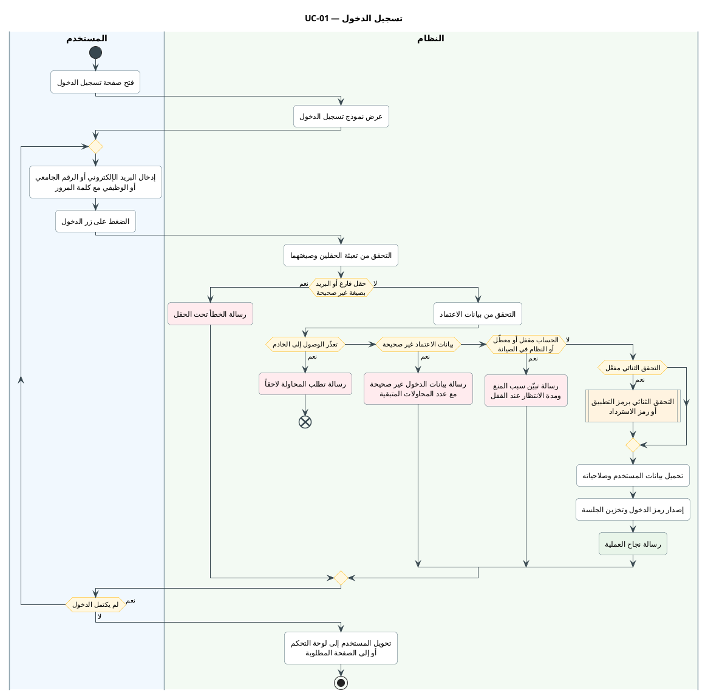

</div>

### UC-02: تسجيل الخروج

**الفاعلون:** جميع مستخدمي النظام. **يوضّح المخطط:** الخروج من الجهاز الحالي مع حذف بيانات الجلسة من المتصفح، أو الخروج من الأجهزة الأخرى مع البقاء داخلاً على الجهاز الحالي.

<div dir="ltr">

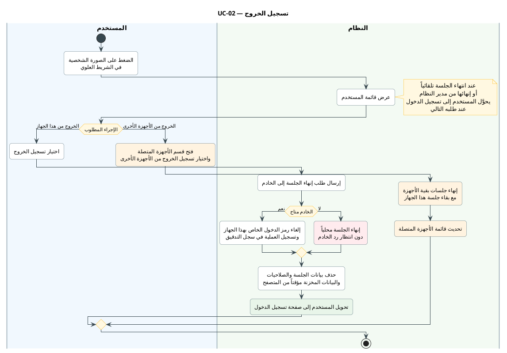

</div>

### UC-03: عرض الملف الشخصي

**الفاعلون:** جميع مستخدمي النظام. **يوضّح المخطط:** فتح إعدادات المستخدم، والتحقق من صلاحية العرض، وتحميل بيانات الحساب وإعدادات الإشعارات، وتبديل الدور لمن له أكثر من دور.

<div dir="ltr">

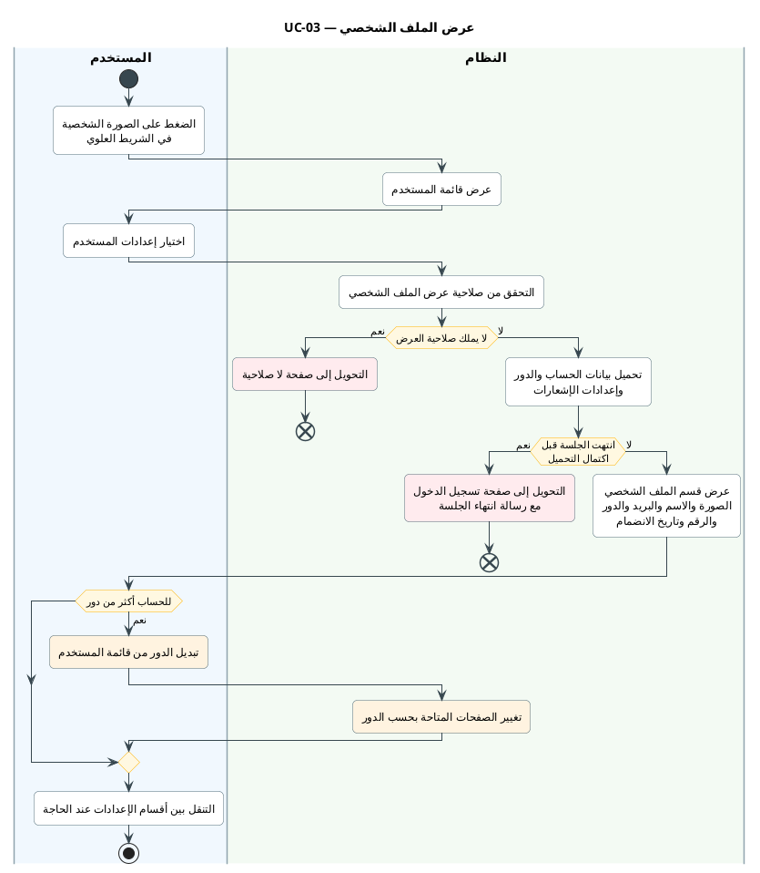

</div>

### UC-04: تعديل الملف الشخصي

**الفاعلون:** جميع مستخدمي النظام. **يوضّح المخطط:** تعديل الاسم والبريد والصورة، وفحص الصورة، والتحقق من الحقول وتكرار البريد، وتجاهل التعديلات أو حفظها وتحديث الشريط العلوي.

<div dir="ltr">

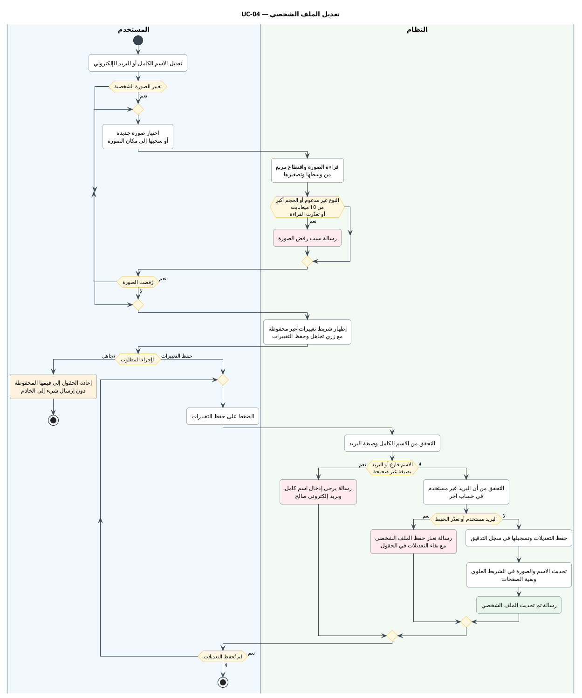

</div>

### UC-05: نسيت كلمة المرور

**الفاعلون:** جميع مستخدمي النظام. **يوضّح المخطط:** طلب رمز التحقق وإرساله إلى البريد دون كشف وجود الحساب، ثم تضمين حالتي «التحقق الثنائي» UC-06 و«تغيير كلمة المرور» UC-07.

<div dir="ltr">

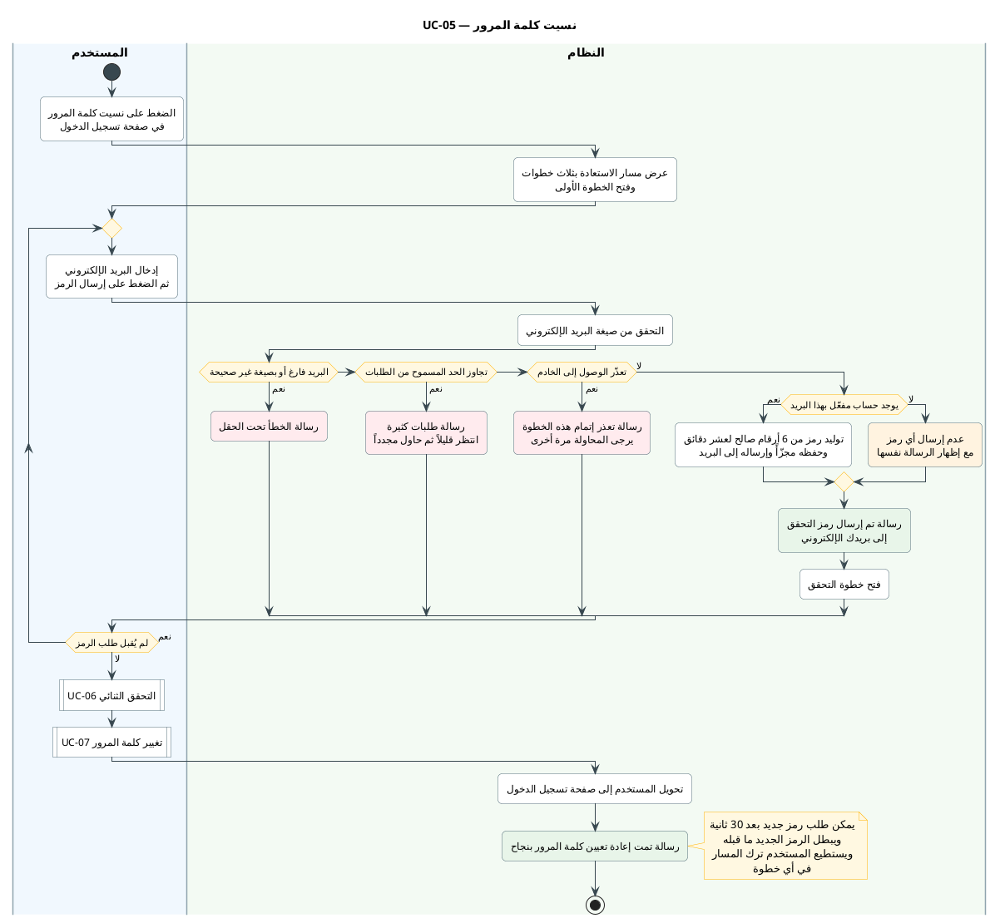

</div>

### UC-06: التحقق الثنائي (رمز التحقق)

**الفاعلون:** جميع مستخدمي النظام، وخدمة المصادقة (Auth service). **يوضّح المخطط:** التحقق من صيغة الرمز ثم مطابقته لدى خدمة المصادقة (الصلاحية والمحاولات والمطابقة)، وتضمّنه حالة «تغيير كلمة المرور» UC-07.

<div dir="ltr">

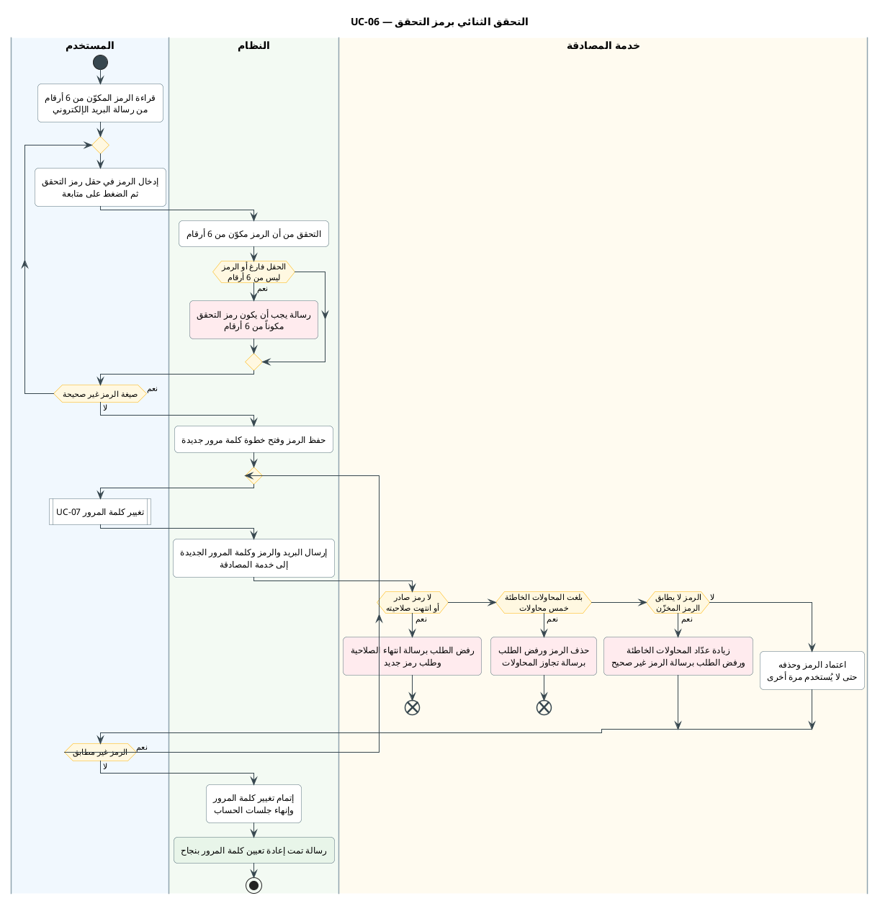

</div>

### UC-07: تغيير كلمة المرور

**الفاعلون:** جميع مستخدمي النظام. **يوضّح المخطط:** التحقق من تعبئة الحقول وتطابقها، ثم من كلمة المرور الحالية وسياسة كلمة المرور وسجل الكلمات السابقة، وحفظ الجديدة وإنهاء الجلسات الأخرى وإشعار صاحب الحساب.

<div dir="ltr">

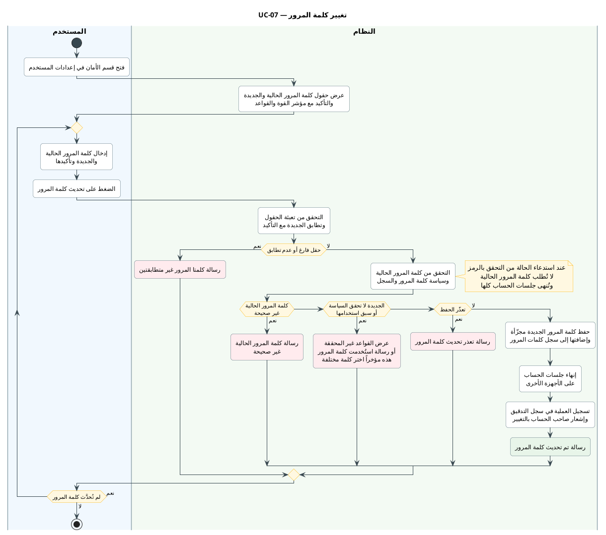

</div>

### UC-08: تفعيل التحقق الثنائي عبر تطبيق المصادقة

**الفاعلون:** جميع مستخدمي النظام. **يوضّح المخطط:** توليد المفتاح السري وربطه بتطبيق المصادقة، ثم تأكيد الرمز وتسليم رموز الاسترداد، وإيقاف التحقق الثنائي بعد تأكيد الهوية.

<div dir="ltr">

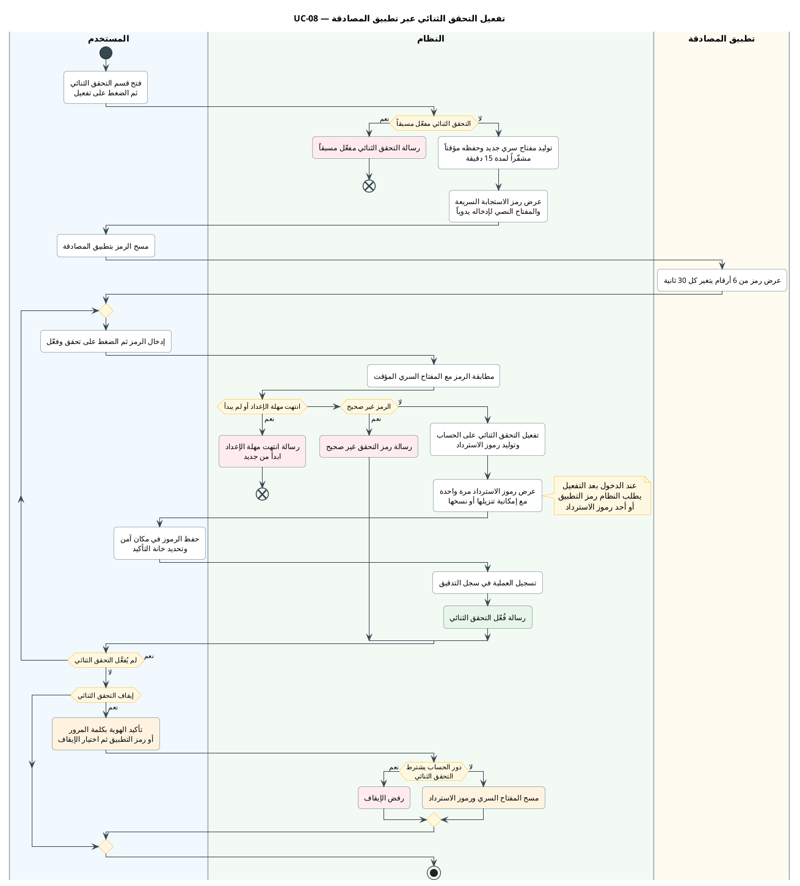

</div>

---

## الحزمة الثانية: المستخدمون والأدوار (User and Roles)

تغطي الحالات من UC-09 إلى UC-17.

### UC-09: عرض المستخدمين

**الفاعلون:** مدير النظام (ADM)، الإدارة العليا (EXE) للعرض فقط. **يوضّح المخطط:** التحقق من صلاحية العرض وتحميل الحسابات، والبحث والتصفية، وفتح تفاصيل حساب، وتصدير القائمة.

<div dir="ltr">

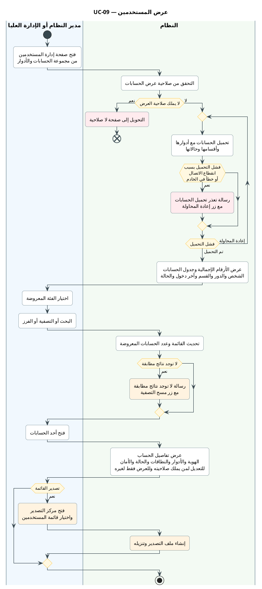

</div>

### UC-10: إنشاء مستخدم

**الفاعلون:** مدير النظام (ADM). **يوضّح المخطط:** إدخال هوية الحساب ودوره وكلمة مروره، والتحقق من الحقول ومن تفرّد البريد واسم الدخول والرقم الوظيفي، وتضمّن حالة «تعيين الأدوار» UC-13، ثم الإشعار وسجل التدقيق.

<div dir="ltr">

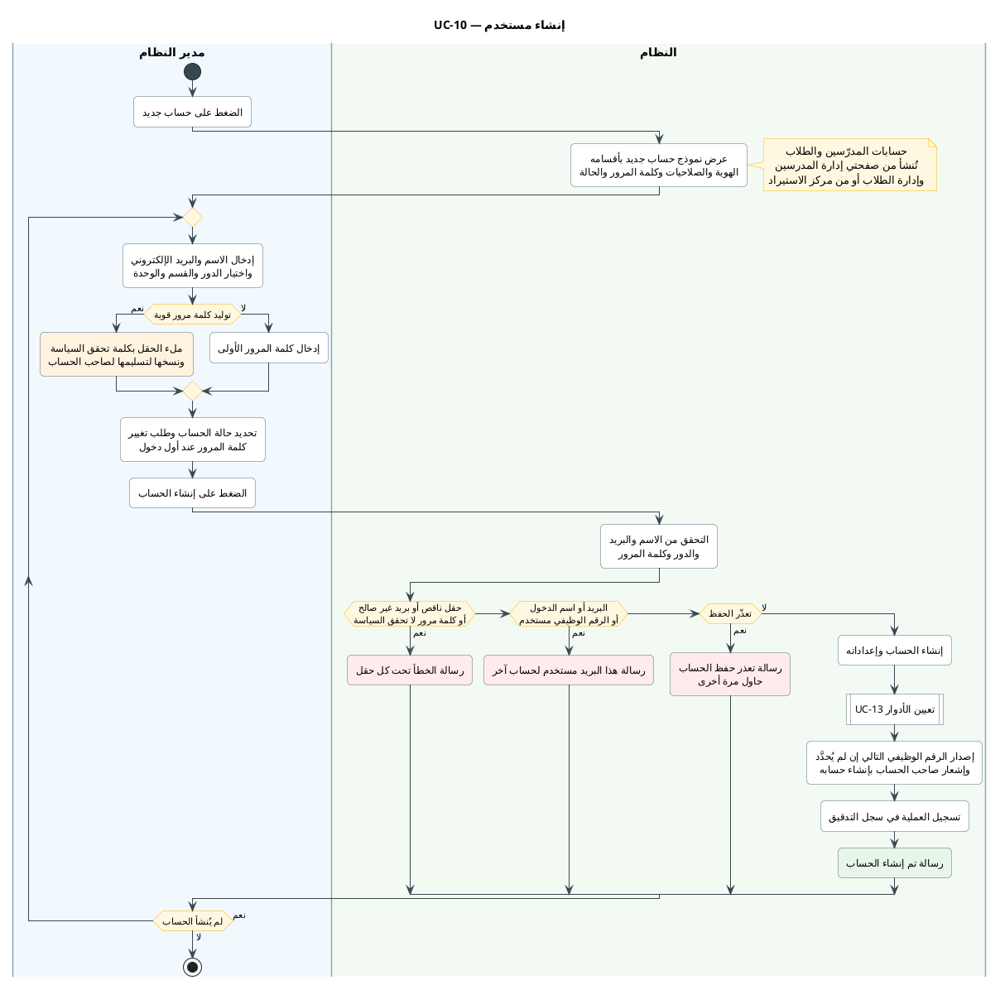

</div>

### UC-11: تعديل مستخدم

**الفاعلون:** مدير النظام (ADM). **يوضّح المخطط:** تعديل بيانات الحساب مع حماية الحساب المؤسِّس والمدير نفسه وآخر مدير مفعّل، وإنهاء الجلسات عند التعطيل، ومسارات قسم «الأمان» البديلة.

<div dir="ltr">

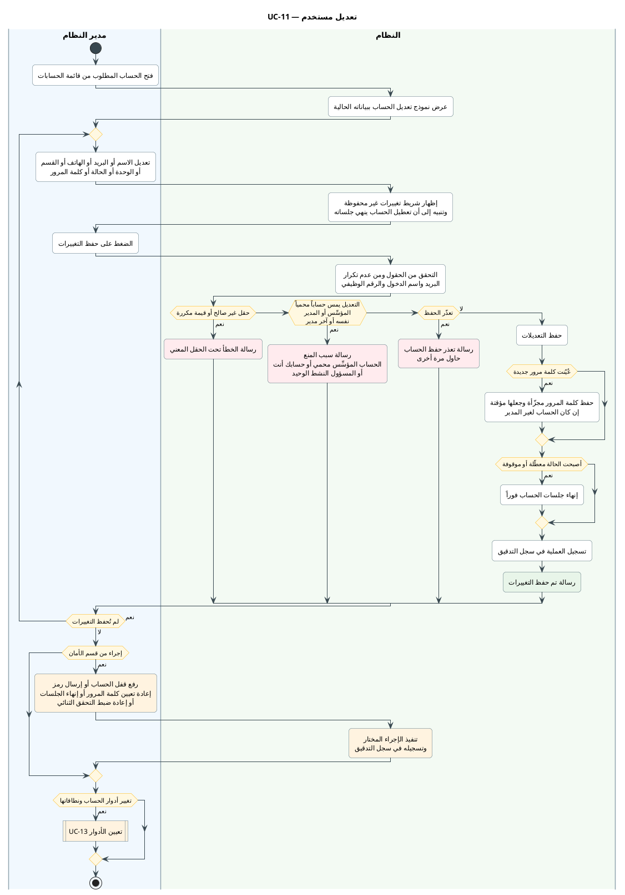

</div>

### UC-12: حذف مستخدم

**الفاعلون:** مدير النظام (ADM). **يوضّح المخطط:** فحص شروط الحذف في الواجهة ثم إعادة فحصها في الخادم قبل حذف الحساب مع إشعاراته وإعداداته، وبديل إيقاف الحساب بدل حذفه.

<div dir="ltr">

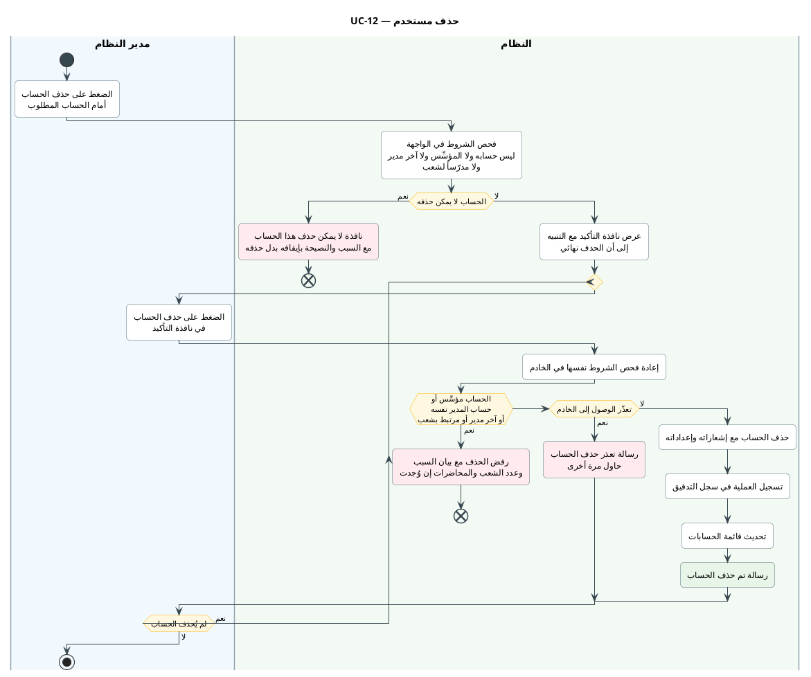

</div>

### UC-13: تعيين الأدوار

**الفاعلون:** مدير النظام (ADM). **يوضّح المخطط:** استبدال أدوار الحساب بالمجموعة المحددة بنطاقاتها ومددها، مع تأكيد هوية المدير وحماية الحساب المؤسِّس وآخر مدير. تُستدعى تلقائياً من UC-10.

<div dir="ltr">

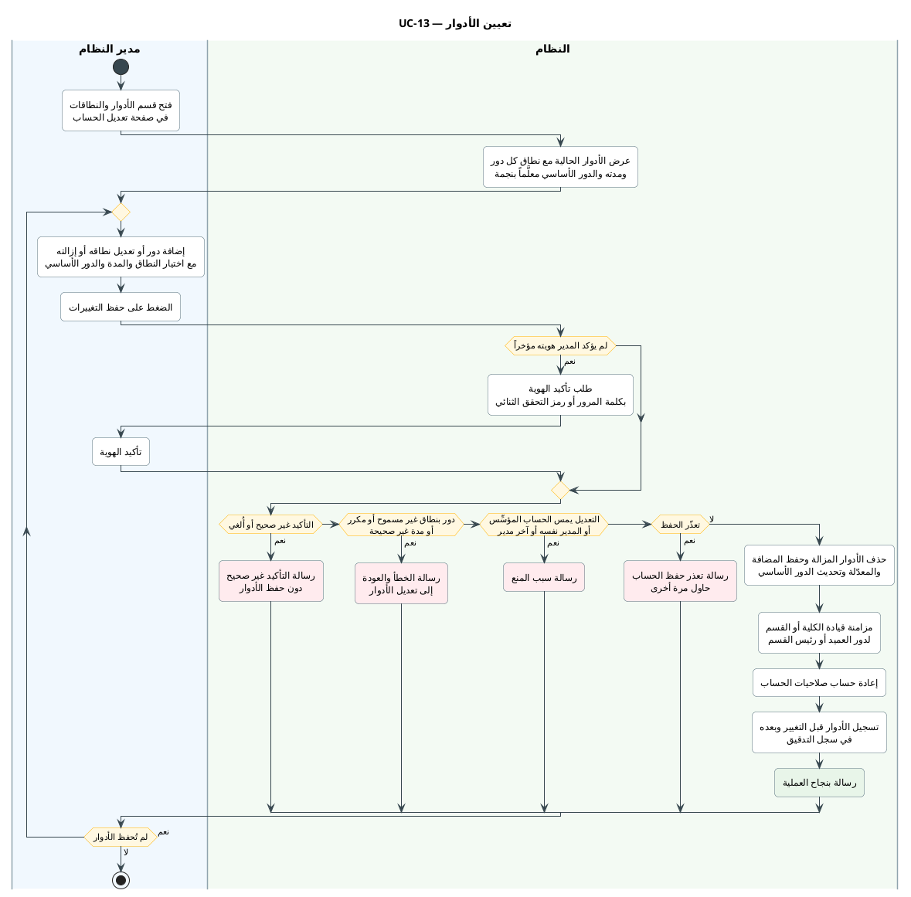

</div>

### UC-14: عرض مصفوفة الصلاحيات (RACI)

**الفاعلون:** مدير النظام (ADM)، الإدارة العليا (EXE) للعرض فقط. **يوضّح المخطط:** التحقق من صلاحية عرض الأدوار وتحميلها، وبناء المصفوفة (الأدوار أعمدة والصلاحيات صفوف)، والبحث فيها وفتح تفاصيل دور للعرض.

<div dir="ltr">

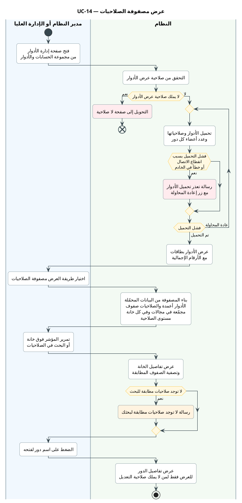

</div>

### UC-15: إضافة دور

**الفاعلون:** مدير النظام (ADM). **يوضّح المخطط:** تحديد هوية الدور ومداه وصلاحياته (مع النسخ من دور قائم وقاعدة التبعية)، ثم التحقق من الحقول وتفرّد الرمز وإنشاء الدور المخصص.

<div dir="ltr">

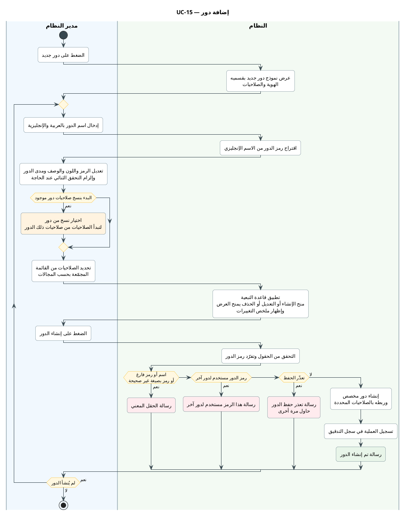

</div>

### UC-16: تعديل دور

**الفاعلون:** مدير النظام (ADM). **يوضّح المخطط:** تعديل بيانات الدور وصلاحياته مع حماية رمز دور النظام ونطاقه وصلاحية إدارة الأدوار، وتسجيل الصلاحيات المضافة والمزالة.

<div dir="ltr">

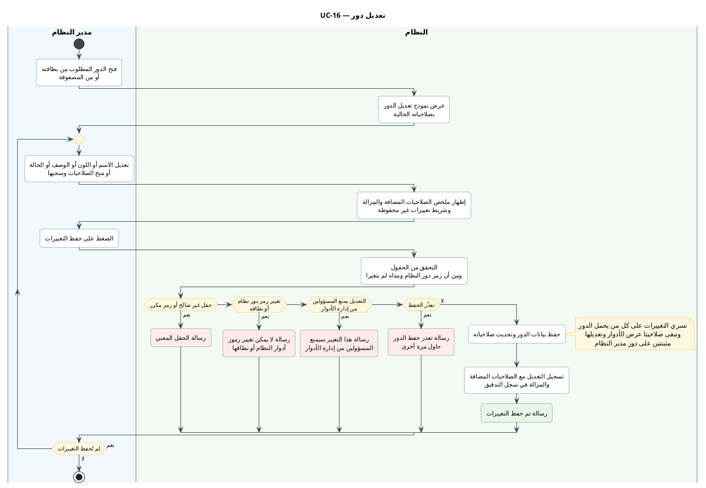

</div>

### UC-17: حذف دور

**الفاعلون:** مدير النظام (ADM). **يوضّح المخطط:** فحص أن الدور مخصص وبلا أعضاء، ثم حذفه مع فك ارتباط صلاحياته بعد تأكيد المدير وإعادة الفحص في الخادم، وبديل نقل الأعضاء أولاً.

<div dir="ltr">

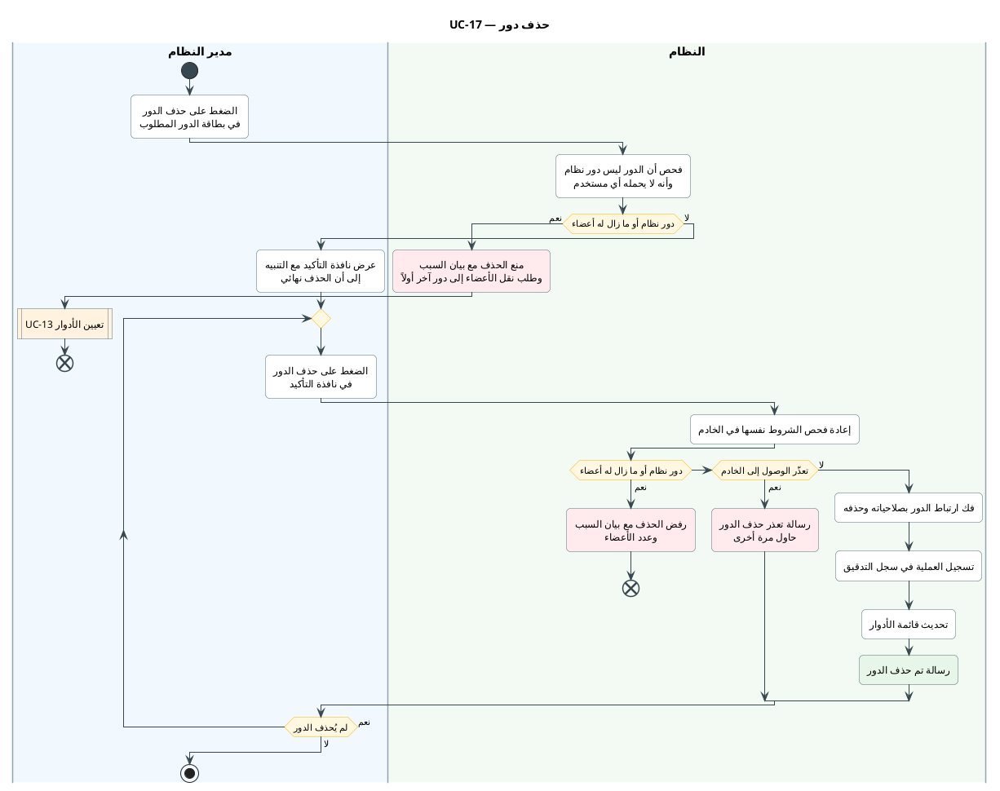

</div>

---

## الحزمة الثالثة: الموارد (Resources)

تغطي الحالات من UC-18 إلى UC-26.

### UC-18: إدارة القاعات

**الفاعلون:** منسق الجداول والموارد (CRD)، ويشاركه مدير النظام (ADM) الصلاحية نفسها. **يوضّح المخطط:** إضافة قاعة أو تعديلها (مع تضمّن حالة «تحديد سعة الامتحان» UC-19)، والتحقق من الحقول وتفرّد الرمز، وحذف قاعة ومنع الحذف إن كانت فيها محاضرات مجدولة.

<div dir="ltr">

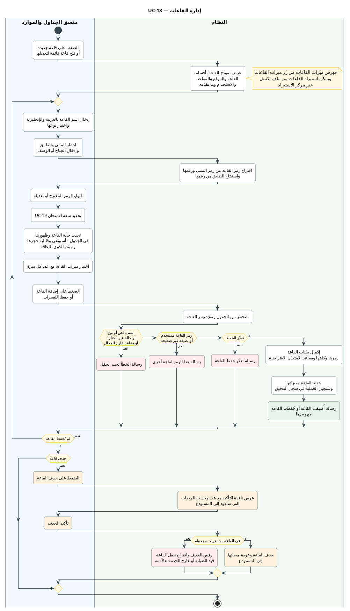

</div>

### UC-19: تحديد سعة الامتحان

**الفاعلون:** منسق الجداول والموارد (CRD). **يوضّح المخطط:** تحديد مقاعد الامتحان وخريطة المقاعد داخل نموذج القاعة والتحقق منها عند الحفظ. حالة مضمَّنة في UC-18.

<div dir="ltr">

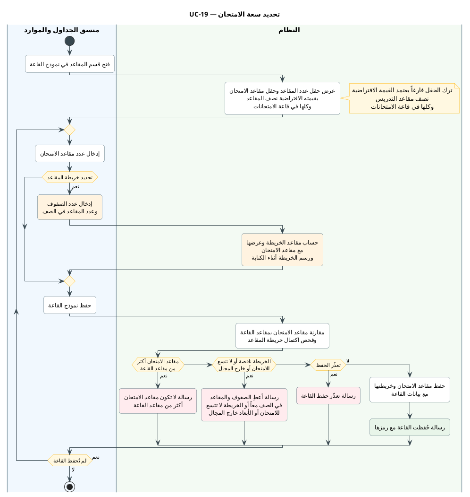

</div>

### UC-20: إدارة الأجهزة

**الفاعلون:** منسق الجداول والموارد (CRD)، ويشاركه مدير النظام (ADM) الصلاحية نفسها. **يوضّح المخطط:** إضافة صنف ووحداته بأرقام أصول فريدة، ونقل الوحدات أو تغيير حالتها، والإبلاغ عن عطل (يبدأ UC-22).

<div dir="ltr">

```plantuml
@startuml UC-20_manage_equipment_activity
' ===== النمط الموحّد (انسخه مع المخطط) =====
skinparam defaultFontName Tahoma
skinparam shadowing false
skinparam roundcorner 10
skinparam defaultTextAlignment center
skinparam ArrowColor #37474F
skinparam ActivityBackgroundColor #FFFFFF
skinparam ActivityBorderColor #546E7A
skinparam ActivityDiamondBackgroundColor #FFF8E1
skinparam ActivityDiamondBorderColor #FFB300
skinparam ActivityStartColor #37474F
skinparam ActivityEndColor #37474F
skinparam ActivityBarColor #37474F
skinparam NoteBackgroundColor #FFF8E1
skinparam NoteBorderColor #FFB300
skinparam SwimlaneBorderColor #90A4AE
skinparam SwimlaneTitleFontSize 14
skinparam SwimlaneTitleFontStyle bold
' ===== المخطط =====
title UC-20 — إدارة الأجهزة

|#F1F8FE|منسق الجداول والموارد|
|#F3FAF3|النظام|
|منسق الجداول والموارد|
start
:الضغط على معدّات جديدة;
|النظام|
:عرض نموذج الصنف
الاسم بالعربية والإنجليزية والفئة
والكلية وقابلية النقل;
note right
  تعديل الصنف يُحفظ على كل وحدات الصنف
  وعند الحذف يُعرض خيار الإخراج من الخدمة
  فتبقى الوحدات في السجل خارج القاعات
end note
|منسق الجداول والموارد|
repeat
  :إدخال بيانات الصنف واختيار فئته;
  :تحديد عدد الوحدات في المرة الواحدة
  من 1 إلى 500 وحدة وتفعيل قابلة للنقل
  إن كانت محمولة;
  |النظام|
  :عرض أرقام الأصول
  التي ستأخذها الوحدات الجديدة;
  |منسق الجداول والموارد|
  :الضغط على أضف الوحدات;
  |النظام|
  :التحقق من صحة الحقول;
  if (اسم فارغ أو فئة غير مختارة\nأو عدد وحدات خارج المجال) then (نعم)
    #FFEBEE:رسالة الخطأ تحت الحقل;
  elseif (رقم الأصل مستخدم\nأو الكفالة تنتهي قبل الشراء) then (نعم)
    #FFEBEE:رسالة هذا الرقم لوحدة أخرى;
  else (لا)
    :إنشاء الوحدات وإعطاء كل وحدة
    رقم أصلها الفريد;
    :تسجيل العملية في سجل التدقيق;
    #E8F5E9:رسالة أُضيفت المعدّات
    مع عدد الوحدات;
  endif
  |منسق الجداول والموارد|
repeat while (لم تُضف الوحدات) is (نعم) not (لا)
repeat
  :فتح الصنف واختيار وحدات منه
  ثم نقلها إلى قاعة أو المستودع
  أو تغيير حالتها;
  |النظام|
  if (نقل وحدة مُخرجة من الخدمة\nإلى قاعة) then (نعم)
    #FFEBEE:رسالة لا تدخل الوحدة المُخرجة
    من الخدمة أي قاعة أعدها إلى الخدمة أولاً;
  elseif (تعذّر الحفظ) then (نعم)
    #FFEBEE:رسالة تعذّر حفظ التغيير;
  else (لا)
    :حفظ المكان أو الحالة الجديدة;
    #E8F5E9:رسالة بنجاح العملية;
  endif
  |منسق الجداول والموارد|
repeat while (لم يُحفظ التغيير) is (نعم) not (لا)
if (الإبلاغ عن عطل في وحدة) then (نعم)
  #FFF3E0:UC-22 إدارة الصيانة|
endif
stop
@enduml
```

</div>

### UC-21: إدارة المختبرات

**الفاعلون:** منسق الجداول والموارد (CRD). **يوضّح المخطط:** عرض المختبرات وتعديل مقاعدها وحالتها وتجهيزاتها، والإبلاغ عن عطل (يبدأ UC-22)، وعرض معدات المختبر.

<div dir="ltr">

```plantuml
@startuml UC-21_manage_labs_activity
' ===== النمط الموحّد (انسخه مع المخطط) =====
skinparam defaultFontName Tahoma
skinparam shadowing false
skinparam roundcorner 10
skinparam defaultTextAlignment center
skinparam ArrowColor #37474F
skinparam ActivityBackgroundColor #FFFFFF
skinparam ActivityBorderColor #546E7A
skinparam ActivityDiamondBackgroundColor #FFF8E1
skinparam ActivityDiamondBorderColor #FFB300
skinparam ActivityStartColor #37474F
skinparam ActivityEndColor #37474F
skinparam ActivityBarColor #37474F
skinparam NoteBackgroundColor #FFF8E1
skinparam NoteBorderColor #FFB300
skinparam SwimlaneBorderColor #90A4AE
skinparam SwimlaneTitleFontSize 14
skinparam SwimlaneTitleFontStyle bold
' ===== المخطط =====
title UC-21 — إدارة المختبرات

|#F1F8FE|منسق الجداول والموارد|
|#F3FAF3|النظام|
|منسق الجداول والموارد|
start
:تصفية القاعات بنوع مختبرات وورش;
|النظام|
:عرض المختبرات بمقاعدها وحالتها وميزاتها
ونسبة المحجوز من أسبوع كل منها;
|منسق الجداول والموارد|
:فتح مختبر قائم
أو إضافة قاعة جديدة بنوع مختبر;
|النظام|
:عرض نموذج القاعة
مع التنبيهات الخاصة بالمختبرات;
|منسق الجداول والموارد|
repeat
  :تعديل مقاعد المختبر وحالته;
  :تسجيل ما يقدّمه المختبر من الفهرس مع العدد
  حواسيب وطاولات مخبرية ونقاط شبكة وجهاز عرض;
  :الضغط على حفظ التغييرات;
  |النظام|
  :التحقق من صحة الحقول;
  if (اسم ناقص أو مقاعد\nأو عدد ميزة خارج المجال) then (نعم)
    #FFEBEE:رسالة الاسم مطلوب باللغتين
    أو كل عدد بين واحد والحد الأعلى;
  elseif (تعذّر الحفظ) then (نعم)
    #FFEBEE:رسالة تعذّر حفظ القاعة;
  else (لا)
    :حفظ المختبر وميزاته
    وتسجيل العملية في سجل التدقيق;
    #E8F5E9:رسالة حُفظت القاعة مع رمزها;
  endif
  |منسق الجداول والموارد|
repeat while (لم يُحفظ المختبر) is (نعم) not (لا)
if (الإبلاغ عن عطل في هذه القاعة) then (نعم)
  #FFF3E0:UC-22 إدارة الصيانة|
  note right
    إن أوقف البلاغ الاستخدام
    خرج المختبر من الجدول والحجوزات
    حتى يُغلق
  end note
endif
if (عرض معدات المختبر) then (نعم)
  #FFF3E0:فتح صفحة الأجهزة والمعدات
  مصفّاة على وحدات هذا المختبر;
endif
stop
@enduml
```

</div>

### UC-22: إدارة الصيانة

**الفاعلون:** منسق الجداول والموارد (CRD). **يوضّح المخطط:** تسجيل بلاغ عطل، وإخراج المورد من الاستخدام إن كان البلاغ مانعاً، ومتابعة البلاغ حتى إصلاحه، وبلاغ المدرّس عن قاعة محاضرته وقرار المنسق.

<div dir="ltr">

```plantuml
@startuml UC-22_manage_maintenance_activity
' ===== النمط الموحّد (انسخه مع المخطط) =====
skinparam defaultFontName Tahoma
skinparam shadowing false
skinparam roundcorner 10
skinparam defaultTextAlignment center
skinparam ArrowColor #37474F
skinparam ActivityBackgroundColor #FFFFFF
skinparam ActivityBorderColor #546E7A
skinparam ActivityDiamondBackgroundColor #FFF8E1
skinparam ActivityDiamondBorderColor #FFB300
skinparam ActivityStartColor #37474F
skinparam ActivityEndColor #37474F
skinparam ActivityBarColor #37474F
skinparam NoteBackgroundColor #FFF8E1
skinparam NoteBorderColor #FFB300
skinparam SwimlaneBorderColor #90A4AE
skinparam SwimlaneTitleFontSize 14
skinparam SwimlaneTitleFontStyle bold
' ===== المخطط =====
title UC-22 — إدارة الصيانة

|#F1F8FE|منسق الجداول والموارد|
|#F3FAF3|النظام|
|منسق الجداول والموارد|
start
:الضغط على الإبلاغ عن عطل;
|النظام|
:عرض نموذج بلاغ جديد;
|منسق الجداول والموارد|
repeat
  :اختيار القاعة أو الجهاز بالبحث
  بالرمز أو رقم الأصل أو الاسم;
  :كتابة المشكلة وتحديد النوع والأولوية
  والتفاصيل ومن يصلحه;
  :تحديد هل يوقف البلاغ الاستخدام
  ومتى يبدأ ومتى يُتوقع أن ينتهي;
  :الضغط على سجّل البلاغ;
  |النظام|
  :التحقق من صحة الحقول;
  if (لم تُختر القاعة أو الجهاز\nأو لم تُكتب المشكلة) then (نعم)
    #FFEBEE:رسالة اختر القاعة أو الجهاز
    أو اكتب المشكلة;
  elseif (العودة المتوقعة قبل\nبدء الاستخدام الموقوف) then (نعم)
    #FFEBEE:رسالة لا يعود قبل أن يبدأ;
  elseif (الجهاز المختار\nمُخرج من الخدمة) then (نعم)
    #FFEBEE:رسالة هذا الجهاز مُخرج من الخدمة;
  elseif (تعذّر الحفظ) then (نعم)
    #FFEBEE:رسالة تعذّر حفظ البلاغ;
  else (لا)
    :تسجيل البلاغ برقم مرجعي
    بحالة مبلَّغ عنه;
    if (البلاغ مانع\nللاستخدام وحان وقته) then (نعم)
      :إخراج القاعة أو الجهاز من الاستخدام
      وإبلاغ المنسقين;
    else (لا)
      #FFF3E0:تسجيل البلاغ مخطّطاً
      ليأخذ المورد عند حلول وقته تلقائياً;
    endif
    :إظهار المحاضرات التي يضعها الجدول المنشور
    في القاعة مع قاعات شاغرة تناسب كلاً منها;
  endif
  |منسق الجداول والموارد|
repeat while (لم يُسجَّل البلاغ) is (نعم) not (لا)
:الضغط على تولَّ العمل عليه;
|النظام|
:تحويل حالة البلاغ إلى يُعمل عليه;
|منسق الجداول والموارد|
:الضغط على أُصلح وكتابة ما أُنجز;
|النظام|
if (البلاغ مغلق أو نقله مستخدم آخر\nإلى مرحلة أخرى) then (نعم)
  #FFEBEE:رسالة هذا البلاغ مغلق
  أو أعد تحميله لترى أين وصل;
  end
else (لا)
  :إغلاق البلاغ وتسجيل الانتقال;
  :إعادة القاعة أو الجهاز إلى الاستخدام
  ما لم يُبقِه بلاغ آخر خارجه;
  #E8F5E9:رسالة أُغلق البلاغ بالإصلاح;
endif
if (بلاغ مدرّس عن قاعة محاضرته) then (نعم)
  #FFF3E0:إشعار عاجل للمنسقين
  وظهور المحاضرة بانتظار قرار;
  |منسق الجداول والموارد|
  #FFF3E0:اختيار نقل موعد المحاضرة إلى قاعة شاغرة
  أو إلغائه أو إبقائها في قاعتها;
  |النظام|
  #FFF3E0:تنفيذ القرار وإبلاغ المدرّس والطلاب;
endif
stop
@enduml
```

</div>

### UC-23: عرض الموارد

**الفاعلون:** عضو هيئة التدريس (INS)، موظف (EMP). **يوضّح المخطط:** البحث عن قاعة شاغرة بحسب التاريخ والوقت والحضور والنوع والميزات، وعرض يوم القاعة، ومنه يبدأ UC-24 أو UC-26.

<div dir="ltr">

```plantuml
@startuml UC-23_view_resources_activity
' ===== النمط الموحّد (انسخه مع المخطط) =====
skinparam defaultFontName Tahoma
skinparam shadowing false
skinparam roundcorner 10
skinparam defaultTextAlignment center
skinparam ArrowColor #37474F
skinparam ActivityBackgroundColor #FFFFFF
skinparam ActivityBorderColor #546E7A
skinparam ActivityDiamondBackgroundColor #FFF8E1
skinparam ActivityDiamondBorderColor #FFB300
skinparam ActivityStartColor #37474F
skinparam ActivityEndColor #37474F
skinparam ActivityBarColor #37474F
skinparam NoteBackgroundColor #FFF8E1
skinparam NoteBorderColor #FFB300
skinparam SwimlaneBorderColor #90A4AE
skinparam SwimlaneTitleFontSize 14
skinparam SwimlaneTitleFontStyle bold
' ===== المخطط =====
title UC-23 — عرض الموارد

|#F1F8FE|عضو هيئة التدريس أو الموظف|
|#F3FAF3|النظام|
|عضو هيئة التدريس أو الموظف|
start
:فتح صفحة حجوزاتي للقاعات
والانتقال إلى ابحث عن قاعة;
|النظام|
:عرض نموذج البحث عن قاعة شاغرة;
|عضو هيئة التدريس أو الموظف|
repeat
  :اختيار التاريخ ووقتي البدء والانتهاء;
  :إدخال عدد الحضور واختيار نوع القاعة;
  if (تحديد الميزات أو المبنى\nأو حصر النتائج في الحجز الفوري) then (نعم)
    #FFF3E0:تحديد الميزات المطلوبة والمبنى;
  endif
  |النظام|
  :التحقق من صحة التاريخ والوقت وعدد الحضور;
  if (تاريخ مضى أو وقت\nانتهاء لا يلي البدء\nأو عدد حضور غير صحيح) then (نعم)
    #FFEBEE:رسالة الخطأ المناسبة
    والعودة إلى معايير البحث;
  elseif (تعذّر البحث) then (نعم)
    #FFEBEE:رسالة تعذّر البحث حاول مجدداً;
  else (لا)
    :البحث عن القاعات التي في الخدمة
    وتتسع للحضور ولا تشغلها محاضرة
    أو حجز أو صيانة;
    if (لا توجد قاعة شاغرة) then (نعم)
      #FFEBEE:رسالة لا قاعة شاغرة في هذا الوقت
      جرّب وقتاً آخر أو عدداً أقل من الحضور;
    else (لا)
      :عرض القاعات الشاغرة مرتبة
      ما يُحجز فوراً أولاً ثم الأصغر المناسبة;
    endif
  endif
  |عضو هيئة التدريس أو الموظف|
repeat while (لم تظهر قاعات شاغرة) is (نعم) not (لا)
:فتح قاعة لعرض يومها كاملاً;
|النظام|
:عرض شريط اليوم للقاعة
محاضرات وحجوزات وصيانة وأوقات شاغرة;
|عضو هيئة التدريس أو الموظف|
if (الإجراء التالي) then (حجز القاعة)
  #FFF3E0:UC-26 حجز قاعة دراسية|
else (طلب مورد إضافي)
  #FFF3E0:UC-24 طلب موارد إضافية|
endif
stop
@enduml
```

</div>

### UC-24: طلب موارد إضافية

**الفاعلون:** عضو هيئة التدريس (INS)، ومنسق الجداول والموارد (CRD) جهةً تراجع الطلب. **يوضّح المخطط:** تعبئة طلب مورد لمحاضرة منشورة والتحقق منه وتسجيله وإشعار المنسقين، ثم مراجعته (UC-25) وتعديل الطلب أو سحبه.

<div dir="ltr">

```plantuml
@startuml UC-24_request_resources_activity
' ===== النمط الموحّد (انسخه مع المخطط) =====
skinparam defaultFontName Tahoma
skinparam shadowing false
skinparam roundcorner 10
skinparam defaultTextAlignment center
skinparam ArrowColor #37474F
skinparam ActivityBackgroundColor #FFFFFF
skinparam ActivityBorderColor #546E7A
skinparam ActivityDiamondBackgroundColor #FFF8E1
skinparam ActivityDiamondBorderColor #FFB300
skinparam ActivityStartColor #37474F
skinparam ActivityEndColor #37474F
skinparam ActivityBarColor #37474F
skinparam NoteBackgroundColor #FFF8E1
skinparam NoteBorderColor #FFB300
skinparam SwimlaneBorderColor #90A4AE
skinparam SwimlaneTitleFontSize 14
skinparam SwimlaneTitleFontStyle bold
' ===== المخطط =====
title UC-24 — طلب موارد إضافية

|#F1F8FE|عضو هيئة التدريس|
|#F3FAF3|النظام|
|#FFFBF0|منسق الجداول والموارد|
|عضو هيئة التدريس|
start
:الضغط على طلب جديد
أو على طلب مورد من تفاصيل المحاضرة;
|النظام|
:عرض نموذج طلب مورد;
|عضو هيئة التدريس|
repeat
  :اختيار المحاضرة وما يحتاجه
  من قاعة أو تجهيزات أو شيء آخر;
  :تحديد التفاصيل بحسب النوع;
  |النظام|
  :عرض مواعيد المحاضرة القادمة
  التي يمكن الطلب لها دون العطل
  وأسابيع الامتحانات والمواعيد الملغاة;
  |عضو هيئة التدريس|
  :تحديد موعد واحد أو عدة أسابيع
  وكتابة سبب الحاجة;
  :الضغط على أرسل الطلب;
  |النظام|
  :التحقق من الحقول والمحاضرة والمواعيد
  ومن العدد المطلوب وعدم وجود طلب مماثل;
  if (حقل ناقص أو عدد غير صحيح\nأو أكبر من القطع الموجودة\nأو لم يُذكر السبب) then (نعم)
    #FFEBEE:رسالة الخطأ المناسبة
    والعودة إلى النموذج;
  elseif (المحاضرة ليست في جدول منشور\nأو لا مواعيد في التواريخ) then (نعم)
    #FFEBEE:رسالة السبب والعودة
    إلى اختيار الموعد;
  elseif (طلب مماثل ما زال\nبانتظار الرد) then (نعم)
    #FFEBEE:رسالة سبق أن طلبت هذا
    مع رقمه المرجعي;
    end
  elseif (تعذّر الحفظ) then (نعم)
    #FFEBEE:رسالة تعذّر حفظ الطلب;
  else (لا)
    :تسجيل الطلب برقم مرجعي
    بحالة بانتظار الرد;
    :إشعار المنسقين بالطلب وبشكل أعجل
    إن كان أول موعد خلال ثلاثة أيام;
    #E8F5E9:رسالة أُرسل الطلب إلى المنسّق;
  endif
  |عضو هيئة التدريس|
repeat while (لم يُرسل الطلب) is (نعم) not (لا)
|منسق الجداول والموارد|
:استلام إشعار بطلب مورد جديد;
:UC-25 معالجة طلبات الموارد|
|عضو هيئة التدريس|
if (تعديل الطلب أو سحبه) then (نعم)
  #FFF3E0:تعديل الطلب أو سحبه
  ما دام بانتظار الرد;
endif
stop
@enduml
```

</div>

### UC-25: معالجة طلبات الموارد

**الفاعلون:** منسق الجداول والموارد (CRD)، وعضو هيئة التدريس (INS) يتلقى الرد. **يوضّح المخطط:** مراجعة الطلب وقبوله بتخصيص قاعة أو قطع شاغرة (مع قفل المورد) أو رفضه بسبب، وإشعار المدرّس والطلاب، ثم إنجاز الطلب.

<div dir="ltr">

```plantuml
@startuml UC-25_process_resource_requests_activity
' ===== النمط الموحّد (انسخه مع المخطط) =====
skinparam defaultFontName Tahoma
skinparam shadowing false
skinparam roundcorner 10
skinparam defaultTextAlignment center
skinparam ArrowColor #37474F
skinparam ActivityBackgroundColor #FFFFFF
skinparam ActivityBorderColor #546E7A
skinparam ActivityDiamondBackgroundColor #FFF8E1
skinparam ActivityDiamondBorderColor #FFB300
skinparam ActivityStartColor #37474F
skinparam ActivityEndColor #37474F
skinparam ActivityBarColor #37474F
skinparam NoteBackgroundColor #FFF8E1
skinparam NoteBorderColor #FFB300
skinparam SwimlaneBorderColor #90A4AE
skinparam SwimlaneTitleFontSize 14
skinparam SwimlaneTitleFontStyle bold
' ===== المخطط =====
title UC-25 — معالجة طلبات الموارد

|#F1F8FE|منسق الجداول والموارد|
|#F3FAF3|النظام|
|منسق الجداول والموارد|
start
:اختيار طلب من قائمة بانتظار الرد;
|النظام|
:عرض لوحة المراجعة
المحاضرة ومواعيد الطلب وسببه;
:عرض القاعات الشاغرة من النوع المطلوب
في كل المواعيد القادمة أو القطع المتاحة;
if (لا قاعة شاغرة ولا قطعة متاحة) then (نعم)
  #FFEBEE:رسالة لا قاعة من هذا النوع شاغرة
  في كل المواعيد القادمة
  ارفضه بكلمة أو اطلب مواعيد أخرى;
endif
|منسق الجداول والموارد|
if (قرار المنسق) then (قبول الطلب)
  repeat
    :اختيار القاعة أو القطع المراد تخصيصها
    وكتابة كلمة للمدرّس;
    :الضغط على اقبله;
    |النظام|
    :قفل القاعة أو القطع والتحقق من أنها
    ما زالت شاغرة في كل المواعيد القادمة;
    if (لم يُختر شيء للتخصيص\nأو لم تعد شاغرة) then (نعم)
      #FFEBEE:رسالة تبيّن السبب
      وإعادة قراءة القائمة لاختيار غيرها;
    elseif (ردّ مستخدم آخر على الطلب\nأو سحبه المدرّس) then (نعم)
      #FFEBEE:رسالة ردّ أحد آخر على هذا الطلب
      أعد تحميله لترى أين وصل;
      end
    elseif (تعذّر الحفظ) then (نعم)
      #FFEBEE:رسالة تعذّر حفظ الطلب;
    else (لا)
      :تخصيص القاعة لتلك المواعيد
      أو حجز القطع
      وتغيير حالة الطلب إلى مقبول;
      :تسجيل الخطوة في سجل الطلب;
      #E8F5E9:رسالة قُبل الطلب وأُعلم المدرّس;
    endif
    |منسق الجداول والموارد|
  repeat while (لم يُقبل الطلب) is (نعم) not (لا)
  |النظام|
  :إشعار المدرّس بالقبول مع القاعة
  أو العدد وكلمة المنسق
  وإبلاغ طلاب الشعبة إن انتقلت محاضراتهم;
else (رفض الطلب)
  |منسق الجداول والموارد|
  #FFF3E0:كتابة سبب الرفض الإلزامي
  ثم الضغط على ارفضه وأعلم المدرّس;
  |النظام|
  #FFF3E0:تغيير حالة الطلب إلى مرفوض
  وتسجيل السبب وإشعار المدرّس به;
endif
|النظام|
:عدّ الطلب المقبول منجزاً تلقائياً
بعد انتهاء مواعيده أو بضغط المنسق
على عُدّه منجزاً;
note right
  يُعلَّم الطلب المقبول إن خرجت قاعته
  من الاستخدام أو لم تعد محاضرته
  في الجدول
end note
stop
@enduml
```

</div>

### UC-26: حجز قاعة دراسية

**الفاعلون:** موظف (EMP)، أمين المكتبة (LIB)، ومن لديه صلاحية الحجز من أعضاء هيئة التدريس وغيرهم. **يوضّح المخطط:** حجز قاعة لمرة واحدة أو أسبوعياً، وقفل القاعة والتحقق من خلوها، وتأكيد الحجز فوراً أو انتظار المنسق.

<div dir="ltr">

```plantuml
@startuml UC-26_book_room_activity
' ===== النمط الموحّد (انسخه مع المخطط) =====
skinparam defaultFontName Tahoma
skinparam shadowing false
skinparam roundcorner 10
skinparam defaultTextAlignment center
skinparam ArrowColor #37474F
skinparam ActivityBackgroundColor #FFFFFF
skinparam ActivityBorderColor #546E7A
skinparam ActivityDiamondBackgroundColor #FFF8E1
skinparam ActivityDiamondBorderColor #FFB300
skinparam ActivityStartColor #37474F
skinparam ActivityEndColor #37474F
skinparam ActivityBarColor #37474F
skinparam NoteBackgroundColor #FFF8E1
skinparam NoteBorderColor #FFB300
skinparam SwimlaneBorderColor #90A4AE
skinparam SwimlaneTitleFontSize 14
skinparam SwimlaneTitleFontStyle bold
' ===== المخطط =====
title UC-26 — حجز قاعة دراسية

|#F1F8FE|المستخدم صاحب الحجز|
|#F3FAF3|النظام|
|#FFFBF0|منسق الجداول والموارد|
|المستخدم صاحب الحجز|
start
:UC-23 عرض الموارد|
:الضغط على احجز أو اطلب الحجز
أمام القاعة المطلوبة;
|النظام|
:عرض نموذج حجز قاعة
مع شريط اليوم الكامل والوقت المختار;
note right
  يُسجَّل الحضور بدءاً من ربع ساعة
  قبل بداية الحجز وإن لم يُسجَّل
  بعد ربع ساعة من البدء حُرّرت القاعة
  ويلغي المستخدم حجزاً واحداً
  أو كل الأسابيع المتبقية
end note
|المستخدم صاحب الحجز|
repeat
  :كتابة المناسبة واختيار الغرض وعدد الحضور;
  :اختيار التكرار هذا اليوم فقط
  أو أسبوعياً حتى تاريخ محدد;
  :كتابة ملاحظات للمنسق اختيارياً
  ثم الضغط على احجز أو أرسل الطلب;
  |النظام|
  :التحقق من المناسبة والغرض وعدد الحضور
  ضمن سعة القاعة والوقت ومدته;
  if (تاريخ مضى أو مدة\nأكثر من 12 ساعة\nأو مناسبة فارغة\nأو حضور فوق السعة) then (نعم)
    #FFEBEE:رسالة الخطأ
    والعودة إلى بيانات الحجز;
  elseif (القاعة خارج الخدمة) then (نعم)
    #FFEBEE:رسالة القاعة خارج الخدمة;
  else (لا)
    :قفل القاعة والتحقق من خلوها
    من محاضرة أو حجز أو صيانة;
    if (القاعة مشغولة في ذلك الوقت) then (نعم)
      #FFEBEE:رسالة القاعة محجوزة حينها
      مع بيان ما يشغلها وزر حجز الأسابيع
      الشاغرة في الحجز الأسبوعي;
    elseif (تعذّر الحفظ) then (نعم)
      #FFEBEE:رسالة تعذّر حفظ الحجز;
    else (لا)
      if (القاعة قابلة للحجز) then (نعم)
        :تسجيل الحجز مؤكَّداً فوراً
        برقم مرجعي;
      else (لا)
        #FFF3E0:تسجيل الحجز بانتظار التأكيد
        وإشعار المنسقين;
      endif
      :إضافة الحجز إلى حجوزات المستخدم وتقويمه;
      #E8F5E9:رسالة حُجزت القاعة مع المرجع
      أو أُرسل طلب الحجز وسيردّ المنسق;
    endif
  endif
  |المستخدم صاحب الحجز|
repeat while (لم يُسجَّل الحجز) is (نعم) not (لا)
|منسق الجداول والموارد|
if (الحجز بانتظار التأكيد) then (نعم)
  #FFF3E0:تأكيد الحجز أو رفضه
  مع سبب إلزامي;
  |النظام|
  #FFF3E0:إشعار صاحب الحجز بالرد;
endif
stop
@enduml
```

</div>

---

## الحزمة الرابعة: الجدولة (Scheduling)

تغطي الحالات من UC-27 إلى UC-33.

### UC-27: إدخال أوقات التفرّغ

**الفاعلون:** عضو هيئة التدريس (INS). **يوضّح المخطط:** تلوين أسبوع المدرّس للفصل بالفرشاة (مفضّل ومتاح ومغلق)، والتحقق من نافذة التفرّغ وصلاحية المواضع، وحفظه مسودة أو تسليمه مع إشعار المنسقين.

<div dir="ltr">

```plantuml
@startuml UC-27_enter_availability_activity
' ===== النمط الموحّد (انسخه مع المخطط) =====
skinparam defaultFontName Tahoma
skinparam shadowing false
skinparam roundcorner 10
skinparam defaultTextAlignment center
skinparam ArrowColor #37474F
skinparam ActivityBackgroundColor #FFFFFF
skinparam ActivityBorderColor #546E7A
skinparam ActivityDiamondBackgroundColor #FFF8E1
skinparam ActivityDiamondBorderColor #FFB300
skinparam ActivityStartColor #37474F
skinparam ActivityEndColor #37474F
skinparam ActivityBarColor #37474F
skinparam NoteBackgroundColor #FFF8E1
skinparam NoteBorderColor #FFB300
skinparam SwimlaneBorderColor #90A4AE
skinparam SwimlaneTitleFontSize 14
skinparam SwimlaneTitleFontStyle bold
' ===== المخطط =====
title UC-27 — إدخال أوقات التفرّغ

|#F1F8FE|عضو هيئة التدريس|
|#F3FAF3|النظام|
|عضو هيئة التدريس|
start
:فتح صفحة أوقات تفرّغي
من مجموعة مساحتي;
|النظام|
:عرض الفصول التي تُجمع أوقات تفرّغها
مع حالة أسبوع المدرّس ونافذة التفرّغ;
note right
  إن كان أسبوع الفصل فارغاً
  يعرض النظام البدء من فصل سابق
  ويصبح الأسبوع المعدَّل بعد تسليمه
  مسودة حتى يُسلَّم من جديد
end note
|عضو هيئة التدريس|
:اختيار الفصل;
|النظام|
:عرض شبكة الأسبوع
وساعات التدريس المسندة للمدرّس;
|عضو هيئة التدريس|
repeat
  :تلوين الشبكة بالفرشاة
  مفضّل أو متاح أو مغلق;
  :اختيار سبب كل وقت مغلق
  وكتابة كلمة للمنسق;
  |النظام|
  :حساب الساعات المتاحة والمفضّلة
  والمغلقة ومقارنتها بساعات التدريس;
  if (الساعات المتاحة لا تكفي\nأو ساعات مغلقة بلا سبب) then (نعم)
    #FFF3E0:تحذير قبل الحفظ
    ويترك القرار للمدرّس;
  endif
  |عضو هيئة التدريس|
  :الضغط على تسليم
  أو على حفظ مسودة;
  |النظام|
  :التحقق من نافذة التفرّغ
  ومن صلاحية المواضع;
  if (النافذة مغلقة أو الفصل مغلق\nأو يُجمع لفصل آخر) then (نعم)
    #FFEBEE:رسالة السبب
    ويبقى الأسبوع للقراءة فقط;
    end
  elseif (موضع في يوم لا تدريس فيه\nأو داخل استراحة أو متداخل) then (نعم)
    #FFEBEE:رسالة رفض الخادم الحفظ
    مع بيان سبب كل موضع;
  elseif (تعذّر الحفظ) then (نعم)
    #FFEBEE:رسالة تعذّر حفظ أوقات تفرّغك;
  else (لا)
    :حفظ مواضع الأسبوع للفصل;
    if (تسليم الأسبوع) then (نعم)
      :تحويل الأسبوع إلى مسلَّم
      مع وقت التسليم;
      :إشعار المنسقين بالتسليم
      مرة واحدة خلال نصف ساعة;
      #E8F5E9:رسالة سُلّم أسبوعك وأُخبر المنسق;
    else (لا)
      #FFF3E0:حفظ الأسبوع مسودة
      خاصة بالمدرّس;
      #E8F5E9:رسالة حُفظ أسبوعك مسودة;
    endif
  endif
  |عضو هيئة التدريس|
repeat while (لم يُحفظ الأسبوع) is (نعم) not (لا)
stop
@enduml
```

</div>

### UC-28: متابعة أوقات تفرّغ المدرّسين وتذكيرهم

**الفاعلون:** منسق الجداول والموارد (CRD)، رئيس القسم (HOD)، عميد الكلية (DEN)، وموظف الشؤون الأكاديمية (ACO) للمتابعة فقط. **يوضّح المخطط:** تحميل التوفّر ضمن نطاق المستخدم، وفتح أسبوع مدرّس للقراءة، وإرسال تذكير لمن لم يسلّم مع تجاوز من سلّم أو ذُكّر حديثاً.

<div dir="ltr">

```plantuml
@startuml UC-28_follow_availability_activity
' ===== النمط الموحّد (انسخه مع المخطط) =====
skinparam defaultFontName Tahoma
skinparam shadowing false
skinparam roundcorner 10
skinparam defaultTextAlignment center
skinparam ArrowColor #37474F
skinparam ActivityBackgroundColor #FFFFFF
skinparam ActivityBorderColor #546E7A
skinparam ActivityDiamondBackgroundColor #FFF8E1
skinparam ActivityDiamondBorderColor #FFB300
skinparam ActivityStartColor #37474F
skinparam ActivityEndColor #37474F
skinparam ActivityBarColor #37474F
skinparam NoteBackgroundColor #FFF8E1
skinparam NoteBorderColor #FFB300
skinparam SwimlaneBorderColor #90A4AE
skinparam SwimlaneTitleFontSize 14
skinparam SwimlaneTitleFontStyle bold
' ===== المخطط =====
title UC-28 — متابعة أوقات تفرّغ المدرّسين وتذكيرهم

|#F1F8FE|المنسق أو رئيس القسم أو العميد|
|#F3FAF3|النظام|
|المنسق أو رئيس القسم أو العميد|
start
:فتح صفحة توفّر المدرّسين
من مجموعة الجدولة;
|النظام|
:التحقق من صلاحية متابعة التوفّر;
if (لا يملك صلاحية المتابعة) then (نعم)
  #FFEBEE:التحويل إلى صفحة لا صلاحية;
  end
else (لا)
  repeat
    :تحديد الفصل الذي تُجمع أوقاته
    وتحميل مدرّسي كليته أو قسمه وأسابيعهم;
    if (لا فصل لمتابعة التوفّر فيه) then (نعم)
      #FFEBEE:رسالة لا فصل لمتابعة التوفّر فيه;
      end
    elseif (فشل التحميل بسبب\nانقطاع الاتصال أو خطأ) then (نعم)
      #FFEBEE:رسالة تعذّر تحميل التوفّر
      مع زر إعادة المحاولة;
    endif
  repeat while (فشل التحميل) is (إعادة المحاولة) not (تم التحميل)
  :عرض عدد من سلّم ومن لديه مسودة
  ومن لم يبدأ ومن لا تتسع ساعاته
  والخريطة الحرارية وقائمة المدرّسين;
  note right
    يذكّر النظام من لم يسلّم تلقائياً
    مرة بين ثلاثة أيام ويوم قبل الإغلاق
  end note
endif
|المنسق أو رئيس القسم أو العميد|
:تصفية القائمة بالحالة أو القسم
أو البحث بالاسم أو الترتيب;
:فتح أسبوع مدرّس بعينه;
|النظام|
:عرض أسبوعه للقراءة فقط
الشبكة والأوقات المغلقة وأسبابها
وكلمته للمنسق والتذكيرات السابقة;
|المنسق أو رئيس القسم أو العميد|
if (يملك صلاحية التذكير) then (نعم)
  :الضغط على تذكير أمام مدرّس لم يسلّم
  أو على تذكير من لم يسلّم;
  |النظام|
  :التحقق من أن المدرّس ضمن نطاق المستخدم
  ولم يسلّم ومرور 12 ساعة على آخر تذكير;
  if (المدرّس خارج النطاق أو سلّم\nأو ذُكّر قبل أقل من 12 ساعة) then (نعم)
    #FFEBEE:رسالة ذُكّروا قبل قليل
    ولم يُرسل تذكير جديد
    أو لا أحد يحتاج تذكيراً الجميع سلّم;
  elseif (تعذّر إرسال التذكير) then (نعم)
    #FFEBEE:رسالة تعذّر إرسال التذكير
    حاول مرة أخرى;
  else (لا)
    :إرسال إشعار إلى المدرّس داخل التطبيق
    وفورياً يطلب تسليم الأسبوع
    مع موعد إغلاق النافذة;
    :تسجيل التذكير;
    #E8F5E9:رسالة ذُكّر مدرّس واحد
    أو ذُكّر عدد من المدرّسين;
  endif
else (لا)
  #FFF3E0:الاطلاع على أسابيع المدرّسين فقط
  دون صلاحية التذكير;
endif
stop
@enduml
```

</div>

### UC-29: توليد الجدول الدراسي

**الفاعلون:** منسق الجداول والموارد (CRD). **يوضّح المخطط:** طلب التوليد وإضافته إلى الطابور، وتنفيذه في الخلفية بمحرك الجدولة (الخوارزمية الجينية أو التراجع والتتبع) مع متابعة الواجهة للحالة، ثم مراجعة الناتج وإضافته إلى نسخة الجدول.

<div dir="ltr">

```plantuml
@startuml UC-29_generate_schedule_activity
' ===== النمط الموحّد (انسخه مع المخطط) =====
skinparam defaultFontName Tahoma
skinparam shadowing false
skinparam roundcorner 10
skinparam defaultTextAlignment center
skinparam ArrowColor #37474F
skinparam ActivityBackgroundColor #FFFFFF
skinparam ActivityBorderColor #546E7A
skinparam ActivityDiamondBackgroundColor #FFF8E1
skinparam ActivityDiamondBorderColor #FFB300
skinparam ActivityStartColor #37474F
skinparam ActivityEndColor #37474F
skinparam ActivityBarColor #37474F
skinparam NoteBackgroundColor #FFF8E1
skinparam NoteBorderColor #FFB300
skinparam SwimlaneBorderColor #90A4AE
skinparam SwimlaneTitleFontSize 14
skinparam SwimlaneTitleFontStyle bold
' ===== المخطط =====
title UC-29 — توليد الجدول الدراسي

|#F1F8FE|منسق الجداول والموارد|
|#F3FAF3|النظام|
|#FFFBF0|المجدول ومحرك الجدولة|
|منسق الجداول والموارد|
start
:فتح صفحة الجدول الأسبوعي
والتأكد من النسخة المعروضة على اللوح;
repeat
  :اختيار نطاق التوليد في استوديو التوليد
  كل الكليات أو كلية أو قسم;
  :اختيار الخوارزمية الجينية
  أو خوارزمية التراجع والتتبع;
  :الضغط على توليد جدول;
  |النظام|
  if (لا يملك صلاحية التوليد) then (نعم)
    #FFEBEE:رفض الطلب برسالة
    لا تملك صلاحية تنفيذ هذا;
    end
  elseif (تعذّر الوصول إلى الخادم) then (نعم)
    #FFEBEE:رسالة تعذر بدء المولّد
    تحقق من إعدادات الجدول ثم أعد المحاولة;
    end
  else (لا)
    :حفظ طلب التوليد في الطابور
    وتسجيله في سجل التدقيق;
    :عرض شاشة جارٍ بناء أسبوعك
    بحالة الطلب وترتيبه في الطابور;
  endif
  fork
    |النظام|
    repeat
      :متابعة حالة المهمة
      كل بضع ثوانٍ;
    repeat while (لم تنتهِ المهمة) is (نعم) not (لا)
  fork again
    |المجدول ومحرك الجدولة|
    :أخذ أقدم طلب في الانتظار
    وتشغيل الخوارزمية المختارة
    على الشعب والقاعات والقيود;
    if (قواعد الجدولة غير مكتملة\nأو لا جدول يحقق القيود الصارمة\nأو تجاوز الوقت المسموح) then (نعم)
      #FFEBEE:تسجيل الفشل مع السبب
      وعدد القيود الصارمة غير المحققة;
    else (لا)
      :وضع المحاضرات بما يحقق القيود الصارمة
      ويقلل عقوبة القيود المرنة;
      :التحقق من الجدول الناتج
      بمدقق القيود الصارمة;
      :حفظ النتيجة وتسجيلها
      في سجل التدقيق;
    endif
    :إشعار المنسق بجاهزية الجدول
    أو بفشل التوليد;
  end fork
  |منسق الجداول والموارد|
  if (فشل التوليد) then (نعم)
    #FFEBEE:رسالة لم يُعثر على جدول صالح
    أو استغرق التوليد وقتاً طويلاً
    فأُوقف أو فشلت عملية التوليد;
  else (لا)
    :معاينة الجدول المولَّد
    مقابل المسودة الحالية;
  endif
repeat while (فشل التوليد) is (نعم) not (لا)
:مراجعة المقاييس الخوارزمية وزمن الحل
والانتهاكات والملاءمة والجلسات المتغيرة;
if (تعديل محاضرات المعاينة) then (نعم)
  #FFF3E0:سحب محاضرات المعاينة وإفلاتها;
endif
if (الإجراء المطلوب) then (إضافته إلى النسخة)
  :الضغط على إضافته إلى النسخة;
  |النظام|
  if (النسخة لا تقبل التعديل\nأو خارج النطاق أو تغيّرت) then (نعم)
    #FFEBEE:رسالة السبب مع إضافة الجدول
    إلى مسودة جديدة إن لم تعد
    النسخة قابلة للتعديل;
  elseif (فشل التحقق النهائي\nمن القيود الصارمة) then (نعم)
    #FFEBEE:رسالة الأخطاء والعودة
    إلى المعاينة;
    end
  else (لا)
    :حفظ المحاضرات وتحديث النسخة
    وتوزيع الطلاب;
    #E8F5E9:رسالة أُضيف الجدول المولَّد إلى النسخة
    يُراجع ثم يُرسل للاعتماد;
  endif
else (تجاهل الناتج)
  |منسق الجداول والموارد|
  #FFF3E0:الضغط على إلغاء المعاينة
  فلا يتغير شيء في المسودة;
endif
stop
@enduml
```

</div>

### UC-30: إرسال الجدول للاعتماد

**الفاعلون:** منسق الجداول والموارد (CRD)، وموظف الشؤون الأكاديمية (ACO) جهةً تستقبل الطلب. **يوضّح المخطط:** تشغيل قائمة التحقق ثم الإرسال للاعتماد بعد اجتيازها، وإشعار الشؤون الأكاديمية، وسحب النسخة قبل مراجعتها.

<div dir="ltr">

```plantuml
@startuml UC-30_submit_schedule_activity
' ===== النمط الموحّد (انسخه مع المخطط) =====
skinparam defaultFontName Tahoma
skinparam shadowing false
skinparam roundcorner 10
skinparam defaultTextAlignment center
skinparam ArrowColor #37474F
skinparam ActivityBackgroundColor #FFFFFF
skinparam ActivityBorderColor #546E7A
skinparam ActivityDiamondBackgroundColor #FFF8E1
skinparam ActivityDiamondBorderColor #FFB300
skinparam ActivityStartColor #37474F
skinparam ActivityEndColor #37474F
skinparam ActivityBarColor #37474F
skinparam NoteBackgroundColor #FFF8E1
skinparam NoteBorderColor #FFB300
skinparam SwimlaneBorderColor #90A4AE
skinparam SwimlaneTitleFontSize 14
skinparam SwimlaneTitleFontStyle bold
' ===== المخطط =====
title UC-30 — إرسال الجدول للاعتماد

|#F1F8FE|منسق الجداول والموارد|
|#F3FAF3|النظام|
|#FFFBF0|موظف الشؤون الأكاديمية|
|منسق الجداول والموارد|
start
:فتح النسخة المطلوبة على لوح الجدول
الأسبوعي أو من نسخ الجدول;
repeat
  :الضغط على تشغيل قائمة التحقق;
  |النظام|
  :فحص النسخة محاضراتها وقواعدها الصارمة
  وشعبها ونسخ الكليات الأخرى
  ونصاب المدرّسين وتوزيع الطلاب;
  :إظهار نتيجة كل بند
  وحفظها على النسخة;
  |منسق الجداول والموارد|
  :الضغط على إرسال للاعتماد
  وكتابة ملاحظة اختيارية;
  |النظام|
  :إعادة تشغيل قائمة التحقق
  والتأكد من اجتيازها;
  if (النسخة ليست في حالة تسمح\nبالإرسال أو الفصل مغلق) then (نعم)
    #FFEBEE:رسالة لا يُجرى هذا الإجراء
    والنسخة في حالتها الحالية;
    end
  elseif (تغيّرت النسخة منذ فتحها) then (نعم)
    #FFEBEE:رسالة تغيّرت هذه النسخة
    منذ فتحتها أعد تحميلها;
  elseif (لم تجتز النسخة\nقائمة التحقق) then (نعم)
    #FFEBEE:رسالة لم تجتز النسخة قائمة التحقق
    مع البنود المانعة;
  elseif (تعذّر الإرسال) then (نعم)
    #FFEBEE:رسالة تعذّر إرسال النسخة
    للاعتماد;
  else (لا)
    :تحويل حالة النسخة إلى بانتظار الاعتماد
    وتسجيل المرسل ووقت الإرسال;
    #E8F5E9:رسالة أُرسلت النسخة للاعتماد;
  endif
  |منسق الجداول والموارد|
repeat while (لم تُرسل النسخة) is (نعم) not (لا)
|النظام|
:إشعار موظفي الشؤون الأكاديمية
بوصول نسخة للمراجعة;
|موظف الشؤون الأكاديمية|
:استلام إشعار وصول نسخة للمراجعة;
:UC-31 اعتماد الجدول ونشره|
|منسق الجداول والموارد|
if (سحب النسخة قبل مراجعتها) then (نعم)
  #FFF3E0:الضغط على سحبها من الاعتماد;
  |النظام|
  #FFF3E0:إعادة النسخة مسودة قابلة للتعديل;
  |منسق الجداول والموارد|
endif
if (النسخة مُرجَعة بملاحظات) then (نعم)
  #FFF3E0:معالجة الملاحظات المفتوحة
  وتعليمها معالَجة ثم إعادة الإرسال;
endif
stop
@enduml
```

</div>

### UC-31: اعتماد الجدول ونشره

**الفاعلون:** موظف الشؤون الأكاديمية (ACO)، ومنسق الجداول والموارد (CRD) يتلقى القرار، والمدرّسون والطلاب يُبلَّغون بالنشر. **يوضّح المخطط:** اعتماد النسخة بعد إعادة فحصها، ونشرها مع أرشفة السابقة وتوزيع الطلاب وترحيل العلامات، أو إرجاعها بملاحظات.

<div dir="ltr">

```plantuml
@startuml UC-31_approve_publish_schedule_activity
' ===== النمط الموحّد (انسخه مع المخطط) =====
skinparam defaultFontName Tahoma
skinparam shadowing false
skinparam roundcorner 10
skinparam defaultTextAlignment center
skinparam ArrowColor #37474F
skinparam ActivityBackgroundColor #FFFFFF
skinparam ActivityBorderColor #546E7A
skinparam ActivityDiamondBackgroundColor #FFF8E1
skinparam ActivityDiamondBorderColor #FFB300
skinparam ActivityStartColor #37474F
skinparam ActivityEndColor #37474F
skinparam ActivityBarColor #37474F
skinparam NoteBackgroundColor #FFF8E1
skinparam NoteBorderColor #FFB300
skinparam SwimlaneBorderColor #90A4AE
skinparam SwimlaneTitleFontSize 14
skinparam SwimlaneTitleFontStyle bold
' ===== المخطط =====
title UC-31 — اعتماد الجدول ونشره

|#F1F8FE|موظف الشؤون الأكاديمية|
|#F3FAF3|النظام|
|موظف الشؤون الأكاديمية|
start
:فتح صفحة اعتماد الجداول
واختيار نسخة من قائمة بانتظار المراجعة;
|النظام|
:عرض محاضرات النسخة على الجدول الأسبوعي
وقائمة التحقق والملاحظات ومسار النسخة;
|موظف الشؤون الأكاديمية|
:مراجعة المحاضرات ومقارنتها
بالنسخة السارية عند الحاجة;
if (قرار الموظف) then (اعتماد ثم نشر)
  :الضغط على اعتماد;
  |النظام|
  :إعادة تشغيل قائمة التحقق;
  if (تعارضات صلبة أو بنود\nلم تجتز القائمة) then (نعم)
    #FFEBEE:رسالة في النسخة تعارضات صلبة
    تمنع اعتمادها ويُرجعها الموظف
    إلى المنسق بملاحظات;
    end
  else (لا)
    :تحويل النسخة إلى معتمدة
    وإشعار المنسق;
  endif
  |موظف الشؤون الأكاديمية|
  :الضغط على نشر;
  |النظام|
  :التحقق من تعارض النسخة مع نسخة سارية
  للمؤسسة كلها وإعادة فحص القائمة;
  if (جدول الفصل منشور للمؤسسة كلها\nأو تعارضات صلبة) then (نعم)
    #FFEBEE:رسالة تمنع النشر
    مع بيان السبب والبنود المانعة;
    end
  else (لا)
    :أرشفة النسخة التي حلّت محلها
    ونشر هذه النسخة;
    :توزيع الطلاب على محاضرات النسخة
    وفحص المشكلات;
    if (تعذّر توزيع الطلاب\nدون مشكلات) then (نعم)
      #FFEBEE:التراجع عن العملية كلها
      ورسالة تعذّر توزيع الطلاب
      على النسخة ولم يُنشر شيء;
      end
    else (لا)
      :ترحيل العلامات وكشوف العلامات
      المقفلة والطلبات إلى المحاضرات المقابلة;
      :تسجيل النشر في سجل النسخة
      وإشعار المنسق والمدرّسين والطلاب;
      #E8F5E9:رسالة نُشرت النسخة;
    endif
  endif
else (إرجاع بملاحظات)
  |موظف الشؤون الأكاديمية|
  #FFF3E0:كتابة ملاحظة على محاضرة
  ثم الضغط على إرجاع بملاحظات
  وكتابة سبب الإرجاع;
  |النظام|
  if (سبب الإرجاع فارغ) then (نعم)
    #FFEBEE:رسالة يُكتب سبب الإرجاع;
    end
  else (لا)
    #FFF3E0:تحويل النسخة إلى مُرجَعة بملاحظات
    وإشعار المنسق بالإرجاع;
  endif
endif
stop
@enduml
```

</div>

### UC-32: عرض الجدول الأسبوعي

**الفاعلون:** الطالب (STU)، عضو هيئة التدريس (INS). **يوضّح المخطط:** تحميل الجدول المنشور لمحاضرات المستخدم وحالاته الفارغة، وعرض تفاصيل محاضرة، وتنزيل ملف الجدول.

<div dir="ltr">

```plantuml
@startuml UC-32_view_weekly_schedule_activity
' ===== النمط الموحّد (انسخه مع المخطط) =====
skinparam defaultFontName Tahoma
skinparam shadowing false
skinparam roundcorner 10
skinparam defaultTextAlignment center
skinparam ArrowColor #37474F
skinparam ActivityBackgroundColor #FFFFFF
skinparam ActivityBorderColor #546E7A
skinparam ActivityDiamondBackgroundColor #FFF8E1
skinparam ActivityDiamondBorderColor #FFB300
skinparam ActivityStartColor #37474F
skinparam ActivityEndColor #37474F
skinparam ActivityBarColor #37474F
skinparam NoteBackgroundColor #FFF8E1
skinparam NoteBorderColor #FFB300
skinparam SwimlaneBorderColor #90A4AE
skinparam SwimlaneTitleFontSize 14
skinparam SwimlaneTitleFontStyle bold
' ===== المخطط =====
title UC-32 — عرض الجدول الأسبوعي

|#F1F8FE|الطالب أو عضو هيئة التدريس|
|#F3FAF3|النظام|
|الطالب أو عضو هيئة التدريس|
start
:فتح صفحة جدولي الأسبوعي
من مجموعة مساحتي;
|النظام|
:التحقق من صلاحية عرض الجدول;
if (لا يملك صلاحية العرض) then (نعم)
  #FFEBEE:التحويل إلى صفحة لا صلاحية;
  end
else (لا)
  repeat
    :تحديد الفصل النشط وتحميل الجدول
    المنشور لمحاضرات المستخدم;
    if (تعذّر التحميل بسبب\nخطأ في الخادم) then (نعم)
      #FFEBEE:رسالة تعذّر تحميل الجدول
      مع زر إعادة المحاولة;
    endif
  repeat while (فشل التحميل) is (إعادة المحاولة) not (تم التحميل)
  if (لا فصل نشط أو لم يُنشر الجدول\nأو لا محاضرات باسم المستخدم) then (نعم)
    #FFEBEE:رسالة تبيّن السبب
    لا يوجد فصل نشط أو لم يُنشر الجدول بعد
    أو لا محاضرات باسمك;
    end
  else (لا)
    :عرض الأرقام الإجمالية
    والمحاضرة التالية;
    :عرض الجدول الأسبوعي على شبكة الأيام
    مع تعليم اليوم الحالي وتسمية العطلة;
    note right
      عند نشر نسخة جديدة أو نقل محاضرة
      أو إلغاء موعدها يصل المستخدم
      إشعار فوري ويتحدّث جدوله
    end note
  endif
endif
|الطالب أو عضو هيئة التدريس|
:اختيار محاضرة;
|النظام|
:عرض المقرر والشعبة والمدرّس والقاعة
واليوم والوقت وما طرأ على موعد بعينه
من نقل أو إلغاء;
|الطالب أو عضو هيئة التدريس|
if (تنزيل ملف الجدول) then (نعم)
  :الضغط على تنزيل ملف الجدول;
  |النظام|
  if (فشل إنشاء الملف أو تنزيله) then (نعم)
    #FFEBEE:رسالة تعذّر تنزيل ملف الجدول;
  else (لا)
    :إنشاء ملف الجدول وتنزيله;
  endif
  |الطالب أو عضو هيئة التدريس|
endif
if (الاشتراك في التقويم) then (نعم)
  #FFF3E0:اختيار اشترك أو نزّل من التقويم الأكاديمي
  لتحديث الجدول تلقائياً في التقويم الشخصي;
endif
if (إجراء لعضو هيئة\nالتدريس على المحاضرة) then (نعم)
  #FFF3E0:UC-33 تقديم طلب اعتذار أو تعويض|
  #FFF3E0:UC-24 طلب موارد إضافية|
endif
stop
@enduml
```

</div>

### UC-33: تقديم طلب اعتذار أو تعويض عن محاضرة

**الفاعلون:** عضو هيئة التدريس (INS)، ومنسق الجداول والموارد (CRD) جهةً تبتّ في الطلب. **يوضّح المخطط:** تقديم طلب اعتذار أو محاضرة تعويضية والتحقق من التاريخ والوقت والقاعة، ثم قرار المنسق وإبلاغ المدرّس والطلاب.

<div dir="ltr">

```plantuml
@startuml UC-33_lecture_request_activity
' ===== النمط الموحّد (انسخه مع المخطط) =====
skinparam defaultFontName Tahoma
skinparam shadowing false
skinparam roundcorner 10
skinparam defaultTextAlignment center
skinparam ArrowColor #37474F
skinparam ActivityBackgroundColor #FFFFFF
skinparam ActivityBorderColor #546E7A
skinparam ActivityDiamondBackgroundColor #FFF8E1
skinparam ActivityDiamondBorderColor #FFB300
skinparam ActivityStartColor #37474F
skinparam ActivityEndColor #37474F
skinparam ActivityBarColor #37474F
skinparam NoteBackgroundColor #FFF8E1
skinparam NoteBorderColor #FFB300
skinparam SwimlaneBorderColor #90A4AE
skinparam SwimlaneTitleFontSize 14
skinparam SwimlaneTitleFontStyle bold
' ===== المخطط =====
title UC-33 — تقديم طلب اعتذار أو تعويض عن محاضرة

|#F1F8FE|عضو هيئة التدريس|
|#F3FAF3|النظام|
|#FFFBF0|منسق الجداول والموارد|
|عضو هيئة التدريس|
start
:اختيار المحاضرة من جدوله الأسبوعي;
|النظام|
:عرض تفاصيل المحاضرة وإجراءاتها
اعتذار عن موعد واقتراح محاضرة تعويضية;
|عضو هيئة التدريس|
:اختيار نوع الطلب;
|النظام|
:عرض نموذج الطلب
للاعتذار موعد قادم على يوم المحاضرة
وللتعويض تاريخ ووقتا بدء وانتهاء
وقاعة اختيارية;
|عضو هيئة التدريس|
repeat
  :تحديد التاريخ والوقت والقاعة للتعويض
  واختيار السبب وكتابة كلمة للمنسق;
  :الضغط على إرسال الطلب;
  |النظام|
  :التحقق من التاريخ ومن عدم وجود طلب مماثل
  ومن وقت التعويض وقاعته;
  if (التاريخ أو وقت التعويض\nأو قاعته غير صالح) then (نعم)
    #FFEBEE:رسالة تبيّن السبب والعودة
    إلى تحديد التاريخ والوقت;
  elseif (طلب مماثل قيد الانتظار) then (نعم)
    #FFEBEE:رسالة هناك طلب مماثل
    قيد الانتظار;
    end
  elseif (تعذّر الحفظ) then (نعم)
    #FFEBEE:رسالة تعذّر الوصول إلى الخادم
    تحقّق من اتصالك ثم أعد المحاولة;
  else (لا)
    :تسجيل الطلب بحالة قيد الانتظار
    وإشعار المنسقين;
    #E8F5E9:عرض الطلب في طلباتي للمحاضرات
    بحالة بانتظار مراجعة المنسق;
  endif
  |عضو هيئة التدريس|
repeat while (لم يُرسل الطلب) is (نعم) not (لا)
if (تعديل الطلب أو سحبه) then (نعم)
  #FFF3E0:تعديل التاريخ والسبب أو سحب الطلب
  ما دام قيد الانتظار;
endif
|منسق الجداول والموارد|
:فتح طلبات المحاضرات وفحص الطلب;
if (سبق البتّ في الطلب) then (نعم)
  #FFEBEE:رسالة لا يُبتّ مرة ثانية
  في طلب سبق البتّ فيه;
  end
else (لا)
  if (قرار المنسق) then (قبول)
    :قبول الطلب مع ملاحظة;
    |النظام|
    :تحديث الحالة إلى مقبول
    وإشعار المدرّس وطلاب الشعبة;
  else (رفض)
    |منسق الجداول والموارد|
    :رفض الطلب مع ملاحظة;
    |النظام|
    :تحديث الحالة إلى مرفوض
    وإشعار المدرّس;
  endif
endif
stop
@enduml
```

</div>

---

## الحزمة الخامسة: الامتحانات والدرجات

تغطي الحالتين UC-34 وUC-35.

### UC-34: رصد علامات الامتحان

**الفاعلون:** موظف شؤون الامتحانات (EXM)، والطالب (STU) يُبلَّغ بدرجته. **يوضّح المخطط:** فتح كشف علامات الجلسة وإدخال علامة كل طالب على مكوّنات المادة، والتحقق من نافذة الرصد وإقفال الجلسة والحدود، وإشعار الطالب باكتمال علاماته، ثم إقفال الجلسة.

<div dir="ltr">

```plantuml
@startuml UC-34_enter_exam_marks_activity
' ===== النمط الموحّد (انسخه مع المخطط) =====
skinparam defaultFontName Tahoma
skinparam shadowing false
skinparam roundcorner 10
skinparam defaultTextAlignment center
skinparam ArrowColor #37474F
skinparam ActivityBackgroundColor #FFFFFF
skinparam ActivityBorderColor #546E7A
skinparam ActivityDiamondBackgroundColor #FFF8E1
skinparam ActivityDiamondBorderColor #FFB300
skinparam ActivityStartColor #37474F
skinparam ActivityEndColor #37474F
skinparam ActivityBarColor #37474F
skinparam NoteBackgroundColor #FFF8E1
skinparam NoteBorderColor #FFB300
skinparam SwimlaneBorderColor #90A4AE
skinparam SwimlaneTitleFontSize 14
skinparam SwimlaneTitleFontStyle bold
' ===== المخطط =====
title UC-34 — رصد علامات الامتحان

|#F1F8FE|موظف شؤون الامتحانات|
|#F3FAF3|النظام|
|موظف شؤون الامتحانات|
start
:فتح لوحة الامتحانات واختيار الفصل;
|النظام|
:عرض مواد الفصل لكل مادة
شعبها وتقدّم رصدها ومكوّنات علامتها;
|موظف شؤون الامتحانات|
:الضغط على رصد العلامات لمادة
أو فتح شعبة بعينها;
|النظام|
:عرض كشف علامات الجلسة
طلاب الشعبة مرتبين بالرقم الجامعي
وحقل لكل مكوّن من مكوّنات المادة;
note right
  العلامة الفارغة تعني لم تُرصد لا صفراً
  ولا يظهر تقدير الطالب
  إلا بعد رصد كل مكوّنات علامته
end note
|موظف شؤون الامتحانات|
repeat
  repeat
    :إدخال علامة كل طالب
    على مكوّنات المادة;
    |النظام|
    :حساب المجموع والتقدير والنجاح
    على سلّم درجات برنامج الطالب معاينةً;
    |موظف شؤون الامتحانات|
    :الضغط على حفظ لطالب واحد
    أو على حفظ التغييرات للجميع;
    |النظام|
    :التحقق من نافذة رصد العلامات
    ومن أن الجلسة غير مقفلة
    ومن تسجيل الطالب وحدود كل علامة;
    if (نافذة رصد العلامات\nللفصل مغلقة) then (نعم)
      #FFEBEE:رسالة رصد العلامات
      لهذا الفصل مغلق الآن;
      end
    elseif (الجلسة مقفلة) then (نعم)
      #FFEBEE:رسالة الجلسة مقفلة ولا يمكن
      تعديل علاماتها قبل إعادة فتحها;
      end
    elseif (الطالب غير مسجّل\nأو علامة خارج حدود مكوّنها) then (نعم)
      #FFEBEE:رسالة تبيّن السبب وتلوين
      الخانة بالأحمر دون حفظها;
    elseif (تعذّر الحفظ) then (نعم)
      #FFEBEE:رسالة تعذّر حفظ العلامة
      أعد المحاولة;
    else (لا)
      :حفظ العلامات وإعادة حساب المجموع
      والتقدير وتسجيل الإدخال في سجل التدقيق;
      if (اكتملت علامات الطالب) then (نعم)
        :إشعار الطالب بدرجته الجديدة;
      endif
    endif
    |موظف شؤون الامتحانات|
  repeat while (لم تُحفظ العلامات) is (نعم) not (لا)
  :الضغط على إقفال الجلسة
  بعد رصد علامات كل الطلاب;
  |النظام|
  :التحقق من اكتمال علامات كل الطلاب
  ومن عدم وجود تغييرات غير محفوظة;
  if (طلاب بلا علامة\nأو تغييرات غير محفوظة) then (نعم)
    #FFEBEE:رسالة ما زال هناك طلاب بلا علامة
    أو هناك تغييرات غير محفوظة
    احفظها قبل الإقفال;
  elseif (تعذّر الإقفال) then (نعم)
    #FFEBEE:رسالة تعذّر إقفال الجلسة
    أعد المحاولة;
  else (لا)
    :إقفال الجلسة ومنع تعديل علاماتها
    وتسجيل الإقفال في سجل التدقيق;
    #E8F5E9:رسالة أُقفلت الجلسة;
  endif
  |موظف شؤون الامتحانات|
repeat while (لم تُقفل الجلسة) is (نعم) not (لا)
if (إعادة فتح جلسة مقفلة\nلتصحيح علاماتها) then (نعم)
  #FFF3E0:الضغط على إعادة الفتح;
  |النظام|
  #FFF3E0:إعادة الجلسة إلى مفتوحة;
  |موظف شؤون الامتحانات|
endif
if (تعديل مكوّنات العلامة) then (نعم)
  #FFF3E0:إضافة مكوّنات المادة أو حذفها
  أو تغيير أوزانها وعلاماتها العظمى
  ومجموع الأوزان 100 تماماً;
endif
stop
@enduml
```

</div>

### UC-35: عرض الدرجات

**الفاعلون:** الطالب (STU). **يوضّح المخطط:** تحميل فصول الطالب وسلّم تقديرات برنامجه ودرجات الفصل، وعرض تفصيل علامة مقرر على مكوّناتها، وتنزيل ملف الدرجات.

<div dir="ltr">

```plantuml
@startuml UC-35_view_grades_activity
' ===== النمط الموحّد (انسخه مع المخطط) =====
skinparam defaultFontName Tahoma
skinparam shadowing false
skinparam roundcorner 10
skinparam defaultTextAlignment center
skinparam ArrowColor #37474F
skinparam ActivityBackgroundColor #FFFFFF
skinparam ActivityBorderColor #546E7A
skinparam ActivityDiamondBackgroundColor #FFF8E1
skinparam ActivityDiamondBorderColor #FFB300
skinparam ActivityStartColor #37474F
skinparam ActivityEndColor #37474F
skinparam ActivityBarColor #37474F
skinparam NoteBackgroundColor #FFF8E1
skinparam NoteBorderColor #FFB300
skinparam SwimlaneBorderColor #90A4AE
skinparam SwimlaneTitleFontSize 14
skinparam SwimlaneTitleFontStyle bold
' ===== المخطط =====
title UC-35 — عرض الدرجات

|#F1F8FE|الطالب|
|#F3FAF3|النظام|
|الطالب|
start
:فتح صفحة درجاتي من مجموعة مساحتي;
|النظام|
:التحقق من صلاحية عرض الدرجات;
if (لا يملك صلاحية عرض الدرجات) then (نعم)
  #FFEBEE:التحويل إلى صفحة لا صلاحية;
  end
else (لا)
  repeat
    :تحميل الفصول التي للطالب مقررات فيها
    وسلّم تقديرات برنامجه;
    if (تعذّر التحميل بسبب\nخطأ في الخادم) then (نعم)
      #FFEBEE:رسالة تعذّر تحميل الدرجات
      مع زر إعادة المحاولة;
    endif
  repeat while (فشل التحميل) is (إعادة المحاولة) not (تم التحميل)
  if (لا فصول مسجَّلة باسم الطالب) then (نعم)
    #FFEBEE:رسالة لا فصول مسجّلة باسمك
    فلا توجد درجات تُعرض;
    end
  else (لا)
    :عرض درجات أحدث فصل المعدّل
    والمقررات المصحّحة وما بانتظار الرصد
    وعدد المقررات الناجحة
    مع سلّم تقديرات برنامجه;
  endif
endif
|الطالب|
if (اختيار فصل آخر) then (نعم)
  :اختيار الفصل المطلوب;
  |النظام|
  if (لا مقررات في الفصل المختار) then (نعم)
    #FFEBEE:رسالة لا مقررات في هذا الفصل
    جرّب فصلاً آخر;
  else (لا)
    :عرض مقررات الفصل مرتبة من الأعلى
    علامةً إلى الأدنى وما لم يُرصد
    في آخر القائمة;
  endif
  |الطالب|
endif
:فتح مقرر لعرض تفصيل علامته;
|النظام|
:عرض مكوّنات المقرر وزن كل مكوّن
وعلامة الطالب فيه من علامته العظمى
وتاريخ رصده وما لم يُرصد بعد;
note right
  المقرر المرصود جزئياً لا يُحتسب
  تقديره قبل اكتمال علامته
  وعند اكتمال علامات مقرر
  يصل الطالب إشعار بدرجة جديدة
end note
|الطالب|
if (تنزيل ملف الدرجات) then (نعم)
  :الضغط على تنزيل ملف الدرجات;
  |النظام|
  if (فشل إنشاء الملف أو تنزيله) then (نعم)
    #FFEBEE:رسالة تعذّر تنزيل ملف الدرجات;
  else (لا)
    :إنشاء ملف الدرجات وتنزيله;
  endif
endif
stop
@enduml
```

</div>

---

## الحزمة السادسة: التقويم والتقارير والنظام

تغطي الحالات من UC-36 إلى UC-38.

### UC-36: نقل الفصل الدراسي بين مراحله

**الفاعلون:** موظف الشؤون الأكاديمية (ACO)، ويشاركه مدير النظام (ADM) الصلاحية نفسها. **يوضّح المخطط:** عرض المراحل السبع والانتقالات المتاحة وشروطها، ثم تنفيذ الانتقال بعد قفل صف الفصل وفحص الحالة والسبب والشروط الملزمة، وتسجيله في تاريخ الفصل.

<div dir="ltr">

```plantuml
@startuml UC-36_transition_semester_activity
' ===== النمط الموحّد (انسخه مع المخطط) =====
skinparam defaultFontName Tahoma
skinparam shadowing false
skinparam roundcorner 10
skinparam defaultTextAlignment center
skinparam ArrowColor #37474F
skinparam ActivityBackgroundColor #FFFFFF
skinparam ActivityBorderColor #546E7A
skinparam ActivityDiamondBackgroundColor #FFF8E1
skinparam ActivityDiamondBorderColor #FFB300
skinparam ActivityStartColor #37474F
skinparam ActivityEndColor #37474F
skinparam ActivityBarColor #37474F
skinparam NoteBackgroundColor #FFF8E1
skinparam NoteBorderColor #FFB300
skinparam SwimlaneBorderColor #90A4AE
skinparam SwimlaneTitleFontSize 14
skinparam SwimlaneTitleFontStyle bold
' ===== المخطط =====
title UC-36 — نقل الفصل الدراسي بين مراحله

|#F1F8FE|موظف الشؤون الأكاديمية|
|#F3FAF3|النظام|
|موظف الشؤون الأكاديمية|
start
:فتح صفحة السنوات والفصول الدراسية
من مجموعة الشؤون الأكاديمية;
:الضغط على المراحل في بطاقة الفصل المطلوب;
|النظام|
:عرض نافذة مراحل الفصل
المراحل السبع على مسار والانتقالات المتاحة
وسجل ما مرّ به الفصل;
note right
  الرجوع إلى مرحلة سابقة لا شروط له
  لكنه يحتاج إلى سبب
  ولا يجوز تخطي مرحلة
  ولا يُعدَّل الفصل المغلق
  قبل إعادة فتحه من مراحله
end note
|موظف الشؤون الأكاديمية|
repeat
  :اختيار المرحلة التالية;
  |النظام|
  :فحص شروط الانتقال كما هي الآن
  وإظهار الشروط الملزمة والتنبيهات;
  |موظف الشؤون الأكاديمية|
  if (الانتقال إلى مرحلة سابقة) then (نعم)
    #FFF3E0:كتابة سبب الرجوع;
  endif
  :الضغط على زر الانتقال
  بعد قراءة الشروط والتنبيهات;
  |النظام|
  :قفل صف الفصل وإعادة فحص الشروط الملزمة;
  if (الانتقال غير مسموح\nمن المرحلة الحالية) then (نعم)
    #FFEBEE:رسالة لا يمكن الانتقال
    إلى هذه المرحلة من مرحلته الحالية;
  elseif (رجوع بلا سبب) then (نعم)
    #FFEBEE:رسالة اكتب سبب الرجوع;
  elseif (شرط ملزم لم يتحقق) then (نعم)
    #FFEBEE:رسالة لم يتحقق أحد شروط
    هذه المرحلة بعد مع بيان الشرط;
    end
  elseif (تعذّر النقل) then (نعم)
    #FFEBEE:رسالة تعذّر نقل الفصل;
  else (لا)
    :نقل الفصل إلى المرحلة الجديدة
    وتسجيل الانتقال من نقله ومتى
    والتنبيهات التي مرّ بها;
    :تسجيل العملية في سجل التدقيق;
    :تحديث بطاقة الفصل;
    #E8F5E9:رسالة نجاح الانتقال;
  endif
  |موظف الشؤون الأكاديمية|
repeat while (لم يتم الانتقال) is (نعم) not (لا)
stop
@enduml
```

</div>

### UC-37: عرض تقارير الإدارة

**الفاعلون:** الإدارة العليا (EXE). **يوضّح المخطط:** فتح تقارير الإدارة بحسب الصلاحيات الممنوحة، وحساب القراءات من الجدول المنشور للفصل المختار، وعرض تبويب التقرير، وتصدير التقرير في الواجهة.

<div dir="ltr">

```plantuml
@startuml UC-37_management_reports_activity
' ===== النمط الموحّد (انسخه مع المخطط) =====
skinparam defaultFontName Tahoma
skinparam shadowing false
skinparam roundcorner 10
skinparam defaultTextAlignment center
skinparam ArrowColor #37474F
skinparam ActivityBackgroundColor #FFFFFF
skinparam ActivityBorderColor #546E7A
skinparam ActivityDiamondBackgroundColor #FFF8E1
skinparam ActivityDiamondBorderColor #FFB300
skinparam ActivityStartColor #37474F
skinparam ActivityEndColor #37474F
skinparam ActivityBarColor #37474F
skinparam NoteBackgroundColor #FFF8E1
skinparam NoteBorderColor #FFB300
skinparam SwimlaneBorderColor #90A4AE
skinparam SwimlaneTitleFontSize 14
skinparam SwimlaneTitleFontStyle bold
' ===== المخطط =====
title UC-37 — عرض تقارير الإدارة

|#F1F8FE|الإدارة العليا|
|#F3FAF3|النظام|
|الإدارة العليا|
start
:فتح صفحة تقارير الإدارة
من مجموعة الرئيسية;
|النظام|
:التحقق من صلاحيات التقارير
الممنوحة للمسؤول;
if (لا يملك أي صلاحية تقارير) then (نعم)
  #FFEBEE:رسالة لا تقارير متاحة لحسابك
  راجع مدير النظام لمنحك ما يلزم;
  end
else (لا)
  repeat
    :تحديد الفصل الحالي افتراضياً
    والتحقق من وجود جدول منشور له;
    if (لا يوجد فصل دراسي بعد) then (نعم)
      #FFEBEE:رسالة لا يوجد فصل دراسي بعد;
      end
    elseif (لم يُنشر جدول الفصل المحدد) then (نعم)
      #FFEBEE:رسالة لم يُنشر جدول هذا الفصل
      اختر فصلاً له جدول منشور;
      |الإدارة العليا|
      #FFF3E0:اختيار فصل آخر;
      |النظام|
    else (لا)
      :حساب القراءات من الجدول المنشور
      ساعات فعلية مقابل ساعات متاحة;
      :إظهار تبويبات التقارير المسموحة
      القاعات والمختبرات وشكل الأسبوع
      وأوقات الذروة والميزات
      والمعدّات والمخالفات;
    endif
  repeat while (لم يُنشر جدول الفصل) is (نعم) not (لا)
endif
|الإدارة العليا|
repeat
  :اختيار تبويب التقرير;
  |النظام|
  if (صلاحيته لا تشمل\nهذا التقرير) then (نعم)
    #FFEBEE:رسالة صلاحيتك لا تشمل هذا التقرير;
  elseif (خطأ في الخادم\nأو انقطاع الاتصال) then (نعم)
    #FFEBEE:رسالة حدث خطأ في الخادم
    أثناء حساب القراءة
    مع زر إعادة المحاولة;
  else (لا)
    :عرض التقرير أرقاماً إجمالية
    وجداول ومخططات
    نسبة إشغال القاعات بالساعات
    وقاعات بلا أي حجز
    وشعب أكبر من قاعاتها;
  endif
  |الإدارة العليا|
repeat while (لم يظهر التقرير) is (نعم) not (لا)
if (اختيار فصل آخر\nأو تحديث القراءة) then (نعم)
  #FFF3E0:اختيار فصل آخر
  أو الضغط على تحديث القراءة;
  |النظام|
  #FFF3E0:إعادة حساب التقارير
  من الجدول المنشور للفصل المختار;
  |الإدارة العليا|
endif
:الضغط على تصدير التقرير;
|النظام|
if (فشل إنشاء ملف التقرير) then (نعم)
  #FFEBEE:رسالة تعذّر تصدير التقرير;
else (لا)
  :إنشاء ملف التقرير من الصفحة المعروضة
  وتنزيله;
  #E8F5E9:رسالة صُدِّر التقرير;
  note right
    صفحة إشغال القاعات تعرض
    الخريطة الحرارية للقراءة فقط
  end note
endif
stop
@enduml
```

</div>

### UC-38: إنشاء نسخة احتياطية واستعادتها

**الفاعلون:** مدير النظام (ADM). **يوضّح المخطط:** إنشاء نسخة مشفّرة وحفظها على الخادم، ثم الاستعادة منها بعد تفعيل وضع الصيانة وتأكيد هوية المدير مع أخذ نسخة أمان تلقائياً قبل البدء.

<div dir="ltr">

```plantuml
@startuml UC-38_backup_restore_activity
' ===== النمط الموحّد (انسخه مع المخطط) =====
skinparam defaultFontName Tahoma
skinparam shadowing false
skinparam roundcorner 10
skinparam defaultTextAlignment center
skinparam ArrowColor #37474F
skinparam ActivityBackgroundColor #FFFFFF
skinparam ActivityBorderColor #546E7A
skinparam ActivityDiamondBackgroundColor #FFF8E1
skinparam ActivityDiamondBorderColor #FFB300
skinparam ActivityStartColor #37474F
skinparam ActivityEndColor #37474F
skinparam ActivityBarColor #37474F
skinparam NoteBackgroundColor #FFF8E1
skinparam NoteBorderColor #FFB300
skinparam SwimlaneBorderColor #90A4AE
skinparam SwimlaneTitleFontSize 14
skinparam SwimlaneTitleFontStyle bold
' ===== المخطط =====
title UC-38 — إنشاء نسخة احتياطية واستعادتها

|#F1F8FE|مدير النظام|
|#F3FAF3|النظام|
|مدير النظام|
start
:فتح صفحة النسخ الاحتياطي
من مجموعة النظام;
repeat
  :اختيار نوع النسخة
  كاملة أو البيانات أو الملفات;
  :الضغط على خذ نسخة الآن;
  |النظام|
  :إنشاء أرشيف الجداول والملفات المرفوعة
  بحسب النوع مع توقيع للتحقق;
  :تشفير الأرشيف وحفظه على الخادم;
  :تسجيل العملية في سجل التدقيق;
  if (تعذّر إكمال النسخة الاحتياطية) then (نعم)
    #FFEBEE:رسالة تعذّر إكمال النسخة الاحتياطية
    وتظهر النسخة بحالة فشلت;
  else (لا)
    #E8F5E9:عرض النسخة في القائمة بحالة اكتملت
    مع حجمها وعدد جداولها وصفوفها;
  endif
  |مدير النظام|
repeat while (لم تكتمل النسخة) is (نعم) not (لا)
if (الحاجة إلى الاستعادة) then (نعم)
  repeat
    #FFF3E0:تفعيل وضع الصيانة
    لإغلاق النظام أمام المستخدمين;
    #FFF3E0:الضغط على استعادة
    أمام النسخة المطلوبة;
    |النظام|
    #FFF3E0:عرض نافذة استعادة نسخة
    الحالة التي سيعود إليها النظام
    وأن ما تغيّر بعدها يُفقد
    وأن نسخة أمان تُؤخذ أولاً;
    |مدير النظام|
    #FFF3E0:كتابة ملاحظة اختيارية وتأكيد فهم
    فقدان التغييرات ثم الضغط على استعادة;
    |النظام|
    #FFF3E0:طلب تأكيد هوية المدير
    بكلمة المرور أو رمز التحقق الثنائي;
    |مدير النظام|
    #FFF3E0:تأكيد الهوية;
    |النظام|
    :التحقق من التأكيد ومن تفعيل وضع الصيانة
    ومن أن النسخة محفوظة وسليمة;
    if (التأكيد غير صحيح\nأو أُلغي) then (نعم)
      #FFEBEE:رسالة التأكيد غير صحيح
      ولا تبدأ الاستعادة;
    elseif (النظام غير مغلق\nللصيانة) then (نعم)
      #FFEBEE:رسالة يجب تفعيل وضع الصيانة
      قبل الاستعادة;
    elseif (النسخة غير محفوظة\nأو ملفها تالف) then (نعم)
      #FFEBEE:رسالة هذه النسخة لم تعد محفوظة
      على الخادم أو ملف النسخة تالف;
    else (لا)
      :أخذ نسخة أمان
      من الحالة الحالية;
      :إفراغ الجداول وإعادة ملئها من النسخة
      عدا سجل التدقيق وجلسات الأجهزة
      وسجل النسخ والاستعادات;
      if (لم تكتمل الاستعادة) then (نعم)
        #FFEBEE:رسالة لم تكتمل الاستعادة
        أُخذت نسخة أمان قبل بدئها;
      else (لا)
        :تسجيل الاستعادة في سجل الاستعادات
        وفي سجل التدقيق;
        #E8F5E9:رسالة اكتملت الاستعادة
        راجع النظام ثم أعد فتحه;
        note right
          يبقى النظام مغلقاً للصيانة
          حتى يعيد المدير فتحه
        end note
      endif
    endif
    |مدير النظام|
  repeat while (لم تكتمل الاستعادة) is (نعم) not (لا)
endif
stop
@enduml
```

</div>

---

## الحزمة السابعة: الإدارة والمتابعة (Administration and Monitoring)

تغطي الحالات من UC-39 إلى UC-47.

### UC-39: الدخول باسم مستخدم آخر

**الفاعلون:** مدير النظام (ADM). **يوضّح المخطط:** تأكيد هوية المدير، ورفض الدخول باسم الحسابات الممنوعة، وفتح جلسة موسومة باسم المدير مع لافتة دائمة، ثم إنهاؤها والعودة إلى حسابه.

<div dir="ltr">

```plantuml
@startuml UC-39_impersonate_user_activity
' ===== النمط الموحّد (انسخه مع المخطط) =====
skinparam defaultFontName Tahoma
skinparam shadowing false
skinparam roundcorner 10
skinparam defaultTextAlignment center
skinparam ArrowColor #37474F
skinparam ActivityBackgroundColor #FFFFFF
skinparam ActivityBorderColor #546E7A
skinparam ActivityDiamondBackgroundColor #FFF8E1
skinparam ActivityDiamondBorderColor #FFB300
skinparam ActivityStartColor #37474F
skinparam ActivityEndColor #37474F
skinparam ActivityBarColor #37474F
skinparam NoteBackgroundColor #FFF8E1
skinparam NoteBorderColor #FFB300
skinparam SwimlaneBorderColor #90A4AE
skinparam SwimlaneTitleFontSize 14
skinparam SwimlaneTitleFontStyle bold
' ===== المخطط =====
title UC-39 — الدخول باسم مستخدم آخر

|#F1F8FE|مدير النظام|
|#F3FAF3|النظام|
|مدير النظام|
start
:فتح الحساب من إدارة المستخدمين
ثم قسم الأمان;
|النظام|
:عرض إجراء الدخول باسمه
مع تنبيه تسجيل كل خطوة;
|مدير النظام|
repeat
  :الضغط على الدخول باسمه;
  |النظام|
  :طلب تأكيد الهوية إن لم تكن حديثة;
  |مدير النظام|
  :إدخال كلمة المرور أو رمز التحقق;
  |النظام|
  :التحقق من التأكيد;
  if (التأكيد صحيح) then (نعم)
  else (لا)
    #FFEBEE:رسالة التأكيد غير صحيح;
  endif
  |مدير النظام|
repeat while (التأكيد غير صحيح) is (نعم) not (لا)
|النظام|
:التحقق من حالة المدير والحساب المستهدف;
if (منتحل أصلاً أو الهدف\nحسابه أو المؤسس أو معطّل\nأو مدير نظام آخر) then (نعم)
  #FFEBEE:رسالة لا يمكنك الدخول
  باسم هذا الحساب;
  end
else (لا)
endif
:إصدار جلسة باسم المستخدم
موسومة باسم المدير;
:تسجيل بدء الانتحال في سجل التدقيق;
:عرض لوحة المستخدم مع لافتة دائمة
أنت تتصفح النظام باسمه;
note right
  تُمنع أثناء الجلسة العمليات الحساسة
  كتغيير كلمة المرور وإدارة الأدوار
  وحذف الحسابات واعتماد الدرجات
end note
|مدير النظام|
:تصفح الشاشات كما يراها المستخدم;
:الضغط على العودة إلى حسابي;
|النظام|
if (الجلسة جلسة انتحال) then (لا)
  #FFEBEE:رسالة أنت لست داخلاً
  باسم حساب آخر;
  end
else (نعم)
endif
:إغلاق الجلسة المستعارة
وتسجيل إنهاء الانتحال;
if (حساب المدير ما زال مفعّلاً) then (نعم)
  :إصدار جلسة جديدة للمدير;
  #E8F5E9:العودة إلى حساب المدير
  مع رسالة عدت إلى حسابك;
else (لا)
  #FFEBEE:التحويل إلى صفحة تسجيل الدخول;
endif
stop
@enduml
```

</div>

### UC-40: استعراض سجل التدقيق

**الفاعلون:** مدير النظام (ADM). **يوضّح المخطط:** التحقق من صلاحية العرض وتحميل الإجراءات، وحالتي السجل الفارغ وتعذّر التحميل، ثم التصفية والبحث وفتح تفاصيل إجراء وحفظ آخر ما اطّلع عليه المدير.

<div dir="ltr">

```plantuml
@startuml UC-40_audit_log_activity
' ===== النمط الموحّد (انسخه مع المخطط) =====
skinparam defaultFontName Tahoma
skinparam shadowing false
skinparam roundcorner 10
skinparam defaultTextAlignment center
skinparam ArrowColor #37474F
skinparam ActivityBackgroundColor #FFFFFF
skinparam ActivityBorderColor #546E7A
skinparam ActivityDiamondBackgroundColor #FFF8E1
skinparam ActivityDiamondBorderColor #FFB300
skinparam ActivityStartColor #37474F
skinparam ActivityEndColor #37474F
skinparam ActivityBarColor #37474F
skinparam NoteBackgroundColor #FFF8E1
skinparam NoteBorderColor #FFB300
skinparam SwimlaneBorderColor #90A4AE
skinparam SwimlaneTitleFontSize 14
skinparam SwimlaneTitleFontStyle bold
' ===== المخطط =====
title UC-40 — استعراض سجل التدقيق

|#F1F8FE|مدير النظام|
|#F3FAF3|النظام|
|مدير النظام|
start
:فتح صفحة سجل التدقيق;
|النظام|
if (يملك صلاحية عرض السجل) then (لا)
  #FFEBEE:رسالة لا تملك صلاحية عرض السجل;
  end
else (نعم)
endif
repeat
  :تحميل الإجراءات من الأحدث
  مع الأعداد الإجمالية;
  if (تعذّر التحميل) then (نعم)
    #FFEBEE:رسالة تعذّر تحميل السجل
    مع زر إعادة المحاولة;
  endif
repeat while (أعاد المدير المحاولة) is (نعم) not (لا)
if (توجد إجراءات) then (لا)
  #FFEBEE:رسالة لا توجد إجراءات بعد;
  end
else (نعم)
endif
:عرض الإجراءات مجمّعة بالأيام
وكل إجراء جملة مقروءة;
|مدير النظام|
repeat
  :تحديد نوع الحدث والمجال والشخص والفترة
  أو كتابة نص في البحث;
  |النظام|
  :تحميل الإجراءات المطابقة;
  if (لا نتائج مطابقة) then (نعم)
    #FFEBEE:رسالة لا نتائج لهذه التصفية;
  endif
  |مدير النظام|
repeat while (يريد تصفية أخرى) is (نعم) not (لا)
:الضغط على عرض التفاصيل أمام إجراء;
|النظام|
:عرض السجل المتأثر ورقم الطلب
وعنوان الجهاز والمتصفح وما تغيّر;
:حفظ آخر ما اطّلع عليه المدير
لحساب الجديد في الزيارة التالية;
#E8F5E9:اكتمال الاستعراض دون أي تعديل;
stop
@enduml
```

</div>

### UC-41: ضبط إعدادات النظام ووضع الصيانة

**الفاعلون:** مدير النظام (ADM). **يوضّح المخطط:** تعديل مفاتيح مجموعة وفحصها، وتأكيد الهوية لمجموعتي الأمان والنسخ الاحتياطي، وحفظ القيم، ثم ضبط وضع الصيانة بعد تأكيد الهوية وفحص المواعيد وإغلاق النظام أمام غير المصرَّح لهم.

<div dir="ltr">

```plantuml
@startuml UC-41_system_settings_activity
' ===== النمط الموحّد (انسخه مع المخطط) =====
skinparam defaultFontName Tahoma
skinparam shadowing false
skinparam roundcorner 10
skinparam defaultTextAlignment center
skinparam ArrowColor #37474F
skinparam ActivityBackgroundColor #FFFFFF
skinparam ActivityBorderColor #546E7A
skinparam ActivityDiamondBackgroundColor #FFF8E1
skinparam ActivityDiamondBorderColor #FFB300
skinparam ActivityStartColor #37474F
skinparam ActivityEndColor #37474F
skinparam ActivityBarColor #37474F
skinparam NoteBackgroundColor #FFF8E1
skinparam NoteBorderColor #FFB300
skinparam SwimlaneBorderColor #90A4AE
skinparam SwimlaneTitleFontSize 14
skinparam SwimlaneTitleFontStyle bold
' ===== المخطط =====
title UC-41 — ضبط إعدادات النظام ووضع الصيانة

|#F1F8FE|مدير النظام|
|#F3FAF3|النظام|
|مدير النظام|
start
:اختيار مجموعة من أقسام الإعدادات;
|النظام|
:عرض المفاتيح بقيمها وحدودها
ووسم ما خالف الافتراضي;
|مدير النظام|
repeat
  :تعديل القيم المطلوبة;
  |النظام|
  :فحص كل قيمة بنوعها وحدودها;
  if (قيمة خاطئة أو خارج الحدود) then (نعم)
    #FFEBEE:رسالة تحت المفتاح
    مثل لا يقل عن الحد الأدنى;
  else (لا)
    |مدير النظام|
    :الضغط على حفظ;
    |النظام|
    if (مجموعة الأمان أو النسخ\nالاحتياطي دون تأكيد حديث) then (نعم)
      :طلب تأكيد الهوية;
      |مدير النظام|
      :تأكيد الهوية;
      |النظام|
    endif
    if (التأكيد غير صحيح) then (نعم)
      #FFEBEE:رسالة التأكيد غير صحيح;
    elseif (رفض الخادم قيمة) then (نعم)
      #FFEBEE:رسالة بعض البيانات غير صالحة;
    else (لا)
      :حفظ القيم وتسجيل التغيير
      في سجل التدقيق;
      #E8F5E9:رسالة حُفظت إعدادات المجموعة;
    endif
  endif
  |مدير النظام|
repeat while (لم تُحفظ القيم) is (نعم) not (لا)
if (ضبط وضع الصيانة) then (نعم)
  repeat
    :اختيار مغلق الآن أو موعد معلن
    مع المواعيد والرسالة باللغتين;
    |النظام|
    :طلب تأكيد الهوية إن لم تكن حديثة;
    :التحقق من التأكيد والمواعيد;
    if (التأكيد غير صحيح) then (نعم)
      #FFEBEE:رسالة التأكيد غير صحيح;
    elseif (موعد ناقص أو عودة\nفي الماضي أو قبل البدء) then (نعم)
      #FFEBEE:رسالة تبيّن خطأ الموعد;
    else (لا)
      :حفظ حالة الصيانة
      وتسجيلها في سجل التدقيق;
      :إغلاق النظام أمام غير المصرّح لهم
      وعرض صفحة الصيانة لهم;
      #E8F5E9:رسالة أُغلق النظام للصيانة
      أو أُعلن موعد الصيانة;
    endif
    |مدير النظام|
  repeat while (لم تُحفظ الحالة) is (نعم) not (لا)
else (لا)
endif
stop
@enduml
```

</div>

### UC-42: مراقبة صحة النظام

**الفاعلون:** مدير النظام (ADM). **يوضّح المخطط:** الفحص الدوري الذي يشغّله المجدول، وعرض الحالة العامة وبطاقات الفحوص، والفحص الفوري، ثم إعادة المهام الخلفية الفاشلة أو تجاهلها.

<div dir="ltr">

```plantuml
@startuml UC-42_system_health_activity
' ===== النمط الموحّد (انسخه مع المخطط) =====
skinparam defaultFontName Tahoma
skinparam shadowing false
skinparam roundcorner 10
skinparam defaultTextAlignment center
skinparam ArrowColor #37474F
skinparam ActivityBackgroundColor #FFFFFF
skinparam ActivityBorderColor #546E7A
skinparam ActivityDiamondBackgroundColor #FFF8E1
skinparam ActivityDiamondBorderColor #FFB300
skinparam ActivityStartColor #37474F
skinparam ActivityEndColor #37474F
skinparam ActivityBarColor #37474F
skinparam NoteBackgroundColor #FFF8E1
skinparam NoteBorderColor #FFB300
skinparam SwimlaneBorderColor #90A4AE
skinparam SwimlaneTitleFontSize 14
skinparam SwimlaneTitleFontStyle bold
' ===== المخطط =====
title UC-42 — مراقبة صحة النظام

|#F1F8FE|مدير النظام|
|#F3FAF3|النظام|
|#FFFBF0|المجدول الدوري|
|المجدول الدوري|
start
:تشغيل الفحوص كل خمس دقائق
وحفظ نتيجة كل فحص بزمنه;
|مدير النظام|
:فتح صفحة صحة النظام;
|النظام|
if (يملك صلاحية صحة النظام) then (لا)
  #FFEBEE:التحويل إلى صفحة لا صلاحية;
  end
else (نعم)
endif
:تحميل آخر النتائج والمهام الخلفية;
if (تعذّر التحميل) then (نعم)
  #FFEBEE:رسالة تعذّر الوصول إلى الخادم
  مع زر إعادة المحاولة;
  end
else (لا)
endif
:عرض الحالة العامة وبطاقة لكل فحص
بحالته وسطر يشرحها;
|مدير النظام|
:الضغط على افحص الآن;
|النظام|
:تشغيل الفحوص كلها فوراً
وتسجيل العملية في سجل التدقيق;
if (تعذّر إجراء فحص) then (نعم)
  #FFEBEE:عرض الفحص بحالة عطل مع سببه;
else (لا)
endif
:تحديث البطاقات ورسالة اكتمل الفحص;
|مدير النظام|
:مراجعة المهام الفاشلة;
if (الإجراء المطلوب) then (إعادة)
  :الضغط على إعادة أو إعادة الكل;
  |النظام|
  :إعادة المهام إلى الطابور;
  if (تعذّرت الإعادة) then (نعم)
    #FFEBEE:رسالة تعذّر إكمال الطلب;
  else (لا)
    #E8F5E9:رسالة أُعيد تشغيل المهام;
  endif
else (تجاهل)
  |مدير النظام|
  #FFF3E0:الضغط على تجاهل ثم التأكيد;
  |النظام|
  #FFF3E0:حذف المهام الفاشلة من القائمة;
endif
stop
@enduml
```

</div>

### UC-43: استيراد البيانات من ملف

**الفاعلون:** مدير النظام (ADM)، ومنسق الجداول والموارد (CRD)، وموظف الشؤون الأكاديمية (ACO)، كلٌّ بالأنواع التي يملك إنشاءها. **يوضّح المخطط:** اختيار النوع ورفع الملف وفحصه، ومطابقة الأعمدة، وفحص الصفوف دون كتابة، ثم الاستيراد بالنمط المختار أو التراجع عنه كله.

<div dir="ltr">

```plantuml
@startuml UC-43_import_data_activity
' ===== النمط الموحّد (انسخه مع المخطط) =====
skinparam defaultFontName Tahoma
skinparam shadowing false
skinparam roundcorner 10
skinparam defaultTextAlignment center
skinparam ArrowColor #37474F
skinparam ActivityBackgroundColor #FFFFFF
skinparam ActivityBorderColor #546E7A
skinparam ActivityDiamondBackgroundColor #FFF8E1
skinparam ActivityDiamondBorderColor #FFB300
skinparam ActivityStartColor #37474F
skinparam ActivityEndColor #37474F
skinparam ActivityBarColor #37474F
skinparam NoteBackgroundColor #FFF8E1
skinparam NoteBorderColor #FFB300
skinparam SwimlaneBorderColor #90A4AE
skinparam SwimlaneTitleFontSize 14
skinparam SwimlaneTitleFontStyle bold
' ===== المخطط =====
title UC-43 — استيراد البيانات من ملف

|#F1F8FE|المستخدم|
|#F3FAF3|النظام|
|المستخدم|
start
:فتح مركز الاستيراد;
|النظام|
if (يسمح الدور باستيراد نوع) then (لا)
  #FFEBEE:رسالة لا يسمح دورك باستيراد أي نوع;
  end
else (نعم)
endif
|المستخدم|
:اختيار النوع وتنزيل قالبه عند الحاجة;
repeat
  :رفع الملف;
  |النظام|
  :فحص الصيغة والمحتوى والحجم وعدد الصفوف;
  if (ملف غير مقروء أو فارغ\nأو أكبر من الحد) then (نعم)
    #FFEBEE:رسالة تبيّن سبب رفض الملف;
  endif
  |المستخدم|
repeat while (رُفض الملف) is (نعم) not (لا)
|النظام|
:اقتراح مطابقة الأعمدة
وعرض أول عشرة صفوف;
|المستخدم|
repeat
  :مراجعة المطابقة واختيار معالجة الموجود
  والصفوف الخاطئة ثم افحص الملف;
  |النظام|
  if (حقل مطلوب غير مربوط\nأو عمود مكرر) then (نعم)
    #FFEBEE:رسالة اربط كل الأعمدة المطلوبة;
  else (لا)
    :فحص كل صف دون كتابة;
    if (لا صفوف صالحة) then (نعم)
      #FFEBEE:رسالة لا توجد صفوف صالحة;
    else (لا)
      :عرض نتيجة الفحص والمشكلات;
      |المستخدم|
      :الضغط على استورد الصفوف;
      |النظام|
      :إعادة الفحص والكتابة داخل معاملة;
      if (الكل أو لا شيء وفيه خطأ\nأو تعذّر حفظ صف) then (نعم)
        #FFEBEE:التراجع عن الاستيراد كله
        ورسالة لم يكتمل الاستيراد;
      else (لا)
        :تسجيل الاستيراد في سجل التدقيق;
        #E8F5E9:اكتمل الاستيراد مع أعداد
        ما أُضيف وما حُدّث وما رُفض;
      endif
    endif
  endif
  |المستخدم|
repeat while (لم يكتمل الاستيراد) is (نعم) not (لا)
if (تنزيل تقرير الأخطاء) then (نعم)
  #FFF3E0:تنزيل الصفوف المرفوضة وأسبابها;
else (لا)
endif
stop
@enduml
```

</div>

### UC-44: إدارة التكاملات ومفاتيح الواجهة البرمجية

**الفاعلون:** مدير النظام (ADM)، والنظام الخارجي الذي يتصل بالمفتاح. **يوضّح المخطط:** حفظ إعدادات تكامل واختبار الاتصال به، وإنشاء مفتاح يُعرض مرة واحدة، وتحقق النظام من المفتاح عند كل اتصال خارجي، وإلغاؤه.

<div dir="ltr">

```plantuml
@startuml UC-44_integrations_activity
' ===== النمط الموحّد (انسخه مع المخطط) =====
skinparam defaultFontName Tahoma
skinparam shadowing false
skinparam roundcorner 10
skinparam defaultTextAlignment center
skinparam ArrowColor #37474F
skinparam ActivityBackgroundColor #FFFFFF
skinparam ActivityBorderColor #546E7A
skinparam ActivityDiamondBackgroundColor #FFF8E1
skinparam ActivityDiamondBorderColor #FFB300
skinparam ActivityStartColor #37474F
skinparam ActivityEndColor #37474F
skinparam ActivityBarColor #37474F
skinparam NoteBackgroundColor #FFF8E1
skinparam NoteBorderColor #FFB300
skinparam SwimlaneBorderColor #90A4AE
skinparam SwimlaneTitleFontSize 14
skinparam SwimlaneTitleFontStyle bold
' ===== المخطط =====
title UC-44 — إدارة التكاملات ومفاتيح الواجهة البرمجية

|#F1F8FE|مدير النظام|
|#F3FAF3|النظام|
|#FFFBF0|النظام الخارجي|
|مدير النظام|
start
:فتح صفحة التكاملات;
|النظام|
if (يملك صلاحية إدارة التكاملات) then (لا)
  #FFEBEE:رسالة ليس لديك صلاحية
  إدارة التكاملات;
  end
else (نعم)
endif
:عرض التكاملات دون أسرارها والمفاتيح;
|مدير النظام|
repeat
  :إدخال إعدادات التكامل وتفعيله
  ثم الضغط على حفظ;
  |النظام|
  if (حقل مطلوب ناقص\nأو قيمة غير صالحة) then (نعم)
    #FFEBEE:رسالة أكمل الحقول المطلوبة;
  else (لا)
    :حفظ الإعدادات والأسرار مشفّرة;
    #E8F5E9:رسالة حُفظ التكامل;
  endif
  |مدير النظام|
repeat while (لم يُحفظ التكامل) is (نعم) not (لا)
:الضغط على اختبار الاتصال;
|النظام|
:الاتصال بالخدمة بالإعدادات المحفوظة;
if (تعذّر إجراء الاختبار) then (نعم)
  #FFEBEE:رسالة تعذّر إجراء الاختبار;
else (لا)
  :عرض الاتصال ناجح أو فشل الاتصال;
endif
|مدير النظام|
:إدخال اسم المفتاح وصلاحياته
وانتهائه والعناوين المسموحة;
|النظام|
:توليد المفتاح وحفظ بصمته المجزّأة;
:عرض المفتاح مرة واحدة للنسخ;
|مدير النظام|
:تسليم المفتاح إلى النظام الخارجي;
|النظام الخارجي|
:الاتصال بالنظام بالمفتاح;
|النظام|
if (المفتاح ملغى أو منتهٍ\nأو العنوان أو النطاق ممنوع) then (نعم)
  #FFEBEE:رفض الطلب الخارجي;
else (لا)
  :تنفيذ الطلب وتسجيل آخر استخدام;
endif
|مدير النظام|
if (إلغاء المفتاح) then (نعم)
  #FFF3E0:الضغط على إلغاء أمام المفتاح;
  |النظام|
  #FFF3E0:إبطال المفتاح فوراً دون حذفه;
else (لا)
endif
stop
@enduml
```

</div>

### UC-45: البحث الشامل

**الفاعلون:** جميع مستخدمي النظام. **يوضّح المخطط:** فتح نافذة البحث وفحص طول الكلمة، والبحث فيما يملك المستخدم صلاحيته بعد توحيد الحروف، وحالتي التعذّر وانعدام النتائج، ثم فتح النتيجة في شاشتها.

<div dir="ltr">

```plantuml
@startuml UC-45_global_search_activity
' ===== النمط الموحّد (انسخه مع المخطط) =====
skinparam defaultFontName Tahoma
skinparam shadowing false
skinparam roundcorner 10
skinparam defaultTextAlignment center
skinparam ArrowColor #37474F
skinparam ActivityBackgroundColor #FFFFFF
skinparam ActivityBorderColor #546E7A
skinparam ActivityDiamondBackgroundColor #FFF8E1
skinparam ActivityDiamondBorderColor #FFB300
skinparam ActivityStartColor #37474F
skinparam ActivityEndColor #37474F
skinparam ActivityBarColor #37474F
skinparam NoteBackgroundColor #FFF8E1
skinparam NoteBorderColor #FFB300
skinparam SwimlaneBorderColor #90A4AE
skinparam SwimlaneTitleFontSize 14
skinparam SwimlaneTitleFontStyle bold
' ===== المخطط =====
title UC-45 — البحث الشامل

|#F1F8FE|المستخدم|
|#F3FAF3|النظام|
|المستخدم|
start
:الضغط على بحث سريع أو الاختصار;
|النظام|
:عرض نافذة البحث;
|المستخدم|
repeat
  :كتابة كلمة البحث;
  |النظام|
  if (الكلمة أقصر من حرفين) then (نعم)
    #FFEBEE:رسالة اكتب حرفين على الأقل;
  else (لا)
    :البحث في المجموعات التي يملك
    المستخدم صلاحية شاشاتها;
    :توحيد الحروف وحذف التشكيل
    وإرجاع خمس نتائج من كل مجموعة;
    if (تعذّر البحث) then (نعم)
      #FFEBEE:رسالة تعذّر البحث الآن;
    elseif (لا نتائج مطابقة) then (نعم)
      #FFEBEE:رسالة لا شيء يطابق الكلمة;
    else (لا)
      :عرض النتائج مجمّعة بحسب النوع;
    endif
  endif
  |المستخدم|
repeat while (لا نتيجة مناسبة) is (نعم) not (لا)
:التنقل بالأسهم واختيار نتيجة;
|النظام|
#E8F5E9:فتح الشاشة المختصة
والبحث معبّأ فيها;
stop
@enduml
```

</div>

### UC-46: متابعة الإشعارات

**الفاعلون:** جميع مستخدمي النظام، وخدمة الإشعارات الفورية (FCM). **يوضّح المخطط:** إنشاء الإشعار عند وقوع الحدث وإرساله فوراً بحسب التفضيلات، وحذف رموز الأجهزة المرفوضة، ثم فتح مركز الإشعارات وتصفيتها وتعليمها مقروءة.

<div dir="ltr">

```plantuml
@startuml UC-46_notifications_activity
' ===== النمط الموحّد (انسخه مع المخطط) =====
skinparam defaultFontName Tahoma
skinparam shadowing false
skinparam roundcorner 10
skinparam defaultTextAlignment center
skinparam ArrowColor #37474F
skinparam ActivityBackgroundColor #FFFFFF
skinparam ActivityBorderColor #546E7A
skinparam ActivityDiamondBackgroundColor #FFF8E1
skinparam ActivityDiamondBorderColor #FFB300
skinparam ActivityStartColor #37474F
skinparam ActivityEndColor #37474F
skinparam ActivityBarColor #37474F
skinparam NoteBackgroundColor #FFF8E1
skinparam NoteBorderColor #FFB300
skinparam SwimlaneBorderColor #90A4AE
skinparam SwimlaneTitleFontSize 14
skinparam SwimlaneTitleFontStyle bold
' ===== المخطط =====
title UC-46 — متابعة الإشعارات

|#F1F8FE|المستخدم|
|#F3FAF3|النظام|
|#FFFBF0|خدمة الإشعارات الفورية|
|النظام|
start
:وقوع حدث يعني المستخدم;
:إنشاء إشعار داخل التطبيق بلغتي الواجهة;
if (التفضيلات تسمح بالإشعار الفوري) then (نعم)
  |خدمة الإشعارات الفورية|
  :إرسال الإشعار إلى الأجهزة المسجّلة;
  if (رمز جهاز مرفوض) then (نعم)
    |النظام|
    #FFEBEE:حذف رمز الجهاز
    وإبقاء الإشعار داخل التطبيق;
  else (لا)
  endif
else (لا)
endif
|النظام|
:تحديث عدّاد الجرس كل ثماني ثوانٍ;
|المستخدم|
:الضغط على الجرس أو فتح مركز الإشعارات;
|النظام|
:تحميل الإشعارات مجمّعة بالأيام;
if (تعذّر التحميل) then (نعم)
  #FFEBEE:رسالة تعذر تحميل إشعاراتك;
  end
elseif (لا توجد إشعارات) then (نعم)
  #FFEBEE:رسالة لا جديد لديك;
  end
else (لا)
endif
|المستخدم|
:تصفية الإشعارات بحسب النوع عند الحاجة;
:فتح إشعار;
|النظام|
:تعليمه مقروءاً وتحديث العدّاد
وفتح صفحة الحدث;
|المستخدم|
if (الإجراء التالي) then (تعيين الكل)
  :الضغط على تعيين الكل كمقروء;
  |النظام|
  #E8F5E9:رسالة تم تعيين كل الإشعارات كمقروءة;
else (حذف إشعار)
  |المستخدم|
  #FFF3E0:الضغط على حذف;
  |النظام|
  #FFF3E0:حذف الإشعار مع زر تراجع;
endif
stop
@enduml
```

</div>

### UC-47: عرض لوحة التحكم

**الفاعلون:** جميع مستخدمي النظام. **يوضّح المخطط:** تحديد الدور وتحميل بيانات لوحته بالتوازي، وحالتي التحميل الجزئي والتعذّر الكامل، ثم عرض المؤشرات وما ينتظر المستخدم وفتح الاختصارات.

<div dir="ltr">

```plantuml
@startuml UC-47_dashboard_activity
' ===== النمط الموحّد (انسخه مع المخطط) =====
skinparam defaultFontName Tahoma
skinparam shadowing false
skinparam roundcorner 10
skinparam defaultTextAlignment center
skinparam ArrowColor #37474F
skinparam ActivityBackgroundColor #FFFFFF
skinparam ActivityBorderColor #546E7A
skinparam ActivityDiamondBackgroundColor #FFF8E1
skinparam ActivityDiamondBorderColor #FFB300
skinparam ActivityStartColor #37474F
skinparam ActivityEndColor #37474F
skinparam ActivityBarColor #37474F
skinparam NoteBackgroundColor #FFF8E1
skinparam NoteBorderColor #FFB300
skinparam SwimlaneBorderColor #90A4AE
skinparam SwimlaneTitleFontSize 14
skinparam SwimlaneTitleFontStyle bold
' ===== المخطط =====
title UC-47 — عرض لوحة التحكم

|#F1F8FE|المستخدم|
|#F3FAF3|النظام|
|المستخدم|
start
:تسجيل الدخول أو فتح الرئيسية;
|النظام|
:تحديد الدور الحالي وصلاحياته;
repeat
  fork
    :جلب بيانات الشاشة الأولى للدور;
  fork again
    :جلب بيانات الشاشة الثانية للدور;
  fork again
    :جلب بقية المصادر بالتوازي;
  end fork
  if (تعذّر تحميل اللوحة كلها) then (نعم)
    #FFEBEE:رسالة تعذّر تحميل لوحتك
    مع زر إعادة المحاولة;
  elseif (تعذّر تحميل جزء منها) then (نعم)
    #FFEBEE:تنبيه بأن ما يظهر ناقص;
  else (لا)
  endif
repeat while (أعاد المستخدم المحاولة) is (نعم) not (لا)
if (لا بيانات بعد) then (نعم)
  #FFEBEE:رسالة لا بيانات لعرضها بعد;
  end
else (لا)
endif
:حساب المؤشرات وما ينتظر المستخدم;
:عرض التحية والمؤشرات والفصل الحالي
ومرحلته والاختصارات;
note right
  يبدّل صاحب أكثر من دور دوره
  فتتبدّل اللوحة ومؤشراتها
end note
|المستخدم|
:الضغط على بطاقة أو اختصار;
|النظام|
#E8F5E9:فتح الشاشة المختصة;
stop
@enduml
```

</div>

---

## الحزمة الثامنة: الهيكل الأكاديمي والخطط (Academic Structure and Plans)

تغطي الحالات من UC-48 إلى UC-56.

### UC-48: إدارة الفروع والمباني

**الفاعلون:** مدير النظام (ADM)، ويطّلع منسق الجداول والموارد (CRD) وموظف الشؤون الأكاديمية (ACO) دون تعديل. **يوضّح المخطط:** إنشاء فرع أو مبنى بعد فحص حقوله ورمزه، ووضع القاعات في المبنى، وإغلاقه بعد التحذير، وحذف الفارغ ورفض حذف ما فيه قاعات.

<div dir="ltr">

```plantuml
@startuml UC-48_campuses_buildings_activity
' ===== النمط الموحّد (انسخه مع المخطط) =====
skinparam defaultFontName Tahoma
skinparam shadowing false
skinparam roundcorner 10
skinparam defaultTextAlignment center
skinparam ArrowColor #37474F
skinparam ActivityBackgroundColor #FFFFFF
skinparam ActivityBorderColor #546E7A
skinparam ActivityDiamondBackgroundColor #FFF8E1
skinparam ActivityDiamondBorderColor #FFB300
skinparam ActivityStartColor #37474F
skinparam ActivityEndColor #37474F
skinparam ActivityBarColor #37474F
skinparam NoteBackgroundColor #FFF8E1
skinparam NoteBorderColor #FFB300
skinparam SwimlaneBorderColor #90A4AE
skinparam SwimlaneTitleFontSize 14
skinparam SwimlaneTitleFontStyle bold
' ===== المخطط =====
title UC-48 — إدارة الفروع والمباني

|#F1F8FE|مدير النظام|
|#F3FAF3|النظام|
|مدير النظام|
start
:فتح صفحة الفروع والمباني;
|النظام|
:عرض الفروع ببطاقات مبانيها
وتنبيه القاعات التي بلا مبنى;
|مدير النظام|
repeat
  :الضغط على فرع جديد أو مبنى جديد
  وإدخال البيانات ثم حفظ;
  |النظام|
  if (حقل ناقص أو صيغة غير صحيحة\nأو قيمة خارج الحدود) then (نعم)
    #FFEBEE:رسالة تحت الحقل;
  elseif (الرمز مستخدم) then (نعم)
    #FFEBEE:رسالة هذا الرمز مستخدم;
  elseif (تعذّر الحفظ) then (نعم)
    #FFEBEE:رسالة تعذّر الوصول إلى الخادم;
  else (لا)
    :حفظ الفرع أو المبنى
    وتسجيله في سجل التدقيق;
    #E8F5E9:رسالة تم الإنشاء;
  endif
  |مدير النظام|
repeat while (لم يُحفظ) is (نعم) not (لا)
:الضغط على وضع قاعات واختيارها;
|النظام|
if (إحدى القاعات لم تعد موجودة) then (نعم)
  #FFEBEE:رسالة إحدى القاعات لم تعد موجودة;
else (لا)
  :نقل القاعات إلى المبنى وتحديث البطاقة;
endif
|مدير النظام|
if (الإجراء التالي) then (إغلاق المبنى)
  #FFF3E0:تغيير الحالة إلى مغلق;
  |النظام|
  #FFF3E0:تحذير بأن قاعاته تخرج من الجدول;
  #FFF3E0:إخراج القاعات من التوليد والحجز
  حتى يُعاد فتح المبنى;
else (حذف المبنى)
  |مدير النظام|
  #FFF3E0:حذف المبنى ثم التأكيد;
  |النظام|
  if (في المبنى قاعات) then (نعم)
    #FFEBEE:رسالة لا يمكن حذفه الآن
    مع ما يجب نقله أولاً;
  else (لا)
    #FFF3E0:حذف المبنى;
  endif
endif
stop
@enduml
```

</div>

### UC-49: إدارة الكليات والأقسام وقياداتها

**الفاعلون:** مدير النظام (ADM)، وعميد الكلية (DEN) لأقسام كليته. **يوضّح المخطط:** حفظ كلية أو قسم بعد التحقق، ثم تسمية القائد بعد تأكيد الهوية وفحص الأهلية والتاريخ والنطاق، وإسناد الدور بنطاق الوحدة وسحبه من السلف.

<div dir="ltr">

```plantuml
@startuml UC-49_faculties_departments_activity
' ===== النمط الموحّد (انسخه مع المخطط) =====
skinparam defaultFontName Tahoma
skinparam shadowing false
skinparam roundcorner 10
skinparam defaultTextAlignment center
skinparam ArrowColor #37474F
skinparam ActivityBackgroundColor #FFFFFF
skinparam ActivityBorderColor #546E7A
skinparam ActivityDiamondBackgroundColor #FFF8E1
skinparam ActivityDiamondBorderColor #FFB300
skinparam ActivityStartColor #37474F
skinparam ActivityEndColor #37474F
skinparam ActivityBarColor #37474F
skinparam NoteBackgroundColor #FFF8E1
skinparam NoteBorderColor #FFB300
skinparam SwimlaneBorderColor #90A4AE
skinparam SwimlaneTitleFontSize 14
skinparam SwimlaneTitleFontStyle bold
' ===== المخطط =====
title UC-49 — إدارة الكليات والأقسام وقياداتها

|#F1F8FE|مدير النظام أو العميد|
|#F3FAF3|النظام|
|مدير النظام أو العميد|
start
:فتح الهيكل التنظيمي;
|النظام|
:عرض الكليات والأقسام وقادتها;
|مدير النظام أو العميد|
repeat
  :كلية جديدة أو قسم جديد أو تعديل بطاقة
  وإدخال البيانات ثم حفظ;
  |النظام|
  if (حقل ناقص أو رمز غير صحيح\nأو قيمة خارج الحدود) then (نعم)
    #FFEBEE:رسالة تحت الحقل;
  elseif (الرمز مستخدم) then (نعم)
    #FFEBEE:رسالة هذا الرمز مستخدم
    لكلية أو قسم آخر;
  else (لا)
    :حفظ الوحدة وتسجيلها في سجل التدقيق;
    #E8F5E9:رسالة تمت الإضافة;
  endif
  |مدير النظام أو العميد|
repeat while (لم تُحفظ الوحدة) is (نعم) not (لا)
repeat
  :تسمية عميد أو رئيس قسم
  واختيار الشخص وتاريخ التكليف ثم تأكيد;
  |النظام|
  :طلب تأكيد الهوية إن لم تكن حديثة;
  if (التأكيد غير صحيح) then (نعم)
    #FFEBEE:رسالة تسمية القائد تحتاج
    إلى تأكيد هويتك;
  elseif (المسمّى غير مؤهل\nأو التاريخ ليس بعد اليوم) then (نعم)
    #FFEBEE:رسالة تبيّن سبب الرفض;
  elseif (الوحدة خارج النطاق) then (نعم)
    #FFEBEE:رسالة دورك لا يسمح بهذا الإجراء;
    end
  else (لا)
    :سحب دور القيادة من السلف في الوحدة
    وإسناده إلى المسمّى بنطاقها;
    :تسجيل التعيين في سجل التعيينات
    وسجل التدقيق;
    #E8F5E9:رسالة سُمّي الشخص للمنصب;
  endif
  |مدير النظام أو العميد|
repeat while (لم تتم التسمية) is (نعم) not (لا)
stop
@enduml
```

</div>

### UC-50: إدارة البرامج الأكاديمية

**الفاعلون:** مدير النظام (ADM) للإنشاء والإغلاق والحذف، وموظف الشؤون الأكاديمية (ACO) لتعديل اللوائح. **يوضّح المخطط:** إدخال البرنامج ولوائحه وفحص الحدود وبدايات السنوات وتفرّد الرمز، ثم الحفظ، وإغلاق البرنامج بديلاً عن حذفه إن كان فيه طلاب أو خطط.

<div dir="ltr">

```plantuml
@startuml UC-50_academic_programs_activity
' ===== النمط الموحّد (انسخه مع المخطط) =====
skinparam defaultFontName Tahoma
skinparam shadowing false
skinparam roundcorner 10
skinparam defaultTextAlignment center
skinparam ArrowColor #37474F
skinparam ActivityBackgroundColor #FFFFFF
skinparam ActivityBorderColor #546E7A
skinparam ActivityDiamondBackgroundColor #FFF8E1
skinparam ActivityDiamondBorderColor #FFB300
skinparam ActivityStartColor #37474F
skinparam ActivityEndColor #37474F
skinparam ActivityBarColor #37474F
skinparam NoteBackgroundColor #FFF8E1
skinparam NoteBorderColor #FFB300
skinparam SwimlaneBorderColor #90A4AE
skinparam SwimlaneTitleFontSize 14
skinparam SwimlaneTitleFontStyle bold
' ===== المخطط =====
title UC-50 — إدارة البرامج الأكاديمية

|#F1F8FE|المستخدم|
|#F3FAF3|النظام|
|المستخدم|
start
:فتح البرامج الأكاديمية;
|النظام|
:عرض البرامج بأعداد طلابها وخططها;
|المستخدم|
repeat
  :إدخال القسم والاسمين والرمز والدرجة
  والساعات والمدة وبدايات السنوات;
  :الضغط على حفظ;
  |النظام|
  if (حقل ناقص أو قيمة خارج الحدود) then (نعم)
    #FFEBEE:رسالة تحت الحقل;
  elseif (بدايات السنوات غير صحيحة) then (نعم)
    #FFEBEE:رسالة السنة الأولى تبدأ من الصفر
    أو كل سنة تبدأ بعد سابقتها;
  elseif (الرمز مستخدم أو نقل برنامج\nفيه طلاب إلى قسم آخر) then (نعم)
    #FFEBEE:رسالة تبيّن سبب الرفض;
  else (لا)
    :حفظ البرنامج وتسجيله في سجل التدقيق;
    #E8F5E9:رسالة أُنشئ البرنامج;
  endif
  |المستخدم|
repeat while (لم يُحفظ البرنامج) is (نعم) not (لا)
if (حذف البرنامج) then (نعم)
  :الضغط على حذف ثم التأكيد;
  |النظام|
  if (فيه طلاب أو خطط دراسية) then (نعم)
    #FFEBEE:رسالة لا يُحذف أغلقه بدلاً من ذلك;
    |المستخدم|
    #FFF3E0:تغيير الحالة إلى مغلق;
    |النظام|
    #FFF3E0:إغلاق البرنامج أمام الطلاب الجدد;
  else (لا)
    :حذف البرنامج;
  endif
else (لا)
endif
stop
@enduml
```

</div>

### UC-51: إدارة الوحدات الإدارية

**الفاعلون:** مدير النظام (ADM). **يوضّح المخطط:** إدخال الوحدة ومديرها وفحص الرمز والحلقات والعمق وأهلية المدير، ثم تحديد العاملين من حسابات الموظفين، وحذف الوحدة الفارغة أو إغلاق غيرها.

<div dir="ltr">

```plantuml
@startuml UC-51_administrative_units_activity
' ===== النمط الموحّد (انسخه مع المخطط) =====
skinparam defaultFontName Tahoma
skinparam shadowing false
skinparam roundcorner 10
skinparam defaultTextAlignment center
skinparam ArrowColor #37474F
skinparam ActivityBackgroundColor #FFFFFF
skinparam ActivityBorderColor #546E7A
skinparam ActivityDiamondBackgroundColor #FFF8E1
skinparam ActivityDiamondBorderColor #FFB300
skinparam ActivityStartColor #37474F
skinparam ActivityEndColor #37474F
skinparam ActivityBarColor #37474F
skinparam NoteBackgroundColor #FFF8E1
skinparam NoteBorderColor #FFB300
skinparam SwimlaneBorderColor #90A4AE
skinparam SwimlaneTitleFontSize 14
skinparam SwimlaneTitleFontStyle bold
' ===== المخطط =====
title UC-51 — إدارة الوحدات الإدارية

|#F1F8FE|مدير النظام|
|#F3FAF3|النظام|
|مدير النظام|
start
:فتح الوحدات الإدارية;
|النظام|
:عرض شجرة الوحدات ومديريها
وتنبيه الوحدات التي لا يديرها أحد;
|مدير النظام|
repeat
  :وحدة جديدة تحت وحدة أم
  بالاسمين والرمز والمبنى والبريد والهاتف;
  :اختيار المدير من الموظفين ثم حفظ;
  |النظام|
  if (حقل ناقص أو صيغة غير صحيحة\nأو رمز مستخدم) then (نعم)
    #FFEBEE:رسالة تحت الحقل;
  elseif (الوحدة تحت نفسها أو تابعتها\nأو العمق فوق ستة) then (نعم)
    #FFEBEE:رسالة تبيّن خطأ موقع الوحدة;
  elseif (المدير ليس موظفاً قادراً\nعلى الدخول) then (نعم)
    #FFEBEE:رسالة لا يدير الوحدة إلا موظف;
  else (لا)
    :حفظ الوحدة وتسجيلها في سجل التدقيق;
    #E8F5E9:رسالة أُنشئت الوحدة;
  endif
  |مدير النظام|
repeat while (لم تُحفظ الوحدة) is (نعم) not (لا)
repeat
  :إضافة العاملين بالبحث ثم حفظ;
  |النظام|
  if (أحدهم ليس حساب موظف\nأو لم يعد موجوداً) then (نعم)
    #FFEBEE:رسالة لا يعمل في الوحدة
    إلا حسابات الموظفين;
  else (لا)
    :ربط الحسابات بالوحدة
    دون تغيير أقسامها الأكاديمية;
  endif
  |مدير النظام|
repeat while (لم يُحفظ العاملون) is (نعم) not (لا)
if (حذف الوحدة) then (نعم)
  |النظام|
  if (تحتها وحدات أو فيها عاملون) then (نعم)
    #FFEBEE:رسالة انقلهم أولاً أو أغلقها;
  else (لا)
    #FFF3E0:حذف الوحدة;
  endif
else (لا)
endif
stop
@enduml
```

</div>

### UC-52: إدارة النوافذ الزمنية والعطل وأدوار التسجيل

**الفاعلون:** موظف الشؤون الأكاديمية (ACO)، ويشاركه مدير النظام (ADM) الصلاحية نفسها. **يوضّح المخطط:** إضافة نوافذ الأعمال وفحص مواعيدها وتداخلها، وإضافة العطل، وبناء أدوار التسجيل ومعاينتها وحفظها داخل نافذة التسجيل، والإشعار عند حلول المواعيد.

<div dir="ltr">

```plantuml
@startuml UC-52_windows_holidays_activity
' ===== النمط الموحّد (انسخه مع المخطط) =====
skinparam defaultFontName Tahoma
skinparam shadowing false
skinparam roundcorner 10
skinparam defaultTextAlignment center
skinparam ArrowColor #37474F
skinparam ActivityBackgroundColor #FFFFFF
skinparam ActivityBorderColor #546E7A
skinparam ActivityDiamondBackgroundColor #FFF8E1
skinparam ActivityDiamondBorderColor #FFB300
skinparam ActivityStartColor #37474F
skinparam ActivityEndColor #37474F
skinparam ActivityBarColor #37474F
skinparam NoteBackgroundColor #FFF8E1
skinparam NoteBorderColor #FFB300
skinparam SwimlaneBorderColor #90A4AE
skinparam SwimlaneTitleFontSize 14
skinparam SwimlaneTitleFontStyle bold
' ===== المخطط =====
title UC-52 — إدارة النوافذ الزمنية والعطل وأدوار التسجيل

|#F1F8FE|موظف الشؤون الأكاديمية|
|#F3FAF3|النظام|
|موظف الشؤون الأكاديمية|
start
:فتح النوافذ الزمنية من بطاقة الفصل;
|النظام|
:عرض الأعمال التسعة وحالة كل منها;
|موظف الشؤون الأكاديمية|
repeat
  :نافذة جديدة بالعمل وموعدي الفتح والإغلاق;
  |النظام|
  if (الإغلاق قبل الفتح\nأو النافذة أطول من سنة) then (نعم)
    #FFEBEE:رسالة تبيّن خطأ الموعد;
  elseif (تتداخل مع نافذة للعمل نفسه) then (نعم)
    #FFEBEE:رسالة تتداخل مع نافذة أخرى;
  else (لا)
    :حفظ النافذة وجدولة إشعاريها;
    #E8F5E9:رسالة أُضيفت نافذة العمل;
  endif
  |موظف الشؤون الأكاديمية|
repeat while (نافذة أخرى) is (نعم) not (لا)
repeat
  :عطلة باسمها وأيامها وما توقفه;
  |النظام|
  if (يوم أخير قبل الأول\nأو أطول من الحد\nأو لا توقف شيئاً) then (نعم)
    #FFEBEE:رسالة تبيّن خطأ العطلة;
  else (لا)
    :حفظ العطلة;
  endif
  |موظف الشؤون الأكاديمية|
repeat while (لم تُحفظ العطلة) is (نعم) not (لا)
:الضغط على أدوار التسجيل;
|النظام|
if (توجد نافذة تسجيل) then (لا)
  #FFEBEE:رسالة أضف نافذة تسجيل أولاً;
  end
else (نعم)
endif
|موظف الشؤون الأكاديمية|
repeat
  :بناء الأدوار حسب السنة أو تحديد شروطها
  ولحظات بدئها;
  |النظام|
  :معاينة توزّع الطلبة على الأدوار;
  |موظف الشؤون الأكاديمية|
  :الضغط على حفظ الأدوار;
  |النظام|
  if (دور خارج النافذة أو قبل سابقه) then (نعم)
    #FFEBEE:رسالة يجب أن يبدأ داخل نافذة تسجيل;
  else (لا)
    :حفظ الأدوار وتسجيلها;
    #E8F5E9:رسالة حُفظت أدوار التسجيل;
  endif
  |موظف الشؤون الأكاديمية|
repeat while (لم تُحفظ الأدوار) is (نعم) not (لا)
|النظام|
:إشعار المعنيين عند فتح كل نافذة
وقرب إغلاقها وعند بدء كل دور;
stop
@enduml
```

</div>

### UC-53: إدارة المقررات وتوصيفها

**الفاعلون:** موظف الشؤون الأكاديمية (ACO)، ومنسق الجداول والموارد (CRD). **يوضّح المخطط:** حفظ المقرر بعد فحص حقوله ورمزه وفئته وحماية المحاضرات المنشورة، وتوسّعه بحالة «تحديد المتطلبات السابقة والمعادلات» UC-54، وحفظ المفردات، والأرشفة.

<div dir="ltr">

```plantuml
@startuml UC-53_manage_courses_activity
' ===== النمط الموحّد (انسخه مع المخطط) =====
skinparam defaultFontName Tahoma
skinparam shadowing false
skinparam roundcorner 10
skinparam defaultTextAlignment center
skinparam ArrowColor #37474F
skinparam ActivityBackgroundColor #FFFFFF
skinparam ActivityBorderColor #546E7A
skinparam ActivityDiamondBackgroundColor #FFF8E1
skinparam ActivityDiamondBorderColor #FFB300
skinparam ActivityStartColor #37474F
skinparam ActivityEndColor #37474F
skinparam ActivityBarColor #37474F
skinparam NoteBackgroundColor #FFF8E1
skinparam NoteBorderColor #FFB300
skinparam SwimlaneBorderColor #90A4AE
skinparam SwimlaneTitleFontSize 14
skinparam SwimlaneTitleFontStyle bold
' ===== المخطط =====
title UC-53 — إدارة المقررات وتوصيفها

|#F1F8FE|المستخدم|
|#F3FAF3|النظام|
|المستخدم|
start
:فتح صفحة المقررات;
|النظام|
:عرض مقررات النطاق وشعبها وخططها;
|المستخدم|
repeat
  :مقرر جديد أو فتح مقرر وإدخال الرمز
  والقسم والاسمين والساعات والفئة;
  :الضغط على حفظ;
  |النظام|
  if (حقل ناقص أو خارج الحدود) then (نعم)
    #FFEBEE:رسالة تحت الحقل;
  elseif (الرمز مستخدم في القسم\nأو الفئة لا تناسب الشعب) then (نعم)
    #FFEBEE:رسالة تبيّن السبب;
  elseif (التغيير يزيل محاضرات منشورة\nأو عليها علامات) then (نعم)
    #FFEBEE:رسالة لم يُحفظ شيء;
  else (لا)
    :حفظ المقرر وتسجيله في سجل التدقيق;
    #E8F5E9:رسالة تم حفظ المقرر;
  endif
  |المستخدم|
repeat while (لم يُحفظ المقرر) is (نعم) not (لا)
if (تحديد المتطلبات) then (نعم)
  :UC-54 تحديد المتطلبات السابقة والمعادلات|
else (لا)
endif
repeat
  :إضافة مواضيع المفردات أو نسخها
  من مقرر آخر ثم حفظ;
  |النظام|
  if (موضوع بلا عنوان\nأو أسبوع خارج الحدود\nأو مواضيع فوق الحد) then (نعم)
    #FFEBEE:رسالة صحّح المواضيع المعلّمة;
  else (لا)
    :حفظ المواضيع بترتيبها;
  endif
  |المستخدم|
repeat while (لم تُحفظ المفردات) is (نعم) not (لا)
if (أرشفة المقرر) then (نعم)
  |النظام|
  if (مطروح في فصل لم يُغلق) then (نعم)
    #FFEBEE:رسالة أوقف طرحه أولاً ثم أرشفه;
  else (لا)
    #FFF3E0:أرشفة المقرر مع حفظ سجله;
  endif
else (لا)
endif
stop
@enduml
```

</div>

### UC-54: تحديد المتطلبات السابقة والمعادلات

**الفاعلون:** موظف الشؤون الأكاديمية (ACO)، ومنسق الجداول والموارد (CRD). **يوضّح المخطط:** تحديد مجموعات المتطلبات وفحص كل ارتباط، وكشف الحلقات على مستوى الكتالوج قبل الحفظ، ثم المعادلات ثنائية الاتجاه، وعرض خريطة المتطلبات.

<div dir="ltr">

```plantuml
@startuml UC-54_course_requirements_activity
' ===== النمط الموحّد (انسخه مع المخطط) =====
skinparam defaultFontName Tahoma
skinparam shadowing false
skinparam roundcorner 10
skinparam defaultTextAlignment center
skinparam ArrowColor #37474F
skinparam ActivityBackgroundColor #FFFFFF
skinparam ActivityBorderColor #546E7A
skinparam ActivityDiamondBackgroundColor #FFF8E1
skinparam ActivityDiamondBorderColor #FFB300
skinparam ActivityStartColor #37474F
skinparam ActivityEndColor #37474F
skinparam ActivityBarColor #37474F
skinparam NoteBackgroundColor #FFF8E1
skinparam NoteBorderColor #FFB300
skinparam SwimlaneBorderColor #90A4AE
skinparam SwimlaneTitleFontSize 14
skinparam SwimlaneTitleFontStyle bold
' ===== المخطط =====
title UC-54 — تحديد المتطلبات السابقة والمعادلات

|#F1F8FE|المستخدم|
|#F3FAF3|النظام|
|المستخدم|
start
:فتح قسم المتطلبات في نموذج المقرر;
|النظام|
:عرض المجموعات الحالية والمعادلات;
|المستخدم|
repeat
  :إضافة مجموعات سابقة ببدائلها وأدنى تقدير
  ومتطلبات متزامنة ثم حفظ;
  |النظام|
  :وسم المقررات التي لا تصلح مع السبب;
  if (المقرر يتطلب نفسه أو مكرر\nأو مؤرشف أو معادل) then (نعم)
    #FFEBEE:رسالة تبيّن سبب الرفض;
  elseif (أدنى تقدير خارج السلّم\nأو متطلبات فوق الحد) then (نعم)
    #FFEBEE:رسالة تبيّن الحد المسموح;
  else (لا)
    :كشف الحلقات في الكتالوج كله;
    if (المتطلبات تُغلق حلقة) then (نعم)
      #FFEBEE:رسالة المقررات في حلقة
      ولم يُحفظ شيء;
    else (لا)
      :حفظ المجموعات كاملة
      وتسجيلها في سجل التدقيق;
    endif
  endif
  |المستخدم|
repeat while (لم تُحفظ المتطلبات) is (نعم) not (لا)
repeat
  :إضافة المقررات المعادلة ثم حفظ;
  |النظام|
  if (يعادل نفسه أو مقرراً يتطلبه\nأو مقرراً خارج النطاق) then (نعم)
    #FFEBEE:رسالة تبيّن سبب الرفض;
  else (لا)
    #E8F5E9:حفظ المعادلات ثنائية الاتجاه;
  endif
  |المستخدم|
repeat while (لم تُحفظ المعادلات) is (نعم) not (لا)
if (فتح خريطة المتطلبات) then (نعم)
  |النظام|
  #FFF3E0:عرض المقررات بعمقها والحواف
  وقسم الحلقات إن وُجدت;
else (لا)
endif
stop
@enduml
```

</div>

### UC-55: إدارة سلالم الدرجات

**الفاعلون:** موظف الشؤون الأكاديمية (ACO)، ويشاركه مدير النظام (ADM) الصلاحية نفسها. **يوضّح المخطط:** إدخال الحروف والنقاط والرموز الخاصة مع حساب نهايات الحروف، وفحص السلّم قبل حفظه، ثم جعله افتراضياً أو نسخه أو حذفه ضمن شروطه.

<div dir="ltr">

```plantuml
@startuml UC-55_grading_schemes_activity
' ===== النمط الموحّد (انسخه مع المخطط) =====
skinparam defaultFontName Tahoma
skinparam shadowing false
skinparam roundcorner 10
skinparam defaultTextAlignment center
skinparam ArrowColor #37474F
skinparam ActivityBackgroundColor #FFFFFF
skinparam ActivityBorderColor #546E7A
skinparam ActivityDiamondBackgroundColor #FFF8E1
skinparam ActivityDiamondBorderColor #FFB300
skinparam ActivityStartColor #37474F
skinparam ActivityEndColor #37474F
skinparam ActivityBarColor #37474F
skinparam NoteBackgroundColor #FFF8E1
skinparam NoteBorderColor #FFB300
skinparam SwimlaneBorderColor #90A4AE
skinparam SwimlaneTitleFontSize 14
skinparam SwimlaneTitleFontStyle bold
' ===== المخطط =====
title UC-55 — إدارة سلالم الدرجات

|#F1F8FE|موظف الشؤون الأكاديمية|
|#F3FAF3|النظام|
|موظف الشؤون الأكاديمية|
start
:الضغط على سلّم جديد;
|النظام|
:عرض محرر السلّم بأقسامه;
|موظف الشؤون الأكاديمية|
repeat
  :الاسمان وأعلى النقاط وبداية كل حرف
  ونقاطه وعلامة النجاح والرموز الخاصة;
  |النظام|
  :حساب نهاية كل حرف ووسمه ناجحاً أو راسباً;
  |موظف الشؤون الأكاديمية|
  :تجربة علامة ثم الضغط على إنشاء السلّم;
  |النظام|
  if (حرف مكرر أو نقاط لا تتدرج\nأو علامة نجاح في غير موضعها) then (نعم)
    #FFEBEE:رسالة بعض الحقول تحتاج إلى تصحيح;
  elseif (تعذّر الوصول إلى الخادم) then (نعم)
    #FFEBEE:رسالة تعذّر الوصول إلى الخادم;
  else (لا)
    :حفظ السلّم وتسجيله في سجل التدقيق;
    #E8F5E9:رسالة أُنشئ السلّم;
  endif
  |موظف الشؤون الأكاديمية|
repeat while (لم يُحفظ السلّم) is (نعم) not (لا)
if (الإجراء التالي) then (جعله افتراضياً)
  #FFF3E0:اجعله الافتراضي;
  |النظام|
  #FFF3E0:جعل السلّم الافتراضي الوحيد;
else (حذف السلّم)
  |موظف الشؤون الأكاديمية|
  #FFF3E0:حذف ثم تأكيد الحذف;
  |النظام|
  if (السلّم افتراضي أو مستخدم) then (نعم)
    #FFEBEE:رسالة تمنع الحذف مع السبب;
  else (لا)
    #FFF3E0:حذف السلّم;
  endif
endif
stop
@enduml
```

</div>

### UC-56: إعداد الخطة الدراسية واعتمادها

**الفاعلون:** موظف الشؤون الأكاديمية (ACO). **يوضّح المخطط:** إنشاء الخطة مسودة، وتحرير المجموعات والمقررات مع تقرير يتحدّث فوراً، وحفظ المحتوى، ثم الاعتماد بعد التأكيد وخلو التقرير من الأخطاء المانعة وأرشفة الخطة السارية.

<div dir="ltr">

```plantuml
@startuml UC-56_study_plans_activity
' ===== النمط الموحّد (انسخه مع المخطط) =====
skinparam defaultFontName Tahoma
skinparam shadowing false
skinparam roundcorner 10
skinparam defaultTextAlignment center
skinparam ArrowColor #37474F
skinparam ActivityBackgroundColor #FFFFFF
skinparam ActivityBorderColor #546E7A
skinparam ActivityDiamondBackgroundColor #FFF8E1
skinparam ActivityDiamondBorderColor #FFB300
skinparam ActivityStartColor #37474F
skinparam ActivityEndColor #37474F
skinparam ActivityBarColor #37474F
skinparam NoteBackgroundColor #FFF8E1
skinparam NoteBorderColor #FFB300
skinparam SwimlaneBorderColor #90A4AE
skinparam SwimlaneTitleFontSize 14
skinparam SwimlaneTitleFontStyle bold
' ===== المخطط =====
title UC-56 — إعداد الخطة الدراسية واعتمادها

|#F1F8FE|موظف الشؤون الأكاديمية|
|#F3FAF3|النظام|
|موظف الشؤون الأكاديمية|
start
repeat
  :خطة جديدة أو نسخة جديدة بالبرنامج
  والرمز والاسمين وسنة السريان;
  |النظام|
  if (بيانات ناقصة أو الرمز مستخدم) then (نعم)
    #FFEBEE:رسالة تبيّن الخطأ;
  else (لا)
    :إنشاء الخطة مسودة;
  endif
  |موظف الشؤون الأكاديمية|
repeat while (لم تُنشأ الخطة) is (نعم) not (لا)
|النظام|
:فتح المحرر بعرضيه مع تقرير الخطة;
|موظف الشؤون الأكاديمية|
repeat
  :إضافة المجموعات بحدودها والمقررات
  وتوزيعها على الفصول;
  |النظام|
  :حساب ساعات المجموعات وتحديث التقرير;
  |موظف الشؤون الأكاديمية|
  :الضغط على حفظ;
  |النظام|
  if (الخطة لم تعد مسودة) then (نعم)
    #FFEBEE:رسالة أنشئ نسخة جديدة لتعديلها;
    end
  elseif (مقرر مكرر أو مفقود\nأو قيمة خارج الحدود) then (نعم)
    #FFEBEE:رسالة أصلح ما عُلّم في الخطة;
  else (لا)
    :حفظ المحتوى كاملاً;
  endif
  |موظف الشؤون الأكاديمية|
  :اعتماد الخطة ثم التأكيد;
  |النظام|
  if (في التقرير أخطاء مانعة) then (نعم)
    #FFEBEE:رسالة في الخطة أخطاء تمنع اعتمادها;
  else (لا)
    :تفعيل الخطة وأرشفة السارية
    للبرنامج وسنة السريان نفسيهما;
    #E8F5E9:رسالة اعتُمدت الخطة;
  endif
  |موظف الشؤون الأكاديمية|
repeat while (لم تُعتمد الخطة) is (نعم) not (لا)
stop
@enduml
```

</div>

---

## الحزمة التاسعة: إعداد الجدولة وتشغيلها (Scheduling Preparation and Operations)

تغطي الحالات من UC-57 إلى UC-62.

### UC-57: إدارة الملف التدريسي لعضو هيئة التدريس

**الفاعلون:** موظف الشؤون الأكاديمية (ACO)، وعميد الكلية (DEN) ورئيس القسم (HOD) ضمن نطاقهما، وعضو هيئة التدريس (INS) لساعاته المكتبية وتفضيلاته. **يوضّح المخطط:** فحص النطاق ثم حفظ الرتبة والحدّين والمقررات المؤهَّل لها وإشعار المدرّس، ثم تعديل المدرّس ساعاته المكتبية ورغباته.

<div dir="ltr">

```plantuml
@startuml UC-57_teaching_profile_activity
' ===== النمط الموحّد (انسخه مع المخطط) =====
skinparam defaultFontName Tahoma
skinparam shadowing false
skinparam roundcorner 10
skinparam defaultTextAlignment center
skinparam ArrowColor #37474F
skinparam ActivityBackgroundColor #FFFFFF
skinparam ActivityBorderColor #546E7A
skinparam ActivityDiamondBackgroundColor #FFF8E1
skinparam ActivityDiamondBorderColor #FFB300
skinparam ActivityStartColor #37474F
skinparam ActivityEndColor #37474F
skinparam ActivityBarColor #37474F
skinparam NoteBackgroundColor #FFF8E1
skinparam NoteBorderColor #FFB300
skinparam SwimlaneBorderColor #90A4AE
skinparam SwimlaneTitleFontSize 14
skinparam SwimlaneTitleFontStyle bold
' ===== المخطط =====
title UC-57 — إدارة الملف التدريسي لعضو هيئة التدريس

|#F1F8FE|موظف الشؤون الأكاديمية|
|#F3FAF3|النظام|
|#FFFBF0|عضو هيئة التدريس|
|موظف الشؤون الأكاديمية|
start
:فتح الكادر التدريسي ثم ملف مدرّس;
|النظام|
if (المدرّس ضمن النطاق) then (لا)
  #FFEBEE:رسالة هذا المدرّس خارج نطاقك;
  end
else (نعم)
endif
:عرض الملف والمقررات والحِمل الفعلي;
|موظف الشؤون الأكاديمية|
repeat
  :اختيار الرتبة وتحديد الحدّين والمكتب
  والدوام والقدرة على المراقبة ثم حفظ;
  |النظام|
  if (حد خارج النطاق\nأو الأقصى أقل من الأدنى) then (نعم)
    #FFEBEE:رسالة تحت الحقل;
  else (لا)
    :حفظ الملف وتسجيله في سجل التدقيق;
  endif
  |موظف الشؤون الأكاديمية|
repeat while (لم يُحفظ الملف) is (نعم) not (لا)
repeat
  :إضافة المقررات المؤهَّل لها
  وما يدرّسه من كل منها ثم حفظ;
  |النظام|
  if (مقرر بلا جزء أو جزء غير موجود\nأو مقرر محذوف) then (نعم)
    #FFEBEE:رسالة تبيّن المقرر المخالف;
  else (لا)
    :حفظ القائمة كاملة
    وإشعار المدرّس بما تغيّر;
    #E8F5E9:رسالة تم الحفظ مع الأعداد;
  endif
  |موظف الشؤون الأكاديمية|
repeat while (لم تُحفظ القائمة) is (نعم) not (لا)
|عضو هيئة التدريس|
repeat
  :فتح ملفي التدريسي وإضافة الساعات المكتبية
  وتحديد الرغبة في كل مقرر ثم حفظ;
  |النظام|
  if (موعد معكوس أو متداخل\nأو مواعيد فوق الحد) then (نعم)
    #FFEBEE:رسالة تبيّن خطأ الموعد;
  else (لا)
    #E8F5E9:حفظ المواعيد والرغبات
    ورسالة تم حفظ ملفك;
  endif
  |عضو هيئة التدريس|
repeat while (لم يُحفظ) is (نعم) not (لا)
stop
@enduml
```

</div>

### UC-58: طرح المقررات وتقدير الطلب

**الفاعلون:** منسق الجداول والموارد (CRD)، وموظف الشؤون الأكاديمية (ACO) جهةً تعتمد الطرح. **يوضّح المخطط:** حساب الطلب ومعاينته وتطبيقه مسودةً، والتعديل اليدوي ورفض ما لا يُعدَّل، ثم اعتماد المسودات وقفلها وإشعار المنسقين.

<div dir="ltr">

```plantuml
@startuml UC-58_course_offerings_activity
' ===== النمط الموحّد (انسخه مع المخطط) =====
skinparam defaultFontName Tahoma
skinparam shadowing false
skinparam roundcorner 10
skinparam defaultTextAlignment center
skinparam ArrowColor #37474F
skinparam ActivityBackgroundColor #FFFFFF
skinparam ActivityBorderColor #546E7A
skinparam ActivityDiamondBackgroundColor #FFF8E1
skinparam ActivityDiamondBorderColor #FFB300
skinparam ActivityStartColor #37474F
skinparam ActivityEndColor #37474F
skinparam ActivityBarColor #37474F
skinparam NoteBackgroundColor #FFF8E1
skinparam NoteBorderColor #FFB300
skinparam SwimlaneBorderColor #90A4AE
skinparam SwimlaneTitleFontSize 14
skinparam SwimlaneTitleFontStyle bold
' ===== المخطط =====
title UC-58 — طرح المقررات وتقدير الطلب

|#F1F8FE|منسق الجداول|
|#F3FAF3|النظام|
|#FFFBF0|موظف الشؤون الأكاديمية|
|منسق الجداول|
start
:اختيار الفصل في طرح المقررات;
|النظام|
if (يوجد فصل مفتوح للتخطيط) then (لا)
  #FFEBEE:رسالة لا فصل مفتوح للتخطيط;
  end
else (نعم)
endif
|منسق الجداول|
:الضغط على تقدير الطلب;
|النظام|
:حساب الطلب من الخطط والراسبين
وتحويله إلى شعب لكل نوع;
if (لا ترسل الخطط أحداً ولا راسبين) then (نعم)
  #FFEBEE:رسالة لا ترسل الخطط أحداً;
  end
else (لا)
endif
:عرض المعاينة مجمّعة بالإجراء
مع آخر ثلاث دورات منشورة;
|منسق الجداول|
:تعديل النسبة أو المقاعد واستبعاد مقررات
ثم تطبيق التقدير;
|النظام|
if (الفصل مغلق) then (نعم)
  #FFEBEE:رسالة هذا الفصل مغلق;
  end
else (لا)
  :حفظ الطروح مسودة مع إبقاء الأرقام اليدوية;
endif
|منسق الجداول|
repeat
  :تعديل أرقام مقرر أو طرح مقرر يدوياً;
  |النظام|
  if (مطروح بالفعل أو معتمد\nأو طرحه ملغى) then (نعم)
    #FFEBEE:رسالة تبيّن السبب;
  else (لا)
    :حفظ الأرقام ووسمها يدوي;
  endif
  |منسق الجداول|
repeat while (تعديل آخر) is (نعم) not (لا)
|موظف الشؤون الأكاديمية|
:اعتماد المسودات ثم التأكيد;
|النظام|
if (توجد مسودات) then (لا)
  #FFEBEE:رسالة لا مسودات تنتظر الاعتماد;
else (نعم)
  :اعتماد المسودات وقفلها
  وإشعار المنسقين;
  #E8F5E9:رسالة اعتُمدت المقررات;
endif
stop
@enduml
```

</div>

### UC-59: إنشاء الشعب وإسناد مدرّسيها

**الفاعلون:** منسق الجداول والموارد (CRD)، ويشاركه مدير النظام (ADM) الصلاحية نفسها. **يوضّح المخطط:** إنشاء الشعب المخطّطة من الطرح، وتعديل الشعبة مع حماية محاضراتها المنشورة، وإسناد فريق التدريس بأدواره وحصصه وإشعار المدرّسين.

<div dir="ltr">

```plantuml
@startuml UC-59_sections_teachers_activity
' ===== النمط الموحّد (انسخه مع المخطط) =====
skinparam defaultFontName Tahoma
skinparam shadowing false
skinparam roundcorner 10
skinparam defaultTextAlignment center
skinparam ArrowColor #37474F
skinparam ActivityBackgroundColor #FFFFFF
skinparam ActivityBorderColor #546E7A
skinparam ActivityDiamondBackgroundColor #FFF8E1
skinparam ActivityDiamondBorderColor #FFB300
skinparam ActivityStartColor #37474F
skinparam ActivityEndColor #37474F
skinparam ActivityBarColor #37474F
skinparam NoteBackgroundColor #FFF8E1
skinparam NoteBorderColor #FFB300
skinparam SwimlaneBorderColor #90A4AE
skinparam SwimlaneTitleFontSize 14
skinparam SwimlaneTitleFontStyle bold
' ===== المخطط =====
title UC-59 — إنشاء الشعب وإسناد مدرّسيها

|#F1F8FE|منسق الجداول|
|#F3FAF3|النظام|
|منسق الجداول|
start
:اختيار الفصل في صفحة الشعب;
|النظام|
if (لا فصل للتخطيط أو لا طروح) then (نعم)
  #FFEBEE:رسالة لا مقررات مطروحة بعد;
  end
else (لا)
endif
:عرض المقررات بشعبها وعلامات النقص;
|منسق الجداول|
:الضغط على إنشاء الشعب المخطّطة;
|النظام|
if (الفصل مغلق أو الطرح ملغى\nأو الشعب بلغت الحد) then (نعم)
  #FFEBEE:رسالة تبيّن السبب;
  end
elseif (لا شعب ناقصة) then (نعم)
  #FFEBEE:رسالة لا شعب مخطّطة ناقصة;
else (لا)
  :إنشاء الشعب وربط كل عملية بنظرية;
endif
|منسق الجداول|
repeat
  :تعديل السعة والقيود والحالة ثم حفظ;
  |النظام|
  if (للشعبة محاضرات منشورة\nأو عليها علامات) then (نعم)
    #FFEBEE:رسالة لا يتغيّر مكوّنها;
  else (لا)
    :حفظ الشعبة;
  endif
  |منسق الجداول|
repeat while (لم تُحفظ الشعبة) is (نعم) not (لا)
repeat
  :اختيار المدرّسين وأدوارهم وحصص أحمالهم
  ثم حفظ;
  |النظام|
  if (لا أساسي أو حصة خارج الحدود\nأو محاضرات منشورة تمنع) then (نعم)
    #FFEBEE:رسالة تعذّر حفظ المدرّسين;
  else (لا)
    :حفظ الفريق وأحماله;
    :إشعار كل مدرّس بتكليفه;
    #E8F5E9:رسالة حُفظ المدرّسون;
  endif
  |منسق الجداول|
repeat while (لم يُحفظ الفريق) is (نعم) not (لا)
stop
@enduml
```

</div>

### UC-60: ضبط قواعد الجدولة وقيودها

**الفاعلون:** مدير النظام (ADM)، ومنسق الجداول والموارد (CRD) إن مُنح صلاحية إعدادات الجدولة. **يوضّح المخطط:** ضبط شكل اليوم والقواعد وأوزانها والقيود المقيّدة، وفحص القيم والعدد، ثم الحفظ وتحديث الشبكة وإشعار المنسقين بإعادة التوليد.

<div dir="ltr">

```plantuml
@startuml UC-60_scheduling_rules_activity
' ===== النمط الموحّد (انسخه مع المخطط) =====
skinparam defaultFontName Tahoma
skinparam shadowing false
skinparam roundcorner 10
skinparam defaultTextAlignment center
skinparam ArrowColor #37474F
skinparam ActivityBackgroundColor #FFFFFF
skinparam ActivityBorderColor #546E7A
skinparam ActivityDiamondBackgroundColor #FFF8E1
skinparam ActivityDiamondBorderColor #FFB300
skinparam ActivityStartColor #37474F
skinparam ActivityEndColor #37474F
skinparam ActivityBarColor #37474F
skinparam NoteBackgroundColor #FFF8E1
skinparam NoteBorderColor #FFB300
skinparam SwimlaneBorderColor #90A4AE
skinparam SwimlaneTitleFontSize 14
skinparam SwimlaneTitleFontStyle bold
' ===== المخطط =====
title UC-60 — ضبط قواعد الجدولة وقيودها

|#F1F8FE|المستخدم|
|#F3FAF3|النظام|
|المستخدم|
start
:فتح قواعد الجدولة;
|النظام|
if (يملك صلاحية العرض) then (لا)
  #FFEBEE:رسالة لا يمكنك عرض قواعد الجدولة;
  end
else (نعم)
endif
:عرض شكل اليوم والقواعد والقيود
جملاً مقروءة مع سعة الأسبوع;
|المستخدم|
repeat
  :تحديد الأيام والساعات والاستراحات والخطوة
  والحد اليومي وفاصل القاعة;
  :تفعيل القواعد الصارمة وضبط أوزان المرنة;
  :إضافة قيود لجهة بعينها إلزاماً أو تفضيلاً;
  :الضغط على حفظ;
  |النظام|
  if (وقت خاطئ أو آخر ساعة قبل أولها\nأو يوم أقصر من خطوة) then (نعم)
    #FFEBEE:رسالة تحت القيمة;
  elseif (خطوة غير مسموحة أو لا يوم\nأو استراحة خاطئة) then (نعم)
    #FFEBEE:رسالة تبيّن الخطأ;
  elseif (القيود فوق المسموح) then (نعم)
    #FFEBEE:رسالة احذف بعض القيود;
  else (لا)
    :حفظ القواعد والقيود وتحديث الشبكة;
    :إشعار المنسقين بإعادة التوليد;
    #E8F5E9:رسالة تم حفظ القواعد;
  endif
  |المستخدم|
repeat while (لم تُحفظ القواعد) is (نعم) not (لا)
stop
@enduml
```

</div>

### UC-61: معالجة تعارضات الجدول ومؤشر الجودة

**الفاعلون:** منسق الجداول والموارد (CRD). **يوضّح المخطط:** فحص النسخة وعرض التعارضات ومؤشر الجودة، واختيار تعارض واقتراح حله، ثم التطبيق بعد التحقق من حالة النسخة مع التراجع إن نشأ تعارض صلب.

<div dir="ltr">

```plantuml
@startuml UC-61_schedule_conflicts_activity
' ===== النمط الموحّد (انسخه مع المخطط) =====
skinparam defaultFontName Tahoma
skinparam shadowing false
skinparam roundcorner 10
skinparam defaultTextAlignment center
skinparam ArrowColor #37474F
skinparam ActivityBackgroundColor #FFFFFF
skinparam ActivityBorderColor #546E7A
skinparam ActivityDiamondBackgroundColor #FFF8E1
skinparam ActivityDiamondBorderColor #FFB300
skinparam ActivityStartColor #37474F
skinparam ActivityEndColor #37474F
skinparam ActivityBarColor #37474F
skinparam NoteBackgroundColor #FFF8E1
skinparam NoteBorderColor #FFB300
skinparam SwimlaneBorderColor #90A4AE
skinparam SwimlaneTitleFontSize 14
skinparam SwimlaneTitleFontStyle bold
' ===== المخطط =====
title UC-61 — معالجة تعارضات الجدول ومؤشر الجودة

|#F1F8FE|منسق الجداول|
|#F3FAF3|النظام|
|منسق الجداول|
start
:فتح لوحة التعارضات من نسخة الجدول;
|النظام|
:فحص النسخة وتصنيف التعارضات
وحساب مؤشر الجودة;
if (توجد تعارضات) then (لا)
  #E8F5E9:عرض المؤشر مع بيان خلو النسخة;
  stop
else (نعم)
endif
:عرض التعارضات الصلبة والمرنة بأماكنها;
|منسق الجداول|
repeat
  :اختيار تعارض;
  |النظام|
  :حساب اقتراحات النقل والتبديل
  والقاعة البديلة وأثرها;
  if (لا اقتراح يحل التعارض) then (نعم)
    #FFEBEE:بيان أنه لا اقتراح متاحاً;
  else (لا)
    |منسق الجداول|
    :تطبيق اقتراح بنقرة;
    |النظام|
    if (النسخة لا تُعدَّل\nأو تغيّرت منذ فتحها) then (نعم)
      #FFEBEE:رسالة تبيّن السبب مع إعادة التحميل;
    else (لا)
      :تنفيذ التعديل وإعادة فحص النسخة;
      if (نشأ تعارض صلب جديد) then (نعم)
        #FFEBEE:التراجع عن التعديل
        ورسالة تبيّن التداخل;
      else (لا)
        :حفظ التعارضات في سجل مصنّف
        وتسجيل التعديل;
        #E8F5E9:تحديث اللوحة ومؤشر الجودة;
      endif
    endif
  endif
  |منسق الجداول|
repeat while (بقي تعارض يعالجه) is (نعم) not (لا)
stop
@enduml
```

</div>

### UC-62: الإعادة الطارئة للجدولة واقتراح البدلاء

**الفاعلون:** منسق الجداول والموارد (CRD)، ويُبلَّغ عضو هيئة التدريس (INS) والطلاب (STU) المتأثرون. **يوضّح المخطط:** اختيار نوع التغيير للجلسة المتأثرة، واقتراح أفضل خمسة بدائل، وتطبيق البديل بعد كتابة السبب وفحص التداخل، وإشعار المتأثرين، ومسار البديل المؤهَّل عند الإجازة.

<div dir="ltr">

```plantuml
@startuml UC-62_emergency_rescheduling_activity
' ===== النمط الموحّد (انسخه مع المخطط) =====
skinparam defaultFontName Tahoma
skinparam shadowing false
skinparam roundcorner 10
skinparam defaultTextAlignment center
skinparam ArrowColor #37474F
skinparam ActivityBackgroundColor #FFFFFF
skinparam ActivityBorderColor #546E7A
skinparam ActivityDiamondBackgroundColor #FFF8E1
skinparam ActivityDiamondBorderColor #FFB300
skinparam ActivityStartColor #37474F
skinparam ActivityEndColor #37474F
skinparam ActivityBarColor #37474F
skinparam NoteBackgroundColor #FFF8E1
skinparam NoteBorderColor #FFB300
skinparam SwimlaneBorderColor #90A4AE
skinparam SwimlaneTitleFontSize 14
skinparam SwimlaneTitleFontStyle bold
' ===== المخطط =====
title UC-62 — الإعادة الطارئة للجدولة واقتراح البدلاء

|#F1F8FE|منسق الجداول|
|#F3FAF3|النظام|
|منسق الجداول|
start
:فتح الجلسة المتأثرة
من الجدول أو بلاغ أو طلب;
if (سبب التغيير) then (إجازة مدرّس معتمدة)
  |النظام|
  #FFF3E0:اقتراح بدلاء مؤهلين مرتبين
  بالملاءمة والتوافر;
  |منسق الجداول|
  #FFF3E0:إسناد بديل أو إلغاء الجلسة
  مع جدولة تعويضية;
else (طارئ على الجلسة)
  :اختيار الإلغاء أو النقل
  أو تغيير القاعة أو التعويض;
  |النظام|
  if (الجدول غير منشور\nأو الفصل مغلق) then (نعم)
    #FFEBEE:رسالة لا تتغير نسخ جدوله;
    end
  else (لا)
  endif
  repeat
    :تثبيت الجدول عدا العنصر المتأثر
    والبحث عن البدائل;
    if (لا بديل صالحاً) then (نعم)
      #FFEBEE:بيان أنه لا بديل
      مع اقتراح الإلغاء والتعويض;
    else (لا)
      :عرض أفضل خمسة بدائل وأثرها;
      |منسق الجداول|
      :اختيار بديل وكتابة السبب ثم التأكيد;
      |النظام|
      if (حُجز البديل لغيره في الأثناء) then (نعم)
        #FFEBEE:رسالة تبيّن التداخل;
      else (لا)
        :حجز القاعة وتسجيل التغيير
        بنوعه وسببه ومنفّذه;
      endif
    endif
    |منسق الجداول|
  repeat while (لم يُطبَّق تغيير) is (نعم) not (لا)
endif
|النظام|
#E8F5E9:إشعار المدرّس والطلاب المتأثرين
وتحديث جداولهم;
stop
@enduml
```

</div>

---

## الحزمة العاشرة: سجلات الطلاب والتسجيل (Student Records and Registration)

تغطي الحالات من UC-63 إلى UC-71.

### UC-63: إدارة سجلات الطلاب

**الفاعلون:** مدير النظام (ADM)، وموظف القبول (ADO). **يوضّح المخطط:** إدخال ملف الطالب والتحقق من حقوله وقسمه وبرنامجه ووثيقته، وتوليد الرقم الجامعي في الخادم أو التوقف عند نفاد التسلسل، ثم الإنشاء وتسجيله.

<div dir="ltr">

```plantuml
@startuml UC-63_student_records_activity
' ===== النمط الموحّد (انسخه مع المخطط) =====
skinparam defaultFontName Tahoma
skinparam shadowing false
skinparam roundcorner 10
skinparam defaultTextAlignment center
skinparam ArrowColor #37474F
skinparam ActivityBackgroundColor #FFFFFF
skinparam ActivityBorderColor #546E7A
skinparam ActivityDiamondBackgroundColor #FFF8E1
skinparam ActivityDiamondBorderColor #FFB300
skinparam ActivityStartColor #37474F
skinparam ActivityEndColor #37474F
skinparam ActivityBarColor #37474F
skinparam NoteBackgroundColor #FFF8E1
skinparam NoteBorderColor #FFB300
skinparam SwimlaneBorderColor #90A4AE
skinparam SwimlaneTitleFontSize 14
skinparam SwimlaneTitleFontStyle bold
' ===== المخطط =====
title UC-63 — إدارة سجلات الطلاب

|#F1F8FE|المستخدم|
|#F3FAF3|النظام|
|المستخدم|
start
:اختيار كلية لعرض طلابها;
|النظام|
:عرض الطلاب مع مرشح السجل
وتنبيه من لا يمكن جدولته;
|المستخدم|
repeat
  :طالب جديد وإدخال الاسم والبريد والقسم
  والبرنامج والسنة والساعات والحالة;
  :إدخال البيانات الشخصية والشهادة
  ووثيقة الهوية ثم حفظ;
  |النظام|
  if (حقل ناقص أو صيغة خاطئة\nأو قيمة خارج الحدود) then (نعم)
    #FFEBEE:رسالة تحت الحقل;
  elseif (البريد أو الوثيقة\nمسجّلة لغيره) then (نعم)
    #FFEBEE:رسالة تبيّن التكرار;
  elseif (نظامي بلا قسم\nأو برنامج مغلق أو غير محدد) then (نعم)
    #FFEBEE:رسالة تبيّن مشكلة القسم أو البرنامج;
  else (لا)
    :توليد الرقم الجامعي من سنة القبول
    ورمز القسم والتسلسل التالي;
    if (نفد التسلسل) then (نعم)
      #FFEBEE:رسالة نفد تسلسل الرقم الجامعي;
      end
    else (لا)
      :إنشاء الحساب والملف
      وحفظ بصمة الوثيقة دون رقمها;
      :تسجيل الإنشاء في سجل التدقيق;
      #E8F5E9:رسالة أُضيف الطالب;
    endif
  endif
  |المستخدم|
repeat while (لم يُنشأ الملف) is (نعم) not (لا)
stop
@enduml
```

</div>

### UC-64: عرض التدقيق الأكاديمي

**الفاعلون:** الطالب (STU) لنفسه، والمرشد الأكاديمي (ADV) لطلابه، وموظف الشؤون الأكاديمية (ACO). **يوضّح المخطط:** فتح التدقيق من الطالب أو من ملفه، وفحص حق الاطلاع، وتحديد الخطة السارية، ومقابلة المقررات بالمجموعات وعرض المنجز والمتبقي.

<div dir="ltr">

```plantuml
@startuml UC-64_degree_audit_activity
' ===== النمط الموحّد (انسخه مع المخطط) =====
skinparam defaultFontName Tahoma
skinparam shadowing false
skinparam roundcorner 10
skinparam defaultTextAlignment center
skinparam ArrowColor #37474F
skinparam ActivityBackgroundColor #FFFFFF
skinparam ActivityBorderColor #546E7A
skinparam ActivityDiamondBackgroundColor #FFF8E1
skinparam ActivityDiamondBorderColor #FFB300
skinparam ActivityStartColor #37474F
skinparam ActivityEndColor #37474F
skinparam ActivityBarColor #37474F
skinparam NoteBackgroundColor #FFF8E1
skinparam NoteBorderColor #FFB300
skinparam SwimlaneBorderColor #90A4AE
skinparam SwimlaneTitleFontSize 14
skinparam SwimlaneTitleFontStyle bold
' ===== المخطط =====
title UC-64 — عرض التدقيق الأكاديمي

|#F1F8FE|المستخدم|
|#F3FAF3|النظام|
|المستخدم|
start
if (من يفتح التدقيق) then (الطالب لنفسه)
  :فتح خطتي وتقدّمي;
else (المرشد أو الموظف)
  :فتح ملف الطالب ثم التدقيق الأكاديمي;
endif
|النظام|
if (يحق للمستخدم الاطلاع\nعلى الطالب) then (لا)
  #FFEBEE:رسالة هذا خارج نطاق دورك;
  end
else (نعم)
endif
:تحديد الخطة السارية لبرنامجه وسنة قبوله;
if (توجد خطة سارية) then (لا)
  #FFEBEE:بيان أنه لا خطة سارية;
  end
else (نعم)
endif
repeat
  :مقابلة المقررات الناجحة والمعادلة والجارية
  بمجموعات الخطة;
  if (تعذّر التحميل) then (نعم)
    #FFEBEE:رسالة تعذّر الوصول إلى الخادم
    مع زر إعادة المحاولة;
  endif
repeat while (أعاد المستخدم المحاولة) is (نعم) not (لا)
:عرض كل مجموعة بحدها وما أُنجز
وما يجري وما بقي;
:عرض الساعات المنجزة والمعدل ونسبة الإنجاز;
|المستخدم|
:فتح مجموعة لعرض مقرراتها المتبقية;
if (تنزيل التدقيق) then (نعم)
  |النظام|
  #FFF3E0:إنشاء ملف التدقيق وتنزيله;
else (لا)
endif
stop
@enduml
```

</div>

### UC-65: ترشيح المتخرجين واعتماد دفعة التخرج

**الفاعلون:** موظف الشؤون الأكاديمية (ACO). **يوضّح المخطط:** فحص نشر الدرجات وتشغيل التدقيق للمرشحين، والاعتماد الفردي ورفض من عليه عائق، ثم اعتماد الدفعة بعد إعادة التحقق وتحويل الحالات وإشعار المتخرجين.

<div dir="ltr">

```plantuml
@startuml UC-65_graduation_activity
' ===== النمط الموحّد (انسخه مع المخطط) =====
skinparam defaultFontName Tahoma
skinparam shadowing false
skinparam roundcorner 10
skinparam defaultTextAlignment center
skinparam ArrowColor #37474F
skinparam ActivityBackgroundColor #FFFFFF
skinparam ActivityBorderColor #546E7A
skinparam ActivityDiamondBackgroundColor #FFF8E1
skinparam ActivityDiamondBorderColor #FFB300
skinparam ActivityStartColor #37474F
skinparam ActivityEndColor #37474F
skinparam ActivityBarColor #37474F
skinparam NoteBackgroundColor #FFF8E1
skinparam NoteBorderColor #FFB300
skinparam SwimlaneBorderColor #90A4AE
skinparam SwimlaneTitleFontSize 14
skinparam SwimlaneTitleFontStyle bold
' ===== المخطط =====
title UC-65 — ترشيح المتخرجين واعتماد دفعة التخرج

|#F1F8FE|موظف الشؤون الأكاديمية|
|#F3FAF3|النظام|
|موظف الشؤون الأكاديمية|
start
:فتح مرشحو التخرج واختيار الفصل;
|النظام|
if (درجات الفصل منشورة) then (لا)
  #FFEBEE:بيان أن الدرجات لم تُنشر بعد;
  end
else (نعم)
endif
:UC-64 عرض التدقيق الأكاديمي لكل مرشح|
if (يوجد مستوفون) then (لا)
  #FFEBEE:بيان أنه لا مرشحين مستوفين;
  end
else (نعم)
endif
:عرض المستوفين بتقديرهم ومرتبة شرفهم
والعوائق المانعة;
|موظف الشؤون الأكاديمية|
repeat
  :مراجعة مرشح والضغط على اعتماد;
  |النظام|
  if (على المرشح عائق يمنع التخرج) then (نعم)
    #FFEBEE:رفض اعتماده مع بيان العائق;
  else (لا)
    :تعليم المرشح معتمداً;
  endif
  |موظف الشؤون الأكاديمية|
repeat while (مرشح آخر) is (نعم) not (لا)
:اعتماد الدفعة ثم التأكيد;
|النظام|
:إعادة التحقق من كل معتمد
وإخراج من تغيّر وضعه مع السبب;
:تحويل الحالة إلى متخرج وحفظ التقدير
ومرتبة الشرف وسنة التخرج;
:تسجيل الاعتماد وإشعار المتخرجين;
#E8F5E9:رسالة اعتماد الدفعة وعدد المتخرجين;
stop
@enduml
```

</div>

### UC-66: نشر كتالوج التسجيل وفتح أدواره

**الفاعلون:** موظف الشؤون الأكاديمية (ACO)، والطلاب (STU) يُبلَّغون بفتح أدوارهم. **يوضّح المخطط:** فحص الجدول المنشور ونافذة التسجيل، ونشر الكتالوج، وفتح كل دور في لحظته وإشعار طلبته، ومتابعة اللوحة الحية.

<div dir="ltr">

```plantuml
@startuml UC-66_publish_catalog_activity
' ===== النمط الموحّد (انسخه مع المخطط) =====
skinparam defaultFontName Tahoma
skinparam shadowing false
skinparam roundcorner 10
skinparam defaultTextAlignment center
skinparam ArrowColor #37474F
skinparam ActivityBackgroundColor #FFFFFF
skinparam ActivityBorderColor #546E7A
skinparam ActivityDiamondBackgroundColor #FFF8E1
skinparam ActivityDiamondBorderColor #FFB300
skinparam ActivityStartColor #37474F
skinparam ActivityEndColor #37474F
skinparam ActivityBarColor #37474F
skinparam NoteBackgroundColor #FFF8E1
skinparam NoteBorderColor #FFB300
skinparam SwimlaneBorderColor #90A4AE
skinparam SwimlaneTitleFontSize 14
skinparam SwimlaneTitleFontStyle bold
' ===== المخطط =====
title UC-66 — نشر كتالوج التسجيل وفتح أدواره

|#F1F8FE|موظف الشؤون الأكاديمية|
|#F3FAF3|النظام|
|#FFFBF0|الطلاب|
|موظف الشؤون الأكاديمية|
start
:فتح التسجيل واختيار الفصل;
|النظام|
:عرض حالة الاستعداد والأدوار وطلبتها;
|موظف الشؤون الأكاديمية|
:الضغط على نشر الكتالوج;
|النظام|
if (الجدول غير منشور) then (نعم)
  #FFEBEE:بيان أن الكتالوج يحتاج إلى جدول منشور;
  end
elseif (لا نافذة تسجيل) then (نعم)
  #FFEBEE:رسالة أضف نافذة تسجيل أولاً;
  end
else (لا)
endif
:نشر الكتالوج وفتح الشعب
وتسجيل النشر في سجل التدقيق;
repeat
  :انتظار لحظة بدء الدور التالي;
  :إتاحة التسجيل لطلبة الدور;
  |الطلاب|
  :استلام إشعار حان دورك في التسجيل;
  |النظام|
repeat while (بقيت أدوار) is (نعم) not (لا)
|موظف الشؤون الأكاديمية|
:فتح لوحة المراقبة;
|النظام|
#E8F5E9:عرض التسجيلات في الدقيقة ونسب الامتلاء
وقوائم الانتظار والأخطاء الشائعة;
stop
@enduml
```

</div>

### UC-67: تسجيل المقررات

**الفاعلون:** الطالب (STU). **يوضّح المخطط:** فحص الأهلية، وبناء السلة بإضافات يتحقق منها النظام، ثم التحقق الشامل بتضمّن «التحقق من أهلية التسجيل» UC-68، والتأكيد الذرّي مع التراجع الكامل عند امتلاء شعبة، وإصدار الفاتورة ورقم التأكيد.

<div dir="ltr">

```plantuml
@startuml UC-67_course_registration_activity
' ===== النمط الموحّد (انسخه مع المخطط) =====
skinparam defaultFontName Tahoma
skinparam shadowing false
skinparam roundcorner 10
skinparam defaultTextAlignment center
skinparam ArrowColor #37474F
skinparam ActivityBackgroundColor #FFFFFF
skinparam ActivityBorderColor #546E7A
skinparam ActivityDiamondBackgroundColor #FFF8E1
skinparam ActivityDiamondBorderColor #FFB300
skinparam ActivityStartColor #37474F
skinparam ActivityEndColor #37474F
skinparam ActivityBarColor #37474F
skinparam NoteBackgroundColor #FFF8E1
skinparam NoteBorderColor #FFB300
skinparam SwimlaneBorderColor #90A4AE
skinparam SwimlaneTitleFontSize 14
skinparam SwimlaneTitleFontStyle bold
' ===== المخطط =====
title UC-67 — تسجيل المقررات

|#F1F8FE|الطالب|
|#F3FAF3|النظام|
|الطالب|
start
:فتح التسجيل;
|النظام|
:عرض قائمة فحص الأهلية وحدود الساعات;
if (مانع في قائمة الفحص) then (نعم)
  #FFEBEE:بيان سبب المنع مثل نافذة مغلقة
  أو عائق أو نقص تصريح المرشد;
  end
else (لا)
endif
|الطالب|
repeat
  repeat
    :اختيار مقرر وشعبة من كل مكوّن
    ثم أضف إلى السلة;
    |النظام|
    :UC-68 التحقق من أهلية التسجيل|
    if (فشلت قاعدة على الإضافة) then (نعم)
      #FFEBEE:القاعدة الفاشلة والإجراء المقترح
      والشعب البديلة;
    else (لا)
      :إضافة الشعب بحجز مؤقت
      وتحديث معاينة الجدول;
    endif
    |الطالب|
  repeat while (السلة غير مكتملة) is (نعم) not (لا)
  :الضغط على تأكيد التسجيل;
  |النظام|
  :UC-68 التحقق الشامل على السلة|
  if (فشلت قواعد أو انتهت السلة) then (نعم)
    #FFEBEE:نتائج القواعد كلها وإجراءاتها;
  else (لا)
    :حجز المقاعد كلها في معاملة واحدة
    بتحديث شرطي ومفتاح تكرار;
    if (امتلأت شعبة قبل التأكيد) then (نعم)
      #FFEBEE:التراجع عن المعاملة كلها
      ورسالة لا مقاعد مع البدائل;
    else (لا)
      :إنشاء التسجيلات ودفعة برقم تأكيد
      وإصدار الفاتورة;
      #E8F5E9:صفحة التأكيد برقم التأكيد والجدول;
    endif
  endif
  |الطالب|
repeat while (لم يكتمل التسجيل) is (نعم) not (لا)
stop
@enduml
```

</div>

### UC-68: التحقق من أهلية التسجيل

**الفاعلون:** الطالب (STU)، وتُستدعى من حالتي «تسجيل المقررات» و«السحب والإضافة». **يوضّح المخطط:** جمع السياق وتشغيل مجموعات القواعد الأربع بالتتابع مع إضافة كل فشل إلى التقرير دون توقف، ثم إرجاع النتائج كلها معاً.

<div dir="ltr">

```plantuml
@startuml UC-68_registration_validation_activity
' ===== النمط الموحّد (انسخه مع المخطط) =====
skinparam defaultFontName Tahoma
skinparam shadowing false
skinparam roundcorner 10
skinparam defaultTextAlignment center
skinparam ArrowColor #37474F
skinparam ActivityBackgroundColor #FFFFFF
skinparam ActivityBorderColor #546E7A
skinparam ActivityDiamondBackgroundColor #FFF8E1
skinparam ActivityDiamondBorderColor #FFB300
skinparam ActivityStartColor #37474F
skinparam ActivityEndColor #37474F
skinparam ActivityBarColor #37474F
skinparam NoteBackgroundColor #FFF8E1
skinparam NoteBorderColor #FFB300
skinparam SwimlaneBorderColor #90A4AE
skinparam SwimlaneTitleFontSize 14
skinparam SwimlaneTitleFontStyle bold
' ===== المخطط =====
title UC-68 — التحقق من أهلية التسجيل

|#F1F8FE|الطالب|
|#F3FAF3|النظام|
|الطالب|
start
:تحقق أو تأكيد التسجيل أو إضافة شعبة;
|النظام|
:جمع سياق الطالب والفصل والسلة
والاستثناءات الممنوحة;
:فحص قواعد الطالب
النافذة والدور والحالة والعوائق والتصريح;
if (فشلت قاعدة طالب) then (نعم)
  #FFEBEE:إضافة الفشل إلى التقرير;
endif
:فحص قواعد المقرر
الطرح والإعادة والمتطلبات والمكوّنات;
if (فشلت قاعدة مقرر) then (نعم)
  #FFEBEE:إضافة الفشل إلى التقرير;
endif
:فحص قواعد الشعبة
القيود والفتح والسعة;
if (فشلت قاعدة شعبة) then (نعم)
  #FFEBEE:إضافة الفشل إلى التقرير;
endif
:فحص قواعد السلة
تعارض الأوقات والامتحانات وحدّا الساعات;
if (فشلت قاعدة سلة) then (نعم)
  #FFEBEE:إضافة الفشل إلى التقرير;
endif
:تجاوز ما يغطيه استثناء ممنوح وحده;
if (في التقرير فشل) then (نعم)
  #FFEBEE:عرض كل فشل بسببه وإجرائه المقترح;
else (لا)
  #E8F5E9:السلة صالحة للتأكيد مع التنبيهات;
endif
stop
@enduml
```

</div>

### UC-69: الانضمام إلى قائمة الانتظار وقبول المقعد

**الفاعلون:** الطالب (STU). **يوضّح المخطط:** الانضمام بعد فحص حدود القائمة، وترقية أول المنتظرين عند تحرر مقعد، ثم القبول مع فحص المهلة وإعادة التحقق، أو الرفض وانتقال العرض إلى من يليه.

<div dir="ltr">

```plantuml
@startuml UC-69_waitlist_activity
' ===== النمط الموحّد (انسخه مع المخطط) =====
skinparam defaultFontName Tahoma
skinparam shadowing false
skinparam roundcorner 10
skinparam defaultTextAlignment center
skinparam ArrowColor #37474F
skinparam ActivityBackgroundColor #FFFFFF
skinparam ActivityBorderColor #546E7A
skinparam ActivityDiamondBackgroundColor #FFF8E1
skinparam ActivityDiamondBorderColor #FFB300
skinparam ActivityStartColor #37474F
skinparam ActivityEndColor #37474F
skinparam ActivityBarColor #37474F
skinparam NoteBackgroundColor #FFF8E1
skinparam NoteBorderColor #FFB300
skinparam SwimlaneBorderColor #90A4AE
skinparam SwimlaneTitleFontSize 14
skinparam SwimlaneTitleFontStyle bold
' ===== المخطط =====
title UC-69 — الانضمام إلى قائمة الانتظار وقبول المقعد

|#F1F8FE|الطالب|
|#F3FAF3|النظام|
|الطالب|
start
:انضم إلى قائمة الانتظار عند شعبة ممتلئة;
|النظام|
if (القائمة ممتلئة\nأو بلغ الطالب الحد) then (نعم)
  #FFEBEE:رسالة تبيّن السبب;
  end
else (لا)
endif
:إضافة الطالب وعرض ترتيبه المتوقع;
:عند تحرر مقعد ترقية أول المنتظرين
بعرض ومهلة وإشعاره;
|الطالب|
if (الرد على العرض) then (قبول)
  :فتح العرض والضغط على قبول;
  |النظام|
  if (انتهت مهلة العرض) then (نعم)
    #FFEBEE:رسالة انتهت مهلة عرض المقعد;
    end
  else (لا)
  endif
  :UC-68 التحقق من أهلية التسجيل|
  if (فشلت قاعدة) then (نعم)
    #FFEBEE:سبب الرفض مع بقاء العرض
    حتى نهاية مهلته;
  else (لا)
    :تسجيل الطالب ذرّياً وتحديث فاتورته;
    #E8F5E9:إشعار بتأكيد التسجيل;
  endif
else (رفض أو انتهاء المهلة)
  |النظام|
  #FFF3E0:عرض المقعد على من يليه;
endif
stop
@enduml
```

</div>

### UC-70: السحب والإضافة

**الفاعلون:** الطالب (STU). **يوضّح المخطط:** فحص النافذة، والحذف مع فحص الحد الأدنى، أو التبديل بتضمّن «التحقق من أهلية التسجيل» UC-68 والتنفيذ الذرّي، ثم تسوية الفاتورة وتحرير المقعد لقائمة الانتظار.

<div dir="ltr">

```plantuml
@startuml UC-70_add_drop_activity
' ===== النمط الموحّد (انسخه مع المخطط) =====
skinparam defaultFontName Tahoma
skinparam shadowing false
skinparam roundcorner 10
skinparam defaultTextAlignment center
skinparam ArrowColor #37474F
skinparam ActivityBackgroundColor #FFFFFF
skinparam ActivityBorderColor #546E7A
skinparam ActivityDiamondBackgroundColor #FFF8E1
skinparam ActivityDiamondBorderColor #FFB300
skinparam ActivityStartColor #37474F
skinparam ActivityEndColor #37474F
skinparam ActivityBarColor #37474F
skinparam NoteBackgroundColor #FFF8E1
skinparam NoteBorderColor #FFB300
skinparam SwimlaneBorderColor #90A4AE
skinparam SwimlaneTitleFontSize 14
skinparam SwimlaneTitleFontStyle bold
' ===== المخطط =====
title UC-70 — السحب والإضافة

|#F1F8FE|الطالب|
|#F3FAF3|النظام|
|الطالب|
start
:فتح تسجيلاتي للفصل;
|النظام|
:عرض المقررات والشعب وحالة النافذة;
|الطالب|
repeat
  :اختيار مقرر والضغط على حذف
  أو تبديل الشعبة;
  |النظام|
  if (النافذة مغلقة) then (نعم)
    #FFEBEE:رسالة انتهت فترة الحذف
    مع إمكانية طلب الانسحاب;
    end
  else (لا)
  endif
  if (نوع الطلب) then (حذف)
    if (ينزل تحت الحد الأدنى) then (نعم)
      #FFEBEE:رسالة الحذف ينزل تحت الحد الأدنى;
    else (لا)
      :حذف التسجيل وتحرير المقعد;
      :إشعار دائن وترقية أول المنتظرين;
      #E8F5E9:تحديث الجدول ورسالة النجاح;
    endif
  else (تبديل)
    :UC-68 التحقق من أهلية التسجيل|
    if (فشلت قاعدة) then (نعم)
      #FFEBEE:القاعدة الفاشلة وسببها;
    elseif (امتلأت الشعبة الجديدة) then (نعم)
      #FFEBEE:التراجع مع بقاء الشعبة الأصلية;
    else (لا)
      :حجز الجديد وتحرير القديم معاً;
      #E8F5E9:فاتورة تعديل عند اللزوم
      ورسالة النجاح;
    endif
  endif
  |الطالب|
repeat while (تعديل آخر) is (نعم) not (لا)
stop
@enduml
```

</div>

### UC-71: منح استثناءات التسجيل وإدارة العوائق

**الفاعلون:** موظف الشؤون الأكاديمية (ACO)، وتضع الوحدة المالية والمكتبة عوائقهما آلياً. **يوضّح المخطط:** منح استثناء موثّق، ووضع عائق ورفعه يدوياً مع رفض رفع العائق الآلي، ومسار العوائق الآلية من المالية والمكتبة.

<div dir="ltr">

```plantuml
@startuml UC-71_overrides_holds_activity
' ===== النمط الموحّد (انسخه مع المخطط) =====
skinparam defaultFontName Tahoma
skinparam shadowing false
skinparam roundcorner 10
skinparam defaultTextAlignment center
skinparam ArrowColor #37474F
skinparam ActivityBackgroundColor #FFFFFF
skinparam ActivityBorderColor #546E7A
skinparam ActivityDiamondBackgroundColor #FFF8E1
skinparam ActivityDiamondBorderColor #FFB300
skinparam ActivityStartColor #37474F
skinparam ActivityEndColor #37474F
skinparam ActivityBarColor #37474F
skinparam NoteBackgroundColor #FFF8E1
skinparam NoteBorderColor #FFB300
skinparam SwimlaneBorderColor #90A4AE
skinparam SwimlaneTitleFontSize 14
skinparam SwimlaneTitleFontStyle bold
' ===== المخطط =====
title UC-71 — منح استثناءات التسجيل وإدارة العوائق

|#F1F8FE|موظف الشؤون الأكاديمية|
|#F3FAF3|النظام|
|موظف الشؤون الأكاديمية|
start
:فتح ملف تسجيل الطالب;
|النظام|
:عرض التسجيلات والعوائق والاستثناءات;
|موظف الشؤون الأكاديمية|
if (الإجراء) then (منح استثناء)
  repeat
    :اختيار نوع الاستثناء والمقرر أو الشعبة
    وكتابة السبب والمدة;
    |النظام|
    if (السبب أو المقرر ناقص) then (نعم)
      #FFEBEE:رسالة بعض البيانات غير صالحة;
    else (لا)
      :حفظ الاستثناء بمنفّذه ووقته;
      #E8F5E9:إشعار الطالب بأنه يستطيع التسجيل;
    endif
    |موظف الشؤون الأكاديمية|
  repeat while (لم يُحفظ الاستثناء) is (نعم) not (لا)
else (عائق)
  :وضع عائق بنوعه وما يمنعه وسببه;
  |النظام|
  :حفظ العائق وإشعار الطالب;
  |موظف الشؤون الأكاديمية|
  :رفع العائق بعد زوال سببه;
  |النظام|
  if (العائق آلي أو مرفوع مسبقاً) then (نعم)
    #FFEBEE:بيان أن العائق يُرفع من مصدره;
  else (لا)
    #E8F5E9:رفع العائق وتسجيله وإشعار الطالب;
  endif
endif
stop
@enduml
```

</div>

---

## الحزمة الحادية عشرة: الحضور والتعلّم والتقييم (Attendance, Learning and Evaluation)

تغطي الحالات من UC-72 إلى UC-77.

### UC-72: تسجيل حضور الجلسة

**الفاعلون:** عضو هيئة التدريس (INS)، والطالب (STU) عند الحضور برمز QR. **يوضّح المخطط:** فتح ورقة الجلسة، والتحضير اليدوي مع فحص الإقفال، أو التحضير برمز متغير يمسحه الطالب ويُتحقق منه، ثم تحديث نسب الغياب والإنذارات.

<div dir="ltr">

```plantuml
@startuml UC-72_take_attendance_activity
' ===== النمط الموحّد (انسخه مع المخطط) =====
skinparam defaultFontName Tahoma
skinparam shadowing false
skinparam roundcorner 10
skinparam defaultTextAlignment center
skinparam ArrowColor #37474F
skinparam ActivityBackgroundColor #FFFFFF
skinparam ActivityBorderColor #546E7A
skinparam ActivityDiamondBackgroundColor #FFF8E1
skinparam ActivityDiamondBorderColor #FFB300
skinparam ActivityStartColor #37474F
skinparam ActivityEndColor #37474F
skinparam ActivityBarColor #37474F
skinparam NoteBackgroundColor #FFF8E1
skinparam NoteBorderColor #FFB300
skinparam SwimlaneBorderColor #90A4AE
skinparam SwimlaneTitleFontSize 14
skinparam SwimlaneTitleFontStyle bold
' ===== المخطط =====
title UC-72 — تسجيل حضور الجلسة

|#F1F8FE|عضو هيئة التدريس|
|#F3FAF3|النظام|
|#FFFBF0|الطالب|
|عضو هيئة التدريس|
start
:فتح جلسات اليوم واختيار جلسة الشعبة;
|النظام|
if (توجد جلسة اليوم) then (لا)
  #FFEBEE:بيان أنه لا جلسة اليوم;
  end
else (نعم)
endif
:عرض ورقة الحضور بطلاب الشعبة;
|عضو هيئة التدريس|
if (طريقة التحضير) then (يدوياً)
  repeat
    :تعليم حالة كل طالب ثم حفظ;
    |النظام|
    if (انتهت مهلة التعديل) then (نعم)
      #FFEBEE:رسالة انتهت مهلة تعديل الحضور;
      end
    elseif (تعذّر الحفظ) then (نعم)
      #FFEBEE:رسالة تعذّر الوصول إلى الخادم
      مع الإبقاء على التعليمات;
    else (لا)
      :حفظ الحالات للطلاب المسجلين;
    endif
    |عضو هيئة التدريس|
  repeat while (لم يُحفظ الحضور) is (نعم) not (لا)
else (برمز متغير)
  #FFF3E0:تشغيل الرمز على شاشة القاعة;
  |الطالب|
  repeat
    #FFF3E0:مسح الرمز بالجوال;
    |النظام|
    if (رمز منتهٍ أو غير صالح\nأو طالب غير مسجّل) then (نعم)
      #FFEBEE:رسالة رفض في جوال الطالب;
    else (لا)
      #FFF3E0:تعليم الطالب حاضراً
      وإظهار اسمه للمدرّس;
    endif
    |الطالب|
  repeat while (طلاب آخرون يمسحون) is (نعم) not (لا)
  |عضو هيئة التدريس|
  #FFF3E0:إيقاف الرمز;
  |النظام|
  #FFF3E0:تعليم من لم يمسح غائباً;
endif
|النظام|
:تحديث نسب الغياب في المادة;
#E8F5E9:إطلاق الإنذارات عند العتبات
ورسالة بنجاح الحفظ;
stop
@enduml
```

</div>

### UC-73: متابعة الغياب واعتماد الحرمان

**الفاعلون:** موظف الشؤون الأكاديمية (ACO)، والطالب (STU) يطّلع على غيابه وإنذاراته. **يوضّح المخطط:** حساب النسب وإطلاق الإنذارات، ومراجعة قوائم الحرمان المبدئية، ثم الاعتماد بعد فحص مرحلة الفصل ورصد الحرمان واستبعاد المحرومين، ورفع الحرمان بعذر.

<div dir="ltr">

```plantuml
@startuml UC-73_absence_deprivation_activity
' ===== النمط الموحّد (انسخه مع المخطط) =====
skinparam defaultFontName Tahoma
skinparam shadowing false
skinparam roundcorner 10
skinparam defaultTextAlignment center
skinparam ArrowColor #37474F
skinparam ActivityBackgroundColor #FFFFFF
skinparam ActivityBorderColor #546E7A
skinparam ActivityDiamondBackgroundColor #FFF8E1
skinparam ActivityDiamondBorderColor #FFB300
skinparam ActivityStartColor #37474F
skinparam ActivityEndColor #37474F
skinparam ActivityBarColor #37474F
skinparam NoteBackgroundColor #FFF8E1
skinparam NoteBorderColor #FFB300
skinparam SwimlaneBorderColor #90A4AE
skinparam SwimlaneTitleFontSize 14
skinparam SwimlaneTitleFontStyle bold
' ===== المخطط =====
title UC-73 — متابعة الغياب واعتماد الحرمان

|#F1F8FE|موظف الشؤون الأكاديمية|
|#F3FAF3|النظام|
|النظام|
start
:إعادة حساب نسبة الغياب بعد كل حفظ للحضور;
if (بلغت النسبة عتبة إنذار) then (نعم)
  :إطلاق الإنذار وإشعار الطالب;
else (لا)
endif
|موظف الشؤون الأكاديمية|
:فتح الحرمان واختيار الفصل;
|النظام|
:إعداد القوائم المبدئية
لمن تجاوز عتبة الحرمان;
if (توجد قوائم) then (لا)
  #FFEBEE:بيان خلو القوائم;
  end
else (نعم)
endif
|موظف الشؤون الأكاديمية|
repeat
  :مراجعة القوائم واستبعاد أصحاب الأعذار
  ثم اعتماد الحرمان والتأكيد;
  |النظام|
  if (المرحلة لا تسمح بالاعتماد) then (نعم)
    #FFEBEE:رسالة هذا الانتقال غير مسموح;
    end
  elseif (تعذّر الحفظ) then (نعم)
    #FFEBEE:رسالة تعذّر الوصول إلى الخادم
    دون اعتماد أي جزء;
  else (لا)
    :رصد رمز الحرمان للمحرومين
    واستبعادهم من مقاعد الامتحان;
    :تسجيل الاعتماد وإشعار المحرومين ومدرّسيهم;
    #E8F5E9:تأكيد الاعتماد;
  endif
  |موظف الشؤون الأكاديمية|
repeat while (لم يُعتمد الحرمان) is (نعم) not (لا)
if (رفع الحرمان بعذر موثّق) then (نعم)
  |النظام|
  #FFF3E0:حذف الرمز وإعادة الطالب إلى الامتحان;
else (لا)
endif
stop
@enduml
```

</div>

### UC-74: إدارة محتوى المادة وإعلاناتها

**الفاعلون:** عضو هيئة التدريس (INS)، والطالب (STU) يطّلع على صفحة المادة. **يوضّح المخطط:** فحص عضوية الشعبة، ورفع الملف وفحصه ونشره، ونشر الإعلان، وتعليم تقدّم المنهج، وإشعار طلاب الشعبة.

<div dir="ltr">

```plantuml
@startuml UC-74_course_content_activity
' ===== النمط الموحّد (انسخه مع المخطط) =====
skinparam defaultFontName Tahoma
skinparam shadowing false
skinparam roundcorner 10
skinparam defaultTextAlignment center
skinparam ArrowColor #37474F
skinparam ActivityBackgroundColor #FFFFFF
skinparam ActivityBorderColor #546E7A
skinparam ActivityDiamondBackgroundColor #FFF8E1
skinparam ActivityDiamondBorderColor #FFB300
skinparam ActivityStartColor #37474F
skinparam ActivityEndColor #37474F
skinparam ActivityBarColor #37474F
skinparam NoteBackgroundColor #FFF8E1
skinparam NoteBorderColor #FFB300
skinparam SwimlaneBorderColor #90A4AE
skinparam SwimlaneTitleFontSize 14
skinparam SwimlaneTitleFontStyle bold
' ===== المخطط =====
title UC-74 — إدارة محتوى المادة وإعلاناتها

|#F1F8FE|عضو هيئة التدريس|
|#F3FAF3|النظام|
|عضو هيئة التدريس|
start
:فتح موادي واختيار الشعبة;
|النظام|
if (المستخدم من أعضاء الشعبة) then (لا)
  #FFEBEE:رسالة لا تملك صلاحية تنفيذ هذا;
  end
else (نعم)
endif
:عرض صفحة المادة بأقسامها;
|عضو هيئة التدريس|
repeat
  :رفع ملف مع الأسبوع أو الموضوع ووصفه;
  |النظام|
  :فحص النوع والحجم والمحتوى;
  if (الملف مرفوض) then (نعم)
    #FFEBEE:رسالة رُفض الملف مع السبب;
  else (لا)
    :حفظ الملف مسودة;
  endif
  |عضو هيئة التدريس|
repeat while (لم يُقبل الملف) is (نعم) not (لا)
:نشر الملف;
|النظام|
:نشره لطلاب الشعبة وإشعارهم;
|عضو هيئة التدريس|
repeat
  :كتابة إعلان للشعبة ونشره;
  |النظام|
  if (الإعلان فارغ) then (نعم)
    #FFEBEE:رسالة بعض البيانات غير صالحة;
  else (لا)
    :حفظ الإعلان وإشعار الطلاب;
  endif
  |عضو هيئة التدريس|
repeat while (لم يُنشر الإعلان) is (نعم) not (لا)
:تعليم مواضيع الأسبوع المنجزة;
|النظام|
#E8F5E9:حفظ التقدّم وتحديث نسبته
في صفحة المادة;
stop
@enduml
```

</div>

### UC-75: إنشاء كويز ونشره

**الفاعلون:** عضو هيئة التدريس (INS). **يوضّح المخطط:** بناء بنك الأسئلة وفحصه، وإنشاء الكويز وضبطه ونشره بعد فحص اكتماله، ثم تصحيح المقالي وترحيل الدرجات أو التوقف إن كان الكشف لا يُعدَّل.

<div dir="ltr">

```plantuml
@startuml UC-75_create_quiz_activity
' ===== النمط الموحّد (انسخه مع المخطط) =====
skinparam defaultFontName Tahoma
skinparam shadowing false
skinparam roundcorner 10
skinparam defaultTextAlignment center
skinparam ArrowColor #37474F
skinparam ActivityBackgroundColor #FFFFFF
skinparam ActivityBorderColor #546E7A
skinparam ActivityDiamondBackgroundColor #FFF8E1
skinparam ActivityDiamondBorderColor #FFB300
skinparam ActivityStartColor #37474F
skinparam ActivityEndColor #37474F
skinparam ActivityBarColor #37474F
skinparam NoteBackgroundColor #FFF8E1
skinparam NoteBorderColor #FFB300
skinparam SwimlaneBorderColor #90A4AE
skinparam SwimlaneTitleFontSize 14
skinparam SwimlaneTitleFontStyle bold
' ===== المخطط =====
title UC-75 — إنشاء كويز ونشره

|#F1F8FE|عضو هيئة التدريس|
|#F3FAF3|النظام|
|عضو هيئة التدريس|
start
:إنشاء بنك أسئلة أو فتح بنك قائم;
repeat
  :إضافة الأسئلة بأنواعها وإجاباتها ودرجاتها
  أو استيرادها من ملف;
  |النظام|
  if (سؤال ناقص أو ملف غير صالح) then (نعم)
    #FFEBEE:رسالة مع وسم الأسئلة;
  else (لا)
    :حفظ الأسئلة;
  endif
  |عضو هيئة التدريس|
repeat while (لم تُحفظ الأسئلة) is (نعم) not (لا)
repeat
  :إنشاء كويز بأسئلة من البنك ودرجاتها
  والمواعيد والمدة والمحاولات والسياسة;
  :الضغط على نشر;
  |النظام|
  if (بلا أسئلة أو مواعيد غير صحيحة) then (نعم)
    #FFEBEE:رسالة تبيّن النقص;
  else (لا)
    :نشر الكويز وإشعار الطلاب عند فتحه;
  endif
  |عضو هيئة التدريس|
repeat while (لم يُنشر الكويز) is (نعم) not (لا)
:تصحيح الإجابات المقالية بعد الإغلاق;
|النظام|
:إعادة حساب درجات المحاولات;
|عضو هيئة التدريس|
:ترحيل الدرجات إلى دفتر الدرجات;
|النظام|
if (لا مكوّن مرتبط\nأو الكشف لا يُعدَّل) then (نعم)
  #FFEBEE:رسالة لا يمكن تعديل الكشف
  في مرحلته الحالية;
else (لا)
  #E8F5E9:نقل الدرجات إلى مكوّن التقييم;
endif
stop
@enduml
```

</div>

### UC-76: أداء الكويز

**الفاعلون:** الطالب (STU). **يوضّح المخطط:** فحص إتاحة الكويز والمحاولات، والإجابة مع الحفظ التلقائي وتسجيل أحداث النزاهة، ثم التسليم أو التسليم الآلي عند انتهاء الوقت، والتصحيح الآلي وعرض النتيجة بحسب السياسة.

<div dir="ltr">

```plantuml
@startuml UC-76_take_quiz_activity
' ===== النمط الموحّد (انسخه مع المخطط) =====
skinparam defaultFontName Tahoma
skinparam shadowing false
skinparam roundcorner 10
skinparam defaultTextAlignment center
skinparam ArrowColor #37474F
skinparam ActivityBackgroundColor #FFFFFF
skinparam ActivityBorderColor #546E7A
skinparam ActivityDiamondBackgroundColor #FFF8E1
skinparam ActivityDiamondBorderColor #FFB300
skinparam ActivityStartColor #37474F
skinparam ActivityEndColor #37474F
skinparam ActivityBarColor #37474F
skinparam NoteBackgroundColor #FFF8E1
skinparam NoteBorderColor #FFB300
skinparam SwimlaneBorderColor #90A4AE
skinparam SwimlaneTitleFontSize 14
skinparam SwimlaneTitleFontStyle bold
' ===== المخطط =====
title UC-76 — أداء الكويز

|#F1F8FE|الطالب|
|#F3FAF3|النظام|
|الطالب|
start
:فتح كويزاتي واختيار كويز مفتوح;
|النظام|
:عرض التعليمات والمدة والمحاولات المتبقية;
|الطالب|
:ابدأ المحاولة;
|النظام|
if (الكويز غير متاح الآن) then (نعم)
  #FFEBEE:رسالة هذا الكويز غير متاح الآن;
  end
elseif (استُنفدت المحاولات) then (نعم)
  #FFEBEE:رسالة استنفدت محاولاتك;
  end
else (لا)
endif
:إنشاء المحاولة وعرض الأسئلة مخلوطة
مع عدّاد تنازلي;
|الطالب|
repeat
  :الإجابة عن سؤال;
  |النظام|
  :حفظ الإجابة تلقائياً
  وتسجيل أحداث النزاهة;
  |الطالب|
repeat while (بقيت أسئلة والوقت باقٍ) is (نعم) not (لا)
if (طريقة التسليم) then (يسلّم الطالب)
  :تسليم ثم التأكيد;
  |النظام|
  if (سُلّمت مسبقاً) then (نعم)
    #FFEBEE:رسالة سُلّمت المحاولة مسبقاً;
  elseif (انتهى الوقت) then (نعم)
    #FFEBEE:رسالة انتهى وقت المحاولة
    والتسليم بما حُفظ;
  else (لا)
    :تسليم المحاولة;
  endif
else (انتهى الوقت)
  |النظام|
  #FFF3E0:التسليم الآلي بما حُفظ;
endif
|النظام|
:تصحيح الأسئلة الموضوعية آلياً;
#E8F5E9:عرض النتيجة بحسب السياسة
أو انتظار تصحيح المقالي;
stop
@enduml
```

</div>

### UC-77: تقييم المقرر والمدرّس

**الفاعلون:** الطالب (STU)، وعضو هيئة التدريس (INS) ورئيس القسم (HOD) وعميد الكلية (DEN) يطّلعون على النتائج. **يوضّح المخطط:** دعوة الطلاب، وتعبئة الاستبانة وفحصها وتخزينها دون هوية، ثم إتاحة النتائج المجمّعة للمدرّس بشرطي نشر الدرجات والحد الأدنى من الاستجابات.

<div dir="ltr">

```plantuml
@startuml UC-77_course_evaluation_activity
' ===== النمط الموحّد (انسخه مع المخطط) =====
skinparam defaultFontName Tahoma
skinparam shadowing false
skinparam roundcorner 10
skinparam defaultTextAlignment center
skinparam ArrowColor #37474F
skinparam ActivityBackgroundColor #FFFFFF
skinparam ActivityBorderColor #546E7A
skinparam ActivityDiamondBackgroundColor #FFF8E1
skinparam ActivityDiamondBorderColor #FFB300
skinparam ActivityStartColor #37474F
skinparam ActivityEndColor #37474F
skinparam ActivityBarColor #37474F
skinparam NoteBackgroundColor #FFF8E1
skinparam NoteBorderColor #FFB300
skinparam SwimlaneBorderColor #90A4AE
skinparam SwimlaneTitleFontSize 14
skinparam SwimlaneTitleFontStyle bold
' ===== المخطط =====
title UC-77 — تقييم المقرر والمدرّس

|#F1F8FE|الطالب|
|#F3FAF3|النظام|
|#FFFBF0|عضو هيئة التدريس|
|النظام|
start
:دعوة الطلاب عند فتح نافذة التقييم;
|الطالب|
:فتح التقييمات المطلوبة واختيار مقرر;
|النظام|
:عرض الاستبانة مع تنبيه إخفاء الهوية;
|الطالب|
repeat
  :الإجابة عن الأسئلة ثم إرسال;
  |النظام|
  if (الاستبانة مغلقة\nأو قيّم المقرر سابقاً) then (نعم)
    #FFEBEE:رسالة تبيّن السبب;
    end
  elseif (سؤال إلزامي بلا إجابة) then (نعم)
    #FFEBEE:وسم السؤال الناقص;
  else (لا)
    :تخزين الإجابات دون رابط بالهوية
    وتعليم المشاركة فقط;
    #E8F5E9:رسالة شكر;
  endif
  |الطالب|
repeat while (لم تُرسل الاستبانة) is (نعم) not (لا)
|عضو هيئة التدريس|
:فتح نتائج تقييمي;
|النظام|
if (الدرجات منشورة\nوالاستجابات فوق الحد) then (نعم)
  #E8F5E9:عرض المتوسطات والتعليقات دون هوية;
else (لا)
  #FFEBEE:بيان أن النتائج غير متاحة بعد;
endif
stop
@enduml
```

</div>

---

## الحزمة الثانية عشرة: سير اعتماد الدرجات (Grade Approval Workflow)

تغطي الحالات من UC-78 إلى UC-83.

### UC-78: رصد كشف الدرجات وإرساله للمراجعة

**الفاعلون:** عضو هيئة التدريس (INS). **يوضّح المخطط:** الرصد يدوياً أو بالاستيراد، والحفظ مع فحص الحالة والحدود والإصدار، ومعاينة المجاميع، ثم الإرسال للمراجعة بعد فحص الاكتمال.

<div dir="ltr">

```plantuml
@startuml UC-78_grade_sheet_entry_activity
' ===== النمط الموحّد (انسخه مع المخطط) =====
skinparam defaultFontName Tahoma
skinparam shadowing false
skinparam roundcorner 10
skinparam defaultTextAlignment center
skinparam ArrowColor #37474F
skinparam ActivityBackgroundColor #FFFFFF
skinparam ActivityBorderColor #546E7A
skinparam ActivityDiamondBackgroundColor #FFF8E1
skinparam ActivityDiamondBorderColor #FFB300
skinparam ActivityStartColor #37474F
skinparam ActivityEndColor #37474F
skinparam ActivityBarColor #37474F
skinparam NoteBackgroundColor #FFF8E1
skinparam NoteBorderColor #FFB300
skinparam SwimlaneBorderColor #90A4AE
skinparam SwimlaneTitleFontSize 14
skinparam SwimlaneTitleFontStyle bold
' ===== المخطط =====
title UC-78 — رصد كشف الدرجات وإرساله للمراجعة

|#F1F8FE|عضو هيئة التدريس|
|#F3FAF3|النظام|
|عضو هيئة التدريس|
start
:فتح كشف الدرجات للشعبة;
|النظام|
:عرض الطلاب والمكوّنات والمجاميع والحالة;
|عضو هيئة التدريس|
repeat
  if (طريقة الرصد) then (يدوياً)
    :إدخال العلامات على المكوّنات;
  else (من ملف)
    #FFF3E0:رفع الملف واعتماد المطابقة
    بالأرقام الجامعية;
  endif
  :الضغط على حفظ;
  |النظام|
  if (الكشف ليس مسودة ولا معاداً) then (نعم)
    #FFEBEE:رسالة لا يمكن تعديل الكشف;
    end
  elseif (علامة خارج حدود مكوّنها) then (نعم)
    #FFEBEE:وسم الخانة ورسالة خارج النطاق;
  elseif (تغيّر الكشف منذ فتحه) then (نعم)
    #FFEBEE:رسالة أعد التحميل وحاول مجدداً;
  else (لا)
    :حفظ العلامات في سجل تاريخ الكشف;
  endif
  |عضو هيئة التدريس|
repeat while (لم تُحفظ العلامات) is (نعم) not (لا)
:حساب المجاميع لمعاينتها;
|النظام|
:المجموع والتقدير على سلّم كل طالب;
|عضو هيئة التدريس|
:إرسال للمراجعة;
|النظام|
if (علامات ناقصة غير معلّمة) then (نعم)
  #FFEBEE:رسالة توجد علامات ناقصة
  مع الطلاب المعنيين;
else (لا)
  :نقل الكشف إلى مرسل للمراجعة وقفله
  وتسجيل الانتقال;
  #E8F5E9:إشعار رئيس القسم;
endif
stop
@enduml
```

</div>

### UC-79: مراجعة كشف الدرجات في القسم

**الفاعلون:** رئيس القسم (HOD). **يوضّح المخطط:** فتح الصندوق والكشف ضمن نطاق القسم بإحصاءاته، ثم الموافقة أو الإعادة بسبب بعد فحص الحالة، وتسجيل الانتقال والإشعار.

<div dir="ltr">

```plantuml
@startuml UC-79_department_review_activity
' ===== النمط الموحّد (انسخه مع المخطط) =====
skinparam defaultFontName Tahoma
skinparam shadowing false
skinparam roundcorner 10
skinparam defaultTextAlignment center
skinparam ArrowColor #37474F
skinparam ActivityBackgroundColor #FFFFFF
skinparam ActivityBorderColor #546E7A
skinparam ActivityDiamondBackgroundColor #FFF8E1
skinparam ActivityDiamondBorderColor #FFB300
skinparam ActivityStartColor #37474F
skinparam ActivityEndColor #37474F
skinparam ActivityBarColor #37474F
skinparam NoteBackgroundColor #FFF8E1
skinparam NoteBorderColor #FFB300
skinparam SwimlaneBorderColor #90A4AE
skinparam SwimlaneTitleFontSize 14
skinparam SwimlaneTitleFontStyle bold
' ===== المخطط =====
title UC-79 — مراجعة كشف الدرجات في القسم

|#F1F8FE|رئيس القسم|
|#F3FAF3|النظام|
|رئيس القسم|
start
:فتح صندوق الكشوف;
|النظام|
if (توجد كشوف بانتظار المراجعة) then (لا)
  #FFEBEE:بيان خلو الصندوق;
  end
else (نعم)
endif
|رئيس القسم|
repeat
  :فتح كشف;
  |النظام|
  if (الكشف خارج قسمه) then (نعم)
    #FFEBEE:رسالة هذا خارج نطاق دورك;
  else (لا)
    :عرض التوزيع ونسبة النجاح والمقارنات;
    |رئيس القسم|
    :القرار موافقة أو إعادة مع السبب;
    |النظام|
    if (الكشف لم يعد بانتظار المراجعة) then (نعم)
      #FFEBEE:رسالة الانتقال غير مسموح;
    elseif (إعادة دون سبب) then (نعم)
      #FFEBEE:طلب كتابة السبب;
    else (لا)
      :نقل الكشف إلى مراجَع أو معاد
      وتسجيل الانتقال;
      #E8F5E9:إشعار شؤون الامتحانات أو المدرّس;
    endif
  endif
  |رئيس القسم|
repeat while (كشف آخر) is (نعم) not (لا)
stop
@enduml
```

</div>

### UC-80: الإدخال المزدوج واعتماد الكشوف ونشرها

**الفاعلون:** موظف شؤون الامتحانات (EXM)، والطلاب (STU) يُبلَّغون بالنشر. **يوضّح المخطط:** الإدخال المستقل وحلّ الفروقات، والاعتماد بعد حلّها، ثم النشر بتأكيد الهوية ومفتاح التكرار وتضمّن «حساب المعدل والوضع الأكاديمي» UC-81 والأحداث التالية.

<div dir="ltr">

```plantuml
@startuml UC-80_verify_publish_grades_activity
' ===== النمط الموحّد (انسخه مع المخطط) =====
skinparam defaultFontName Tahoma
skinparam shadowing false
skinparam roundcorner 10
skinparam defaultTextAlignment center
skinparam ArrowColor #37474F
skinparam ActivityBackgroundColor #FFFFFF
skinparam ActivityBorderColor #546E7A
skinparam ActivityDiamondBackgroundColor #FFF8E1
skinparam ActivityDiamondBorderColor #FFB300
skinparam ActivityStartColor #37474F
skinparam ActivityEndColor #37474F
skinparam ActivityBarColor #37474F
skinparam NoteBackgroundColor #FFF8E1
skinparam NoteBorderColor #FFB300
skinparam SwimlaneBorderColor #90A4AE
skinparam SwimlaneTitleFontSize 14
skinparam SwimlaneTitleFontStyle bold
' ===== المخطط =====
title UC-80 — الإدخال المزدوج واعتماد الكشوف ونشرها

|#F1F8FE|موظف شؤون الامتحانات|
|#F3FAF3|النظام|
|موظف شؤون الامتحانات|
start
:فتح الكشوف المراجَعة وإدخال علامة النهائي
أو استيراد ملف التحقق;
|النظام|
if (الحالة تسمح بالتحقق) then (لا)
  #FFEBEE:رسالة لا يمكن تعديل الكشف;
  end
else (نعم)
endif
:حفظ الإدخال المستقل
ومقارنته بإدخال المدرّس;
:عرض جدول الفروقات;
|موظف شؤون الامتحانات|
repeat
  :حلّ الفروقات بملاحظة ثم اعتماد;
  |النظام|
  if (بقيت فروقات) then (نعم)
    #FFEBEE:رسالة فروقات غير محلولة;
  else (لا)
    :نقل الكشف إلى معتمد;
  endif
  |موظف شؤون الامتحانات|
repeat while (لم يُعتمد الكشف) is (نعم) not (لا)
repeat
  :اختيار الكشوف المعتمدة ونشرها
  ثم تأكيد الهوية;
  |النظام|
  if (التأكيد غير صحيح) then (نعم)
    #FFEBEE:رسالة التأكيد غير صحيح;
  elseif (المفتاح نفسه بمحتوى مختلف) then (نعم)
    #FFEBEE:رسالة أُرسل الطلب سابقاً
    بمحتوى مختلف;
  else (لا)
    :قبول الطلب وتنفيذه في الخلفية;
  endif
  |موظف شؤون الامتحانات|
repeat while (لم يُقبل النشر) is (نعم) not (لا)
|النظام|
:نقل الكشوف إلى منشور
وتخطي المنشور مسبقاً;
:UC-81 حساب المعدل والوضع الأكاديمي|
:الإنذارات ثم مراجعة أهلية المنح;
#E8F5E9:إشعار الطلاب بدرجة جديدة;
stop
@enduml
```

</div>

### UC-81: حساب المعدل والوضع الأكاديمي

**الفاعلون:** النظام، وتُستدعى من حالتي «الإدخال المزدوج واعتماد الكشوف ونشرها» و«طلب تعديل درجة منشورة»، والطالب (STU) يُبلَّغ بوضعه. **يوضّح المخطط:** المرور على الطلاب المتأثرين وحساب معدلاتهم بسلّم برامجهم، وتحديد الوضع وحفظ السجل الفصلي، وإصدار الإنذار عند تغيّر الوضع.

<div dir="ltr">

```plantuml
@startuml UC-81_gpa_standing_activity
' ===== النمط الموحّد (انسخه مع المخطط) =====
skinparam defaultFontName Tahoma
skinparam shadowing false
skinparam roundcorner 10
skinparam defaultTextAlignment center
skinparam ArrowColor #37474F
skinparam ActivityBackgroundColor #FFFFFF
skinparam ActivityBorderColor #546E7A
skinparam ActivityDiamondBackgroundColor #FFF8E1
skinparam ActivityDiamondBorderColor #FFB300
skinparam ActivityStartColor #37474F
skinparam ActivityEndColor #37474F
skinparam ActivityBarColor #37474F
skinparam NoteBackgroundColor #FFF8E1
skinparam NoteBorderColor #FFB300
skinparam SwimlaneBorderColor #90A4AE
skinparam SwimlaneTitleFontSize 14
skinparam SwimlaneTitleFontStyle bold
' ===== المخطط =====
title UC-81 — حساب المعدل والوضع الأكاديمي

|#F3FAF3|النظام|
|#FFFBF0|الطالب ومرشده|
|النظام|
start
:استقبال حدث النشر أو التعديل;
:تحديد الطلاب المتأثرين;
repeat
  :قراءة درجات الطالب المنشورة وسلّم برنامجه;
  if (لا سلّم لبرنامجه) then (نعم)
    #FFF3E0:استعمال السلّم الافتراضي;
  endif
  :حساب نقاط كل مقرر مع الرموز الخاصة
  وسياسة الإعادة;
  :المعدل الفصلي والتراكمي والساعات المنجزة;
  :تحديد الوضع من العتبات
  جيد أو إنذار أو فصل;
  if (تعذّر حفظ السجل) then (نعم)
    #FFEBEE:تسجيل الخطأ وإعادة المحاولة
    في الخلفية;
  else (لا)
    :حفظ السجل الفصلي;
    if (تغيّر الوضع) then (نعم)
      :إصدار الإنذار الأكاديمي;
      |الطالب ومرشده|
      :استلام إشعار الوضع الجديد;
      |النظام|
    endif
  endif
repeat while (بقي طلاب) is (نعم) not (لا)
#E8F5E9:اكتمال تحديث السجلات الفصلية;
stop
@enduml
```

</div>

### UC-82: إصدار كشف الدرجات

**الفاعلون:** الطالب (STU) لكشفه غير الرسمي، وموظف الشؤون الأكاديمية (ACO) للكشف الرسمي. **يوضّح المخطط:** عرض الكشف غير الرسمي وتنزيله، وإصدار الرسمي برمز تحقق بعد فحص العوائق، والتحقق العام من الرمز.

<div dir="ltr">

```plantuml
@startuml UC-82_transcript_activity
' ===== النمط الموحّد (انسخه مع المخطط) =====
skinparam defaultFontName Tahoma
skinparam shadowing false
skinparam roundcorner 10
skinparam defaultTextAlignment center
skinparam ArrowColor #37474F
skinparam ActivityBackgroundColor #FFFFFF
skinparam ActivityBorderColor #546E7A
skinparam ActivityDiamondBackgroundColor #FFF8E1
skinparam ActivityDiamondBorderColor #FFB300
skinparam ActivityStartColor #37474F
skinparam ActivityEndColor #37474F
skinparam ActivityBarColor #37474F
skinparam NoteBackgroundColor #FFF8E1
skinparam NoteBorderColor #FFB300
skinparam SwimlaneBorderColor #90A4AE
skinparam SwimlaneTitleFontSize 14
skinparam SwimlaneTitleFontStyle bold
' ===== المخطط =====
title UC-82 — إصدار كشف الدرجات

|#F1F8FE|الطالب|
|#F3FAF3|النظام|
|#FFFBF0|موظف الشؤون الأكاديمية|
|الطالب|
start
:فتح كشف درجاتي;
|النظام|
if (توجد درجات منشورة) then (لا)
  #FFEBEE:بيان أنه لا درجات منشورة بعد;
  end
else (نعم)
endif
:عرض المقررات والمعدلات والوضع;
|الطالب|
:تنزيل الكشف غير الرسمي;
|النظام|
if (تعذّر إنشاء الملف) then (نعم)
  #FFEBEE:بيان تعذّر إنشاء الملف;
else (لا)
  :إنشاء الملف موسوماً بأنه غير رسمي;
endif
|موظف الشؤون الأكاديمية|
:إصدار كشف رسمي من ملف الطالب;
|النظام|
if (عائق مالي أو عائق مكتبة) then (نعم)
  #FFEBEE:رفض الإصدار مع بيان العائق;
else (لا)
  :إنشاء الكشف برمز تحقق وتاريخ إصدار
  وتسجيله في سجل التدقيق;
  #E8F5E9:تنزيل الكشف الرسمي;
  note right
    يتحقق أي طرف خارجي من الرمز
    دون تسجيل دخول
  end note
endif
stop
@enduml
```

</div>

### UC-83: طلب تعديل درجة منشورة

**الفاعلون:** عضو هيئة التدريس (INS)، وعميد الكلية (DEN) جهةً تبتّ في التعديل الحساس. **يوضّح المخطط:** تقديم الطلب وفحصه وتقدير حجم التغيير وتوجيهه، ثم قرار العميد، وتطبيق التعديل بتضمّن «حساب المعدل والوضع الأكاديمي» UC-81 والإشعار.

<div dir="ltr">

```plantuml
@startuml UC-83_grade_change_activity
' ===== النمط الموحّد (انسخه مع المخطط) =====
skinparam defaultFontName Tahoma
skinparam shadowing false
skinparam roundcorner 10
skinparam defaultTextAlignment center
skinparam ArrowColor #37474F
skinparam ActivityBackgroundColor #FFFFFF
skinparam ActivityBorderColor #546E7A
skinparam ActivityDiamondBackgroundColor #FFF8E1
skinparam ActivityDiamondBorderColor #FFB300
skinparam ActivityStartColor #37474F
skinparam ActivityEndColor #37474F
skinparam ActivityBarColor #37474F
skinparam NoteBackgroundColor #FFF8E1
skinparam NoteBorderColor #FFB300
skinparam SwimlaneBorderColor #90A4AE
skinparam SwimlaneTitleFontSize 14
skinparam SwimlaneTitleFontStyle bold
' ===== المخطط =====
title UC-83 — طلب تعديل درجة منشورة

|#F1F8FE|عضو هيئة التدريس|
|#F3FAF3|النظام|
|#FFFBF0|عميد الكلية|
|عضو هيئة التدريس|
start
:طلب تعديل لدرجة طالب;
|النظام|
if (الدرجة منشورة) then (لا)
  #FFEBEE:بيان أن التعديل قبل النشر
  يكون من الكشف;
  end
else (نعم)
endif
|عضو هيئة التدريس|
repeat
  :العلامة الجديدة والسبب والمرفق;
  |النظام|
  if (علامة خارج النطاق\nأو سبب أو مرفق ناقص) then (نعم)
    #FFEBEE:رسالة تبيّن الخطأ;
  else (لا)
    :تقدير حجم التغيير ومدى قلب النتيجة;
  endif
  |عضو هيئة التدريس|
repeat while (لم يُقبل الطلب) is (نعم) not (لا)
|النظام|
if (تجاوز الحد أو قلب النتيجة) then (نعم)
  :توجيه الطلب إلى العميد وإشعاره;
  |عميد الكلية|
  :مراجعة السبب والقيمتين ثم القرار;
else (لا)
  #FFF3E0:توجيهه إلى موظف الشؤون الأكاديمية;
endif
|النظام|
if (القرار) then (رفض)
  #FFEBEE:إشعار المدرّس بالرفض وملاحظته;
  stop
else (موافقة)
  :تطبيق التعديل وحفظ القيمة السابقة
  في سجل الدرجات;
  :UC-81 حساب المعدل والوضع الأكاديمي|
  #E8F5E9:إشعار الطالب والمدرّس بالقرار;
endif
stop
@enduml
```

</div>

---

## الحزمة الثالثة عشرة: جدولة الامتحانات وتنفيذها (Exam Scheduling and Operations)

تغطي الحالات من UC-84 إلى UC-87.

### UC-84: جدولة الامتحانات

**الفاعلون:** موظف شؤون الامتحانات (EXM). **يوضّح المخطط:** تعريف الفترة وقواعدها وتوليد قائمة الامتحانات، ثم توليد الجدول بالتلوين والتحسين، والنقل اليدوي المفحوص، والنشر بعد تحقق الشروط.

<div dir="ltr">

```plantuml
@startuml UC-84_exam_schedule_activity
' ===== النمط الموحّد (انسخه مع المخطط) =====
skinparam defaultFontName Tahoma
skinparam shadowing false
skinparam roundcorner 10
skinparam defaultTextAlignment center
skinparam ArrowColor #37474F
skinparam ActivityBackgroundColor #FFFFFF
skinparam ActivityBorderColor #546E7A
skinparam ActivityDiamondBackgroundColor #FFF8E1
skinparam ActivityDiamondBorderColor #FFB300
skinparam ActivityStartColor #37474F
skinparam ActivityEndColor #37474F
skinparam ActivityBarColor #37474F
skinparam NoteBackgroundColor #FFF8E1
skinparam NoteBorderColor #FFB300
skinparam SwimlaneBorderColor #90A4AE
skinparam SwimlaneTitleFontSize 14
skinparam SwimlaneTitleFontStyle bold
' ===== المخطط =====
title UC-84 — جدولة الامتحانات

|#F1F8FE|موظف شؤون الامتحانات|
|#F3FAF3|النظام|
|موظف شؤون الامتحانات|
start
repeat
  :إنشاء فترة بنوعها وتاريخيها
  والفترات اليومية والقواعد;
  |النظام|
  if (بيانات غير صالحة) then (نعم)
    #FFEBEE:رسالة مع وسم الحقول;
  else (لا)
    :حفظ الفترة وقواعدها;
  endif
  |موظف شؤون الامتحانات|
repeat while (لم تُحفظ الفترة) is (نعم) not (لا)
:توليد قائمة الامتحانات;
|النظام|
:امتحان لكل مقرر مطروح يدمج شعبه;
|موظف شؤون الامتحانات|
:فصل الشعب أو دمجها ثم توليد الجدول;
|النظام|
:بناء رسم التعارض من التسجيلات الفعلية;
:التلوين بلا تعارض لأي طالب
ثم التحسين على القيود المرنة;
if (تعذّر التوزيع في الفترات) then (نعم)
  #FFEBEE:عرض الامتحانات المتعارضة
  واقتراح زيادة الفترات;
  end
else (لا)
endif
:عرض الجدول ومؤشرات القيود المرنة;
|موظف شؤون الامتحانات|
repeat
  if (نقل امتحان يدوياً) then (نعم)
    #FFF3E0:نقل امتحان إلى فترة أخرى;
    |النظام|
    if (تعارض أو سعة غير كافية) then (نعم)
      #FFEBEE:رفض النقل مع السبب;
    else (لا)
      #FFF3E0:حفظ الموضع الجديد;
    endif
  else (لا)
  endif
  |موظف شؤون الامتحانات|
  :نشر الجدول;
  |النظام|
  if (شرط نشر غير متحقق) then (نعم)
    #FFEBEE:قائمة الشروط غير المتحققة;
  else (لا)
    :نشر الجدول وتسجيل النشر;
    #E8F5E9:إشعار الطلاب والمدرّسين;
  endif
  |موظف شؤون الامتحانات|
repeat while (لم يُنشر الجدول) is (نعم) not (لا)
stop
@enduml
```

</div>

### UC-85: توزيع القاعات والمقاعد والمراقبين

**الفاعلون:** موظف شؤون الامتحانات (EXM)، وعضو هيئة التدريس (INS) يُبلَّغ بمهام المراقبة. **يوضّح المخطط:** توزيع القاعات بعد فحص السعة، وتوزيع المقاعد على الخرائط مع استبعاد المحرومين، وتوزيع المراقبين بعدالة وإشعارهم، وإصدار مستندات القاعات.

<div dir="ltr">

```plantuml
@startuml UC-85_seating_proctors_activity
' ===== النمط الموحّد (انسخه مع المخطط) =====
skinparam defaultFontName Tahoma
skinparam shadowing false
skinparam roundcorner 10
skinparam defaultTextAlignment center
skinparam ArrowColor #37474F
skinparam ActivityBackgroundColor #FFFFFF
skinparam ActivityBorderColor #546E7A
skinparam ActivityDiamondBackgroundColor #FFF8E1
skinparam ActivityDiamondBorderColor #FFB300
skinparam ActivityStartColor #37474F
skinparam ActivityEndColor #37474F
skinparam ActivityBarColor #37474F
skinparam NoteBackgroundColor #FFF8E1
skinparam NoteBorderColor #FFB300
skinparam SwimlaneBorderColor #90A4AE
skinparam SwimlaneTitleFontSize 14
skinparam SwimlaneTitleFontStyle bold
' ===== المخطط =====
title UC-85 — توزيع القاعات والمقاعد والمراقبين

|#F1F8FE|موظف شؤون الامتحانات|
|#F3FAF3|النظام|
|موظف شؤون الامتحانات|
start
:توزيع القاعات للفترة;
|النظام|
if (سعة قاعات فترة غير كافية) then (نعم)
  #FFEBEE:رسالة سعة القاعات غير كافية;
  end
else (لا)
  :إسناد القاعات بالغرف الأكبر أولاً;
endif
|موظف شؤون الامتحانات|
repeat
  :توزيع المقاعد;
  |النظام|
  if (قاعة بلا خريطة أو سعة امتحان) then (نعم)
    #FFEBEE:بيان القاعة لتُستكمل سعتها;
  else (لا)
    :توزيع الطلاب على الخرائط مع تبديل المقررات
    واستبعاد المحرومين;
  endif
  |موظف شؤون الامتحانات|
repeat while (لم تُوزَّع المقاعد) is (نعم) not (لا)
:توزيع المراقبين;
|النظام|
:توزيع بالنسبة المحددة وعدالة الأحمال
دون إجازة أو تداخل;
if (مراقبون غير كافين) then (نعم)
  #FFEBEE:عرض القاعات التي بلا مراقب;
  |موظف شؤون الامتحانات|
  #FFF3E0:استكمال المراقبين يدوياً;
  |النظام|
else (لا)
endif
:إشعار المراقبين بمهامهم;
|موظف شؤون الامتحانات|
:تنزيل قوائم الأبواب وخرائط المقاعد
وأوراق الحضور;
|النظام|
#E8F5E9:إصدار مستندات القاعات;
stop
@enduml
```

</div>

### UC-86: عرض جدول امتحاناتي وبطاقة الامتحان

**الفاعلون:** الطالب (STU). **يوضّح المخطط:** فحص نشر الجدول ووجود امتحانات للطالب، وعرضها بقاعاتها ومقاعدها، ثم إنشاء البطاقة وتنزيلها.

<div dir="ltr">

```plantuml
@startuml UC-86_my_exams_activity
' ===== النمط الموحّد (انسخه مع المخطط) =====
skinparam defaultFontName Tahoma
skinparam shadowing false
skinparam roundcorner 10
skinparam defaultTextAlignment center
skinparam ArrowColor #37474F
skinparam ActivityBackgroundColor #FFFFFF
skinparam ActivityBorderColor #546E7A
skinparam ActivityDiamondBackgroundColor #FFF8E1
skinparam ActivityDiamondBorderColor #FFB300
skinparam ActivityStartColor #37474F
skinparam ActivityEndColor #37474F
skinparam ActivityBarColor #37474F
skinparam NoteBackgroundColor #FFF8E1
skinparam NoteBorderColor #FFB300
skinparam SwimlaneBorderColor #90A4AE
skinparam SwimlaneTitleFontSize 14
skinparam SwimlaneTitleFontStyle bold
' ===== المخطط =====
title UC-86 — عرض جدول امتحاناتي وبطاقة الامتحان

|#F1F8FE|الطالب|
|#F3FAF3|النظام|
|الطالب|
start
:فتح امتحاناتي واختيار الفترة;
|النظام|
if (جدول الفترة منشور) then (لا)
  #FFEBEE:رسالة جدول الامتحانات غير منشور;
  end
else (نعم)
endif
if (للطالب امتحانات) then (لا)
  #FFEBEE:بيان أنه لا امتحانات له;
  end
else (نعم)
endif
:عرض الامتحانات بالقاعة والمقعد
مع عدّ تنازلي لأقربها;
note right
  يظهر الامتحان المحروم منه
  دون قاعة أو مقعد
end note
|الطالب|
repeat
  :الضغط على بطاقة الامتحان;
  |النظام|
  if (تعذّر إنشاء البطاقة) then (نعم)
    #FFEBEE:بيان تعذّر إنشاء البطاقة;
  else (لا)
    #E8F5E9:تنزيل البطاقة بالقاعات والمقاعد
    والمواعيد;
  endif
  |الطالب|
repeat while (لم تُنزَّل البطاقة) is (نعم) not (لا)
stop
@enduml
```

</div>

### UC-87: إدارة يوم الامتحان

**الفاعلون:** موظف شؤون الامتحانات (EXM) في غرفة العمليات، وعضو هيئة التدريس (INS) مراقباً. **يوضّح المخطط:** فتح غرفة العمليات، وتسجيل حضور القاعة مع فحص الإدراج والحرمان وتعليم الغائبين آلياً، والإبلاغ عن الحوادث ومتابعتها، وحفظ البلاغ عند انقطاع الاتصال.

<div dir="ltr">

```plantuml
@startuml UC-87_exam_day_activity
' ===== النمط الموحّد (انسخه مع المخطط) =====
skinparam defaultFontName Tahoma
skinparam shadowing false
skinparam roundcorner 10
skinparam defaultTextAlignment center
skinparam ArrowColor #37474F
skinparam ActivityBackgroundColor #FFFFFF
skinparam ActivityBorderColor #546E7A
skinparam ActivityDiamondBackgroundColor #FFF8E1
skinparam ActivityDiamondBorderColor #FFB300
skinparam ActivityStartColor #37474F
skinparam ActivityEndColor #37474F
skinparam ActivityBarColor #37474F
skinparam NoteBackgroundColor #FFF8E1
skinparam NoteBorderColor #FFB300
skinparam SwimlaneBorderColor #90A4AE
skinparam SwimlaneTitleFontSize 14
skinparam SwimlaneTitleFontStyle bold
' ===== المخطط =====
title UC-87 — إدارة يوم الامتحان

|#F1F8FE|المراقب|
|#F3FAF3|النظام|
|#FFFBF0|غرفة العمليات|
|غرفة العمليات|
start
:فتح غرفة العمليات لتاريخ اليوم;
|النظام|
if (توجد امتحانات اليوم) then (لا)
  #FFEBEE:بيان أنه لا امتحانات اليوم;
  end
else (نعم)
endif
:عرض القاعات والمراقبين والحضور
مع تحديث لحظي;
|المراقب|
repeat
  :تعليم الحاضرين أو مسح بطاقاتهم;
  |النظام|
  if (الطالب غير مدرج في القاعة) then (نعم)
    #FFEBEE:بيان القاعة الصحيحة;
  elseif (الطالب محروم) then (نعم)
    #FFEBEE:رسالة الطالب محروم من الامتحان;
  else (لا)
    :حفظ الحضور;
  endif
  |المراقب|
repeat while (طلاب آخرون) is (نعم) not (لا)
|النظام|
:تعليم غير الحاضرين غائبين
عند انتهاء المهلة وربط ذلك بعلاماتهم;
|المراقب|
if (وقعت حادثة) then (نعم)
  :إبلاغ بنوعها والطالب والوقت والوصف;
  |النظام|
  if (انقطع الاتصال) then (نعم)
    #FFEBEE:حفظ البلاغ على الجهاز
    وإعادة إرساله عند العودة;
  endif
  :تسجيل الحادثة وتنبيه الغرفة;
  |غرفة العمليات|
  :متابعة الحادثة وتسجيل نتيجتها;
else (لا)
endif
|النظام|
#E8F5E9:تحديث حضور القاعات في الغرفة;
stop
@enduml
```

</div>

---

## الحزمة الرابعة عشرة: القبول والإرشاد (Admission and Advising)

تغطي الحالات من UC-88 إلى UC-92.

### UC-88: إدارة دورات القبول

**الفاعلون:** موظف القبول (ADO). **يوضّح المخطط:** إدخال الدورة وبرامجها ومعادلتها ومستنداتها وفحصها، وحفظها مسودة، ثم فتح التقديم بعد فحص اكتمال الإعدادات.

<div dir="ltr">

```plantuml
@startuml UC-88_admission_cycles_activity
' ===== النمط الموحّد (انسخه مع المخطط) =====
skinparam defaultFontName Tahoma
skinparam shadowing false
skinparam roundcorner 10
skinparam defaultTextAlignment center
skinparam ArrowColor #37474F
skinparam ActivityBackgroundColor #FFFFFF
skinparam ActivityBorderColor #546E7A
skinparam ActivityDiamondBackgroundColor #FFF8E1
skinparam ActivityDiamondBorderColor #FFB300
skinparam ActivityStartColor #37474F
skinparam ActivityEndColor #37474F
skinparam ActivityBarColor #37474F
skinparam NoteBackgroundColor #FFF8E1
skinparam NoteBorderColor #FFB300
skinparam SwimlaneBorderColor #90A4AE
skinparam SwimlaneTitleFontSize 14
skinparam SwimlaneTitleFontStyle bold
' ===== المخطط =====
title UC-88 — إدارة دورات القبول

|#F1F8FE|موظف القبول|
|#F3FAF3|النظام|
|موظف القبول|
start
repeat
  :دورة جديدة بالاسم والسنة
  والتاريخين والرسوم;
  :البرامج بسعاتها وشروطها
  ومعادلة المفاضلة والمستندات;
  :الضغط على حفظ;
  |النظام|
  if (تواريخ أو سعات أو أوزان\nغير صالحة) then (نعم)
    #FFEBEE:رسالة مع وسم الحقول;
  else (لا)
    :حفظ الدورة مسودة;
  endif
  |موظف القبول|
repeat while (لم تُحفظ الدورة) is (نعم) not (لا)
repeat
  :الضغط على فتح التقديم;
  |النظام|
  if (إعدادات ناقصة) then (نعم)
    #FFEBEE:بيان النقص كبرنامج بلا سعة;
    |موظف القبول|
    :استكمال الإعدادات;
  else (لا)
    |النظام|
    :نقل الدورة إلى مفتوحة في موعدها
    وتسجيل الانتقال;
    #E8F5E9:إظهار الدورة في البوابة العامة;
  endif
  |موظف القبول|
repeat while (لم تُفتح الدورة) is (نعم) not (لا)
stop
@enduml
```

</div>

### UC-89: تقديم طلب القبول ومتابعته

**الفاعلون:** المتقدّم (APL)، وبوابة الدفع الإلكتروني لرسوم التقديم، وموظف القبول (ADO) يراجع المستندات. **يوضّح المخطط:** إنشاء الحساب، وتعبئة الطلب ورفع المستندات ودفع الرسوم، والتقديم بعد فحص شروطه، ومراجعة المستندات، ثم قبول العرض في مهلته والتحويل إلى طالب.

<div dir="ltr">

```plantuml
@startuml UC-89_apply_admission_activity
' ===== النمط الموحّد (انسخه مع المخطط) =====
skinparam defaultFontName Tahoma
skinparam shadowing false
skinparam roundcorner 10
skinparam defaultTextAlignment center
skinparam ArrowColor #37474F
skinparam ActivityBackgroundColor #FFFFFF
skinparam ActivityBorderColor #546E7A
skinparam ActivityDiamondBackgroundColor #FFF8E1
skinparam ActivityDiamondBorderColor #FFB300
skinparam ActivityStartColor #37474F
skinparam ActivityEndColor #37474F
skinparam ActivityBarColor #37474F
skinparam NoteBackgroundColor #FFF8E1
skinparam NoteBorderColor #FFB300
skinparam SwimlaneBorderColor #90A4AE
skinparam SwimlaneTitleFontSize 14
skinparam SwimlaneTitleFontStyle bold
' ===== المخطط =====
title UC-89 — تقديم طلب القبول ومتابعته

|#F1F8FE|المتقدّم|
|#F3FAF3|النظام|
|#FFFBF0|بوابة الدفع|
|المتقدّم|
start
repeat
  :إنشاء حساب بالبريد وإدخال الرمز;
  |النظام|
  if (البريد مسجّل أو الرمز خاطئ) then (نعم)
    #FFEBEE:رسالة تبيّن السبب;
  else (لا)
    :تفعيل حساب المتقدّم;
  endif
  |المتقدّم|
repeat while (لم يُفعَّل الحساب) is (نعم) not (لا)
:تعبئة البيانات وترتيب الرغبات
مع حفظ كل خطوة;
repeat
  :رفع المستندات ودفع الرسوم;
  |بوابة الدفع|
  :تنفيذ الدفع وإرسال إشعار موقّع;
  |النظام|
  :فحص الملفات وتأكيد الدفعة;
  |المتقدّم|
  :تقديم الطلب;
  |النظام|
  if (الدورة مغلقة أو له طلب فيها) then (نعم)
    #FFEBEE:رسالة تبيّن السبب;
    end
  elseif (مستندات ناقصة أو رسوم\nغير مدفوعة أو ملف مرفوض) then (نعم)
    #FFEBEE:رسالة تبيّن النقص;
  else (لا)
    :تسجيل الطلب مقدّماً مع خط زمني;
  endif
  |المتقدّم|
repeat while (لم يُقدَّم الطلب) is (نعم) not (لا)
|النظام|
:مراجعة موظف القبول للمستندات
وإشعار المتقدّم بما رُفض;
:إشعار المتقدّم بالقرار ومهلة العرض;
|المتقدّم|
if (الرد على العرض) then (قبول)
  :قبول العرض;
  |النظام|
  if (انتهت المهلة) then (نعم)
    #FFEBEE:رسالة انتهت مهلة العرض;
    end
  else (لا)
    :الرقم الجامعي والسجل وتبديل الدور
    وإسناد مرشد وفاتورة الفصل الأول;
    #E8F5E9:إشعار ترحيبي بالحساب الجديد;
  endif
else (رفض)
  |النظام|
  #FFF3E0:إتاحة المقعد لقائمة الانتظار;
endif
stop
@enduml
```

</div>

### UC-90: المفاضلة وإصدار قرارات القبول

**الفاعلون:** موظف القبول (ADO)، والمتقدّمون (APL) يُبلَّغون بالقرارات. **يوضّح المخطط:** حساب العلامات والترتيب وتوزيع المقاعد، والتعديل الفردي ضمن السعة، ثم نشر القرارات بعد فحص السعات وإشعار المتقدمين.

<div dir="ltr">

```plantuml
@startuml UC-90_admission_decisions_activity
' ===== النمط الموحّد (انسخه مع المخطط) =====
skinparam defaultFontName Tahoma
skinparam shadowing false
skinparam roundcorner 10
skinparam defaultTextAlignment center
skinparam ArrowColor #37474F
skinparam ActivityBackgroundColor #FFFFFF
skinparam ActivityBorderColor #546E7A
skinparam ActivityDiamondBackgroundColor #FFF8E1
skinparam ActivityDiamondBorderColor #FFB300
skinparam ActivityStartColor #37474F
skinparam ActivityEndColor #37474F
skinparam ActivityBarColor #37474F
skinparam NoteBackgroundColor #FFF8E1
skinparam NoteBorderColor #FFB300
skinparam SwimlaneBorderColor #90A4AE
skinparam SwimlaneTitleFontSize 14
skinparam SwimlaneTitleFontStyle bold
' ===== المخطط =====
title UC-90 — المفاضلة وإصدار قرارات القبول

|#F1F8FE|موظف القبول|
|#F3FAF3|النظام|
|موظف القبول|
start
:فتح طلبات الدورة وحساب العلامات;
|النظام|
:حساب العلامة المركّبة لكل طلب مكتمل
واستبعاد الناقص مع بيانه;
|موظف القبول|
:فتح ترتيب المفاضلة لبرنامج;
|النظام|
:ترتيب المتقدمين تنازلياً;
|موظف القبول|
:توزيع المقاعد;
|النظام|
:التوزيع بالترتيب والرغبات والسعات
ووضع الباقين على الانتظار;
|موظف القبول|
repeat
  :مراجعة النتيجة وتعديل قرارات فردية;
  :نشر القرارات مع مهلة العرض;
  |النظام|
  if (تجاوز سعة برنامج) then (نعم)
    #FFEBEE:رسالة اكتملت سعة البرنامج;
  else (لا)
    :نشر القرارات وتسجيلها;
    #E8F5E9:إشعار كل متقدّم بقراره ومهلته;
  endif
  |موظف القبول|
repeat while (لم تُنشر القرارات) is (نعم) not (لا)
if (تحويل من قبلوا العروض) then (نعم)
  |النظام|
  #FFF3E0:التحويل الجماعي إلى طلاب في الخلفية;
else (لا)
endif
stop
@enduml
```

</div>

### UC-91: مراجعة الخطة الفصلية ومنح تصريح التسجيل

**الفاعلون:** المرشد الأكاديمي (ADV)، والطالب (STU) يقدّم خطته. **يوضّح المخطط:** اقتراح الخطة وتقديمها بعد فحص النافذة والحد، ثم مراجعة المرشد بالتدقيق ومؤشرات الخطر، ومنح التصريح أو الإعادة بعد فحص النطاق والحالة.

<div dir="ltr">

```plantuml
@startuml UC-91_advising_clearance_activity
' ===== النمط الموحّد (انسخه مع المخطط) =====
skinparam defaultFontName Tahoma
skinparam shadowing false
skinparam roundcorner 10
skinparam defaultTextAlignment center
skinparam ArrowColor #37474F
skinparam ActivityBackgroundColor #FFFFFF
skinparam ActivityBorderColor #546E7A
skinparam ActivityDiamondBackgroundColor #FFF8E1
skinparam ActivityDiamondBorderColor #FFB300
skinparam ActivityStartColor #37474F
skinparam ActivityEndColor #37474F
skinparam ActivityBarColor #37474F
skinparam NoteBackgroundColor #FFF8E1
skinparam NoteBorderColor #FFB300
skinparam SwimlaneBorderColor #90A4AE
skinparam SwimlaneTitleFontSize 14
skinparam SwimlaneTitleFontStyle bold
' ===== المخطط =====
title UC-91 — مراجعة الخطة الفصلية ومنح تصريح التسجيل

|#F1F8FE|الطالب|
|#F3FAF3|النظام|
|#FFFBF0|المرشد الأكاديمي|
|الطالب|
start
:فتح خطتي للفصل;
|النظام|
:اقتراح خطة من الخطة والمتطلبات المستوفاة
والمطروح مع أولوية الراسبة;
|الطالب|
repeat
  :تعديل الخطة ثم التقديم للمرشد;
  |النظام|
  if (نافذة الإرشاد مغلقة) then (نعم)
    #FFEBEE:رسالة الفترة المخصصة مغلقة;
    end
  elseif (الخطة تتجاوز حد الساعات) then (نعم)
    #FFEBEE:رسالة يتجاوز الحد الأعلى لساعاتك;
  else (لا)
    :حفظ الخطة مقدّمة وإشعار المرشد;
  endif
  |الطالب|
repeat while (لم تُقدَّم الخطة) is (نعم) not (لا)
|المرشد الأكاديمي|
:فتح الخطة مع التدقيق ومؤشرات الخطر;
:منح التصريح أو الإعادة بملاحظات;
|النظام|
if (خارج نطاقه أو لم تعد\nبانتظار المراجعة) then (نعم)
  #FFEBEE:رسالة تبيّن السبب;
elseif (القرار) then (إعادة)
  #FFF3E0:إعادة الخطة بالملاحظات وإشعار الطالب;
else (منح)
  :تسجيل التصريح ليستعمله خط التحقق;
  #E8F5E9:إشعار الطالب بالتصريح;
endif
stop
@enduml
```

</div>

### UC-92: متابعة الإنذارات ومواعيد الإرشاد

**الفاعلون:** المرشد الأكاديمي (ADV)، والطالب (STU) يحجز الموعد. **يوضّح المخطط:** معالجة الإنذار بعد إشعاره، وتحديد الفترات، وحجز الطالب بفحص التداخل، ثم إتمام الموعد وتسجيل ملاحظة بمستوى رؤيتها.

<div dir="ltr">

```plantuml
@startuml UC-92_warnings_appointments_activity
' ===== النمط الموحّد (انسخه مع المخطط) =====
skinparam defaultFontName Tahoma
skinparam shadowing false
skinparam roundcorner 10
skinparam defaultTextAlignment center
skinparam ArrowColor #37474F
skinparam ActivityBackgroundColor #FFFFFF
skinparam ActivityBorderColor #546E7A
skinparam ActivityDiamondBackgroundColor #FFF8E1
skinparam ActivityDiamondBorderColor #FFB300
skinparam ActivityStartColor #37474F
skinparam ActivityEndColor #37474F
skinparam ActivityBarColor #37474F
skinparam NoteBackgroundColor #FFF8E1
skinparam NoteBorderColor #FFB300
skinparam SwimlaneBorderColor #90A4AE
skinparam SwimlaneTitleFontSize 14
skinparam SwimlaneTitleFontStyle bold
' ===== المخطط =====
title UC-92 — متابعة الإنذارات ومواعيد الإرشاد

|#F1F8FE|المرشد الأكاديمي|
|#F3FAF3|النظام|
|#FFFBF0|الطالب|
|النظام|
start
:إشعار المرشد بإنذار أحد طلابه
أو ارتفاع مؤشر تعثّره;
|المرشد الأكاديمي|
:مراجعة الإنذار وتعليمه مُطّلعاً عليه
ثم معالجاً مع ملاحظة;
:تحديد فترات المواعيد المتاحة;
|الطالب|
repeat
  :اختيار فترة وكتابة الموضوع ثم الحجز;
  |النظام|
  :قفل جدول المرشد وفحص الفترة;
  if (محجوزة أو متداخلة) then (نعم)
    #FFEBEE:بيان أن الفترة لم تعد متاحة;
  else (لا)
    :حجز الموعد وإشعار الطرفين وتذكيرهما;
  endif
  |الطالب|
repeat while (لم يُحجز الموعد) is (نعم) not (لا)
|المرشد الأكاديمي|
:تعليم الموعد تمّ أو لم يحضر;
repeat
  :ملاحظة إرشاد واختيار مستوى رؤيتها;
  |النظام|
  if (الملاحظة فارغة) then (نعم)
    #FFEBEE:رسالة بعض البيانات غير صالحة;
  else (لا)
    #E8F5E9:حفظ الملاحظة مشفّرة بمستوى رؤيتها;
  endif
  |المرشد الأكاديمي|
repeat while (لم تُحفظ الملاحظة) is (نعم) not (لا)
stop
@enduml
```

</div>

---

## الحزمة الخامسة عشرة: المالية (Finance)

تغطي الحالات من UC-93 إلى UC-96.

### UC-93: إدارة الرسوم والفواتير

**الفاعلون:** الموظف المالي (FIN). **يوضّح المخطط:** حفظ هيكل الرسوم بعد فحصه، والحساب الآلي للرسوم عند التسجيل أو تعديله وإصدار الفاتورة وقيدها، وتعليق الإصدار عند غياب الهيكل، ووضع العائق عند تجاوز الاستحقاق.

<div dir="ltr">

```plantuml
@startuml UC-93_fees_invoices_activity
' ===== النمط الموحّد (انسخه مع المخطط) =====
skinparam defaultFontName Tahoma
skinparam shadowing false
skinparam roundcorner 10
skinparam defaultTextAlignment center
skinparam ArrowColor #37474F
skinparam ActivityBackgroundColor #FFFFFF
skinparam ActivityBorderColor #546E7A
skinparam ActivityDiamondBackgroundColor #FFF8E1
skinparam ActivityDiamondBorderColor #FFB300
skinparam ActivityStartColor #37474F
skinparam ActivityEndColor #37474F
skinparam ActivityBarColor #37474F
skinparam NoteBackgroundColor #FFF8E1
skinparam NoteBorderColor #FFB300
skinparam SwimlaneBorderColor #90A4AE
skinparam SwimlaneTitleFontSize 14
skinparam SwimlaneTitleFontStyle bold
' ===== المخطط =====
title UC-93 — إدارة الرسوم والفواتير

|#F1F8FE|الموظف المالي|
|#F3FAF3|النظام|
|الموظف المالي|
start
repeat
  :هيكل لبرنامج وسنة بسعر الساعة
  والرسوم الثابتة والمختبرات والمواعيد;
  |النظام|
  if (قيمة سالبة أو موعد غير صالح) then (نعم)
    #FFEBEE:رسالة المبلغ غير صالح;
  else (لا)
    :حفظ الهيكل;
  endif
  |الموظف المالي|
repeat while (لم يُحفظ الهيكل) is (نعم) not (لا)
|النظام|
:استقبال تأكيد تسجيل طالب أو تعديله;
if (يوجد هيكل لبرنامجه وسنته) then (لا)
  #FFEBEE:تعليق الإصدار وتنبيه الموظف المالي;
  end
else (نعم)
endif
:حساب الرسوم من الساعات والهيكل
مطروحاً منها المنح والخصومات;
if (الفاتورة الأصلية ملغاة) then (نعم)
  #FFF3E0:إصدار فاتورة جديدة بالرسوم المعدّلة;
else (لا)
  :إصدار الفاتورة أو فاتورة التعديل
  أو الإشعار الدائن;
endif
:إضافة القيد إلى دفتر الحساب
دون تعديل ما سبقه;
if (تجاوز موعد الاستحقاق دون سداد) then (نعم)
  :تعليم الفاتورة متأخرة;
  #E8F5E9:وضع عائق مالي على الطالب;
else (لا)
  #E8F5E9:الفاتورة بانتظار السداد;
endif
stop
@enduml
```

</div>

### UC-94: عرض الرصيد والدفع الإلكتروني

**الفاعلون:** الطالب (STU)، وبوابة الدفع الإلكتروني. **يوضّح المخطط:** عرض الرصيد وبدء الدفع بعد فحص الفاتورة والمبلغ، والدفع في البوابة، ثم التحقق من إشعارها الموقّع ومنع التكرار وتسجيل الدفعة ورفع العائق.

<div dir="ltr">

```plantuml
@startuml UC-94_online_payment_activity
' ===== النمط الموحّد (انسخه مع المخطط) =====
skinparam defaultFontName Tahoma
skinparam shadowing false
skinparam roundcorner 10
skinparam defaultTextAlignment center
skinparam ArrowColor #37474F
skinparam ActivityBackgroundColor #FFFFFF
skinparam ActivityBorderColor #546E7A
skinparam ActivityDiamondBackgroundColor #FFF8E1
skinparam ActivityDiamondBorderColor #FFB300
skinparam ActivityStartColor #37474F
skinparam ActivityEndColor #37474F
skinparam ActivityBarColor #37474F
skinparam NoteBackgroundColor #FFF8E1
skinparam NoteBorderColor #FFB300
skinparam SwimlaneBorderColor #90A4AE
skinparam SwimlaneTitleFontSize 14
skinparam SwimlaneTitleFontStyle bold
' ===== المخطط =====
title UC-94 — عرض الرصيد والدفع الإلكتروني

|#F1F8FE|الطالب|
|#F3FAF3|النظام|
|#FFFBF0|بوابة الدفع|
|الطالب|
start
:فتح الرصيد;
|النظام|
:عرض الرصيد والفواتير والحركات;
|الطالب|
repeat
  :ادفع الآن لفاتورة بمبلغ محدد;
  |النظام|
  if (الفاتورة غير قابلة للدفع\nأو المبلغ غير صالح) then (نعم)
    #FFEBEE:رسالة تبيّن السبب;
  else (لا)
    :إنشاء معاملة معرّفة بمفتاح تكرار
    والتحويل إلى البوابة;
    |بوابة الدفع|
    :إتمام الدفع أو إلغاؤه;
    if (فشل الدفع) then (نعم)
      |النظام|
      #FFEBEE:رسالة أعادت بوابة الدفع خطأً;
    else (لا)
      |بوابة الدفع|
      :إرسال إشعار الدفع الموقّع;
    endif
  endif
  |الطالب|
repeat while (لم يتم الدفع) is (نعم) not (لا)
|النظام|
:التحقق من التوقيع والنافذة الزمنية;
if (توقيع غير صالح) then (نعم)
  #FFEBEE:رفض الإشعار وتسجيله للتدقيق;
  end
elseif (معالج سابقاً) then (نعم)
  #FFF3E0:تجاهل التكرار دون أثر مضاعف;
else (لا)
  :تسجيل الدفعة وتطبيقها وقيدها;
  if (سُدّد المستحق بالكامل) then (نعم)
    :رفع العائق المالي تلقائياً;
  endif
  #E8F5E9:إصدار الإيصال وإشعار الطالب;
endif
stop
@enduml
```

</div>

### UC-95: تسجيل دفعة في الصندوق

**الفاعلون:** الموظف المالي (FIN). **يوضّح المخطط:** البحث عن الطالب، وإدخال الدفعة وفحصها، وتسجيلها وقيدها وطباعة الإيصال ورفع العائق عند السداد الكامل، وعكس الدفعة الخاطئة.

<div dir="ltr">

```plantuml
@startuml UC-95_cashier_payment_activity
' ===== النمط الموحّد (انسخه مع المخطط) =====
skinparam defaultFontName Tahoma
skinparam shadowing false
skinparam roundcorner 10
skinparam defaultTextAlignment center
skinparam ArrowColor #37474F
skinparam ActivityBackgroundColor #FFFFFF
skinparam ActivityBorderColor #546E7A
skinparam ActivityDiamondBackgroundColor #FFF8E1
skinparam ActivityDiamondBorderColor #FFB300
skinparam ActivityStartColor #37474F
skinparam ActivityEndColor #37474F
skinparam ActivityBarColor #37474F
skinparam NoteBackgroundColor #FFF8E1
skinparam NoteBorderColor #FFB300
skinparam SwimlaneBorderColor #90A4AE
skinparam SwimlaneTitleFontSize 14
skinparam SwimlaneTitleFontStyle bold
' ===== المخطط =====
title UC-95 — تسجيل دفعة في الصندوق

|#F1F8FE|الموظف المالي|
|#F3FAF3|النظام|
|الموظف المالي|
start
repeat
  :البحث عن الطالب برقمه الجامعي;
  |النظام|
  if (لا طالب بهذا الرقم) then (نعم)
    #FFEBEE:بيان أنه لا طالب بهذا الرقم;
  else (لا)
    :عرض الفواتير المستحقة والرصيد;
  endif
  |الموظف المالي|
repeat while (لم يُعثر على الطالب) is (نعم) not (لا)
repeat
  :المبلغ والطريقة والمرجع والفواتير
  ثم تسجيل الدفعة;
  |النظام|
  if (مبلغ غير صالح أو بيانات ناقصة) then (نعم)
    #FFEBEE:رسالة تبيّن الخطأ;
  elseif (فاتورة مدفوعة أو ملغاة) then (نعم)
    #FFEBEE:رسالة الفاتورة مدفوعة أو ملغاة;
  else (لا)
    :تسجيل الدفعة وتطبيقها وقيدها;
    :طباعة الإيصال;
    if (سُدّد المستحق بالكامل) then (نعم)
      :رفع العائق المالي وإشعار الطالب;
    endif
    #E8F5E9:اكتمال تسجيل الدفعة;
  endif
  |الموظف المالي|
repeat while (لم تُسجَّل الدفعة) is (نعم) not (لا)
if (عكس دفعة خاطئة) then (نعم)
  #FFF3E0:العكس بسبب بعد تأكيد الهوية;
  |النظام|
  #FFF3E0:قيد عكسي وإعادة المستحق;
else (لا)
endif
stop
@enduml
```

</div>

### UC-96: إدارة الأقساط والمنح والاسترداد

**الفاعلون:** الموظف المالي (FIN)، والطالب (STU) يقدّم طلب التقسيط. **يوضّح المخطط:** إنشاء خطة التقسيط بعد طلب الطالب، ومراجعة أهلية المنح بعد نشر الدرجات، وحساب الاسترداد عند الانسحاب وصرفه بعد الموافقة.

<div dir="ltr">

```plantuml
@startuml UC-96_installments_scholarships_activity
' ===== النمط الموحّد (انسخه مع المخطط) =====
skinparam defaultFontName Tahoma
skinparam shadowing false
skinparam roundcorner 10
skinparam defaultTextAlignment center
skinparam ArrowColor #37474F
skinparam ActivityBackgroundColor #FFFFFF
skinparam ActivityBorderColor #546E7A
skinparam ActivityDiamondBackgroundColor #FFF8E1
skinparam ActivityDiamondBorderColor #FFB300
skinparam ActivityStartColor #37474F
skinparam ActivityEndColor #37474F
skinparam ActivityBarColor #37474F
skinparam NoteBackgroundColor #FFF8E1
skinparam NoteBorderColor #FFB300
skinparam SwimlaneBorderColor #90A4AE
skinparam SwimlaneTitleFontSize 14
skinparam SwimlaneTitleFontStyle bold
' ===== المخطط =====
title UC-96 — إدارة الأقساط والمنح والاسترداد

|#F1F8FE|الموظف المالي|
|#F3FAF3|النظام|
|#FFFBF0|الطالب|
|الطالب|
start
:تقديم طلب تقسيط إلكتروني;
|النظام|
:توجيه الطلب إلى الموظف المالي;
|الموظف المالي|
repeat
  :إنشاء خطة بعدد الأقساط ومواعيدها;
  |النظام|
  if (المجموع لا يساوي المستحق\nأو موعد قبل اليوم) then (نعم)
    #FFEBEE:رسالة المبلغ غير صالح;
  else (لا)
    :فواتير الأقساط وقيدها وإشعار الطالب;
  endif
  |الموظف المالي|
repeat while (لم تُنشأ الخطة) is (نعم) not (لا)
|النظام|
:مراجعة أهلية المنح بعد نشر الدرجات;
if (نزل المعدل عن الشرط) then (نعم)
  :تعليق المنحة وإشعار الطالب;
else (لا)
  :إبقاء المنحة;
endif
:حساب الاسترداد بحسب أسبوع الانسحاب;
|الموظف المالي|
:مراجعة الاسترداد والموافقة;
|النظام|
if (الاسترداد غير مسموح للدفعة) then (نعم)
  #FFEBEE:رسالة الاسترداد غير مسموح;
else (لا)
  :صرف الاسترداد وقيده في الدفتر;
  #E8F5E9:إشعار الطالب بالاسترداد;
endif
stop
@enduml
```

</div>

---

## الحزمة السادسة عشرة: المكتبة وشؤون الموظفين والطلبات (Library, Staff Affairs and E-Requests)

تغطي الحالات من UC-97 إلى UC-103.

### UC-97: البحث في كتالوج المكتبة وحجز نسخة

**الفاعلون:** الطالب (STU)، وعضو هيئة التدريس (INS)، وكل من يحق له استخدام المكتبة. **يوضّح المخطط:** البحث بعد توحيد الكتابة وإعادته عند غياب النتائج، وعرض النسخ، والحجز بعد فحص الأهلية، ثم تجهيز النسخة للحاجز أو انتقالها إلى التالي عند انتهاء المهلة.

<div dir="ltr">

```plantuml
@startuml UC-97_library_search_activity
' ===== النمط الموحّد (انسخه مع المخطط) =====
skinparam defaultFontName Tahoma
skinparam shadowing false
skinparam roundcorner 10
skinparam defaultTextAlignment center
skinparam ArrowColor #37474F
skinparam ActivityBackgroundColor #FFFFFF
skinparam ActivityBorderColor #546E7A
skinparam ActivityDiamondBackgroundColor #FFF8E1
skinparam ActivityDiamondBorderColor #FFB300
skinparam ActivityStartColor #37474F
skinparam ActivityEndColor #37474F
skinparam ActivityBarColor #37474F
skinparam NoteBackgroundColor #FFF8E1
skinparam NoteBorderColor #FFB300
skinparam SwimlaneBorderColor #90A4AE
skinparam SwimlaneTitleFontSize 14
skinparam SwimlaneTitleFontStyle bold
' ===== المخطط =====
title UC-97 — البحث في كتالوج المكتبة وحجز نسخة

|#F1F8FE|المستخدم|
|#F3FAF3|النظام|
|المستخدم|
start
repeat
  :فتح المكتبة وكتابة كلمة البحث;
  |النظام|
  :توحيد الهمزات والتاء المربوطة
  والألف المقصورة ثم البحث النصي;
  if (لا نتائج مطابقة) then (نعم)
    #FFEBEE:بيان أنه لا نتائج
    مع اقتراح تبسيط البحث;
  else (لا)
    :عرض العناوين ومؤلفيها وتوافرها;
  endif
  |المستخدم|
repeat while (لا نتائج) is (نعم) not (لا)
:فتح عنوان;
|النظام|
:عرض النسخ المتاحة ومواقعها
والمعارة ومواعيد إرجاعها;
if (توجد نسخة متاحة على الرف) then (نعم)
  #E8F5E9:استعارة النسخة من أمين المكتبة;
  stop
else (لا)
endif
|المستخدم|
:الضغط على احجز;
|النظام|
if (لديه مواد متأخرة\nأو بلغ حد فئته) then (نعم)
  #FFEBEE:رسالة تبيّن السبب;
  end
else (لا)
endif
:تسجيل الحجز بترتيبه في القائمة;
:تعليم أول نسخة مرتجعة جاهزة
للحاجز الأول وإشعاره بمهلة الاستلام;
if (انتهت المهلة دون استلام) then (نعم)
  #FFF3E0:إلغاء الحجز وتعليم النسخة
  للحاجز التالي وإشعاره;
else (لا)
  #E8F5E9:استلام النسخة من أمين المكتبة;
endif
stop
@enduml
```

</div>

### UC-98: إعارة النسخ وإرجاعها

**الفاعلون:** أمين المكتبة (LIB). **يوضّح المخطط:** الإعارة بعد فحص النسخة وحدود الفئة والمتأخرات، والإرجاع مع حساب الغرامة وتحويلها إلى فاتورة، وتجهيز النسخة للحاجز، ورفع عائق المكتبة أو إبقاؤه.

<div dir="ltr">

```plantuml
@startuml UC-98_library_circulation_activity
' ===== النمط الموحّد (انسخه مع المخطط) =====
skinparam defaultFontName Tahoma
skinparam shadowing false
skinparam roundcorner 10
skinparam defaultTextAlignment center
skinparam ArrowColor #37474F
skinparam ActivityBackgroundColor #FFFFFF
skinparam ActivityBorderColor #546E7A
skinparam ActivityDiamondBackgroundColor #FFF8E1
skinparam ActivityDiamondBorderColor #FFB300
skinparam ActivityStartColor #37474F
skinparam ActivityEndColor #37474F
skinparam ActivityBarColor #37474F
skinparam NoteBackgroundColor #FFF8E1
skinparam NoteBorderColor #FFB300
skinparam SwimlaneBorderColor #90A4AE
skinparam SwimlaneTitleFontSize 14
skinparam SwimlaneTitleFontStyle bold
' ===== المخطط =====
title UC-98 — إعارة النسخ وإرجاعها

|#F1F8FE|أمين المكتبة|
|#F3FAF3|النظام|
|أمين المكتبة|
start
if (نوع العملية) then (إعارة)
  repeat
    :مسح بطاقة المستعير وباركود النسخة;
    |النظام|
    if (النسخة غير متاحة) then (نعم)
      #FFEBEE:رسالة هذه النسخة غير متاحة;
    elseif (بلغ حد فئته\nأو لديه متأخرات) then (نعم)
      #FFEBEE:رسالة تبيّن السبب;
    else (لا)
      :تسجيل الإعارة بموعد إرجاع
      بحسب سياسة الفئة;
      #E8F5E9:إظهار الإيصال;
    endif
    |أمين المكتبة|
  repeat while (لم تُسجَّل الإعارة) is (نعم) not (لا)
else (إرجاع)
  repeat
    :مسح باركود النسخة وتحديد حالتها;
    |النظام|
    if (لا إعارة قائمة للنسخة) then (نعم)
      #FFEBEE:بيان أن النسخة غير معارة;
    else (لا)
      :إنهاء الإعارة وتسجيل حالة النسخة;
    endif
    |أمين المكتبة|
  repeat while (النسخة غير معارة) is (نعم) not (لا)
  |النظام|
  if (تأخر بعد فترة السماح) then (نعم)
    :حساب غرامة يومية بسقف ثمن الكتاب
    وتحويلها إلى فاتورة;
  else (لا)
  endif
  if (للعنوان حجز) then (نعم)
    :تعليم النسخة جاهزة للحاجز الأول
    وإشعاره;
  else (لا)
  endif
  if (أرجع كل متأخراته\nوسدد غراماته) then (نعم)
    #E8F5E9:رفع عائق المكتبة;
  else (لا)
    #FFF3E0:إبقاء عائق المكتبة;
  endif
endif
stop
@enduml
```

</div>

### UC-99: إدارة ملفات الموظفين وعقودهم

**الفاعلون:** موظف شؤون الموظفين (HRO)، والموظف (EMP) يطّلع على ملفه ودوامه، وجهاز البصمة يرسل الدوام. **يوضّح المخطط:** حفظ الملف بعد فحصه، وحفظ العقد وجدولة تنبيه انتهائه، ورفض بصمات الجهاز ذي المفتاح غير الصالح أو تسجيلها وحساب الدوام، واطّلاع الموظف على ملفه ودوامه.

<div dir="ltr">

```plantuml
@startuml UC-99_employee_files_activity
' ===== النمط الموحّد (انسخه مع المخطط) =====
skinparam defaultFontName Tahoma
skinparam shadowing false
skinparam roundcorner 10
skinparam defaultTextAlignment center
skinparam ArrowColor #37474F
skinparam ActivityBackgroundColor #FFFFFF
skinparam ActivityBorderColor #546E7A
skinparam ActivityDiamondBackgroundColor #FFF8E1
skinparam ActivityDiamondBorderColor #FFB300
skinparam ActivityStartColor #37474F
skinparam ActivityEndColor #37474F
skinparam ActivityBarColor #37474F
skinparam NoteBackgroundColor #FFF8E1
skinparam NoteBorderColor #FFB300
skinparam SwimlaneBorderColor #90A4AE
skinparam SwimlaneTitleFontSize 14
skinparam SwimlaneTitleFontStyle bold
' ===== المخطط =====
title UC-99 — إدارة ملفات الموظفين وعقودهم

|#F1F8FE|موظف شؤون الموظفين|
|#F3FAF3|النظام|
|#FFFBF0|جهاز البصمة|
|#FBF4FC|الموظف|
|موظف شؤون الموظفين|
start
repeat
  :بيانات الموظف ووظيفته ووحدته
  وراتبه وحسابه البنكي وحسابه;
  |النظام|
  if (بيانات ناقصة أو حساب\nمرتبط بموظف آخر) then (نعم)
    #FFEBEE:رسالة بعض البيانات المدخلة غير صالحة;
  else (لا)
    :حفظ الملف مع قصر الراتب
    والحساب البنكي على شؤون الموظفين;
  endif
  |موظف شؤون الموظفين|
repeat while (لم يُحفظ الملف) is (نعم) not (لا)
repeat
  :نوع العقد وتاريخا بدئه وانتهائه;
  |النظام|
  if (الانتهاء قبل البدء\nأو تداخل مع عقد قائم) then (نعم)
    #FFEBEE:بيان الخطأ;
  else (لا)
    :حفظ العقد وجدولة التنبيه قبل انتهائه;
  endif
  |موظف شؤون الموظفين|
repeat while (لم يُحفظ العقد) is (نعم) not (لا)
|جهاز البصمة|
:إرسال بصمات الحضور والانصراف
بمفتاح الجهاز;
|النظام|
if (مفتاح غير صالح\nأو خارج نطاقه) then (نعم)
  #FFEBEE:رفض الإرسال دون تسجيل أي بصمة;
  end
else (لا)
endif
:تسجيل البصمات وحساب دوام كل يوم;
|الموظف|
:فتح ملفي الوظيفي ودوامي;
|النظام|
#E8F5E9:عرض الملف والعقد والدوام الشهري;
stop
@enduml
```

</div>

### UC-100: تقديم طلب إجازة

**الفاعلون:** الموظف (EMP)، وعضو هيئة التدريس (INS). **يوضّح المخطط:** حساب الأيام بعد استبعاد العطل، والتقديم مع إعادة الإدخال عند نقص الرصيد أو التداخل أو قصر مدة الإشعار، ثم توجيه الطلب إلى المدير المباشر أو إلغاؤه قبل الموافقة النهائية.

<div dir="ltr">

```plantuml
@startuml UC-100_leave_request_activity
' ===== النمط الموحّد (انسخه مع المخطط) =====
skinparam defaultFontName Tahoma
skinparam shadowing false
skinparam roundcorner 10
skinparam defaultTextAlignment center
skinparam ArrowColor #37474F
skinparam ActivityBackgroundColor #FFFFFF
skinparam ActivityBorderColor #546E7A
skinparam ActivityDiamondBackgroundColor #FFF8E1
skinparam ActivityDiamondBorderColor #FFB300
skinparam ActivityStartColor #37474F
skinparam ActivityEndColor #37474F
skinparam ActivityBarColor #37474F
skinparam NoteBackgroundColor #FFF8E1
skinparam NoteBorderColor #FFB300
skinparam SwimlaneBorderColor #90A4AE
skinparam SwimlaneTitleFontSize 14
skinparam SwimlaneTitleFontStyle bold
' ===== المخطط =====
title UC-100 — تقديم طلب إجازة

|#F1F8FE|الموظف أو المدرّس|
|#F3FAF3|النظام|
|الموظف أو المدرّس|
start
:فتح إجازاتي;
|النظام|
:عرض الأرصدة والطلبات السابقة بحالاتها;
|الموظف أو المدرّس|
repeat
  :نوع الإجازة وتاريخا البدء والانتهاء
  والسبب والمستند إن لزم;
  |النظام|
  if (الانتهاء قبل البدء) then (نعم)
    #FFEBEE:بيان الخطأ;
  else (لا)
    :حساب الأيام بعد استبعاد العطل
    وأيام العطلة الأسبوعية;
    |الموظف أو المدرّس|
    :الضغط على تقديم;
    |النظام|
    if (الرصيد غير كافٍ) then (نعم)
      #FFEBEE:رسالة رصيد الإجازة غير كافٍ;
    elseif (تتداخل مع إجازة أخرى) then (نعم)
      #FFEBEE:رسالة تتداخل مع إجازة أخرى;
    elseif (أقل من مدة الإشعار) then (نعم)
      #FFEBEE:رسالة أقل من مدة الإشعار المطلوبة;
    else (لا)
      :تسجيل الطلب دون خصم الرصيد;
    endif
  endif
  |الموظف أو المدرّس|
repeat while (لم يُسجَّل الطلب) is (نعم) not (لا)
|النظام|
:توجيه الطلب إلى المدير المباشر وإشعاره;
|الموظف أو المدرّس|
if (إلغاء قبل الموافقة النهائية) then (نعم)
  #FFF3E0:إلغاء الطلب;
else (لا)
  #E8F5E9:الطلب بانتظار المدير المباشر;
endif
stop
@enduml
```

</div>

### UC-101: اعتماد طلبات الإجازة

**الفاعلون:** المدير المباشر، وموظف شؤون الموظفين (HRO). **يوضّح المخطط:** قرار المدير المباشر بعد التحقق من النطاق والحالة، والرفض دون خصم الرصيد، ثم الاعتماد النهائي بعد إعادة فحص الرصيد والتداخل وخصمه، وإحالة إجازة المدرّس إلى اقتراح البدلاء.

<div dir="ltr">

```plantuml
@startuml UC-101_leave_approval_activity
' ===== النمط الموحّد (انسخه مع المخطط) =====
skinparam defaultFontName Tahoma
skinparam shadowing false
skinparam roundcorner 10
skinparam defaultTextAlignment center
skinparam ArrowColor #37474F
skinparam ActivityBackgroundColor #FFFFFF
skinparam ActivityBorderColor #546E7A
skinparam ActivityDiamondBackgroundColor #FFF8E1
skinparam ActivityDiamondBorderColor #FFB300
skinparam ActivityStartColor #37474F
skinparam ActivityEndColor #37474F
skinparam ActivityBarColor #37474F
skinparam NoteBackgroundColor #FFF8E1
skinparam NoteBorderColor #FFB300
skinparam SwimlaneBorderColor #90A4AE
skinparam SwimlaneTitleFontSize 14
skinparam SwimlaneTitleFontStyle bold
' ===== المخطط =====
title UC-101 — اعتماد طلبات الإجازة

|#F1F8FE|المدير المباشر|
|#F3FAF3|النظام|
|#FFFBF0|موظف شؤون الموظفين|
|المدير المباشر|
start
:فتح طلبات إجازة فريقي;
|النظام|
:عرض الطلبات مع أرصدة أصحابها
وتقويم إجازات الفريق;
|المدير المباشر|
:الموافقة أو الرفض مع ملاحظة;
|النظام|
if (الطلب ليس لفريقه\nأو لم يعد بانتظاره) then (نعم)
  #FFEBEE:رسالة تبيّن السبب;
  end
else (لا)
endif
if (قرار المدير) then (رفض)
  #FFF3E0:تعليم الطلب مرفوضاً
  دون خصم الرصيد وإشعار مقدّمه;
  stop
else (موافقة)
endif
:توجيه الطلب إلى شؤون الموظفين
وإشعار مقدّمه بالمرحلة;
|موظف شؤون الموظفين|
:الاعتماد النهائي أو الرفض;
|النظام|
if (تغيّر الرصيد\nأو نشأ تداخل) then (نعم)
  #FFEBEE:رسالة تبيّن السبب;
  end
elseif (القرار رفض) then (نعم)
  #FFF3E0:تعليم الطلب مرفوضاً وإشعار مقدّمه;
  stop
else (لا)
endif
:خصم الرصيد وتعليم الطلب معتمداً
وإشعار مقدّمه;
if (مدرّس له محاضرات\nفي مدة الإجازة) then (نعم)
  :UC-62 الإعادة الطارئة للجدولة
  واقتراح البدلاء|
else (لا)
endif
#E8F5E9:اكتمال اعتماد الإجازة;
stop
@enduml
```

</div>

### UC-102: تقديم طلب إلكتروني ومتابعته

**الفاعلون:** الطالب (STU). **يوضّح المخطط:** اختيار النوع وعرض نموذجه، ورفض النوع غير المتاح أو المكرر، وإعادة التعبئة عند نقص الحقول، وتسجيل الطلب وتوجيهه، ودفع رسومه إن وُجدت، والرد على طلب المعلومات حتى الإشعار بالقرار.

<div dir="ltr">

```plantuml
@startuml UC-102_submit_request_activity
' ===== النمط الموحّد (انسخه مع المخطط) =====
skinparam defaultFontName Tahoma
skinparam shadowing false
skinparam roundcorner 10
skinparam defaultTextAlignment center
skinparam ArrowColor #37474F
skinparam ActivityBackgroundColor #FFFFFF
skinparam ActivityBorderColor #546E7A
skinparam ActivityDiamondBackgroundColor #FFF8E1
skinparam ActivityDiamondBorderColor #FFB300
skinparam ActivityStartColor #37474F
skinparam ActivityEndColor #37474F
skinparam ActivityBarColor #37474F
skinparam NoteBackgroundColor #FFF8E1
skinparam NoteBorderColor #FFB300
skinparam SwimlaneBorderColor #90A4AE
skinparam SwimlaneTitleFontSize 14
skinparam SwimlaneTitleFontStyle bold
' ===== المخطط =====
title UC-102 — تقديم طلب إلكتروني ومتابعته

|#F1F8FE|الطالب|
|#F3FAF3|النظام|
|الطالب|
start
:فتح طلباتي والضغط على طلب جديد;
|النظام|
:عرض الأنواع المتاحة برسومها ومددها;
|الطالب|
:اختيار نوع الطلب;
|النظام|
:عرض النموذج الديناميكي وخطوات اعتماده;
|الطالب|
:تعبئة النموذج وإرفاق المستندات
ثم الضغط على تقديم;
|النظام|
if (نوع الطلب غير متاح\nأو طلب معلّق مماثل) then (نعم)
  #FFEBEE:رسالة تبيّن السبب;
  end
else (لا)
endif
while (حقل ناقص أو مستند مرفوض) is (نعم)
  #FFEBEE:رسالة بعض البيانات المدخلة غير صالحة;
  |الطالب|
  :تصحيح الحقول وإعادة التقديم;
  |النظام|
endwhile (لا)
:تسجيل الطلب برقمه وتوجيهه
إلى الخطوة الأولى وإشعار المعالِج;
if (للنوع رسوم) then (نعم)
  :UC-94 عرض الرصيد والدفع الإلكتروني|
else (لا)
endif
:عرض الخط الزمني ومدة الإنجاز المعلنة;
|الطالب|
if (طلب المعالِج معلومات) then (نعم)
  :الرد على طلب المعلومات;
  |النظام|
  :إعادة الطلب إلى خطوته نفسها;
else (لا)
endif
|النظام|
#E8F5E9:إشعار الطالب بالقرار والأثر المنفَّذ;
stop
@enduml
```

</div>

### UC-103: معالجة الطلبات الإلكترونية

**الفاعلون:** الجهة المعالِجة بحسب نوع الطلب: موظف الشؤون الأكاديمية (ACO) أو موظف شؤون الامتحانات (EXM)، والطالب (STU) يُبلَّغ بالقرار. **يوضّح المخطط:** عرض الصندوق، ورفض القرار على طلب غير مسند، وفروع القرار الأربعة: طلب المعلومات والرفض والاعتماد الوسيط والاعتماد الأخير مع تنفيذ أثره أو إبقائه بانتظار التنفيذ.

<div dir="ltr">

```plantuml
@startuml UC-103_process_requests_activity
' ===== النمط الموحّد (انسخه مع المخطط) =====
skinparam defaultFontName Tahoma
skinparam shadowing false
skinparam roundcorner 10
skinparam defaultTextAlignment center
skinparam ArrowColor #37474F
skinparam ActivityBackgroundColor #FFFFFF
skinparam ActivityBorderColor #546E7A
skinparam ActivityDiamondBackgroundColor #FFF8E1
skinparam ActivityDiamondBorderColor #FFB300
skinparam ActivityStartColor #37474F
skinparam ActivityEndColor #37474F
skinparam ActivityBarColor #37474F
skinparam NoteBackgroundColor #FFF8E1
skinparam NoteBorderColor #FFB300
skinparam SwimlaneBorderColor #90A4AE
skinparam SwimlaneTitleFontSize 14
skinparam SwimlaneTitleFontStyle bold
' ===== المخطط =====
title UC-103 — معالجة الطلبات الإلكترونية

|#F1F8FE|الجهة المعالِجة|
|#F3FAF3|النظام|
|#FFFBF0|الطالب|
|الجهة المعالِجة|
start
:فتح صندوق الطلبات;
|النظام|
if (لا طلبات في الصندوق) then (نعم)
  #FFF3E0:بيان خلو الصندوق;
  stop
else (لا)
endif
:عرض الطلبات المسندة لدوره ونطاقه
مع مدة الإنجاز المتبقية;
note right
  يُصعَّد الطلب تلقائياً إلى المشرف
  عند تجاوز مدة الإنجاز المعلنة
end note
|الجهة المعالِجة|
:فتح طلب ومراجعة النموذج والمرفقات;
:اختيار القرار مع تعليق;
|النظام|
if (الطلب غير مسند إليه\nأو تجاوز خطوته) then (نعم)
  #FFEBEE:رسالة هذا الطلب غير مسند إليك;
  end
else (لا)
endif
:تسجيل القرار والتعليق;
if (رفض) then (نعم)
  #FFF3E0:إنهاء الطلب مرفوضاً;
elseif (اعتماد في خطوة وسيطة) then (نعم)
  :توجيه الطلب إلى الخطوة التالية
  وإشعار جهتها;
elseif (اعتماد في الخطوة الأخيرة) then (نعم)
  :تنفيذ الأثر الآلي لنوع الطلب;
  if (تعذّر التنفيذ) then (نعم)
    #FFEBEE:إبقاء الطلب بانتظار التنفيذ
    وتنبيه المسؤول;
  else (لا)
    #E8F5E9:مثل رصد الانسحاب وتحرير المقعد
    أو تحويل الغياب بعذر;
  endif
else (طلب معلومات)
  |الطالب|
  :الرد بالمعلومات المطلوبة;
  |النظام|
  :إعادة الطلب إلى الخطوة نفسها;
endif
|الطالب|
:استلام إشعار القرار;
stop
@enduml
```

</div>

---

## الحزمة السابعة عشرة: الذكاء الاصطناعي والتحليلات (AI and Analytics)

تغطي الحالات من UC-104 إلى UC-113.

### UC-104: ضبط بوابة الذكاء الاصطناعي ومتابعة استخدامها

**الفاعلون:** مدير النظام (ADM)، والإدارة العليا (EXE) لتقرير الاستخدام، ومزوّد النماذج اللغوية. **يوضّح المخطط:** اختبار الاتصال بالمزوّد حتى ينجح، وحفظ الميزات والحصص والميزانية بعد فحصها، ثم تطبيق الحصص وتسجيل الكلفة في كل طلب والتنبيه عند بلوغ الميزانية.

<div dir="ltr">

```plantuml
@startuml UC-104_ai_gateway_activity
' ===== النمط الموحّد (انسخه مع المخطط) =====
skinparam defaultFontName Tahoma
skinparam shadowing false
skinparam roundcorner 10
skinparam defaultTextAlignment center
skinparam ArrowColor #37474F
skinparam ActivityBackgroundColor #FFFFFF
skinparam ActivityBorderColor #546E7A
skinparam ActivityDiamondBackgroundColor #FFF8E1
skinparam ActivityDiamondBorderColor #FFB300
skinparam ActivityStartColor #37474F
skinparam ActivityEndColor #37474F
skinparam ActivityBarColor #37474F
skinparam NoteBackgroundColor #FFF8E1
skinparam NoteBorderColor #FFB300
skinparam SwimlaneBorderColor #90A4AE
skinparam SwimlaneTitleFontSize 14
skinparam SwimlaneTitleFontStyle bold
' ===== المخطط =====
title UC-104 — ضبط بوابة الذكاء الاصطناعي ومتابعة استخدامها

|#F1F8FE|مدير النظام|
|#F3FAF3|النظام|
|#FFFBF0|مزوّد النماذج|
|مدير النظام|
start
:فتح إعدادات الذكاء الاصطناعي;
|النظام|
:عرض المزوّد والميزات والحصص
مع إخفاء المفاتيح;
|مدير النظام|
repeat
  :اختيار المزوّد وإدخال مفتاحه
  ثم اختبار الاتصال;
  |مزوّد النماذج|
  :الرد على طلب تجريبي;
  |النظام|
  if (فشل الاتصال أو رُفض المفتاح) then (نعم)
    #FFEBEE:بيان سبب الفشل دون حفظ المفتاح;
  else (لا)
    :إظهار نجاح الاختبار;
  endif
  |مدير النظام|
repeat while (فشل الاختبار) is (نعم) not (لا)
repeat
  :الميزات لكل دور والحصة اليومية
  والميزانية الشهرية ثم حفظ;
  |النظام|
  if (قيمة غير صالحة) then (نعم)
    #FFEBEE:رسالة بعض البيانات المدخلة غير صالحة;
  else (لا)
    :حفظ الإعدادات مع تشفير المفتاح
    وتطبيقها فوراً وتسجيلها في التدقيق;
  endif
  |مدير النظام|
repeat while (لم تُحفظ الإعدادات) is (نعم) not (لا)
|النظام|
:تطبيق الحصص وتسجيل الاستخدام والكلفة
في كل طلب ذكاء;
if (بلغ الاستخدام الميزانية) then (نعم)
  #FFF3E0:تنبيه مدير النظام;
else (لا)
endif
#E8F5E9:تقرير الاستخدام لمدير النظام
والإدارة العليا;
stop
@enduml
```

</div>

### UC-105: محادثة المساعد الذكي

**الفاعلون:** جميع مستخدمي النظام، ومزوّد النماذج اللغوية. **يوضّح المخطط:** فحص الميزة والحصة، وتنفيذ الأدوات بصلاحيات المستخدم مع رفض ما خرج عن نطاقه، والاسترجاع من الإصدار النافذ، وبث الإجابة موسومة أو بيان تعذّر الخدمة، ثم بطاقة الإجراء التي تفتح الشاشة المختصة.

<div dir="ltr">

```plantuml
@startuml UC-105_ai_assistant_activity
' ===== النمط الموحّد (انسخه مع المخطط) =====
skinparam defaultFontName Tahoma
skinparam shadowing false
skinparam roundcorner 10
skinparam defaultTextAlignment center
skinparam ArrowColor #37474F
skinparam ActivityBackgroundColor #FFFFFF
skinparam ActivityBorderColor #546E7A
skinparam ActivityDiamondBackgroundColor #FFF8E1
skinparam ActivityDiamondBorderColor #FFB300
skinparam ActivityStartColor #37474F
skinparam ActivityEndColor #37474F
skinparam ActivityBarColor #37474F
skinparam NoteBackgroundColor #FFF8E1
skinparam NoteBorderColor #FFB300
skinparam SwimlaneBorderColor #90A4AE
skinparam SwimlaneTitleFontSize 14
skinparam SwimlaneTitleFontStyle bold
' ===== المخطط =====
title UC-105 — محادثة المساعد الذكي

|#F1F8FE|المستخدم|
|#F3FAF3|النظام|
|#FFFBF0|خدمة الذكاء|
|المستخدم|
start
:فتح نافذة المساعد من أي شاشة;
|النظام|
:عرض أسئلة مقترحة بحسب الدور والمرحلة;
|المستخدم|
:كتابة السؤال أو اختيار سؤال مقترح;
|النظام|
if (الميزة غير مفعّلة لدوره) then (نعم)
  #FFEBEE:بيان أن المساعد غير متاح;
  end
elseif (نفدت الحصة اليومية) then (نعم)
  #FFEBEE:بيان نفاد الحصة وموعد تجددها;
  end
else (لا)
endif
:تمرير السؤال وسياقه بطلب موقّع;
|خدمة الذكاء|
:اختيار الأدوات اللازمة للسؤال;
|النظام|
:تنفيذ الأدوات بصلاحيات المستخدم;
if (بيانات خارج صلاحياته) then (نعم)
  #FFEBEE:رفض الأداة في الخادم;
else (لا)
  :إرجاع نتيجة الأداة;
endif
|خدمة الذكاء|
:الاسترجاع من الإصدار النافذ للوائح;
if (تعذّرت الخدمة أو المزوّد) then (نعم)
  |النظام|
  #FFEBEE:بيان أن المساعد غير متاح حالياً
  مع بقاء الشاشات اليدوية;
  end
else (لا)
endif
|خدمة الذكاء|
:صياغة الإجابة مع مصدرها;
|النظام|
:بث الإجابة موسومة بأنها مولّدة
وحفظ الرسائل والاستخدام;
|المستخدم|
if (بطاقة إجراء مقترح) then (نعم)
  :الضغط على البطاقة;
  |النظام|
  #E8F5E9:فتح الشاشة المختصة
  ليؤكد المستخدم الإجراء بمسارها;
else (لا)
  |المستخدم|
  #E8F5E9:قراءة الإجابة وتقييمها;
endif
stop
@enduml
```

</div>

### UC-106: إدارة قاعدة معرفة اللوائح

**الفاعلون:** موظف الشؤون الأكاديمية (ACO)، ومزوّد النماذج اللغوية للتضمينات. **يوضّح المخطط:** رفع الإصدار مع إعادة الإدخال عند رفض الملف أو البيانات، وفهرسته في خدمة الذكاء أو تعليمه فاشلاً، وتجربة سؤال عليه، وإيقاف إصدار قديم.

<div dir="ltr">

```plantuml
@startuml UC-106_knowledge_base_activity
' ===== النمط الموحّد (انسخه مع المخطط) =====
skinparam defaultFontName Tahoma
skinparam shadowing false
skinparam roundcorner 10
skinparam defaultTextAlignment center
skinparam ArrowColor #37474F
skinparam ActivityBackgroundColor #FFFFFF
skinparam ActivityBorderColor #546E7A
skinparam ActivityDiamondBackgroundColor #FFF8E1
skinparam ActivityDiamondBorderColor #FFB300
skinparam ActivityStartColor #37474F
skinparam ActivityEndColor #37474F
skinparam ActivityBarColor #37474F
skinparam NoteBackgroundColor #FFF8E1
skinparam NoteBorderColor #FFB300
skinparam SwimlaneBorderColor #90A4AE
skinparam SwimlaneTitleFontSize 14
skinparam SwimlaneTitleFontStyle bold
' ===== المخطط =====
title UC-106 — إدارة قاعدة معرفة اللوائح

|#F1F8FE|موظف الشؤون الأكاديمية|
|#F3FAF3|النظام|
|#FFFBF0|خدمة الذكاء|
|موظف الشؤون الأكاديمية|
start
:فتح قاعدة معرفة اللوائح;
|النظام|
:عرض الوثائق وإصداراتها ونفاذها;
|موظف الشؤون الأكاديمية|
repeat
  :الملف ورقم الإصدار وتاريخ النفاذ;
  |النظام|
  if (الملف مرفوض) then (نعم)
    #FFEBEE:رسالة رُفض الملف;
  elseif (إصدار مكرر أو تاريخ غير صالح) then (نعم)
    #FFEBEE:رسالة بعض البيانات المدخلة غير صالحة;
  else (لا)
    :حفظ الإصدار بحالة قيد الفهرسة;
  endif
  |موظف الشؤون الأكاديمية|
repeat while (لم يُحفظ الإصدار) is (نعم) not (لا)
|خدمة الذكاء|
:استخراج النص وتقطيعه حسب المواد
وتحويل المقاطع إلى تضمينات;
if (تعذّر الاستخراج أو التضمينات) then (نعم)
  |النظام|
  #FFEBEE:تعليم الإصدار فشلت الفهرسة
  وإشعار الموظف ليعيد المحاولة;
  end
else (لا)
endif
|النظام|
:حفظ المقاطع وتعليم الإصدار مفهرساً
وإشعار الموظف;
|موظف الشؤون الأكاديمية|
:تجربة سؤال على الإصدار;
|النظام|
:الإجابة من الإصدار النافذ
مع المادة ورقم الإصدار;
|موظف الشؤون الأكاديمية|
if (إيقاف إصدار قديم) then (نعم)
  |النظام|
  #FFF3E0:إخراج الإصدار من نطاق الإجابة
  دون حذفه;
else (لا)
  |موظف الشؤون الأكاديمية|
  #E8F5E9:اكتمال إضافة الإصدار;
endif
stop
@enduml
```

</div>

### UC-107: إدخال التفرّغ والقيود بلغة طبيعية

**الفاعلون:** عضو هيئة التدريس (INS)، ومنسق الجداول والموارد (CRD)، ومزوّد النماذج اللغوية. **يوضّح المخطط:** فحص الميزة، وتكرار التحويل والتوضيح حتى تصح المخرجات المهيكلة، ثم التأكيد والحفظ بالمسار العادي مع إعادة التأكيد عند فشل فحوصه.

<div dir="ltr">

```plantuml
@startuml UC-107_natural_language_input_activity
' ===== النمط الموحّد (انسخه مع المخطط) =====
skinparam defaultFontName Tahoma
skinparam shadowing false
skinparam roundcorner 10
skinparam defaultTextAlignment center
skinparam ArrowColor #37474F
skinparam ActivityBackgroundColor #FFFFFF
skinparam ActivityBorderColor #546E7A
skinparam ActivityDiamondBackgroundColor #FFF8E1
skinparam ActivityDiamondBorderColor #FFB300
skinparam ActivityStartColor #37474F
skinparam ActivityEndColor #37474F
skinparam ActivityBarColor #37474F
skinparam NoteBackgroundColor #FFF8E1
skinparam NoteBorderColor #FFB300
skinparam SwimlaneBorderColor #90A4AE
skinparam SwimlaneTitleFontSize 14
skinparam SwimlaneTitleFontStyle bold
' ===== المخطط =====
title UC-107 — إدخال التفرّغ والقيود بلغة طبيعية

|#F1F8FE|المدرّس أو المنسق|
|#F3FAF3|النظام|
|#FFFBF0|خدمة الذكاء|
|المدرّس أو المنسق|
start
:فتح التفرّغ أو قواعد الجدولة
والضغط على اكتب بلغتك;
:كتابة العبارة;
|النظام|
if (الميزة غير متاحة\nأو نفدت الحصة) then (نعم)
  #FFEBEE:بيان أن الميزة غير متاحة
  مع إبقاء الإدخال اليدوي;
  end
else (لا)
endif
repeat
  |خدمة الذكاء|
  :طلب مخرجات مهيكلة وفق المخطط;
  |النظام|
  :التحقق من المخرجات كأي إدخال;
  if (لا تطابق المخطط\nأو العبارة غامضة) then (نعم)
    #FFF3E0:طلب توضيح بسؤال محدد;
    |المدرّس أو المنسق|
    :توضيح العبارة;
  else (لا)
    |النظام|
    :عرض الخانات على الشبكة
    أو القيد مع أثره المتوقع;
  endif
  |النظام|
repeat while (طُلب توضيح) is (نعم) not (لا)
|المدرّس أو المنسق|
repeat
  :التعديل عند الحاجة ثم تأكيد;
  |النظام|
  if (فشلت الفحوص المعتادة) then (نعم)
    #FFEBEE:رسالة الفحص نفسها كالإدخال اليدوي;
  else (لا)
    #E8F5E9:الحفظ بالمسار العادي للشاشة;
  endif
  |المدرّس أو المنسق|
repeat while (لم يُحفظ) is (نعم) not (لا)
stop
@enduml
```

</div>

### UC-108: شرح نتيجة الجدولة

**الفاعلون:** منسق الجداول والموارد (CRD)، وعضو هيئة التدريس (INS)، ومزوّد النماذج اللغوية. **يوضّح المخطط:** رفض الشرح قبل انتهاء التوليد، وصياغته من التقرير وحده مع الرجوع إلى التقرير المهيكل عند تعذّر الخدمة أو ورود رقم غريب، ثم شرح موضع محاضرة مع فحص النطاق.

<div dir="ltr">

```plantuml
@startuml UC-108_schedule_explainer_activity
' ===== النمط الموحّد (انسخه مع المخطط) =====
skinparam defaultFontName Tahoma
skinparam shadowing false
skinparam roundcorner 10
skinparam defaultTextAlignment center
skinparam ArrowColor #37474F
skinparam ActivityBackgroundColor #FFFFFF
skinparam ActivityBorderColor #546E7A
skinparam ActivityDiamondBackgroundColor #FFF8E1
skinparam ActivityDiamondBorderColor #FFB300
skinparam ActivityStartColor #37474F
skinparam ActivityEndColor #37474F
skinparam ActivityBarColor #37474F
skinparam NoteBackgroundColor #FFF8E1
skinparam NoteBorderColor #FFB300
skinparam SwimlaneBorderColor #90A4AE
skinparam SwimlaneTitleFontSize 14
skinparam SwimlaneTitleFontStyle bold
' ===== المخطط =====
title UC-108 — شرح نتيجة الجدولة

|#F1F8FE|المنسق أو المدرّس|
|#F3FAF3|النظام|
|#FFFBF0|خدمة الذكاء|
|المنسق أو المدرّس|
start
:فتح نتيجة توليد والضغط على اشرح;
|النظام|
if (التوليد جارٍ أو بلا تقرير) then (نعم)
  #FFEBEE:بيان أن الشرح يتاح بعد التوليد;
  end
else (لا)
endif
:قراءة تقرير التوليد وفحص الكفاية
والقيود المرنة الأكثر مخالفة;
|خدمة الذكاء|
:صياغة الشرح من التقرير وحده;
|النظام|
if (تعذّرت الخدمة) then (نعم)
  #FFF3E0:عرض التقرير المهيكل دون نص مولّد;
elseif (رقم غير وارد في التقرير) then (نعم)
  |خدمة الذكاء|
  :إعادة الصياغة مرة واحدة;
  |النظام|
  #FFF3E0:التقرير المهيكل إن تكرر الخطأ;
else (لا)
  #E8F5E9:عرض الشرح والإجراءات المقترحة
  موسوماً بأنه مولّد;
endif
|المنسق أو المدرّس|
:الضغط على محاضرة واختيار لماذا هنا;
|النظام|
if (المحاضرة خارج نطاقه) then (نعم)
  #FFEBEE:رسالة هذا خارج نطاق دورك;
  end
else (لا)
  #E8F5E9:عرض القيود والتفضيلات
  التي حددت موضعها;
endif
stop
@enduml
```

</div>

### UC-109: التنبؤ بالطلب على المقررات

**الفاعلون:** منسق الجداول والموارد (CRD)، وموظف الشؤون الأكاديمية (ACO) والإدارة العليا (EXE) لمراجعة النموذج وتفعيله. **يوضّح المخطط:** تقدير المعادلة ثم توقع النموذج بجانبه أو المعادلة وحدها عند تعذّره، واعتماد المنسق للرقم، وإعادة التدريب بنهاية الفصل، وتفعيل النسخة المتفوقة أو رفضه.

<div dir="ltr">

```plantuml
@startuml UC-109_demand_forecast_activity
' ===== النمط الموحّد (انسخه مع المخطط) =====
skinparam defaultFontName Tahoma
skinparam shadowing false
skinparam roundcorner 10
skinparam defaultTextAlignment center
skinparam ArrowColor #37474F
skinparam ActivityBackgroundColor #FFFFFF
skinparam ActivityBorderColor #546E7A
skinparam ActivityDiamondBackgroundColor #FFF8E1
skinparam ActivityDiamondBorderColor #FFB300
skinparam ActivityStartColor #37474F
skinparam ActivityEndColor #37474F
skinparam ActivityBarColor #37474F
skinparam NoteBackgroundColor #FFF8E1
skinparam NoteBorderColor #FFB300
skinparam SwimlaneBorderColor #90A4AE
skinparam SwimlaneTitleFontSize 14
skinparam SwimlaneTitleFontStyle bold
' ===== المخطط =====
title UC-109 — التنبؤ بالطلب على المقررات

|#F1F8FE|المنسق|
|#F3FAF3|النظام|
|#FFFBF0|خدمة التحليلات|
|#FBF4FC|الشؤون الأكاديمية أو الإدارة العليا|
|المنسق|
start
:الضغط على تقدير الطلب في طرح المقررات;
|النظام|
:التقدير بالمعادلة من الخطط والراسبين;
if (خدمة التحليلات متاحة\nوالبيانات كافية) then (لا)
  #FFF3E0:اعتماد المعادلة وحدها
  مع بيان سبب غياب التوقع;
else (نعم)
  |خدمة التحليلات|
  :توقع النموذج المفعّل مع مجال الثقة;
  |النظام|
  :عرض التوقع بجانب تقدير المعادلة;
endif
|المنسق|
:اعتماد الرقم الذي يراه لكل مقرر;
|خدمة التحليلات|
:إعادة تدريب النموذج بنهاية الفصل
وحساب مقاييس دقته;
|الشؤون الأكاديمية أو الإدارة العليا|
:مراجعة المقاييس مقارنة بالحالية
وبالخط الأساسي ثم تفعيل;
|النظام|
if (لم تتفوق بالفارق المطلوب) then (نعم)
  #FFEBEE:رفض التفعيل مع بيان المقاييس;
else (لا)
  #E8F5E9:تفعيل النسخة وتسجيل ذلك;
endif
stop
@enduml
```

</div>

### UC-110: متابعة مؤشر خطر التعثّر

**الفاعلون:** المرشد الأكاديمي (ADV)، وموظف الشؤون الأكاديمية (ACO)، ورئيس القسم (HOD). **يوضّح المخطط:** الحساب الليلي للمؤشر وإشعار المرشد أو إبقاء آخر مؤشرات، وعرض طلاب المرشد وفتح ملف طالب مع فحص النطاق، والتدخل بموعد إرشاد، وتوزيع المؤشرات في النطاق.

<div dir="ltr">

```plantuml
@startuml UC-110_risk_index_activity
' ===== النمط الموحّد (انسخه مع المخطط) =====
skinparam defaultFontName Tahoma
skinparam shadowing false
skinparam roundcorner 10
skinparam defaultTextAlignment center
skinparam ArrowColor #37474F
skinparam ActivityBackgroundColor #FFFFFF
skinparam ActivityBorderColor #546E7A
skinparam ActivityDiamondBackgroundColor #FFF8E1
skinparam ActivityDiamondBorderColor #FFB300
skinparam ActivityStartColor #37474F
skinparam ActivityEndColor #37474F
skinparam ActivityBarColor #37474F
skinparam NoteBackgroundColor #FFF8E1
skinparam NoteBorderColor #FFB300
skinparam SwimlaneBorderColor #90A4AE
skinparam SwimlaneTitleFontSize 14
skinparam SwimlaneTitleFontStyle bold
' ===== المخطط =====
title UC-110 — متابعة مؤشر خطر التعثّر

|#F1F8FE|المرشد الأكاديمي|
|#F3FAF3|النظام|
|#FFFBF0|خدمة التحليلات|
|#FBF4FC|الشؤون الأكاديمية أو رئيس القسم|
|النظام|
start
:جمع بيانات كل طالب في الدفعة الليلية;
if (خدمة التحليلات متاحة) then (لا)
  #FFF3E0:إبقاء آخر مؤشرات بتاريخها
  وتنبيه المسؤول;
else (نعم)
  |خدمة التحليلات|
  :حساب المؤشر وأبرز العوامل
  دون الخصائص الحساسة;
  |النظام|
  :حفظ المؤشرات وعواملها
  وإشعار المرشد بمن تجاوز العتبة;
endif
|المرشد الأكاديمي|
:فتح طلابي;
|النظام|
if (لا طلاب أو لا مؤشرات) then (نعم)
  #FFEBEE:بيان ذلك;
  end
else (لا)
endif
:عرض الطلاب مرتبين بالمؤشر وعوامله
موسوماً بأنه مؤشر لا حكم;
|المرشد الأكاديمي|
repeat
  :فتح ملف طالب;
  |النظام|
  if (الطالب ليس من طلابه) then (نعم)
    #FFEBEE:رسالة هذا خارج نطاق دورك;
  else (لا)
    :عرض تطور المؤشر وعوامله
    مع الملف الأكاديمي;
  endif
  |المرشد الأكاديمي|
repeat while (خارج نطاقه) is (نعم) not (لا)
:UC-92 متابعة الإنذارات ومواعيد الإرشاد|
|الشؤون الأكاديمية أو رئيس القسم|
:فتح مؤشرات الخطر;
|النظام|
#E8F5E9:عرض توزيع المؤشرات في النطاق
بحسب البرنامج والسنة;
stop
@enduml
```

</div>

### UC-111: استخراج بيانات المقررات من ملف

**الفاعلون:** موظف الشؤون الأكاديمية (ACO)، ومزوّد النماذج اللغوية. **يوضّح المخطط:** فحص توافر الميزة، ورفع الملف مع إعادته عند رفضه أو خلوه من المقررات، والاستخراج بمخرجات مهيكلة في جدول معاينة، ثم استيراد الصفوف الصالحة بمسار الاستيراد المعتاد.

<div dir="ltr">

```plantuml
@startuml UC-111_document_extraction_activity
' ===== النمط الموحّد (انسخه مع المخطط) =====
skinparam defaultFontName Tahoma
skinparam shadowing false
skinparam roundcorner 10
skinparam defaultTextAlignment center
skinparam ArrowColor #37474F
skinparam ActivityBackgroundColor #FFFFFF
skinparam ActivityBorderColor #546E7A
skinparam ActivityDiamondBackgroundColor #FFF8E1
skinparam ActivityDiamondBorderColor #FFB300
skinparam ActivityStartColor #37474F
skinparam ActivityEndColor #37474F
skinparam ActivityBarColor #37474F
skinparam NoteBackgroundColor #FFF8E1
skinparam NoteBorderColor #FFB300
skinparam SwimlaneBorderColor #90A4AE
skinparam SwimlaneTitleFontSize 14
skinparam SwimlaneTitleFontStyle bold
' ===== المخطط =====
title UC-111 — استخراج بيانات المقررات من ملف

|#F1F8FE|موظف الشؤون الأكاديمية|
|#F3FAF3|النظام|
|#FFFBF0|خدمة الذكاء|
|النظام|
start
if (الميزة متاحة والخدمة تعمل) then (لا)
  #FFEBEE:بيان أن الاستخراج غير متاح
  مع إبقاء الاستيراد العادي;
  end
else (نعم)
endif
|موظف الشؤون الأكاديمية|
repeat
  :الضغط على استخراج من ملف
  واختيار ملف الخطة أو التوصيف;
  |النظام|
  if (الملف مرفوض أو بلا نص) then (نعم)
    #FFEBEE:رسالة رُفض الملف مع السبب;
  else (لا)
    |خدمة الذكاء|
    :استخراج المقررات بمخرجات مهيكلة
    بالرمز والاسم والساعات والمتطلبات;
    |النظام|
    if (لم يُستخرج أي مقرر) then (نعم)
      #FFEBEE:بيان أنه لم يجد مقررات;
    else (لا)
      :عرض جدول المعاينة بوسم كل صف;
    endif
  endif
  |موظف الشؤون الأكاديمية|
repeat while (لا صفوف للمعاينة) is (نعم) not (لا)
:تصحيح الصفوف وحذف ما لا يريده
ثم الضغط على استيراد;
|النظام|
:UC-43 استيراد البيانات من ملف|
if (بقيت صفوف فيها أخطاء) then (نعم)
  #FFF3E0:استيراد الصالحة وإظهار أخطاء الباقي;
else (لا)
  #E8F5E9:استيراد كل الصفوف وإظهار الملخص;
endif
stop
@enduml
```

</div>

### UC-112: توليد ملخص لتقرير أو لوحة

**الفاعلون:** الإدارة العليا (EXE)، ومدير النظام (ADM)، ومزوّد النماذج اللغوية. **يوضّح المخطط:** فحص الميزة والحصة، وإرسال أرقام التقرير وحدها، وبيان تعذّر الخدمة، ثم مطابقة أرقام الملخص بالتقرير قبل عرضه موسوماً أو حجبه.

<div dir="ltr">

```plantuml
@startuml UC-112_report_summary_activity
' ===== النمط الموحّد (انسخه مع المخطط) =====
skinparam defaultFontName Tahoma
skinparam shadowing false
skinparam roundcorner 10
skinparam defaultTextAlignment center
skinparam ArrowColor #37474F
skinparam ActivityBackgroundColor #FFFFFF
skinparam ActivityBorderColor #546E7A
skinparam ActivityDiamondBackgroundColor #FFF8E1
skinparam ActivityDiamondBorderColor #FFB300
skinparam ActivityStartColor #37474F
skinparam ActivityEndColor #37474F
skinparam ActivityBarColor #37474F
skinparam NoteBackgroundColor #FFF8E1
skinparam NoteBorderColor #FFB300
skinparam SwimlaneBorderColor #90A4AE
skinparam SwimlaneTitleFontSize 14
skinparam SwimlaneTitleFontStyle bold
' ===== المخطط =====
title UC-112 — توليد ملخص لتقرير أو لوحة

|#F1F8FE|الإدارة العليا أو مدير النظام|
|#F3FAF3|النظام|
|#FFFBF0|خدمة الذكاء|
|الإدارة العليا أو مدير النظام|
start
:فتح لوحة أو تقرير والضغط على لخّص;
|النظام|
if (الميزة غير مفعّلة\nأو نفدت الحصة) then (نعم)
  #FFEBEE:إخفاء الزر أو بيان نفاد الحصة;
  end
else (لا)
endif
:جمع أرقام التقرير المعروض بفلاتره
وإرسالها وحدها;
|خدمة الذكاء|
if (تعذّرت الخدمة) then (نعم)
  |النظام|
  #FFEBEE:بيان أن الملخص غير متاح
  مع بقاء التقرير كما هو;
  end
else (لا)
endif
|خدمة الذكاء|
:صياغة ملخص يبرز أهم الأرقام والتغيرات;
|النظام|
:مطابقة كل رقم في الملخص بالتقرير;
if (رقم غير وارد بعد إعادة واحدة) then (نعم)
  #FFEBEE:عدم عرض الملخص وبيان ذلك;
else (لا)
  #E8F5E9:عرض الملخص موسوماً بأنه مولّد
  مع وقت البيانات;
endif
stop
@enduml
```

</div>

### UC-113: محاكاة السيناريوهات

**الفاعلون:** الإدارة العليا (EXE)، ومنسق الجداول والموارد (CRD). **يوضّح المخطط:** حفظ السيناريو بعد فحصه، وتشغيله على نسخة معزولة، وإنهاء الحالة عند تعذّر المحرك أو متابعتها بنتيجة متعذرة أو ناجحة إلى المقارنة بالوضع القائم، وطلب شرح النتيجة.

<div dir="ltr">

```plantuml
@startuml UC-113_scenario_simulator_activity
' ===== النمط الموحّد (انسخه مع المخطط) =====
skinparam defaultFontName Tahoma
skinparam shadowing false
skinparam roundcorner 10
skinparam defaultTextAlignment center
skinparam ArrowColor #37474F
skinparam ActivityBackgroundColor #FFFFFF
skinparam ActivityBorderColor #546E7A
skinparam ActivityDiamondBackgroundColor #FFF8E1
skinparam ActivityDiamondBorderColor #FFB300
skinparam ActivityStartColor #37474F
skinparam ActivityEndColor #37474F
skinparam ActivityBarColor #37474F
skinparam NoteBackgroundColor #FFF8E1
skinparam NoteBorderColor #FFB300
skinparam SwimlaneBorderColor #90A4AE
skinparam SwimlaneTitleFontSize 14
skinparam SwimlaneTitleFontStyle bold
' ===== المخطط =====
title UC-113 — محاكاة السيناريوهات

|#F1F8FE|الإدارة العليا أو المنسق|
|#F3FAF3|النظام|
|الإدارة العليا أو المنسق|
start
:فتح المحاكي والضغط على سيناريو جديد;
repeat
  :الفصل الأساس ونوع التغيير وقيمته;
  |النظام|
  if (قيمة غير صالحة) then (نعم)
    #FFEBEE:رسالة بعض البيانات المدخلة غير صالحة;
  else (لا)
    :حفظ السيناريو;
  endif
  |الإدارة العليا أو المنسق|
repeat while (لم يُحفظ السيناريو) is (نعم) not (لا)
:الضغط على تشغيل;
|النظام|
:إنشاء نسخة معزولة من بيانات الفصل
وتطبيق السيناريو عليها;
:فحص الكفاية وتشغيل محرك الجدولة
على النسخة المعزولة مع إظهار التقدم;
if (محرك الجدولة غير متاح) then (نعم)
  #FFEBEE:رسالة محرك التحسين غير متاح
  وحفظ السيناريو دون نتيجة;
  end
elseif (لا حل يحقق القيود الصلبة) then (نعم)
  #FFF3E0:النتيجة متعذرة مع أسباب فحص الكفاية;
else (لا)
endif
:مقارنة النتيجة بالوضع القائم
وحفظ لقطتها;
|الإدارة العليا أو المنسق|
if (طلب شرح النتيجة) then (نعم)
  :UC-108 شرح نتيجة الجدولة|
else (لا)
endif
|النظام|
#E8F5E9:عرض المقارنة دون أي تغيير
على البيانات الحقيقية;
stop
@enduml
```

</div>

</div>
