<div dir="rtl">

> **الوثيقة:** مخططات التسلسل (Sequence Diagrams) — **النظام:** OptiTime — **التاريخ:** 2026-10-15

# مخططات التسلسل — نظام OptiTime

تضم هذه الوثيقة أكواد PlantUML لمخططات التسلسل التي تغطي حالات الاستخدام الواردة في ملف السيناريوهات (`UseCase Scenario/optitime-usecase-scenarios.md`)، وعددها 113 حالة في سبع عشرة حزمة، بالترقيم والحزم نفسها من UC-01 إلى UC-113. لكل حالة مخطط واحد، عدا ثلاث حالات كبيرة (UC-29 وUC-34 وUC-38) قُسّمت كل منها إلى مخططين حتى يبقى كل مخطط مقروءاً؛ فمجموع المخططات 116 مخططاً.

يتبع كل مخطط المسار الأساسي (Normal Flow) للسيناريو، ويعرض استثناءاته الرئيسية (Exception) في فروع `alt` حمراء، ومساراته البديلة (Alternative Flow) في فروع `opt` أو `alt` صفراء. وما فيها من طلبات (`METHOD /api/...`) وصلاحيات ورموز أخطاء مأخوذ من كود النظام الفعلي لما بُني من الميزات: مسارات `routes/api.php` ورموز `lang/ar/errors.php`؛ ومن مرجع الواجهات البرمجية في خطة المشروع (`Plan/optitime-api-reference.md`) لما لم يُبنَ بعد، مكتوباً بالبادئة `/api` نفسها. ولا يحدد ذلك المرجع مسارات طبقة الذكاء الاصطناعي، فمساراتها وصلاحياتها في الحزمة السابعة عشرة مقترحة بالنمط نفسه تحت البادئة `/api/ai`.

## طريقة العرض والتصدير

1. **معاينة Markdown في VS Code (Ctrl+Shift+V):** تعرض إضافة PlantUML (`jebbs.plantuml`) المخططات هنا عبر **خادم PlantUML** يُحدَّد في الإعداد `plantuml.server`؛ فإن لم يُضبط ظهر الكود نصاً مع تنبيه «No PlantUML server». ولك خياران:
   - **الخادم العام (الأسهل):** القيمة `"plantuml.server": "https://www.plantuml.com/plantuml"`؛ وهو يتطلب الإنترنت وتُرسل إليه نصوص المخططات.
   - **خادم محلي دون إنترنت:** شغّل في الطرفية الأمر `java -Dfile.encoding=UTF-8 -jar "%USERPROFILE%\.vscode\extensions\jebbs.plantuml-2.18.1\plantuml.jar" -picoweb:8080:127.0.0.1` واتركها تعمل (وغيّر رقم الإصدار إن اختلف عندك)، ثم اضبط القيمة `"plantuml.server": "http://127.0.0.1:8080"`، ومن قائمة الأوامر نفّذ «Markdown: Change Preview Security Settings» واختر «Allow insecure local content» لتسمح المعاينة بتحميل الصور من الخادم المحلي.
2. **ملف `.puml` منفرد:** انسخ كتلة المخطط كاملة (من سطر `startuml` في أولها إلى سطر `enduml` في آخرها) إلى ملف بامتداد `.puml`، ثم اضغط Alt+D للمعاينة؛ وهذا يعمل بـ Java وحدها دون خادم. ولتصديره من قائمة الأوامر (Ctrl+Shift+P) اختر «PlantUML: Export Current Diagram» لتصديره بصيغة PNG أو SVG. صيغة SVG أنسب للتقرير لأنها تحافظ على جودتها عند التكبير.
3. **بدائل:** لصق الكتلة في موقع PlantUML على الإنترنت (`plantuml.com/plantuml`)، أو إدراجها في draw.io من القائمة Arrange ثم Insert ثم Advanced ثم PlantUML.

كل كتلة مكتفية بذاتها: يبدأ كل مخطط بنمط موحّد (الأسطر التي تبدأ بـ `skinparam`) ثم عنوانه وأطرافه ورسائله، فتُنسخ كتلة واحدة دون الحاجة إلى غيرها. واسم المخطط المكتوب بعد كلمة `startuml` في أول الكتلة هو اسم ملف الصورة عند التصدير.

## دليل الرموز

| العنصر في المخطط | معناه |
|---|---|
| شخص (Actor) | الفاعل البشري في حالة الاستخدام |
| دائرة بخط جانبي (Boundary) | واجهة النظام المبنية بـ Vue 3 |
| دائرة بسهم (Control) | الخادم Laravel API بما فيه من تحقق من الصلاحيات ومنطق العمل |
| مستطيل | خدمة داخلية أو عملية في الخلفية: الإشعارات، المجدول الدوري، محرك الجدولة، البريد، التخزين المؤقت |
| مستطيل في إطار «خدمة الذكاء الاصطناعي» | خدمة Python (FastAPI) بجانب الخادم للمساعد الذكي والتحليلات، تُستدعى بطلب موقّع يُكتب `HMAC` |
| مستطيل في إطار «خدمة خارجية» | خدمة خارج النظام: الإشعارات الفورية، بوابة الدفع الإلكتروني، مزوّد النماذج اللغوية |
| أسطوانة (Database) | قاعدة البيانات MySQL |
| سهم متصل ثم متقطع | الطلب ثم الاستجابة إليه |
| شريط بين خطين مزدوجين | مرحلة من مراحل الحالة |
| `alt` أخضر | المسار الأساسي (النجاح) |
| `alt` أحمر | استثناء أو خطأ ويُعرض رمزه بخط ثابت مثل `422 AUTH_OTP_INVALID` |
| `alt` أو `opt` أصفر | مسار بديل أو خطوة اختيارية |
| `loop` و`par` | تكرار، وتنفيذ متواز في الواجهة والخلفية |
| `ref` | حالة استخدام أخرى تُضمَّن أو تُوسَّع (مثل UC-06 ضمن UC-05) |
| مستطيل أصفر فاتح | ملاحظة |

ترقيم الرسائل تلقائي. والسطر المكتوب بخط ثابت تحت وصف الرسالة هو الطلب الفعلي أو رمز الاستجابة: `422` خطأ في التحقق، و`403` لا صلاحية، و`409` تعارض مع الحالة الحالية، و`423` حساب مقفل، و`429` تجاوز الحد المسموح من الطلبات، و`503` خدمة غير متاحة حالياً. والعبارة «التحقق من الرمز والصلاحية» تعني فحص رمز الدخول (Sanctum) والصلاحية المكتوبة تحتها.

<div dir="ltr">

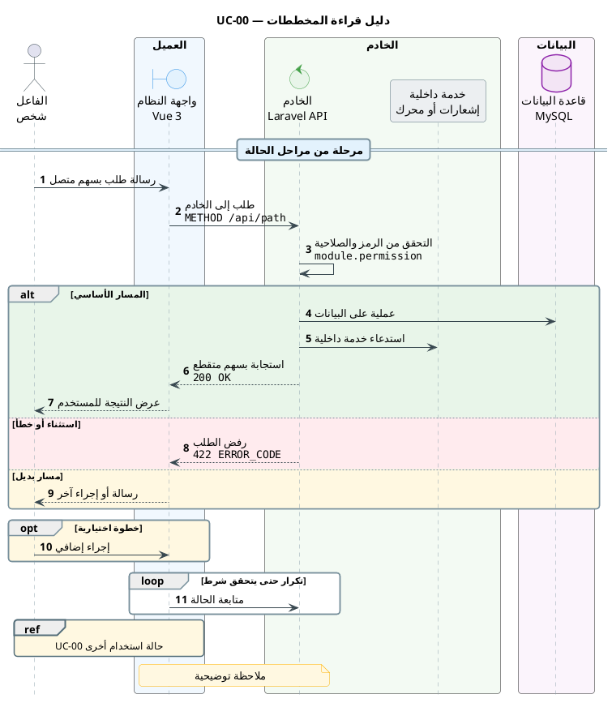

</div>

## فهرس المخططات

| الرقم | حالة الاستخدام | الفاعلون | الحزمة | اسم المخطط |
|---|---|---|---|---|
| UC-01 | تسجيل الدخول | جميع المستخدمين | المصادقة والملف الشخصي | `UC-01_login` |
| UC-02 | تسجيل الخروج | جميع المستخدمين | المصادقة والملف الشخصي | `UC-02_logout` |
| UC-03 | عرض الملف الشخصي | جميع المستخدمين | المصادقة والملف الشخصي | `UC-03_view_profile` |
| UC-04 | تعديل الملف الشخصي | جميع المستخدمين | المصادقة والملف الشخصي | `UC-04_edit_profile` |
| UC-05 | نسيت كلمة المرور | جميع المستخدمين | المصادقة والملف الشخصي | `UC-05_forgot_password` |
| UC-06 | التحقق الثنائي (رمز التحقق) | جميع المستخدمين، خدمة المصادقة | المصادقة والملف الشخصي | `UC-06_otp_verification` |
| UC-07 | تغيير كلمة المرور | جميع المستخدمين | المصادقة والملف الشخصي | `UC-07_change_password` |
| UC-08 | تفعيل التحقق الثنائي عبر تطبيق المصادقة | جميع المستخدمين | المصادقة والملف الشخصي | `UC-08_enable_two_factor` |
| UC-09 | عرض المستخدمين | ADM، EXE (عرض فقط) | المستخدمون والأدوار | `UC-09_view_users` |
| UC-10 | إنشاء مستخدم | ADM | المستخدمون والأدوار | `UC-10_create_user` |
| UC-11 | تعديل مستخدم | ADM | المستخدمون والأدوار | `UC-11_edit_user` |
| UC-12 | حذف مستخدم | ADM | المستخدمون والأدوار | `UC-12_delete_user` |
| UC-13 | تعيين الأدوار | ADM | المستخدمون والأدوار | `UC-13_assign_roles` |
| UC-14 | عرض مصفوفة الصلاحيات (RACI) | ADM، EXE (عرض فقط) | المستخدمون والأدوار | `UC-14_permission_matrix` |
| UC-15 | إضافة دور | ADM | المستخدمون والأدوار | `UC-15_create_role` |
| UC-16 | تعديل دور | ADM | المستخدمون والأدوار | `UC-16_edit_role` |
| UC-17 | حذف دور | ADM | المستخدمون والأدوار | `UC-17_delete_role` |
| UC-18 | إدارة القاعات | CRD | الموارد | `UC-18_manage_rooms` |
| UC-19 | تحديد سعة الامتحان | CRD | الموارد | `UC-19_exam_capacity` |
| UC-20 | إدارة الأجهزة | CRD | الموارد | `UC-20_manage_equipment` |
| UC-21 | إدارة المختبرات | CRD | الموارد | `UC-21_manage_labs` |
| UC-22 | إدارة الصيانة | CRD | الموارد | `UC-22_manage_maintenance` |
| UC-23 | عرض الموارد | INS، EMP | الموارد | `UC-23_view_resources` |
| UC-24 | طلب موارد إضافية | INS | الموارد | `UC-24_request_resources` |
| UC-25 | معالجة طلبات الموارد | CRD | الموارد | `UC-25_process_resource_requests` |
| UC-26 | حجز قاعة دراسية | EMP، LIB | الموارد | `UC-26_book_room` |
| UC-27 | إدخال أوقات التفرّغ | INS | الجدولة | `UC-27_enter_availability` |
| UC-28 | متابعة أوقات تفرّغ المدرّسين وتذكيرهم | CRD، HOD، DEN | الجدولة | `UC-28_follow_availability` |
| UC-29 | توليد الجدول الدراسي | CRD | الجدولة | `UC-29_generate_run`<br>`UC-29_generate_review` |
| UC-30 | إرسال الجدول للاعتماد | CRD | الجدولة | `UC-30_submit_schedule` |
| UC-31 | اعتماد الجدول ونشره | ACO | الجدولة | `UC-31_approve_publish_schedule` |
| UC-32 | عرض الجدول الأسبوعي | STU، INS | الجدولة | `UC-32_view_weekly_schedule` |
| UC-33 | تقديم طلب اعتذار أو تعويض عن محاضرة | INS | الجدولة | `UC-33_lecture_request` |
| UC-34 | رصد علامات الامتحان | EXM | الامتحانات والدرجات | `UC-34_marks_entry`<br>`UC-34_close_session` |
| UC-35 | عرض الدرجات | STU | الامتحانات والدرجات | `UC-35_view_grades` |
| UC-36 | نقل الفصل الدراسي بين مراحله | ACO | التقويم والتقارير والنظام | `UC-36_transition_semester` |
| UC-37 | عرض تقارير الإدارة | EXE | التقويم والتقارير والنظام | `UC-37_management_reports` |
| UC-38 | إنشاء نسخة احتياطية واستعادتها | ADM | التقويم والتقارير والنظام | `UC-38_backup_create`<br>`UC-38_restore` |
| UC-39 | الدخول باسم مستخدم آخر | ADM | الإدارة والمتابعة | `UC-39_impersonate_user` |
| UC-40 | استعراض سجل التدقيق | ADM | الإدارة والمتابعة | `UC-40_audit_log` |
| UC-41 | ضبط إعدادات النظام ووضع الصيانة | ADM | الإدارة والمتابعة | `UC-41_system_settings` |
| UC-42 | مراقبة صحة النظام | ADM | الإدارة والمتابعة | `UC-42_system_health` |
| UC-43 | استيراد البيانات من ملف | ADM، CRD، ACO | الإدارة والمتابعة | `UC-43_import_data` |
| UC-44 | إدارة التكاملات ومفاتيح الواجهة البرمجية | ADM، نظام خارجي | الإدارة والمتابعة | `UC-44_integrations` |
| UC-45 | البحث الشامل | جميع المستخدمين | الإدارة والمتابعة | `UC-45_global_search` |
| UC-46 | متابعة الإشعارات | جميع المستخدمين، خدمة الإشعارات الفورية | الإدارة والمتابعة | `UC-46_notifications` |
| UC-47 | عرض لوحة التحكم | جميع المستخدمين | الإدارة والمتابعة | `UC-47_dashboard` |
| UC-48 | إدارة الفروع والمباني | ADM | الهيكل الأكاديمي والخطط | `UC-48_campuses_buildings` |
| UC-49 | إدارة الكليات والأقسام وقياداتها | ADM، DEN | الهيكل الأكاديمي والخطط | `UC-49_faculties_departments` |
| UC-50 | إدارة البرامج الأكاديمية | ADM، ACO | الهيكل الأكاديمي والخطط | `UC-50_academic_programs` |
| UC-51 | إدارة الوحدات الإدارية | ADM | الهيكل الأكاديمي والخطط | `UC-51_administrative_units` |
| UC-52 | إدارة النوافذ الزمنية والعطل وأدوار التسجيل | ACO | الهيكل الأكاديمي والخطط | `UC-52_windows_holidays` |
| UC-53 | إدارة المقررات وتوصيفها | ACO، CRD | الهيكل الأكاديمي والخطط | `UC-53_manage_courses` |
| UC-54 | تحديد المتطلبات السابقة والمعادلات | ACO، CRD | الهيكل الأكاديمي والخطط | `UC-54_course_requirements` |
| UC-55 | إدارة سلالم الدرجات | ACO | الهيكل الأكاديمي والخطط | `UC-55_grading_schemes` |
| UC-56 | إعداد الخطة الدراسية واعتمادها | ACO | الهيكل الأكاديمي والخطط | `UC-56_study_plans` |
| UC-57 | إدارة الملف التدريسي لعضو هيئة التدريس | ACO، DEN، HOD، INS | إعداد الجدولة وتشغيلها | `UC-57_teaching_profile` |
| UC-58 | طرح المقررات وتقدير الطلب | CRD، ACO | إعداد الجدولة وتشغيلها | `UC-58_course_offerings` |
| UC-59 | إنشاء الشعب وإسناد مدرّسيها | CRD | إعداد الجدولة وتشغيلها | `UC-59_sections_teachers` |
| UC-60 | ضبط قواعد الجدولة وقيودها | ADM، CRD | إعداد الجدولة وتشغيلها | `UC-60_scheduling_rules` |
| UC-61 | معالجة تعارضات الجدول ومؤشر الجودة | CRD | إعداد الجدولة وتشغيلها | `UC-61_schedule_conflicts` |
| UC-62 | الإعادة الطارئة للجدولة واقتراح البدلاء | CRD | إعداد الجدولة وتشغيلها | `UC-62_emergency_rescheduling` |
| UC-63 | إدارة سجلات الطلاب | ADM، ADO | سجلات الطلاب والتسجيل | `UC-63_student_records` |
| UC-64 | عرض التدقيق الأكاديمي | STU، ADV، ACO | سجلات الطلاب والتسجيل | `UC-64_degree_audit` |
| UC-65 | ترشيح المتخرجين واعتماد دفعة التخرج | ACO | سجلات الطلاب والتسجيل | `UC-65_graduation` |
| UC-66 | نشر كتالوج التسجيل وفتح أدواره | ACO | سجلات الطلاب والتسجيل | `UC-66_publish_catalog` |
| UC-67 | تسجيل المقررات | STU | سجلات الطلاب والتسجيل | `UC-67_course_registration` |
| UC-68 | التحقق من أهلية التسجيل | STU | سجلات الطلاب والتسجيل | `UC-68_registration_validation` |
| UC-69 | الانضمام إلى قائمة الانتظار وقبول المقعد | STU | سجلات الطلاب والتسجيل | `UC-69_waitlist` |
| UC-70 | السحب والإضافة | STU | سجلات الطلاب والتسجيل | `UC-70_add_drop` |
| UC-71 | منح استثناءات التسجيل وإدارة العوائق | ACO | سجلات الطلاب والتسجيل | `UC-71_overrides_holds` |
| UC-72 | تسجيل حضور الجلسة | INS، STU | الحضور والتعلّم والتقييم | `UC-72_take_attendance` |
| UC-73 | متابعة الغياب واعتماد الحرمان | ACO، STU | الحضور والتعلّم والتقييم | `UC-73_absence_deprivation` |
| UC-74 | إدارة محتوى المادة وإعلاناتها | INS، STU | الحضور والتعلّم والتقييم | `UC-74_course_content` |
| UC-75 | إنشاء كويز ونشره | INS | الحضور والتعلّم والتقييم | `UC-75_create_quiz` |
| UC-76 | أداء الكويز | STU | الحضور والتعلّم والتقييم | `UC-76_take_quiz` |
| UC-77 | تقييم المقرر والمدرّس | STU، INS، HOD، DEN | الحضور والتعلّم والتقييم | `UC-77_course_evaluation` |
| UC-78 | رصد كشف الدرجات وإرساله للمراجعة | INS | سير اعتماد الدرجات | `UC-78_grade_sheet_entry` |
| UC-79 | مراجعة كشف الدرجات في القسم | HOD | سير اعتماد الدرجات | `UC-79_department_review` |
| UC-80 | الإدخال المزدوج واعتماد الكشوف ونشرها | EXM | سير اعتماد الدرجات | `UC-80_verify_publish_grades` |
| UC-81 | حساب المعدل والوضع الأكاديمي | النظام | سير اعتماد الدرجات | `UC-81_gpa_standing` |
| UC-82 | إصدار كشف الدرجات | STU، ACO | سير اعتماد الدرجات | `UC-82_transcript` |
| UC-83 | طلب تعديل درجة منشورة | INS، DEN | سير اعتماد الدرجات | `UC-83_grade_change` |
| UC-84 | جدولة الامتحانات | EXM | جدولة الامتحانات وتنفيذها | `UC-84_exam_schedule` |
| UC-85 | توزيع القاعات والمقاعد والمراقبين | EXM | جدولة الامتحانات وتنفيذها | `UC-85_seating_proctors` |
| UC-86 | عرض جدول امتحاناتي وبطاقة الامتحان | STU | جدولة الامتحانات وتنفيذها | `UC-86_my_exams` |
| UC-87 | إدارة يوم الامتحان | EXM، INS | جدولة الامتحانات وتنفيذها | `UC-87_exam_day` |
| UC-88 | إدارة دورات القبول | ADO | القبول والإرشاد | `UC-88_admission_cycles` |
| UC-89 | تقديم طلب القبول ومتابعته | APL، بوابة الدفع | القبول والإرشاد | `UC-89_apply_admission` |
| UC-90 | المفاضلة وإصدار قرارات القبول | ADO | القبول والإرشاد | `UC-90_admission_decisions` |
| UC-91 | مراجعة الخطة الفصلية ومنح تصريح التسجيل | ADV، STU | القبول والإرشاد | `UC-91_advising_clearance` |
| UC-92 | متابعة الإنذارات ومواعيد الإرشاد | ADV، STU | القبول والإرشاد | `UC-92_warnings_appointments` |
| UC-93 | إدارة الرسوم والفواتير | FIN | المالية | `UC-93_fees_invoices` |
| UC-94 | عرض الرصيد والدفع الإلكتروني | STU، بوابة الدفع | المالية | `UC-94_online_payment` |
| UC-95 | تسجيل دفعة في الصندوق | FIN | المالية | `UC-95_cashier_payment` |
| UC-96 | إدارة الأقساط والمنح والاسترداد | FIN، STU | المالية | `UC-96_installments_scholarships` |
| UC-97 | البحث في كتالوج المكتبة وحجز نسخة | STU، INS | المكتبة وشؤون الموظفين والطلبات | `UC-97_library_search` |
| UC-98 | إعارة النسخ وإرجاعها | LIB | المكتبة وشؤون الموظفين والطلبات | `UC-98_library_circulation` |
| UC-99 | إدارة ملفات الموظفين وعقودهم | HRO، EMP، جهاز البصمة | المكتبة وشؤون الموظفين والطلبات | `UC-99_employee_files` |
| UC-100 | تقديم طلب إجازة | EMP، INS | المكتبة وشؤون الموظفين والطلبات | `UC-100_leave_request` |
| UC-101 | اعتماد طلبات الإجازة | المدير المباشر، HRO | المكتبة وشؤون الموظفين والطلبات | `UC-101_leave_approval` |
| UC-102 | تقديم طلب إلكتروني ومتابعته | STU | المكتبة وشؤون الموظفين والطلبات | `UC-102_submit_request` |
| UC-103 | معالجة الطلبات الإلكترونية | ACO، EXM | المكتبة وشؤون الموظفين والطلبات | `UC-103_process_requests` |
| UC-104 | ضبط بوابة الذكاء الاصطناعي ومتابعة استخدامها | ADM، EXE | الذكاء الاصطناعي والتحليلات | `UC-104_ai_gateway` |
| UC-105 | محادثة المساعد الذكي | جميع المستخدمين | الذكاء الاصطناعي والتحليلات | `UC-105_ai_assistant` |
| UC-106 | إدارة قاعدة معرفة اللوائح | ACO | الذكاء الاصطناعي والتحليلات | `UC-106_knowledge_base` |
| UC-107 | إدخال التفرّغ والقيود بلغة طبيعية | INS، CRD | الذكاء الاصطناعي والتحليلات | `UC-107_natural_language_input` |
| UC-108 | شرح نتيجة الجدولة | CRD، INS | الذكاء الاصطناعي والتحليلات | `UC-108_schedule_explainer` |
| UC-109 | التنبؤ بالطلب على المقررات | CRD، ACO، EXE | الذكاء الاصطناعي والتحليلات | `UC-109_demand_forecast` |
| UC-110 | متابعة مؤشر خطر التعثّر | ADV، ACO، HOD | الذكاء الاصطناعي والتحليلات | `UC-110_risk_index` |
| UC-111 | استخراج بيانات المقررات من ملف | ACO | الذكاء الاصطناعي والتحليلات | `UC-111_document_extraction` |
| UC-112 | توليد ملخص لتقرير أو لوحة | EXE، ADM | الذكاء الاصطناعي والتحليلات | `UC-112_report_summary` |
| UC-113 | محاكاة السيناريوهات | EXE، CRD | الذكاء الاصطناعي والتحليلات | `UC-113_scenario_simulator` |

---

## الحزمة الأولى: المصادقة والملف الشخصي (Auth_profile)

تغطي الحالات من UC-01 إلى UC-08.

### UC-01: تسجيل الدخول

**الفاعلون:** جميع مستخدمي النظام. **يوضّح المخطط:** الدخول بالبريد أو الرقم الجامعي أو الوظيفي، وقفل الحساب بعد المحاولات الخاطئة، ومسار التحقق الثنائي إن كان مفعّلاً.

<div dir="ltr">

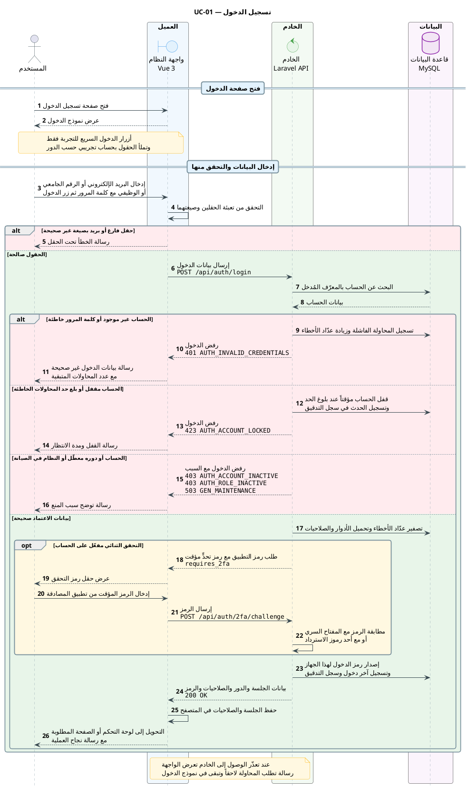

</div>

### UC-02: تسجيل الخروج

**الفاعلون:** جميع مستخدمي النظام. **يوضّح المخطط:** الخروج من الجهاز الحالي، أو من الأجهزة الأخرى مع البقاء داخلاً على الجهاز الحالي.

<div dir="ltr">

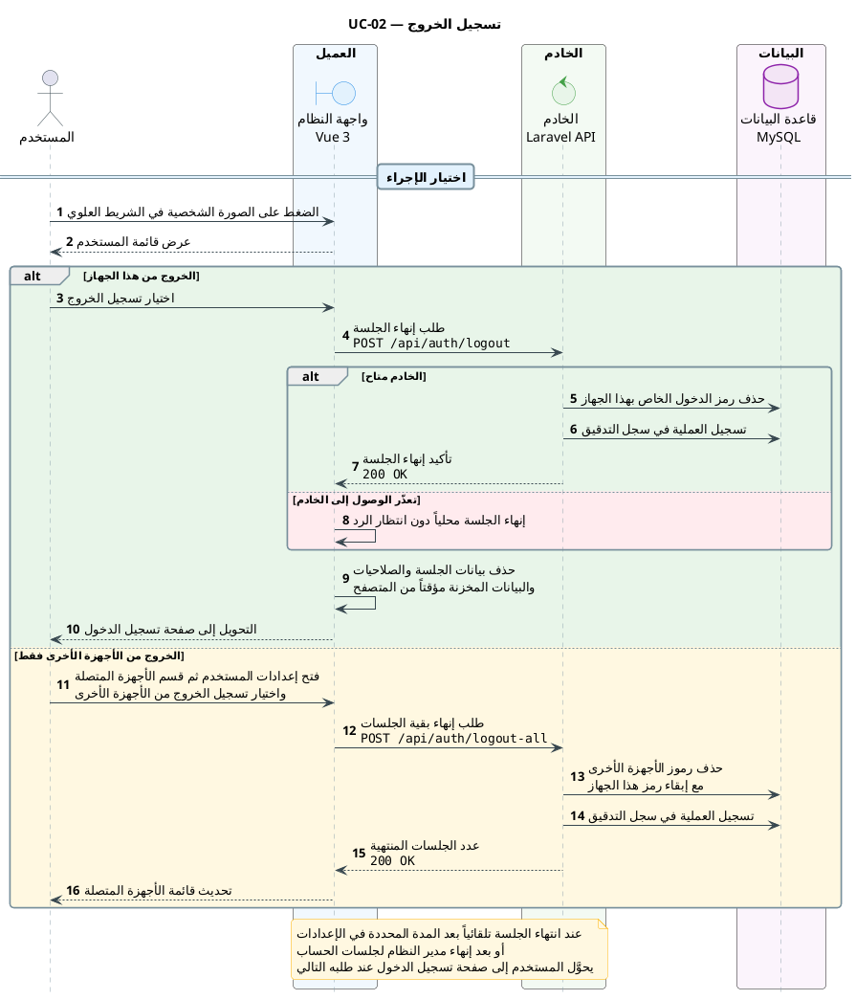

</div>

### UC-03: عرض الملف الشخصي

**الفاعلون:** جميع مستخدمي النظام. **يوضّح المخطط:** فتح إعدادات المستخدم وتحميل بيانات الحساب وإعدادات الإشعارات بعد التحقق من الصلاحية.

<div dir="ltr">

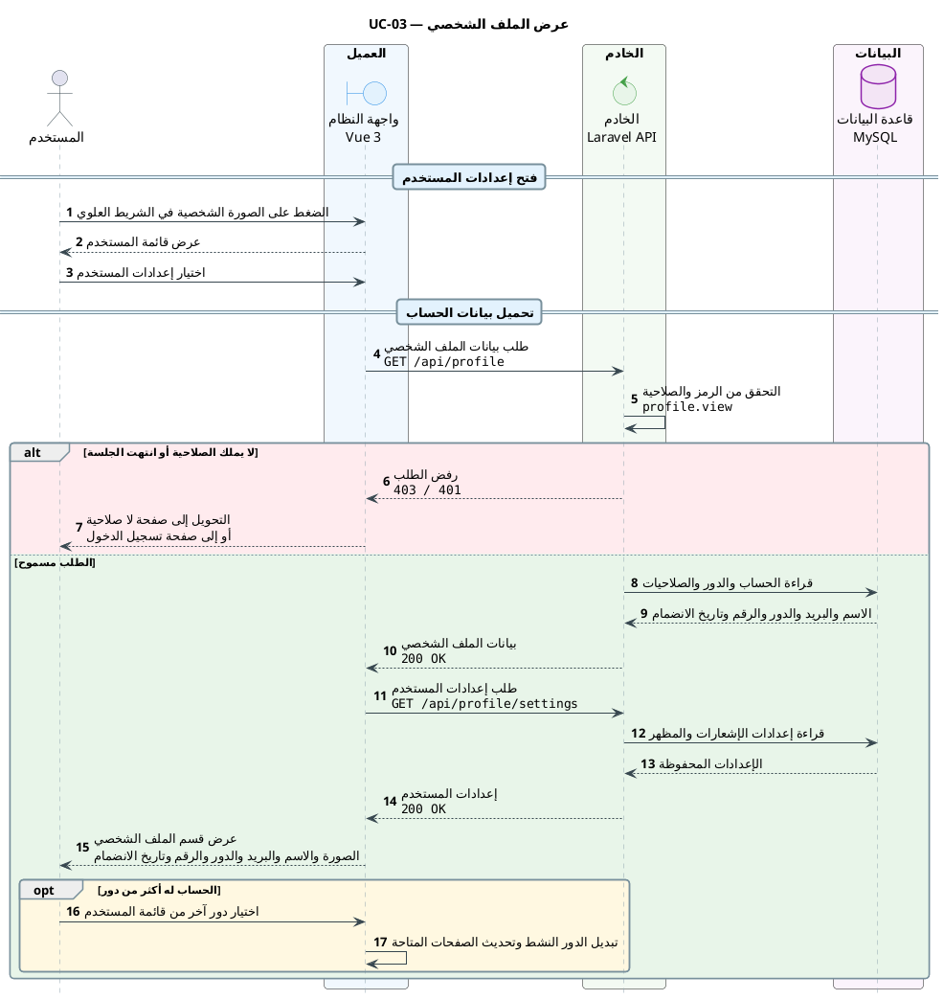

</div>

### UC-04: تعديل الملف الشخصي

**الفاعلون:** جميع مستخدمي النظام. **يوضّح المخطط:** تعديل الاسم والبريد والصورة، والتحقق من عدم تكرار البريد، وتحديث الشريط العلوي بعد الحفظ.

<div dir="ltr">

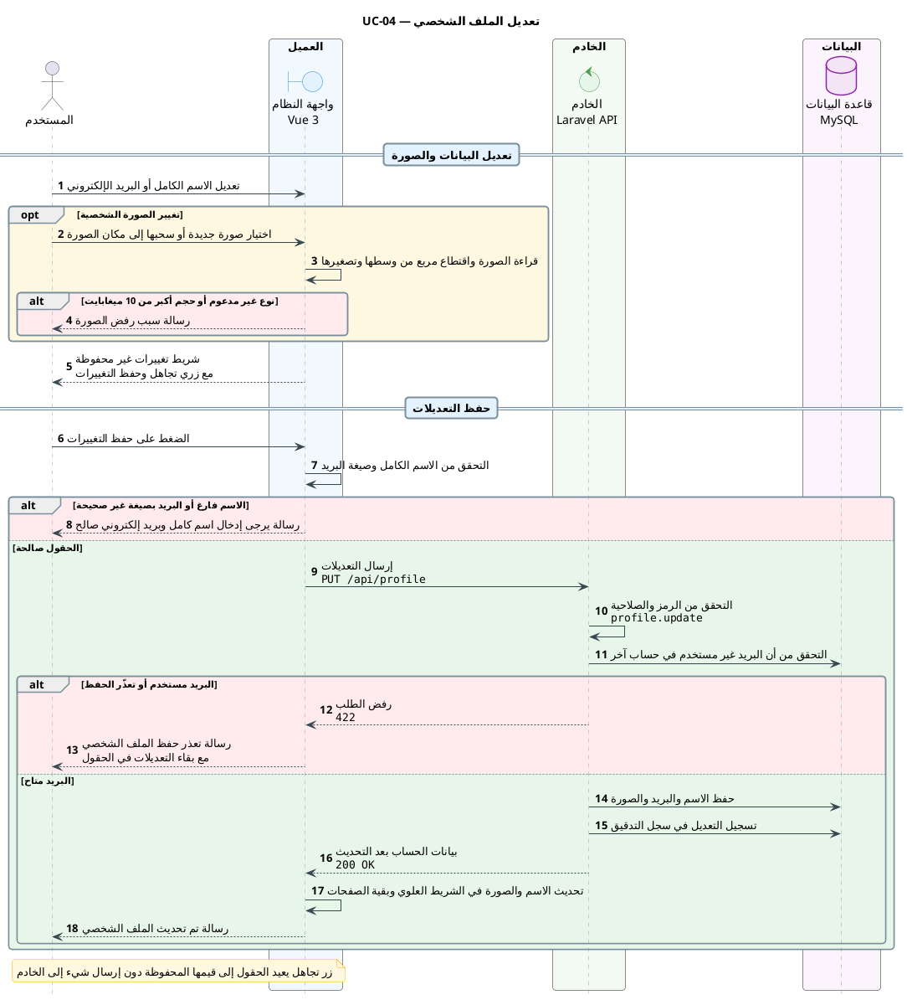

</div>

### UC-05: نسيت كلمة المرور

**الفاعلون:** جميع مستخدمي النظام. **يوضّح المخطط:** طلب رمز التحقق وإرساله إلى البريد، ثم تضمين حالتي «التحقق الثنائي» UC-06 و«تغيير كلمة المرور» UC-07.

<div dir="ltr">

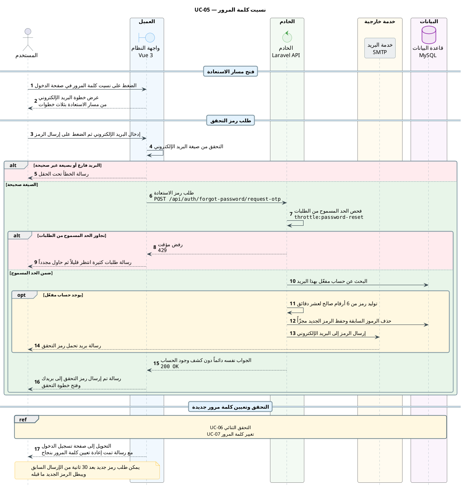

</div>

### UC-06: التحقق الثنائي (رمز التحقق)

**الفاعلون:** جميع مستخدمي النظام، وخدمة المصادقة (Auth service). **يوضّح المخطط:** مطابقة رمز البريد لدى خدمة المصادقة، وتضمّنه حالة «تغيير كلمة المرور» UC-07.

<div dir="ltr">

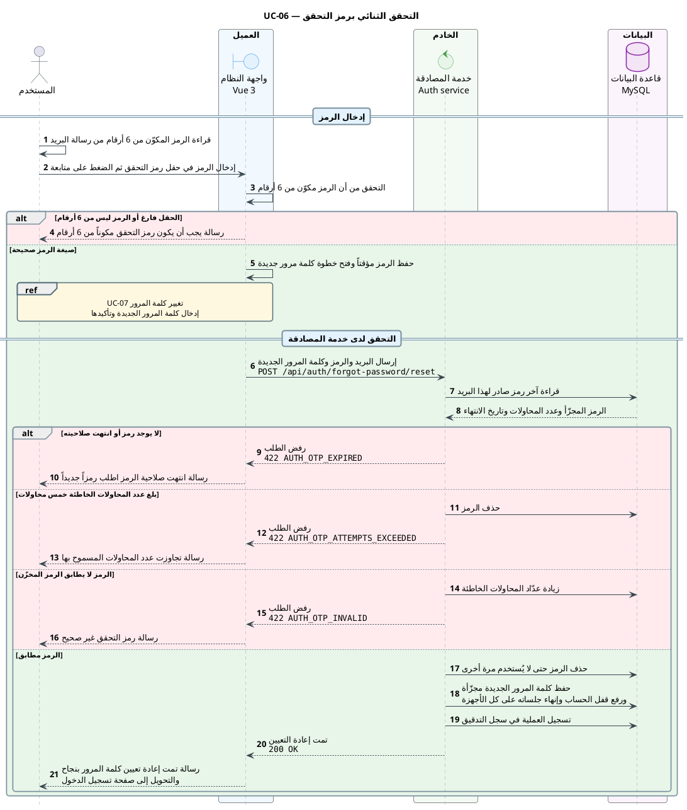

</div>

### UC-07: تغيير كلمة المرور

**الفاعلون:** جميع مستخدمي النظام. **يوضّح المخطط:** التحقق من الكلمة الحالية وسياسة كلمة المرور وسجل الكلمات السابقة، ثم إنهاء الجلسات الأخرى وإشعار صاحب الحساب.

<div dir="ltr">

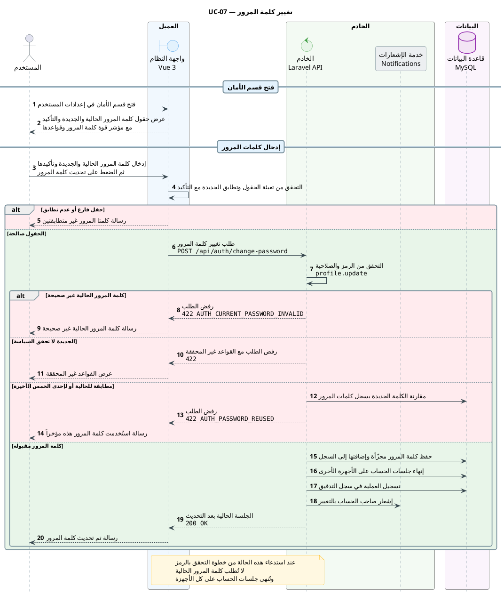

</div>

### UC-08: تفعيل التحقق الثنائي عبر تطبيق المصادقة

**الفاعلون:** جميع مستخدمي النظام. **يوضّح المخطط:** توليد المفتاح السري وربطه بتطبيق المصادقة، ثم تأكيد الرمز وتسليم رموز الاسترداد، وإيقاف التحقق بعد تأكيد الهوية.

<div dir="ltr">

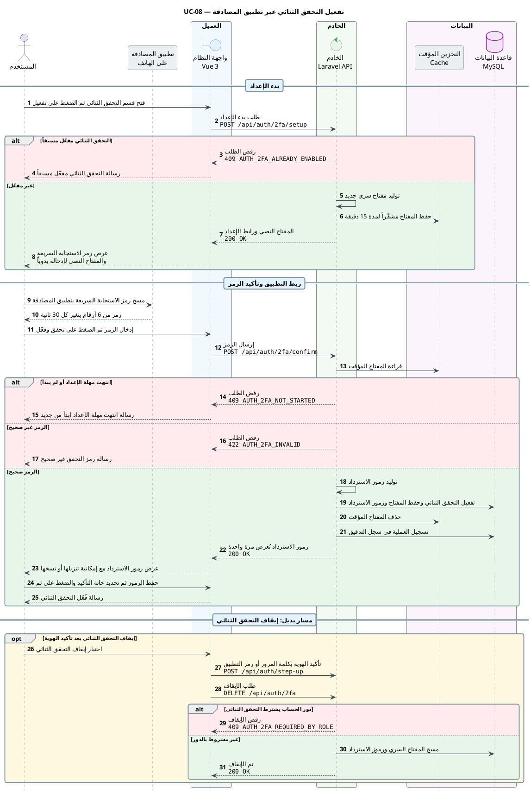

</div>

---

## الحزمة الثانية: المستخدمون والأدوار (User and Roles)

تغطي الحالات من UC-09 إلى UC-17.

### UC-09: عرض المستخدمين

**الفاعلون:** مدير النظام (ADM)، الإدارة العليا (EXE) للعرض فقط. **يوضّح المخطط:** تحميل الحسابات والتحقق من الصلاحية، والبحث والتصفية في الواجهة، وفتح تفاصيل حساب، وتصدير القائمة.

<div dir="ltr">

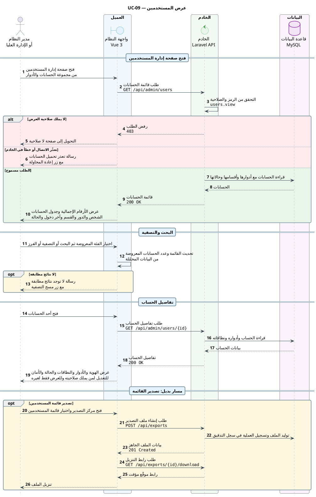

</div>

### UC-10: إنشاء مستخدم

**الفاعلون:** مدير النظام (ADM). **يوضّح المخطط:** إدخال بيانات الحساب والتحقق منها وإنشاؤه، وتضمّن حالة «تعيين الأدوار» UC-13 لإسناد الدور الأساسي، ثم الإشعار وسجل التدقيق.

<div dir="ltr">

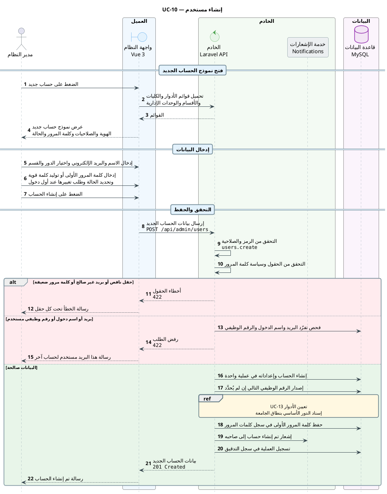

</div>

### UC-11: تعديل مستخدم

**الفاعلون:** مدير النظام (ADM). **يوضّح المخطط:** تعديل بيانات الحساب مع حماية الحساب المؤسِّس والمدير نفسه وآخر مدير مفعّل، وإنهاء الجلسات عند التعطيل، ومسارات قسم «الأمان» البديلة.

<div dir="ltr">

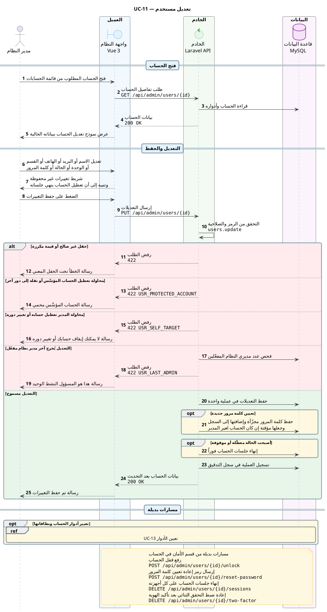

</div>

### UC-12: حذف مستخدم

**الفاعلون:** مدير النظام (ADM). **يوضّح المخطط:** فحص شروط الحذف في الواجهة ثم إعادة فحصها في الخادم قبل حذف الحساب مع إشعاراته وإعداداته.

<div dir="ltr">

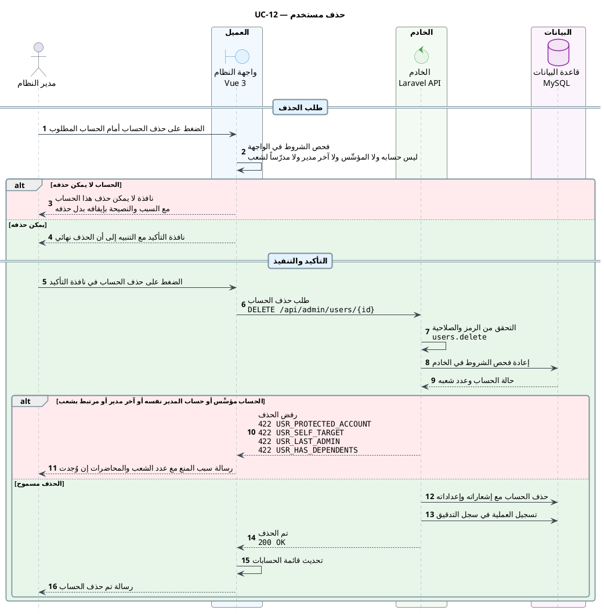

</div>

### UC-13: تعيين الأدوار

**الفاعلون:** مدير النظام (ADM). **يوضّح المخطط:** استبدال أدوار الحساب بالمجموعة المحددة بنطاقاتها ومددها، مع تأكيد هوية المدير (step-up) وحماية الحساب المؤسِّس وآخر مدير. تُستدعى تلقائياً من UC-10.

<div dir="ltr">

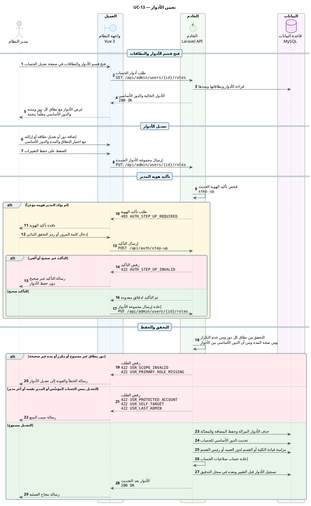

</div>

### UC-14: عرض مصفوفة الصلاحيات (RACI)

**الفاعلون:** مدير النظام (ADM)، الإدارة العليا (EXE) للعرض فقط. **يوضّح المخطط:** تحميل الأدوار وكتالوج الصلاحيات، وبناء المصفوفة في الواجهة، وفتح تفاصيل دور للعرض.

<div dir="ltr">

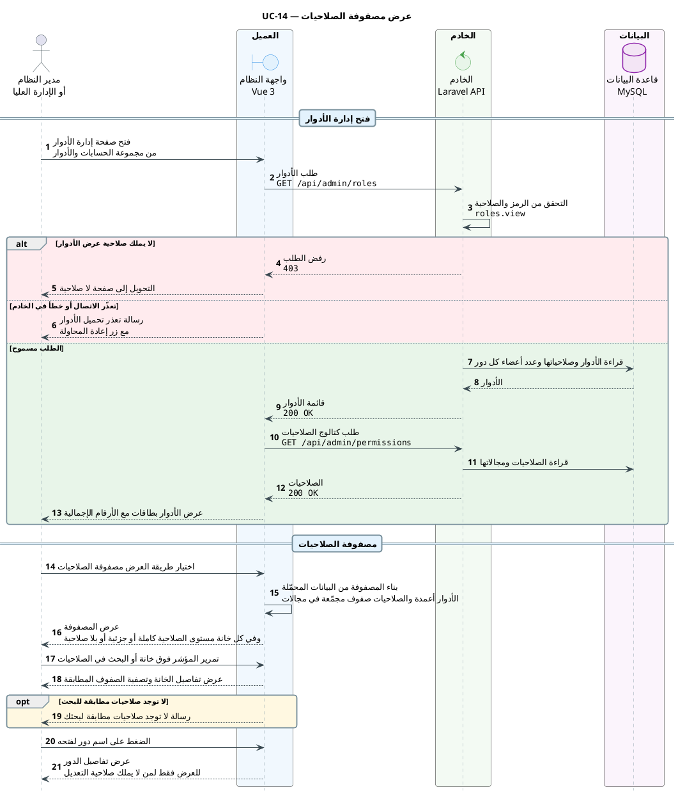

</div>

### UC-15: إضافة دور

**الفاعلون:** مدير النظام (ADM). **يوضّح المخطط:** تحديد هوية الدور ومداه وصلاحياته (مع النسخ من دور قائم وقاعدة التبعية)، ثم التحقق من الرمز وإنشاء الدور المخصص.

<div dir="ltr">

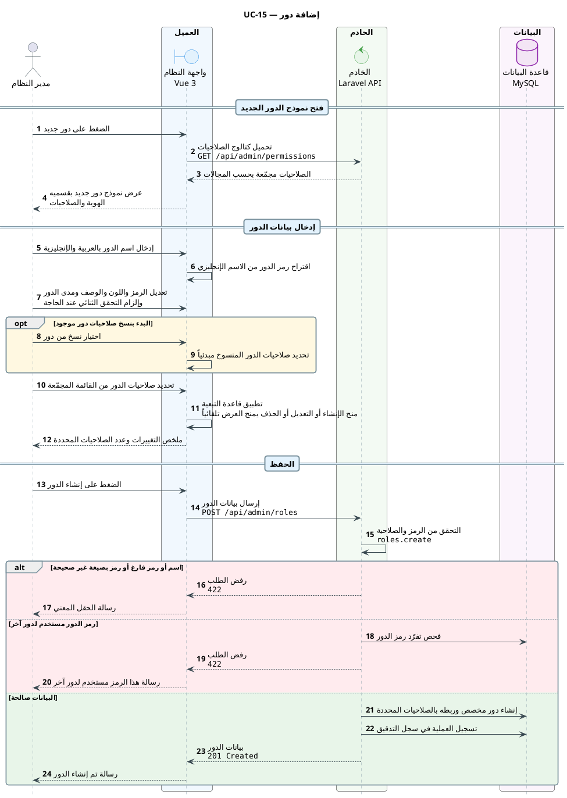

</div>

### UC-16: تعديل دور

**الفاعلون:** مدير النظام (ADM). **يوضّح المخطط:** تعديل بيانات الدور وصلاحياته مع حماية أدوار النظام وصلاحية إدارة الأدوار، وتسجيل الصلاحيات المضافة والمزالة.

<div dir="ltr">

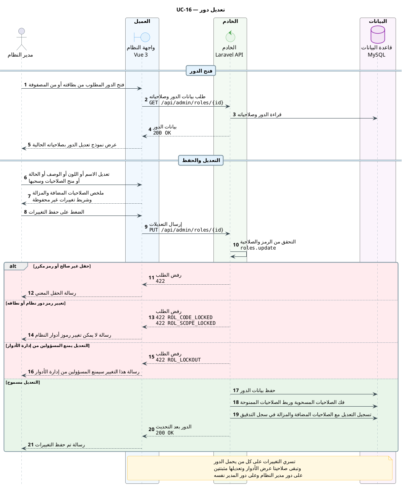

</div>

### UC-17: حذف دور

**الفاعلون:** مدير النظام (ADM). **يوضّح المخطط:** فحص أن الدور مخصص وبلا أعضاء، ثم حذفه مع فك ارتباط صلاحياته بعد تأكيد المدير.

<div dir="ltr">

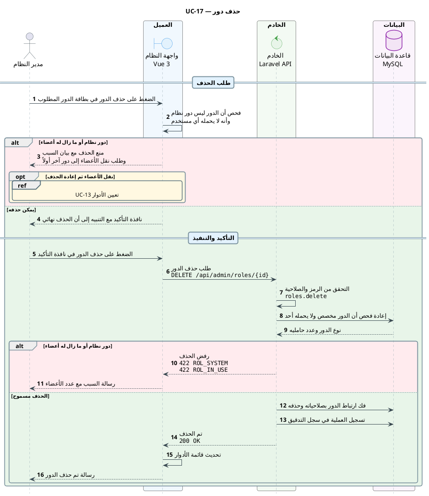

</div>

---

## الحزمة الثالثة: الموارد (Resources)

تغطي الحالات من UC-18 إلى UC-26.

### UC-18: إدارة القاعات

**الفاعلون:** منسق الجداول والموارد (CRD)، ويشاركه مدير النظام (ADM) الصلاحية نفسها. **يوضّح المخطط:** إضافة قاعة أو تعديلها (مع تضمّن حالة «تحديد سعة الامتحان» UC-19)، والتحقق من الرمز، وحذف قاعة ومنع الحذف إن كانت فيها محاضرات مجدولة.

<div dir="ltr">

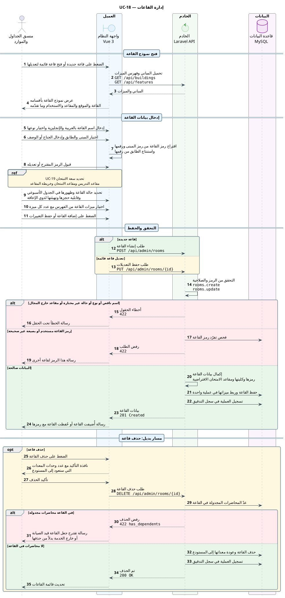

</div>

### UC-19: تحديد سعة الامتحان

**الفاعلون:** منسق الجداول والموارد (CRD). **يوضّح المخطط:** تحديد مقاعد الامتحان وخريطة المقاعد داخل نموذج القاعة والتحقق منها عند الحفظ. حالة مضمَّنة في UC-18.

<div dir="ltr">

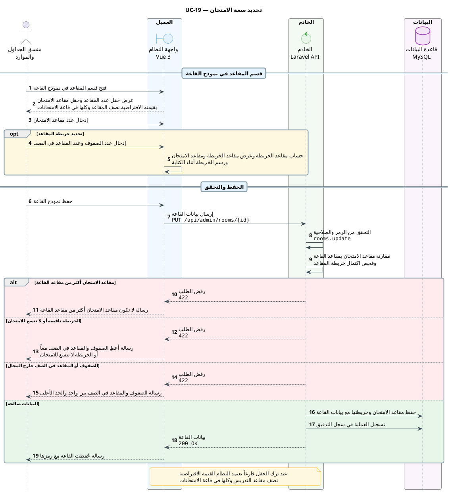

</div>

### UC-20: إدارة الأجهزة

**الفاعلون:** منسق الجداول والموارد (CRD)، ويشاركه مدير النظام (ADM) الصلاحية نفسها. **يوضّح المخطط:** إضافة صنف ووحداته بأرقام أصول فريدة، ونقل الوحدات أو تغيير حالتها، والإبلاغ عن عطل (يبدأ UC-22).

<div dir="ltr">

```plantuml
@startuml UC-20_manage_equipment
' ===== النمط الموحّد (انسخه مع المخطط) =====
skinparam defaultFontName Tahoma
skinparam shadowing false
skinparam roundcorner 8
skinparam ParticipantPadding 14
skinparam BoxPadding 10
skinparam NoteBackgroundColor #FFF8E1
skinparam NoteBorderColor #FFB300
skinparam ParticipantBackgroundColor #ECEFF1
skinparam ParticipantBorderColor #546E7A
skinparam ActorBorderColor #37474F
skinparam BoundaryBackgroundColor #E3F2FD
skinparam BoundaryBorderColor #1E88E5
skinparam ControlBackgroundColor #E8F5E9
skinparam ControlBorderColor #43A047
skinparam DatabaseBackgroundColor #F3E5F5
skinparam DatabaseBorderColor #8E24AA
skinparam sequence {
  ArrowColor #37474F
  LifeLineBorderColor #90A4AE
  GroupBorderColor #78909C
  DividerBackgroundColor #E3F2FD
  DividerBorderColor #78909C
  ReferenceBackgroundColor #FFF8E1
  ReferenceBorderColor #546E7A
}
hide footbox
autonumber
' ===== المخطط =====
title UC-20 — إدارة الأجهزة

actor "منسق الجداول\nوالموارد" as CRD
box "العميل" #F1F8FE
  boundary "واجهة النظام\nVue 3" as UI
end box
box "الخادم" #F3FAF3
  control "الخادم\nLaravel API" as API
end box
box "البيانات" #FBF4FC
  database "قاعدة البيانات\nMySQL" as DB
end box

== إضافة صنف ووحداته ==
CRD -> UI : الضغط على معدّات جديدة
UI --> CRD : عرض نموذج الصنف\nالاسم بالعربية والإنجليزية والفئة والكلية وقابلية النقل
CRD -> UI : إدخال بيانات الصنف واختيار فئته
CRD -> UI : تحديد عدد الوحدات من 1 إلى 500 في المرة الواحدة\nوتفعيل قابلة للنقل إن كانت محمولة
UI --> CRD : عرض أرقام الأصول التي ستأخذها الوحدات الجديدة
CRD -> UI : الضغط على أضف الوحدات
UI -> API : إرسال بيانات الصنف وعدد الوحدات\n""POST /api/equipment""
API -> API : التحقق من الرمز والصلاحية\n""resources.create""
alt #FFEBEE اسم فارغ أو فئة غير مختارة أو عدد وحدات خارج المجال
  API --> UI : أخطاء الحقول\n""422""
  UI --> CRD : رسالة الخطأ تحت الحقل
else #FFEBEE رقم الأصل مستخدم أو الكفالة تنتهي قبل الشراء
  API --> UI : رفض الطلب\n""422""
  UI --> CRD : رسالة هذا الرقم لوحدة أخرى
else #E8F5E9 البيانات صالحة
  API -> DB : إنشاء الوحدات في عملية واحدة\nوإعطاء كل وحدة رقم أصلها الفريد
  API -> DB : تسجيل العملية في سجل التدقيق
  API --> UI : الوحدات الجديدة بأرقام أصولها\n""201 Created""
  UI --> CRD : رسالة أُضيفت المعدّات مع عدد الوحدات
end

== نقل الوحدات أو تغيير حالتها ==
CRD -> UI : فتح الصنف واختيار وحدات منه\nثم نقلها إلى قاعة أو المستودع أو تغيير حالتها
UI -> API : طلب التعديل على الوحدات المختارة\n""POST /api/equipment/batch""
API -> API : التحقق من الرمز والصلاحية\n""resources.update""
alt #FFEBEE نقل وحدة مُخرجة من الخدمة إلى قاعة
  API --> UI : رفض الطلب\n""422""
  UI --> CRD : رسالة لا تدخل الوحدة المُخرجة من الخدمة أي قاعة\nأعدها إلى الخدمة أولاً
else #E8F5E9 التعديل مسموح
  API -> DB : حفظ المكان أو الحالة الجديدة لكل وحدة
  API -> DB : تسجيل العملية في سجل التدقيق
  API --> UI : الوحدات بعد التحديث\n""200 OK""
  UI --> CRD : رسالة بنجاح العملية
end

== مسارات بديلة ==
opt #FFF8E1 الإبلاغ عن عطل في وحدة
  CRD -> UI : الضغط على أبلغ عن عطل من الوحدة
  ref over CRD, DB : UC-22 إدارة الصيانة
end
note over UI, DB
  تعديل الصنف يُحفظ على كل وحدات الصنف معاً
  وتعديل وحدة يتناول رقم أصلها وتاريخ شرائها وكفالتها
  وعند الحذف يُعرض خيار الإخراج من الخدمة بدلاً منه
end note
@enduml
```

</div>

### UC-21: إدارة المختبرات

**الفاعلون:** منسق الجداول والموارد (CRD). **يوضّح المخطط:** عرض المختبرات وتعديل مقاعدها وحالتها وتجهيزاتها، والإبلاغ عن عطل (يبدأ UC-22)، وعرض معدات المختبر.

<div dir="ltr">

```plantuml
@startuml UC-21_manage_labs
' ===== النمط الموحّد (انسخه مع المخطط) =====
skinparam defaultFontName Tahoma
skinparam shadowing false
skinparam roundcorner 8
skinparam ParticipantPadding 14
skinparam BoxPadding 10
skinparam NoteBackgroundColor #FFF8E1
skinparam NoteBorderColor #FFB300
skinparam ParticipantBackgroundColor #ECEFF1
skinparam ParticipantBorderColor #546E7A
skinparam ActorBorderColor #37474F
skinparam BoundaryBackgroundColor #E3F2FD
skinparam BoundaryBorderColor #1E88E5
skinparam ControlBackgroundColor #E8F5E9
skinparam ControlBorderColor #43A047
skinparam DatabaseBackgroundColor #F3E5F5
skinparam DatabaseBorderColor #8E24AA
skinparam sequence {
  ArrowColor #37474F
  LifeLineBorderColor #90A4AE
  GroupBorderColor #78909C
  DividerBackgroundColor #E3F2FD
  DividerBorderColor #78909C
  ReferenceBackgroundColor #FFF8E1
  ReferenceBorderColor #546E7A
}
hide footbox
autonumber
' ===== المخطط =====
title UC-21 — إدارة المختبرات

actor "منسق الجداول\nوالموارد" as CRD
box "العميل" #F1F8FE
  boundary "واجهة النظام\nVue 3" as UI
end box
box "الخادم" #F3FAF3
  control "الخادم\nLaravel API" as API
end box
box "البيانات" #FBF4FC
  database "قاعدة البيانات\nMySQL" as DB
end box

== عرض المختبرات ==
CRD -> UI : فتح صفحة إدارة القاعات\nوتصفية القاعات بنوع مختبرات وورش
UI -> API : طلب القاعات\n""GET /api/admin/rooms""
API -> API : التحقق من الرمز والصلاحية\n""rooms.view""
API -> DB : قراءة القاعات وميزاتها ونسبة المحجوز من أسبوع كل منها
DB --> API : القاعات
API --> UI : قائمة القاعات\n""200 OK""
UI --> CRD : عرض المختبرات وحدها\nبمقاعدها وحالتها وميزاتها ونسبة المحجوز

== فتح المختبر وتعديله ==
CRD -> UI : فتح مختبر قائم أو إضافة قاعة جديدة بنوع مختبر
UI -> API : تحميل فهرس الميزات\n""GET /api/features""
API --> UI : الميزات
UI --> CRD : عرض نموذج القاعة مع تنبيهات خاصة بالمختبرات
CRD -> UI : تعديل مقاعد المختبر وحالته
CRD -> UI : تسجيل ما يقدمه المختبر من الفهرس مع العدد\nحواسيب وطاولات مخبرية ونقاط شبكة وجهاز عرض
CRD -> UI : الضغط على حفظ التغييرات
UI -> API : إرسال بيانات المختبر\n""PUT /api/admin/rooms/{id}""
API -> API : التحقق من الرمز والصلاحية\n""rooms.update""
alt #FFEBEE اسم ناقص أو مقاعد أو عدد ميزة خارج المجال
  API --> UI : أخطاء الحقول\n""422""
  UI --> CRD : رسالة الخطأ تحت الحقل
else #E8F5E9 البيانات صالحة
  API -> DB : حفظ المختبر وميزاته في عملية واحدة
  API -> DB : تسجيل العملية في سجل التدقيق
  API --> UI : بيانات المختبر\n""200 OK""
  UI --> CRD : رسالة حُفظت القاعة مع رمزها
end

== مسارات بديلة ==
opt #FFF8E1 الإبلاغ عن عطل في هذه القاعة
  CRD -> UI : الضغط على أبلغ عن عطل في هذه القاعة
  ref over CRD, DB : UC-22 إدارة الصيانة
  note over UI, API
    إن أوقف البلاغ الاستخدام خرج المختبر
    من الجدول والحجوزات حتى يُغلق
  end note
end
opt #FFF8E1 عرض معدات المختبر
  CRD -> UI : الضغط على اعرضها
  UI --> CRD : فتح صفحة الأجهزة والمعدات مصفّاة على وحدات المختبر
end
@enduml
```

</div>

### UC-22: إدارة الصيانة

**الفاعلون:** منسق الجداول والموارد (CRD). **يوضّح المخطط:** تسجيل بلاغ عطل، وإخراج المورد من الاستخدام إن كان البلاغ مانعاً، ومتابعة البلاغ حتى إصلاحه، وبلاغ المدرّس عن قاعة محاضرته وقرار المنسق.

<div dir="ltr">

```plantuml
@startuml UC-22_manage_maintenance
' ===== النمط الموحّد (انسخه مع المخطط) =====
skinparam defaultFontName Tahoma
skinparam shadowing false
skinparam roundcorner 8
skinparam ParticipantPadding 14
skinparam BoxPadding 10
skinparam NoteBackgroundColor #FFF8E1
skinparam NoteBorderColor #FFB300
skinparam ParticipantBackgroundColor #ECEFF1
skinparam ParticipantBorderColor #546E7A
skinparam ActorBorderColor #37474F
skinparam BoundaryBackgroundColor #E3F2FD
skinparam BoundaryBorderColor #1E88E5
skinparam ControlBackgroundColor #E8F5E9
skinparam ControlBorderColor #43A047
skinparam DatabaseBackgroundColor #F3E5F5
skinparam DatabaseBorderColor #8E24AA
skinparam sequence {
  ArrowColor #37474F
  LifeLineBorderColor #90A4AE
  GroupBorderColor #78909C
  DividerBackgroundColor #E3F2FD
  DividerBorderColor #78909C
  ReferenceBackgroundColor #FFF8E1
  ReferenceBorderColor #546E7A
}
hide footbox
autonumber
' ===== المخطط =====
title UC-22 — إدارة الصيانة

actor "منسق الجداول\nوالموارد" as CRD
box "العميل" #F1F8FE
  boundary "واجهة النظام\nVue 3" as UI
end box
box "الخادم" #F3FAF3
  control "الخادم\nLaravel API" as API
  participant "خدمة الإشعارات\nNotifications" as NTF
end box
box "البيانات" #FBF4FC
  database "قاعدة البيانات\nMySQL" as DB
end box

== تسجيل البلاغ ==
CRD -> UI : الضغط على الإبلاغ عن عطل
UI --> CRD : عرض نموذج بلاغ جديد
CRD -> UI : اختيار القاعة أو الجهاز بالبحث بالرمز\nأو رقم الأصل أو الاسم
CRD -> UI : كتابة المشكلة وتحديد النوع والأولوية والتفاصيل\nوهل يوقف البلاغ الاستخدام ومتى يبدأ ومتى يُتوقع أن ينتهي
CRD -> UI : الضغط على سجّل البلاغ
UI -> API : إرسال البلاغ\n""POST /api/maintenance-logs""
API -> API : التحقق من الرمز والصلاحية\n""maintenance_logs.create""
alt #FFEBEE لم تُختر القاعة أو الجهاز أو لم تُكتب المشكلة
  API --> UI : أخطاء الحقول\n""422""
  UI --> CRD : رسالة اختر القاعة أو الجهاز أو اكتب المشكلة
else #FFEBEE العودة المتوقعة قبل بدء الاستخدام الموقوف
  API --> UI : رفض الطلب\n""422""
  UI --> CRD : رسالة لا يعود قبل أن يبدأ
else #FFEBEE الجهاز المختار مُخرج من الخدمة
  API --> UI : رفض الطلب\n""422""
  UI --> CRD : رسالة هذا الجهاز مُخرج من الخدمة
else #E8F5E9 البلاغ صالح
  API -> DB : تسجيل البلاغ برقم مرجعي بحالة مبلَّغ عنه
  opt #FFF8E1 البلاغ مانع للاستخدام وحان وقته
    API -> DB : إخراج القاعة أو الجهاز من الاستخدام\nمع حفظ حالته السابقة
    API -> NTF : إبلاغ المنسقين
  end
  API --> UI : البلاغ برقمه المرجعي\n""201 Created""
  UI --> CRD : عرض المحاضرات التي يضعها الجدول المنشور في القاعة\nمع قاعات شاغرة تناسب كلاً منها
end

== المتابعة والإصلاح ==
CRD -> UI : الضغط على تولَّ العمل عليه
UI -> API : طلب بدء العمل\n""POST /api/maintenance-logs/{id}/start""
API -> DB : تحويل الحالة إلى يُعمل عليه وتسجيل الانتقال
API --> UI : البلاغ بعد التحديث\n""200 OK""
CRD -> UI : الضغط على أُصلح وكتابة ما أُنجز
UI -> API : طلب إغلاق البلاغ\n""POST /api/maintenance-logs/{id}/resolve""
alt #FFEBEE البلاغ مغلق أو نقله مستخدم آخر إلى مرحلة أخرى
  API --> UI : رفض الطلب\n""409 RES_MAINTENANCE_CLOSED""
  UI --> CRD : رسالة هذا البلاغ مغلق وتنتهي الحالة
else #E8F5E9 البلاغ قائم
  API -> DB : إغلاق البلاغ وتسجيل الانتقال
  API -> DB : إعادة القاعة أو الجهاز إلى حالته السابقة\nما لم يُبقِه بلاغ آخر خارج الاستخدام
  API --> UI : البلاغ المغلق\n""200 OK""
  UI --> CRD : رسالة أُغلق البلاغ بالإصلاح
end

== مسارات بديلة ==
opt #FFF8E1 بلاغ مدرّس عن قاعة محاضرته
  NTF --> CRD : إشعار عاجل وظهور المحاضرة بانتظار قرار
  CRD -> UI : اختيار نقل موعد المحاضرة إلى قاعة شاغرة\nأو إلغائه أو إبقائها في قاعتها
  UI -> API : طلب تنفيذ القرار\n""POST /api/maintenance-logs/{id}/decide""
  API -> DB : تنفيذ القرار على المحاضرة وتسجيله
  API -> NTF : إبلاغ المدرّس والطلاب بالقرار
end
opt #FFF8E1 إعادة البلاغ إلى الانتظار أو إلغاؤه
  UI -> API : طلب الإعادة\n""POST /api/maintenance-logs/{id}/put-back""\n""POST /api/maintenance-logs/{id}/cancel""
end
note over UI, DB
  البلاغ المخطط يأخذ القاعة أو الجهاز تلقائياً عند حلول وقته
  والبلاغ المغلق لا يُفتح ثانية
  والعطل العائد يُبلَّغ عنه ببلاغ جديد
end note
@enduml
```

</div>

### UC-23: عرض الموارد

**الفاعلون:** عضو هيئة التدريس (INS)، موظف (EMP). **يوضّح المخطط:** البحث عن قاعة شاغرة بحسب التاريخ والوقت والحضور والنوع والميزات، وعرض يوم القاعة، ومنه يبدأ UC-24 أو UC-26.

<div dir="ltr">

```plantuml
@startuml UC-23_view_resources
' ===== النمط الموحّد (انسخه مع المخطط) =====
skinparam defaultFontName Tahoma
skinparam shadowing false
skinparam roundcorner 8
skinparam ParticipantPadding 14
skinparam BoxPadding 10
skinparam NoteBackgroundColor #FFF8E1
skinparam NoteBorderColor #FFB300
skinparam ParticipantBackgroundColor #ECEFF1
skinparam ParticipantBorderColor #546E7A
skinparam ActorBorderColor #37474F
skinparam BoundaryBackgroundColor #E3F2FD
skinparam BoundaryBorderColor #1E88E5
skinparam ControlBackgroundColor #E8F5E9
skinparam ControlBorderColor #43A047
skinparam DatabaseBackgroundColor #F3E5F5
skinparam DatabaseBorderColor #8E24AA
skinparam sequence {
  ArrowColor #37474F
  LifeLineBorderColor #90A4AE
  GroupBorderColor #78909C
  DividerBackgroundColor #E3F2FD
  DividerBorderColor #78909C
  ReferenceBackgroundColor #FFF8E1
  ReferenceBorderColor #546E7A
}
hide footbox
autonumber
' ===== المخطط =====
title UC-23 — عرض الموارد

actor "عضو هيئة التدريس\nأو الموظف" as USR
box "العميل" #F1F8FE
  boundary "واجهة النظام\nVue 3" as UI
end box
box "الخادم" #F3FAF3
  control "الخادم\nLaravel API" as API
end box
box "البيانات" #FBF4FC
  database "قاعدة البيانات\nMySQL" as DB
end box

== فتح نموذج البحث ==
USR -> UI : فتح صفحة حجوزاتي للقاعات والانتقال إلى ابحث عن قاعة
UI -> API : تحميل خيارات البحث\nالمباني والميزات وأنواع القاعات\n""GET /api/room-reservations/options""
API --> UI : الخيارات
UI --> USR : عرض نموذج البحث عن قاعة شاغرة

== إدخال معايير البحث ==
USR -> UI : اختيار التاريخ ووقتي البدء والانتهاء
USR -> UI : إدخال عدد الحضور واختيار نوع القاعة
USR -> UI : تحديد الميزات والمبنى والحجز الفوري اختيارياً
UI -> UI : التحقق من التاريخ والوقت وعدد الحضور
alt #FFEBEE تاريخ مضى أو وقت انتهاء لا يلي البدء أو عدد حضور غير صحيح
  UI --> USR : رسالة الخطأ والعودة إلى معايير البحث
else #E8F5E9 المعايير صحيحة
  UI -> API : طلب القاعات الشاغرة\n""GET /api/room-reservations/search""
  API -> API : التحقق من الرمز والصلاحية\n""room_reservations.create""
  API -> DB : البحث عن القاعات التي في الخدمة وتتسع للحضور\nولا تشغلها محاضرة أو حجز أو صيانة في ذلك الوقت
  DB --> API : القاعات الشاغرة
  alt #FFEBEE لا توجد قاعة شاغرة
    API --> UI : نتيجة فارغة\n""200 OK""
    UI --> USR : رسالة لا قاعة شاغرة في هذا الوقت\nجرّب وقتاً آخر أو عدداً أقل من الحضور
  else #E8F5E9 توجد قاعات شاغرة
    API --> UI : القاعات مرتبة\nالحجز الفوري أولاً ثم الأصغر المناسبة\n""200 OK""
    UI --> USR : عرض القاعات الشاغرة بنوعها ومقاعدها وموقعها وميزاتها\nوهل هي حجز فوري أم تحتاج موافقة
  end
end

== يوم القاعة ==
USR -> UI : فتح قاعة لعرض يومها كاملاً
UI -> API : طلب يوم القاعة\n""GET /api/room-reservations/rooms/{roomId}/day""
API -> DB : قراءة محاضرات القاعة وحجوزاتها وصيانتها في ذلك اليوم
API --> UI : مواعيد اليوم\n""200 OK""
UI --> USR : عرض شريط اليوم للقاعة\nمحاضرات وحجوزات وصيانة وأوقات شاغرة

== مسارات بديلة ==
opt #FFF8E1 طلب مورد إضافي لعضو هيئة التدريس
  ref over USR, DB : UC-24 طلب موارد إضافية
end
opt #FFF8E1 حجز القاعة
  USR -> UI : الضغط على احجز أو اطلب الحجز من نتيجة البحث
  ref over USR, DB : UC-26 حجز قاعة دراسية
end
@enduml
```

</div>

### UC-24: طلب موارد إضافية

**الفاعلون:** عضو هيئة التدريس (INS)، ومنسق الجداول والموارد (CRD) جهةً تراجع الطلب. **يوضّح المخطط:** تعبئة طلب مورد لمحاضرة منشورة والتحقق منه وتسجيله وإشعار المنسقين، وتعديل الطلب أو سحبه.

<div dir="ltr">

```plantuml
@startuml UC-24_request_resources
' ===== النمط الموحّد (انسخه مع المخطط) =====
skinparam defaultFontName Tahoma
skinparam shadowing false
skinparam roundcorner 8
skinparam ParticipantPadding 14
skinparam BoxPadding 10
skinparam NoteBackgroundColor #FFF8E1
skinparam NoteBorderColor #FFB300
skinparam ParticipantBackgroundColor #ECEFF1
skinparam ParticipantBorderColor #546E7A
skinparam ActorBorderColor #37474F
skinparam BoundaryBackgroundColor #E3F2FD
skinparam BoundaryBorderColor #1E88E5
skinparam ControlBackgroundColor #E8F5E9
skinparam ControlBorderColor #43A047
skinparam DatabaseBackgroundColor #F3E5F5
skinparam DatabaseBorderColor #8E24AA
skinparam sequence {
  ArrowColor #37474F
  LifeLineBorderColor #90A4AE
  GroupBorderColor #78909C
  DividerBackgroundColor #E3F2FD
  DividerBorderColor #78909C
  ReferenceBackgroundColor #FFF8E1
  ReferenceBorderColor #546E7A
}
hide footbox
autonumber
' ===== المخطط =====
title UC-24 — طلب موارد إضافية

actor "عضو هيئة\nالتدريس" as INS
box "العميل" #F1F8FE
  boundary "واجهة النظام\nVue 3" as UI
end box
box "الخادم" #F3FAF3
  control "الخادم\nLaravel API" as API
  participant "خدمة الإشعارات\nNotifications" as NTF
end box
box "البيانات" #FBF4FC
  database "قاعدة البيانات\nMySQL" as DB
end box
actor "منسق الجداول\nوالموارد" as CRD

== فتح نموذج الطلب ==
INS -> UI : الضغط على طلب جديد\nأو على طلب مورد من تفاصيل المحاضرة
UI -> API : تحميل خيارات الطلب\nالأصناف المحمولة والميزات وأنواع القاعات\n""GET /api/instructor/resource-requests/options""
API --> UI : الخيارات
UI --> INS : عرض نموذج طلب مورد

== تعبئة الطلب ==
INS -> UI : اختيار المحاضرة وما يحتاجه\nمن قاعة أو تجهيزات أو شيء آخر
INS -> UI : تحديد التفاصيل بحسب النوع
UI --> INS : عرض مواعيد المحاضرة القادمة التي يمكن الطلب لها\nدون العطل وأسابيع الامتحانات والمواعيد الملغاة
INS -> UI : تحديد موعد واحد أو عدة أسابيع وكتابة سبب الحاجة
INS -> UI : الضغط على أرسل الطلب

== التحقق والتسجيل ==
UI -> API : إرسال الطلب\n""POST /api/instructor/resource-requests""
API -> API : التحقق من الرمز والصلاحية\n""instructor.resource_requests.create""
alt #FFEBEE حقل ناقص أو عدد غير صحيح أو لم يُذكر السبب
  API --> UI : أخطاء الحقول\n""422""
  UI --> INS : رسالة الخطأ والعودة إلى النموذج
else #FFEBEE المحاضرة ليست في جدول منشور أو لا مواعيد في التواريخ المختارة
  API -> DB : التحقق من الجدول المنشور ومن مواعيد المحاضرة
  API --> UI : رفض الطلب\n""422""
  UI --> INS : رسالة السبب والعودة إلى اختيار الموعد
else #FFEBEE العدد المطلوب أكبر من القطع الموجودة
  API -> DB : عدّ الوحدات المتاحة من هذا النوع
  API --> UI : رفض الطلب\n""422""
  UI --> INS : رسالة لا يوجد هذا العدد من القطع من هذا النوع
else #FFEBEE طلب مماثل ما زال بانتظار الرد
  API --> UI : رفض الطلب\n""409 RES_REQUEST_EXISTS""
  UI --> INS : رسالة سبق أن طلبت هذا مع رقمه المرجعي
else #E8F5E9 الطلب صالح
  API -> DB : تسجيل الطلب برقم مرجعي بحالة بانتظار الرد
  API -> DB : تسجيل العملية في سجل التدقيق
  API -> NTF : إشعار المنسقين بالطلب\nوبشكل أعجل إن كان أول موعد خلال ثلاثة أيام
  NTF --> CRD : إشعار بطلب مورد جديد
  API --> UI : الطلب برقمه المرجعي\n""201 Created""
  UI --> INS : رسالة أُرسل الطلب إلى المنسّق
end

== مسارات بديلة ==
opt #FFF8E1 تعديل الطلب أو سحبه ما دام بانتظار الرد
  INS -> UI : اختيار تعديل الطلب أو سحبه
  UI -> API : طلب تعديل الطلب\n""PATCH /api/instructor/resource-requests/{id}""
  UI -> API : طلب سحب الطلب\n""POST /api/instructor/resource-requests/{id}/cancel""
  API -> DB : حفظ التعديل أو تحويل الحالة إلى مسحوب
end
opt #FFF8E1 متابعة الرد
  ref over INS, CRD : UC-25 معالجة طلبات الموارد
end
@enduml
```

</div>

### UC-25: معالجة طلبات الموارد

**الفاعلون:** منسق الجداول والموارد (CRD)، وعضو هيئة التدريس (INS) يتلقى الرد. **يوضّح المخطط:** مراجعة الطلب وقبوله بتخصيص قاعة أو قطع شاغرة (مع قفل المورد) أو رفضه بسبب، وإشعار المدرّس والطلاب، ثم إنجاز الطلب.

<div dir="ltr">

```plantuml
@startuml UC-25_process_resource_requests
' ===== النمط الموحّد (انسخه مع المخطط) =====
skinparam defaultFontName Tahoma
skinparam shadowing false
skinparam roundcorner 8
skinparam ParticipantPadding 14
skinparam BoxPadding 10
skinparam NoteBackgroundColor #FFF8E1
skinparam NoteBorderColor #FFB300
skinparam ParticipantBackgroundColor #ECEFF1
skinparam ParticipantBorderColor #546E7A
skinparam ActorBorderColor #37474F
skinparam BoundaryBackgroundColor #E3F2FD
skinparam BoundaryBorderColor #1E88E5
skinparam ControlBackgroundColor #E8F5E9
skinparam ControlBorderColor #43A047
skinparam DatabaseBackgroundColor #F3E5F5
skinparam DatabaseBorderColor #8E24AA
skinparam sequence {
  ArrowColor #37474F
  LifeLineBorderColor #90A4AE
  GroupBorderColor #78909C
  DividerBackgroundColor #E3F2FD
  DividerBorderColor #78909C
  ReferenceBackgroundColor #FFF8E1
  ReferenceBorderColor #546E7A
}
hide footbox
autonumber
' ===== المخطط =====
title UC-25 — معالجة طلبات الموارد

actor "منسق الجداول\nوالموارد" as CRD
box "العميل" #F1F8FE
  boundary "واجهة النظام\nVue 3" as UI
end box
box "الخادم" #F3FAF3
  control "الخادم\nLaravel API" as API
  participant "خدمة الإشعارات\nNotifications" as NTF
end box
box "البيانات" #FBF4FC
  database "قاعدة البيانات\nMySQL" as DB
end box
actor "عضو هيئة\nالتدريس" as INS

== مراجعة الطلب ==
CRD -> UI : اختيار طلب من قائمة بانتظار الرد
UI -> API : طلب تفاصيل الطلب\n""GET /api/resource-requests/{id}""
API -> API : التحقق من الرمز والصلاحية\n""resource_requests.view""
API -> DB : قراءة المحاضرة ومواعيد الطلب\nوالقاعات أو القطع الشاغرة في كل المواعيد القادمة
API --> UI : لوحة المراجعة\n""200 OK""
UI --> CRD : عرض المحاضرة ومواعيد الطلب وسببه\nوالقاعات أو القطع الشاغرة الأنسب أولاً
opt #FFEBEE لا قاعة شاغرة من النوع المطلوب أو لا قطعة متاحة
  UI --> CRD : رسالة لا قاعة من هذا النوع شاغرة في كل المواعيد\nويتابع المنسق بالرفض
end

== قرار المنسق ==
alt #E8F5E9 قبول الطلب
  CRD -> UI : اختيار القاعة أو القطع وكتابة كلمة للمدرّس\nثم الضغط على اقبله
  UI -> API : طلب القبول مع التخصيص\n""POST /api/resource-requests/{id}/approve""
  API -> API : التحقق من الرمز والصلاحية\n""resource_requests.review""
  API -> DB : قفل القاعة أو القطع والتحقق من أنها ما زالت شاغرة\nفي كل المواعيد القادمة
  alt #FFEBEE لم يُختر شيء أو لم تعد القاعة أو القطع شاغرة
    API --> UI : رفض الطلب\n""422""
    UI --> CRD : رسالة لم تعد تلك القاعة شاغرة\nأُعيدت قراءة القائمة فاختر غيرها
  else #FFEBEE ردّ مستخدم آخر على الطلب أو سحبه المدرّس
    API --> UI : رفض الطلب\n""409 GEN_INVALID_TRANSITION""
    UI --> CRD : رسالة ردّ أحد آخر على هذا الطلب\nأعد تحميله لترى أين وصل
  else #E8F5E9 المورد ما زال شاغراً
    API -> DB : تخصيص القاعة لتلك المواعيد أو حجز القطع\nوتغيير حالة الطلب إلى مقبول
    API -> DB : تسجيل الخطوة في سجل الطلب
    API -> NTF : إشعار المدرّس بالقبول\nوإبلاغ طلاب الشعبة إن انتقلت محاضراتهم القادمة
    NTF --> INS : إشعار القبول مع القاعة أو العدد وكلمة المنسق
    API --> UI : الطلب بعد القبول\n""200 OK""
    UI --> CRD : رسالة قُبل الطلب وأُعلم المدرّس
  end
else #FFF8E1 رفض الطلب
  CRD -> UI : كتابة سبب الرفض ثم الضغط على ارفضه وأعلم المدرّس
  UI -> API : طلب الرفض مع السبب\n""POST /api/resource-requests/{id}/reject""
  API -> DB : تغيير الحالة إلى مرفوض وتسجيل السبب
  API -> NTF : إشعار المدرّس بالرفض مع سببه
  NTF --> INS : إشعار الرفض
  API --> UI : الطلب بعد الرفض\n""200 OK""
end

== الإنجاز ==
opt #FFF8E1 عدّ الطلب المقبول منجزاً
  CRD -> UI : الضغط على عُدّه منجزاً
  UI -> API : طلب الإنجاز\n""POST /api/resource-requests/{id}/fulfil""
  API -> DB : تغيير الحالة إلى منجز
end
note over UI, DB
  يُعدّ الطلب منجزاً تلقائياً بعد انتهاء مواعيده
  ويُعلَّم الطلب المقبول إن خرجت قاعته من الاستخدام
  أو لم تعد محاضرته في الجدول
end note
@enduml
```

</div>

### UC-26: حجز قاعة دراسية

**الفاعلون:** موظف (EMP)، أمين المكتبة (LIB)، ومن لديه صلاحية الحجز من أعضاء هيئة التدريس وغيرهم. **يوضّح المخطط:** حجز قاعة لمرة واحدة أو أسبوعياً، وقفل القاعة والتحقق من خلوها، وتأكيد الحجز فوراً أو انتظار المنسق.

<div dir="ltr">

```plantuml
@startuml UC-26_book_room
' ===== النمط الموحّد (انسخه مع المخطط) =====
skinparam defaultFontName Tahoma
skinparam shadowing false
skinparam roundcorner 8
skinparam ParticipantPadding 14
skinparam BoxPadding 10
skinparam NoteBackgroundColor #FFF8E1
skinparam NoteBorderColor #FFB300
skinparam ParticipantBackgroundColor #ECEFF1
skinparam ParticipantBorderColor #546E7A
skinparam ActorBorderColor #37474F
skinparam BoundaryBackgroundColor #E3F2FD
skinparam BoundaryBorderColor #1E88E5
skinparam ControlBackgroundColor #E8F5E9
skinparam ControlBorderColor #43A047
skinparam DatabaseBackgroundColor #F3E5F5
skinparam DatabaseBorderColor #8E24AA
skinparam sequence {
  ArrowColor #37474F
  LifeLineBorderColor #90A4AE
  GroupBorderColor #78909C
  DividerBackgroundColor #E3F2FD
  DividerBorderColor #78909C
  ReferenceBackgroundColor #FFF8E1
  ReferenceBorderColor #546E7A
}
hide footbox
autonumber
' ===== المخطط =====
title UC-26 — حجز قاعة دراسية

actor "المستخدم\nصاحب الحجز" as USR
box "العميل" #F1F8FE
  boundary "واجهة النظام\nVue 3" as UI
end box
box "الخادم" #F3FAF3
  control "الخادم\nLaravel API" as API
  participant "خدمة الإشعارات\nNotifications" as NTF
end box
box "البيانات" #FBF4FC
  database "قاعدة البيانات\nMySQL" as DB
end box
actor "منسق الجداول\nوالموارد" as CRD

== اختيار القاعة ==
ref over USR, UI : UC-23 عرض الموارد\nالبحث عن قاعة شاغرة
USR -> UI : الضغط على احجز أو اطلب الحجز أمام القاعة المطلوبة
UI -> API : طلب يوم القاعة\n""GET /api/room-reservations/rooms/{roomId}/day""
API --> UI : محاضرات القاعة وحجوزاتها وصيانتها في ذلك اليوم
UI --> USR : عرض نموذج حجز قاعة\nمع شريط اليوم الكامل والوقت المختار

== إدخال بيانات الحجز ==
USR -> UI : كتابة المناسبة واختيار الغرض وعدد الحضور
USR -> UI : اختيار التكرار\nهذا اليوم فقط أو أسبوعياً حتى تاريخ محدد
USR -> UI : كتابة ملاحظات للمنسق اختيارياً\nثم الضغط على احجز أو أرسل الطلب

== التحقق والحجز ==
UI -> API : إرسال طلب الحجز\n""POST /api/room-reservations""
API -> API : التحقق من الرمز والصلاحية\n""room_reservations.create""
alt #FFEBEE تاريخ مضى أو مدة أكثر من 12 ساعة أو مناسبة فارغة أو حضور فوق السعة
  API --> UI : أخطاء الحقول\n""422""
  UI --> USR : رسالة الخطأ والعودة إلى بيانات الحجز
else #FFEBEE القاعة خارج الخدمة
  API --> UI : رفض الطلب\n""422""
  UI --> USR : رسالة القاعة خارج الخدمة
else #E8F5E9 البيانات صالحة
  API -> DB : قفل القاعة والتحقق من خلوها من محاضرة أو حجز أو صيانة\nفي كل التواريخ المطلوبة
  alt #FFEBEE القاعة مشغولة في ذلك الوقت
    API --> UI : رفض الطلب مع ما يشغل القاعة\n""409 RES_ROOM_TAKEN""
    UI --> USR : رسالة القاعة محجوزة حينها مع بيان ما يشغلها\nومع زر حجز الأسابيع الشاغرة في الحجز الأسبوعي
  else #E8F5E9 القاعة خالية
    alt #E8F5E9 القاعة قابلة للحجز
      API -> DB : تسجيل الحجز برقم مرجعي بحالة مؤكَّد
    else #FFF8E1 القاعة تحتاج موافقة
      API -> DB : تسجيل الحجز برقم مرجعي بحالة بانتظار التأكيد
      API -> NTF : إشعار المنسقين بطلب الحجز
      NTF --> CRD : إشعار بحجز ينتظر التأكيد
    end
    API --> UI : الحجز أو الحجوزات\n""201 Created""
    UI --> USR : رسالة حُجزت القاعة مع المرجع\nأو أُرسل طلب الحجز وسيردّ المنسق
  end
end

== حجز ينتظر التأكيد ==
opt #FFF8E1 رد المنسق على الحجز
  CRD -> UI : فتح حجوزات القاعات\nثم تأكيد الحجز أو رفضه مع سبب إلزامي
  UI -> API : طلب التأكيد\n""POST /api/room-reservations/{id}/approve""
  UI -> API : طلب الرفض\n""POST /api/room-reservations/{id}/decline""
  API -> NTF : إشعار صاحب الحجز بالرد
  NTF --> USR : إشعار بتأكيد الحجز أو رفضه
end
note over UI, DB
  يُسجَّل الحضور بدءاً من ربع ساعة قبل بداية الحجز في قاعات الدراسة
  وإن لم يُسجَّل بعد ربع ساعة من البدء حُرّرت القاعة لغيره
  ويلغي المستخدم حجزاً واحداً أو كل الأسابيع المتبقية من حجوزاتي
end note
@enduml
```

</div>

---

## الحزمة الرابعة: الجدولة (Scheduling)

تغطي الحالات من UC-27 إلى UC-33.

### UC-27: إدخال أوقات التفرّغ

**الفاعلون:** عضو هيئة التدريس (INS). **يوضّح المخطط:** تلوين أسبوع المدرّس للفصل بالفرشاة (مفضّل ومتاح ومغلق)، والتحقق من نافذة التفرّغ وصلاحية المواضع، وحفظه مسودة أو تسليمه مع إشعار المنسقين.

<div dir="ltr">

```plantuml
@startuml UC-27_enter_availability
' ===== النمط الموحّد (انسخه مع المخطط) =====
skinparam defaultFontName Tahoma
skinparam shadowing false
skinparam roundcorner 8
skinparam ParticipantPadding 14
skinparam BoxPadding 10
skinparam NoteBackgroundColor #FFF8E1
skinparam NoteBorderColor #FFB300
skinparam ParticipantBackgroundColor #ECEFF1
skinparam ParticipantBorderColor #546E7A
skinparam ActorBorderColor #37474F
skinparam BoundaryBackgroundColor #E3F2FD
skinparam BoundaryBorderColor #1E88E5
skinparam ControlBackgroundColor #E8F5E9
skinparam ControlBorderColor #43A047
skinparam DatabaseBackgroundColor #F3E5F5
skinparam DatabaseBorderColor #8E24AA
skinparam sequence {
  ArrowColor #37474F
  LifeLineBorderColor #90A4AE
  GroupBorderColor #78909C
  DividerBackgroundColor #E3F2FD
  DividerBorderColor #78909C
  ReferenceBackgroundColor #FFF8E1
  ReferenceBorderColor #546E7A
}
hide footbox
autonumber
' ===== المخطط =====
title UC-27 — إدخال أوقات التفرّغ

actor "عضو هيئة\nالتدريس" as INS
box "العميل" #F1F8FE
  boundary "واجهة النظام\nVue 3" as UI
end box
box "الخادم" #F3FAF3
  control "الخادم\nLaravel API" as API
  participant "خدمة الإشعارات\nNotifications" as NTF
end box
box "البيانات" #FBF4FC
  database "قاعدة البيانات\nMySQL" as DB
end box
actor "منسق الجداول\nوالموارد" as CRD

== اختيار الفصل ==
INS -> UI : فتح صفحة أوقات تفرّغي من مجموعة مساحتي
UI -> API : طلب الفصول وحالة أسبوع المدرّس\n""GET /api/instructor/availability""
API -> API : التحقق من الرمز والصلاحية\n""instructor_availability.view""
API -> DB : قراءة الفصول التي تُجمع أوقاتها\nوحالة أسبوع المدرّس ونافذة التفرّغ في كل منها
API --> UI : الفصول وحالة الأسبوع والنافذة\n""200 OK""
UI --> INS : عرض الفصول مع حالة الأسبوع لم يبدأ أو مسودة أو سُلّم\nوهل النافذة مفتوحة وحتى متى
INS -> UI : اختيار الفصل
UI -> API : طلب شبكة الأسبوع وساعات التدريس المسندة\n""GET /api/instructor/availability-grid-context""
API --> UI : أيام الدوام وساعاته والاستراحات\n""200 OK""
UI --> INS : عرض شبكة الأسبوع وساعات التدريس المسندة له

== تلوين الأسبوع ==
INS -> UI : اختيار الفرشاة مفضّل أو متاح أو مغلق\nوالتلوين بالسحب على الشبكة أو بالنقر على المواضع
INS -> UI : اختيار سبب كل وقت مغلق وكتابة كلمة للمنسق
UI -> UI : حساب الساعات المتاحة والمفضّلة والمغلقة\nومقارنتها بساعات التدريس
opt #FFF8E1 الساعات المتاحة لا تكفي أو ساعات مغلقة بلا سبب
  UI --> INS : تحذير قبل الحفظ ويترك القرار للمدرّس
end

== الحفظ أو التسليم ==
INS -> UI : الضغط على تسليم أو على حفظ مسودة
UI -> API : إرسال أسبوع الفصل\n""PUT /api/instructor/availability""
API -> API : التحقق من الرمز والصلاحية\n""instructor_availability.update""
API -> DB : التحقق من أن نافذة التفرّغ مفتوحة وأن الفصل غير مغلق
alt #FFEBEE النافذة مغلقة أو الفصل مغلق أو تُجمع الأوقات لفصل آخر
  API --> UI : رفض الحفظ\n""403 GEN_WINDOW_CLOSED""\n""409 AVL_TERM_CLOSED""\n""409 AVL_TERM_NOT_COLLECTING""
  UI --> INS : رسالة السبب ويبقى الأسبوع للقراءة فقط
else #FFEBEE موضع في يوم لا تدريس فيه أو داخل استراحة أو مواضع متداخلة
  API --> UI : رفض الحفظ\n""422""
  UI --> INS : رسالة رفض الخادم الحفظ\nمع بيان سبب كل موضع
else #E8F5E9 النافذة مفتوحة والمواضع صالحة
  API -> DB : حفظ مواضع الأسبوع للفصل في عملية واحدة
  alt #E8F5E9 تسليم الأسبوع
    API -> DB : تحويل الأسبوع إلى مسلَّم مع وقت التسليم
    API -> NTF : إشعار المنسقين بتسليم الأسبوع\nمرة واحدة لتكرار التسليم خلال نصف ساعة
    NTF --> CRD : إشعار تسليم أسبوع مدرّس
  else #FFF8E1 حفظ مسودة
    API -> DB : حفظ الأسبوع مسودة خاصة بالمدرّس
  end
  API --> UI : أسبوع الفصل بعد الحفظ\n""200 OK""
  UI --> INS : رسالة سُلّم أسبوعك وأُخبر المنسق\nأو حُفظ أسبوعك مسودة
end
note over UI, API
  يصبح الأسبوع المعدَّل بعد تسليمه مسودة إلى أن يُسلَّم من جديد
  ويذكّر المنسق أو رئيس القسم أو العميد من لم يسلّم
  ويذكّره النظام تلقائياً قبل إغلاق النافذة
end note
@enduml
```

</div>

### UC-28: متابعة أوقات تفرّغ المدرّسين وتذكيرهم

**الفاعلون:** منسق الجداول والموارد (CRD)، رئيس القسم (HOD)، عميد الكلية (DEN)، وموظف الشؤون الأكاديمية (ACO) للمتابعة فقط. **يوضّح المخطط:** تحميل التوفّر ضمن نطاق المستخدم، وفتح أسبوع مدرّس للقراءة، وإرسال تذكير لمن لم يسلّم مع تجاوز من سلّم أو ذُكّر حديثاً.

<div dir="ltr">

```plantuml
@startuml UC-28_follow_availability
' ===== النمط الموحّد (انسخه مع المخطط) =====
skinparam defaultFontName Tahoma
skinparam shadowing false
skinparam roundcorner 8
skinparam ParticipantPadding 14
skinparam BoxPadding 10
skinparam NoteBackgroundColor #FFF8E1
skinparam NoteBorderColor #FFB300
skinparam ParticipantBackgroundColor #ECEFF1
skinparam ParticipantBorderColor #546E7A
skinparam ActorBorderColor #37474F
skinparam BoundaryBackgroundColor #E3F2FD
skinparam BoundaryBorderColor #1E88E5
skinparam ControlBackgroundColor #E8F5E9
skinparam ControlBorderColor #43A047
skinparam DatabaseBackgroundColor #F3E5F5
skinparam DatabaseBorderColor #8E24AA
skinparam sequence {
  ArrowColor #37474F
  LifeLineBorderColor #90A4AE
  GroupBorderColor #78909C
  DividerBackgroundColor #E3F2FD
  DividerBorderColor #78909C
  ReferenceBackgroundColor #FFF8E1
  ReferenceBorderColor #546E7A
}
hide footbox
autonumber
' ===== المخطط =====
title UC-28 — متابعة أوقات تفرّغ المدرّسين وتذكيرهم

actor "المتابع\nمنسق أو رئيس قسم\nأو عميد" as FOL
box "العميل" #F1F8FE
  boundary "واجهة النظام\nVue 3" as UI
end box
box "الخادم" #F3FAF3
  control "الخادم\nLaravel API" as API
  participant "خدمة الإشعارات\nNotifications" as NTF
end box
box "البيانات" #FBF4FC
  database "قاعدة البيانات\nMySQL" as DB
end box
actor "المدرّس" as INS

== فتح صفحة توفّر المدرّسين ==
FOL -> UI : فتح صفحة توفّر المدرّسين من مجموعة الجدولة
UI -> API : طلب نظرة عامة على التوفّر\n""GET /api/availability/overview""
API -> API : التحقق من الرمز والصلاحية\n""instructor_availability.overview""
alt #FFEBEE لا يملك صلاحية المتابعة
  API --> UI : رفض الطلب\n""403""
  UI --> FOL : التحويل إلى صفحة لا صلاحية
else #FFEBEE لا فصل لمتابعة التوفّر فيه أو تعذّر التحميل
  UI --> FOL : رسالة لا فصل لمتابعة التوفّر فيه\nأو تعذّر تحميل التوفّر مع زر إعادة المحاولة
else #E8F5E9 الطلب مسموح
  API -> DB : تحديد الفصل الذي تُجمع أوقاته\nوتحميل مدرّسي كلية المستخدم أو قسمه وأسابيعهم
  DB --> API : المدرّسون وأسابيعهم
  API --> UI : الأرقام والخريطة الحرارية وقائمة المدرّسين\n""200 OK""
  UI --> FOL : عرض عدد من سلّم ومن لديه مسودة ومن لم يبدأ\nومن لا تتسع ساعاته لتدريسه والخريطة الحرارية والقائمة
end

== التصفية وفتح أسبوع مدرّس ==
FOL -> UI : تصفية القائمة بالحالة أو القسم أو البحث بالاسم أو الترتيب
UI -> UI : تحديث القائمة من البيانات المحمّلة
FOL -> UI : فتح أسبوع مدرّس بعينه
UI -> API : طلب أسبوع المدرّس\n""GET /api/availability/instructors/{instructorId}""
API -> DB : قراءة الشبكة والأوقات المغلقة وأسبابها\nوكلمته للمنسق والتذكيرات السابقة
API --> UI : أسبوع المدرّس\n""200 OK""
UI --> FOL : عرض الأسبوع للقراءة فقط

== إرسال التذكير ==
FOL -> UI : الضغط على تذكير أمام مدرّس لم يسلّم\nأو على تذكير من لم يسلّم
UI -> API : طلب التذكير\n""POST /api/availability/remind""
API -> API : التحقق من الرمز والصلاحية\n""instructor_availability.remind""
API -> DB : التحقق من أن المدرّس ضمن نطاق المستخدم ولم يسلّم\nومن مرور 12 ساعة على آخر تذكير
alt #FFEBEE خارج النطاق أو سلّم أسبوعه أو ذُكّر قبل أقل من 12 ساعة
  API --> UI : قائمة المتجاوَزين مع سبب كل منهم\n""200 OK""
  UI --> FOL : رسالة ذُكّروا قبل قليل ولم يُرسل تذكير جديد\nأو لا أحد يحتاج تذكيراً الجميع سلّم
else #E8F5E9 المدرّس يستحق التذكير
  API -> DB : تسجيل التذكير
  API -> NTF : إشعار المدرّس داخل التطبيق وفورياً\nيطلب تسليم أسبوعه مع موعد إغلاق النافذة
  NTF --> INS : إشعار أعطِ أوقات تفرّغك
  API --> UI : المدرّسون الذين ذُكّروا\n""200 OK""
  UI --> FOL : رسالة ذُكّر مدرّس واحد أو ذُكّر عدد من المدرّسين
end
note over UI, API
  يتابع موظف الشؤون الأكاديمية دون صلاحية التذكير
  ويذكّر النظام من لم يسلّم تلقائياً
  مرة بين ثلاثة أيام ويوم قبل إغلاق النافذة
end note
@enduml
```

</div>

### UC-29: توليد الجدول الدراسي

**الفاعلون:** منسق الجداول والموارد (CRD). **يوضّح المخطط:** طلب التوليد وإضافته إلى الطابور، وتنفيذه في الخلفية بمحرك الجدولة (الخوارزمية الجينية أو التراجع والتتبع) مع متابعة الواجهة للحالة، ثم مراجعة الناتج وإضافته إلى نسخة الجدول. قُسّم إلى مخططين لطوله.

**المخطط 1 من 2: طلب التوليد وتنفيذه في الخلفية**

<div dir="ltr">

```plantuml
@startuml UC-29_generate_run
' ===== النمط الموحّد (انسخه مع المخطط) =====
skinparam defaultFontName Tahoma
skinparam shadowing false
skinparam roundcorner 8
skinparam ParticipantPadding 14
skinparam BoxPadding 10
skinparam NoteBackgroundColor #FFF8E1
skinparam NoteBorderColor #FFB300
skinparam ParticipantBackgroundColor #ECEFF1
skinparam ParticipantBorderColor #546E7A
skinparam ActorBorderColor #37474F
skinparam BoundaryBackgroundColor #E3F2FD
skinparam BoundaryBorderColor #1E88E5
skinparam ControlBackgroundColor #E8F5E9
skinparam ControlBorderColor #43A047
skinparam DatabaseBackgroundColor #F3E5F5
skinparam DatabaseBorderColor #8E24AA
skinparam sequence {
  ArrowColor #37474F
  LifeLineBorderColor #90A4AE
  GroupBorderColor #78909C
  DividerBackgroundColor #E3F2FD
  DividerBorderColor #78909C
  ReferenceBackgroundColor #FFF8E1
  ReferenceBorderColor #546E7A
}
hide footbox
autonumber
' ===== المخطط =====
title UC-29 (1/2) — طلب التوليد وتنفيذه في الخلفية

actor "منسق الجداول\nوالموارد" as CRD
box "العميل" #F1F8FE
  boundary "واجهة النظام\nVue 3" as UI
end box
box "الخادم" #F3FAF3
  control "الخادم\nLaravel API" as API
  participant "المجدول الدوري\nschedule-generation:process" as WRK
  control "محرك الجدولة\nScheduleGenerateService" as ENG
end box
box "البيانات" #FBF4FC
  database "قاعدة البيانات\nMySQL" as DB
end box

== اختيار نطاق التوليد والخوارزمية ==
CRD -> UI : فتح صفحة الجدول الأسبوعي\nوالتأكد من النسخة المعروضة على اللوح
CRD -> UI : اختيار نطاق التوليد في استوديو التوليد\nكل الكليات أو كلية أو قسم
CRD -> UI : اختيار الخوارزمية الجينية أو خوارزمية التراجع والتتبع
CRD -> UI : الضغط على توليد جدول

== تسجيل الطلب في الطابور ==
UI -> API : طلب توليد الجدول\n""POST /api/schedule/generate""
API -> API : التحقق من الرمز وصلاحية التوليد\n""schedule.generate""
alt #FFEBEE لا يملك صلاحية التوليد
  API --> UI : رفض الطلب\n""403 GEN_FORBIDDEN""
  UI --> CRD : رسالة لا تملك صلاحية تنفيذ هذا
else #FFEBEE تعذّر الوصول إلى الخادم
  UI --> CRD : رسالة تعذر بدء المولّد\nتحقق من إعدادات الجدول ثم أعد المحاولة
else #E8F5E9 الطلب مسموح
  API -> DB : حفظ طلب التوليد بحالة في الانتظار
  API -> DB : تسجيل الطلب في سجل التدقيق
  API --> UI : رقم المهمة وحالتها\n""202 Accepted""
  UI --> CRD : شاشة جارٍ بناء أسبوعك\nبحالة الطلب وترتيبه في الطابور
end

== المعالجة في الخلفية ==
par #E3F2FD الواجهة تتابع حالة المهمة
  loop #FFFFFF كل بضع ثوانٍ حتى تنتهي المهمة
    UI -> API : متابعة حالة المهمة\n""GET /api/schedule/generate/{id}""
    API --> UI : الحالة ونسبة التقدم وترتيب الطابور
  end
else #F3FAF3 المجدول الدوري ينفّذ المهمة
  WRK -> DB : أخذ أقدم طلب في الانتظار\nوتحويله إلى جارٍ بعملية واحدة
  WRK -> ENG : تشغيل الخوارزمية المختارة على الشعب والقاعات\nوأوقات التفرّغ والقيود
  ENG -> ENG : التحقق من اكتمال قواعد الجدولة
  alt #FFEBEE قواعد الجدولة غير مكتملة
    ENG --> WRK : فشل مع بيان القواعد الناقصة
  else #FFEBEE تعذّر إيجاد جدول يحقق القيود الصارمة أو تجاوز الوقت المسموح
    ENG --> WRK : فشل مع السبب وعدد القيود الصارمة غير المحققة
  else #E8F5E9 وُجد جدول صالح
    ENG -> ENG : وضع المحاضرات بما يحقق القيود الصارمة\nويقلل عقوبة القيود المرنة
    ENG -> ENG : التحقق من الجدول الناتج بمدقق القيود الصارمة
    ENG --> WRK : الجلسات والمقاييس
  end
  WRK -> DB : حفظ النتيجة وتحويل المهمة إلى اكتملت أو فشلت
  WRK -> DB : تسجيل النتيجة في سجل التدقيق
  WRK --> CRD : إشعار الجدول جاهز للمراجعة\nأو إشعار فشل التوليد
end
alt #FFEBEE فشل التوليد
  UI --> CRD : رسالة لم يُعثر على جدول صالح\nأو استغرق التوليد وقتاً طويلاً فأُوقف\nأو فشلت عملية التوليد
else #E8F5E9 اكتمل التوليد
  UI --> CRD : عرض الجدول المولَّد للمراجعة
end
note over UI, API
  يعمل التوليد على الخادم فيمكن للمنسق مغادرة الصفحة
  ويصله إشعار عند جاهزية الجدول
  وتتابع المراجعة والإضافة إلى النسخة في المخطط الثاني
end note
@enduml
```

</div>

**المخطط 2 من 2: مراجعة الناتج وإضافته إلى النسخة**

<div dir="ltr">

```plantuml
@startuml UC-29_generate_review
' ===== النمط الموحّد (انسخه مع المخطط) =====
skinparam defaultFontName Tahoma
skinparam shadowing false
skinparam roundcorner 8
skinparam ParticipantPadding 14
skinparam BoxPadding 10
skinparam NoteBackgroundColor #FFF8E1
skinparam NoteBorderColor #FFB300
skinparam ParticipantBackgroundColor #ECEFF1
skinparam ParticipantBorderColor #546E7A
skinparam ActorBorderColor #37474F
skinparam BoundaryBackgroundColor #E3F2FD
skinparam BoundaryBorderColor #1E88E5
skinparam ControlBackgroundColor #E8F5E9
skinparam ControlBorderColor #43A047
skinparam DatabaseBackgroundColor #F3E5F5
skinparam DatabaseBorderColor #8E24AA
skinparam sequence {
  ArrowColor #37474F
  LifeLineBorderColor #90A4AE
  GroupBorderColor #78909C
  DividerBackgroundColor #E3F2FD
  DividerBorderColor #78909C
  ReferenceBackgroundColor #FFF8E1
  ReferenceBorderColor #546E7A
}
hide footbox
autonumber
' ===== المخطط =====
title UC-29 (2/2) — مراجعة الناتج وإضافته إلى النسخة

actor "منسق الجداول\nوالموارد" as CRD
box "العميل" #F1F8FE
  boundary "واجهة النظام\nVue 3" as UI
end box
box "الخادم" #F3FAF3
  control "الخادم\nLaravel API" as API
end box
box "البيانات" #FBF4FC
  database "قاعدة البيانات\nMySQL" as DB
end box

== قراءة النتيجة ومراجعتها ==
UI -> API : قراءة نتيجة المهمة\n""GET /api/schedule/generate/{id}""
API --> UI : الجلسات والمقاييس\n""200 OK""
UI --> CRD : معاينة الجدول المولَّد مقابل المسودة الحالية
CRD -> UI : مراجعة المقاييس\nالخوارزمية وزمن الحل والانتهاكات والملاءمة والجلسات المتغيرة
opt #FFF8E1 تعديل محاضرات المعاينة
  CRD -> UI : سحب محاضرات المعاينة وإفلاتها
end

== إضافة الجدول إلى النسخة ==
alt #E8F5E9 إضافته إلى النسخة
  CRD -> UI : الضغط على إضافته إلى النسخة
  UI -> API : حفظ جلسات الجدول في النسخة\n""PUT /api/coordinator/schedules/{id}/sessions""
  API -> API : التحقق من الرمز والصلاحية\n""schedules.update""
  alt #FFEBEE النسخة لا تقبل التعديل أو خارج النطاق أو تغيّرت
    API --> UI : رفض الطلب\n""409 SCH_VERSION_NOT_EDITABLE""\n""403 GEN_FORBIDDEN_SCOPE""\n""409 SCH_VERSION_STALE""
    UI --> CRD : رسالة السبب مع إضافة الجدول إلى مسودة جديدة\nإن لم تعد النسخة قابلة للتعديل
  else #FFEBEE فشل التحقق النهائي من القيود الصارمة
    API --> UI : رفض الطلب\n""422""
    UI --> CRD : رسالة الأخطاء والعودة إلى المعاينة
  else #E8F5E9 الجلسات صالحة
    API -> DB : حفظ المحاضرات وتحديث النسخة وتوزيع الطلاب
    API --> UI : النسخة بعد التحديث\n""200 OK""
    UI --> CRD : رسالة أُضيف الجدول المولَّد إلى النسخة\nيُراجع ثم يُرسل للاعتماد
  end
else #FFF8E1 تجاهل الناتج
  CRD -> UI : الضغط على إلغاء المعاينة
  UI --> CRD : لا يتغير شيء في المسودة
end
note over UI, DB
  البناء اليدوي بإضافة محاضرة وسحبها وإفلاتها
  والإصلاح التلقائي ينقل المحاضرات خارج التعارضات التي يحلّها النقل
end note
@enduml
```

</div>

### UC-30: إرسال الجدول للاعتماد

**الفاعلون:** منسق الجداول والموارد (CRD)، وموظف الشؤون الأكاديمية (ACO) جهةً تستقبل الطلب. **يوضّح المخطط:** تشغيل قائمة التحقق ثم الإرسال للاعتماد بعد اجتيازها، وإشعار الشؤون الأكاديمية، وسحب النسخة قبل مراجعتها.

<div dir="ltr">

```plantuml
@startuml UC-30_submit_schedule
' ===== النمط الموحّد (انسخه مع المخطط) =====
skinparam defaultFontName Tahoma
skinparam shadowing false
skinparam roundcorner 8
skinparam ParticipantPadding 14
skinparam BoxPadding 10
skinparam NoteBackgroundColor #FFF8E1
skinparam NoteBorderColor #FFB300
skinparam ParticipantBackgroundColor #ECEFF1
skinparam ParticipantBorderColor #546E7A
skinparam ActorBorderColor #37474F
skinparam BoundaryBackgroundColor #E3F2FD
skinparam BoundaryBorderColor #1E88E5
skinparam ControlBackgroundColor #E8F5E9
skinparam ControlBorderColor #43A047
skinparam DatabaseBackgroundColor #F3E5F5
skinparam DatabaseBorderColor #8E24AA
skinparam sequence {
  ArrowColor #37474F
  LifeLineBorderColor #90A4AE
  GroupBorderColor #78909C
  DividerBackgroundColor #E3F2FD
  DividerBorderColor #78909C
  ReferenceBackgroundColor #FFF8E1
  ReferenceBorderColor #546E7A
}
hide footbox
autonumber
' ===== المخطط =====
title UC-30 — إرسال الجدول للاعتماد

actor "منسق الجداول\nوالموارد" as CRD
box "العميل" #F1F8FE
  boundary "واجهة النظام\nVue 3" as UI
end box
box "الخادم" #F3FAF3
  control "الخادم\nLaravel API" as API
  participant "خدمة الإشعارات\nNotifications" as NTF
end box
box "البيانات" #FBF4FC
  database "قاعدة البيانات\nMySQL" as DB
end box
actor "موظف الشؤون\nالأكاديمية" as ACO

== تشغيل قائمة التحقق ==
CRD -> UI : فتح النسخة المطلوبة على لوح الجدول الأسبوعي\nأو من نسخ الجدول
CRD -> UI : الضغط على تشغيل قائمة التحقق
UI -> API : طلب فحص النسخة\n""POST /api/schedule-versions/{id}/check""
API -> API : التحقق من الرمز والصلاحية\n""schedules.update""
API -> DB : فحص النسخة\nمحاضرات وقواعد صارمة وشعب ونُسخ كليات أخرى\nونصاب المدرّسين وتوزيع الطلاب والملاحظات المفتوحة
API -> DB : حفظ نتيجة قائمة التحقق على النسخة
API --> UI : نتيجة كل بند\n""200 OK""
UI --> CRD : عرض نتيجة كل بند

== الإرسال للاعتماد ==
CRD -> UI : الضغط على إرسال للاعتماد وكتابة ملاحظة اختيارية
UI -> API : طلب الإرسال\n""POST /api/schedule-versions/{id}/submit""
API -> API : التحقق من الرمز والصلاحية\n""schedules.submit""
API -> DB : التحقق من نطاق المنسق ومن أن الفصل غير مغلق\nومن أن النسخة مسودة أو مُرجَعة
alt #FFEBEE النسخة ليست في حالة تسمح بالإرسال أو الفصل مغلق
  API --> UI : رفض الطلب\n""409 SCH_WRONG_STATUS""\n""409 SCH_TERM_CLOSED""
  UI --> CRD : رسالة لا يُجرى هذا الإجراء والنسخة في حالتها الحالية
else #FFEBEE تغيّرت النسخة منذ فتحها
  API --> UI : رفض الطلب\n""409 SCH_VERSION_STALE""
  UI --> CRD : رسالة تغيّرت هذه النسخة منذ فتحتها\nأعد تحميلها ثم احفظ
else #FFEBEE لم تجتز النسخة قائمة التحقق
  API -> DB : إعادة تشغيل قائمة التحقق
  API --> UI : رفض الطلب مع البنود المانعة\n""422 SCH_CHECKLIST_FAILED""
  UI --> CRD : رسالة لم تجتز النسخة قائمة التحقق\nتُعالَج البنود المعلَّمة ثم تُرسل
else #E8F5E9 النسخة اجتازت القائمة
  API -> DB : تحويل الحالة إلى بانتظار الاعتماد\nوتسجيل المرسل ووقت الإرسال
  API -> NTF : إشعار أصحاب صلاحية المراجعة
  NTF --> ACO : إشعار وصول نسخة للمراجعة
  API --> UI : النسخة بحالتها الجديدة\n""200 OK""
  UI --> CRD : رسالة أُرسلت النسخة للاعتماد
end

== مسارات بديلة ==
opt #FFF8E1 سحب النسخة قبل أن تبدأ المراجعة
  CRD -> UI : الضغط على سحبها من الاعتماد
  UI -> API : طلب السحب\n""POST /api/schedule-versions/{id}/withdraw""
  API -> DB : إعادة النسخة إلى مسودة قابلة للتعديل
  API --> UI : النسخة بعد السحب\n""200 OK""
end
opt #FFF8E1 معالجة نسخة مُرجَعة بملاحظات
  ref over CRD, ACO : UC-31 اعتماد الجدول ونشره
  CRD -> UI : معالجة الملاحظات المفتوحة وتعليمها معالَجة\nثم إعادة الإرسال
end
@enduml
```

</div>

### UC-31: اعتماد الجدول ونشره

**الفاعلون:** موظف الشؤون الأكاديمية (ACO)، ومنسق الجداول والموارد (CRD) يتلقى القرار، والمدرّسون والطلاب يُبلَّغون بالنشر. **يوضّح المخطط:** اعتماد النسخة بعد إعادة فحصها، ونشرها مع أرشفة السابقة وتوزيع الطلاب وترحيل العلامات، أو إرجاعها بملاحظات.

<div dir="ltr">

```plantuml
@startuml UC-31_approve_publish_schedule
' ===== النمط الموحّد (انسخه مع المخطط) =====
skinparam defaultFontName Tahoma
skinparam shadowing false
skinparam roundcorner 8
skinparam ParticipantPadding 14
skinparam BoxPadding 10
skinparam NoteBackgroundColor #FFF8E1
skinparam NoteBorderColor #FFB300
skinparam ParticipantBackgroundColor #ECEFF1
skinparam ParticipantBorderColor #546E7A
skinparam ActorBorderColor #37474F
skinparam BoundaryBackgroundColor #E3F2FD
skinparam BoundaryBorderColor #1E88E5
skinparam ControlBackgroundColor #E8F5E9
skinparam ControlBorderColor #43A047
skinparam DatabaseBackgroundColor #F3E5F5
skinparam DatabaseBorderColor #8E24AA
skinparam sequence {
  ArrowColor #37474F
  LifeLineBorderColor #90A4AE
  GroupBorderColor #78909C
  DividerBackgroundColor #E3F2FD
  DividerBorderColor #78909C
  ReferenceBackgroundColor #FFF8E1
  ReferenceBorderColor #546E7A
}
hide footbox
autonumber
' ===== المخطط =====
title UC-31 — اعتماد الجدول ونشره

actor "موظف الشؤون\nالأكاديمية" as ACO
box "العميل" #F1F8FE
  boundary "واجهة النظام\nVue 3" as UI
end box
box "الخادم" #F3FAF3
  control "الخادم\nLaravel API" as API
  participant "خدمة الإشعارات\nNotifications" as NTF
end box
box "البيانات" #FBF4FC
  database "قاعدة البيانات\nMySQL" as DB
end box
actor "المنسق والمدرّسون\nوالطلاب" as REC

== مراجعة النسخة ==
ACO -> UI : فتح صفحة اعتماد الجداول\nواختيار نسخة من قائمة بانتظار المراجعة
UI -> API : طلب النسخة ومحاضراتها\n""GET /api/schedule-versions/{id}""\n""GET /api/schedule-versions/{id}/lectures""
API -> DB : قراءة محاضرات النسخة وقائمة التحقق\nوالملاحظات ومسار النسخة
API --> UI : بيانات النسخة\n""200 OK""
UI --> ACO : عرض المحاضرات على الجدول الأسبوعي\nوقائمة التحقق والملاحظات ومسار النسخة
ACO -> UI : مراجعة المحاضرات ومقارنتها بالنسخة السارية عند الحاجة

== الاعتماد ==
ACO -> UI : الضغط على اعتماد
UI -> API : طلب الاعتماد\n""POST /api/schedule-versions/{id}/approve""
API -> API : التحقق من الرمز والصلاحية\n""schedules.approve""
API -> DB : إعادة تشغيل قائمة التحقق
alt #FFEBEE تعارضات صلبة أو بنود لم تجتز القائمة
  API --> UI : رفض الطلب مع البنود المانعة\n""422 SCH_HARD_CONFLICTS_REMAIN""
  UI --> ACO : رسالة في النسخة تعارضات صلبة تمنع اعتمادها\nويُرجعها الموظف إلى المنسق بملاحظات
else #E8F5E9 القائمة ناجحة
  API -> DB : تحويل النسخة إلى معتمدة وتسجيل الانتقال
  API -> NTF : إشعار المنسق بالاعتماد
  NTF --> REC : إشعار اعتماد النسخة
  API --> UI : النسخة بعد الاعتماد\n""200 OK""
end

== النشر ==
ACO -> UI : الضغط على نشر
UI -> API : طلب النشر\n""POST /api/schedule-versions/{id}/publish""
API -> API : التحقق من الرمز والصلاحية\n""schedules.publish""
API -> DB : فحص تعارض النسخة مع نسخة سارية للمؤسسة كلها\nوإعادة فحص القائمة
alt #FFEBEE جدول الفصل منشور للمؤسسة كلها
  API --> UI : رفض الطلب\n""409 SCH_SCOPE_CLASH""
  UI --> ACO : رسالة لا تُنشر فوقه نسخة لكلية واحدة
else #FFEBEE تعارضات صلبة في النسخة
  API --> UI : رفض الطلب\n""422 SCH_HARD_CONFLICTS_REMAIN""
  UI --> ACO : رسالة التعارضات الصلبة مع البنود المانعة
else #E8F5E9 النشر ممكن
  API -> DB : أرشفة النسخة التي حلّت محلها ونشر هذه النسخة
  API -> DB : توزيع الطلاب على محاضرات النسخة وفحص المشكلات
  alt #FFEBEE تعذّر توزيع الطلاب دون مشكلات
    API -> DB : التراجع عن العملية كلها
    API --> UI : رفض الطلب مع المشكلات\n""422 SCH_SEATING_PROBLEMS""
    UI --> ACO : رسالة تعذّر توزيع الطلاب على النسخة\nولم يُنشر شيء
  else #E8F5E9 التوزيع سليم
    API -> DB : ترحيل العلامات وكشوف العلامات المقفلة والطلبات\nإلى المحاضرة المقابلة في النسخة المنشورة
    API -> DB : تسجيل النشر في سجل النسخة
    API -> NTF : إشعار المنسق والمدرّسين والطلاب بنشر الجدول
    NTF --> REC : إشعار نشر الجدول
    API --> UI : النسخة المنشورة\n""200 OK""
    UI --> ACO : رسالة نُشرت النسخة
  end
end

== مسار بديل: الإرجاع بملاحظات ==
opt #FFF8E1 إرجاع النسخة إلى المنسق
  ACO -> UI : كتابة ملاحظة على محاضرة\nثم الضغط على إرجاع بملاحظات وكتابة السبب
  UI -> API : طلب إضافة الملاحظة\n""POST /api/schedule-versions/{id}/comments""
  UI -> API : طلب الإرجاع مع السبب\n""POST /api/schedule-versions/{id}/return""
  alt #FFEBEE سبب الإرجاع فارغ
    API --> UI : رفض الطلب\n""422 SCH_RETURN_NEEDS_NOTE""
  else #E8F5E9 السبب مكتوب
    API -> DB : تحويل النسخة إلى مُرجَعة وحفظ السبب ملاحظةً على النسخة
    API -> NTF : إشعار المنسق بإرجاع النسخة
    NTF --> REC : إشعار إرجاع النسخة بملاحظات
  end
end
@enduml
```

</div>

### UC-32: عرض الجدول الأسبوعي

**الفاعلون:** الطالب (STU)، عضو هيئة التدريس (INS). **يوضّح المخطط:** تحميل الجدول المنشور لمحاضرات المستخدم وحالاته الفارغة، وعرض تفاصيل محاضرة، وتنزيل ملف الجدول.

<div dir="ltr">

```plantuml
@startuml UC-32_view_weekly_schedule
' ===== النمط الموحّد (انسخه مع المخطط) =====
skinparam defaultFontName Tahoma
skinparam shadowing false
skinparam roundcorner 8
skinparam ParticipantPadding 14
skinparam BoxPadding 10
skinparam NoteBackgroundColor #FFF8E1
skinparam NoteBorderColor #FFB300
skinparam ParticipantBackgroundColor #ECEFF1
skinparam ParticipantBorderColor #546E7A
skinparam ActorBorderColor #37474F
skinparam BoundaryBackgroundColor #E3F2FD
skinparam BoundaryBorderColor #1E88E5
skinparam ControlBackgroundColor #E8F5E9
skinparam ControlBorderColor #43A047
skinparam DatabaseBackgroundColor #F3E5F5
skinparam DatabaseBorderColor #8E24AA
skinparam sequence {
  ArrowColor #37474F
  LifeLineBorderColor #90A4AE
  GroupBorderColor #78909C
  DividerBackgroundColor #E3F2FD
  DividerBorderColor #78909C
  ReferenceBackgroundColor #FFF8E1
  ReferenceBorderColor #546E7A
}
hide footbox
autonumber
' ===== المخطط =====
title UC-32 — عرض الجدول الأسبوعي

actor "الطالب أو عضو\nهيئة التدريس" as USR
box "العميل" #F1F8FE
  boundary "واجهة النظام\nVue 3" as UI
end box
box "الخادم" #F3FAF3
  control "الخادم\nLaravel API" as API
end box
box "البيانات" #FBF4FC
  database "قاعدة البيانات\nMySQL" as DB
end box

== فتح الجدول ==
USR -> UI : فتح صفحة جدولي الأسبوعي من مجموعة مساحتي
UI -> API : طلب الجدول الأسبوعي\n""GET /api/student/weekly-schedule""\n""GET /api/instructor/weekly-schedule""
API -> API : التحقق من الرمز والصلاحية\n""student.schedule.view""\n""instructor.schedule.view""
alt #FFEBEE لا يملك صلاحية عرض جدوله
  API --> UI : رفض الطلب\n""403""
  UI --> USR : التحويل إلى صفحة لا صلاحية
else #FFEBEE تعذّر التحميل بسبب خطأ في الخادم
  UI --> USR : رسالة تعذّر تحميل الجدول\nمع زر إعادة المحاولة
else #E8F5E9 الطلب مسموح
  API -> DB : تحديد الفصل النشط\nوتحميل الجدول المنشور لمحاضرات المستخدم
  DB --> API : الفصل والمحاضرات
  alt #FFF3E0 لا فصل نشط أو لم يُنشر الجدول أو لا محاضرات باسم المستخدم
    API --> UI : حالة فارغة مع سببها\n""200 OK""
    UI --> USR : رسالة تبيّن السبب\nولا فصل نشط أو لم يُنشر الجدول بعد أو لا محاضرات باسمك
  else #E8F5E9 توجد محاضرات
    API --> UI : الفصل والمحاضرات وشبكة الأسبوع\n""200 OK""
    UI --> USR : عرض الأرقام الإجمالية والمحاضرة التالية\nوالجدول الأسبوعي مع تعليم اليوم الحالي وتسمية العطلة
  end
end

== تفاصيل المحاضرة ==
USR -> UI : اختيار محاضرة
UI --> USR : عرض المقرر والشعبة والمدرّس والقاعة واليوم والوقت\nوما طرأ على موعد بعينه من نقل أو إلغاء

== تنزيل ملف الجدول ==
USR -> UI : الضغط على تنزيل ملف الجدول
UI -> API : طلب ملف الجدول\n""GET /api/student/weekly-schedule/pdf""\n""GET /api/instructor/weekly-schedule/pdf""
alt #FFEBEE فشل إنشاء الملف أو تنزيله
  API --> UI : رفض الطلب\n""500""
  UI --> USR : رسالة تعذّر تنزيل ملف الجدول
else #E8F5E9 الملف جاهز
  API --> UI : ملف الجدول\n""200 OK""
  UI --> USR : تنزيل الملف
end

== مسارات بديلة ==
opt #FFF8E1 اشتراك التقويم
  USR -> UI : فتح التقويم الأكاديمي واختيار اشترك أو نزّل
  UI -> API : طلب رابط الاشتراك\n""POST /api/calendar/feed""
  API --> UI : رابط يتحدّث تلقائياً في تقويمه الشخصي\n""201 Created""
end
opt #FFF8E1 إجراءات عضو هيئة التدريس على المحاضرة
  ref over USR, DB : UC-33 تقديم طلب اعتذار أو تعويض عن محاضرة
  ref over USR, DB : UC-24 طلب موارد إضافية
end
note over UI, API
  عند نشر نسخة جديدة أو نقل محاضرة أو إلغاء موعدها
  يصل المستخدم إشعار فوري ويتحدّث جدوله
end note
@enduml
```

</div>

### UC-33: تقديم طلب اعتذار أو تعويض عن محاضرة

**الفاعلون:** عضو هيئة التدريس (INS)، ومنسق الجداول والموارد (CRD) جهةً تبتّ في الطلب. **يوضّح المخطط:** تقديم طلب اعتذار أو محاضرة تعويضية والتحقق من التاريخ والوقت والقاعة، ثم قرار المنسق وإبلاغ المدرّس والطلاب.

<div dir="ltr">

```plantuml
@startuml UC-33_lecture_request
' ===== النمط الموحّد (انسخه مع المخطط) =====
skinparam defaultFontName Tahoma
skinparam shadowing false
skinparam roundcorner 8
skinparam ParticipantPadding 14
skinparam BoxPadding 10
skinparam NoteBackgroundColor #FFF8E1
skinparam NoteBorderColor #FFB300
skinparam ParticipantBackgroundColor #ECEFF1
skinparam ParticipantBorderColor #546E7A
skinparam ActorBorderColor #37474F
skinparam BoundaryBackgroundColor #E3F2FD
skinparam BoundaryBorderColor #1E88E5
skinparam ControlBackgroundColor #E8F5E9
skinparam ControlBorderColor #43A047
skinparam DatabaseBackgroundColor #F3E5F5
skinparam DatabaseBorderColor #8E24AA
skinparam sequence {
  ArrowColor #37474F
  LifeLineBorderColor #90A4AE
  GroupBorderColor #78909C
  DividerBackgroundColor #E3F2FD
  DividerBorderColor #78909C
  ReferenceBackgroundColor #FFF8E1
  ReferenceBorderColor #546E7A
}
hide footbox
autonumber
' ===== المخطط =====
title UC-33 — تقديم طلب اعتذار أو تعويض عن محاضرة

actor "عضو هيئة\nالتدريس" as INS
box "العميل" #F1F8FE
  boundary "واجهة النظام\nVue 3" as UI
end box
box "الخادم" #F3FAF3
  control "الخادم\nLaravel API" as API
  participant "خدمة الإشعارات\nNotifications" as NTF
end box
box "البيانات" #FBF4FC
  database "قاعدة البيانات\nMySQL" as DB
end box
actor "منسق الجداول\nوالموارد" as CRD

== اختيار المحاضرة ونوع الطلب ==
INS -> UI : اختيار المحاضرة من جدوله الأسبوعي
UI --> INS : عرض تفاصيل المحاضرة وإجراءاتها\nاعتذار عن موعد واقتراح محاضرة تعويضية
INS -> UI : اختيار نوع الطلب
UI --> INS : عرض نموذج الطلب\nللاعتذار موعد قادم على يوم المحاضرة\nوللتعويض تاريخ ووقتا بدء وانتهاء وقاعة اختيارية
INS -> UI : تحديد التاريخ والوقت والقاعة للتعويض\nواختيار السبب وكتابة كلمة للمنسق
INS -> UI : الضغط على إرسال الطلب

== التحقق والتسجيل ==
UI -> API : إرسال الطلب\n""POST /api/instructor/lecture-requests""
API -> API : التحقق من الرمز والصلاحية\n""instructor.requests.create""
alt #FFEBEE التاريخ غير صالح
  API --> UI : رفض الطلب مع رمز السبب\n""422 requested_date_not_future""\n""422 outside_semester""\n""422 on_holiday""\n""422 during_exams""\n""422 day_mismatch""
  UI --> INS : رسالة تبيّن السبب والعودة إلى تحديد التاريخ
else #FFEBEE طلب مماثل قيد الانتظار
  API -> DB : البحث عن طلب مماثل لهذه المحاضرة وهذا التاريخ
  API --> UI : رفض الطلب\n""422 duplicate""
  UI --> INS : رسالة هناك طلب مماثل قيد الانتظار
else #FFEBEE وقت التعويض أو قاعته غير صالحين
  API -> DB : فحص يوم التدريس وتعارض محاضرات المدرّس\nوحالة القاعة وإشغالها
  API --> UI : رفض الطلب\n""422 makeup_not_teachable""\n""422 makeup_clashes_own_lecture""\n""422 makeup_room_unavailable""\n""422 makeup_room_busy""
  UI --> INS : رسالة تبيّن السبب والعودة إلى تحديد الوقت
else #E8F5E9 الطلب صالح
  API -> DB : تسجيل الطلب بحالة قيد الانتظار
  API -> NTF : إشعار المنسقين بطلب جديد
  NTF --> CRD : إشعار طلب محاضرة جديد
  API -> DB : تسجيل العملية في سجل التدقيق
  API --> UI : الطلب بعد التسجيل\n""201 Created""
  UI --> INS : عرض الطلب في طلباتي للمحاضرات\nبحالة بانتظار مراجعة المنسق
end

== مسارات بديلة ==
opt #FFF8E1 تعديل الطلب أو سحبه ما دام قيد الانتظار
  INS -> UI : اختيار تعديل الطلب أو سحبه
  UI -> API : طلب التعديل أو السحب\n""PUT /api/instructor/lecture-requests/{id}""\n""DELETE /api/instructor/lecture-requests/{id}""
end
opt #FFF8E1 بتّ المنسق في الطلب
  CRD -> UI : فتح طلبات المحاضرات وفحص الطلب\nثم قبوله أو رفضه مع ملاحظة
  UI -> API : طلب القرار\n""PUT /api/coordinator/lecture-requests/{id}""
  API -> API : التحقق من الرمز والصلاحية\n""lecture_requests.update""
  alt #FFEBEE سبق البتّ في الطلب
    API --> UI : رفض الطلب\n""422 not_pending""
  else #E8F5E9 الطلب قيد الانتظار
    API -> DB : تحديث الحالة إلى مقبول أو مرفوض وحفظ الملاحظة
    API -> NTF : إشعار المدرّس بالقرار\nوإبلاغ طلاب الشعبة عند القبول
    NTF --> INS : إشعار بقرار المنسق
  end
end
@enduml
```

</div>

---

## الحزمة الخامسة: الامتحانات والدرجات

تغطي الحالتين UC-34 وUC-35.

### UC-34: رصد علامات الامتحان

**الفاعلون:** موظف شؤون الامتحانات (EXM)، والطالب (STU) يُبلَّغ بدرجته. **يوضّح المخطط:** فتح كشف علامات الجلسة وإدخال علامة كل طالب على مكوّنات المادة، والتحقق من نافذة الرصد وإقفال الجلسة والحدود، وإشعار الطالب باكتمال علاماته، ثم إقفال الجلسة. قُسّم إلى مخططين لطوله.

**المخطط 1 من 2: فتح الكشف ورصد العلامات وحفظها**

<div dir="ltr">

```plantuml
@startuml UC-34_marks_entry
' ===== النمط الموحّد (انسخه مع المخطط) =====
skinparam defaultFontName Tahoma
skinparam shadowing false
skinparam roundcorner 8
skinparam ParticipantPadding 14
skinparam BoxPadding 10
skinparam NoteBackgroundColor #FFF8E1
skinparam NoteBorderColor #FFB300
skinparam ParticipantBackgroundColor #ECEFF1
skinparam ParticipantBorderColor #546E7A
skinparam ActorBorderColor #37474F
skinparam BoundaryBackgroundColor #E3F2FD
skinparam BoundaryBorderColor #1E88E5
skinparam ControlBackgroundColor #E8F5E9
skinparam ControlBorderColor #43A047
skinparam DatabaseBackgroundColor #F3E5F5
skinparam DatabaseBorderColor #8E24AA
skinparam sequence {
  ArrowColor #37474F
  LifeLineBorderColor #90A4AE
  GroupBorderColor #78909C
  DividerBackgroundColor #E3F2FD
  DividerBorderColor #78909C
  ReferenceBackgroundColor #FFF8E1
  ReferenceBorderColor #546E7A
}
hide footbox
autonumber
' ===== المخطط =====
title UC-34 (1/2) — فتح الكشف ورصد العلامات وحفظها

actor "موظف شؤون\nالامتحانات" as EXM
box "العميل" #F1F8FE
  boundary "واجهة النظام\nVue 3" as UI
end box
box "الخادم" #F3FAF3
  control "الخادم\nLaravel API" as API
  participant "خدمة الإشعارات\nNotifications" as NTF
end box
box "البيانات" #FBF4FC
  database "قاعدة البيانات\nMySQL" as DB
end box
actor "الطالب" as STU

== فتح لوحة الامتحانات ==
EXM -> UI : فتح لوحة الامتحانات واختيار الفصل
UI -> API : طلب مواد الفصل وتقدّم رصدها\n""GET /api/exams/subjects""
API -> API : التحقق من الرمز والصلاحية\n""exam_sessions.view""
API -> DB : قراءة المواد وشعبها وتقدّم الرصد ومكوّنات العلامة
API --> UI : المواد\n""200 OK""
UI --> EXM : عرض مواد الفصل لكل مادة\nشعبها وتقدّم رصدها ومكوّنات علامتها

== كشف علامات الجلسة ==
EXM -> UI : الضغط على رصد العلامات لمادة أو فتح شعبة بعينها
UI -> API : طلب كشف علامات الجلسة\n""GET /api/exams/grades""
API -> API : التحقق من الصلاحية\n""exam_grades.view""
API -> DB : قراءة طلاب الشعبة بالرقم الجامعي وعلاماتهم على المكوّنات
API --> UI : الكشف\n""200 OK""
UI --> EXM : عرض طلاب الشعبة وحقلاً لكل مكوّن من مكوّنات المادة
EXM -> UI : إدخال علامة كل طالب على مكوّنات المادة
UI -> UI : حساب المجموع والتقدير والنجاح\nعلى سلّم درجات برنامج الطالب معاينةً

== حفظ العلامات ==
EXM -> UI : الضغط على حفظ لطالب واحد أو حفظ التغييرات للجميع
UI -> API : إرسال علامات الطالب\n""POST /api/exams/grades""
API -> API : التحقق من الرمز والصلاحية\n""exam_grades.update""
API -> DB : التحقق من نافذة رصد العلامات للفصل\nومن أن الجلسة غير مقفلة ومن تسجيل الطالب فيها
alt #FFEBEE نافذة رصد العلامات مغلقة
  API --> UI : رفض الطلب\n""403 GEN_WINDOW_CLOSED""
  UI --> EXM : رسالة رصد العلامات لهذا الفصل مغلق الآن
else #FFEBEE الجلسة مقفلة
  API --> UI : رفض الطلب\n""422 closed""
  UI --> EXM : رسالة الجلسة مقفلة\nولا يمكن تعديل علاماتها قبل إعادة فتحها
else #FFEBEE الطالب غير مسجّل في الجلسة
  API --> UI : رفض الطلب\n""422 not_enrolled""
  UI --> EXM : رسالة هذا الطالب غير مسجّل في هذه الجلسة
else #FFEBEE علامة خارج حدود مكوّنها
  API --> UI : رفض الطلب\n""422""
  UI --> EXM : تلوين الخانة بالأحمر مع رسالة\nقيمة خارج حدود مكوّنها
else #E8F5E9 العلامات صالحة
  API -> DB : حفظ العلامات وإعادة حساب المجموع والتقدير
  API -> DB : تسجيل الإدخال في سجل التدقيق
  opt #FFF8E1 اكتملت علامات الطالب
    API -> NTF : إشعار الطالب بدرجته الجديدة
    NTF --> STU : إشعار نشر درجة جديدة
  end
  API --> UI : صف الطالب بعد الحفظ\n""200 OK""
  UI --> EXM : رسالة بنجاح الحفظ
end
note over UI, DB
  العلامة الفارغة تعني لم تُرصد لا صفراً
  فتُملأ الكشوف مكوّناً مكوّناً
  ولا يظهر تقدير الطالب إلا بعد رصد كل مكوّنات علامته
end note
@enduml
```

</div>

**المخطط 2 من 2: إقفال الجلسة**

<div dir="ltr">

```plantuml
@startuml UC-34_close_session
' ===== النمط الموحّد (انسخه مع المخطط) =====
skinparam defaultFontName Tahoma
skinparam shadowing false
skinparam roundcorner 8
skinparam ParticipantPadding 14
skinparam BoxPadding 10
skinparam NoteBackgroundColor #FFF8E1
skinparam NoteBorderColor #FFB300
skinparam ParticipantBackgroundColor #ECEFF1
skinparam ParticipantBorderColor #546E7A
skinparam ActorBorderColor #37474F
skinparam BoundaryBackgroundColor #E3F2FD
skinparam BoundaryBorderColor #1E88E5
skinparam ControlBackgroundColor #E8F5E9
skinparam ControlBorderColor #43A047
skinparam DatabaseBackgroundColor #F3E5F5
skinparam DatabaseBorderColor #8E24AA
skinparam sequence {
  ArrowColor #37474F
  LifeLineBorderColor #90A4AE
  GroupBorderColor #78909C
  DividerBackgroundColor #E3F2FD
  DividerBorderColor #78909C
  ReferenceBackgroundColor #FFF8E1
  ReferenceBorderColor #546E7A
}
hide footbox
autonumber
' ===== المخطط =====
title UC-34 (2/2) — إقفال جلسة العلامات

actor "موظف شؤون\nالامتحانات" as EXM
box "العميل" #F1F8FE
  boundary "واجهة النظام\nVue 3" as UI
end box
box "الخادم" #F3FAF3
  control "الخادم\nLaravel API" as API
end box
box "البيانات" #FBF4FC
  database "قاعدة البيانات\nMySQL" as DB
end box

== إقفال الجلسة ==
EXM -> UI : الضغط على إقفال الجلسة بعد رصد علامات كل الطلاب
UI -> UI : التحقق من عدم وجود تغييرات غير محفوظة في الكشف
alt #FFEBEE توجد تغييرات غير محفوظة
  UI --> EXM : رسالة هناك تغييرات غير محفوظة\nاحفظها قبل الإقفال
else #E8F5E9 لا تغييرات غير محفوظة
  UI -> API : طلب إقفال الجلسة\n""POST /api/exams/sessions/close""
  API -> API : التحقق من الرمز والصلاحية\n""exam_sessions.update""
  API -> DB : عدّ الطلاب الذين بلا علامة مكتملة
  alt #FFEBEE ما زال هناك طلاب بلا علامة
    API --> UI : رفض الطلب مع عدد المتبقين\n""422 incomplete""
    UI --> EXM : رسالة ما زال هناك طلاب بلا علامة\nولا يمكن إقفال الجلسة قبل رصدها
  else #FFEBEE تعذّر الوصول إلى الخادم
    UI --> EXM : رسالة تعذّر إقفال الجلسة أعد المحاولة
  else #E8F5E9 كل العلامات مكتملة
    API -> DB : إقفال الجلسة ومنع تعديل علاماتها
    API -> DB : تسجيل الإقفال في سجل التدقيق
    API --> UI : حالة الجلسة\n""200 OK""
    UI --> EXM : رسالة أُقفلت الجلسة
  end
end

== مسارات بديلة ==
opt #FFF8E1 إعادة فتح جلسة مقفلة لتصحيح علاماتها
  EXM -> UI : الضغط على إعادة الفتح
  UI -> API : طلب إعادة الفتح\n""POST /api/exams/sessions/reopen""
  API -> DB : إعادة الجلسة إلى مفتوحة
  API --> UI : حالة الجلسة\n""200 OK""
end
note over UI, DB
  تعديل مكوّنات العلامة وأوزانها ومجموعها 100 تماماً
  ""PUT /api/exams/subjects/{offering}/components""
  تنزيل كشف العلامات في أي وقت
  ""GET /api/exams/grades/session-pdf""
end note
@enduml
```

</div>

### UC-35: عرض الدرجات

**الفاعلون:** الطالب (STU). **يوضّح المخطط:** تحميل فصول الطالب وسلّم تقديرات برنامجه ودرجات الفصل، وعرض تفصيل علامة مقرر على مكوّناتها، وتنزيل ملف الدرجات.

<div dir="ltr">

```plantuml
@startuml UC-35_view_grades
' ===== النمط الموحّد (انسخه مع المخطط) =====
skinparam defaultFontName Tahoma
skinparam shadowing false
skinparam roundcorner 8
skinparam ParticipantPadding 14
skinparam BoxPadding 10
skinparam NoteBackgroundColor #FFF8E1
skinparam NoteBorderColor #FFB300
skinparam ParticipantBackgroundColor #ECEFF1
skinparam ParticipantBorderColor #546E7A
skinparam ActorBorderColor #37474F
skinparam BoundaryBackgroundColor #E3F2FD
skinparam BoundaryBorderColor #1E88E5
skinparam ControlBackgroundColor #E8F5E9
skinparam ControlBorderColor #43A047
skinparam DatabaseBackgroundColor #F3E5F5
skinparam DatabaseBorderColor #8E24AA
skinparam sequence {
  ArrowColor #37474F
  LifeLineBorderColor #90A4AE
  GroupBorderColor #78909C
  DividerBackgroundColor #E3F2FD
  DividerBorderColor #78909C
  ReferenceBackgroundColor #FFF8E1
  ReferenceBorderColor #546E7A
}
hide footbox
autonumber
' ===== المخطط =====
title UC-35 — عرض الدرجات

actor "الطالب" as STU
box "العميل" #F1F8FE
  boundary "واجهة النظام\nVue 3" as UI
end box
box "الخادم" #F3FAF3
  control "الخادم\nLaravel API" as API
end box
box "البيانات" #FBF4FC
  database "قاعدة البيانات\nMySQL" as DB
end box

== فتح صفحة درجاتي ==
STU -> UI : فتح صفحة درجاتي من مجموعة مساحتي
UI -> API : طلب الفصول وسلّم تقديرات البرنامج\n""GET /api/student/semesters""\n""GET /api/student/grading-scale""
API -> API : التحقق من الرمز والصلاحية\n""student.grades.view""
alt #FFEBEE لا يملك صلاحية عرض الدرجات
  API --> UI : رفض الطلب\n""403""
  UI --> STU : التحويل إلى صفحة لا صلاحية
else #FFEBEE تعذّر التحميل بسبب خطأ في الخادم
  UI --> STU : رسالة تعذّر تحميل الدرجات\nمع زر إعادة المحاولة
else #E8F5E9 الطلب مسموح
  API -> DB : قراءة الفصول التي للطالب مقررات فيها\nوسلّم تقديرات برنامجه
  API --> UI : الفصول والسلّم\n""200 OK""
  alt #FFF3E0 لا فصول مسجَّلة باسم الطالب
    UI --> STU : رسالة لا فصول مسجّلة باسمك\nفلا توجد درجات تُعرض
  else #E8F5E9 توجد فصول مسجَّلة
    UI -> API : طلب درجات أحدث فصل\n""GET /api/student/grades""
    API -> DB : قراءة مقررات الفصل ومكوّنات كل مقرر وعلامات الطالب
    API --> UI : الدرجات\n""200 OK""
    UI --> STU : عرض المعدّل والمقررات المصحّحة وما بانتظار الرصد\nوعدد المقررات الناجحة مع سلّم تقديرات برنامجه
  end
end

== فصل آخر وتفصيل المقرر ==
STU -> UI : اختيار فصل آخر عند الحاجة
UI -> API : طلب درجات الفصل المختار\n""GET /api/student/grades""
API --> UI : درجات الفصل\n""200 OK""
alt #FFF3E0 لا مقررات في الفصل المختار
  UI --> STU : رسالة لا مقررات في هذا الفصل جرّب فصلاً آخر
else #E8F5E9 توجد مقررات
  UI --> STU : عرض المقررات مرتبة من الأعلى علامةً إلى الأدنى\nوما لم يُرصد في آخر القائمة
end
STU -> UI : فتح مقرر لعرض تفصيل علامته
UI --> STU : عرض مكوّنات المقرر\nوزن كل مكوّن وعلامة الطالب فيه من علامته العظمى\nوتاريخ رصده وما لم يُرصد بعد

== تنزيل ملف الدرجات ==
STU -> UI : الضغط على تنزيل ملف الدرجات
UI -> API : طلب ملف الدرجات\n""GET /api/student/grades/pdf""
API -> API : التحقق من صلاحية التصدير\n""student.grades.export""
alt #FFEBEE فشل إنشاء الملف أو تنزيله
  API --> UI : رفض الطلب\n""500""
  UI --> STU : رسالة تعذّر تنزيل ملف الدرجات
else #E8F5E9 الملف جاهز
  API --> UI : ملف الدرجات\n""200 OK""
  UI --> STU : تنزيل الملف
end
note over UI, API
  المقرر المرصود جزئياً يعرض المكوّنات المرصودة
  والباقي لم يُرصد بعد ولا يُحتسب تقديره قبل اكتمال علامته
  وعند اكتمال علامات مقرر يصل الطالب إشعار بدرجة جديدة
end note
@enduml
```

</div>

---

## الحزمة السادسة: التقويم والتقارير والنظام

تغطي الحالات من UC-36 إلى UC-38.

### UC-36: نقل الفصل الدراسي بين مراحله

**الفاعلون:** موظف الشؤون الأكاديمية (ACO)، ويشاركه مدير النظام (ADM) الصلاحية نفسها. **يوضّح المخطط:** عرض المراحل السبع والانتقالات المتاحة وشروطها، ثم تنفيذ الانتقال بعد قفل صف الفصل وفحص الحالة والسبب والشروط الملزمة، وتسجيله في تاريخ الفصل.

<div dir="ltr">

```plantuml
@startuml UC-36_transition_semester
' ===== النمط الموحّد (انسخه مع المخطط) =====
skinparam defaultFontName Tahoma
skinparam shadowing false
skinparam roundcorner 8
skinparam ParticipantPadding 14
skinparam BoxPadding 10
skinparam NoteBackgroundColor #FFF8E1
skinparam NoteBorderColor #FFB300
skinparam ParticipantBackgroundColor #ECEFF1
skinparam ParticipantBorderColor #546E7A
skinparam ActorBorderColor #37474F
skinparam BoundaryBackgroundColor #E3F2FD
skinparam BoundaryBorderColor #1E88E5
skinparam ControlBackgroundColor #E8F5E9
skinparam ControlBorderColor #43A047
skinparam DatabaseBackgroundColor #F3E5F5
skinparam DatabaseBorderColor #8E24AA
skinparam sequence {
  ArrowColor #37474F
  LifeLineBorderColor #90A4AE
  GroupBorderColor #78909C
  DividerBackgroundColor #E3F2FD
  DividerBorderColor #78909C
  ReferenceBackgroundColor #FFF8E1
  ReferenceBorderColor #546E7A
}
hide footbox
autonumber
' ===== المخطط =====
title UC-36 — نقل الفصل الدراسي بين مراحله

actor "موظف الشؤون\nالأكاديمية" as ACO
box "العميل" #F1F8FE
  boundary "واجهة النظام\nVue 3" as UI
end box
box "الخادم" #F3FAF3
  control "الخادم\nLaravel API" as API
  participant "إجراء نقل الفصل\nTransitionSemesterAction" as ACT
end box
box "البيانات" #FBF4FC
  database "قاعدة البيانات\nMySQL" as DB
end box

== فتح مراحل الفصل ==
ACO -> UI : فتح صفحة السنوات والفصول الدراسية\nمن مجموعة الشؤون الأكاديمية
ACO -> UI : الضغط على المراحل في بطاقة الفصل المطلوب
UI -> API : طلب مراحل الفصل وانتقالاته\n""GET /api/semesters/{id}/transitions""
API -> API : التحقق من الرمز والصلاحية\n""semesters.view""
API -> DB : قراءة الانتقالات المتاحة من المرحلة الحالية\nوفحص شروط كل انتقال وسجل ما مرّ به الفصل
API --> UI : الانتقالات وشروطها وسجل الفصل\n""200 OK""
UI --> ACO : عرض نافذة مراحل الفصل\nالمراحل السبع على مسار والانتقالات المتاحة وسجل الفصل

== اختيار المرحلة ==
ACO -> UI : اختيار المرحلة التالية
UI --> ACO : عرض الشروط الملزمة والتنبيهات لهذا الانتقال
opt #FFF8E1 الرجوع إلى مرحلة سابقة
  ACO -> UI : كتابة سبب الرجوع
end
ACO -> UI : الضغط على زر الانتقال بعد قراءة الشروط والتنبيهات

== تنفيذ الانتقال ==
UI -> API : طلب نقل الفصل\n""POST /api/semesters/{id}/transition""
API -> API : التحقق من الرمز والصلاحية\n""semesters.transition""
API -> ACT : تنفيذ الانتقال إلى المرحلة المطلوبة
ACT -> DB : قفل صف الفصل حتى لا ينقله مستخدمان معاً
alt #FFEBEE الانتقال غير مسموح من المرحلة الحالية
  ACT --> API : رفض الانتقال
  API --> UI : رفض الطلب\n""409 GEN_INVALID_TRANSITION""
  UI --> ACO : رسالة لا يمكن الانتقال إلى هذه المرحلة\nمن مرحلته الحالية
else #FFEBEE رجوع إلى مرحلة سابقة بلا سبب
  ACT --> API : رفض الانتقال
  API --> UI : رفض الطلب\n""422 CAL_REASON_REQUIRED""
  UI --> ACO : رسالة اكتب سبب الرجوع
else #FFEBEE شرط ملزم من شروط المرحلة لم يتحقق
  ACT -> DB : فحص الشروط الملزمة للمرحلة الجديدة
  ACT --> API : رفض الانتقال مع نتيجة كل شرط
  API --> UI : رفض الطلب\n""409 CAL_TRANSITION_BLOCKED""
  UI --> ACO : رسالة لم يتحقق أحد شروط هذه المرحلة بعد\nمع بيان الشرط
else #E8F5E9 الانتقال مسموح
  ACT -> DB : نقل الفصل إلى المرحلة الجديدة وتسجيل الانتقال\nمن نقله ومتى والتنبيهات التي مرّ بها
  ACT -> DB : تسجيل العملية في سجل التدقيق
  ACT --> API : الفصل بعد الانتقال
  API --> UI : بيانات الفصل\n""200 OK""
  UI --> ACO : تحديث بطاقة الفصل ورسالة بنجاح الانتقال
end
note over UI, DB
  الرجوع إلى مرحلة سابقة لا شروط له لكنه يحتاج إلى سبب
  ولا يجوز تخطي مرحلة
  ولا يُعدَّل الفصل المغلق قبل إعادة فتحه من مراحله
end note
@enduml
```

</div>

### UC-37: عرض تقارير الإدارة

**الفاعلون:** الإدارة العليا (EXE). **يوضّح المخطط:** فتح تقارير الإدارة بحسب الصلاحيات الممنوحة، وحساب القراءات من الجدول المنشور للفصل المختار، وعرض تبويب التقرير، وتصدير التقرير في الواجهة.

<div dir="ltr">

```plantuml
@startuml UC-37_management_reports
' ===== النمط الموحّد (انسخه مع المخطط) =====
skinparam defaultFontName Tahoma
skinparam shadowing false
skinparam roundcorner 8
skinparam ParticipantPadding 14
skinparam BoxPadding 10
skinparam NoteBackgroundColor #FFF8E1
skinparam NoteBorderColor #FFB300
skinparam ParticipantBackgroundColor #ECEFF1
skinparam ParticipantBorderColor #546E7A
skinparam ActorBorderColor #37474F
skinparam BoundaryBackgroundColor #E3F2FD
skinparam BoundaryBorderColor #1E88E5
skinparam ControlBackgroundColor #E8F5E9
skinparam ControlBorderColor #43A047
skinparam DatabaseBackgroundColor #F3E5F5
skinparam DatabaseBorderColor #8E24AA
skinparam sequence {
  ArrowColor #37474F
  LifeLineBorderColor #90A4AE
  GroupBorderColor #78909C
  DividerBackgroundColor #E3F2FD
  DividerBorderColor #78909C
  ReferenceBackgroundColor #FFF8E1
  ReferenceBorderColor #546E7A
}
hide footbox
autonumber
' ===== المخطط =====
title UC-37 — عرض تقارير الإدارة

actor "الإدارة العليا" as EXE
box "العميل" #F1F8FE
  boundary "واجهة النظام\nVue 3" as UI
end box
box "الخادم" #F3FAF3
  control "الخادم\nLaravel API" as API
end box
box "البيانات" #FBF4FC
  database "قاعدة البيانات\nMySQL" as DB
end box

== فتح صفحة تقارير الإدارة ==
EXE -> UI : فتح صفحة تقارير الإدارة من مجموعة الرئيسية
UI -> UI : تحديد تبويبات التقارير المسموحة\nمن صلاحيات الحساب
alt #FFEBEE لا يملك أي صلاحية تقارير
  UI --> EXE : رسالة لا تقارير متاحة لحسابك\nراجع مدير النظام لمنحك ما يلزم
else #E8F5E9 يملك صلاحية تقرير واحد على الأقل
  UI -> API : طلب الفصول ونظرة عامة على الفصل الحالي\n""GET /api/management/semesters""\n""GET /api/management/reports/overview""
  API -> DB : تحديد الفصل والتحقق من وجود جدول منشور له
  DB --> API : الفصل والجدول المنشور
  alt #FFEBEE لا فصل دراسي بعد
    API --> UI : حالة فارغة\n""200 OK""
    UI --> EXE : رسالة لا يوجد فصل دراسي بعد
  else #FFF3E0 لم يُنشر جدول الفصل
    API --> UI : حالة فارغة\n""200 OK""
    UI --> EXE : رسالة لم يُنشر جدول هذا الفصل\nاختر فصلاً له جدول منشور
  else #E8F5E9 الجدول منشور
    API -> DB : حساب القراءات من الجدول المنشور\nساعات فعلية مقابل ساعات متاحة
    API --> UI : النظرة العامة\n""200 OK""
    UI --> EXE : عرض التبويبات المسموحة\nالقاعات والمختبرات وشكل الأسبوع وأوقات الذروة والميزات والمعدّات والمخالفات
  end
end

== تبويب التقرير ==
EXE -> UI : اختيار تبويب التقرير
UI -> API : طلب التقرير المختار\n""GET /api/management/reports/classroom-occupancy""
API -> API : التحقق من الرمز وصلاحية التقرير\n""reports.classroom_occupancy""
alt #FFEBEE صلاحيته لا تشمل هذا التقرير
  API --> UI : رفض الطلب\n""403""
  UI --> EXE : رسالة صلاحيتك لا تشمل هذا التقرير
else #FFEBEE خطأ في الخادم أو انقطاع الاتصال
  UI --> EXE : رسالة تعذّر حساب القراءة\nمع زر إعادة المحاولة
else #E8F5E9 التقرير مسموح
  API -> DB : حساب إشغال القاعات من الجدول المنشور
  API --> UI : أرقام وجداول ومخططات التقرير\n""200 OK""
  UI --> EXE : عرض التقرير\nنسبة إشغال القاعات بالساعات وقاعات بلا أي حجز وشعب أكبر من قاعاتها
end
opt #FFF8E1 اختيار فصل آخر
  EXE -> UI : اختيار فصل آخر
  UI -> API : طلب إعادة حساب التقرير للفصل المختار
  API --> UI : قراءات الفصل المختار
end

== تصدير التقرير ==
EXE -> UI : الضغط على تصدير التقرير
UI -> UI : إنشاء ملف التقرير من الصفحة المعروضة وتنزيله
alt #FFEBEE فشل إنشاء الملف
  UI --> EXE : رسالة تعذّر تصدير التقرير
else #E8F5E9 الملف جاهز
  UI --> EXE : رسالة صُدِّر التقرير
end
note over UI, API
  زر تحديث القراءة يعيد حساب التقرير من الجدول المنشور
  وصفحة إشغال القاعات تعرض الخريطة الحرارية للقراءة فقط
end note
@enduml
```

</div>

### UC-38: إنشاء نسخة احتياطية واستعادتها

**الفاعلون:** مدير النظام (ADM). **يوضّح المخطط:** إنشاء نسخة مشفّرة وحفظها على الخادم، ثم الاستعادة منها بعد تفعيل وضع الصيانة وتأكيد هوية المدير مع أخذ نسخة أمان تلقائياً قبل البدء. قُسّم إلى مخططين لطوله.

**المخطط 1 من 2: إنشاء نسخة احتياطية**

<div dir="ltr">

```plantuml
@startuml UC-38_backup_create
' ===== النمط الموحّد (انسخه مع المخطط) =====
skinparam defaultFontName Tahoma
skinparam shadowing false
skinparam roundcorner 8
skinparam ParticipantPadding 14
skinparam BoxPadding 10
skinparam NoteBackgroundColor #FFF8E1
skinparam NoteBorderColor #FFB300
skinparam ParticipantBackgroundColor #ECEFF1
skinparam ParticipantBorderColor #546E7A
skinparam ActorBorderColor #37474F
skinparam BoundaryBackgroundColor #E3F2FD
skinparam BoundaryBorderColor #1E88E5
skinparam ControlBackgroundColor #E8F5E9
skinparam ControlBorderColor #43A047
skinparam DatabaseBackgroundColor #F3E5F5
skinparam DatabaseBorderColor #8E24AA
skinparam sequence {
  ArrowColor #37474F
  LifeLineBorderColor #90A4AE
  GroupBorderColor #78909C
  DividerBackgroundColor #E3F2FD
  DividerBorderColor #78909C
  ReferenceBackgroundColor #FFF8E1
  ReferenceBorderColor #546E7A
}
hide footbox
autonumber
' ===== المخطط =====
title UC-38 (1/2) — إنشاء نسخة احتياطية

actor "مدير النظام" as ADM
box "العميل" #F1F8FE
  boundary "واجهة النظام\nVue 3" as UI
end box
box "الخادم" #F3FAF3
  control "الخادم\nLaravel API" as API
  participant "خدمة النسخ الاحتياطي\nBackupService" as BKP
end box
box "البيانات" #FBF4FC
  database "قاعدة البيانات\nMySQL" as DB
end box

== اختيار نوع النسخة ==
ADM -> UI : فتح صفحة النسخ الاحتياطي من مجموعة النظام
UI --> ADM : عرض قائمة النسخ الحالية والاستعادات السابقة
ADM -> UI : اختيار نوع النسخة\nكاملة أو البيانات أو الملفات
ADM -> UI : الضغط على خذ نسخة الآن

== إنشاء النسخة ==
UI -> API : طلب إنشاء نسخة\n""POST /api/admin/backups""
API -> API : التحقق من الرمز والصلاحية\n""system_backups.create""
API -> BKP : إنشاء النسخة بالنوع المختار
BKP -> DB : تسجيل النسخة بحالة جارية
BKP -> DB : قراءة الجداول
BKP -> BKP : بناء أرشيف الجداول والملفات المرفوعة بحسب النوع\nمع توقيع للتحقق ثم تشفيره وحفظه على الخادم
BKP --> API : النسخة بحالتها النهائية
API -> DB : تسجيل العملية في سجل التدقيق
alt #FFEBEE تعذّر إكمال النسخة الاحتياطية
  BKP -> DB : تحويل النسخة إلى فشلت
  API --> UI : رفض الطلب\n""500 SYS_BACKUP_FAILED""
  UI --> ADM : رسالة تعذّر إكمال النسخة الاحتياطية\nوتظهر النسخة بحالة فشلت
else #E8F5E9 اكتملت النسخة
  BKP -> DB : تحويل النسخة إلى اكتملت مع حجمها وتوقيعها
  API --> UI : بيانات النسخة\n""201 Created""
  UI --> ADM : عرض النسخة في القائمة بحالة اكتملت\nمع حجمها وعدد جداولها وصفوفها
end
note over UI, API
  تنزيل نسخة أو حذفها بعد تأكيد الهوية
  ""GET /api/admin/backups/{id}/download""
  ""DELETE /api/admin/backups/{id}""
  وينشئ المجدول نسخاً تلقائية بحسب إعدادات النسخ الاحتياطي
  ويحتفظ بعدد محدد منها
end note
@enduml
```

</div>

**المخطط 2 من 2: استعادة نسخة احتياطية**

<div dir="ltr">

```plantuml
@startuml UC-38_restore
' ===== النمط الموحّد (انسخه مع المخطط) =====
skinparam defaultFontName Tahoma
skinparam shadowing false
skinparam roundcorner 8
skinparam ParticipantPadding 14
skinparam BoxPadding 10
skinparam NoteBackgroundColor #FFF8E1
skinparam NoteBorderColor #FFB300
skinparam ParticipantBackgroundColor #ECEFF1
skinparam ParticipantBorderColor #546E7A
skinparam ActorBorderColor #37474F
skinparam BoundaryBackgroundColor #E3F2FD
skinparam BoundaryBorderColor #1E88E5
skinparam ControlBackgroundColor #E8F5E9
skinparam ControlBorderColor #43A047
skinparam DatabaseBackgroundColor #F3E5F5
skinparam DatabaseBorderColor #8E24AA
skinparam sequence {
  ArrowColor #37474F
  LifeLineBorderColor #90A4AE
  GroupBorderColor #78909C
  DividerBackgroundColor #E3F2FD
  DividerBorderColor #78909C
  ReferenceBackgroundColor #FFF8E1
  ReferenceBorderColor #546E7A
}
hide footbox
autonumber
' ===== المخطط =====
title UC-38 (2/2) — استعادة نسخة احتياطية

actor "مدير النظام" as ADM
box "العميل" #F1F8FE
  boundary "واجهة النظام\nVue 3" as UI
end box
box "الخادم" #F3FAF3
  control "الخادم\nLaravel API" as API
  participant "إجراء الاستعادة\nRestoreBackupAction" as RST
  participant "خدمة النسخ الاحتياطي\nBackupService" as BKP
end box
box "البيانات" #FBF4FC
  database "قاعدة البيانات\nMySQL" as DB
end box

== تفعيل وضع الصيانة ==
ADM -> UI : تفعيل وضع الصيانة لإغلاق النظام أمام المستخدمين
UI -> API : طلب إغلاق النظام للصيانة\n""POST /api/admin/maintenance""
API -> API : التحقق من الصلاحية وتأكيد الهوية\n""settings.manage""
API -> DB : حفظ حالة الصيانة وتسجيل العملية في سجل التدقيق
API --> UI : حالة الصيانة\n""200 OK""

== طلب الاستعادة وتأكيد الهوية ==
ADM -> UI : الضغط على استعادة أمام النسخة المطلوبة
UI --> ADM : نافذة استعادة نسخة\nالحالة التي سيعود إليها النظام وأن ما تغيّر بعدها يُفقد\nوأن نسخة أمان تُؤخذ أولاً
ADM -> UI : كتابة ملاحظة اختيارية وتأكيد فهم فقدان التغييرات\nثم الضغط على استعادة
UI -> API : طلب الاستعادة\n""POST /api/admin/backups/{id}/restore""
API -> API : فحص تأكيد الهوية الحديث\n""step_up""
alt #FFF8E1 لم يؤكد المدير هويته مؤخراً
  API --> UI : طلب تأكيد الهوية\n""403 AUTH_STEP_UP_REQUIRED""
  UI --> ADM : نافذة تأكيد الهوية
  ADM -> UI : إدخال كلمة المرور أو رمز التحقق الثنائي
  UI -> API : إرسال التأكيد\n""POST /api/auth/step-up""
  alt #FFEBEE التأكيد غير صحيح أو أُلغي
    API --> UI : رفض التأكيد\n""422 AUTH_STEP_UP_INVALID""
    UI --> ADM : رسالة التأكيد غير صحيح\nولا تبدأ الاستعادة
  else #E8F5E9 التأكيد صحيح
    UI -> API : إعادة طلب الاستعادة\n""POST /api/admin/backups/{id}/restore""
  end
end

== تنفيذ الاستعادة ==
API -> RST : تنفيذ الاستعادة
RST -> DB : التحقق من تفعيل وضع الصيانة\nومن أن النسخة محفوظة وسليمة
alt #FFEBEE النظام غير مغلق للصيانة
  RST --> API : رفض الاستعادة
  API --> UI : رفض الطلب\n""409 SYS_MAINTENANCE_REQUIRED""
  UI --> ADM : رسالة يجب تفعيل وضع الصيانة قبل الاستعادة
else #FFEBEE النسخة غير محفوظة أو ملفها تالف
  RST --> API : رفض الاستعادة
  API --> UI : رفض الطلب\n""409 SYS_BACKUP_UNAVAILABLE""\n""422 SYS_BACKUP_DAMAGED""
  UI --> ADM : رسالة هذه النسخة لم تعد محفوظة على الخادم\nأو ملف النسخة تالف
else #E8F5E9 الشروط متحققة
  RST -> BKP : أخذ نسخة أمان من الحالة الحالية
  BKP --> RST : نسخة الأمان
  RST -> DB : إفراغ الجداول وإعادة ملئها من النسخة\nعدا سجل التدقيق وجلسات الأجهزة وسجل النسخ والاستعادات
  alt #FFEBEE لم تكتمل الاستعادة
    RST -> DB : تسجيل الاستعادة بحالة فشلت
    API --> UI : رفض الطلب\n""500 SYS_RESTORE_FAILED""
    UI --> ADM : رسالة لم تكتمل الاستعادة\nأُخذت نسخة أمان قبل بدئها
  else #E8F5E9 اكتملت الاستعادة
    RST -> DB : تسجيل الاستعادة في سجل الاستعادات
    API -> DB : تسجيل العملية في سجل التدقيق
    API --> UI : نتيجة الاستعادة\n""200 OK""
    UI --> ADM : رسالة اكتملت الاستعادة\nراجع النظام ثم أعد فتحه
  end
end
note over UI, API
  يبقى النظام مغلقاً للصيانة بعد الاستعادة
  حتى يعيد المدير فتحه
end note
@enduml
```

</div>

---

## الحزمة السابعة: الإدارة والمتابعة (Administration and Monitoring)

تغطي الحالات من UC-39 إلى UC-47.

### UC-39: الدخول باسم مستخدم آخر

**الفاعلون:** مدير النظام (ADM). **يوضّح المخطط:** طلب الدخول باسم مستخدم مع تأكيد هوية المدير، ورفض الأهداف الممنوعة، وإصدار جلسة موسومة باسم المدير، ثم إنهاؤها والعودة إلى حسابه.

<div dir="ltr">

```plantuml
@startuml UC-39_impersonate_user
' ===== النمط الموحّد (انسخه مع المخطط) =====
skinparam defaultFontName Tahoma
skinparam shadowing false
skinparam roundcorner 8
skinparam ParticipantPadding 14
skinparam BoxPadding 10
skinparam NoteBackgroundColor #FFF8E1
skinparam NoteBorderColor #FFB300
skinparam ParticipantBackgroundColor #ECEFF1
skinparam ParticipantBorderColor #546E7A
skinparam ActorBorderColor #37474F
skinparam BoundaryBackgroundColor #E3F2FD
skinparam BoundaryBorderColor #1E88E5
skinparam ControlBackgroundColor #E8F5E9
skinparam ControlBorderColor #43A047
skinparam DatabaseBackgroundColor #F3E5F5
skinparam DatabaseBorderColor #8E24AA
skinparam sequence {
  ArrowColor #37474F
  LifeLineBorderColor #90A4AE
  GroupBorderColor #78909C
  DividerBackgroundColor #E3F2FD
  DividerBorderColor #78909C
  ReferenceBackgroundColor #FFF8E1
  ReferenceBorderColor #546E7A
}
hide footbox
autonumber
' ===== المخطط =====
title UC-39 — الدخول باسم مستخدم آخر

actor "مدير النظام" as ADM
box "العميل" #F1F8FE
  boundary "واجهة النظام\nVue 3" as UI
end box
box "الخادم" #F3FAF3
  control "الخادم\nLaravel API" as API
  participant "خدمة الجلسات\nSessionService" as SES
end box
box "البيانات" #FBF4FC
  database "قاعدة البيانات\nMySQL" as DB
end box

== بدء الدخول باسم المستخدم ==
ADM -> UI : فتح الحساب من إدارة المستخدمين\nثم قسم الأمان
UI --> ADM : إجراء الدخول باسمه مع تنبيه\nبأن كل خطوة تُسجَّل باسم المدير
ADM -> UI : الضغط على الدخول باسمه
UI -> API : طلب بدء الانتحال\n""POST /api/auth/impersonate/{userId}""
API -> API : التحقق من الرمز والصلاحية\n""users.impersonate""
opt #FFF8E1 لم يؤكد المدير هويته خلال المدة المحددة
  API --> UI : طلب تأكيد الهوية\n""403 AUTH_STEP_UP_REQUIRED""
  UI --> ADM : نافذة أكّد هويتك للمتابعة
  ADM -> UI : إدخال كلمة المرور أو رمز التحقق الثنائي
  UI -> API : إرسال التأكيد\n""POST /api/auth/step-up""
  alt #FFEBEE التأكيد غير صحيح أو أُلغي
    API --> UI : رفض التأكيد\n""422 AUTH_STEP_UP_INVALID""
    UI --> ADM : رسالة التأكيد غير صحيح
  else #E8F5E9 التأكيد صحيح
    API --> UI : تم التأكيد لمدة محددة\n""200 OK""
    UI -> API : إعادة طلب بدء الانتحال\n""POST /api/auth/impersonate/{userId}""
  end
end
API -> DB : قراءة الحساب المستهدف وجلسة المدير الحالية
alt #FFEBEE المدير منتحل أصلاً أو الهدف حسابه\nأو المؤسِّس أو معطّل أو مدير نظام آخر
  API --> UI : رفض الطلب\n""403 AUTH_IMPERSONATION_NOT_ALLOWED""
  UI --> ADM : رسالة لا يمكنك الدخول باسم هذا الحساب
else #E8F5E9 الدخول مسموح
  API -> SES : إصدار جلسة باسم المستخدم\nموسومة باسم المدير
  SES -> DB : حفظ رمز الدخول مع هوية المنتحِل
  API -> DB : تسجيل بدء الانتحال في سجل التدقيق
  API --> UI : رمز الجلسة وصلاحيات المستخدم المستهدف\n""200 OK""
  UI --> ADM : لوحة المستخدم مع لافتة دائمة\nأنت تتصفح النظام باسمه
end

== التصفح والإنهاء ==
ADM -> UI : تصفح الشاشات كما يراها المستخدم
note over UI, API
  تُسجَّل كل الإجراءات أثناء الجلسة باسم المدير
  وتُمنع العمليات الحساسة مثل تغيير كلمة المرور
  وإدارة الأدوار وحذف الحسابات واعتماد الدرجات
end note
ADM -> UI : الضغط على العودة إلى حسابي
UI -> API : طلب إنهاء الانتحال\n""POST /api/auth/impersonate/stop""
alt #FFEBEE الجلسة الحالية ليست جلسة انتحال
  API --> UI : رفض الطلب\n""409 AUTH_NOT_IMPERSONATING""
  UI --> ADM : رسالة أنت لست داخلاً باسم حساب آخر
else #E8F5E9 جلسة انتحال قائمة
  API -> DB : حذف الجلسة المستعارة\nوتسجيل إنهاء الانتحال في سجل التدقيق
  alt #FFEBEE عُطّل حساب المدير أثناء الانتحال
    API --> UI : خروج دون جلسة جديدة\n""200 OK""
    UI --> ADM : التحويل إلى صفحة تسجيل الدخول
  else #E8F5E9 حساب المدير مفعّل
    API -> SES : إصدار جلسة جديدة للمدير
    API --> UI : رمز جلسة المدير\n""200 OK""
    UI --> ADM : العودة إلى حساب المدير\nمع رسالة عدت إلى حسابك
  end
end
@enduml
```

</div>

### UC-40: استعراض سجل التدقيق

**الفاعلون:** مدير النظام (ADM). **يوضّح المخطط:** تحميل الإجراءات بعد التحقق من الصلاحية، والتصفية والبحث، وفتح تفاصيل إجراء، وحساب الجديد منذ آخر زيارة، دون أي مسار للتعديل أو الحذف.

<div dir="ltr">

```plantuml
@startuml UC-40_audit_log
' ===== النمط الموحّد (انسخه مع المخطط) =====
skinparam defaultFontName Tahoma
skinparam shadowing false
skinparam roundcorner 8
skinparam ParticipantPadding 14
skinparam BoxPadding 10
skinparam NoteBackgroundColor #FFF8E1
skinparam NoteBorderColor #FFB300
skinparam ParticipantBackgroundColor #ECEFF1
skinparam ParticipantBorderColor #546E7A
skinparam ActorBorderColor #37474F
skinparam BoundaryBackgroundColor #E3F2FD
skinparam BoundaryBorderColor #1E88E5
skinparam ControlBackgroundColor #E8F5E9
skinparam ControlBorderColor #43A047
skinparam DatabaseBackgroundColor #F3E5F5
skinparam DatabaseBorderColor #8E24AA
skinparam sequence {
  ArrowColor #37474F
  LifeLineBorderColor #90A4AE
  GroupBorderColor #78909C
  DividerBackgroundColor #E3F2FD
  DividerBorderColor #78909C
  ReferenceBackgroundColor #FFF8E1
  ReferenceBorderColor #546E7A
}
hide footbox
autonumber
' ===== المخطط =====
title UC-40 — استعراض سجل التدقيق

actor "مدير النظام" as ADM
box "العميل" #F1F8FE
  boundary "واجهة النظام\nVue 3" as UI
end box
box "الخادم" #F3FAF3
  control "الخادم\nLaravel API" as API
end box
box "البيانات" #FBF4FC
  database "قاعدة البيانات\nMySQL" as DB
end box

== فتح السجل ==
ADM -> UI : فتح صفحة سجل التدقيق من مجموعة النظام
UI -> API : طلب الإجراءات\n""GET /api/admin/audit-logs""
API -> API : التحقق من الرمز والصلاحية\n""audit_logs.view""
alt #FFEBEE لا يملك صلاحية عرض السجل
  API --> UI : رفض الطلب\n""403""
  UI --> ADM : رسالة لا تملك صلاحية عرض السجل
else #FFEBEE تعذّر التحميل لانقطاع الاتصال أو خطأ في الخادم
  UI --> ADM : رسالة تعذّر تحميل السجل\nمع زر إعادة المحاولة
else #E8F5E9 الطلب مسموح
  API -> DB : قراءة الإجراءات من الأحدث\nمع الأعداد الإجمالية
  API --> UI : صفحة من الإجراءات والأعداد\n""200 OK""
  alt #FFF3E0 لا توجد إجراءات بعد
    UI --> ADM : رسالة لا توجد إجراءات بعد
  else #E8F5E9 توجد إجراءات
    UI --> ADM : الإجراءات مجمّعة بالأيام\nوكل إجراء جملة مقروءة
  end
end

== التصفية والتفاصيل ==
ADM -> UI : تحديد نوع الحدث والمجال والشخص والفترة\nأو كتابة نص في البحث
UI -> API : طلب الإجراءات المطابقة\n""GET /api/admin/audit-logs""
API -> DB : قراءة الإجراءات بحسب الشروط
API --> UI : الإجراءات المطابقة\n""200 OK""
alt #FFF3E0 لا إجراءات تطابق التصفية
  UI --> ADM : رسالة لا نتائج لهذه التصفية\nجرّب توسيع المدة
else #E8F5E9 توجد نتائج
  UI --> ADM : الإجراءات المطابقة
end
ADM -> UI : الضغط على عرض التفاصيل أمام إجراء
UI --> ADM : السجل المتأثر ورقم الطلب وعنوان الجهاز\nوالمتصفح ومفتاح الإجراء وما تغيّر

== الجديد منذ آخر زيارة ==
UI -> API : طلب عدد الإجراءات الجديدة\n""GET /api/admin/audit-logs/new-count""
API -> DB : عدّ ما سُجّل بعد آخر ما اطّلع عليه المدير
API --> UI : العدد وما يستدعي الانتباه\n""200 OK""
UI --> ADM : تنبيه بما يستدعي الانتباه إن وُجد
note over API, DB
  لا يوجد أي مسار لتعديل سجل التدقيق أو حذفه
  ويُستبقى سبع سنوات على الأقل
end note
@enduml
```

</div>

### UC-41: ضبط إعدادات النظام ووضع الصيانة

**الفاعلون:** مدير النظام (ADM). **يوضّح المخطط:** تحميل مجموعة الإعدادات وفحص القيم في الواجهة، وتأكيد الهوية لمجموعتي الأمان والنسخ الاحتياطي، وحفظ القيم وتسجيلها، ثم ضبط وضع الصيانة بعد تأكيد الهوية وفحص المواعيد.

<div dir="ltr">

```plantuml
@startuml UC-41_system_settings
' ===== النمط الموحّد (انسخه مع المخطط) =====
skinparam defaultFontName Tahoma
skinparam shadowing false
skinparam roundcorner 8
skinparam ParticipantPadding 14
skinparam BoxPadding 10
skinparam NoteBackgroundColor #FFF8E1
skinparam NoteBorderColor #FFB300
skinparam ParticipantBackgroundColor #ECEFF1
skinparam ParticipantBorderColor #546E7A
skinparam ActorBorderColor #37474F
skinparam BoundaryBackgroundColor #E3F2FD
skinparam BoundaryBorderColor #1E88E5
skinparam ControlBackgroundColor #E8F5E9
skinparam ControlBorderColor #43A047
skinparam DatabaseBackgroundColor #F3E5F5
skinparam DatabaseBorderColor #8E24AA
skinparam sequence {
  ArrowColor #37474F
  LifeLineBorderColor #90A4AE
  GroupBorderColor #78909C
  DividerBackgroundColor #E3F2FD
  DividerBorderColor #78909C
  ReferenceBackgroundColor #FFF8E1
  ReferenceBorderColor #546E7A
}
hide footbox
autonumber
' ===== المخطط =====
title UC-41 — ضبط إعدادات النظام ووضع الصيانة

actor "مدير النظام" as ADM
box "العميل" #F1F8FE
  boundary "واجهة النظام\nVue 3" as UI
end box
box "الخادم" #F3FAF3
  control "الخادم\nLaravel API" as API
  participant "خدمة الإعدادات\nSettingsService" as SET
end box
box "البيانات" #FBF4FC
  database "قاعدة البيانات\nMySQL" as DB
end box

== حفظ مجموعة إعدادات ==
ADM -> UI : اختيار مجموعة من أقسام الإعدادات
UI -> API : طلب المجموعة بقيمها وحدودها\n""GET /api/admin/settings/{group}""
API -> API : التحقق من الرمز والصلاحية\n""settings.view""
API -> SET : وصف المفاتيح بقيمها الحالية\nوالافتراضية وحدودها
API --> UI : المفاتيح\n""200 OK""
UI --> ADM : المفاتيح وتلميحاتها\nمع وسم ما خالف الافتراضي
ADM -> UI : تعديل القيم المطلوبة
UI -> UI : فحص كل قيمة بنوعها وحدودها
alt #FFEBEE قيمة من نوع خاطئ أو خارج الحدود
  UI --> ADM : رسالة تحت المفتاح\nمثل لا يقل عن الحد الأدنى
else #E8F5E9 القيم صالحة
  ADM -> UI : الضغط على حفظ
  UI -> API : حفظ المجموعة\n""PUT /api/admin/settings/{group}""
  API -> API : التحقق من الصلاحية\n""settings.manage""
  opt #FFF8E1 مجموعة الأمان أو النسخ الاحتياطي دون تأكيد حديث
    API --> UI : طلب تأكيد الهوية\n""403 AUTH_STEP_UP_REQUIRED""
    UI --> ADM : نافذة تأكيد الهوية
    ADM -> UI : كلمة المرور أو رمز التحقق الثنائي
    UI -> API : إرسال التأكيد ثم إعادة الحفظ\n""POST /api/auth/step-up""
  end
  API -> SET : التحقق من القيم وحفظها
  alt #FFEBEE رفض الخادم قيمة
    API --> UI : رفض الطلب\n""422 GEN_VALIDATION_FAILED""
    UI --> ADM : رسالة بعض البيانات المدخلة غير صالحة
  else #E8F5E9 حُفظت القيم
    SET -> DB : حفظ القيم الجديدة
    API -> DB : تسجيل التغيير في سجل التدقيق
    API --> UI : المجموعة بعد الحفظ\n""200 OK""
    UI --> ADM : رسالة حُفظت إعدادات المجموعة
  end
end

== وضع الصيانة ==
ADM -> UI : اختيار مغلق الآن أو موعد معلن\nمع المواعيد والرسالة باللغتين
UI -> API : حفظ حالة الصيانة\n""POST /api/admin/maintenance""
API -> API : التحقق من الصلاحية وتأكيد الهوية الحديث\n""settings.manage""
alt #FFEBEE موعد البدء ناقص أو العودة في الماضي أو قبل البدء
  API --> UI : رفض الطلب\n""422 GEN_VALIDATION_FAILED""
  UI --> ADM : رسالة تبيّن خطأ الموعد
else #E8F5E9 المواعيد صحيحة
  API -> DB : حفظ حالة الصيانة\nوتسجيلها في سجل التدقيق
  API --> UI : الحالة الجديدة\n""200 OK""
  UI --> ADM : رسالة أُغلق النظام للصيانة\nأو أُعلن موعد الصيانة
end
note over UI, API
  يرى غير مديري الإعدادات صفحة النظام في صيانة
  ويُرفض أي طلب منهم برمز الصيانة
  ""503 GEN_MAINTENANCE""
  وتتحقق الصفحة كل ثلاثين ثانية وتعيدهم عند الفتح
end note
@enduml
```

</div>

### UC-42: مراقبة صحة النظام

**الفاعلون:** مدير النظام (ADM). **يوضّح المخطط:** تشغيل المجدول للفحوص كل خمس دقائق، وتحميل النتائج والحالة العامة، والفحص الفوري عند الطلب، ثم إعادة المهام الخلفية الفاشلة أو تجاهلها.

<div dir="ltr">

```plantuml
@startuml UC-42_system_health
' ===== النمط الموحّد (انسخه مع المخطط) =====
skinparam defaultFontName Tahoma
skinparam shadowing false
skinparam roundcorner 8
skinparam ParticipantPadding 14
skinparam BoxPadding 10
skinparam NoteBackgroundColor #FFF8E1
skinparam NoteBorderColor #FFB300
skinparam ParticipantBackgroundColor #ECEFF1
skinparam ParticipantBorderColor #546E7A
skinparam ActorBorderColor #37474F
skinparam BoundaryBackgroundColor #E3F2FD
skinparam BoundaryBorderColor #1E88E5
skinparam ControlBackgroundColor #E8F5E9
skinparam ControlBorderColor #43A047
skinparam DatabaseBackgroundColor #F3E5F5
skinparam DatabaseBorderColor #8E24AA
skinparam sequence {
  ArrowColor #37474F
  LifeLineBorderColor #90A4AE
  GroupBorderColor #78909C
  DividerBackgroundColor #E3F2FD
  DividerBorderColor #78909C
  ReferenceBackgroundColor #FFF8E1
  ReferenceBorderColor #546E7A
}
hide footbox
autonumber
' ===== المخطط =====
title UC-42 — مراقبة صحة النظام

actor "مدير النظام" as ADM
box "العميل" #F1F8FE
  boundary "واجهة النظام\nVue 3" as UI
end box
box "الخادم" #F3FAF3
  control "الخادم\nLaravel API" as API
  participant "المجدول الدوري\nsystem:health-check" as CRON
  participant "فاحص الصحة\nHealthChecker" as HC
end box
box "البيانات" #FBF4FC
  database "قاعدة البيانات\nMySQL" as DB
end box

== الفحص الدوري ==
loop #FFFFFF كل خمس دقائق
  CRON -> HC : تشغيل الفحوص كلها
  HC -> DB : حفظ نتيجة كل فحص بزمنه
end

== عرض الصحة ==
ADM -> UI : فتح صفحة صحة النظام من مجموعة النظام
UI -> API : طلب نتائج الفحوص والمهام الخلفية\n""GET /api/admin/health""\n""GET /api/admin/queues""
API -> API : التحقق من الرمز والصلاحية\n""system.health""
alt #FFEBEE لا يملك صلاحية صحة النظام
  API --> UI : رفض الطلب\n""403""
  UI --> ADM : التحويل إلى صفحة لا صلاحية
else #FFEBEE تعذّر التحميل لانقطاع الاتصال أو خطأ في الخادم
  UI --> ADM : رسالة تعذّر الوصول إلى الخادم\nمع زر إعادة المحاولة
else #E8F5E9 الطلب مسموح
  API -> DB : قراءة آخر النتائج ونتائج آخر يوم\nوالمهام المنتظرة والفاشلة
  API --> UI : النتائج والحالة العامة\n""200 OK""
  UI --> ADM : الحالة العامة وبطاقة لكل فحص\nبحالته وسطر يشرحها
end

== الفحص الفوري ==
ADM -> UI : الضغط على افحص الآن
UI -> API : تشغيل الفحوص\n""POST /api/admin/health/run""
API -> HC : تشغيل الفحوص كلها فوراً
HC -> DB : حفظ النتائج
alt #FFEBEE تعذّر إجراء أحد الفحوص
  HC --> API : الفحص بحالة عطل مع سببه
else #E8F5E9 اكتملت الفحوص
  HC --> API : نتائج الفحوص
end
API -> DB : تسجيل الفحص اليدوي في سجل التدقيق
API --> UI : النتائج الجديدة\n""200 OK""
UI --> ADM : تحديث البطاقات\nورسالة اكتمل الفحص

== المهام الخلفية الفاشلة ==
alt #E8F5E9 إعادة المهام
  ADM -> UI : الضغط على إعادة أو إعادة الكل
  UI -> API : إعادة المهام إلى الطابور\n""POST /api/admin/queues/retry""
  API -> DB : إعادة المهام وتسجيل ذلك في سجل التدقيق
  API --> UI : عدد المهام المعادة\n""200 OK""
  UI --> ADM : رسالة أُعيد تشغيل المهام
else #FFF3E0 تجاهل المهام
  ADM -> UI : الضغط على تجاهل أو تجاهل الكل ثم التأكيد
  UI -> API : حذف المهام من القائمة\n""POST /api/admin/queues/forget""
  API -> DB : حذف المهام الفاشلة وتسجيل ذلك
  API --> UI : عدد المهام المحذوفة\n""200 OK""
  UI --> ADM : رسالة حُذفت المهام من القائمة
end
note over UI, API
  عند فشل فحص يصل المدير إشعار فوري بالعطل
  ونقطتا فحص الحياة والجاهزية متاحتان لأدوات المراقبة
  ""GET /api/health""
  ""GET /api/ready""
end note
@enduml
```

</div>

### UC-43: استيراد البيانات من ملف

**الفاعلون:** مدير النظام (ADM)، ومنسق الجداول والموارد (CRD)، وموظف الشؤون الأكاديمية (ACO)، كلٌّ بالأنواع التي يملك إنشاءها. **يوضّح المخطط:** رفع الملف وفحص صيغته واقتراح مطابقة الأعمدة، ثم فحص الصفوف دون كتابة، ثم الاستيراد داخل معاملة بنمطي الصالح فقط أو الكل أو لا شيء، وتقرير الأخطاء.

<div dir="ltr">

```plantuml
@startuml UC-43_import_data
' ===== النمط الموحّد (انسخه مع المخطط) =====
skinparam defaultFontName Tahoma
skinparam shadowing false
skinparam roundcorner 8
skinparam ParticipantPadding 14
skinparam BoxPadding 10
skinparam NoteBackgroundColor #FFF8E1
skinparam NoteBorderColor #FFB300
skinparam ParticipantBackgroundColor #ECEFF1
skinparam ParticipantBorderColor #546E7A
skinparam ActorBorderColor #37474F
skinparam BoundaryBackgroundColor #E3F2FD
skinparam BoundaryBorderColor #1E88E5
skinparam ControlBackgroundColor #E8F5E9
skinparam ControlBorderColor #43A047
skinparam DatabaseBackgroundColor #F3E5F5
skinparam DatabaseBorderColor #8E24AA
skinparam sequence {
  ArrowColor #37474F
  LifeLineBorderColor #90A4AE
  GroupBorderColor #78909C
  DividerBackgroundColor #E3F2FD
  DividerBorderColor #78909C
  ReferenceBackgroundColor #FFF8E1
  ReferenceBorderColor #546E7A
}
hide footbox
autonumber
' ===== المخطط =====
title UC-43 — استيراد البيانات من ملف

actor "المستخدم\nبحسب صلاحياته" as U
box "العميل" #F1F8FE
  boundary "واجهة النظام\nVue 3" as UI
end box
box "الخادم" #F3FAF3
  control "الخادم\nLaravel API" as API
  participant "مدير الاستيراد\nImportManager" as IMP
end box
box "البيانات" #FBF4FC
  database "قاعدة البيانات\nMySQL" as DB
end box

== النوع والملف ==
U -> UI : فتح مركز الاستيراد
UI -> API : طلب الأنواع المتاحة\n""GET /api/imports/types""
API -> API : التحقق من الرمز والصلاحية\n""imports.manage""
API --> UI : الأنواع التي يملك المستخدم إنشاءها\n""200 OK""
alt #FFEBEE لا يسمح الدور باستيراد أي نوع
  UI --> U : رسالة لا يسمح دورك باستيراد أي نوع
else #E8F5E9 توجد أنواع
  U -> UI : اختيار النوع ورفع الملف
  opt #FFF8E1 تنزيل القالب أولاً
    UI -> API : طلب القالب\n""GET /api/imports/templates/{type}""
  end
  UI -> API : رفع الملف\n""POST /api/imports""
  API -> IMP : فحص الصيغة والمحتوى والحجم وعدد الصفوف
  alt #FFEBEE ملف غير مقروء أو فارغ أو أكبر من الحد
    API --> UI : رفض الملف\n""422 IMP_UNREADABLE""\n""422 IMP_EMPTY""\n""422 IMP_TOO_MANY_ROWS""
    UI --> U : رسالة تبيّن سبب الرفض
  else #E8F5E9 الملف مقروء
    IMP -> DB : حفظ الاستيراد بحالة بانتظار ربط الأعمدة
    API --> UI : مطابقة مقترحة للأعمدة وأول عشرة صفوف\n""201 Created""
    UI --> U : المطابقة المقترحة ومعاينة الصفوف
  end
end

== المطابقة والفحص ==
U -> UI : مراجعة المطابقة واختيار معالجة الموجود\nوالصفوف الخاطئة ثم افحص الملف
UI -> API : حفظ المطابقة وفحص الصفوف\n""POST /api/imports/{id}/mapping""
alt #FFEBEE حقل مطلوب غير مربوط أو عمود مكرر
  API --> UI : رفض المطابقة\n""422 IMP_MAPPING_INCOMPLETE""\n""422 IMP_MAPPING_DUPLICATE""
  UI --> U : رسالة اربط كل الأعمدة المطلوبة
else #E8F5E9 المطابقة مكتملة
  API -> IMP : فحص كل صف دون كتابة
  IMP -> DB : حفظ نتيجة الفحص ومشكلات الصفوف
  API --> UI : نتيجة الفحص والمشكلات\n""200 OK""
  UI --> U : الصفوف الصالحة وما فيه أخطاء\nبالصف والحقل والقيمة والسبب
end

== الاستيراد ==
U -> UI : الضغط على استورد الصفوف
UI -> API : اعتماد الاستيراد\n""POST /api/imports/{id}/commit""
alt #FFEBEE لا توجد صفوف صالحة
  API --> UI : رفض الطلب\n""422 IMP_NO_VALID_ROWS""
  UI --> U : رسالة لا توجد صفوف صالحة للاستيراد
else #E8F5E9 توجد صفوف صالحة
  API -> IMP : إعادة فحص الصفوف وكتابتها داخل معاملة
  alt #FFEBEE الكل أو لا شيء وفي الملف خطأ أو تعذّر حفظ صف
    IMP -> DB : التراجع عن المعاملة كلها
    API --> UI : الاستيراد لم يكتمل\n""200 OK""
    UI --> U : رسالة لم يكتمل الاستيراد ولم يُحفظ شيء منه
  else #E8F5E9 كُتبت الصفوف الصالحة
    IMP -> DB : إنشاء السجلات أو تحديثها
    API -> DB : تسجيل الاستيراد في سجل التدقيق
    API --> UI : أعداد ما أُضيف وما حُدّث وما رُفض\n""200 OK""
    UI --> U : اكتمل الاستيراد مع الأعداد
  end
end
opt #FFF8E1 تقرير الأخطاء
  U -> UI : تنزيل تقرير الأخطاء
  UI -> API : طلب التقرير\n""GET /api/imports/{id}/errors""
  API --> UI : ملف الصفوف المرفوضة وأسبابها\n""200 OK""
end
@enduml
```

</div>

### UC-44: إدارة التكاملات ومفاتيح الواجهة البرمجية

**الفاعلون:** مدير النظام (ADM)، والنظام الخارجي الذي يتصل بالمفتاح. **يوضّح المخطط:** حفظ إعدادات تكامل مع إخفاء أسراره واختبار الاتصال به، وإنشاء مفتاح يُعرض مرة واحدة، ثم تحقق النظام من مفتاح النظام الخارجي عند كل اتصال، وإلغاء المفتاح.

<div dir="ltr">

```plantuml
@startuml UC-44_integrations
' ===== النمط الموحّد (انسخه مع المخطط) =====
skinparam defaultFontName Tahoma
skinparam shadowing false
skinparam roundcorner 8
skinparam ParticipantPadding 14
skinparam BoxPadding 10
skinparam NoteBackgroundColor #FFF8E1
skinparam NoteBorderColor #FFB300
skinparam ParticipantBackgroundColor #ECEFF1
skinparam ParticipantBorderColor #546E7A
skinparam ActorBorderColor #37474F
skinparam BoundaryBackgroundColor #E3F2FD
skinparam BoundaryBorderColor #1E88E5
skinparam ControlBackgroundColor #E8F5E9
skinparam ControlBorderColor #43A047
skinparam DatabaseBackgroundColor #F3E5F5
skinparam DatabaseBorderColor #8E24AA
skinparam sequence {
  ArrowColor #37474F
  LifeLineBorderColor #90A4AE
  GroupBorderColor #78909C
  DividerBackgroundColor #E3F2FD
  DividerBorderColor #78909C
  ReferenceBackgroundColor #FFF8E1
  ReferenceBorderColor #546E7A
}
hide footbox
autonumber
' ===== المخطط =====
title UC-44 — إدارة التكاملات ومفاتيح الواجهة البرمجية

actor "مدير النظام" as ADM
box "العميل" #F1F8FE
  boundary "واجهة النظام\nVue 3" as UI
end box
box "الخادم" #F3FAF3
  control "الخادم\nLaravel API" as API
end box
box "خدمة خارجية" #FFFBF0
  participant "الخدمة المتكاملة\nبريد أو رسائل أو بصمة" as EXT
end box
box "البيانات" #FBF4FC
  database "قاعدة البيانات\nMySQL" as DB
end box
actor "النظام الخارجي" as SYS

== إعداد التكامل واختباره ==
ADM -> UI : فتح صفحة التكاملات
UI -> API : طلب التكاملات والمفاتيح\n""GET /api/admin/integrations""\n""GET /api/admin/api-keys""
API -> API : التحقق من الرمز والصلاحية\n""integrations.manage""
alt #FFEBEE لا يملك صلاحية إدارة التكاملات
  API --> UI : رفض الطلب\n""403""
  UI --> ADM : رسالة ليس لديك صلاحية إدارة التكاملات
else #E8F5E9 الطلب مسموح
  API --> UI : التكاملات دون أسرارها والمفاتيح\n""200 OK""
  ADM -> UI : إدخال إعدادات التكامل وتفعيله ثم حفظ
  UI -> API : حفظ الإعدادات\n""PUT /api/admin/integrations/{key}""
  alt #FFEBEE حقل مطلوب ناقص أو قيمة غير صالحة
    API --> UI : رفض الطلب\n""422 GEN_VALIDATION_FAILED""
    UI --> ADM : رسالة أكمل الحقول المطلوبة
  else #E8F5E9 الإعدادات مكتملة
    API -> DB : حفظ الإعدادات والأسرار مشفّرة\nوتسجيلها في سجل التدقيق
    API --> UI : التكامل مع إخفاء الأسرار\n""200 OK""
    UI --> ADM : رسالة حُفظ التكامل
    ADM -> UI : الضغط على اختبار الاتصال
    UI -> API : اختبار الاتصال\n""POST /api/admin/integrations/{key}/test""
    API -> EXT : اتصال بالإعدادات المحفوظة
    EXT --> API : نجاح الاتصال أو فشله
    API --> UI : نتيجة الاختبار\n""200 OK""
    UI --> ADM : الاتصال ناجح أو فشل الاتصال
  end
end

== مفتاح لنظام خارجي ==
ADM -> UI : اسم المفتاح وصلاحياته وانتهاؤه\nوالعناوين المسموحة ثم إنشاء مفتاح
UI -> API : إنشاء المفتاح\n""POST /api/admin/api-keys""
API -> DB : حفظ بصمة المفتاح المجزّأة وصلاحياته
API --> UI : المفتاح كاملاً لمرة واحدة\n""201 Created""
UI --> ADM : نافذة انسخ المفتاح الآن\nفلا يظهر مرة أخرى
ADM -> SYS : تسليم المفتاح إلى النظام الخارجي
SYS -> API : طلب بالمفتاح\n""GET /api/integration/ping""
API -> DB : مطابقة البصمة وفحص الانتهاء\nوالعنوان ونطاق الطلب
alt #FFEBEE المفتاح ملغى أو منتهٍ أو العنوان أو النطاق غير مسموح
  API --> SYS : رفض الطلب\n""401""
else #E8F5E9 المفتاح صالح
  API -> DB : تسجيل آخر استخدام
  API --> SYS : الاستجابة المطلوبة\n""200 OK""
end
opt #FFF8E1 إلغاء المفتاح
  ADM -> UI : الضغط على إلغاء أمام المفتاح
  UI -> API : إلغاء المفتاح\n""DELETE /api/admin/api-keys/{id}""
  API -> DB : تعليم المفتاح ملغى دون حذفه
  API --> UI : تم الإلغاء\n""200 OK""
end
@enduml
```

</div>

### UC-45: البحث الشامل

**الفاعلون:** جميع مستخدمي النظام. **يوضّح المخطط:** فتح نافذة البحث وفحص طول الكلمة، والبحث في المجموعات التي يملك المستخدم صلاحية شاشاتها فقط بعد توحيد الحروف، ثم فتح النتيجة في شاشتها والبحث معبّأ فيها.

<div dir="ltr">

```plantuml
@startuml UC-45_global_search
' ===== النمط الموحّد (انسخه مع المخطط) =====
skinparam defaultFontName Tahoma
skinparam shadowing false
skinparam roundcorner 8
skinparam ParticipantPadding 14
skinparam BoxPadding 10
skinparam NoteBackgroundColor #FFF8E1
skinparam NoteBorderColor #FFB300
skinparam ParticipantBackgroundColor #ECEFF1
skinparam ParticipantBorderColor #546E7A
skinparam ActorBorderColor #37474F
skinparam BoundaryBackgroundColor #E3F2FD
skinparam BoundaryBorderColor #1E88E5
skinparam ControlBackgroundColor #E8F5E9
skinparam ControlBorderColor #43A047
skinparam DatabaseBackgroundColor #F3E5F5
skinparam DatabaseBorderColor #8E24AA
skinparam sequence {
  ArrowColor #37474F
  LifeLineBorderColor #90A4AE
  GroupBorderColor #78909C
  DividerBackgroundColor #E3F2FD
  DividerBorderColor #78909C
  ReferenceBackgroundColor #FFF8E1
  ReferenceBorderColor #546E7A
}
hide footbox
autonumber
' ===== المخطط =====
title UC-45 — البحث الشامل

actor "المستخدم" as U
box "العميل" #F1F8FE
  boundary "واجهة النظام\nVue 3" as UI
end box
box "الخادم" #F3FAF3
  control "الخادم\nLaravel API" as API
  participant "البحث الشامل\nGlobalSearch" as GS
end box
box "البيانات" #FBF4FC
  database "قاعدة البيانات\nMySQL" as DB
end box

U -> UI : الضغط على بحث سريع\nأو اختصار لوحة المفاتيح
UI --> U : نافذة البحث
U -> UI : كتابة كلمة البحث
UI -> UI : فحص طول الكلمة
alt #FFEBEE الكلمة أقصر من حرفين
  UI --> U : رسالة اكتب حرفين على الأقل للبحث
else #E8F5E9 الكلمة كافية
  UI -> API : البحث بعد توقف الكتابة لحظة\n""GET /api/search""
  API -> GS : البحث بصلاحيات المستخدم ونطاقه
  loop #FFFFFF لكل مجموعة يملك المستخدم صلاحية شاشتها
    GS -> DB : مطابقة الكلمة بعد توحيد الحروف\nوحذف التشكيل
    DB --> GS : خمس نتائج على الأكثر
  end
  alt #FFEBEE تعذّر البحث
    API --> UI : رفض الطلب\n""500 GEN_SERVER_ERROR""
    UI --> U : رسالة تعذّر البحث الآن\nحاول مرة أخرى بعد قليل
  else #E8F5E9 اكتمل البحث
    API --> UI : النتائج مجمّعة بالنوع\n""200 OK""
    alt #FFF3E0 لا نتائج مطابقة
      UI --> U : رسالة لا شيء يطابق الكلمة
    else #E8F5E9 توجد نتائج
      UI --> U : نتائج البحث بحسب النوع\nمع ونتائج أخرى إن زادت
      U -> UI : التنقل بالأسهم واختيار نتيجة
      UI --> U : فتح الشاشة المختصة\nوالبحث معبّأ فيها
    end
  end
end
@enduml
```

</div>

### UC-46: متابعة الإشعارات

**الفاعلون:** جميع مستخدمي النظام، وخدمة الإشعارات الفورية (FCM). **يوضّح المخطط:** إنشاء الإشعار عند وقوع حدث وإرساله فوراً إلى الأجهزة المسجّلة بحسب التفضيلات، وتحديث عدّاد الجرس دورياً، ثم فتح الإشعارات وتعليمها مقروءة، وتسجيل جهاز لتنبيهات سطح المكتب.

<div dir="ltr">

```plantuml
@startuml UC-46_notifications
' ===== النمط الموحّد (انسخه مع المخطط) =====
skinparam defaultFontName Tahoma
skinparam shadowing false
skinparam roundcorner 8
skinparam ParticipantPadding 14
skinparam BoxPadding 10
skinparam NoteBackgroundColor #FFF8E1
skinparam NoteBorderColor #FFB300
skinparam ParticipantBackgroundColor #ECEFF1
skinparam ParticipantBorderColor #546E7A
skinparam ActorBorderColor #37474F
skinparam BoundaryBackgroundColor #E3F2FD
skinparam BoundaryBorderColor #1E88E5
skinparam ControlBackgroundColor #E8F5E9
skinparam ControlBorderColor #43A047
skinparam DatabaseBackgroundColor #F3E5F5
skinparam DatabaseBorderColor #8E24AA
skinparam sequence {
  ArrowColor #37474F
  LifeLineBorderColor #90A4AE
  GroupBorderColor #78909C
  DividerBackgroundColor #E3F2FD
  DividerBorderColor #78909C
  ReferenceBackgroundColor #FFF8E1
  ReferenceBorderColor #546E7A
}
hide footbox
autonumber
' ===== المخطط =====
title UC-46 — متابعة الإشعارات

actor "المستخدم" as U
box "العميل" #F1F8FE
  boundary "واجهة النظام\nVue 3" as UI
end box
box "الخادم" #F3FAF3
  control "الخادم\nLaravel API" as API
  participant "خدمة الإشعارات\nNotifications" as NTF
end box
box "خدمة خارجية" #FFFBF0
  participant "الإشعارات الفورية\nFCM" as FCM
end box
box "البيانات" #FBF4FC
  database "قاعدة البيانات\nMySQL" as DB
end box

== وقوع الحدث ==
API -> NTF : حدث يعني المستخدم\nمثل نشر جدول أو مراجعة طلب
NTF -> DB : إنشاء إشعار داخل التطبيق بلغتي الواجهة
opt #FFF8E1 تفضيلات المستخدم تسمح بالإشعار الفوري
  NTF -> FCM : إرسال إلى الأجهزة المسجّلة
  alt #FFEBEE رفضت الخدمة رمز جهاز
    FCM --> NTF : الرمز غير صالح
    NTF -> DB : حذف رمز الجهاز
  else #E8F5E9 وصل الإشعار
    FCM --> U : إشعار فوري على الجهاز
  end
end
loop #FFFFFF كل ثماني ثوانٍ
  UI -> API : التحقق من الجديد\n""GET /api/notifications""
  API --> UI : عدد غير المقروء\n""200 OK""
end

== مركز الإشعارات ==
U -> UI : الضغط على الجرس أو فتح مركز الإشعارات
UI -> API : طلب الإشعارات\n""GET /api/notifications""
API -> API : التحقق من الرمز والصلاحية\n""notifications.view""
alt #FFEBEE تعذّر التحميل
  UI --> U : رسالة تعذر تحميل إشعاراتك\nمع زر إعادة المحاولة
else #E8F5E9 وصلت الإشعارات
  API -> DB : قراءة إشعارات المستخدم
  API --> UI : الإشعارات والأعداد\n""200 OK""
  alt #FFF3E0 لا توجد إشعارات
    UI --> U : رسالة لا جديد لديك
  else #E8F5E9 توجد إشعارات
    UI --> U : الإشعارات مجمّعة بالأيام\nمع التصفية بحسب النوع
    U -> UI : فتح إشعار
    UI -> API : تعليمه مقروءاً\n""POST /api/notifications/{id}/read""
    API -> DB : تعليم الإشعار مقروءاً
    API --> UI : تم\n""200 OK""
    UI --> U : فتح صفحة الحدث وتحديث العدّاد
    U -> UI : الضغط على تعيين الكل كمقروء
    UI -> API : تعليم الكل\n""POST /api/notifications/read-all""
    API -> DB : تعليم كل الإشعارات مقروءة
    API --> UI : تم\n""200 OK""
    UI --> U : رسالة تم تعيين كل الإشعارات كمقروءة
  end
end

== تنبيهات سطح المكتب ==
opt #FFF8E1 تفعيل التنبيهات على هذا الجهاز
  U -> UI : الضغط على تفعيل
  UI -> UI : طلب إذن المتصفح ورمز الجهاز
  UI -> API : تسجيل الجهاز\n""POST /api/notifications/devices""
  API -> DB : حفظ رمز الجهاز
  API --> UI : تم التسجيل\n""200 OK""
end
@enduml
```

</div>

### UC-47: عرض لوحة التحكم

**الفاعلون:** جميع مستخدمي النظام. **يوضّح المخطط:** تحديد الدور وصلاحياته، وتحميل بيانات لوحته بالتوازي من الشاشات التي يملكها مع تحمّل فشل بعضها، ثم عرض المؤشرات وما ينتظر المستخدم وفتح الاختصارات.

<div dir="ltr">

```plantuml
@startuml UC-47_dashboard
' ===== النمط الموحّد (انسخه مع المخطط) =====
skinparam defaultFontName Tahoma
skinparam shadowing false
skinparam roundcorner 8
skinparam ParticipantPadding 14
skinparam BoxPadding 10
skinparam NoteBackgroundColor #FFF8E1
skinparam NoteBorderColor #FFB300
skinparam ParticipantBackgroundColor #ECEFF1
skinparam ParticipantBorderColor #546E7A
skinparam ActorBorderColor #37474F
skinparam BoundaryBackgroundColor #E3F2FD
skinparam BoundaryBorderColor #1E88E5
skinparam ControlBackgroundColor #E8F5E9
skinparam ControlBorderColor #43A047
skinparam DatabaseBackgroundColor #F3E5F5
skinparam DatabaseBorderColor #8E24AA
skinparam sequence {
  ArrowColor #37474F
  LifeLineBorderColor #90A4AE
  GroupBorderColor #78909C
  DividerBackgroundColor #E3F2FD
  DividerBorderColor #78909C
  ReferenceBackgroundColor #FFF8E1
  ReferenceBorderColor #546E7A
}
hide footbox
autonumber
' ===== المخطط =====
title UC-47 — عرض لوحة التحكم

actor "المستخدم" as U
box "العميل" #F1F8FE
  boundary "واجهة النظام\nVue 3" as UI
end box
box "الخادم" #F3FAF3
  control "الخادم\nLaravel API" as API
end box
box "البيانات" #FBF4FC
  database "قاعدة البيانات\nMySQL" as DB
end box

U -> UI : تسجيل الدخول أو فتح الرئيسية
UI -> API : طلب المستخدم ودوره وصلاحياته\n""GET /api/auth/me""
API --> UI : الدور الحالي والصلاحيات\n""200 OK""
UI -> UI : اختيار لوحة الدور ومصادر بياناتها
par جلب البيانات بالتوازي بحسب الدور
  UI -> API : لمدير النظام الحسابات والقاعات وسجل التدقيق\n""GET /api/admin/users""\n""GET /api/admin/audit-logs""
else
  UI -> API : للمنسق سياق اللوح وطلبات المحاضرات\n""GET /api/coordinator/schedule-board-context""\n""GET /api/coordinator/lecture-requests""
else
  UI -> API : لعضو هيئة التدريس جدوله وتفرّغه\n""GET /api/instructor/weekly-schedule""\n""GET /api/instructor/availability""
else
  UI -> API : للطالب جدوله وعلاماته\n""GET /api/student/weekly-schedule""\n""GET /api/student/grades""
end
API -> DB : قراءة البيانات ضمن صلاحيات الدور ونطاقه
API --> UI : البيانات المطلوبة\n""200 OK""
alt #FFEBEE تعذّر تحميل اللوحة كلها
  UI --> U : رسالة تعذّر تحميل لوحتك\nمع زر إعادة المحاولة
else #FFF3E0 تعذّر تحميل جزء من البيانات
  UI --> U : ما وصل من اللوحة مع تنبيه\nبأن ما يظهر ناقص
else #E8F5E9 وصلت البيانات كلها
  UI -> UI : حساب المؤشرات وما ينتظر المستخدم
  UI --> U : التحية والمؤشرات والفصل الحالي ومرحلته\nوالاختصارات وما ينتظره
end
U -> UI : الضغط على بطاقة أو اختصار
UI --> U : فتح الشاشة المختصة
note over UI, API
  للإدارة العليا لوحة تعرض إشغال القاعات والأحمال
  وتنتقل منها إلى تقارير الإدارة
  ""GET /api/management/reports/overview""
end note
@enduml
```

</div>

---

## الحزمة الثامنة: الهيكل الأكاديمي والخطط (Academic Structure and Plans)

تغطي الحالات من UC-48 إلى UC-56.

### UC-48: إدارة الفروع والمباني

**الفاعلون:** مدير النظام (ADM)، ويطّلع منسق الجداول والموارد (CRD) وموظف الشؤون الأكاديمية (ACO) دون تعديل. **يوضّح المخطط:** عرض الفروع والمباني، وإنشاء مبنى بعد فحص حقوله وتفرّد رمزه، ووضع القاعات فيه أو إغلاقه وإخراج قاعاته من الجدول، وحذف المبنى الفارغ.

<div dir="ltr">

```plantuml
@startuml UC-48_campuses_buildings
' ===== النمط الموحّد (انسخه مع المخطط) =====
skinparam defaultFontName Tahoma
skinparam shadowing false
skinparam roundcorner 8
skinparam ParticipantPadding 14
skinparam BoxPadding 10
skinparam NoteBackgroundColor #FFF8E1
skinparam NoteBorderColor #FFB300
skinparam ParticipantBackgroundColor #ECEFF1
skinparam ParticipantBorderColor #546E7A
skinparam ActorBorderColor #37474F
skinparam BoundaryBackgroundColor #E3F2FD
skinparam BoundaryBorderColor #1E88E5
skinparam ControlBackgroundColor #E8F5E9
skinparam ControlBorderColor #43A047
skinparam DatabaseBackgroundColor #F3E5F5
skinparam DatabaseBorderColor #8E24AA
skinparam sequence {
  ArrowColor #37474F
  LifeLineBorderColor #90A4AE
  GroupBorderColor #78909C
  DividerBackgroundColor #E3F2FD
  DividerBorderColor #78909C
  ReferenceBackgroundColor #FFF8E1
  ReferenceBorderColor #546E7A
}
hide footbox
autonumber
' ===== المخطط =====
title UC-48 — إدارة الفروع والمباني

actor "مدير النظام" as ADM
box "العميل" #F1F8FE
  boundary "واجهة النظام\nVue 3" as UI
end box
box "الخادم" #F3FAF3
  control "الخادم\nLaravel API" as API
end box
box "البيانات" #FBF4FC
  database "قاعدة البيانات\nMySQL" as DB
end box

== عرض الفروع والمباني ==
ADM -> UI : فتح صفحة الفروع والمباني
UI -> API : طلب الفروع والمباني\n""GET /api/campuses""\n""GET /api/buildings""
API -> API : التحقق من الرمز والصلاحية\n""campuses.view""
API -> DB : قراءة الفروع والمباني وأعداد القاعات
API --> UI : الفروع والمباني\n""200 OK""
UI --> ADM : كل فرع ببطاقات مبانيه\nوتنبيه القاعات التي بلا مبنى

== إنشاء مبنى ==
ADM -> UI : الضغط على مبنى جديد وإدخال بياناته ثم حفظ
UI -> UI : فحص الحقول المطلوبة وصيغة الرمز\nوالطوابق والموقع
alt #FFEBEE حقل ناقص أو صيغة غير صحيحة
  UI --> ADM : رسالة تحت الحقل
else #E8F5E9 الحقول صالحة
  UI -> API : إنشاء المبنى\n""POST /api/buildings""
  API -> API : التحقق من الصلاحية\n""buildings.create""
  alt #FFEBEE الرمز مستخدم
    API --> UI : رفض الطلب\n""422 GEN_VALIDATION_FAILED""
    UI --> ADM : رسالة هذا الرمز مستخدم
  else #E8F5E9 الرمز متاح
    API -> DB : حفظ المبنى وتسجيله في سجل التدقيق
    API --> UI : المبنى الجديد\n""201 Created""
    UI --> ADM : رسالة تم الإنشاء
  end
end

== وضع القاعات أو إغلاق المبنى ==
ADM -> UI : وضع قاعات في المبنى أو تغيير حالته إلى مغلق
opt #FFF8E1 إغلاق المبنى
  UI --> ADM : تحذير بأن قاعاته تخرج من الجدول\nوتظهر محاضراتها تعارضات
end
UI -> API : حفظ المبنى وقاعاته\n""PUT /api/buildings/{id}""
API -> API : التحقق من الصلاحية\n""buildings.update""
alt #FFEBEE إحدى القاعات لم تعد موجودة
  API --> UI : رفض الطلب\n""422 GEN_VALIDATION_FAILED""
  UI --> ADM : رسالة إحدى القاعات لم تعد موجودة
else #E8F5E9 الطلب صالح
  API -> DB : نقل القاعات أو إغلاق المبنى\nوتسجيل ذلك في سجل التدقيق
  API --> UI : المبنى بعد الحفظ\n""200 OK""
  UI --> ADM : رسالة حُفظت التغييرات
end
note over API, DB
  المبنى في الخدمة ما دام هو وفرعه نشطين
  وقاعات المبنى المغلق تخرج من التوليد والحجز
  وتعود كما كانت عند إعادة فتحه
end note

== حذف مبنى ==
ADM -> UI : حذف المبنى ثم التأكيد
UI -> API : حذف المبنى\n""DELETE /api/buildings/{id}""
alt #FFEBEE في المبنى قاعات
  API --> UI : رفض الحذف\n""422 ORG_HAS_DEPENDENTS""
  UI --> ADM : رسالة لا يمكن حذفه الآن\nمع ما يجب نقله أولاً
else #E8F5E9 المبنى فارغ
  API -> DB : حذف المبنى وتسجيل ذلك
  API --> UI : تم الحذف\n""200 OK""
  UI --> ADM : رسالة حُذف المبنى
end
@enduml
```

</div>

### UC-49: إدارة الكليات والأقسام وقياداتها

**الفاعلون:** مدير النظام (ADM)، وعميد الكلية (DEN) لأقسام كليته. **يوضّح المخطط:** حفظ كلية أو قسم بعد التحقق من الحقول وتفرّد الرمز، ثم تسمية العميد أو رئيس القسم بعد تأكيد الهوية وفحص أهلية المسمّى ونطاق المستخدم، وإسناد الدور بنطاق الوحدة وسحبه من السلف.

<div dir="ltr">

```plantuml
@startuml UC-49_faculties_departments
' ===== النمط الموحّد (انسخه مع المخطط) =====
skinparam defaultFontName Tahoma
skinparam shadowing false
skinparam roundcorner 8
skinparam ParticipantPadding 14
skinparam BoxPadding 10
skinparam NoteBackgroundColor #FFF8E1
skinparam NoteBorderColor #FFB300
skinparam ParticipantBackgroundColor #ECEFF1
skinparam ParticipantBorderColor #546E7A
skinparam ActorBorderColor #37474F
skinparam BoundaryBackgroundColor #E3F2FD
skinparam BoundaryBorderColor #1E88E5
skinparam ControlBackgroundColor #E8F5E9
skinparam ControlBorderColor #43A047
skinparam DatabaseBackgroundColor #F3E5F5
skinparam DatabaseBorderColor #8E24AA
skinparam sequence {
  ArrowColor #37474F
  LifeLineBorderColor #90A4AE
  GroupBorderColor #78909C
  DividerBackgroundColor #E3F2FD
  DividerBorderColor #78909C
  ReferenceBackgroundColor #FFF8E1
  ReferenceBorderColor #546E7A
}
hide footbox
autonumber
' ===== المخطط =====
title UC-49 — إدارة الكليات والأقسام وقياداتها

actor "مدير النظام\nأو العميد" as ADM
box "العميل" #F1F8FE
  boundary "واجهة النظام\nVue 3" as UI
end box
box "الخادم" #F3FAF3
  control "الخادم\nLaravel API" as API
  participant "إسناد القائد\nAssignLeaderAction" as LEAD
end box
box "البيانات" #FBF4FC
  database "قاعدة البيانات\nMySQL" as DB
end box

== حفظ كلية أو قسم ==
ADM -> UI : فتح الهيكل التنظيمي ثم كلية جديدة\nأو قسم جديد أو تعديل بطاقة
UI -> API : حفظ الوحدة\n""POST /api/admin/departments""
API -> API : التحقق من الرمز والصلاحية والنطاق\n""departments.create""
alt #FFEBEE حقل ناقص أو رمز غير صحيح أو مستخدم
  API --> UI : رفض الطلب\n""422 GEN_VALIDATION_FAILED""
  UI --> ADM : رسالة تحت الحقل\nمثل هذا الرمز مستخدم لكلية أو قسم آخر
else #E8F5E9 البيانات صالحة
  API -> DB : حفظ الوحدة وتسجيلها في سجل التدقيق
  API --> UI : الوحدة المحفوظة\n""201 Created""
  UI --> ADM : رسالة تمت الإضافة
end

== تسمية القائد ==
ADM -> UI : الضغط على تسمية رئيس القسم أو تغيير
UI -> API : البحث عن الموظفين المؤهلين\n""GET /api/organization/leader-candidates""
API --> UI : الموظفون القادرون على تسجيل الدخول\n""200 OK""
ADM -> UI : اختيار الشخص وتاريخ انتهاء التكليف\nإن كان بالنيابة ثم تأكيد
UI -> API : تسمية رئيس القسم\n""PUT /api/departments/{id}/head""
API -> API : التحقق من الصلاحية وتأكيد الهوية الحديث\n""departments.update""
opt #FFF8E1 لم يؤكد المستخدم هويته خلال المدة المحددة
  API --> UI : طلب تأكيد الهوية\n""403 AUTH_STEP_UP_REQUIRED""
  UI --> ADM : نافذة تأكيد الهوية
  ADM -> UI : كلمة المرور أو رمز التحقق
  UI -> API : إرسال التأكيد ثم إعادة الطلب\n""POST /api/auth/step-up""
end
alt #FFEBEE التأكيد غير صحيح
  API --> UI : رفض التأكيد\n""422 AUTH_STEP_UP_INVALID""
  UI --> ADM : رسالة لم يتغيّر شيء\nتسمية القائد تحتاج إلى تأكيد هويتك
else #FFEBEE المسمّى ليس موظفاً قادراً على الدخول\nأو تاريخ الانتهاء ليس بعد اليوم
  API --> UI : رفض الطلب\n""422 ORG_LEADER_INELIGIBLE""
  UI --> ADM : رسالة تبيّن السبب
else #FFEBEE الوحدة خارج نطاق دور المستخدم
  API --> UI : رفض الطلب\n""403 GEN_FORBIDDEN_SCOPE""
  UI --> ADM : رسالة دورك لا يسمح بهذا الإجراء
else #E8F5E9 التسمية صالحة
  API -> LEAD : إسناد الدور بنطاق الوحدة
  LEAD -> DB : سحب دور القيادة من السلف في هذه الوحدة وحدها
  LEAD -> DB : إسناد الدور إلى المسمّى مع تاريخ الانتهاء
  API -> DB : تسجيل التعيين في سجل التعيينات وسجل التدقيق
  API --> UI : القائد الجديد\n""200 OK""
  UI --> ADM : رسالة سُمّي الشخص رئيساً للقسم
end
note over UI, API
  تسمية العميد بالطريقة نفسها
  ""PUT /api/faculties/{id}/dean""
  وفي تاريخ الانتهاء يُسحب الدور تلقائياً
end note
@enduml
```

</div>

### UC-50: إدارة البرامج الأكاديمية

**الفاعلون:** مدير النظام (ADM) للإنشاء والإغلاق والحذف، وموظف الشؤون الأكاديمية (ACO) لتعديل اللوائح. **يوضّح المخطط:** إنشاء برنامج بعد فحص حقوله وبدايات سنواته، وتعديل اللوائح ضمن الصلاحية، ورفض نقل برنامج فيه طلاب أو حذفه، وإغلاقه بديلاً عن الحذف.

<div dir="ltr">

```plantuml
@startuml UC-50_academic_programs
' ===== النمط الموحّد (انسخه مع المخطط) =====
skinparam defaultFontName Tahoma
skinparam shadowing false
skinparam roundcorner 8
skinparam ParticipantPadding 14
skinparam BoxPadding 10
skinparam NoteBackgroundColor #FFF8E1
skinparam NoteBorderColor #FFB300
skinparam ParticipantBackgroundColor #ECEFF1
skinparam ParticipantBorderColor #546E7A
skinparam ActorBorderColor #37474F
skinparam BoundaryBackgroundColor #E3F2FD
skinparam BoundaryBorderColor #1E88E5
skinparam ControlBackgroundColor #E8F5E9
skinparam ControlBorderColor #43A047
skinparam DatabaseBackgroundColor #F3E5F5
skinparam DatabaseBorderColor #8E24AA
skinparam sequence {
  ArrowColor #37474F
  LifeLineBorderColor #90A4AE
  GroupBorderColor #78909C
  DividerBackgroundColor #E3F2FD
  DividerBorderColor #78909C
  ReferenceBackgroundColor #FFF8E1
  ReferenceBorderColor #546E7A
}
hide footbox
autonumber
' ===== المخطط =====
title UC-50 — إدارة البرامج الأكاديمية

actor "مدير النظام\nأو موظف الشؤون" as U
box "العميل" #F1F8FE
  boundary "واجهة النظام\nVue 3" as UI
end box
box "الخادم" #F3FAF3
  control "الخادم\nLaravel API" as API
end box
box "البيانات" #FBF4FC
  database "قاعدة البيانات\nMySQL" as DB
end box

U -> UI : فتح البرامج الأكاديمية
UI -> API : طلب البرامج\n""GET /api/programs""
API -> API : التحقق من الرمز والصلاحية\n""programs.view""
API -> DB : قراءة البرامج بأعداد طلابها وخططها
API --> UI : البرامج\n""200 OK""
UI --> U : البرامج بحسب الأقسام\nوتنبيه الأقسام التي لا تمنح برنامجاً

== إنشاء برنامج أو تعديل لوائحه ==
U -> UI : إدخال القسم والاسمين والرمز والدرجة\nوالساعات والمدة وبدايات السنوات ثم حفظ
UI -> UI : فحص الحقول وبدايات السنوات
alt #FFEBEE حقل ناقص أو قيمة خارج الحدود\nأو بدايات سنوات غير متصاعدة
  UI --> U : رسالة تحت الحقل\nمثل السنة الأولى تبدأ من الصفر
else #E8F5E9 الحقول صالحة
  alt #E8F5E9 برنامج جديد من مدير النظام
    UI -> API : إنشاء البرنامج\n""POST /api/programs""
    API -> API : التحقق من الصلاحية\n""programs.create""
  else #FFF3E0 تعديل اللوائح من موظف الشؤون
    UI -> API : تعديل البرنامج\n""PUT /api/programs/{id}""
    API -> API : التحقق من الصلاحية\n""programs.update""
  end
  alt #FFEBEE الرمز مستخدم لبرنامج آخر
    API --> UI : رفض الطلب\n""422 GEN_VALIDATION_FAILED""
    UI --> U : رسالة هذا الرمز مستخدم لبرنامج آخر
  else #FFEBEE نقل برنامج فيه طلاب إلى قسم آخر
    API --> UI : رفض الطلب\n""422 ORG_PROGRAM_HAS_STUDENTS""
    UI --> U : رسالة في البرنامج طلاب مسجلون\nفيبقى في قسمه
  else #E8F5E9 الطلب صالح
    API -> DB : حفظ البرنامج وتسجيله في سجل التدقيق
    API --> UI : البرنامج المحفوظ\n""200 OK""
    UI --> U : رسالة أُنشئ البرنامج أو حُفظت التغييرات
  end
end

== حذف برنامج ==
U -> UI : حذف البرنامج ثم التأكيد
UI -> API : حذف البرنامج\n""DELETE /api/programs/{id}""
API -> API : التحقق من الصلاحية\n""programs.delete""
alt #FFEBEE في البرنامج طلاب أو خطط دراسية
  API --> UI : رفض الحذف\n""422 ORG_HAS_DEPENDENTS""
  UI --> U : رسالة لا يُحذف أغلقه بدلاً من ذلك
  U -> UI : تغيير الحالة إلى مغلق
  UI -> API : إغلاق البرنامج\n""PUT /api/programs/{id}""
  API -> DB : إغلاق البرنامج أمام الطلاب الجدد
  UI --> U : رسالة أُغلق البرنامج أمام الطلاب الجدد
else #E8F5E9 البرنامج فارغ
  API -> DB : حذف البرنامج وتسجيل ذلك
  API --> UI : تم الحذف\n""200 OK""
  UI --> U : رسالة حُذف البرنامج
end
@enduml
```

</div>

### UC-51: إدارة الوحدات الإدارية

**الفاعلون:** مدير النظام (ADM). **يوضّح المخطط:** حفظ وحدة في موقعها من الشجرة بعد فحص الرمز والحلقات والعمق وأهلية المدير، ثم تحديد العاملين فيها من حسابات الموظفين، ورفض حذف وحدة لها تابعات أو عاملون.

<div dir="ltr">

```plantuml
@startuml UC-51_administrative_units
' ===== النمط الموحّد (انسخه مع المخطط) =====
skinparam defaultFontName Tahoma
skinparam shadowing false
skinparam roundcorner 8
skinparam ParticipantPadding 14
skinparam BoxPadding 10
skinparam NoteBackgroundColor #FFF8E1
skinparam NoteBorderColor #FFB300
skinparam ParticipantBackgroundColor #ECEFF1
skinparam ParticipantBorderColor #546E7A
skinparam ActorBorderColor #37474F
skinparam BoundaryBackgroundColor #E3F2FD
skinparam BoundaryBorderColor #1E88E5
skinparam ControlBackgroundColor #E8F5E9
skinparam ControlBorderColor #43A047
skinparam DatabaseBackgroundColor #F3E5F5
skinparam DatabaseBorderColor #8E24AA
skinparam sequence {
  ArrowColor #37474F
  LifeLineBorderColor #90A4AE
  GroupBorderColor #78909C
  DividerBackgroundColor #E3F2FD
  DividerBorderColor #78909C
  ReferenceBackgroundColor #FFF8E1
  ReferenceBorderColor #546E7A
}
hide footbox
autonumber
' ===== المخطط =====
title UC-51 — إدارة الوحدات الإدارية

actor "مدير النظام" as ADM
box "العميل" #F1F8FE
  boundary "واجهة النظام\nVue 3" as UI
end box
box "الخادم" #F3FAF3
  control "الخادم\nLaravel API" as API
end box
box "البيانات" #FBF4FC
  database "قاعدة البيانات\nMySQL" as DB
end box

ADM -> UI : فتح الوحدات الإدارية
UI -> API : طلب شجرة الوحدات\n""GET /api/administrative-units""
API -> API : التحقق من الرمز والصلاحية\n""administrative_units.view""
API --> UI : الوحدات ومديروها وعدد العاملين\n""200 OK""
UI --> ADM : شجرة الوحدات\nوتنبيه الوحدات التي لا يديرها أحد

== حفظ وحدة ==
ADM -> UI : وحدة جديدة تحت وحدة أم\nمع الاسمين والرمز والمبنى والبريد والهاتف
UI -> API : البحث عن الموظفين لاختيار المدير\n""GET /api/organization/staff""
API --> UI : الموظفون\n""200 OK""
ADM -> UI : اختيار المدير ثم حفظ
UI -> API : إنشاء الوحدة\n""POST /api/administrative-units""
API -> API : التحقق من الصلاحية\n""administrative_units.create""
alt #FFEBEE حقل ناقص أو رمز أو بريد أو هاتف غير صالح\nأو رمز مستخدم
  API --> UI : رفض الطلب\n""422 GEN_VALIDATION_FAILED""
  UI --> ADM : رسالة تحت الحقل
else #FFEBEE الوحدة تحت نفسها أو تحت إحدى تابعاتها
  API --> UI : رفض الطلب\n""422 ORG_UNIT_CYCLE""
  UI --> ADM : رسالة لا توضع وحدة تحت نفسها\nأو تحت وحدة تابعة لها
else #FFEBEE العمق يتجاوز ستة مستويات
  API --> UI : رفض الطلب\n""422 ORG_UNIT_TOO_DEEP""
  UI --> ADM : رسالة سيصبح الهيكل أعمق من المسموح
else #FFEBEE المدير ليس موظفاً قادراً على الدخول
  API --> UI : رفض الطلب\n""422 ORG_UNIT_MANAGER_INELIGIBLE""
  UI --> ADM : رسالة لا يدير الوحدة إلا موظف قادر على الدخول
else #E8F5E9 البيانات صالحة
  API -> DB : حفظ الوحدة وتسجيلها في سجل التدقيق
  API --> UI : الوحدة الجديدة\n""201 Created""
  UI --> ADM : رسالة أُنشئت الوحدة
end

== العاملون في الوحدة ==
ADM -> UI : إضافة العاملين بالبحث ثم حفظ
UI -> API : حفظ العاملين\n""PUT /api/administrative-units/{id}/members""
API -> API : التحقق من الصلاحيتين\n""administrative_units.update""\n""users.update""
alt #FFEBEE أحد العاملين ليس حساب موظف أو لم يعد موجوداً
  API --> UI : رفض الطلب\n""422 ORG_UNIT_MEMBER_INELIGIBLE""
  UI --> ADM : رسالة لا يعمل في الوحدة إلا حسابات الموظفين
else #E8F5E9 العاملون صالحون
  API -> DB : ربط الحسابات بالوحدة\nدون تغيير أقسامها الأكاديمية
  API --> UI : الوحدة بعامليها\n""200 OK""
  UI --> ADM : رسالة حُفظت التغييرات
end
opt #FFF8E1 حذف الوحدة
  ADM -> UI : حذف الوحدة ثم التأكيد
  UI -> API : حذف الوحدة\n""DELETE /api/administrative-units/{id}""
  alt #FFEBEE تحتها وحدات أو يعمل فيها موظفون
    API --> UI : رفض الحذف\n""422 ORG_HAS_DEPENDENTS""
    UI --> ADM : رسالة انقلهم أولاً أو أغلقها
  else #E8F5E9 الوحدة فارغة
    API -> DB : حذف الوحدة
    UI --> ADM : رسالة حُذفت الوحدة
  end
end
@enduml
```

</div>

### UC-52: إدارة النوافذ الزمنية والعطل وأدوار التسجيل

**الفاعلون:** موظف الشؤون الأكاديمية (ACO)، ويشاركه مدير النظام (ADM) الصلاحية نفسها. **يوضّح المخطط:** إضافة نافذة عمل للفصل بعد فحص مواعيدها وتداخلها، وإضافة عطلة، ثم معاينة أدوار التسجيل وحفظها داخل نافذة التسجيل، وإشعار المعنيين عند الفتح وقرب الإغلاق.

<div dir="ltr">

```plantuml
@startuml UC-52_windows_holidays
' ===== النمط الموحّد (انسخه مع المخطط) =====
skinparam defaultFontName Tahoma
skinparam shadowing false
skinparam roundcorner 8
skinparam ParticipantPadding 14
skinparam BoxPadding 10
skinparam NoteBackgroundColor #FFF8E1
skinparam NoteBorderColor #FFB300
skinparam ParticipantBackgroundColor #ECEFF1
skinparam ParticipantBorderColor #546E7A
skinparam ActorBorderColor #37474F
skinparam BoundaryBackgroundColor #E3F2FD
skinparam BoundaryBorderColor #1E88E5
skinparam ControlBackgroundColor #E8F5E9
skinparam ControlBorderColor #43A047
skinparam DatabaseBackgroundColor #F3E5F5
skinparam DatabaseBorderColor #8E24AA
skinparam sequence {
  ArrowColor #37474F
  LifeLineBorderColor #90A4AE
  GroupBorderColor #78909C
  DividerBackgroundColor #E3F2FD
  DividerBorderColor #78909C
  ReferenceBackgroundColor #FFF8E1
  ReferenceBorderColor #546E7A
}
hide footbox
autonumber
' ===== المخطط =====
title UC-52 — إدارة النوافذ الزمنية والعطل وأدوار التسجيل

actor "موظف الشؤون\nالأكاديمية" as ACO
box "العميل" #F1F8FE
  boundary "واجهة النظام\nVue 3" as UI
end box
box "الخادم" #F3FAF3
  control "الخادم\nLaravel API" as API
  participant "خدمة الإشعارات\nNotifications" as NTF
end box
box "البيانات" #FBF4FC
  database "قاعدة البيانات\nMySQL" as DB
end box

== نافذة جديدة ==
ACO -> UI : فتح النوافذ الزمنية من بطاقة الفصل
UI -> API : طلب نوافذ الفصل\n""GET /api/semesters/{id}/windows""
API --> UI : الأعمال التسعة وحالة كل منها ونوافذها\n""200 OK""
ACO -> UI : نافذة جديدة بالعمل وموعدي الفتح والإغلاق
UI -> UI : فحص الموعدين والتداخل مع نوافذ العمل نفسه
UI -> API : حفظ النافذة\n""POST /api/semesters/{id}/windows""
API -> API : التحقق من الصلاحية\n""semester_windows.create""
alt #FFEBEE الإغلاق قبل الفتح أو أطول من سنة\nأو تداخل مع نافذة للعمل نفسه
  API --> UI : رفض الطلب\n""422 GEN_VALIDATION_FAILED""
  UI --> ACO : رسالة تبيّن خطأ الموعد أو التداخل
else #FFEBEE الفصل مغلق
  API --> UI : رفض الطلب\n""409 CAL_SEMESTER_CLOSED""
  UI --> ACO : رسالة هذا الفصل مغلق
else #E8F5E9 النافذة صالحة
  API -> DB : حفظ النافذة وتسجيلها في سجل التدقيق
  API --> UI : النافذة الجديدة\n""201 Created""
  UI --> ACO : رسالة أُضيفت نافذة العمل للفصل
end

== العطل ==
ACO -> UI : عطلة جديدة باسمها وأيامها وما توقفه
UI -> API : حفظ العطلة\n""POST /api/holidays""
API -> API : التحقق من الصلاحية والبيانات\n""holidays.create""
alt #FFEBEE يوم أخير قبل الأول أو أطول من الحد\nأو لا توقف شيئاً
  API --> UI : رفض الطلب\n""422 GEN_VALIDATION_FAILED""
  UI --> ACO : رسالة تبيّن الخطأ
else #E8F5E9 العطلة صالحة
  API -> DB : حفظ العطلة
  UI --> ACO : رسالة أُضيفت العطلة
end

== أدوار التسجيل ==
ACO -> UI : الضغط على أدوار التسجيل
UI -> API : طلب الأدوار\n""GET /api/semesters/{id}/priority-groups""
alt #FFEBEE لا نافذة تسجيل للفصل
  API --> UI : رفض الطلب\n""409 CAL_NO_REGISTRATION_WINDOW""
  UI --> ACO : رسالة أضف نافذة تسجيل أولاً
else #E8F5E9 توجد نافذة تسجيل
  API --> UI : الأدوار وأعداد طلبتها\n""200 OK""
  ACO -> UI : بناء الأدوار حسب السنة أو تحديد شروط كل دور\nولحظة بدئه
  UI -> API : معاينة توزّع الطلبة\n""POST /api/semesters/{id}/priority-groups/preview""
  API -> DB : عدّ طلبة كل دور ومن لا مجموعة له
  API --> UI : التوزّع المتوقع\n""200 OK""
  ACO -> UI : الضغط على حفظ الأدوار
  UI -> API : حفظ الأدوار\n""PUT /api/semesters/{id}/priority-groups""
  API -> API : التحقق من الصلاحية\n""priority_groups.update""
  alt #FFEBEE دور خارج نافذة التسجيل أو قبل سابقه
    API --> UI : رفض الطلب\n""422 GEN_VALIDATION_FAILED""
    UI --> ACO : رسالة يجب أن يبدأ داخل نافذة تسجيل
  else #E8F5E9 الأدوار صالحة
    API -> DB : حفظ الأدوار وتسجيلها في سجل التدقيق
    UI --> ACO : رسالة حُفظت أدوار التسجيل
  end
end

== عند حلول المواعيد ==
NTF -> NTF : عند فتح نافذة أو قرب إغلاقها\nأو بدء دور طالب
NTF -> DB : إنشاء إشعارات المعنيين\nفُتح العمل أو يُغلق قريباً أو حان دورك
@enduml
```

</div>

### UC-53: إدارة المقررات وتوصيفها

**الفاعلون:** موظف الشؤون الأكاديمية (ACO)، ومنسق الجداول والموارد (CRD). **يوضّح المخطط:** حفظ المقرر بعد فحص حقوله وتفرّد رمزه وملاءمة فئته وحماية المحاضرات المنشورة، وحفظ المفردات، وأرشفة المقرر أو استرجاعه، وتوسّع حالة «تحديد المتطلبات السابقة والمعادلات» UC-54.

<div dir="ltr">

```plantuml
@startuml UC-53_manage_courses
' ===== النمط الموحّد (انسخه مع المخطط) =====
skinparam defaultFontName Tahoma
skinparam shadowing false
skinparam roundcorner 8
skinparam ParticipantPadding 14
skinparam BoxPadding 10
skinparam NoteBackgroundColor #FFF8E1
skinparam NoteBorderColor #FFB300
skinparam ParticipantBackgroundColor #ECEFF1
skinparam ParticipantBorderColor #546E7A
skinparam ActorBorderColor #37474F
skinparam BoundaryBackgroundColor #E3F2FD
skinparam BoundaryBorderColor #1E88E5
skinparam ControlBackgroundColor #E8F5E9
skinparam ControlBorderColor #43A047
skinparam DatabaseBackgroundColor #F3E5F5
skinparam DatabaseBorderColor #8E24AA
skinparam sequence {
  ArrowColor #37474F
  LifeLineBorderColor #90A4AE
  GroupBorderColor #78909C
  DividerBackgroundColor #E3F2FD
  DividerBorderColor #78909C
  ReferenceBackgroundColor #FFF8E1
  ReferenceBorderColor #546E7A
}
hide footbox
autonumber
' ===== المخطط =====
title UC-53 — إدارة المقررات وتوصيفها

actor "موظف الشؤون\nأو المنسق" as U
box "العميل" #F1F8FE
  boundary "واجهة النظام\nVue 3" as UI
end box
box "الخادم" #F3FAF3
  control "الخادم\nLaravel API" as API
end box
box "البيانات" #FBF4FC
  database "قاعدة البيانات\nMySQL" as DB
end box

U -> UI : فتح صفحة المقررات
UI -> API : طلب المقررات\n""GET /api/admin/courses""
API -> API : التحقق من الرمز والصلاحية والنطاق\n""courses.view""
API --> UI : مقررات النطاق وشعبها وخططها\n""200 OK""

== حفظ المقرر ==
U -> UI : إدخال الرمز والقسم والاسمين والساعات\nوالفئة والسنة ونمط التقدير ثم حفظ
UI -> API : حفظ المقرر\n""POST /api/admin/courses""
API -> API : التحقق من الصلاحية\n""courses.create""
alt #FFEBEE حقل ناقص أو خارج الحدود أو الرمز مستخدم في القسم\nأو الفئة لا تناسب الشعب
  API --> UI : رفض الطلب\n""422 GEN_VALIDATION_FAILED""
  UI --> U : رسالة تحت الحقل
else #FFEBEE التغيير يزيل محاضرات منشورة أو عليها علامات
  API --> UI : رفض الطلب\n""409 SEC_PROTECTED_LECTURES""
  UI --> U : رسالة لم يُحفظ شيء
else #E8F5E9 البيانات صالحة
  API -> DB : حفظ المقرر وتسجيله في سجل التدقيق
  API --> UI : المقرر المحفوظ\n""201 Created""
  UI --> U : رسالة تم إنشاء المقرر
end

== المفردات ==
U -> UI : إضافة المواضيع بالأسبوع والعنوانين والوصف\nأو نسخها من مقرر آخر ثم حفظ
UI -> API : حفظ المفردات\n""PUT /api/admin/courses/{id}/topics""
alt #FFEBEE موضوع بلا عنوان أو أسبوع خارج الحدود\nأو مواضيع أكثر من الحد
  API --> UI : رفض الطلب\n""422 GEN_VALIDATION_FAILED""
  UI --> U : رسالة صحّح المواضيع المعلّمة بالأحمر
else #E8F5E9 المواضيع صالحة
  API -> DB : حفظ المواضيع بترتيبها
  UI --> U : رسالة حُفظت المفردات
end
ref over U, API : UC-54 تحديد المتطلبات السابقة والمعادلات

== الأرشفة ==
opt #FFF8E1 أرشفة المقرر
  U -> UI : الضغط على أرشفة المقرر
  UI -> API : أرشفة المقرر\n""POST /api/admin/courses/{id}/archive""
  alt #FFEBEE المقرر مطروح في فصل لم يُغلق
    API --> UI : رفض الطلب\n""409 CUR_COURSE_OFFERED""
    UI --> U : رسالة أوقف طرحه أولاً ثم أرشفه
  else #E8F5E9 يمكن أرشفته
    API -> DB : أرشفة المقرر مع حفظ سجله
    UI --> U : رسالة أُرشف المقرر
  end
end
@enduml
```

</div>

### UC-54: تحديد المتطلبات السابقة والمعادلات

**الفاعلون:** موظف الشؤون الأكاديمية (ACO)، ومنسق الجداول والموارد (CRD). **يوضّح المخطط:** حفظ مجموعات المتطلبات بعد فحص كل ارتباط وكشف الحلقات على مستوى الكتالوج، ثم حفظ المعادلات ثنائية الاتجاه، وعرض خريطة المتطلبات.

<div dir="ltr">

```plantuml
@startuml UC-54_course_requirements
' ===== النمط الموحّد (انسخه مع المخطط) =====
skinparam defaultFontName Tahoma
skinparam shadowing false
skinparam roundcorner 8
skinparam ParticipantPadding 14
skinparam BoxPadding 10
skinparam NoteBackgroundColor #FFF8E1
skinparam NoteBorderColor #FFB300
skinparam ParticipantBackgroundColor #ECEFF1
skinparam ParticipantBorderColor #546E7A
skinparam ActorBorderColor #37474F
skinparam BoundaryBackgroundColor #E3F2FD
skinparam BoundaryBorderColor #1E88E5
skinparam ControlBackgroundColor #E8F5E9
skinparam ControlBorderColor #43A047
skinparam DatabaseBackgroundColor #F3E5F5
skinparam DatabaseBorderColor #8E24AA
skinparam sequence {
  ArrowColor #37474F
  LifeLineBorderColor #90A4AE
  GroupBorderColor #78909C
  DividerBackgroundColor #E3F2FD
  DividerBorderColor #78909C
  ReferenceBackgroundColor #FFF8E1
  ReferenceBorderColor #546E7A
}
hide footbox
autonumber
' ===== المخطط =====
title UC-54 — تحديد المتطلبات السابقة والمعادلات

actor "موظف الشؤون\nأو المنسق" as U
box "العميل" #F1F8FE
  boundary "واجهة النظام\nVue 3" as UI
end box
box "الخادم" #F3FAF3
  control "الخادم\nLaravel API" as API
  participant "خدمة رسم المتطلبات\nPrerequisiteGraphService" as GRAPH
end box
box "البيانات" #FBF4FC
  database "قاعدة البيانات\nMySQL" as DB
end box

== المتطلبات ==
U -> UI : فتح قسم المتطلبات في نموذج المقرر
UI -> API : طلب المتطلبات وحروف السلّم\n""GET /api/admin/courses/{id}/prerequisites""\n""GET /api/admin/prerequisites/letters""
API --> UI : المجموعات الحالية والحروف\n""200 OK""
U -> UI : إضافة مجموعات سابقة ببدائلها وأدنى تقدير\nومتطلبات متزامنة ثم حفظ
UI -> API : حفظ المجموعات كاملة\n""PUT /api/admin/courses/{id}/prerequisites""
API -> API : التحقق من الصلاحية والنطاق\n""courses.update""
API -> API : فحص كل ارتباط\nالنفس والتكرار والمؤرشف والمعادل والحدود
alt #FFEBEE ارتباط لا يصلح
  API --> UI : رفض الطلب\n""422 GEN_VALIDATION_FAILED""
  UI --> U : رسالة تبيّن السبب\nمثل لا يمكن أن يتطلب المقرر نفسه
else #E8F5E9 الارتباطات صالحة
  API -> GRAPH : كشف الحلقات في الكتالوج كله
  GRAPH -> DB : قراءة المتطلبات السابقة لكل المقررات
  alt #FFEBEE المتطلبات تُغلق حلقة
    GRAPH --> API : المقررات التي في الحلقة
    API --> UI : رفض الطلب\n""422 CUR_REQUIREMENT_LOOP""
    UI --> U : رسالة هذه المتطلبات تربط المقررات في حلقة\nلم يُحفظ شيء
  else #E8F5E9 لا حلقة
    API -> DB : حفظ المجموعات كاملة\nوتسجيلها في سجل التدقيق
    API --> UI : المتطلبات المحفوظة\n""200 OK""
    UI --> U : رسالة الحفظ
  end
end

== المعادلات ==
U -> UI : إضافة المقررات المعادلة وملاحظة ثم حفظ
UI -> API : حفظ المعادلات\n""PUT /api/admin/courses/{id}/equivalencies""
alt #FFEBEE يعادل نفسه أو مقرراً يتطلبه\nأو مقرراً خارج النطاق
  API --> UI : رفض الطلب\n""422 GEN_VALIDATION_FAILED""
  UI --> U : رسالة تبيّن السبب
else #E8F5E9 المعادلات صالحة
  API -> DB : حفظ المعادلات ثنائية الاتجاه
  UI --> U : رسالة الحفظ
end
opt #FFF8E1 خريطة المتطلبات
  U -> UI : فتح خريطة المتطلبات لبرنامج أو قسم
  UI -> API : طلب الرسم\n""GET /api/admin/prerequisites/graph""
  API -> GRAPH : بناء الرسم بالعمق والحواف والحلقات
  API --> UI : الرسم\n""200 OK""
  UI --> U : المقررات بعمقها والحواف بالبدائل\nوقسم الحلقات إن وُجدت
end
@enduml
```

</div>

### UC-55: إدارة سلالم الدرجات

**الفاعلون:** موظف الشؤون الأكاديمية (ACO)، ويشاركه مدير النظام (ADM) الصلاحية نفسها. **يوضّح المخطط:** إنشاء سلّم بحروفه ونقاطه ورموزه الخاصة بعد فحص التفرّد والتدرّج وعلامة النجاح، وجعله افتراضياً، ورفض حذف الافتراضي أو المستخدم.

<div dir="ltr">

```plantuml
@startuml UC-55_grading_schemes
' ===== النمط الموحّد (انسخه مع المخطط) =====
skinparam defaultFontName Tahoma
skinparam shadowing false
skinparam roundcorner 8
skinparam ParticipantPadding 14
skinparam BoxPadding 10
skinparam NoteBackgroundColor #FFF8E1
skinparam NoteBorderColor #FFB300
skinparam ParticipantBackgroundColor #ECEFF1
skinparam ParticipantBorderColor #546E7A
skinparam ActorBorderColor #37474F
skinparam BoundaryBackgroundColor #E3F2FD
skinparam BoundaryBorderColor #1E88E5
skinparam ControlBackgroundColor #E8F5E9
skinparam ControlBorderColor #43A047
skinparam DatabaseBackgroundColor #F3E5F5
skinparam DatabaseBorderColor #8E24AA
skinparam sequence {
  ArrowColor #37474F
  LifeLineBorderColor #90A4AE
  GroupBorderColor #78909C
  DividerBackgroundColor #E3F2FD
  DividerBorderColor #78909C
  ReferenceBackgroundColor #FFF8E1
  ReferenceBorderColor #546E7A
}
hide footbox
autonumber
' ===== المخطط =====
title UC-55 — إدارة سلالم الدرجات

actor "موظف الشؤون\nالأكاديمية" as ACO
box "العميل" #F1F8FE
  boundary "واجهة النظام\nVue 3" as UI
end box
box "الخادم" #F3FAF3
  control "الخادم\nLaravel API" as API
end box
box "البيانات" #FBF4FC
  database "قاعدة البيانات\nMySQL" as DB
end box

ACO -> UI : الضغط على سلّم جديد
UI --> ACO : محرر السلّم بأقسامه\nالسلّم والحروف وجرّب علامة والرموز الخاصة
ACO -> UI : الاسمان وأعلى النقاط وبداية كل حرف ونقاطه\nوعلامة النجاح والرموز الخاصة
UI -> UI : حساب نهاية كل حرف ووسمه ناجحاً أو راسباً
ACO -> UI : الضغط على إنشاء السلّم
UI -> API : إنشاء السلّم\n""POST /api/grading-schemes""
API -> API : التحقق من الصلاحية\n""grading_schemes.create""
API -> API : فحص تفرّد الحروف وتدرّج النقاط\nووقوع علامة النجاح عند بداية حرف
alt #FFEBEE حرف مكرر أو نقاط لا تتدرج\nأو علامة نجاح في غير موضعها
  API --> UI : رفض الطلب\n""422 GEN_VALIDATION_FAILED""
  UI --> ACO : رسالة بعض الحقول تحتاج إلى تصحيح
else #E8F5E9 السلّم صالح
  API -> DB : حفظ السلّم وحروفه ورموزه\nوتسجيله في سجل التدقيق
  API --> UI : السلّم الجديد\n""201 Created""
  UI --> ACO : رسالة أُنشئ السلّم
end

== الافتراضي والنسخ والحذف ==
alt #E8F5E9 جعله افتراضياً
  ACO -> UI : اجعله الافتراضي
  UI -> API : تعيين الافتراضي\n""POST /api/grading-schemes/{id}/make-default""
  API -> DB : جعل السلّم الافتراضي الوحيد
  UI --> ACO : رسالة أصبح السلّم الافتراضي
else #FFF3E0 نسخ السلّم
  ACO -> UI : نسخ
  UI -> API : نسخ السلّم\n""POST /api/grading-schemes/{id}/copy""
  API -> DB : إنشاء سلّم من القائم
  UI --> ACO : رسالة نُسخ السلّم
else #FFF3E0 حذف السلّم
  ACO -> UI : حذف ثم تأكيد الحذف
  UI -> API : حذف السلّم\n""DELETE /api/grading-schemes/{id}""
  alt #FFEBEE السلّم الافتراضي
    API --> UI : رفض الحذف\n""409 CUR_SCHEME_IS_DEFAULT""
    UI --> ACO : رسالة اجعل سلّماً آخر افتراضياً أولاً
  else #FFEBEE برامج تستخدم السلّم
    API --> UI : رفض الحذف\n""409 CUR_SCHEME_IN_USE""
    UI --> ACO : رسالة ما زالت برامج تستخدم هذا السلّم
  else #E8F5E9 يمكن حذفه
    API -> DB : حذف السلّم
    UI --> ACO : رسالة حُذف السلّم
  end
end
@enduml
```

</div>

### UC-56: إعداد الخطة الدراسية واعتمادها

**الفاعلون:** موظف الشؤون الأكاديمية (ACO). **يوضّح المخطط:** إنشاء الخطة مسودة، وتحرير مجموعاتها ومقرراتها مع تقرير يتحدّث فوراً، وحفظ المحتوى كاملاً، ثم الاعتماد بعد خلو التقرير من الأخطاء المانعة وأرشفة الخطة السارية.

<div dir="ltr">

```plantuml
@startuml UC-56_study_plans
' ===== النمط الموحّد (انسخه مع المخطط) =====
skinparam defaultFontName Tahoma
skinparam shadowing false
skinparam roundcorner 8
skinparam ParticipantPadding 14
skinparam BoxPadding 10
skinparam NoteBackgroundColor #FFF8E1
skinparam NoteBorderColor #FFB300
skinparam ParticipantBackgroundColor #ECEFF1
skinparam ParticipantBorderColor #546E7A
skinparam ActorBorderColor #37474F
skinparam BoundaryBackgroundColor #E3F2FD
skinparam BoundaryBorderColor #1E88E5
skinparam ControlBackgroundColor #E8F5E9
skinparam ControlBorderColor #43A047
skinparam DatabaseBackgroundColor #F3E5F5
skinparam DatabaseBorderColor #8E24AA
skinparam sequence {
  ArrowColor #37474F
  LifeLineBorderColor #90A4AE
  GroupBorderColor #78909C
  DividerBackgroundColor #E3F2FD
  DividerBorderColor #78909C
  ReferenceBackgroundColor #FFF8E1
  ReferenceBorderColor #546E7A
}
hide footbox
autonumber
' ===== المخطط =====
title UC-56 — إعداد الخطة الدراسية واعتمادها

actor "موظف الشؤون\nالأكاديمية" as ACO
box "العميل" #F1F8FE
  boundary "واجهة النظام\nVue 3" as UI
end box
box "الخادم" #F3FAF3
  control "الخادم\nLaravel API" as API
end box
box "البيانات" #FBF4FC
  database "قاعدة البيانات\nMySQL" as DB
end box

== إنشاء الخطة ==
ACO -> UI : خطة جديدة بالبرنامج والرمز والاسمين\nوسنة السريان والساعات
UI -> API : إنشاء الخطة\n""POST /api/study-plans""
API -> API : التحقق من الصلاحية\n""study_plans.create""
alt #FFEBEE بيانات ناقصة أو الرمز مستخدم
  API --> UI : رفض الطلب\n""422 GEN_VALIDATION_FAILED""
  UI --> ACO : رسالة تبيّن الخطأ
else #E8F5E9 البيانات صالحة
  API -> DB : إنشاء الخطة مسودة
  API --> UI : الخطة\n""201 Created""
  UI --> ACO : محرر الخطة بعرضيه وتقريرها
end

== التحرير والحفظ ==
ACO -> UI : إضافة المجموعات بحدودها والمقررات\nوتوزيعها على الفصول
UI -> UI : حساب ساعات كل مجموعة وتحديث التقرير\nبالأخطاء والتنبيهات
ACO -> UI : الضغط على حفظ
UI -> API : حفظ المحتوى كاملاً بطلب واحد\n""PUT /api/study-plans/{id}/content""
API -> API : التحقق من الصلاحية\n""study_plans.update""
alt #FFEBEE الخطة لم تعد مسودة
  API --> UI : رفض الطلب\n""409 CUR_PLAN_LOCKED""
  UI --> ACO : رسالة أنشئ نسخة جديدة لتعديلها
else #FFEBEE مقرر مكرر أو مفقود أو قيمة خارج الحدود
  API --> UI : رفض الطلب\n""422 GEN_VALIDATION_FAILED""
  UI --> ACO : رسالة أصلح ما عُلّم في الخطة ثم احفظ
else #E8F5E9 المحتوى صالح
  API -> DB : حفظ المجموعات والمقررات\nوتسجيلها في سجل التدقيق
  API --> UI : الخطة وتقريرها\n""200 OK""
  UI --> ACO : رسالة حُفظت الخطة
end

== الاعتماد ==
ACO -> UI : اعتماد الخطة ثم التأكيد
UI -> API : اعتماد الخطة\n""POST /api/study-plans/{id}/activate""
API -> API : التحقق من الصلاحية\n""study_plans.activate""
API -> DB : إعادة حساب تقرير الخطة
alt #FFEBEE في التقرير أخطاء تمنع الاعتماد
  API --> UI : رفض الطلب\n""422 CUR_PLAN_INVALID""
  UI --> ACO : رسالة في الخطة أخطاء تمنع اعتمادها\nمع التقرير
else #E8F5E9 لا أخطاء مانعة
  API -> DB : تفعيل الخطة وأرشفة السارية\nللبرنامج وسنة السريان نفسيهما
  API -> DB : تسجيل الاعتماد في سجل التدقيق
  API --> UI : الخطة المعتمدة\n""200 OK""
  UI --> ACO : رسالة اعتُمدت الخطة وأُرشفت السابقة
end
@enduml
```

</div>

---

## الحزمة التاسعة: إعداد الجدولة وتشغيلها (Scheduling Preparation and Operations)

تغطي الحالات من UC-57 إلى UC-62.

### UC-57: إدارة الملف التدريسي لعضو هيئة التدريس

**الفاعلون:** موظف الشؤون الأكاديمية (ACO)، وعميد الكلية (DEN) ورئيس القسم (HOD) ضمن نطاقهما، وعضو هيئة التدريس (INS) لساعاته المكتبية وتفضيلاته. **يوضّح المخطط:** حفظ الرتبة وحدّي الساعات بعد فحص النطاق والحدود، وحفظ المقررات المؤهَّل لها وإشعار المدرّس، ثم تعديل المدرّس ساعاته المكتبية ورغباته.

<div dir="ltr">

```plantuml
@startuml UC-57_teaching_profile
' ===== النمط الموحّد (انسخه مع المخطط) =====
skinparam defaultFontName Tahoma
skinparam shadowing false
skinparam roundcorner 8
skinparam ParticipantPadding 14
skinparam BoxPadding 10
skinparam NoteBackgroundColor #FFF8E1
skinparam NoteBorderColor #FFB300
skinparam ParticipantBackgroundColor #ECEFF1
skinparam ParticipantBorderColor #546E7A
skinparam ActorBorderColor #37474F
skinparam BoundaryBackgroundColor #E3F2FD
skinparam BoundaryBorderColor #1E88E5
skinparam ControlBackgroundColor #E8F5E9
skinparam ControlBorderColor #43A047
skinparam DatabaseBackgroundColor #F3E5F5
skinparam DatabaseBorderColor #8E24AA
skinparam sequence {
  ArrowColor #37474F
  LifeLineBorderColor #90A4AE
  GroupBorderColor #78909C
  DividerBackgroundColor #E3F2FD
  DividerBorderColor #78909C
  ReferenceBackgroundColor #FFF8E1
  ReferenceBorderColor #546E7A
}
hide footbox
autonumber
' ===== المخطط =====
title UC-57 — إدارة الملف التدريسي لعضو هيئة التدريس

actor "موظف الشؤون\nالأكاديمية" as ACO
box "العميل" #F1F8FE
  boundary "واجهة النظام\nVue 3" as UI
end box
box "الخادم" #F3FAF3
  control "الخادم\nLaravel API" as API
  participant "خدمة الإشعارات\nNotifications" as NTF
end box
box "البيانات" #FBF4FC
  database "قاعدة البيانات\nMySQL" as DB
end box
actor "عضو هيئة\nالتدريس" as INS

== ملف المدرّس ==
ACO -> UI : فتح الكادر التدريسي ثم الملف التدريسي لمدرّس
UI -> API : طلب الملف\n""GET /api/admin/instructors/{id}/profile""
API -> API : التحقق من الرمز والصلاحية والنطاق\n""instructors.view""
alt #FFEBEE المدرّس خارج نطاق الكلية أو القسم
  API --> UI : رفض الطلب\n""403 GEN_FORBIDDEN_SCOPE""
  UI --> ACO : رسالة هذا المدرّس خارج نطاق كليتك أو قسمك
else #E8F5E9 ضمن النطاق
  API --> UI : الملف والمقررات والحِمل الفعلي\n""200 OK""
  ACO -> UI : اختيار الرتبة وتحديد الحدّين والمكتب\nوالدوام الجزئي والقدرة على المراقبة
  UI --> ACO : الحدّان المعتادان للرتبة
  UI -> API : حفظ الملف\n""PUT /api/admin/instructors/{id}/profile""
  API -> API : التحقق من الصلاحية\n""instructors.manage""
  alt #FFEBEE حد خارج النطاق أو الأقصى أقل من الأدنى
    API --> UI : رفض الطلب\n""422 GEN_VALIDATION_FAILED""
    UI --> ACO : رسالة تحت الحقل
  else #E8F5E9 القيم صالحة
    API -> DB : حفظ الملف وتسجيله في سجل التدقيق
    API --> UI : الملف المحفوظ\n""200 OK""
    UI --> ACO : رسالة تم حفظ الملف التدريسي
  end
end

== المقررات المؤهَّل لها ==
ACO -> UI : إضافة المقررات وما يدرّسه من كل منها ثم حفظ
UI -> API : حفظ القائمة كاملة\n""PUT /api/admin/instructors/{id}/qualified-courses""
alt #FFEBEE مقرر بلا جزء أو جزء عملي غير موجود\nأو مقرر لم يعد موجوداً
  API --> UI : رفض الطلب\n""422 GEN_VALIDATION_FAILED""
  UI --> ACO : رسالة تبيّن المقرر المخالف
else #E8F5E9 القائمة صالحة
  API -> DB : استبدال القائمة بطلب واحد
  API -> NTF : إشعار المدرّس بما أُضيف وما أُزيل
  NTF --> INS : إشعار بتغيّر مقرراته
  API --> UI : عدد ما أُضيف وما أُزيل\n""200 OK""
  UI --> ACO : رسالة تم الحفظ مع الأعداد
end

== ملفي التدريسي ==
INS -> UI : فتح ملفي التدريسي
UI -> API : طلب الملف\n""GET /api/instructor/profile""
API --> UI : ما يحفظه القسم وما يخص المدرّس\n""200 OK""
INS -> UI : مواعيد الساعات المكتبية والرغبة في كل مقرر\nثم حفظ
UI -> API : حفظ المواعيد\n""PUT /api/instructor/profile/office""
UI -> API : حفظ الرغبات\n""PUT /api/instructor/profile/preferences""
API -> API : التحقق من الصلاحية\n""instructor.profile.update""
alt #FFEBEE موعد ينتهي قبل أن يبدأ أو متداخل\nأو مواعيد فوق الحد
  API --> UI : رفض الطلب\n""422 GEN_VALIDATION_FAILED""
  UI --> INS : رسالة تبيّن خطأ الموعد
else #E8F5E9 المواعيد صالحة
  API -> DB : حفظ المواعيد والرغبات
  UI --> INS : رسالة تم حفظ ملفك
end
@enduml
```

</div>

### UC-58: طرح المقررات وتقدير الطلب

**الفاعلون:** منسق الجداول والموارد (CRD)، وموظف الشؤون الأكاديمية (ACO) جهةً تعتمد الطرح. **يوضّح المخطط:** حساب الطلب من الخطط والراسبين ومعاينته مجمّعاً بالإجراء، وتطبيقه مع إبقاء الأرقام اليدوية، وتعديل أرقام مقرر، ثم اعتماد المسودات وقفلها وإشعار المنسقين.

<div dir="ltr">

```plantuml
@startuml UC-58_course_offerings
' ===== النمط الموحّد (انسخه مع المخطط) =====
skinparam defaultFontName Tahoma
skinparam shadowing false
skinparam roundcorner 8
skinparam ParticipantPadding 14
skinparam BoxPadding 10
skinparam NoteBackgroundColor #FFF8E1
skinparam NoteBorderColor #FFB300
skinparam ParticipantBackgroundColor #ECEFF1
skinparam ParticipantBorderColor #546E7A
skinparam ActorBorderColor #37474F
skinparam BoundaryBackgroundColor #E3F2FD
skinparam BoundaryBorderColor #1E88E5
skinparam ControlBackgroundColor #E8F5E9
skinparam ControlBorderColor #43A047
skinparam DatabaseBackgroundColor #F3E5F5
skinparam DatabaseBorderColor #8E24AA
skinparam sequence {
  ArrowColor #37474F
  LifeLineBorderColor #90A4AE
  GroupBorderColor #78909C
  DividerBackgroundColor #E3F2FD
  DividerBorderColor #78909C
  ReferenceBackgroundColor #FFF8E1
  ReferenceBorderColor #546E7A
}
hide footbox
autonumber
' ===== المخطط =====
title UC-58 — طرح المقررات وتقدير الطلب

actor "منسق الجداول\nوالموارد" as CRD
box "العميل" #F1F8FE
  boundary "واجهة النظام\nVue 3" as UI
end box
box "الخادم" #F3FAF3
  control "الخادم\nLaravel API" as API
  participant "تقدير الطلب\nForecastDemandAction" as FC
end box
box "البيانات" #FBF4FC
  database "قاعدة البيانات\nMySQL" as DB
end box
actor "موظف الشؤون\nالأكاديمية" as ACO

== التقدير ==
CRD -> UI : اختيار الفصل في طرح المقررات
UI -> API : طلب الطرح\n""GET /api/offerings""
API -> API : التحقق من الرمز والصلاحية\n""offerings.view""
API --> UI : الطروح وحالاتها\n""200 OK""
CRD -> UI : الضغط على تقدير الطلب
UI -> API : معاينة التقدير\n""POST /api/offerings/forecast""
API -> API : التحقق من الصلاحية\n""offerings.manage""
API -> FC : حساب الطلب لكل مقرر
FC -> DB : طلاب الخطط الذين يأتي المقرر في فصلهم\nوالراسبون الذين لم ينجحوا بعد
FC -> FC : المتوقعون مقسومين على مقاعد الشعبة\nلكل نوع مع التقريب للأعلى
API --> UI : معاينة مجمّعة بالإجراء\nمع آخر ثلاث دورات منشورة\n""200 OK""
alt #FFF3E0 لا ترسل الخطط أحداً ولا راسبين
  UI --> CRD : رسالة لا ترسل الخطط أحداً إلى أي مقرر
else #E8F5E9 توجد مقترحات
  CRD -> UI : تعديل النسبة أو المقاعد واستبعاد مقررات\nثم تطبيق التقدير
  UI -> API : تطبيق التقدير\n""POST /api/offerings/forecast""
  alt #FFEBEE الفصل مغلق
    API --> UI : رفض الطلب\n""409 OFR_TERM_CLOSED""
    UI --> CRD : رسالة هذا الفصل مغلق
  else #E8F5E9 الفصل مفتوح
    API -> DB : حفظ الطروح مسودة مع إبقاء الأرقام اليدوية\nوتسجيل ذلك في سجل التدقيق
    API --> UI : أعداد ما أُضيف وما حُدّث\n""200 OK""
    UI --> CRD : رسالة أُضيفت المقررات
  end
end

== تعديل يدوي ==
CRD -> UI : تعديل أرقام مقرر أو طرح مقرر يدوياً
UI -> API : حفظ الأرقام\n""PATCH /api/offerings/{id}""
alt #FFEBEE المقرر مطروح بالفعل أو أرقامه معتمدة\nأو طرحه ملغى
  API --> UI : رفض الطلب\n""409 OFR_CONFIRMED""
  UI --> CRD : رسالة تبيّن السبب
else #E8F5E9 التعديل مسموح
  API -> DB : حفظ الأرقام ووسمها يدوي
  UI --> CRD : رسالة حُفظت أرقام المقرر
end

== الاعتماد ==
ACO -> UI : اعتماد المسودات ثم التأكيد
UI -> API : اعتماد الطرح\n""POST /api/offerings/confirm""
API -> API : التحقق من الصلاحية\n""offerings.confirm""
alt #FFF3E0 لا مسودات تنتظر الاعتماد
  API --> UI : لا شيء للاعتماد\n""200 OK""
  UI --> ACO : رسالة لا مسودات تنتظر الاعتماد
else #E8F5E9 توجد مسودات
  API -> DB : اعتماد المسودات وقفلها\nوتسجيل ذلك في سجل التدقيق
  API -> DB : إشعار المنسقين بالاعتماد
  API --> UI : عدد ما اعتُمد\n""200 OK""
  UI --> ACO : رسالة اعتُمدت المقررات
end
@enduml
```

</div>

### UC-59: إنشاء الشعب وإسناد مدرّسيها

**الفاعلون:** منسق الجداول والموارد (CRD)، ويشاركه مدير النظام (ADM) الصلاحية نفسها. **يوضّح المخطط:** إنشاء الشعب المخطّطة من أرقام الطرح وربط العملي بالنظري، وتعديل شعبة مع حماية محاضراتها المنشورة، وإسناد فريق التدريس بأدواره وحصصه وإشعار المدرّسين.

<div dir="ltr">

```plantuml
@startuml UC-59_sections_teachers
' ===== النمط الموحّد (انسخه مع المخطط) =====
skinparam defaultFontName Tahoma
skinparam shadowing false
skinparam roundcorner 8
skinparam ParticipantPadding 14
skinparam BoxPadding 10
skinparam NoteBackgroundColor #FFF8E1
skinparam NoteBorderColor #FFB300
skinparam ParticipantBackgroundColor #ECEFF1
skinparam ParticipantBorderColor #546E7A
skinparam ActorBorderColor #37474F
skinparam BoundaryBackgroundColor #E3F2FD
skinparam BoundaryBorderColor #1E88E5
skinparam ControlBackgroundColor #E8F5E9
skinparam ControlBorderColor #43A047
skinparam DatabaseBackgroundColor #F3E5F5
skinparam DatabaseBorderColor #8E24AA
skinparam sequence {
  ArrowColor #37474F
  LifeLineBorderColor #90A4AE
  GroupBorderColor #78909C
  DividerBackgroundColor #E3F2FD
  DividerBorderColor #78909C
  ReferenceBackgroundColor #FFF8E1
  ReferenceBorderColor #546E7A
}
hide footbox
autonumber
' ===== المخطط =====
title UC-59 — إنشاء الشعب وإسناد مدرّسيها

actor "منسق الجداول\nوالموارد" as CRD
box "العميل" #F1F8FE
  boundary "واجهة النظام\nVue 3" as UI
end box
box "الخادم" #F3FAF3
  control "الخادم\nLaravel API" as API
  participant "خدمة الإشعارات\nNotifications" as NTF
end box
box "البيانات" #FBF4FC
  database "قاعدة البيانات\nMySQL" as DB
end box

== إنشاء الشعب المخطّطة ==
CRD -> UI : اختيار الفصل في صفحة الشعب
UI -> API : طلب الشعب\n""GET /api/sections""
API -> API : التحقق من الرمز والصلاحية\n""sections.view""
API --> UI : المقررات المطروحة بشعبها وعلاماتها\n""200 OK""
CRD -> UI : الضغط على إنشاء الشعب المخطّطة
UI -> API : إنشاء الشعب الناقصة\n""POST /api/sections/plan""
API -> API : التحقق من الصلاحية\n""sections.create""
alt #FFEBEE الفصل مغلق أو الطرح ملغى\nأو الشعب بلغت الحد
  API --> UI : رفض الطلب\n""409 SEC_TERM_CLOSED""\n""409 SEC_OFFERING_CANCELLED""\n""409 SEC_TOO_MANY""
  UI --> CRD : رسالة تبيّن السبب
else #FFF3E0 لا شعب مخطّطة ناقصة
  API --> UI : لا شيء للإنشاء\n""200 OK""
  UI --> CRD : رسالة لا شعب مخطّطة ناقصة
else #E8F5E9 توجد شعب ناقصة
  API -> DB : إنشاء الشعب بأرقامها وسعاتها\nوربط كل عملية بنظرية
  API --> UI : الشعب الجديدة\n""201 Created""
  UI --> CRD : رسالة أُنشئت الشعب
end

== تعديل الشعبة ==
CRD -> UI : تعديل السعة والقيود والحالة ثم حفظ
UI -> API : حفظ الشعبة\n""PATCH /api/sections/{id}""
API -> API : التحقق من الصلاحية\n""sections.update""
alt #FFEBEE للشعبة محاضرات منشورة أو عليها علامات
  API --> UI : رفض الطلب\n""409 SEC_PROTECTED_LECTURES""
  UI --> CRD : رسالة لا يتغيّر مكوّنها
else #E8F5E9 التعديل مسموح
  API -> DB : حفظ الشعبة\nوحذف محاضراتها من الجداول المسودة عند اللزوم
  UI --> CRD : رسالة حُفظت الشعبة
end

== فريق التدريس ==
CRD -> UI : فتح المدرّسون والبحث عن مدرّس
UI -> API : طلب المدرّسين المتاحين\n""GET /api/sections/{id}/teacher-options""
API --> UI : المدرّسون وتأهيلهم وأحمالهم\n""200 OK""
CRD -> UI : تحديد الدور وحصة الحِمل لكل مدرّس ثم حفظ
UI -> API : حفظ الفريق\n""PUT /api/sections/{id}/instructors""
alt #FFEBEE لا مدرّس أساسي أو حصة خارج الحدود\nأو محاضرات منشورة تمنع التغيير
  API --> UI : رفض الطلب\n""422 GEN_VALIDATION_FAILED""
  UI --> CRD : رسالة تعذّر حفظ المدرّسين مع السبب
else #E8F5E9 الفريق صالح
  API -> DB : حفظ الفريق وأحماله\nوتسجيله في سجل التدقيق
  API -> NTF : إشعار كل مدرّس بتكليفه
  API --> UI : الفريق وأحماله\n""200 OK""
  UI --> CRD : رسالة حُفظ المدرّسون
end
@enduml
```

</div>

### UC-60: ضبط قواعد الجدولة وقيودها

**الفاعلون:** مدير النظام (ADM)، ومنسق الجداول والموارد (CRD) إن مُنح صلاحية إعدادات الجدولة. **يوضّح المخطط:** تحميل شكل اليوم والقواعد والقيود، وفحص القيم في الواجهة، وحفظ القواعد العامة وشبكة الأوقات والقيود المقيّدة بالنطاق، ثم إشعار المنسقين بإعادة التوليد.

<div dir="ltr">

```plantuml
@startuml UC-60_scheduling_rules
' ===== النمط الموحّد (انسخه مع المخطط) =====
skinparam defaultFontName Tahoma
skinparam shadowing false
skinparam roundcorner 8
skinparam ParticipantPadding 14
skinparam BoxPadding 10
skinparam NoteBackgroundColor #FFF8E1
skinparam NoteBorderColor #FFB300
skinparam ParticipantBackgroundColor #ECEFF1
skinparam ParticipantBorderColor #546E7A
skinparam ActorBorderColor #37474F
skinparam BoundaryBackgroundColor #E3F2FD
skinparam BoundaryBorderColor #1E88E5
skinparam ControlBackgroundColor #E8F5E9
skinparam ControlBorderColor #43A047
skinparam DatabaseBackgroundColor #F3E5F5
skinparam DatabaseBorderColor #8E24AA
skinparam sequence {
  ArrowColor #37474F
  LifeLineBorderColor #90A4AE
  GroupBorderColor #78909C
  DividerBackgroundColor #E3F2FD
  DividerBorderColor #78909C
  ReferenceBackgroundColor #FFF8E1
  ReferenceBorderColor #546E7A
}
hide footbox
autonumber
' ===== المخطط =====
title UC-60 — ضبط قواعد الجدولة وقيودها

actor "مدير النظام" as ADM
box "العميل" #F1F8FE
  boundary "واجهة النظام\nVue 3" as UI
end box
box "الخادم" #F3FAF3
  control "الخادم\nLaravel API" as API
  participant "خدمة الإشعارات\nNotifications" as NTF
end box
box "البيانات" #FBF4FC
  database "قاعدة البيانات\nMySQL" as DB
end box

ADM -> UI : فتح قواعد الجدولة
UI -> API : طلب القواعد والشبكة والقيود\n""GET /api/admin/schedule-settings/current""\n""GET /api/admin/time-slots""\n""GET /api/admin/scheduling-constraints""
API -> API : التحقق من الرمز والصلاحية\n""schedule_settings.view""
alt #FFEBEE لا يملك صلاحية العرض
  API --> UI : رفض الطلب\n""403""
  UI --> ADM : رسالة لا يمكنك عرض قواعد الجدولة
else #E8F5E9 الطلب مسموح
  API --> UI : شكل اليوم والقواعد بأوزانها والقيود\n""200 OK""
  UI --> ADM : القواعد جملاً مقروءة وسعة الأسبوع
end

== التعديل والحفظ ==
ADM -> UI : أيام الدراسة والساعات والاستراحات والخطوة\nوالقواعد وأوزانها والقيود المقيّدة
UI -> UI : فحص الأوقات والخطوة والأيام والاستراحات
alt #FFEBEE وقت بصيغة خاطئة أو آخر ساعة قبل أولها\nأو خطوة غير مسموحة أو لا يوم دراسي
  UI --> ADM : رسالة تحت القيمة
else #E8F5E9 القيم صالحة
  ADM -> UI : الضغط على حفظ
  UI -> API : حفظ القواعد العامة\n""PUT /api/admin/schedule-settings/current""
  UI -> API : حفظ شبكة الأوقات\n""PUT /api/admin/time-slots""
  UI -> API : حفظ القيود المقيّدة بالنطاق\n""PUT /api/admin/scheduling-constraints""
  API -> API : التحقق من الصلاحية\n""schedule_settings.update""
  alt #FFEBEE القيود أكثر من المسموح
    API --> UI : رفض الطلب\n""422 SCH_TOO_MANY_CONSTRAINTS""
    UI --> ADM : رسالة احذف بعض القيود قبل الحفظ
  else #FFEBEE رفض الخادم قيمة
    API --> UI : رفض الطلب\n""422 GEN_VALIDATION_FAILED""
    UI --> ADM : رسالة تعذّر حفظ القواعد
  else #E8F5E9 حُفظت القواعد
    API -> DB : حفظ القواعد والشبكة والقيود\nوتسجيلها في سجل التدقيق
    API -> NTF : إشعار المنسقين بتحديث القواعد
    API --> UI : القواعد المحفوظة\n""200 OK""
    UI --> ADM : رسالة تم حفظ القواعد
  end
end
note over UI, API
  يرفض الخادم بدء توليد الجدول ما لم تكتمل القواعد
  ويقرأ المحرك القواعد الصارمة والمرنة بأوزانها
end note
@enduml
```

</div>

### UC-61: معالجة تعارضات الجدول ومؤشر الجودة

**الفاعلون:** منسق الجداول والموارد (CRD). **يوضّح المخطط:** فحص نسخة الجدول وتصنيف تعارضاتها مع مؤشر الجودة، وحساب اقتراحات الحل وأثرها، ثم تطبيق اقتراح بعد التحقق من حالة النسخة وإعادة الفحص.

<div dir="ltr">

```plantuml
@startuml UC-61_schedule_conflicts
' ===== النمط الموحّد (انسخه مع المخطط) =====
skinparam defaultFontName Tahoma
skinparam shadowing false
skinparam roundcorner 8
skinparam ParticipantPadding 14
skinparam BoxPadding 10
skinparam NoteBackgroundColor #FFF8E1
skinparam NoteBorderColor #FFB300
skinparam ParticipantBackgroundColor #ECEFF1
skinparam ParticipantBorderColor #546E7A
skinparam ActorBorderColor #37474F
skinparam BoundaryBackgroundColor #E3F2FD
skinparam BoundaryBorderColor #1E88E5
skinparam ControlBackgroundColor #E8F5E9
skinparam ControlBorderColor #43A047
skinparam DatabaseBackgroundColor #F3E5F5
skinparam DatabaseBorderColor #8E24AA
skinparam sequence {
  ArrowColor #37474F
  LifeLineBorderColor #90A4AE
  GroupBorderColor #78909C
  DividerBackgroundColor #E3F2FD
  DividerBorderColor #78909C
  ReferenceBackgroundColor #FFF8E1
  ReferenceBorderColor #546E7A
}
hide footbox
autonumber
' ===== المخطط =====
title UC-61 — معالجة تعارضات الجدول ومؤشر الجودة

actor "منسق الجداول\nوالموارد" as CRD
box "العميل" #F1F8FE
  boundary "واجهة النظام\nVue 3" as UI
end box
box "الخادم" #F3FAF3
  control "الخادم\nLaravel API" as API
  participant "كشف التعارضات\nConflictDetectionService" as CD
  participant "بناء الاقتراحات\nSuggestionBuilder" as SUG
end box
box "البيانات" #FBF4FC
  database "قاعدة البيانات\nMySQL" as DB
end box

CRD -> UI : فتح لوحة التعارضات من نسخة الجدول
UI -> API : طلب التعارضات ومؤشر الجودة\n""GET /api/schedule-versions/{id}/conflicts""\n""GET /api/schedule-versions/{id}/quality""
API -> CD : فحص النسخة وتصنيف التعارضات
CD -> DB : قراءة محاضرات النسخة والقيود
CD -> CD : حساب مؤشر الجودة من القيود المرنة الموزونة
API --> UI : التعارضات الصلبة والمرنة والمؤشر وتفصيله\n""200 OK""
alt #FFF3E0 لا تعارضات
  UI --> CRD : مؤشر الجودة مع بيان خلو النسخة
else #E8F5E9 توجد تعارضات
  UI --> CRD : التعارضات بأنواعها وأماكنها
  CRD -> UI : اختيار تعارض
  UI -> SUG : طلب اقتراحات الحل مع التعارضات
  SUG --> UI : نقل أو تبديل أو قاعة بديلة\nوأثر كل منها
  alt #FFEBEE لا اقتراح يحل التعارض
    UI --> CRD : بيان أنه لا اقتراح متاحاً
  else #E8F5E9 توجد اقتراحات
    CRD -> UI : تطبيق اقتراح بنقرة
    UI -> API : تطبيق الاقتراح\n""POST /api/conflicts/{id}/apply-suggestion""
    API -> API : التحقق من الصلاحية\n""scheduling.edit""
    API -> DB : قراءة حالة النسخة ورقم إصدارها
    alt #FFEBEE النسخة لا تُعدَّل في حالتها أو تغيّرت منذ فتحها
      API --> UI : رفض الطلب\n""409 SCH_VERSION_NOT_EDITABLE""\n""409 SCH_VERSION_STALE""
      UI --> CRD : رسالة تبيّن السبب مع إعادة التحميل
    else #E8F5E9 النسخة قابلة للتعديل
      API -> DB : تنفيذ التعديل
      API -> CD : إعادة فحص النسخة
      alt #FFEBEE نشأ تعارض صلب جديد
        API -> DB : التراجع عن التعديل
        API --> UI : رفض الطلب\n""409 SCH_ROOM_OCCUPIED""
        UI --> CRD : رسالة القاعة مشغولة في هذا الوقت
      else #E8F5E9 التعديل سليم
        CD -> DB : حفظ التعارضات في سجل مصنّف
        API -> DB : تسجيل التعديل في سجل التدقيق
        API --> UI : التعارضات والمؤشر بعد التعديل\n""200 OK""
        UI --> CRD : تحديث اللوحة ومؤشر الجودة
      end
    end
  end
end
@enduml
```

</div>

### UC-62: الإعادة الطارئة للجدولة واقتراح البدلاء

**الفاعلون:** منسق الجداول والموارد (CRD)، ويُبلَّغ عضو هيئة التدريس (INS) والطلاب (STU) المتأثرون. **يوضّح المخطط:** طلب أفضل البدائل لجلسة متأثرة بوضع الإصلاح السريع، واختيار بديل وتطبيقه داخل معاملة مع فحص التداخل، وإشعار المتأثرين، واقتراح البدلاء المؤهلين عند اعتماد إجازة مدرّس.

<div dir="ltr">

```plantuml
@startuml UC-62_emergency_rescheduling
' ===== النمط الموحّد (انسخه مع المخطط) =====
skinparam defaultFontName Tahoma
skinparam shadowing false
skinparam roundcorner 8
skinparam ParticipantPadding 14
skinparam BoxPadding 10
skinparam NoteBackgroundColor #FFF8E1
skinparam NoteBorderColor #FFB300
skinparam ParticipantBackgroundColor #ECEFF1
skinparam ParticipantBorderColor #546E7A
skinparam ActorBorderColor #37474F
skinparam BoundaryBackgroundColor #E3F2FD
skinparam BoundaryBorderColor #1E88E5
skinparam ControlBackgroundColor #E8F5E9
skinparam ControlBorderColor #43A047
skinparam DatabaseBackgroundColor #F3E5F5
skinparam DatabaseBorderColor #8E24AA
skinparam sequence {
  ArrowColor #37474F
  LifeLineBorderColor #90A4AE
  GroupBorderColor #78909C
  DividerBackgroundColor #E3F2FD
  DividerBorderColor #78909C
  ReferenceBackgroundColor #FFF8E1
  ReferenceBorderColor #546E7A
}
hide footbox
autonumber
' ===== المخطط =====
title UC-62 — الإعادة الطارئة للجدولة واقتراح البدلاء

actor "منسق الجداول\nوالموارد" as CRD
box "العميل" #F1F8FE
  boundary "واجهة النظام\nVue 3" as UI
end box
box "الخادم" #F3FAF3
  control "الخادم\nLaravel API" as API
  participant "اقتراحات الطوارئ\nEmergencySuggestionService" as EMG
  participant "خدمة الإشعارات\nNotifications" as NTF
end box
box "البيانات" #FBF4FC
  database "قاعدة البيانات\nMySQL" as DB
end box
actor "المدرّس والطلاب\nالمتأثرون" as AFF

== اقتراح البدائل ==
CRD -> UI : فتح الجلسة المتأثرة واختيار نوع التغيير\nإلغاء أو نقل أو تغيير قاعة أو تعويض
UI -> API : طلب أفضل البدائل\n""GET /api/emergency/suggestions""
API -> API : التحقق من الرمز والصلاحية\n""scheduling.emergency""
alt #FFEBEE الفصل مغلق أو الجدول غير منشور
  API --> UI : رفض الطلب\n""409 SCH_TERM_CLOSED""
  UI --> CRD : رسالة هذا الفصل مغلق لا تتغير نسخ جدوله
else #E8F5E9 الجدول منشور
  API -> EMG : إصلاح سريع يثبّت الجدول كله\nعدا العنصر المتأثر
  EMG -> DB : قراءة الشواغر للقاعات والمدرّس والطلاب
  EMG --> API : أفضل خمسة بدائل مرتبة
  API --> UI : البدائل وأثر كل منها\n""200 OK""
  alt #FFEBEE لا بديل صالحاً
    UI --> CRD : بيان أنه لا بديل متاحاً\nمع اقتراح الإلغاء والتعويض لاحقاً
  else #E8F5E9 توجد بدائل
    CRD -> UI : اختيار بديل وكتابة السبب ثم التأكيد
    UI -> API : نقل الجلسة\n""POST /api/class-sessions/{id}/reschedule""
    API -> DB : قفل الجلسة وفحص التداخل داخل معاملة
    alt #FFEBEE حُجز البديل لغيره في الأثناء
      API --> UI : رفض الطلب\n""409 SCH_ROOM_OCCUPIED""\n""409 SCH_INSTRUCTOR_BUSY""
      UI --> CRD : رسالة تبيّن التداخل مع تحديث البدائل
    else #E8F5E9 البديل خالٍ
      API -> DB : حجز القاعة وتسجيل التغيير بنوعه وسببه ومنفّذه\nوربطه بالبلاغ أو الطلب المرتبط
      API -> NTF : إشعار المتأثرين بالتغيير
      NTF --> AFF : إشعار بنقل الجلسة وتحديث الجداول
      API --> UI : الجلسة بعد التغيير\n""200 OK""
      UI --> CRD : تأكيد التغيير
    end
  end
end

== بديل عند اعتماد إجازة ==
opt #FFF8E1 اعتُمدت إجازة مدرّس له جلسات في مدتها
  CRD -> UI : فتح الجلسات المتأثرة بالإجازة
  UI -> API : طلب المرشحين\n""GET /api/substitutions/candidates""
  API -> DB : المؤهَّلون للمقرر المتاحون بلا تعارض
  API --> UI : المرشحون مرتبين بالملاءمة\n""200 OK""
  CRD -> UI : اختيار البديل وتأكيده
  UI -> API : تأكيد البديل\n""POST /api/substitutions/{id}/confirm""
  API -> NTF : إشعار البديل والطلاب
end
@enduml
```

</div>

---

## الحزمة العاشرة: سجلات الطلاب والتسجيل (Student Records and Registration)

تغطي الحالات من UC-63 إلى UC-71.

### UC-63: إدارة سجلات الطلاب

**الفاعلون:** مدير النظام (ADM)، وموظف القبول (ADO). **يوضّح المخطط:** إنشاء ملف الطالب بعد التحقق من حقوله وقسمه وبرنامجه ووثيقته، وتوليد الرقم الجامعي في الخادم، وحفظ بصمة الوثيقة، ورفض حذف طالب له علامات.

<div dir="ltr">

```plantuml
@startuml UC-63_student_records
' ===== النمط الموحّد (انسخه مع المخطط) =====
skinparam defaultFontName Tahoma
skinparam shadowing false
skinparam roundcorner 8
skinparam ParticipantPadding 14
skinparam BoxPadding 10
skinparam NoteBackgroundColor #FFF8E1
skinparam NoteBorderColor #FFB300
skinparam ParticipantBackgroundColor #ECEFF1
skinparam ParticipantBorderColor #546E7A
skinparam ActorBorderColor #37474F
skinparam BoundaryBackgroundColor #E3F2FD
skinparam BoundaryBorderColor #1E88E5
skinparam ControlBackgroundColor #E8F5E9
skinparam ControlBorderColor #43A047
skinparam DatabaseBackgroundColor #F3E5F5
skinparam DatabaseBorderColor #8E24AA
skinparam sequence {
  ArrowColor #37474F
  LifeLineBorderColor #90A4AE
  GroupBorderColor #78909C
  DividerBackgroundColor #E3F2FD
  DividerBorderColor #78909C
  ReferenceBackgroundColor #FFF8E1
  ReferenceBorderColor #546E7A
}
hide footbox
autonumber
' ===== المخطط =====
title UC-63 — إدارة سجلات الطلاب

actor "مدير النظام\nأو موظف القبول" as U
box "العميل" #F1F8FE
  boundary "واجهة النظام\nVue 3" as UI
end box
box "الخادم" #F3FAF3
  control "الخادم\nLaravel API" as API
  participant "مولّد الرقم الجامعي\nUniversityIdGenerator" as UID
end box
box "البيانات" #FBF4FC
  database "قاعدة البيانات\nMySQL" as DB
end box

U -> UI : اختيار كلية لعرض طلابها
UI -> API : طلب الطلاب\n""GET /api/admin/students""
API -> API : التحقق من الرمز والصلاحية\n""users.view""
API --> UI : الطلاب وبرامجهم وحالاتهم\n""200 OK""
UI --> U : القائمة مع مرشح السجل\nوتنبيه من لا يمكن جدولته

== طالب جديد ==
U -> UI : إدخال الاسم والبريد والقسم والبرنامج والسنة\nوالساعات والحالة والتفاصيل ثم حفظ
UI -> UI : فحص الحقول والتواريخ والدرجات
UI -> API : إنشاء الطالب\n""POST /api/admin/students""
API -> API : التحقق من الصلاحية\n""users.create""
alt #FFEBEE حقل ناقص أو بريد أو وثيقة مستخدمة\nأو نظامي بلا قسم أو برنامج مغلق
  API --> UI : رفض الطلب\n""422 GEN_VALIDATION_FAILED""
  UI --> U : رسالة تحت الحقل
else #E8F5E9 البيانات صالحة
  API -> UID : توليد الرقم من سنة القبول\nورمز القسم والتسلسل التالي
  alt #FFEBEE نفد التسلسل
    UID --> API : لا رقم متاح
    API --> UI : رفض الطلب\n""409 STD_ID_SEQUENCE_EXHAUSTED""
    UI --> U : رسالة نفد تسلسل الرقم الجامعي
  else #E8F5E9 رقم فريد
    UID -> DB : حجز الرقم داخل معاملة
    API -> DB : إنشاء الحساب والملف\nوحفظ بصمة الوثيقة دون رقمها
    API -> DB : تسجيل الإنشاء في سجل التدقيق
    API --> UI : الطالب ورقمه الجامعي\n""201 Created""
    UI --> U : رسالة أُضيف الطالب
  end
end

== تعديل وحذف ==
opt #FFF8E1 تعديل الملف
  U -> UI : تعديل البيانات ثم حفظ
  UI -> API : حفظ الملف\n""PUT /api/admin/students/{id}""
  API -> DB : حفظ البيانات مع بقاء الرقم الجامعي ثابتاً
  UI --> U : رسالة حُفظ الطالب
end
opt #FFF8E1 حذف الطالب
  U -> UI : حذف الطالب ثم التأكيد
  UI -> API : حذف الطالب\n""DELETE /api/admin/students/{id}""
  alt #FFEBEE للطالب علامات مسجّلة
    API --> UI : رفض الحذف\n""422 GEN_VALIDATION_FAILED""
    UI --> U : رسالة هذا الطالب له علامات ولا يمكن حذفه
  else #E8F5E9 لا علامات له
    API -> DB : حذف الطالب وحسابه
    UI --> U : رسالة حُذف الطالب
  end
end
@enduml
```

</div>

### UC-64: عرض التدقيق الأكاديمي

**الفاعلون:** الطالب (STU) لنفسه، والمرشد الأكاديمي (ADV) لطلابه، وموظف الشؤون الأكاديمية (ACO). **يوضّح المخطط:** التحقق من حق المستخدم في الاطلاع، وتحديد الخطة السارية، ومقابلة المقررات الناجحة والمعادلة والجارية بمجموعاتها، وعرض المنجز والمتبقي والملخص.

<div dir="ltr">

```plantuml
@startuml UC-64_degree_audit
' ===== النمط الموحّد (انسخه مع المخطط) =====
skinparam defaultFontName Tahoma
skinparam shadowing false
skinparam roundcorner 8
skinparam ParticipantPadding 14
skinparam BoxPadding 10
skinparam NoteBackgroundColor #FFF8E1
skinparam NoteBorderColor #FFB300
skinparam ParticipantBackgroundColor #ECEFF1
skinparam ParticipantBorderColor #546E7A
skinparam ActorBorderColor #37474F
skinparam BoundaryBackgroundColor #E3F2FD
skinparam BoundaryBorderColor #1E88E5
skinparam ControlBackgroundColor #E8F5E9
skinparam ControlBorderColor #43A047
skinparam DatabaseBackgroundColor #F3E5F5
skinparam DatabaseBorderColor #8E24AA
skinparam sequence {
  ArrowColor #37474F
  LifeLineBorderColor #90A4AE
  GroupBorderColor #78909C
  DividerBackgroundColor #E3F2FD
  DividerBorderColor #78909C
  ReferenceBackgroundColor #FFF8E1
  ReferenceBorderColor #546E7A
}
hide footbox
autonumber
' ===== المخطط =====
title UC-64 — عرض التدقيق الأكاديمي

actor "الطالب أو المرشد\nأو موظف الشؤون" as U
box "العميل" #F1F8FE
  boundary "واجهة النظام\nVue 3" as UI
end box
box "الخادم" #F3FAF3
  control "الخادم\nLaravel API" as API
  participant "التدقيق الأكاديمي\nDegreeAuditService" as AUD
end box
box "البيانات" #FBF4FC
  database "قاعدة البيانات\nMySQL" as DB
end box

alt #E8F5E9 الطالب لنفسه
  U -> UI : فتح خطتي وتقدّمي
  UI -> API : طلب خطتي\n""GET /api/me/study-plan""
  API -> API : التحقق من الصلاحية\n""study_plan.view_own""
else #FFF3E0 المرشد أو الموظف لطالب
  U -> UI : فتح ملف الطالب ثم التدقيق الأكاديمي
  UI -> API : طلب التدقيق\n""GET /api/students/{id}/degree-audit""
  API -> API : التحقق من الصلاحية والنطاق\n""students.view""
end
alt #FFEBEE الطالب خارج نطاق المستخدم
  API --> UI : رفض الطلب\n""403 GEN_FORBIDDEN_SCOPE""
  UI --> U : رسالة هذا خارج نطاق دورك
else #E8F5E9 الاطلاع مسموح
  API -> AUD : تدقيق الطالب
  AUD -> DB : الخطة السارية لبرنامجه وسنة قبوله
  alt #FFEBEE لا خطة سارية
    AUD --> API : لا خطة
    API --> UI : لا خطة سارية\n""404 GEN_NOT_FOUND""
    UI --> U : بيان أنه لا خطة سارية لبرنامجه وسنته
  else #E8F5E9 توجد خطة
    AUD -> DB : المقررات الناجحة والمعادلة والجارية
    AUD -> AUD : مقابلتها بالمجموعات\nمع احتساب المعادل مستوفى
    AUD --> API : المنجز والجاري والمتبقي لكل مجموعة
    API --> UI : التدقيق والملخص\n""200 OK""
    UI --> U : المجموعات بحدودها وحالة كل مقرر\nوالساعات المنجزة والمعدل ونسبة الإنجاز
  end
end
opt #FFF8E1 تنزيل التدقيق
  U -> UI : تنزيل الملف
  UI --> U : ملف التدقيق
end
@enduml
```

</div>

### UC-65: ترشيح المتخرجين واعتماد دفعة التخرج

**الفاعلون:** موظف الشؤون الأكاديمية (ACO). **يوضّح المخطط:** تشغيل التدقيق للمرشحين وعرض المستوفين وعوائقهم وتقديراتهم، والاعتماد الفردي، ثم اعتماد الدفعة بعد إعادة التحقق وتحويل الحالات وإشعار المتخرجين.

<div dir="ltr">

```plantuml
@startuml UC-65_graduation
' ===== النمط الموحّد (انسخه مع المخطط) =====
skinparam defaultFontName Tahoma
skinparam shadowing false
skinparam roundcorner 8
skinparam ParticipantPadding 14
skinparam BoxPadding 10
skinparam NoteBackgroundColor #FFF8E1
skinparam NoteBorderColor #FFB300
skinparam ParticipantBackgroundColor #ECEFF1
skinparam ParticipantBorderColor #546E7A
skinparam ActorBorderColor #37474F
skinparam BoundaryBackgroundColor #E3F2FD
skinparam BoundaryBorderColor #1E88E5
skinparam ControlBackgroundColor #E8F5E9
skinparam ControlBorderColor #43A047
skinparam DatabaseBackgroundColor #F3E5F5
skinparam DatabaseBorderColor #8E24AA
skinparam sequence {
  ArrowColor #37474F
  LifeLineBorderColor #90A4AE
  GroupBorderColor #78909C
  DividerBackgroundColor #E3F2FD
  DividerBorderColor #78909C
  ReferenceBackgroundColor #FFF8E1
  ReferenceBorderColor #546E7A
}
hide footbox
autonumber
' ===== المخطط =====
title UC-65 — ترشيح المتخرجين واعتماد دفعة التخرج

actor "موظف الشؤون\nالأكاديمية" as ACO
box "العميل" #F1F8FE
  boundary "واجهة النظام\nVue 3" as UI
end box
box "الخادم" #F3FAF3
  control "الخادم\nLaravel API" as API
  participant "التدقيق الأكاديمي\nDegreeAuditService" as AUD
  participant "خدمة الإشعارات\nNotifications" as NTF
end box
box "البيانات" #FBF4FC
  database "قاعدة البيانات\nMySQL" as DB
end box

ACO -> UI : فتح مرشحو التخرج واختيار الفصل
UI -> API : طلب المرشحين\n""GET /api/graduation/candidates""
API -> API : التحقق من الرمز والصلاحية\n""graduation.manage""
alt #FFEBEE درجات الفصل غير منشورة
  API --> UI : رفض الطلب\n""409 GEN_CONFLICT""
  UI --> ACO : بيان أن الدرجات لم تُنشر بعد
else #E8F5E9 الدرجات منشورة
  loop #FFFFFF لكل طالب قدّم طلب تخرج أو بلغ ساعات برنامجه
    API -> AUD : تدقيق الطالب
    AUD -> DB : المنجز والمتبقي والعوائق
  end
  API --> UI : المستوفون بتقديرهم ومرتبة شرفهم\nوعوائقهم\n""200 OK""
  alt #FFF3E0 لا مرشحين مستوفين
    UI --> ACO : بيان أنه لا مرشحين مستوفين
  else #E8F5E9 يوجد مرشحون
    ACO -> UI : اعتماد مرشح
    UI -> API : اعتماد فردي\n""POST /api/graduation/candidates/{studentId}/approve""
    alt #FFEBEE على المرشح عائق يمنع التخرج
      API --> UI : رفض الطلب\n""409 GEN_CONFLICT""
      UI --> ACO : رسالة تبيّن العائق
    else #E8F5E9 مستوفٍ بلا عائق
      API -> DB : تعليم المرشح معتمداً
      API --> UI : تم\n""200 OK""
    end
    ACO -> UI : اعتماد الدفعة ثم التأكيد
    UI -> API : اعتماد الدفعة\n""POST /api/graduation/finalize""
    API -> DB : إعادة التحقق من كل معتمد\nوإخراج من تغيّر وضعه مع السبب
    API -> DB : تحويل الحالة إلى متخرج\nوحفظ التقدير ومرتبة الشرف وسنة التخرج
    API -> DB : تسجيل الاعتماد في سجل التدقيق
    API -> NTF : إشعار المتخرجين
    API --> UI : عدد المتخرجين ومن أُخرج\n""200 OK""
    UI --> ACO : رسالة اعتماد الدفعة
  end
end
@enduml
```

</div>

### UC-66: نشر كتالوج التسجيل وفتح أدواره

**الفاعلون:** موظف الشؤون الأكاديمية (ACO)، والطلاب (STU) يُبلَّغون بفتح أدوارهم. **يوضّح المخطط:** فحص الاستعداد ونشر الكتالوج، ثم فتح التسجيل لكل مجموعة في لحظة دورها وإشعارها، ومتابعة التسجيل الحي في لوحة المراقبة.

<div dir="ltr">

```plantuml
@startuml UC-66_publish_catalog
' ===== النمط الموحّد (انسخه مع المخطط) =====
skinparam defaultFontName Tahoma
skinparam shadowing false
skinparam roundcorner 8
skinparam ParticipantPadding 14
skinparam BoxPadding 10
skinparam NoteBackgroundColor #FFF8E1
skinparam NoteBorderColor #FFB300
skinparam ParticipantBackgroundColor #ECEFF1
skinparam ParticipantBorderColor #546E7A
skinparam ActorBorderColor #37474F
skinparam BoundaryBackgroundColor #E3F2FD
skinparam BoundaryBorderColor #1E88E5
skinparam ControlBackgroundColor #E8F5E9
skinparam ControlBorderColor #43A047
skinparam DatabaseBackgroundColor #F3E5F5
skinparam DatabaseBorderColor #8E24AA
skinparam sequence {
  ArrowColor #37474F
  LifeLineBorderColor #90A4AE
  GroupBorderColor #78909C
  DividerBackgroundColor #E3F2FD
  DividerBorderColor #78909C
  ReferenceBackgroundColor #FFF8E1
  ReferenceBorderColor #546E7A
}
hide footbox
autonumber
' ===== المخطط =====
title UC-66 — نشر كتالوج التسجيل وفتح أدواره

actor "موظف الشؤون\nالأكاديمية" as ACO
box "العميل" #F1F8FE
  boundary "واجهة النظام\nVue 3" as UI
end box
box "الخادم" #F3FAF3
  control "الخادم\nLaravel API" as API
  participant "المجدول الدوري\nDispatchWindowEventsJob" as JOB
  participant "خدمة الإشعارات\nNotifications" as NTF
end box
box "البيانات" #FBF4FC
  database "قاعدة البيانات\nMySQL" as DB
end box
actor "طلاب الدور" as STU

ACO -> UI : فتح التسجيل واختيار الفصل
UI -> API : طلب حالة الاستعداد\n""GET /api/semesters/{id}/priority-groups""
API --> UI : الأدوار وأعداد طلبتها\n""200 OK""
ACO -> UI : الضغط على نشر الكتالوج
UI -> API : نشر الكتالوج\n""POST /api/semesters/{id}/catalog/publish""
API -> API : التحقق من الرمز والصلاحية\n""enrollment.manage""
API -> DB : فحص الجدول المنشور ونافذة التسجيل
alt #FFEBEE الجدول غير منشور
  API --> UI : رفض الطلب\n""409 GEN_CONFLICT""
  UI --> ACO : بيان أن الكتالوج يحتاج إلى جدول منشور
else #FFEBEE لا نافذة تسجيل
  API --> UI : رفض الطلب\n""409 CAL_NO_REGISTRATION_WINDOW""
  UI --> ACO : رسالة أضف نافذة تسجيل أولاً
else #E8F5E9 الاستعداد مكتمل
  API -> DB : نشر الكتالوج وفتح الشعب\nوتسجيل النشر في سجل التدقيق
  API --> UI : تم النشر\n""200 OK""
  UI --> ACO : تأكيد النشر
end

== فتح الأدوار ==
loop #FFFFFF عند لحظة بدء كل دور
  JOB -> DB : إتاحة التسجيل لطلبة الدور
  JOB -> NTF : إشعار طلبة الدور
  NTF --> STU : حان دورك في التسجيل
end

== المراقبة ==
ACO -> UI : فتح لوحة المراقبة
UI -> API : طلب التسجيل الحي\n""GET /api/enrollment/monitor""
API -> DB : التسجيلات في الدقيقة ونسب الامتلاء\nوقوائم الانتظار والأخطاء الشائعة
API --> UI : المؤشرات\n""200 OK""
UI --> ACO : لوحة المراقبة الحية
@enduml
```

</div>

### UC-67: تسجيل المقررات

**الفاعلون:** الطالب (STU). **يوضّح المخطط:** قائمة فحص الأهلية والكتالوج بعدّادات المقاعد، وإضافة الشعب إلى السلة بحجز مؤقت بعد التحقق، ثم التأكيد الذرّي بمفتاح التكرار مع تضمّن «التحقق من أهلية التسجيل» UC-68، وإصدار الفاتورة ورقم التأكيد أو التراجع الكامل.

<div dir="ltr">

```plantuml
@startuml UC-67_course_registration
' ===== النمط الموحّد (انسخه مع المخطط) =====
skinparam defaultFontName Tahoma
skinparam shadowing false
skinparam roundcorner 8
skinparam ParticipantPadding 14
skinparam BoxPadding 10
skinparam NoteBackgroundColor #FFF8E1
skinparam NoteBorderColor #FFB300
skinparam ParticipantBackgroundColor #ECEFF1
skinparam ParticipantBorderColor #546E7A
skinparam ActorBorderColor #37474F
skinparam BoundaryBackgroundColor #E3F2FD
skinparam BoundaryBorderColor #1E88E5
skinparam ControlBackgroundColor #E8F5E9
skinparam ControlBorderColor #43A047
skinparam DatabaseBackgroundColor #F3E5F5
skinparam DatabaseBorderColor #8E24AA
skinparam sequence {
  ArrowColor #37474F
  LifeLineBorderColor #90A4AE
  GroupBorderColor #78909C
  DividerBackgroundColor #E3F2FD
  DividerBorderColor #78909C
  ReferenceBackgroundColor #FFF8E1
  ReferenceBorderColor #546E7A
}
hide footbox
autonumber
' ===== المخطط =====
title UC-67 — تسجيل المقررات

actor "الطالب" as STU
box "العميل" #F1F8FE
  boundary "واجهة النظام\nVue 3" as UI
end box
box "الخادم" #F3FAF3
  control "الخادم\nLaravel API" as API
  participant "تأكيد السلة\nCheckoutCartAction" as CO
  participant "إدارة المقاعد\nSeatManager" as SEAT
end box
box "البيانات" #FBF4FC
  database "قاعدة البيانات\nMySQL" as DB
end box

== الأهلية والكتالوج ==
STU -> UI : فتح التسجيل
UI -> API : قائمة فحص الأهلية\n""GET /api/me/registration/eligibility""
API -> API : التحقق من الرمز والصلاحية\n""enrollment.self""
API --> UI : النافذة والدور والحالة والعوائق\nوالتصريح وحدود الساعات\n""200 OK""
alt #FFEBEE مانع في قائمة الفحص
  UI --> STU : سبب المنع مثل نافذة التسجيل مغلقة\nأو يوجد عائق مالي
else #E8F5E9 الطالب مؤهل
  UI -> API : طلب الكتالوج\n""GET /api/catalog""
  API --> UI : المقررات وشعبها والمقاعد الحية\nوحالة متطلبات الطالب\n""200 OK""
  loop #FFFFFF حتى تكتمل السلة
    STU -> UI : اختيار مقرر وشعبة من كل مكوّن\nثم أضف إلى السلة
    UI -> API : إضافة إلى السلة\n""POST /api/me/cart/items""
    ref over API, DB : UC-68 التحقق من أهلية التسجيل
    alt #FFEBEE فشلت قاعدة على الإضافة
      API --> UI : نتيجة التحقق\n""422 ENR_TIME_CONFLICT""
      UI --> STU : القاعدة الفاشلة والإجراء المقترح\nوالشعب البديلة
    else #E8F5E9 الإضافة مقبولة
      API -> SEAT : حجز مؤقت للمقعد
      API --> UI : السلة ومعاينة الجدول\n""200 OK""
      UI --> STU : تحديث السلة والجدول الأسبوعي\nوتمييز التعارض
    end
  end
end

== التأكيد الذرّي ==
STU -> UI : الضغط على تأكيد التسجيل
UI -> API : تأكيد السلة بمفتاح تكرار آمن\n""POST /api/me/cart/checkout""
ref over API, DB : UC-68 التحقق الشامل على السلة كلها
alt #FFEBEE فشلت قاعدة أو أكثر أو انتهت صلاحية السلة
  API --> UI : نتائج القواعد كلها\n""422 ENR_CART_EXPIRED""
  UI --> STU : كل قاعدة فاشلة وإجراؤها المقترح
else #FFF3E0 الطلب نفسه أُرسل سابقاً
  API --> UI : النتيجة السابقة دون تكرار\n""200 OK""
else #E8F5E9 السلة صالحة
  API -> CO : تأكيد السلة
  CO -> DB : بدء معاملة وأقفال مرتبة
  CO -> SEAT : حجز كل مقعد بتحديث شرطي على السعة
  alt #FFEBEE امتلأت شعبة قبل لحظة التأكيد
    SEAT --> CO : فشل الحجز
    CO -> DB : التراجع عن المعاملة كلها
    API --> UI : رفض الطلب\n""409 ENR_SECTION_FULL""
    UI --> STU : رسالة لا توجد مقاعد متاحة مع البدائل
  else #E8F5E9 حُجزت المقاعد كلها
    CO -> DB : إنشاء التسجيلات ودفعة برقم تأكيد
    CO -> DB : حساب الرسوم وإصدار الفاتورة
    CO -> DB : إنهاء المعاملة وتسجيلها في سجل التدقيق
    API --> UI : رقم التأكيد والجدول\n""201 Created""
    UI --> STU : صفحة التأكيد مع إمكانية تنزيلها
  end
end
@enduml
```

</div>

### UC-68: التحقق من أهلية التسجيل

**الفاعلون:** الطالب (STU)، وتُستدعى من حالتي «تسجيل المقررات» و«السحب والإضافة». **يوضّح المخطط:** جمع سياق التحقق ثم تشغيل قواعد الطالب والمقرر والشعبة والسلة كلها مع مراعاة الاستثناءات، وجمع النتائج معاً بأسبابها وإجراءاتها المقترحة. حالة مضمَّنة في UC-67 وUC-70.

<div dir="ltr">

```plantuml
@startuml UC-68_registration_validation
' ===== النمط الموحّد (انسخه مع المخطط) =====
skinparam defaultFontName Tahoma
skinparam shadowing false
skinparam roundcorner 8
skinparam ParticipantPadding 14
skinparam BoxPadding 10
skinparam NoteBackgroundColor #FFF8E1
skinparam NoteBorderColor #FFB300
skinparam ParticipantBackgroundColor #ECEFF1
skinparam ParticipantBorderColor #546E7A
skinparam ActorBorderColor #37474F
skinparam BoundaryBackgroundColor #E3F2FD
skinparam BoundaryBorderColor #1E88E5
skinparam ControlBackgroundColor #E8F5E9
skinparam ControlBorderColor #43A047
skinparam DatabaseBackgroundColor #F3E5F5
skinparam DatabaseBorderColor #8E24AA
skinparam sequence {
  ArrowColor #37474F
  LifeLineBorderColor #90A4AE
  GroupBorderColor #78909C
  DividerBackgroundColor #E3F2FD
  DividerBorderColor #78909C
  ReferenceBackgroundColor #FFF8E1
  ReferenceBorderColor #546E7A
}
hide footbox
autonumber
' ===== المخطط =====
title UC-68 — التحقق من أهلية التسجيل

actor "الطالب" as STU
box "العميل" #F1F8FE
  boundary "واجهة النظام\nVue 3" as UI
end box
box "الخادم" #F3FAF3
  control "الخادم\nLaravel API" as API
  participant "خط التحقق\nEnrollmentValidator" as VAL
end box
box "البيانات" #FBF4FC
  database "قاعدة البيانات\nMySQL" as DB
end box

STU -> UI : تحقق أو تأكيد التسجيل أو إضافة شعبة
UI -> API : طلب التحقق\n""POST /api/me/cart/validate""
API -> API : التحقق من الصلاحية\n""enrollment.self""
API -> VAL : تشغيل خط التحقق
VAL -> DB : جمع السياق: الطالب وخطته وسجله وعوائقه\nوتصريحه والنافذة والأدوار والسلة والاستثناءات
group قواعد الطالب
  VAL -> VAL : النافذة والدور والحالة والعوائق والتصريح
  note right of VAL
    ""ENR_WINDOW_CLOSED""
    ""ENR_NOT_IN_PRIORITY_GROUP""
    ""ENR_HOLD_FINANCIAL""
    ""ENR_CLEARANCE_REQUIRED""
  end note
end
group قواعد المقرر
  VAL -> VAL : الطرح وعدم التسجيل المسبق والإعادة\nوالمتطلبات بالحد الأدنى والمعادلات والمكوّنات
  note right of VAL
    ""ENR_PREREQUISITE_MISSING""
    ""ENR_ALREADY_PASSED""
    ""ENR_COMPONENT_MISSING""
  end note
end
group قواعد الشعبة
  VAL -> VAL : القيود والفتح والسعة
  note right of VAL
    ""ENR_SECTION_RESTRICTED""
    ""ENR_SECTION_CLOSED""
    ""ENR_SECTION_FULL""
  end note
end
group قواعد السلة كلها
  VAL -> VAL : تعارض الأوقات والامتحانات النهائية\nوحدّا الساعات
  note right of VAL
    ""ENR_TIME_CONFLICT""
    ""ENR_EXAM_CONFLICT""
    ""ENR_CREDIT_MAX_EXCEEDED""
  end note
end
VAL -> VAL : تجاوز القاعدة التي يغطيها استثناء ممنوح وحدها
VAL --> API : نتائج القواعد كلها معاً\nلكل فشل سببه وإجراء مقترح
alt #FFEBEE فشلت قاعدة أو أكثر
  API --> UI : التقرير\n""422 GEN_VALIDATION_FAILED""
  UI --> STU : ما فشل بأسبابه والإجراءات المقترحة\nليصحّح كل شيء في محاولة واحدة
else #E8F5E9 نجحت القواعد كلها
  API --> UI : التقرير مع التنبيهات إن وُجدت\n""200 OK""
  UI --> STU : السلة صالحة للتأكيد
end
@enduml
```

</div>

### UC-69: الانضمام إلى قائمة الانتظار وقبول المقعد

**الفاعلون:** الطالب (STU). **يوضّح المخطط:** الانضمام إلى قائمة انتظار شعبة ممتلئة بعد فحص حدودها، وترقية أول المنتظرين بعرض مقعد ومهلة عند تحرره، ثم القبول بإعادة التحقق والتسجيل الذرّي أو انتهاء المهلة والانتقال إلى من يليه.

<div dir="ltr">

```plantuml
@startuml UC-69_waitlist
' ===== النمط الموحّد (انسخه مع المخطط) =====
skinparam defaultFontName Tahoma
skinparam shadowing false
skinparam roundcorner 8
skinparam ParticipantPadding 14
skinparam BoxPadding 10
skinparam NoteBackgroundColor #FFF8E1
skinparam NoteBorderColor #FFB300
skinparam ParticipantBackgroundColor #ECEFF1
skinparam ParticipantBorderColor #546E7A
skinparam ActorBorderColor #37474F
skinparam BoundaryBackgroundColor #E3F2FD
skinparam BoundaryBorderColor #1E88E5
skinparam ControlBackgroundColor #E8F5E9
skinparam ControlBorderColor #43A047
skinparam DatabaseBackgroundColor #F3E5F5
skinparam DatabaseBorderColor #8E24AA
skinparam sequence {
  ArrowColor #37474F
  LifeLineBorderColor #90A4AE
  GroupBorderColor #78909C
  DividerBackgroundColor #E3F2FD
  DividerBorderColor #78909C
  ReferenceBackgroundColor #FFF8E1
  ReferenceBorderColor #546E7A
}
hide footbox
autonumber
' ===== المخطط =====
title UC-69 — الانضمام إلى قائمة الانتظار وقبول المقعد

actor "الطالب" as STU
box "العميل" #F1F8FE
  boundary "واجهة النظام\nVue 3" as UI
end box
box "الخادم" #F3FAF3
  control "الخادم\nLaravel API" as API
  participant "قوائم الانتظار\nWaitlistService" as WL
  participant "خدمة الإشعارات\nNotifications" as NTF
end box
box "البيانات" #FBF4FC
  database "قاعدة البيانات\nMySQL" as DB
end box

STU -> UI : انضم إلى قائمة الانتظار عند شعبة ممتلئة
UI -> API : الانضمام\n""POST /api/sections/{id}/waitlist""
API -> API : التحقق من الصلاحية\n""enrollment.self""
API -> WL : فحص سعة القائمة وحد الطالب
alt #FFEBEE القائمة ممتلئة أو بلغ الطالب الحد
  API --> UI : رفض الطلب\n""409 ENR_WAITLIST_FULL""\n""409 ENR_WAITLIST_LIMIT""
  UI --> STU : رسالة تبيّن السبب
else #E8F5E9 الانضمام مسموح
  WL -> DB : إضافة الطالب بترتيبه
  API --> UI : الترتيب المتوقع\n""201 Created""
  UI --> STU : القائمة في قوائمي بترتيبه
end

== تحرر مقعد ==
WL -> DB : عند تحرر مقعد ترقية أول المنتظرين\nبعرض ومهلة
WL -> NTF : إشعار الطالب بالعرض
NTF --> STU : عُرض عليك مقعد حتى نهاية المهلة
STU -> UI : فتح العرض والضغط على قبول
UI -> API : قبول العرض\n""POST /api/me/waitlists/{id}/accept""
alt #FFEBEE انتهت مهلة العرض
  API --> UI : رفض الطلب\n""409 ENR_WAITLIST_OFFER_EXPIRED""
  UI --> STU : رسالة انتهت مهلة عرض المقعد
else #E8F5E9 العرض قائم
  ref over API, DB : UC-68 التحقق من أهلية التسجيل
  alt #FFEBEE فشلت قاعدة كتعارض جديد
    API --> UI : نتيجة التحقق\n""422 ENR_TIME_CONFLICT""
    UI --> STU : سبب الرفض ويبقى العرض حتى نهاية مهلته
  else #E8F5E9 التحقق ناجح
    API -> DB : تسجيل الطالب ذرّياً وتحديث فاتورته
    API -> NTF : إشعار بتأكيد التسجيل
    API --> UI : التسجيل\n""200 OK""
    UI --> STU : تأكيد التسجيل في الشعبة
  end
end
note over WL, DB
  عند الرفض أو انتهاء المهلة يُعرض المقعد على من يليه
  وتُغلق القوائم بانتهاء نافذة التسجيل
end note
@enduml
```

</div>

### UC-70: السحب والإضافة

**الفاعلون:** الطالب (STU). **يوضّح المخطط:** حذف مقرر أو تبديل شعبته ضمن النافذة بعد فحص الحد الأدنى أو تضمّن «التحقق من أهلية التسجيل» UC-68، والتنفيذ الذرّي مع التراجع عند امتلاء الشعبة الجديدة، وتسوية الفاتورة وترقية قائمة الانتظار.

<div dir="ltr">

```plantuml
@startuml UC-70_add_drop
' ===== النمط الموحّد (انسخه مع المخطط) =====
skinparam defaultFontName Tahoma
skinparam shadowing false
skinparam roundcorner 8
skinparam ParticipantPadding 14
skinparam BoxPadding 10
skinparam NoteBackgroundColor #FFF8E1
skinparam NoteBorderColor #FFB300
skinparam ParticipantBackgroundColor #ECEFF1
skinparam ParticipantBorderColor #546E7A
skinparam ActorBorderColor #37474F
skinparam BoundaryBackgroundColor #E3F2FD
skinparam BoundaryBorderColor #1E88E5
skinparam ControlBackgroundColor #E8F5E9
skinparam ControlBorderColor #43A047
skinparam DatabaseBackgroundColor #F3E5F5
skinparam DatabaseBorderColor #8E24AA
skinparam sequence {
  ArrowColor #37474F
  LifeLineBorderColor #90A4AE
  GroupBorderColor #78909C
  DividerBackgroundColor #E3F2FD
  DividerBorderColor #78909C
  ReferenceBackgroundColor #FFF8E1
  ReferenceBorderColor #546E7A
}
hide footbox
autonumber
' ===== المخطط =====
title UC-70 — السحب والإضافة

actor "الطالب" as STU
box "العميل" #F1F8FE
  boundary "واجهة النظام\nVue 3" as UI
end box
box "الخادم" #F3FAF3
  control "الخادم\nLaravel API" as API
  participant "إدارة المقاعد\nSeatManager" as SEAT
  participant "تقدير الرسوم\nFeeAssessmentService" as FEE
end box
box "البيانات" #FBF4FC
  database "قاعدة البيانات\nMySQL" as DB
end box

STU -> UI : فتح تسجيلاتي للفصل
UI -> API : طلب التسجيلات\n""GET /api/me/enrollments""
API --> UI : المقررات والشعب والساعات وحالة النافذة\n""200 OK""
alt #E8F5E9 حذف مقرر
  STU -> UI : حذف مقرر
  UI -> API : طلب الحذف\n""POST /api/me/enrollments/{id}/drop""
  API -> API : فحص النافذة والحد الأدنى للساعات
  alt #FFEBEE النافذة مغلقة
    API --> UI : رفض الطلب\n""409 ENR_DROP_WINDOW_CLOSED""
    UI --> STU : رسالة انتهت فترة الحذف\nمع إمكانية تقديم طلب انسحاب
  else #FFEBEE الحذف ينزل تحت الحد الأدنى
    API --> UI : رفض الطلب\n""422 ENR_DROP_BELOW_MIN""
    UI --> STU : رسالة الحذف سينزل بك تحت الحد الأدنى
  else #E8F5E9 الحذف مسموح
    API -> SEAT : تحرير المقعد وترقية أول المنتظرين
    API -> FEE : إشعار دائن على الفاتورة
    API -> DB : حذف التسجيل وتسجيله في سجل التدقيق
    API --> UI : التسجيلات بعد الحذف\n""200 OK""
    UI --> STU : تحديث الجدول ورسالة النجاح
  end
else #FFF3E0 تبديل الشعبة
  STU -> UI : تبديل الشعبة واختيار شعبة أخرى
  UI -> API : طلب التبديل\n""POST /api/me/enrollments/{id}/swap""
  ref over API, DB : UC-68 التحقق من أهلية التسجيل
  alt #FFEBEE فشلت قاعدة على الشعبة الجديدة
    API --> UI : نتيجة التحقق\n""422 ENR_TIME_CONFLICT""
    UI --> STU : القاعدة الفاشلة وسببها
  else #E8F5E9 التحقق ناجح
    API -> SEAT : حجز الجديد وتحرير القديم في معاملة واحدة
    alt #FFEBEE امتلأت الشعبة الجديدة في الأثناء
      SEAT -> DB : التراجع وبقاء الشعبة الأصلية
      API --> UI : رفض الطلب\n""409 ENR_SECTION_FULL""
      UI --> STU : رسالة لا توجد مقاعد متاحة
    else #E8F5E9 تم التبديل
      API -> FEE : فاتورة تعديل إن تغيّرت الرسوم
      API --> UI : التسجيل الجديد\n""200 OK""
      UI --> STU : تحديث الجدول ورسالة النجاح
    end
  end
end
@enduml
```

</div>

### UC-71: منح استثناءات التسجيل وإدارة العوائق

**الفاعلون:** موظف الشؤون الأكاديمية (ACO)، وتضع الوحدة المالية والمكتبة عوائقهما آلياً. **يوضّح المخطط:** منح استثناء موثّق لقاعدة بعينها، ووضع عائق ورفعه يدوياً، ووضع العوائق الآلية من المالية والمكتبة ورفعها عند زوال سببها.

<div dir="ltr">

```plantuml
@startuml UC-71_overrides_holds
' ===== النمط الموحّد (انسخه مع المخطط) =====
skinparam defaultFontName Tahoma
skinparam shadowing false
skinparam roundcorner 8
skinparam ParticipantPadding 14
skinparam BoxPadding 10
skinparam NoteBackgroundColor #FFF8E1
skinparam NoteBorderColor #FFB300
skinparam ParticipantBackgroundColor #ECEFF1
skinparam ParticipantBorderColor #546E7A
skinparam ActorBorderColor #37474F
skinparam BoundaryBackgroundColor #E3F2FD
skinparam BoundaryBorderColor #1E88E5
skinparam ControlBackgroundColor #E8F5E9
skinparam ControlBorderColor #43A047
skinparam DatabaseBackgroundColor #F3E5F5
skinparam DatabaseBorderColor #8E24AA
skinparam sequence {
  ArrowColor #37474F
  LifeLineBorderColor #90A4AE
  GroupBorderColor #78909C
  DividerBackgroundColor #E3F2FD
  DividerBorderColor #78909C
  ReferenceBackgroundColor #FFF8E1
  ReferenceBorderColor #546E7A
}
hide footbox
autonumber
' ===== المخطط =====
title UC-71 — منح استثناءات التسجيل وإدارة العوائق

actor "موظف الشؤون\nالأكاديمية" as ACO
box "العميل" #F1F8FE
  boundary "واجهة النظام\nVue 3" as UI
end box
box "الخادم" #F3FAF3
  control "الخادم\nLaravel API" as API
  participant "مزامنة العوائق\nSyncFinancialHoldsJob" as SYNC
  participant "خدمة الإشعارات\nNotifications" as NTF
end box
box "البيانات" #FBF4FC
  database "قاعدة البيانات\nMySQL" as DB
end box

ACO -> UI : فتح ملف تسجيل الطالب
UI -> API : طلب الملف\n""GET /api/enrollment/students/{studentId}""
API --> UI : التسجيلات والعوائق والاستثناءات\n""200 OK""

== منح استثناء ==
ACO -> UI : منح استثناء بنوعه والمقرر أو الشعبة\nوالسبب ومدة الصلاحية
UI -> API : حفظ الاستثناء\n""POST /api/enrollment-overrides""
API -> API : التحقق من الصلاحية\n""enrollment.overrides.manage""
alt #FFEBEE السبب أو المقرر ناقص
  API --> UI : رفض الطلب\n""422 GEN_VALIDATION_FAILED""
  UI --> ACO : رسالة بعض البيانات المدخلة غير صالحة
else #E8F5E9 البيانات مكتملة
  API -> DB : حفظ الاستثناء بمنفّذه ووقته\nوتسجيله في سجل التدقيق
  API -> NTF : إشعار الطالب بأنه يستطيع التسجيل
  API --> UI : الاستثناء\n""201 Created""
end

== وضع عائق ورفعه ==
ACO -> UI : وضع عائق بنوعه وما يمنعه وسببه
UI -> API : حفظ العائق\n""POST /api/holds""
API -> API : التحقق من الصلاحية\n""enrollment.holds.manage""
API -> DB : حفظ العائق وتسجيله
API -> NTF : إشعار الطالب بالعائق
ACO -> UI : رفع العائق بعد زوال سببه مع ملاحظة
UI -> API : رفع العائق\n""POST /api/holds/{id}/release""
alt #FFEBEE العائق آلي أو مرفوع مسبقاً
  API --> UI : رفض الطلب\n""409 GEN_CONFLICT""
  UI --> ACO : بيان أن العائق يُرفع من مصدره
else #E8F5E9 يمكن رفعه
  API -> DB : رفع العائق وتسجيل ذلك
  API -> NTF : إشعار الطالب برفعه
  API --> UI : تم\n""200 OK""
end

== العوائق الآلية ==
SYNC -> DB : وضع العائق المالي عند الاستحقاق\nورفعه عند السداد الكامل
SYNC -> DB : وضع عائق المكتبة عند التأخر\nورفعه عند الإرجاع والسداد
@enduml
```

</div>

---

## الحزمة الحادية عشرة: الحضور والتعلّم والتقييم (Attendance, Learning and Evaluation)

تغطي الحالات من UC-72 إلى UC-77.

### UC-72: تسجيل حضور الجلسة

**الفاعلون:** عضو هيئة التدريس (INS)، والطالب (STU) عند الحضور برمز QR. **يوضّح المخطط:** فتح ورقة حضور الجلسة والحفظ الجماعي اليدوي بعد فحص الإقفال والتسجيل، ومسار رمز QR المتغير الذي يمسحه الطالب ويتحقق النظام من توقيعه، وتحديث نسب الغياب والإنذارات.

<div dir="ltr">

```plantuml
@startuml UC-72_take_attendance
' ===== النمط الموحّد (انسخه مع المخطط) =====
skinparam defaultFontName Tahoma
skinparam shadowing false
skinparam roundcorner 8
skinparam ParticipantPadding 14
skinparam BoxPadding 10
skinparam NoteBackgroundColor #FFF8E1
skinparam NoteBorderColor #FFB300
skinparam ParticipantBackgroundColor #ECEFF1
skinparam ParticipantBorderColor #546E7A
skinparam ActorBorderColor #37474F
skinparam BoundaryBackgroundColor #E3F2FD
skinparam BoundaryBorderColor #1E88E5
skinparam ControlBackgroundColor #E8F5E9
skinparam ControlBorderColor #43A047
skinparam DatabaseBackgroundColor #F3E5F5
skinparam DatabaseBorderColor #8E24AA
skinparam sequence {
  ArrowColor #37474F
  LifeLineBorderColor #90A4AE
  GroupBorderColor #78909C
  DividerBackgroundColor #E3F2FD
  DividerBorderColor #78909C
  ReferenceBackgroundColor #FFF8E1
  ReferenceBorderColor #546E7A
}
hide footbox
autonumber
' ===== المخطط =====
title UC-72 — تسجيل حضور الجلسة

actor "عضو هيئة\nالتدريس" as INS
box "العميل" #F1F8FE
  boundary "واجهة النظام\nVue 3" as UI
end box
box "الخادم" #F3FAF3
  control "الخادم\nLaravel API" as API
  participant "رموز الحضور\nQrTokenService" as QR
  participant "حساب الحضور\nAttendanceCalculator" as CALC
end box
box "البيانات" #FBF4FC
  database "قاعدة البيانات\nMySQL" as DB
end box
actor "الطالب\nبجواله" as STU

INS -> UI : فتح جلسات اليوم واختيار جلسة الشعبة
UI -> API : طلب ورقة الحضور\n""GET /api/class-sessions/{id}/attendance""
API -> API : التحقق من الرمز والصلاحية\n""attendance.take""
alt #FFEBEE لا جلسة اليوم أو أُلغيت
  API --> UI : رفض الطلب\n""404 GEN_NOT_FOUND""
  UI --> INS : بيان أنه لا جلسة اليوم
else #E8F5E9 الجلسة قائمة
  API --> UI : طلاب الشعبة وحالاتهم\n""200 OK""
  alt #E8F5E9 التحضير اليدوي
    INS -> UI : تعليم حالة كل طالب ثم حفظ
    UI -> API : حفظ جماعي\n""PUT /api/class-sessions/{id}/attendance""
    alt #FFEBEE انتهت مهلة التعديل
      API --> UI : رفض الطلب\n""423 ATT_SESSION_LOCKED""
      UI --> INS : رسالة انتهت مهلة تعديل حضور هذه الجلسة
    else #E8F5E9 الجلسة مفتوحة
      API -> DB : حفظ الحالات للطلاب المسجلين فقط
      API -> CALC : تحديث نسب الغياب والإنذارات
      API --> UI : تم الحفظ\n""200 OK""
      UI --> INS : رسالة بنجاح الحفظ
    end
  else #FFF3E0 التحضير برمز متغير
    INS -> UI : تشغيل الرمز
    UI -> API : بدء وضع الرمز\n""POST /api/class-sessions/{id}/qr/start""
    loop #FFFFFF كل ثلاثين ثانية حتى الإيقاف
      QR -> UI : رمز موقّع جديد مرتبط بالجلسة ونافذتها
      STU -> API : مسح الرمز بالجوال\n""POST /api/attendance/check-in""
      API -> QR : التحقق من التوقيع والنافذة\nوتسجيل الطالب في الشعبة
      alt #FFEBEE رمز منتهٍ أو غير صالح أو طالب غير مسجّل
        API --> STU : رفض\n""422 ATT_QR_EXPIRED""\n""422 ATT_QR_INVALID""\n""403 ATT_NOT_ENROLLED""
      else #E8F5E9 الرمز صالح
        API -> DB : تعليم الطالب حاضراً
        API --> STU : تم تسجيل حضورك\n""200 OK""
        API --> UI : ظهور اسم الطالب للمدرّس فوراً
      end
    end
    INS -> UI : إيقاف الرمز
    UI -> API : إيقاف وضع الرمز\n""POST /api/class-sessions/{id}/qr/stop""
    API -> DB : تعليم من لم يمسح غائباً
    API -> CALC : تحديث نسب الغياب والإنذارات
  end
end
@enduml
```

</div>

### UC-73: متابعة الغياب واعتماد الحرمان

**الفاعلون:** موظف الشؤون الأكاديمية (ACO)، والطالب (STU) يطّلع على غيابه وإنذاراته. **يوضّح المخطط:** إعادة حساب النسب وإطلاق الإنذارات، وعرض قوائم الحرمان المبدئية ومراجعتها، ثم الاعتماد الجماعي بعد فحص مرحلة الفصل ورصد الحرمان واستبعاد المحرومين من الامتحان، ورفع الحرمان بعذر.

<div dir="ltr">

```plantuml
@startuml UC-73_absence_deprivation
' ===== النمط الموحّد (انسخه مع المخطط) =====
skinparam defaultFontName Tahoma
skinparam shadowing false
skinparam roundcorner 8
skinparam ParticipantPadding 14
skinparam BoxPadding 10
skinparam NoteBackgroundColor #FFF8E1
skinparam NoteBorderColor #FFB300
skinparam ParticipantBackgroundColor #ECEFF1
skinparam ParticipantBorderColor #546E7A
skinparam ActorBorderColor #37474F
skinparam BoundaryBackgroundColor #E3F2FD
skinparam BoundaryBorderColor #1E88E5
skinparam ControlBackgroundColor #E8F5E9
skinparam ControlBorderColor #43A047
skinparam DatabaseBackgroundColor #F3E5F5
skinparam DatabaseBorderColor #8E24AA
skinparam sequence {
  ArrowColor #37474F
  LifeLineBorderColor #90A4AE
  GroupBorderColor #78909C
  DividerBackgroundColor #E3F2FD
  DividerBorderColor #78909C
  ReferenceBackgroundColor #FFF8E1
  ReferenceBorderColor #546E7A
}
hide footbox
autonumber
' ===== المخطط =====
title UC-73 — متابعة الغياب واعتماد الحرمان

actor "موظف الشؤون\nالأكاديمية" as ACO
box "العميل" #F1F8FE
  boundary "واجهة النظام\nVue 3" as UI
end box
box "الخادم" #F3FAF3
  control "الخادم\nLaravel API" as API
  participant "خدمة الحرمان\nDeprivationService" as DEP
  participant "خدمة الإشعارات\nNotifications" as NTF
end box
box "البيانات" #FBF4FC
  database "قاعدة البيانات\nMySQL" as DB
end box
actor "الطالب" as STU

== الإنذارات ==
DEP -> DB : بعد كل حفظ للحضور\nإعادة حساب نسبة غياب الطالب في المادة
opt #FFF8E1 بلغت النسبة عتبة إنذار
  DEP -> NTF : إطلاق الإنذار الأول أو الثاني
  NTF --> STU : إنذار غياب في المادة
end

== اعتماد الحرمان ==
ACO -> UI : فتح الحرمان واختيار الفصل
UI -> API : طلب القوائم المبدئية\n""GET /api/attendance/deprivations""
API -> API : التحقق من الرمز والصلاحية\n""attendance.manage""
API -> DEP : من تجاوز عتبة الحرمان في كل مادة
API --> UI : القوائم بالنسب والأعذار المقبولة\n""200 OK""
alt #FFF3E0 لا طلاب تجاوزوا العتبة
  UI --> ACO : بيان خلو القوائم
else #E8F5E9 توجد قوائم
  ACO -> UI : مراجعة القوائم واستبعاد أصحاب الأعذار\nثم اعتماد الحرمان والتأكيد
  UI -> API : اعتماد جماعي\n""POST /api/attendance/deprivations/approve""
  API -> DB : فحص مرحلة الفصل
  alt #FFEBEE المرحلة لا تسمح بالاعتماد
    API --> UI : رفض الطلب\n""409 GEN_INVALID_TRANSITION""
    UI --> ACO : رسالة هذا الانتقال في الحالة غير مسموح
  else #E8F5E9 المرحلة تسمح
    API -> DB : تعليم المحرومين ورصد رمز الحرمان في كشوفهم\nواستبعادهم من توزيع مقاعد الامتحان
    API -> DB : تسجيل الاعتماد في سجل التدقيق
    API -> NTF : إشعار المحرومين ومدرّسيهم
    API --> UI : عدد المحرومين\n""200 OK""
    UI --> ACO : تأكيد الاعتماد
  end
end
opt #FFF8E1 رفع الحرمان بعذر موثّق
  ACO -> UI : رفع الحرمان عن طالب مع العذر
  UI -> API : رفع الحرمان\n""POST /api/attendance/deprivations/{id}/revoke""
  API -> DB : حذف الرمز وإعادة الطالب إلى الامتحان
end
note over UI, API
  يطّلع الطالب على حضوره ونسبه وإنذاراته
  ""GET /api/me/attendance""
end note
@enduml
```

</div>

### UC-74: إدارة محتوى المادة وإعلاناتها

**الفاعلون:** عضو هيئة التدريس (INS)، والطالب (STU) يطّلع على صفحة المادة. **يوضّح المخطط:** فتح صفحة المادة لطلاب الشعبة ومدرّسيها فقط، ورفع ملف وفحصه ثم نشره، ونشر إعلان، وتعليم تقدّم المنهج، وإشعار الطلاب.

<div dir="ltr">

```plantuml
@startuml UC-74_course_content
' ===== النمط الموحّد (انسخه مع المخطط) =====
skinparam defaultFontName Tahoma
skinparam shadowing false
skinparam roundcorner 8
skinparam ParticipantPadding 14
skinparam BoxPadding 10
skinparam NoteBackgroundColor #FFF8E1
skinparam NoteBorderColor #FFB300
skinparam ParticipantBackgroundColor #ECEFF1
skinparam ParticipantBorderColor #546E7A
skinparam ActorBorderColor #37474F
skinparam BoundaryBackgroundColor #E3F2FD
skinparam BoundaryBorderColor #1E88E5
skinparam ControlBackgroundColor #E8F5E9
skinparam ControlBorderColor #43A047
skinparam DatabaseBackgroundColor #F3E5F5
skinparam DatabaseBorderColor #8E24AA
skinparam sequence {
  ArrowColor #37474F
  LifeLineBorderColor #90A4AE
  GroupBorderColor #78909C
  DividerBackgroundColor #E3F2FD
  DividerBorderColor #78909C
  ReferenceBackgroundColor #FFF8E1
  ReferenceBorderColor #546E7A
}
hide footbox
autonumber
' ===== المخطط =====
title UC-74 — إدارة محتوى المادة وإعلاناتها

actor "عضو هيئة\nالتدريس" as INS
box "العميل" #F1F8FE
  boundary "واجهة النظام\nVue 3" as UI
end box
box "الخادم" #F3FAF3
  control "الخادم\nLaravel API" as API
  participant "تخزين الملفات\nFileStorageService" as FS
  participant "خدمة الإشعارات\nNotifications" as NTF
end box
box "البيانات" #FBF4FC
  database "قاعدة البيانات\nMySQL" as DB
end box
actor "طلاب الشعبة" as STU

INS -> UI : فتح موادي واختيار الشعبة
UI -> API : طلب صفحة المادة\n""GET /api/sections/{id}/overview""
API -> API : التحقق من الرمز وعضوية الشعبة\n""learning.access""
alt #FFEBEE ليس من طلاب الشعبة ولا مدرّسيها
  API --> UI : رفض الطلب\n""403 GEN_FORBIDDEN""
  UI --> INS : رسالة لا تملك صلاحية تنفيذ هذا
else #E8F5E9 عضو في الشعبة
  API --> UI : الوصف والجدول والمدرّسون والتقدّم\n""200 OK""
end

== المحتوى ==
INS -> UI : رفع ملف مع الأسبوع أو الموضوع ووصفه
UI -> API : رفع الملف\n""POST /api/sections/{id}/materials""
API -> API : التحقق من الصلاحية\n""materials.manage""
API -> FS : فحص النوع والحجم والمحتوى
alt #FFEBEE الملف مرفوض
  API --> UI : رفض الطلب\n""422 GEN_FILE_REJECTED""
  UI --> INS : رسالة رُفض الملف مع السبب
else #E8F5E9 الملف مقبول
  FS -> DB : حفظ الملف مسودة
  INS -> UI : نشر الملف
  UI -> API : نشر\n""POST /api/materials/{id}/publish""
  API -> NTF : إشعار طلاب الشعبة
  NTF --> STU : ملف جديد في المادة
end

== الإعلانات والتقدّم ==
INS -> UI : كتابة إعلان للشعبة ونشره
UI -> API : نشر الإعلان\n""POST /api/sections/{id}/announcements""
API -> DB : حفظ الإعلان
API -> NTF : إشعار طلاب الشعبة
INS -> UI : تعليم مواضيع الأسبوع المنجزة
UI -> API : حفظ التقدّم\n""PUT /api/sections/{id}/progress""
API -> DB : حفظ التقدّم وتحديث نسبته
API --> UI : التقدّم\n""200 OK""
note over UI, API
  ينزّل الطالب الملفات برابط موقّع مؤقت يُعدّ تنزيله
  ""GET /api/materials/{id}/download""
end note
@enduml
```

</div>

### UC-75: إنشاء كويز ونشره

**الفاعلون:** عضو هيئة التدريس (INS). **يوضّح المخطط:** بناء بنك الأسئلة يدوياً أو بالاستيراد، وإنشاء الكويز وضبطه ونشره بعد فحص اكتماله، ثم تصحيح المقالي وترحيل الدرجات إلى دفتر الدرجات.

<div dir="ltr">

```plantuml
@startuml UC-75_create_quiz
' ===== النمط الموحّد (انسخه مع المخطط) =====
skinparam defaultFontName Tahoma
skinparam shadowing false
skinparam roundcorner 8
skinparam ParticipantPadding 14
skinparam BoxPadding 10
skinparam NoteBackgroundColor #FFF8E1
skinparam NoteBorderColor #FFB300
skinparam ParticipantBackgroundColor #ECEFF1
skinparam ParticipantBorderColor #546E7A
skinparam ActorBorderColor #37474F
skinparam BoundaryBackgroundColor #E3F2FD
skinparam BoundaryBorderColor #1E88E5
skinparam ControlBackgroundColor #E8F5E9
skinparam ControlBorderColor #43A047
skinparam DatabaseBackgroundColor #F3E5F5
skinparam DatabaseBorderColor #8E24AA
skinparam sequence {
  ArrowColor #37474F
  LifeLineBorderColor #90A4AE
  GroupBorderColor #78909C
  DividerBackgroundColor #E3F2FD
  DividerBorderColor #78909C
  ReferenceBackgroundColor #FFF8E1
  ReferenceBorderColor #546E7A
}
hide footbox
autonumber
' ===== المخطط =====
title UC-75 — إنشاء كويز ونشره

actor "عضو هيئة\nالتدريس" as INS
box "العميل" #F1F8FE
  boundary "واجهة النظام\nVue 3" as UI
end box
box "الخادم" #F3FAF3
  control "الخادم\nLaravel API" as API
  participant "ترحيل الكويز\nSyncQuizToGradebookAction" as SYNC
end box
box "البيانات" #FBF4FC
  database "قاعدة البيانات\nMySQL" as DB
end box

== بنك الأسئلة ==
INS -> UI : إنشاء بنك أو فتح بنك قائم
UI -> API : إنشاء البنك\n""POST /api/question-banks""
API -> API : التحقق من الرمز والصلاحية\n""question_banks.manage""
INS -> UI : إضافة الأسئلة بأنواعها وخياراتها\nوإجاباتها ودرجاتها
UI -> API : حفظ سؤال\n""POST /api/question-banks/{id}/questions""
opt #FFF8E1 الاستيراد من ملف
  UI -> API : استيراد الأسئلة\n""POST /api/question-banks/{id}/import""
end
alt #FFEBEE سؤال بلا إجابة صحيحة أو بلا درجة\nأو ملف غير صالح
  API --> UI : رفض الطلب\n""422 GEN_VALIDATION_FAILED""
  UI --> INS : رسالة مع وسم الأسئلة
else #E8F5E9 الأسئلة صالحة
  API -> DB : حفظ الأسئلة
end

== الكويز ==
INS -> UI : كويز للشعبة بأسئلة من البنك ودرجاتها\nوالمواعيد والمدة والمحاولات والخلط وسياسة الإظهار
UI -> API : إنشاء الكويز\n""POST /api/sections/{id}/quizzes""
API -> API : التحقق من الصلاحية\n""quizzes.manage""
UI -> API : أسئلة الكويز ودرجاتها\n""PUT /api/quizzes/{id}/questions""
INS -> UI : الضغط على نشر
UI -> API : النشر\n""POST /api/quizzes/{id}/publish""
alt #FFEBEE كويز بلا أسئلة أو بمواعيد غير صحيحة
  API --> UI : رفض الطلب\n""422 GEN_VALIDATION_FAILED""
  UI --> INS : رسالة تبيّن النقص
else #E8F5E9 الكويز مكتمل
  API -> DB : نشر الكويز وجدولة فتحه\nوإشعار الطلاب عند الفتح
  API --> UI : تم النشر\n""200 OK""
end

== التصحيح والترحيل ==
INS -> UI : فتح النتائج بعد الإغلاق وتصحيح المقالي\nمع تغذية راجعة
UI -> API : تصحيح إجابة\n""PATCH /api/quiz-answers/{id}/grade""
API -> DB : حفظ الدرجة وإعادة حساب المحاولة
INS -> UI : ترحيل إلى دفتر الدرجات
UI -> API : الترحيل\n""POST /api/quizzes/{id}/sync-to-gradebook""
API -> SYNC : نقل الدرجات إلى مكوّن التقييم المرتبط
alt #FFEBEE لا مكوّن مرتبط أو الكشف لا يُعدَّل
  SYNC --> API : تعذّر الترحيل
  API --> UI : رفض الطلب\n""409 GRD_SHEET_NOT_EDITABLE""
  UI --> INS : رسالة لا يمكن تعديل الكشف في مرحلته الحالية
else #E8F5E9 رُحّلت الدرجات
  SYNC -> DB : تحديث علامات المكوّن في الكشف
  API --> UI : تم الترحيل\n""200 OK""
end
@enduml
```

</div>

### UC-76: أداء الكويز

**الفاعلون:** الطالب (STU). **يوضّح المخطط:** عرض التعليمات وبدء محاولة محدودة الوقت بعد فحص الإتاحة والمحاولات، والحفظ التلقائي للإجابات وأحداث النزاهة، ثم التسليم أو التسليم الآلي عند انتهاء الوقت، والتصحيح الآلي وعرض النتيجة بحسب السياسة.

<div dir="ltr">

```plantuml
@startuml UC-76_take_quiz
' ===== النمط الموحّد (انسخه مع المخطط) =====
skinparam defaultFontName Tahoma
skinparam shadowing false
skinparam roundcorner 8
skinparam ParticipantPadding 14
skinparam BoxPadding 10
skinparam NoteBackgroundColor #FFF8E1
skinparam NoteBorderColor #FFB300
skinparam ParticipantBackgroundColor #ECEFF1
skinparam ParticipantBorderColor #546E7A
skinparam ActorBorderColor #37474F
skinparam BoundaryBackgroundColor #E3F2FD
skinparam BoundaryBorderColor #1E88E5
skinparam ControlBackgroundColor #E8F5E9
skinparam ControlBorderColor #43A047
skinparam DatabaseBackgroundColor #F3E5F5
skinparam DatabaseBorderColor #8E24AA
skinparam sequence {
  ArrowColor #37474F
  LifeLineBorderColor #90A4AE
  GroupBorderColor #78909C
  DividerBackgroundColor #E3F2FD
  DividerBorderColor #78909C
  ReferenceBackgroundColor #FFF8E1
  ReferenceBorderColor #546E7A
}
hide footbox
autonumber
' ===== المخطط =====
title UC-76 — أداء الكويز

actor "الطالب" as STU
box "العميل" #F1F8FE
  boundary "واجهة النظام\nVue 3" as UI
end box
box "الخادم" #F3FAF3
  control "الخادم\nLaravel API" as API
  participant "التسليم الآلي\nAutoSubmitExpiredAttemptsJob" as AUTO
end box
box "البيانات" #FBF4FC
  database "قاعدة البيانات\nMySQL" as DB
end box

STU -> UI : فتح كويزاتي واختيار كويز مفتوح
UI -> API : طلب التعليمات\n""GET /api/quizzes/{id}/intro""
API -> API : التحقق من الرمز والصلاحية\n""quizzes.attempt""
API --> UI : التعليمات والمدة والمحاولات المتبقية\n""200 OK""
STU -> UI : ابدأ المحاولة
UI -> API : بدء محاولة\n""POST /api/quizzes/{id}/attempts""
alt #FFEBEE الكويز غير متاح الآن
  API --> UI : رفض الطلب\n""409 QUZ_NOT_OPEN""
  UI --> STU : رسالة هذا الكويز غير متاح الآن
else #FFEBEE استنفد الطالب محاولاته
  API --> UI : رفض الطلب\n""409 QUZ_ATTEMPTS_EXHAUSTED""
  UI --> STU : رسالة استنفدت محاولاتك
else #E8F5E9 المحاولة مسموحة
  API -> DB : إنشاء المحاولة بوقت انتهائها
  API --> UI : الأسئلة بالترتيب المخلوط ووقت الانتهاء\n""201 Created""
  UI --> STU : الأسئلة مع عدّاد تنازلي
  loop #FFFFFF لكل إجابة
    STU -> UI : الإجابة عن سؤال
    UI -> API : حفظ تلقائي\n""PUT /api/quiz-attempts/{id}/answers/{questionId}""
    API -> DB : حفظ الإجابة
  end
  opt #FFF8E1 حدث يمس النزاهة مثل مغادرة الصفحة
    UI -> API : تسجيل الحدث\n""POST /api/quiz-attempts/{id}/events""
  end
  alt #E8F5E9 التسليم من الطالب
    STU -> UI : تسليم ثم التأكيد
    UI -> API : التسليم\n""POST /api/quiz-attempts/{id}/submit""
    alt #FFEBEE انتهى الوقت أو سُلّمت مسبقاً
      API --> UI : رفض الطلب\n""409 QUZ_ATTEMPT_EXPIRED""\n""409 QUZ_ALREADY_SUBMITTED""
      UI --> STU : رسالة تبيّن السبب
    else #E8F5E9 التسليم مقبول
      API -> DB : تسليم المحاولة وتصحيح الموضوعي آلياً
      API --> UI : النتيجة بحسب سياسة الإظهار\n""200 OK""
      UI --> STU : النتيجة أو مراجعة الإجابات\nأو بيان انتظار تصحيح المقالي
    end
  else #FFF3E0 انتهاء الوقت دون تسليم
    AUTO -> DB : تسليم المحاولة آلياً بما حُفظ\nوتصحيح الموضوعي
  end
end
@enduml
```

</div>

### UC-77: تقييم المقرر والمدرّس

**الفاعلون:** الطالب (STU)، وعضو هيئة التدريس (INS) ورئيس القسم (HOD) وعميد الكلية (DEN) يطّلعون على النتائج. **يوضّح المخطط:** دعوة الطلاب عند فتح النافذة، وتعبئة الاستبانة وتخزينها دون هوية مع تعليم المشاركة فقط، ثم إتاحة النتائج المجمّعة للمدرّس بعد نشر الدرجات وبلوغ الحد الأدنى.

<div dir="ltr">

```plantuml
@startuml UC-77_course_evaluation
' ===== النمط الموحّد (انسخه مع المخطط) =====
skinparam defaultFontName Tahoma
skinparam shadowing false
skinparam roundcorner 8
skinparam ParticipantPadding 14
skinparam BoxPadding 10
skinparam NoteBackgroundColor #FFF8E1
skinparam NoteBorderColor #FFB300
skinparam ParticipantBackgroundColor #ECEFF1
skinparam ParticipantBorderColor #546E7A
skinparam ActorBorderColor #37474F
skinparam BoundaryBackgroundColor #E3F2FD
skinparam BoundaryBorderColor #1E88E5
skinparam ControlBackgroundColor #E8F5E9
skinparam ControlBorderColor #43A047
skinparam DatabaseBackgroundColor #F3E5F5
skinparam DatabaseBorderColor #8E24AA
skinparam sequence {
  ArrowColor #37474F
  LifeLineBorderColor #90A4AE
  GroupBorderColor #78909C
  DividerBackgroundColor #E3F2FD
  DividerBorderColor #78909C
  ReferenceBackgroundColor #FFF8E1
  ReferenceBorderColor #546E7A
}
hide footbox
autonumber
' ===== المخطط =====
title UC-77 — تقييم المقرر والمدرّس

actor "الطالب" as STU
box "العميل" #F1F8FE
  boundary "واجهة النظام\nVue 3" as UI
end box
box "الخادم" #F3FAF3
  control "الخادم\nLaravel API" as API
  participant "خدمة الإشعارات\nNotifications" as NTF
end box
box "البيانات" #FBF4FC
  database "قاعدة البيانات\nMySQL" as DB
end box
actor "عضو هيئة\nالتدريس" as INS

NTF --> STU : دعوة إلى تقييم المقررات عند فتح النافذة
STU -> UI : فتح التقييمات المطلوبة واختيار مقرر
UI -> API : طلب الاستبانة\n""GET /api/me/evaluations/{invitationId}""
API -> API : التحقق من الرمز والصلاحية\n""evaluations.submit""
API --> UI : الأسئلة مع تنبيه إخفاء الهوية\n""200 OK""
STU -> UI : الإجابة ثم إرسال
UI -> API : إرسال الاستبانة\n""POST /api/me/evaluations/{invitationId}/submit""
alt #FFEBEE الاستبانة مغلقة
  API --> UI : رفض الطلب\n""409 EVL_CLOSED""
  UI --> STU : رسالة الاستبانة مغلقة
else #FFEBEE قيّم الطالب المقرر سابقاً
  API --> UI : رفض الطلب\n""409 EVL_ALREADY_SUBMITTED""
  UI --> STU : رسالة سبق أن قدّمت هذا التقييم
else #FFEBEE سؤال إلزامي بلا إجابة
  API --> UI : رفض الطلب\n""422 GEN_VALIDATION_FAILED""
  UI --> STU : وسم السؤال الناقص
else #E8F5E9 الاستبانة صالحة
  API -> DB : تخزين الإجابات دون أي رابط بالهوية
  API -> DB : تعليم مشاركة الطالب فقط
  API --> UI : تم\n""200 OK""
  UI --> STU : رسالة شكر وإخراج المقرر من المطلوب
end

== النتائج ==
INS -> UI : فتح نتائج تقييمي بعد نشر الدرجات
UI -> API : طلب النتائج\n""GET /api/me/evaluation-results""
API -> API : التحقق من الصلاحية\n""evaluations.results.own""
API -> DB : فحص نشر الدرجات وعدد الاستجابات
alt #FFEBEE الدرجات غير منشورة أو الاستجابات دون الحد
  API --> UI : رفض الطلب\n""409 EVL_INSUFFICIENT_RESPONSES""
  UI --> INS : رسالة الاستجابات أقل من الحد الأدنى\nأو النتائج بعد نشر الدرجات
else #E8F5E9 الشرطان متحققان
  API --> UI : المتوسطات لكل سؤال والتعليقات دون هوية\n""200 OK""
  UI --> INS : النتائج المجمّعة
end
note over UI, API
  يطّلع رئيس القسم والعميد على نتائج نطاقهما
  ""GET /api/evaluations/results""
end note
@enduml
```

</div>

---

## الحزمة الثانية عشرة: سير اعتماد الدرجات (Grade Approval Workflow)

تغطي الحالات من UC-78 إلى UC-83.

### UC-78: رصد كشف الدرجات وإرساله للمراجعة

**الفاعلون:** عضو هيئة التدريس (INS). **يوضّح المخطط:** فتح الكشف ورصد العلامات يدوياً أو بالاستيراد، والحفظ بقفل تفاؤلي مع فحص الحالة والحدود، ومعاينة المجاميع، ثم الإرسال للمراجعة بعد فحص الاكتمال وإشعار رئيس القسم.

<div dir="ltr">

```plantuml
@startuml UC-78_grade_sheet_entry
' ===== النمط الموحّد (انسخه مع المخطط) =====
skinparam defaultFontName Tahoma
skinparam shadowing false
skinparam roundcorner 8
skinparam ParticipantPadding 14
skinparam BoxPadding 10
skinparam NoteBackgroundColor #FFF8E1
skinparam NoteBorderColor #FFB300
skinparam ParticipantBackgroundColor #ECEFF1
skinparam ParticipantBorderColor #546E7A
skinparam ActorBorderColor #37474F
skinparam BoundaryBackgroundColor #E3F2FD
skinparam BoundaryBorderColor #1E88E5
skinparam ControlBackgroundColor #E8F5E9
skinparam ControlBorderColor #43A047
skinparam DatabaseBackgroundColor #F3E5F5
skinparam DatabaseBorderColor #8E24AA
skinparam sequence {
  ArrowColor #37474F
  LifeLineBorderColor #90A4AE
  GroupBorderColor #78909C
  DividerBackgroundColor #E3F2FD
  DividerBorderColor #78909C
  ReferenceBackgroundColor #FFF8E1
  ReferenceBorderColor #546E7A
}
hide footbox
autonumber
' ===== المخطط =====
title UC-78 — رصد كشف الدرجات وإرساله للمراجعة

actor "عضو هيئة\nالتدريس" as INS
box "العميل" #F1F8FE
  boundary "واجهة النظام\nVue 3" as UI
end box
box "الخادم" #F3FAF3
  control "الخادم\nLaravel API" as API
  participant "حساب الدرجات\nGradeCalculator" as GC
end box
box "البيانات" #FBF4FC
  database "قاعدة البيانات\nMySQL" as DB
end box

INS -> UI : فتح كشف الدرجات للشعبة
UI -> API : طلب الكشف\n""GET /api/sections/{id}/grade-sheet""
API -> API : التحقق من الرمز والصلاحية\n""grades.enter""
API --> UI : الطلاب والمكوّنات والمجاميع والحالة\nورقم إصدار الكشف\n""200 OK""

== الرصد والحفظ ==
alt #E8F5E9 الإدخال اليدوي
  INS -> UI : إدخال العلامات على المكوّنات
else #FFF3E0 الاستيراد من ملف
  INS -> UI : رفع ملف العلامات
  UI -> API : رفع ومطابقة بالأرقام الجامعية\n""POST /api/grade-sheets/{id}/import""
  API --> UI : معاينة المطابق وغير المطابق\n""200 OK""
  INS -> UI : اعتماد الاستيراد
  UI -> API : اعتماد\n""POST /api/grade-sheets/{id}/import/{importId}/commit""
end
INS -> UI : الضغط على حفظ
UI -> API : حفظ جماعي برقم الإصدار\n""PUT /api/grade-sheets/{id}/marks""
alt #FFEBEE الكشف ليس مسودة ولا معاداً
  API --> UI : رفض الطلب\n""409 GRD_SHEET_NOT_EDITABLE""
  UI --> INS : رسالة لا يمكن تعديل الكشف في مرحلته الحالية
else #FFEBEE علامة خارج حدود مكوّنها
  API --> UI : رفض الطلب\n""422 GRD_MARK_OUT_OF_RANGE""
  UI --> INS : وسم الخانة ورسالة العلامة خارج النطاق
else #FFEBEE تغيّر الكشف منذ فتحه
  API --> UI : رفض الطلب\n""409 GEN_STALE_VERSION""
  UI --> INS : رسالة عدّل مستخدم آخر هذا العنصر في الأثناء
else #E8F5E9 الحفظ مقبول
  API -> DB : حفظ العلامات وتسجيلها في سجل تاريخ الكشف
  API --> UI : الكشف بإصداره الجديد\n""200 OK""
end
INS -> UI : حساب المجاميع
UI -> API : معاينة\n""POST /api/grade-sheets/{id}/compute""
API -> GC : المجموع والتقدير على سلّم برنامج كل طالب
API --> UI : المعاينة\n""200 OK""

== الإرسال للمراجعة ==
INS -> UI : إرسال للمراجعة
UI -> API : الإرسال\n""POST /api/grade-sheets/{id}/submit""
alt #FFEBEE علامات ناقصة غير معلّمة
  API --> UI : رفض الطلب\n""422 GRD_INCOMPLETE_MARKS""
  UI --> INS : رسالة توجد علامات ناقصة مع الطلاب المعنيين
else #E8F5E9 الكشف مكتمل
  API -> DB : نقل الكشف إلى مرسل للمراجعة وقفله\nوتسجيل الانتقال بصاحبه ووقته
  API -> DB : إشعار رئيس القسم
  API --> UI : الحالة الجديدة\n""200 OK""
  UI --> INS : الكشف مرسل للمراجعة
end
@enduml
```

</div>

### UC-79: مراجعة كشف الدرجات في القسم

**الفاعلون:** رئيس القسم (HOD). **يوضّح المخطط:** صندوق الكشوف ضمن نطاق القسم، وعرض الكشف بإحصاءاته ومقارناته، ثم الموافقة أو الإعادة بسبب بعد فحص الحالة، وتسجيل الانتقال والإشعار.

<div dir="ltr">

```plantuml
@startuml UC-79_department_review
' ===== النمط الموحّد (انسخه مع المخطط) =====
skinparam defaultFontName Tahoma
skinparam shadowing false
skinparam roundcorner 8
skinparam ParticipantPadding 14
skinparam BoxPadding 10
skinparam NoteBackgroundColor #FFF8E1
skinparam NoteBorderColor #FFB300
skinparam ParticipantBackgroundColor #ECEFF1
skinparam ParticipantBorderColor #546E7A
skinparam ActorBorderColor #37474F
skinparam BoundaryBackgroundColor #E3F2FD
skinparam BoundaryBorderColor #1E88E5
skinparam ControlBackgroundColor #E8F5E9
skinparam ControlBorderColor #43A047
skinparam DatabaseBackgroundColor #F3E5F5
skinparam DatabaseBorderColor #8E24AA
skinparam sequence {
  ArrowColor #37474F
  LifeLineBorderColor #90A4AE
  GroupBorderColor #78909C
  DividerBackgroundColor #E3F2FD
  DividerBorderColor #78909C
  ReferenceBackgroundColor #FFF8E1
  ReferenceBorderColor #546E7A
}
hide footbox
autonumber
' ===== المخطط =====
title UC-79 — مراجعة كشف الدرجات في القسم

actor "رئيس القسم" as HOD
box "العميل" #F1F8FE
  boundary "واجهة النظام\nVue 3" as UI
end box
box "الخادم" #F3FAF3
  control "الخادم\nLaravel API" as API
  participant "خدمة الإشعارات\nNotifications" as NTF
end box
box "البيانات" #FBF4FC
  database "قاعدة البيانات\nMySQL" as DB
end box

HOD -> UI : فتح صندوق الكشوف
UI -> API : الكشوف المرسلة للمراجعة\n""GET /api/grade-sheets""
API -> API : التحقق من الرمز والصلاحية والنطاق\n""grades.department_review""
API -> DB : كشوف شعب القسم بحالة مرسل للمراجعة
API --> UI : الكشوف\n""200 OK""
alt #FFF3E0 لا كشوف بانتظار المراجعة
  UI --> HOD : بيان خلو الصندوق
else #E8F5E9 توجد كشوف
  HOD -> UI : فتح كشف
  UI -> API : طلب الكشف\n""GET /api/sections/{id}/grade-sheet""
  API --> UI : الكشف مع التوزيع ونسبة النجاح\nوالمقارنة بالفصول والشعب الأخرى\n""200 OK""
  HOD -> UI : القرار موافقة أو إعادة مع السبب
  alt #E8F5E9 الموافقة
    UI -> API : موافقة القسم\n""POST /api/grade-sheets/{id}/department-approve""
  else #FFF3E0 الإعادة
    UI -> API : إعادة بسبب\n""POST /api/grade-sheets/{id}/return""
  end
  API -> DB : فحص حالة الكشف
  alt #FFEBEE الكشف لم يعد بانتظار المراجعة
    API --> UI : رفض الطلب\n""409 GEN_INVALID_TRANSITION""
    UI --> HOD : رسالة هذا الانتقال في الحالة غير مسموح
  else #FFEBEE إعادة دون سبب
    API --> UI : رفض الطلب\n""422 GEN_VALIDATION_FAILED""
    UI --> HOD : طلب كتابة السبب
  else #E8F5E9 القرار صالح
    API -> DB : نقل الكشف إلى مراجَع من القسم أو معاد\nوتسجيل الانتقال بصاحبه ووقته
    API -> NTF : إشعار شؤون الامتحانات أو المدرّس
    API --> UI : الحالة الجديدة\n""200 OK""
    UI --> HOD : تحديث الصندوق
  end
end
@enduml
```

</div>

### UC-80: الإدخال المزدوج واعتماد الكشوف ونشرها

**الفاعلون:** موظف شؤون الامتحانات (EXM)، والطلاب (STU) يُبلَّغون بالنشر. **يوضّح المخطط:** الإدخال المستقل لعلامة النهائي ومقارنته وحلّ الفروقات، والاعتماد بعد حلّها كلها، ثم النشر الجماعي بتأكيد الهوية ومفتاح التكرار في الخلفية، وتضمّن «حساب المعدل والوضع الأكاديمي» UC-81 ثم الإنذارات والمنح والإشعارات.

<div dir="ltr">

```plantuml
@startuml UC-80_verify_publish_grades
' ===== النمط الموحّد (انسخه مع المخطط) =====
skinparam defaultFontName Tahoma
skinparam shadowing false
skinparam roundcorner 8
skinparam ParticipantPadding 14
skinparam BoxPadding 10
skinparam NoteBackgroundColor #FFF8E1
skinparam NoteBorderColor #FFB300
skinparam ParticipantBackgroundColor #ECEFF1
skinparam ParticipantBorderColor #546E7A
skinparam ActorBorderColor #37474F
skinparam BoundaryBackgroundColor #E3F2FD
skinparam BoundaryBorderColor #1E88E5
skinparam ControlBackgroundColor #E8F5E9
skinparam ControlBorderColor #43A047
skinparam DatabaseBackgroundColor #F3E5F5
skinparam DatabaseBorderColor #8E24AA
skinparam sequence {
  ArrowColor #37474F
  LifeLineBorderColor #90A4AE
  GroupBorderColor #78909C
  DividerBackgroundColor #E3F2FD
  DividerBorderColor #78909C
  ReferenceBackgroundColor #FFF8E1
  ReferenceBorderColor #546E7A
}
hide footbox
autonumber
' ===== المخطط =====
title UC-80 — الإدخال المزدوج واعتماد الكشوف ونشرها

actor "موظف شؤون\nالامتحانات" as EXM
box "العميل" #F1F8FE
  boundary "واجهة النظام\nVue 3" as UI
end box
box "الخادم" #F3FAF3
  control "الخادم\nLaravel API" as API
  participant "نشر الكشوف\nPublishGradeSheetsAction" as PUB
end box
box "البيانات" #FBF4FC
  database "قاعدة البيانات\nMySQL" as DB
end box

== الإدخال المزدوج ==
EXM -> UI : فتح الكشوف المراجَعة وإدخال علامة النهائي\nأو استيراد ملف التحقق
UI -> API : حفظ الإدخال المستقل\n""PUT /api/grade-sheets/{id}/verification-marks""
API -> API : التحقق من الرمز والصلاحية\n""grades.verify""
alt #FFEBEE الكشف ليس بحالة تسمح بالتحقق
  API --> UI : رفض الطلب\n""409 GRD_SHEET_NOT_EDITABLE""
  UI --> EXM : رسالة لا يمكن تعديل الكشف في مرحلته الحالية
else #E8F5E9 الحالة تسمح
  API -> DB : حفظ الإدخال المستقل
  UI -> API : جدول الفروقات\n""GET /api/grade-sheets/{id}/comparison""
  API --> UI : الطالب والعلامتان والفرق\n""200 OK""
  loop #FFFFFF لكل فرق
    EXM -> UI : اختيار العلامة الصحيحة مع ملاحظة
    UI -> API : حل الفرق\n""POST /api/grade-sheets/{id}/resolve-mismatch""
  end
end

== الاعتماد ==
EXM -> UI : اعتماد الكشف
UI -> API : الاعتماد\n""POST /api/grade-sheets/{id}/approve""
API -> API : التحقق من الصلاحية\n""grades.approve""
alt #FFEBEE بقيت فروقات غير محلولة
  API --> UI : رفض الطلب\n""422 GRD_MISMATCH_UNRESOLVED""
  UI --> EXM : رسالة فروقات الإدخال المزدوج غير محلولة
else #E8F5E9 لا فروقات
  API -> DB : نقل الكشف إلى معتمد وتسجيل الانتقال
end

== النشر ==
EXM -> UI : اختيار الكشوف المعتمدة لقسم أو كلية ثم نشر
UI -> API : نشر جماعي بمفتاح تكرار آمن\n""POST /api/grade-sheets/publish-batch""
API -> API : التحقق من الصلاحية وتأكيد الهوية\n""grades.publish""
alt #FFEBEE التأكيد غير صحيح
  API --> UI : رفض\n""422 AUTH_STEP_UP_INVALID""
  UI --> EXM : رسالة التأكيد غير صحيح
else #FFEBEE المفتاح نفسه بمحتوى مختلف
  API --> UI : رفض الطلب\n""409 GEN_IDEMPOTENCY_CONFLICT""
  UI --> EXM : رسالة أُرسل هذا الطلب سابقاً بمحتوى مختلف
else #E8F5E9 الطلب مقبول
  API --> UI : قُبل الطلب للتنفيذ\n""202 Accepted""
  API -> PUB : النشر في الخلفية
  PUB -> DB : نقل الكشوف إلى منشور وتخطي المنشور مسبقاً
  ref over PUB, DB : UC-81 حساب المعدل والوضع الأكاديمي
  PUB -> DB : الإنذارات ثم مراجعة أهلية المنح\nثم إشعار الطلاب بدرجة جديدة
end
@enduml
```

</div>

### UC-81: حساب المعدل والوضع الأكاديمي

**الفاعلون:** النظام، وتُستدعى من حالتي «الإدخال المزدوج واعتماد الكشوف ونشرها» و«طلب تعديل درجة منشورة»، والطالب (STU) يُبلَّغ بوضعه. **يوضّح المخطط:** استقبال حدث النشر أو التعديل، وحساب المعدلات بسلّم كل برنامج مع الرموز الخاصة وسياسة الإعادة، وتحديد الوضع من العتبات، وحفظ السجل الفصلي، وإصدار الإنذار والإشعار.

<div dir="ltr">

```plantuml
@startuml UC-81_gpa_standing
' ===== النمط الموحّد (انسخه مع المخطط) =====
skinparam defaultFontName Tahoma
skinparam shadowing false
skinparam roundcorner 8
skinparam ParticipantPadding 14
skinparam BoxPadding 10
skinparam NoteBackgroundColor #FFF8E1
skinparam NoteBorderColor #FFB300
skinparam ParticipantBackgroundColor #ECEFF1
skinparam ParticipantBorderColor #546E7A
skinparam ActorBorderColor #37474F
skinparam BoundaryBackgroundColor #E3F2FD
skinparam BoundaryBorderColor #1E88E5
skinparam ControlBackgroundColor #E8F5E9
skinparam ControlBorderColor #43A047
skinparam DatabaseBackgroundColor #F3E5F5
skinparam DatabaseBorderColor #8E24AA
skinparam sequence {
  ArrowColor #37474F
  LifeLineBorderColor #90A4AE
  GroupBorderColor #78909C
  DividerBackgroundColor #E3F2FD
  DividerBorderColor #78909C
  ReferenceBackgroundColor #FFF8E1
  ReferenceBorderColor #546E7A
}
hide footbox
autonumber
' ===== المخطط =====
title UC-81 — حساب المعدل والوضع الأكاديمي

participant "حدث النشر\nأو التعديل" as EVT
box "الخادم" #F3FAF3
  participant "إعادة حساب المعدل\nRecalculateStudentGpaJob" as JOB
  participant "حاسبة المعدل\nGpaCalculator" as GPA
  participant "خدمة الإشعارات\nNotifications" as NTF
end box
box "البيانات" #FBF4FC
  database "قاعدة البيانات\nMySQL" as DB
end box
actor "الطالب\nومرشده" as STU

EVT -> JOB : الكشوف المنشورة أو الدرجة المعدّلة
JOB -> DB : تحديد الطلاب المتأثرين
loop #FFFFFF لكل طالب متأثر
  JOB -> DB : قراءة درجاته المنشورة وسلّم برنامجه
  opt #FFF8E1 لا سلّم لبرنامجه
    JOB -> DB : استعمال السلّم الافتراضي
  end
  JOB -> GPA : حساب نقاط كل مقرر من حرفه وساعاته
  GPA -> GPA : معاملة الرموز الخاصة كما يحددها السلّم\nودرجة المقرر المعاد بحسب السياسة
  GPA --> JOB : المعدل الفصلي والتراكمي والساعات المنجزة
  JOB -> JOB : الوضع الأكاديمي من المعدل والعتبات\nجيد أو إنذار أو فصل
  alt #FFEBEE تعذّر حفظ سجل الطالب
    JOB -> DB : تسجيل الخطأ وإعادة المحاولة في الخلفية
  else #E8F5E9 حُفظ السجل
    JOB -> DB : حفظ السجل الفصلي للطالب
    opt #FFF8E1 تغيّر الوضع الأكاديمي
      JOB -> DB : إصدار الإنذار الأكاديمي
      JOB -> NTF : إشعار الطالب ومرشده
      NTF --> STU : إنذار أو وضع أكاديمي جديد
    end
  end
end
note over JOB, DB
  يعيد موظف الشؤون الأكاديمية حساب الفصل كله عند الحاجة
  ""POST /api/semesters/{id}/gpa/recalculate""
end note
@enduml
```

</div>

### UC-82: إصدار كشف الدرجات

**الفاعلون:** الطالب (STU) لكشفه غير الرسمي، وموظف الشؤون الأكاديمية (ACO) للكشف الرسمي. **يوضّح المخطط:** عرض الكشف غير الرسمي للطالب وتنزيله، وإصدار الكشف الرسمي برمز تحقق بعد فحص العوائق، والتحقق العام من الرمز دون تسجيل دخول.

<div dir="ltr">

```plantuml
@startuml UC-82_transcript
' ===== النمط الموحّد (انسخه مع المخطط) =====
skinparam defaultFontName Tahoma
skinparam shadowing false
skinparam roundcorner 8
skinparam ParticipantPadding 14
skinparam BoxPadding 10
skinparam NoteBackgroundColor #FFF8E1
skinparam NoteBorderColor #FFB300
skinparam ParticipantBackgroundColor #ECEFF1
skinparam ParticipantBorderColor #546E7A
skinparam ActorBorderColor #37474F
skinparam BoundaryBackgroundColor #E3F2FD
skinparam BoundaryBorderColor #1E88E5
skinparam ControlBackgroundColor #E8F5E9
skinparam ControlBorderColor #43A047
skinparam DatabaseBackgroundColor #F3E5F5
skinparam DatabaseBorderColor #8E24AA
skinparam sequence {
  ArrowColor #37474F
  LifeLineBorderColor #90A4AE
  GroupBorderColor #78909C
  DividerBackgroundColor #E3F2FD
  DividerBorderColor #78909C
  ReferenceBackgroundColor #FFF8E1
  ReferenceBorderColor #546E7A
}
hide footbox
autonumber
' ===== المخطط =====
title UC-82 — إصدار كشف الدرجات

actor "الطالب" as STU
box "العميل" #F1F8FE
  boundary "واجهة النظام\nVue 3" as UI
end box
box "الخادم" #F3FAF3
  control "الخادم\nLaravel API" as API
  participant "بناء الكشف\nTranscriptBuilder" as TB
end box
box "البيانات" #FBF4FC
  database "قاعدة البيانات\nMySQL" as DB
end box
actor "موظف الشؤون\nالأكاديمية" as ACO

== الكشف غير الرسمي ==
STU -> UI : فتح كشف درجاتي
UI -> API : طلب الكشف\n""GET /api/me/transcript""
API -> API : التحقق من الرمز والصلاحية\n""transcripts.view_own""
alt #FFF3E0 لا درجات منشورة
  API --> UI : كشف فارغ\n""200 OK""
  UI --> STU : بيان أنه لا درجات منشورة بعد
else #E8F5E9 توجد درجات
  API -> TB : المقررات والمعدلات والوضع
  API --> UI : الكشف\n""200 OK""
  STU -> UI : تنزيل الملف
  UI -> API : الكشف غير الرسمي\n""GET /api/me/transcript/pdf""
  API --> UI : ملف موسوم بأنه غير رسمي\n""200 OK""
end

== الكشف الرسمي ==
ACO -> UI : إصدار كشف رسمي من ملف الطالب
UI -> API : الإصدار\n""POST /api/students/{id}/transcripts/official""
API -> API : التحقق من الصلاحية\n""transcripts.issue""
API -> DB : فحص العائق المالي وعائق المكتبة
alt #FFEBEE على الطالب عائق يمنع الكشف الرسمي
  API --> UI : رفض الطلب\n""409 GEN_CONFLICT""
  UI --> ACO : بيان العائق ومصدره
else #E8F5E9 لا عائق
  API -> TB : إنشاء الكشف العربي برمز تحقق فريد\nوتاريخ إصدار
  API -> DB : تسجيل الكشف ورمزه في سجل التدقيق
  API --> UI : الكشف الرسمي\n""201 Created""
  UI --> ACO : تنزيل الكشف
end
note over UI, API
  يتحقق أي طرف خارجي من الكشف برمزه دون تسجيل دخول
  ""GET /api/public/verify/{code}""
end note
@enduml
```

</div>

### UC-83: طلب تعديل درجة منشورة

**الفاعلون:** عضو هيئة التدريس (INS)، وعميد الكلية (DEN) جهةً تبتّ في التعديل الحساس. **يوضّح المخطط:** تقديم الطلب بسبب موثّق وتقدير حجم التغيير وتوجيهه، وقرار العميد مع رفض اعتماد غير المخوّل، ثم تطبيق التعديل وحفظ القيمة السابقة وتضمّن «حساب المعدل والوضع الأكاديمي» UC-81.

<div dir="ltr">

```plantuml
@startuml UC-83_grade_change
' ===== النمط الموحّد (انسخه مع المخطط) =====
skinparam defaultFontName Tahoma
skinparam shadowing false
skinparam roundcorner 8
skinparam ParticipantPadding 14
skinparam BoxPadding 10
skinparam NoteBackgroundColor #FFF8E1
skinparam NoteBorderColor #FFB300
skinparam ParticipantBackgroundColor #ECEFF1
skinparam ParticipantBorderColor #546E7A
skinparam ActorBorderColor #37474F
skinparam BoundaryBackgroundColor #E3F2FD
skinparam BoundaryBorderColor #1E88E5
skinparam ControlBackgroundColor #E8F5E9
skinparam ControlBorderColor #43A047
skinparam DatabaseBackgroundColor #F3E5F5
skinparam DatabaseBorderColor #8E24AA
skinparam sequence {
  ArrowColor #37474F
  LifeLineBorderColor #90A4AE
  GroupBorderColor #78909C
  DividerBackgroundColor #E3F2FD
  DividerBorderColor #78909C
  ReferenceBackgroundColor #FFF8E1
  ReferenceBorderColor #546E7A
}
hide footbox
autonumber
' ===== المخطط =====
title UC-83 — طلب تعديل درجة منشورة

actor "عضو هيئة\nالتدريس" as INS
box "العميل" #F1F8FE
  boundary "واجهة النظام\nVue 3" as UI
end box
box "الخادم" #F3FAF3
  control "الخادم\nLaravel API" as API
  participant "تطبيق التعديل\nApplyGradeChangeAction" as APPLY
  participant "خدمة الإشعارات\nNotifications" as NTF
end box
box "البيانات" #FBF4FC
  database "قاعدة البيانات\nMySQL" as DB
end box
actor "عميد الكلية" as DEN

== تقديم الطلب ==
INS -> UI : طلب تعديل لدرجة طالب منشورة\nبالعلامة الجديدة والسبب والمرفق
UI -> API : تقديم الطلب\n""POST /api/grade-change-requests""
API -> API : التحقق من الرمز والصلاحية\n""grades.change.request""
alt #FFEBEE الدرجة غير منشورة
  API --> UI : رفض الطلب\n""409 GEN_CONFLICT""
  UI --> INS : بيان أن التعديل قبل النشر يكون من الكشف
else #FFEBEE علامة خارج النطاق أو سبب أو مرفق ناقص
  API --> UI : رفض الطلب\n""422 GRD_MARK_OUT_OF_RANGE""
  UI --> INS : رسالة تبيّن الخطأ
else #E8F5E9 الطلب صالح
  API -> API : تقدير حجم التغيير ومدى قلب النتيجة
  API -> DB : حفظ الطلب وتوجيهه إلى العميد\nأو إلى موظف الشؤون إن كان دون الحد
  API -> NTF : إشعار الجهة المعنية
  API --> UI : الطلب\n""201 Created""
end

== القرار ==
DEN -> UI : فتح الطلب ومراجعة السبب والقيمتين
DEN -> UI : الموافقة أو الرفض مع ملاحظة
UI -> API : القرار\n""POST /api/grade-change-requests/{id}/approve""
API -> API : التحقق من الصلاحية\n""grades.change.approve""
alt #FFEBEE جهة غير العميد لتعديل يتطلب موافقته
  API --> UI : رفض\n""403 GRD_CHANGE_REQUIRES_DEAN""
  UI --> DEN : رسالة يتطلب هذا التعديل موافقة العميد
else #E8F5E9 القرار مخوّل
  API -> APPLY : تطبيق التعديل
  APPLY -> DB : حفظ القيمة السابقة والجديدة\nومن طلب ومن اعتمد في سجل الدرجات
  ref over APPLY, DB : UC-81 حساب المعدل والوضع الأكاديمي
  API -> NTF : إشعار الطالب والمدرّس بالقرار
  API --> UI : تم التطبيق\n""200 OK""
end
@enduml
```

</div>

---

## الحزمة الثالثة عشرة: جدولة الامتحانات وتنفيذها (Exam Scheduling and Operations)

تغطي الحالات من UC-84 إلى UC-87.

### UC-84: جدولة الامتحانات

**الفاعلون:** موظف شؤون الامتحانات (EXM). **يوضّح المخطط:** تعريف الفترة وقواعدها، وتوليد قائمة الامتحانات، ثم توليد الجدول في الخلفية ببناء رسم التعارض وتلوينه وتحسينه، والنقل اليدوي مع الفحص الفوري، والنشر بعد تحقق شروطه.

<div dir="ltr">

```plantuml
@startuml UC-84_exam_schedule
' ===== النمط الموحّد (انسخه مع المخطط) =====
skinparam defaultFontName Tahoma
skinparam shadowing false
skinparam roundcorner 8
skinparam ParticipantPadding 14
skinparam BoxPadding 10
skinparam NoteBackgroundColor #FFF8E1
skinparam NoteBorderColor #FFB300
skinparam ParticipantBackgroundColor #ECEFF1
skinparam ParticipantBorderColor #546E7A
skinparam ActorBorderColor #37474F
skinparam BoundaryBackgroundColor #E3F2FD
skinparam BoundaryBorderColor #1E88E5
skinparam ControlBackgroundColor #E8F5E9
skinparam ControlBorderColor #43A047
skinparam DatabaseBackgroundColor #F3E5F5
skinparam DatabaseBorderColor #8E24AA
skinparam sequence {
  ArrowColor #37474F
  LifeLineBorderColor #90A4AE
  GroupBorderColor #78909C
  DividerBackgroundColor #E3F2FD
  DividerBorderColor #78909C
  ReferenceBackgroundColor #FFF8E1
  ReferenceBorderColor #546E7A
}
hide footbox
autonumber
' ===== المخطط =====
title UC-84 — جدولة الامتحانات

actor "موظف شؤون\nالامتحانات" as EXM
box "العميل" #F1F8FE
  boundary "واجهة النظام\nVue 3" as UI
end box
box "الخادم" #F3FAF3
  control "الخادم\nLaravel API" as API
  participant "محرك الامتحانات\nDSatur" as ENG
end box
box "البيانات" #FBF4FC
  database "قاعدة البيانات\nMySQL" as DB
end box

== الفترة والقائمة ==
EXM -> UI : إنشاء فترة بنوعها وتاريخيها\nوالفترات اليومية والقواعد
UI -> API : حفظ الفترة\n""POST /api/exam-periods""
API -> API : التحقق من الرمز والصلاحية\n""exams.manage""
UI -> API : الفترات اليومية والقواعد\n""PUT /api/exam-periods/{id}/slots""\n""PUT /api/exam-periods/{id}/rules""
alt #FFEBEE تواريخ أو فترات أو قواعد غير صالحة
  API --> UI : رفض الطلب\n""422 GEN_VALIDATION_FAILED""
  UI --> EXM : رسالة مع وسم الحقول
else #E8F5E9 البيانات صالحة
  API -> DB : حفظ الفترة وقواعدها
  EXM -> UI : توليد قائمة الامتحانات
  UI -> API : التوليد\n""POST /api/exam-periods/{id}/exams/generate-list""
  API -> DB : امتحان لكل مقرر مطروح يدمج شعبه\nمع أعداد الطلاب
  API --> UI : القائمة\n""200 OK""
  opt #FFF8E1 فصل الشعب أو دمجها
    EXM -> UI : فصل شعب أو دمجها
    UI -> API : شعب الامتحان\n""PUT /api/exams/{id}/sections""
  end
end

== توليد الجدول ==
EXM -> UI : توليد الجدول
UI -> API : طلب التوليد\n""POST /api/exam-periods/{id}/schedule/generate""
API --> UI : قُبل للتنفيذ\n""202 Accepted""
API -> ENG : التوليد في الخلفية
ENG -> DB : تسجيلات الطلاب الفعلية والقاعات
ENG -> ENG : رسم التعارض بعقدة لكل امتحان\nوحافة بوزن الطلاب المشتركين
ENG -> ENG : تلوين بلا تعارض لأي طالب ضمن سعة القاعات\nثم بحث محلي على القيود المرنة
alt #FFEBEE تعذّر التوزيع في الفترات المتاحة
  ENG --> API : الامتحانات المتعارضة وسبب التعذّر
  API --> UI : نتيجة التوليد مع السبب
  UI --> EXM : اقتراح زيادة الفترات
else #E8F5E9 جدول صالح
  ENG -> DB : حفظ الجدول والتعارضات المتبقية
  API --> UI : الجدول ومؤشرات القيود المرنة
end
opt #FFF8E1 نقل امتحان يدوياً
  EXM -> UI : نقل امتحان إلى فترة أخرى
  UI -> API : نقل مع فحص فوري\n""PATCH /api/exams/{id}/slot""
  alt #FFEBEE تعارض لطلاب مشتركين أو سعة غير كافية
    API --> UI : رفض الطلب\n""409 EXM_SLOT_CONFLICT""\n""409 EXM_ROOM_CAPACITY""
    UI --> EXM : رسالة تبيّن السبب
  else #E8F5E9 الموضع صالح
    API -> DB : حفظ الموضع الجديد
  end
end

== النشر ==
EXM -> UI : نشر الجدول
UI -> API : النشر\n""POST /api/exam-periods/{id}/publish""
API -> API : التحقق من الصلاحية\n""exams.publish""
API -> DB : فحص التعارضات والمقاعد والمراقبين
alt #FFEBEE شرط نشر غير متحقق
  API --> UI : رفض الطلب\n""409 GEN_CONFLICT""
  UI --> EXM : قائمة الشروط غير المتحققة
else #E8F5E9 الشروط متحققة
  API --> UI : قُبل للتنفيذ\n""202 Accepted""
  API -> DB : نشر الجدول وإشعار الطلاب والمدرّسين\nوتسجيل النشر في سجل التدقيق
end
@enduml
```

</div>

### UC-85: توزيع القاعات والمقاعد والمراقبين

**الفاعلون:** موظف شؤون الامتحانات (EXM)، وعضو هيئة التدريس (INS) يُبلَّغ بمهام المراقبة. **يوضّح المخطط:** توزيع القاعات بالغرف الأكبر أولاً، وتوزيع المقاعد على خرائط القاعات مع تبديل المقررات واستبعاد المحرومين، وتوزيع المراقبين بعدالة مع استبعاد غير المتاحين، وإشعارهم وإصدار مستندات القاعات.

<div dir="ltr">

```plantuml
@startuml UC-85_seating_proctors
' ===== النمط الموحّد (انسخه مع المخطط) =====
skinparam defaultFontName Tahoma
skinparam shadowing false
skinparam roundcorner 8
skinparam ParticipantPadding 14
skinparam BoxPadding 10
skinparam NoteBackgroundColor #FFF8E1
skinparam NoteBorderColor #FFB300
skinparam ParticipantBackgroundColor #ECEFF1
skinparam ParticipantBorderColor #546E7A
skinparam ActorBorderColor #37474F
skinparam BoundaryBackgroundColor #E3F2FD
skinparam BoundaryBorderColor #1E88E5
skinparam ControlBackgroundColor #E8F5E9
skinparam ControlBorderColor #43A047
skinparam DatabaseBackgroundColor #F3E5F5
skinparam DatabaseBorderColor #8E24AA
skinparam sequence {
  ArrowColor #37474F
  LifeLineBorderColor #90A4AE
  GroupBorderColor #78909C
  DividerBackgroundColor #E3F2FD
  DividerBorderColor #78909C
  ReferenceBackgroundColor #FFF8E1
  ReferenceBorderColor #546E7A
}
hide footbox
autonumber
' ===== المخطط =====
title UC-85 — توزيع القاعات والمقاعد والمراقبين

actor "موظف شؤون\nالامتحانات" as EXM
box "العميل" #F1F8FE
  boundary "واجهة النظام\nVue 3" as UI
end box
box "الخادم" #F3FAF3
  control "الخادم\nLaravel API" as API
  participant "توزيع المقاعد\nSeatingGenerator" as SEAT
  participant "توزيع المراقبين\nAssignProctorsAction" as PRO
end box
box "البيانات" #FBF4FC
  database "قاعدة البيانات\nMySQL" as DB
end box
actor "المراقبون" as INS

EXM -> UI : توزيع القاعات للفترة
UI -> API : التوزيع الآلي\n""POST /api/exam-periods/{id}/rooms/assign""
API -> API : التحقق من الرمز والصلاحية\n""exams.manage""
alt #FFEBEE سعة قاعات فترة غير كافية
  API --> UI : رفض الطلب\n""409 EXM_ROOM_CAPACITY""
  UI --> EXM : رسالة سعة قاعات الامتحان غير كافية\nمع الفترات المعنية
else #E8F5E9 السعة كافية
  API -> DB : إسناد القاعات بالغرف الأكبر أولاً
  EXM -> UI : توزيع المقاعد
  UI -> API : توليد المقاعد\n""POST /api/exams/{id}/seating/generate""
  API -> SEAT : التوزيع على خرائط المقاعد
  SEAT -> DB : قوائم الطلاب بعد استبعاد المحرومين
  alt #FFEBEE قاعة بلا خريطة مقاعد أو سعة امتحان
    SEAT --> API : القاعة الناقصة
    API --> UI : رفض الطلب\n""422 GEN_VALIDATION_FAILED""
    UI --> EXM : بيان القاعة لتُستكمل سعتها
  else #E8F5E9 الخرائط مكتملة
    SEAT -> SEAT : تبديل المقررات في الصفوف المتجاورة
    SEAT -> DB : حفظ مقعد لكل طالب
    API --> UI : خرائط المقاعد وأعدادها\n""200 OK""
  end
end

== المراقبون ==
EXM -> UI : توزيع المراقبين
UI -> API : التوزيع الآلي\n""POST /api/exam-periods/{id}/proctors/assign""
API -> PRO : توزيع بالنسبة المحددة وعدالة الأحمال
PRO -> DB : المأذون لهم بالمراقبة دون إجازة أو تداخل
alt #FFF3E0 مراقبون غير كافين في فترة
  PRO --> API : قاعات بلا مراقب
  API --> UI : القاعات الناقصة لاستكمالها يدوياً
else #E8F5E9 اكتمل التوزيع
  PRO -> DB : حفظ المراقبين لكل قاعة
  API --> UI : عدالة الأحمال لكل مراقب\n""200 OK""
end
API -> DB : إشعار المراقبين بمهامهم
DB --> INS : مهمة مراقبة جديدة
opt #FFF8E1 مستندات القاعات
  EXM -> UI : تنزيل قوائم الأبواب وخرائط المقاعد\nوأوراق الحضور
  UI -> API : المستندات\n""GET /api/exam-periods/{id}/documents""
end
@enduml
```

</div>

### UC-86: عرض جدول امتحاناتي وبطاقة الامتحان

**الفاعلون:** الطالب (STU). **يوضّح المخطط:** فحص نشر جدول الفترة وعرض امتحانات الطالب بقاعاتها ومقاعدها، وتنزيل بطاقة الامتحان، وحالة الامتحان المحروم منه.

<div dir="ltr">

```plantuml
@startuml UC-86_my_exams
' ===== النمط الموحّد (انسخه مع المخطط) =====
skinparam defaultFontName Tahoma
skinparam shadowing false
skinparam roundcorner 8
skinparam ParticipantPadding 14
skinparam BoxPadding 10
skinparam NoteBackgroundColor #FFF8E1
skinparam NoteBorderColor #FFB300
skinparam ParticipantBackgroundColor #ECEFF1
skinparam ParticipantBorderColor #546E7A
skinparam ActorBorderColor #37474F
skinparam BoundaryBackgroundColor #E3F2FD
skinparam BoundaryBorderColor #1E88E5
skinparam ControlBackgroundColor #E8F5E9
skinparam ControlBorderColor #43A047
skinparam DatabaseBackgroundColor #F3E5F5
skinparam DatabaseBorderColor #8E24AA
skinparam sequence {
  ArrowColor #37474F
  LifeLineBorderColor #90A4AE
  GroupBorderColor #78909C
  DividerBackgroundColor #E3F2FD
  DividerBorderColor #78909C
  ReferenceBackgroundColor #FFF8E1
  ReferenceBorderColor #546E7A
}
hide footbox
autonumber
' ===== المخطط =====
title UC-86 — عرض جدول امتحاناتي وبطاقة الامتحان

actor "الطالب" as STU
box "العميل" #F1F8FE
  boundary "واجهة النظام\nVue 3" as UI
end box
box "الخادم" #F3FAF3
  control "الخادم\nLaravel API" as API
end box
box "البيانات" #FBF4FC
  database "قاعدة البيانات\nMySQL" as DB
end box

STU -> UI : فتح امتحاناتي واختيار الفترة
UI -> API : طلب امتحاناتي\n""GET /api/me/exams""
API -> API : التحقق من الرمز والصلاحية\n""exams.view_own""
alt #FFEBEE جدول الفترة غير منشور
  API --> UI : رفض الطلب\n""409 EXM_NOT_PUBLISHED""
  UI --> STU : رسالة جدول الامتحانات غير منشور
else #E8F5E9 الجدول منشور
  API -> DB : امتحانات الطالب بقاعاتها ومقاعدها
  API --> UI : الامتحانات\n""200 OK""
  alt #FFF3E0 لا امتحانات للطالب
    UI --> STU : بيان أنه لا امتحانات له في الفترة
  else #E8F5E9 توجد امتحانات
    UI --> STU : الامتحانات مرتبة زمنياً بالقاعة والمقعد\nمع عدّ تنازلي لأقربها
    note right of UI
      الامتحان المحروم منه يظهر دون قاعة أو مقعد
      ""EXM_STUDENT_DEPRIVED""
    end note
    STU -> UI : بطاقة الامتحان
    UI -> API : طلب البطاقة\n""GET /api/me/exams/{id}/ticket/pdf""
    alt #FFEBEE تعذّر إنشاء البطاقة
      API --> UI : رفض الطلب\n""500 GEN_SERVER_ERROR""
      UI --> STU : بيان تعذّر إنشاء البطاقة
    else #E8F5E9 البطاقة جاهزة
      API --> UI : البطاقة بالمقررات والقاعات والمقاعد والمواعيد\n""200 OK""
      UI --> STU : تنزيل البطاقة
    end
  end
end
@enduml
```

</div>

### UC-87: إدارة يوم الامتحان

**الفاعلون:** موظف شؤون الامتحانات (EXM) في غرفة العمليات، وعضو هيئة التدريس (INS) مراقباً. **يوضّح المخطط:** فتح غرفة العمليات لليوم، وتسجيل المراقب حضور قاعته مع فحص إدراج الطالب وحرمانه وتعليم الغائبين آلياً، والإبلاغ عن الحوادث وتنبيه الغرفة لحظياً.

<div dir="ltr">

```plantuml
@startuml UC-87_exam_day
' ===== النمط الموحّد (انسخه مع المخطط) =====
skinparam defaultFontName Tahoma
skinparam shadowing false
skinparam roundcorner 8
skinparam ParticipantPadding 14
skinparam BoxPadding 10
skinparam NoteBackgroundColor #FFF8E1
skinparam NoteBorderColor #FFB300
skinparam ParticipantBackgroundColor #ECEFF1
skinparam ParticipantBorderColor #546E7A
skinparam ActorBorderColor #37474F
skinparam BoundaryBackgroundColor #E3F2FD
skinparam BoundaryBorderColor #1E88E5
skinparam ControlBackgroundColor #E8F5E9
skinparam ControlBorderColor #43A047
skinparam DatabaseBackgroundColor #F3E5F5
skinparam DatabaseBorderColor #8E24AA
skinparam sequence {
  ArrowColor #37474F
  LifeLineBorderColor #90A4AE
  GroupBorderColor #78909C
  DividerBackgroundColor #E3F2FD
  DividerBorderColor #78909C
  ReferenceBackgroundColor #FFF8E1
  ReferenceBorderColor #546E7A
}
hide footbox
autonumber
' ===== المخطط =====
title UC-87 — إدارة يوم الامتحان

actor "المراقب" as INS
box "العميل" #F1F8FE
  boundary "واجهة النظام\nVue 3" as UI
end box
box "الخادم" #F3FAF3
  control "الخادم\nLaravel API" as API
  participant "حضور الامتحان\nRecordExamAttendanceAction" as ATT
end box
box "البيانات" #FBF4FC
  database "قاعدة البيانات\nMySQL" as DB
end box
actor "غرفة العمليات\nشؤون الامتحانات" as EXM

EXM -> API : فتح غرفة العمليات لتاريخ اليوم\n""GET /api/exam-day""
API -> API : التحقق من الرمز والصلاحية\n""exams.day_control""
alt #FFF3E0 لا امتحانات في التاريخ
  API --> EXM : بيان أنه لا امتحانات اليوم
else #E8F5E9 توجد امتحانات
  API --> EXM : الامتحانات والقاعات والمراقبون\nوالحضور والحوادث مع تحديث لحظي
end

== حضور القاعة ==
INS -> UI : فتح ورقة حضور القاعة وتعليم الحاضرين\nأو مسح بطاقاتهم
UI -> API : حفظ الحضور\n""PUT /api/exams/{id}/rooms/{roomId}/attendance""
API -> ATT : فحص إدراج كل طالب وحرمانه
alt #FFEBEE الطالب غير مدرج في القاعة
  ATT --> API : القاعة الصحيحة للطالب
  API --> UI : رفض للطالب المعني\n""422 GEN_VALIDATION_FAILED""
  UI --> INS : بيان القاعة الصحيحة
else #FFEBEE الطالب محروم
  API --> UI : رفض\n""403 EXM_STUDENT_DEPRIVED""
  UI --> INS : رسالة الطالب محروم من هذا الامتحان
else #E8F5E9 الطلاب مدرجون
  ATT -> DB : حفظ الحضور وتعليم غير الحاضرين غائبين\nعند انتهاء مهلة الدخول وربطه بالعلامات
  API --> EXM : تحديث حضور القاعة في الغرفة
  API --> UI : تم\n""200 OK""
end

== الحوادث ==
INS -> UI : إبلاغ عن حادثة بنوعها والطالب والوقت والوصف
UI -> API : البلاغ\n""POST /api/exams/{id}/incidents""
alt #FFEBEE انقطاع الاتصال
  UI -> UI : حفظ البلاغ على الجهاز\nوإعادة إرساله عند العودة
else #E8F5E9 وصل البلاغ
  API -> DB : تسجيل الحادثة
  API --> EXM : تنبيه فوري بالحادثة
end
EXM -> API : متابعة الحادثة وتسجيل نتيجتها
@enduml
```

</div>

---

## الحزمة الرابعة عشرة: القبول والإرشاد (Admission and Advising)

تغطي الحالات من UC-88 إلى UC-92.

### UC-88: إدارة دورات القبول

**الفاعلون:** موظف القبول (ADO). **يوضّح المخطط:** إنشاء الدورة بتواريخها ورسومها، وتحديد برامجها وسعاتها وشروطها ومعادلة المفاضلة ومستنداتها، ثم فتح التقديم بعد فحص اكتمال الإعدادات وإظهار الدورة في البوابة العامة.

<div dir="ltr">

```plantuml
@startuml UC-88_admission_cycles
' ===== النمط الموحّد (انسخه مع المخطط) =====
skinparam defaultFontName Tahoma
skinparam shadowing false
skinparam roundcorner 8
skinparam ParticipantPadding 14
skinparam BoxPadding 10
skinparam NoteBackgroundColor #FFF8E1
skinparam NoteBorderColor #FFB300
skinparam ParticipantBackgroundColor #ECEFF1
skinparam ParticipantBorderColor #546E7A
skinparam ActorBorderColor #37474F
skinparam BoundaryBackgroundColor #E3F2FD
skinparam BoundaryBorderColor #1E88E5
skinparam ControlBackgroundColor #E8F5E9
skinparam ControlBorderColor #43A047
skinparam DatabaseBackgroundColor #F3E5F5
skinparam DatabaseBorderColor #8E24AA
skinparam sequence {
  ArrowColor #37474F
  LifeLineBorderColor #90A4AE
  GroupBorderColor #78909C
  DividerBackgroundColor #E3F2FD
  DividerBorderColor #78909C
  ReferenceBackgroundColor #FFF8E1
  ReferenceBorderColor #546E7A
}
hide footbox
autonumber
' ===== المخطط =====
title UC-88 — إدارة دورات القبول

actor "موظف القبول" as ADO
box "العميل" #F1F8FE
  boundary "واجهة النظام\nVue 3" as UI
end box
box "الخادم" #F3FAF3
  control "الخادم\nLaravel API" as API
end box
box "البيانات" #FBF4FC
  database "قاعدة البيانات\nMySQL" as DB
end box

ADO -> UI : دورة جديدة بالاسم والسنة\nوتاريخي التقديم والرسوم
UI -> API : إنشاء الدورة\n""POST /api/admission/cycles""
API -> API : التحقق من الرمز والصلاحية\n""admission.cycles.manage""
ADO -> UI : البرامج بسعاتها وشروطها\nومعادلة المفاضلة والمستندات المطلوبة
UI -> API : برامج الدورة\n""PUT /api/admission/cycles/{id}/programs""
UI -> API : المستندات المطلوبة\n""PUT /api/admission/cycles/{id}/document-types""
alt #FFEBEE تواريخ أو سعات أو أوزان غير صالحة
  API --> UI : رفض الطلب\n""422 GEN_VALIDATION_FAILED""
  UI --> ADO : رسالة مع وسم الحقول
else #E8F5E9 البيانات صالحة
  API -> DB : حفظ الدورة مسودة بإعداداتها
  API --> UI : الدورة\n""201 Created""
end

== فتح التقديم ==
ADO -> UI : فتح التقديم
UI -> API : تغيير الحالة\n""POST /api/admission/cycles/{id}/transition""
API -> DB : فحص اكتمال الإعدادات
alt #FFEBEE إعدادات ناقصة
  API --> UI : رفض الطلب\n""409 GEN_INVALID_TRANSITION""
  UI --> ADO : بيان النقص كبرنامج بلا سعة
else #E8F5E9 الإعدادات مكتملة
  API -> DB : نقل الدورة إلى مفتوحة للتقديم في موعدها\nوتسجيل الانتقال في سجل التدقيق
  API --> UI : الحالة الجديدة\n""200 OK""
  UI --> ADO : الدورة ظاهرة في البوابة العامة
end
note over API, DB
  تُغلق الدورة تلقائياً في تاريخ الإغلاق
  ويعرض الموظف تقارير القبول وقمع الطلبات
end note
@enduml
```

</div>

### UC-89: تقديم طلب القبول ومتابعته

**الفاعلون:** المتقدّم (APL)، وبوابة الدفع الإلكتروني لرسوم التقديم، وموظف القبول (ADO) يراجع المستندات. **يوضّح المخطط:** إنشاء الحساب والتحقق منه، وتعبئة الطلب ورفع المستندات، ودفع الرسوم عبر البوابة وتأكيدها بإشعار موقّع، والتقديم بعد فحص شروطه، ومراجعة المستندات، ثم قبول العرض والتحويل إلى طالب.

<div dir="ltr">

```plantuml
@startuml UC-89_apply_admission
' ===== النمط الموحّد (انسخه مع المخطط) =====
skinparam defaultFontName Tahoma
skinparam shadowing false
skinparam roundcorner 8
skinparam ParticipantPadding 14
skinparam BoxPadding 10
skinparam NoteBackgroundColor #FFF8E1
skinparam NoteBorderColor #FFB300
skinparam ParticipantBackgroundColor #ECEFF1
skinparam ParticipantBorderColor #546E7A
skinparam ActorBorderColor #37474F
skinparam BoundaryBackgroundColor #E3F2FD
skinparam BoundaryBorderColor #1E88E5
skinparam ControlBackgroundColor #E8F5E9
skinparam ControlBorderColor #43A047
skinparam DatabaseBackgroundColor #F3E5F5
skinparam DatabaseBorderColor #8E24AA
skinparam sequence {
  ArrowColor #37474F
  LifeLineBorderColor #90A4AE
  GroupBorderColor #78909C
  DividerBackgroundColor #E3F2FD
  DividerBorderColor #78909C
  ReferenceBackgroundColor #FFF8E1
  ReferenceBorderColor #546E7A
}
hide footbox
autonumber
' ===== المخطط =====
title UC-89 — تقديم طلب القبول ومتابعته

actor "المتقدّم" as APL
box "العميل" #F1F8FE
  boundary "بوابة القبول\nVue 3" as UI
end box
box "الخادم" #F3FAF3
  control "الخادم\nLaravel API" as API
  participant "التحويل إلى طالب\nEnrollApplicantAction" as ENR
end box
box "خدمة خارجية" #FFFBF0
  participant "بوابة الدفع\nالإلكتروني" as PG
end box
box "البيانات" #FBF4FC
  database "قاعدة البيانات\nMySQL" as DB
end box

== الحساب والطلب ==
APL -> UI : استعراض الدورات المفتوحة وبرامجها
UI -> API : الدورات\n""GET /api/public/admission/cycles""
APL -> UI : إنشاء حساب بالبريد
UI -> API : التسجيل\n""POST /api/public/applicants/register""
alt #FFEBEE البريد مسجّل أو الرمز غير صحيح
  API --> UI : رفض الطلب\n""422 AUTH_EMAIL_TAKEN""\n""422 AUTH_OTP_INVALID""
  UI --> APL : رسالة تبيّن السبب
else #E8F5E9 الحساب جاهز
  APL -> UI : إنشاء الطلب وتعبئة البيانات خطوةً خطوة\nوترتيب الرغبات
  UI -> API : حفظ الطلب والخطوات\n""POST /api/me/applications""\n""PUT /api/me/applications/{id}/preferences""
  APL -> UI : رفع المستندات
  UI -> API : رفع مستند\n""POST /api/me/applications/{id}/documents""
  alt #FFEBEE ملف مرفوض
    API --> UI : رفض\n""422 GEN_FILE_REJECTED""
    UI --> APL : رسالة رُفض الملف مع السبب
  else #E8F5E9 الملف مقبول
    API -> DB : حفظ الملف في تخزين خاص
  end
end

== الرسوم والتقديم ==
APL -> UI : دفع رسوم التقديم
UI -> API : بدء الدفع\n""POST /api/me/payments/checkout""
API -> PG : إنشاء معاملة معرّفة
API --> UI : رابط البوابة
UI --> APL : التحويل إلى بوابة الدفع
PG -> API : إشعار حالة الدفع الموقّع\n""POST /api/webhooks/payments/{gateway}""
alt #FFEBEE خطأ من البوابة أو إلغاء
  API --> UI : رسالة أعادت بوابة الدفع خطأً
else #E8F5E9 دفعة ناجحة
  API -> DB : تأكيد الرسوم مرة واحدة
end
APL -> UI : تقديم الطلب
UI -> API : التقديم\n""POST /api/me/applications/{id}/submit""
alt #FFEBEE الدورة مغلقة أو له طلب فيها\nأو مستندات ناقصة أو رسوم غير مدفوعة
  API --> UI : رفض الطلب\n""409 ADM_CYCLE_CLOSED""\n""409 ADM_DUPLICATE_APPLICATION""\n""422 ADM_DOCUMENTS_MISSING""
  UI --> APL : رسالة تبيّن السبب
else #E8F5E9 الشروط مكتملة
  API -> DB : تسجيل الطلب مقدّماً مع خط زمني
  API --> UI : الخط الزمني\n""200 OK""
end
note over API, DB
  يقبل موظف القبول كل مستند أو يرفضه بسبب
  ""POST /api/admission/documents/{id}/verify""
  فيُشعر المتقدّم لإعادة رفع المرفوض
end note

== العرض والتحويل ==
APL -> UI : قبول العرض ضمن المهلة
UI -> API : القبول\n""POST /api/me/applications/{id}/offer/accept""
alt #FFEBEE انتهت المهلة
  API --> UI : رفض الطلب\n""409 ADM_OFFER_EXPIRED""
  UI --> APL : رسالة انتهت مهلة العرض
else #E8F5E9 العرض قائم
  API -> ENR : التحويل إلى طالب في الخلفية
  ENR -> DB : الرقم الجامعي والسجل الأكاديمي وتبديل الدور\nوإسناد مرشد وفاتورة الفصل الأول
  ENR -> DB : إشعار ترحيبي بالحساب الجديد
  API --> UI : تم القبول\n""202 Accepted""
end
@enduml
```

</div>

### UC-90: المفاضلة وإصدار قرارات القبول

**الفاعلون:** موظف القبول (ADO)، والمتقدّمون (APL) يُبلَّغون بالقرارات. **يوضّح المخطط:** حساب العلامة المركّبة والترتيب، وتوزيع المقاعد آلياً بحسب الرغبات، والتعديل الفردي مع فحص السعة، ثم نشر القرارات وإشعار المتقدمين، والتحويل الجماعي للمقبولين.

<div dir="ltr">

```plantuml
@startuml UC-90_admission_decisions
' ===== النمط الموحّد (انسخه مع المخطط) =====
skinparam defaultFontName Tahoma
skinparam shadowing false
skinparam roundcorner 8
skinparam ParticipantPadding 14
skinparam BoxPadding 10
skinparam NoteBackgroundColor #FFF8E1
skinparam NoteBorderColor #FFB300
skinparam ParticipantBackgroundColor #ECEFF1
skinparam ParticipantBorderColor #546E7A
skinparam ActorBorderColor #37474F
skinparam BoundaryBackgroundColor #E3F2FD
skinparam BoundaryBorderColor #1E88E5
skinparam ControlBackgroundColor #E8F5E9
skinparam ControlBorderColor #43A047
skinparam DatabaseBackgroundColor #F3E5F5
skinparam DatabaseBorderColor #8E24AA
skinparam sequence {
  ArrowColor #37474F
  LifeLineBorderColor #90A4AE
  GroupBorderColor #78909C
  DividerBackgroundColor #E3F2FD
  DividerBorderColor #78909C
  ReferenceBackgroundColor #FFF8E1
  ReferenceBorderColor #546E7A
}
hide footbox
autonumber
' ===== المخطط =====
title UC-90 — المفاضلة وإصدار قرارات القبول

actor "موظف القبول" as ADO
box "العميل" #F1F8FE
  boundary "واجهة النظام\nVue 3" as UI
end box
box "الخادم" #F3FAF3
  control "الخادم\nLaravel API" as API
  participant "العلامة المركّبة\nCompositeScoreCalculator" as SC
  participant "توزيع المقاعد\nAllocateSeatsAction" as AL
end box
box "البيانات" #FBF4FC
  database "قاعدة البيانات\nMySQL" as DB
end box
actor "المتقدّمون" as APL

ADO -> UI : فتح طلبات الدورة وتصفيتها
UI -> API : الطلبات\n""GET /api/admission/applications""
API -> API : التحقق من الرمز والصلاحية\n""admission.applications.view""
ADO -> UI : حساب العلامات
UI -> API : حساب العلامة المركّبة\n""POST /api/admission/applications/{id}/score""
API -> SC : بمعادلة الدورة لكل طلب مكتمل
SC -> DB : حفظ العلامات واستبعاد الناقص مع بيانه
ADO -> UI : ترتيب المفاضلة لبرنامج
UI -> API : الترتيب\n""GET /api/admission/cycles/{id}/ranking""
API --> UI : المتقدمون تنازلياً بعلاماتهم ورغباتهم\n""200 OK""
ADO -> UI : توزيع المقاعد
UI -> API : التوزيع الآلي\n""POST /api/admission/cycles/{id}/allocate""
API -> AL : التوزيع بالترتيب والرغبات والسعات
AL -> DB : القبول ثم قوائم الانتظار للباقين
API --> UI : نتيجة التوزيع\n""200 OK""
opt #FFF8E1 تعديل قرار فردي
  ADO -> UI : تعديل قرار متقدّم
  UI -> API : قرار فردي\n""POST /api/admission/applications/{id}/decision""
  alt #FFEBEE يتجاوز سعة البرنامج
    API --> UI : رفض الطلب\n""409 ADM_CAPACITY_REACHED""
    UI --> ADO : رسالة اكتملت سعة البرنامج
  else #E8F5E9 ضمن السعة
    API -> DB : حفظ القرار
  end
end

== النشر ==
ADO -> UI : نشر القرارات مع مهلة قبول العرض
UI -> API : النشر\n""POST /api/admission/cycles/{id}/decisions/publish""
API -> API : التحقق من الصلاحية\n""admission.decide""
alt #FFEBEE القرارات تتجاوز سعة برنامج
  API --> UI : رفض الطلب\n""409 ADM_CAPACITY_REACHED""
  UI --> ADO : البرامج المعنية
else #E8F5E9 ضمن السعات
  API -> DB : نشر القرارات وتسجيلها في سجل التدقيق
  API --> APL : إشعار كل متقدّم بقراره ومهلته
  API --> UI : تم النشر\n""200 OK""
end
opt #FFF8E1 التحويل الجماعي
  ADO -> UI : تحويل من قبلوا العروض
  UI -> API : التحويل\n""POST /api/admission/cycles/{id}/enroll""
  API --> UI : قُبل للتنفيذ\n""202 Accepted""
end
@enduml
```

</div>

### UC-91: مراجعة الخطة الفصلية ومنح تصريح التسجيل

**الفاعلون:** المرشد الأكاديمي (ADV)، والطالب (STU) يقدّم خطته. **يوضّح المخطط:** اقتراح الخطة الفصلية للطالب وتقديمها بعد فحص النافذة وحد الساعات، ثم مراجعة المرشد مع التدقيق ومؤشرات الخطر، ومنح التصريح أو الإعادة بعد فحص النطاق والحالة.

<div dir="ltr">

```plantuml
@startuml UC-91_advising_clearance
' ===== النمط الموحّد (انسخه مع المخطط) =====
skinparam defaultFontName Tahoma
skinparam shadowing false
skinparam roundcorner 8
skinparam ParticipantPadding 14
skinparam BoxPadding 10
skinparam NoteBackgroundColor #FFF8E1
skinparam NoteBorderColor #FFB300
skinparam ParticipantBackgroundColor #ECEFF1
skinparam ParticipantBorderColor #546E7A
skinparam ActorBorderColor #37474F
skinparam BoundaryBackgroundColor #E3F2FD
skinparam BoundaryBorderColor #1E88E5
skinparam ControlBackgroundColor #E8F5E9
skinparam ControlBorderColor #43A047
skinparam DatabaseBackgroundColor #F3E5F5
skinparam DatabaseBorderColor #8E24AA
skinparam sequence {
  ArrowColor #37474F
  LifeLineBorderColor #90A4AE
  GroupBorderColor #78909C
  DividerBackgroundColor #E3F2FD
  DividerBorderColor #78909C
  ReferenceBackgroundColor #FFF8E1
  ReferenceBorderColor #546E7A
}
hide footbox
autonumber
' ===== المخطط =====
title UC-91 — مراجعة الخطة الفصلية ومنح تصريح التسجيل

actor "الطالب" as STU
box "العميل" #F1F8FE
  boundary "واجهة النظام\nVue 3" as UI
end box
box "الخادم" #F3FAF3
  control "الخادم\nLaravel API" as API
  participant "مقترح الخطة\nSuggestedPlanGenerator" as SPG
end box
box "البيانات" #FBF4FC
  database "قاعدة البيانات\nMySQL" as DB
end box
actor "المرشد الأكاديمي" as ADV

== الطالب يقدّم خطته ==
STU -> UI : فتح خطتي للفصل
UI -> API : طلب الخطة\n""GET /api/me/advising/clearance""
API -> API : التحقق من الرمز والصلاحية\n""advising.self""
API -> SPG : خطة مقترحة من الخطة والمتطلبات المستوفاة\nوالمطروح وحد الساعات مع أولوية الراسبة
API --> UI : الخطة المقترحة\n""200 OK""
STU -> UI : التعديل ثم التقديم للمرشد
UI -> API : التقديم\n""POST /api/me/advising/clearance/submit""
alt #FFEBEE نافذة الإرشاد مغلقة
  API --> UI : رفض الطلب\n""409 GEN_WINDOW_CLOSED""
  UI --> STU : رسالة الفترة المخصصة لهذا مغلقة
else #FFEBEE الخطة تتجاوز حد الساعات
  API --> UI : رفض الطلب\n""422 ENR_CREDIT_MAX_EXCEEDED""
  UI --> STU : رسالة يتجاوز هذا الحد الأعلى لساعاتك
else #E8F5E9 الخطة صالحة
  API -> DB : حفظ الخطة مقدّمة وإشعار المرشد
  API --> UI : تم التقديم\n""200 OK""
end

== المرشد يراجع ==
ADV -> UI : فتح تصاريح التسجيل ثم خطة الطالب
UI -> API : تفاصيل الخطة\n""GET /api/advising/clearances/{id}""
API -> API : التحقق من الصلاحية والنطاق\n""advising.clearance.approve""
API --> UI : الخطة مع التدقيق الأكاديمي ومؤشرات الخطر\n""200 OK""
ADV -> UI : منح التصريح أو الإعادة بملاحظات
UI -> API : القرار\n""POST /api/advising/clearances/{id}/approve""
alt #FFEBEE الطالب ليس من طلابه أو الخطة لم تعد بانتظار المراجعة
  API --> UI : رفض الطلب\n""403 GEN_FORBIDDEN_SCOPE""\n""409 GEN_INVALID_TRANSITION""
  UI --> ADV : رسالة تبيّن السبب
else #E8F5E9 القرار صالح
  API -> DB : تسجيل التصريح ليستعمله خط التحقق\nأو إعادة الخطة بالملاحظات
  API --> STU : إشعار بالتصريح أو بالملاحظات
  API --> UI : تم\n""200 OK""
end
@enduml
```

</div>

### UC-92: متابعة الإنذارات ومواعيد الإرشاد

**الفاعلون:** المرشد الأكاديمي (ADV)، والطالب (STU) يحجز الموعد. **يوضّح المخطط:** إشعار المرشد بالإنذار ومعالجته، وتحديد فترات المواعيد، وحجز الطالب موعداً بقفل جدول المرشد وفحص التداخل، ثم إتمام الموعد وتسجيل ملاحظة بمستوى رؤيتها.

<div dir="ltr">

```plantuml
@startuml UC-92_warnings_appointments
' ===== النمط الموحّد (انسخه مع المخطط) =====
skinparam defaultFontName Tahoma
skinparam shadowing false
skinparam roundcorner 8
skinparam ParticipantPadding 14
skinparam BoxPadding 10
skinparam NoteBackgroundColor #FFF8E1
skinparam NoteBorderColor #FFB300
skinparam ParticipantBackgroundColor #ECEFF1
skinparam ParticipantBorderColor #546E7A
skinparam ActorBorderColor #37474F
skinparam BoundaryBackgroundColor #E3F2FD
skinparam BoundaryBorderColor #1E88E5
skinparam ControlBackgroundColor #E8F5E9
skinparam ControlBorderColor #43A047
skinparam DatabaseBackgroundColor #F3E5F5
skinparam DatabaseBorderColor #8E24AA
skinparam sequence {
  ArrowColor #37474F
  LifeLineBorderColor #90A4AE
  GroupBorderColor #78909C
  DividerBackgroundColor #E3F2FD
  DividerBorderColor #78909C
  ReferenceBackgroundColor #FFF8E1
  ReferenceBorderColor #546E7A
}
hide footbox
autonumber
' ===== المخطط =====
title UC-92 — متابعة الإنذارات ومواعيد الإرشاد

actor "المرشد الأكاديمي" as ADV
box "العميل" #F1F8FE
  boundary "واجهة النظام\nVue 3" as UI
end box
box "الخادم" #F3FAF3
  control "الخادم\nLaravel API" as API
  participant "حجز المواعيد\nBookAppointmentAction" as BOOK
end box
box "البيانات" #FBF4FC
  database "قاعدة البيانات\nMySQL" as DB
end box
actor "الطالب" as STU

== الإنذارات ==
API --> ADV : إشعار بإنذار أكاديمي لأحد طلابه\nأو ارتفاع مؤشر تعثّره
ADV -> UI : فتح الإنذارات ومراجعة الإنذار
UI -> API : الإنذارات\n""GET /api/academic-warnings""
API -> API : التحقق من الرمز والصلاحية\n""advising.warnings.view""
ADV -> UI : مُطّلَع عليه ثم معالج مع ملاحظة
UI -> API : المعالجة\n""POST /api/academic-warnings/{id}/resolve""
API -> DB : حفظ حالة الإنذار

== المواعيد ==
ADV -> UI : تحديد فترات المواعيد المتاحة
UI -> API : الفترات\n""POST /api/advising/slots""
STU -> UI : اختيار فترة وكتابة الموضوع ثم الحجز
UI -> API : الحجز\n""POST /api/me/advising/appointments""
API -> BOOK : قفل جدول المرشد داخل معاملة
BOOK -> DB : فحص خلو الفترة وعدم تداخلها
alt #FFEBEE حُجزت الفترة أو تتداخل مع موعد للطالب
  BOOK --> API : الفترة غير متاحة
  API --> UI : رفض الطلب\n""409 GEN_CONFLICT""
  UI --> STU : بيان أن الفترة لم تعد متاحة\nمع تحديث الفترات
else #E8F5E9 الفترة متاحة
  BOOK -> DB : حجز الموعد
  API --> STU : تأكيد الحجز والتذكير قبله
  API --> ADV : إشعار بموعد جديد
end
ADV -> UI : بعد اللقاء تمّ أو لم يحضر
UI -> API : إتمام الموعد\n""POST /api/advising/appointments/{id}/complete""

== الملاحظات ==
ADV -> UI : ملاحظة إرشاد بمستوى رؤيتها
UI -> API : حفظ الملاحظة\n""POST /api/advising/advisees/{studentId}/notes""
API -> API : التحقق من الصلاحية\n""advising.notes.manage""
alt #FFEBEE الملاحظة فارغة
  API --> UI : رفض الطلب\n""422 GEN_VALIDATION_FAILED""
  UI --> ADV : رسالة بعض البيانات غير صالحة
else #E8F5E9 الملاحظة صالحة
  API -> DB : حفظ الملاحظة مشفّرة بمستوى رؤيتها
  API --> UI : تم\n""201 Created""
end
@enduml
```

</div>

---

## الحزمة الخامسة عشرة: المالية (Finance)

تغطي الحالات من UC-93 إلى UC-96.

### UC-93: إدارة الرسوم والفواتير

**الفاعلون:** الموظف المالي (FIN). **يوضّح المخطط:** حفظ هيكل الرسوم، والحساب الآلي للرسوم عند تأكيد التسجيل أو تعديله، وإصدار الفاتورة أو فاتورة التعديل وقيدها في الدفتر الذي لا يُعدَّل، ووضع العائق المالي عند تجاوز الاستحقاق.

<div dir="ltr">

```plantuml
@startuml UC-93_fees_invoices
' ===== النمط الموحّد (انسخه مع المخطط) =====
skinparam defaultFontName Tahoma
skinparam shadowing false
skinparam roundcorner 8
skinparam ParticipantPadding 14
skinparam BoxPadding 10
skinparam NoteBackgroundColor #FFF8E1
skinparam NoteBorderColor #FFB300
skinparam ParticipantBackgroundColor #ECEFF1
skinparam ParticipantBorderColor #546E7A
skinparam ActorBorderColor #37474F
skinparam BoundaryBackgroundColor #E3F2FD
skinparam BoundaryBorderColor #1E88E5
skinparam ControlBackgroundColor #E8F5E9
skinparam ControlBorderColor #43A047
skinparam DatabaseBackgroundColor #F3E5F5
skinparam DatabaseBorderColor #8E24AA
skinparam sequence {
  ArrowColor #37474F
  LifeLineBorderColor #90A4AE
  GroupBorderColor #78909C
  DividerBackgroundColor #E3F2FD
  DividerBorderColor #78909C
  ReferenceBackgroundColor #FFF8E1
  ReferenceBorderColor #546E7A
}
hide footbox
autonumber
' ===== المخطط =====
title UC-93 — إدارة الرسوم والفواتير

actor "الموظف المالي" as FIN
box "العميل" #F1F8FE
  boundary "واجهة النظام\nVue 3" as UI
end box
box "الخادم" #F3FAF3
  control "الخادم\nLaravel API" as API
  participant "تقدير الرسوم\nFeeAssessmentService" as FEE
  participant "دفتر الحساب\nLedgerService" as LED
end box
box "البيانات" #FBF4FC
  database "قاعدة البيانات\nMySQL" as DB
end box

== هياكل الرسوم ==
FIN -> UI : هيكل لبرنامج وسنة بسعر الساعة\nوالرسوم الثابتة ورسوم المختبرات والمواعيد
UI -> API : حفظ الهيكل\n""POST /api/finance/fee-structures""
API -> API : التحقق من الرمز والصلاحية\n""finance.fees.manage""
alt #FFEBEE قيمة سالبة أو موعد غير صالح
  API --> UI : رفض الطلب\n""422 FIN_AMOUNT_INVALID""
  UI --> FIN : رسالة المبلغ غير صالح
else #E8F5E9 القيم صالحة
  API -> DB : حفظ الهيكل وتسجيله في سجل التدقيق
  API --> UI : الهيكل\n""201 Created""
end

== الفاتورة عند التسجيل ==
API -> FEE : حدث تأكيد تسجيل طالب أو تعديله
FEE -> DB : الساعات المسجلة وهيكل البرنامج\nوالمنح والخصومات
alt #FFEBEE لا هيكل لبرنامج الطالب وسنته
  FEE -> DB : تعليق الإصدار وتنبيه الموظف المالي
else #E8F5E9 الهيكل موجود
  FEE -> FEE : الساعات في سعر الساعة مع الثابتة والمختبرات\nمطروحاً منها المنح والخصومات
  FEE -> DB : فاتورة الفصل أو فاتورة تعديل أو إشعار دائن
  FEE -> LED : قيد الحركة في دفتر الحساب
  LED -> DB : إضافة قيد دون تعديل ما سبقه
end

== المتابعة ==
FIN -> UI : فتح الفواتير ومتابعة حالاتها
UI -> API : الفواتير\n""GET /api/finance/invoices""
API --> UI : الفواتير بحالاتها\n""200 OK""
loop #FFFFFF يومياً
  API -> DB : تعليم المتجاوزة للاستحقاق متأخرة\nووضع عائق مالي على أصحابها
end
note over API, DB
  يُصحح الخطأ بقيد عكسي أو بإلغاء الفاتورة بسبب
  ""POST /api/finance/invoices/{id}/cancel""
  ولا يُحذف أي قيد من الدفتر
end note
@enduml
```

</div>

### UC-94: عرض الرصيد والدفع الإلكتروني

**الفاعلون:** الطالب (STU)، وبوابة الدفع الإلكتروني. **يوضّح المخطط:** عرض الرصيد والفواتير، وبدء الدفع بمعاملة معرّفة ومفتاح تكرار، ثم استقبال إشعار البوابة الموقّع والتحقق منه ومنع تكرار معالجته، وتسجيل الدفعة وتطبيقها ورفع العائق عند السداد الكامل.

<div dir="ltr">

```plantuml
@startuml UC-94_online_payment
' ===== النمط الموحّد (انسخه مع المخطط) =====
skinparam defaultFontName Tahoma
skinparam shadowing false
skinparam roundcorner 8
skinparam ParticipantPadding 14
skinparam BoxPadding 10
skinparam NoteBackgroundColor #FFF8E1
skinparam NoteBorderColor #FFB300
skinparam ParticipantBackgroundColor #ECEFF1
skinparam ParticipantBorderColor #546E7A
skinparam ActorBorderColor #37474F
skinparam BoundaryBackgroundColor #E3F2FD
skinparam BoundaryBorderColor #1E88E5
skinparam ControlBackgroundColor #E8F5E9
skinparam ControlBorderColor #43A047
skinparam DatabaseBackgroundColor #F3E5F5
skinparam DatabaseBorderColor #8E24AA
skinparam sequence {
  ArrowColor #37474F
  LifeLineBorderColor #90A4AE
  GroupBorderColor #78909C
  DividerBackgroundColor #E3F2FD
  DividerBorderColor #78909C
  ReferenceBackgroundColor #FFF8E1
  ReferenceBorderColor #546E7A
}
hide footbox
autonumber
' ===== المخطط =====
title UC-94 — عرض الرصيد والدفع الإلكتروني

actor "الطالب" as STU
box "العميل" #F1F8FE
  boundary "واجهة النظام\nVue 3" as UI
end box
box "الخادم" #F3FAF3
  control "الخادم\nLaravel API" as API
  participant "معالجة الإشعار\nHandleGatewayWebhookAction" as WH
end box
box "خدمة خارجية" #FFFBF0
  participant "بوابة الدفع\nالإلكتروني" as PG
end box
box "البيانات" #FBF4FC
  database "قاعدة البيانات\nMySQL" as DB
end box

STU -> UI : فتح الرصيد
UI -> API : الملخص والفواتير\n""GET /api/me/finance/summary""\n""GET /api/me/invoices""
API -> API : التحقق من الرمز والصلاحية\n""finance.self""
API --> UI : الرصيد والفواتير والحركات\n""200 OK""
STU -> UI : ادفع الآن لفاتورة بمبلغ محدد
UI -> API : بدء الدفع بمفتاح تكرار آمن\n""POST /api/me/payments/checkout""
alt #FFEBEE الفاتورة مدفوعة أو ملغاة أو المبلغ غير صالح
  API --> UI : رفض الطلب\n""409 FIN_INVOICE_NOT_PAYABLE""\n""422 FIN_AMOUNT_INVALID""
  UI --> STU : رسالة تبيّن السبب
else #E8F5E9 الدفع ممكن
  API -> PG : إنشاء معاملة معرّفة
  PG --> API : رابط الدفع
  API -> DB : حفظ المعاملة معلّقة
  API --> UI : رابط البوابة\n""200 OK""
  UI --> STU : التحويل إلى بوابة الدفع
  STU -> PG : إتمام الدفع
  alt #FFEBEE خطأ من البوابة أو إلغاء
    PG --> UI : العودة بفشل الدفع
    UI --> STU : رسالة أعادت بوابة الدفع خطأً
  else #E8F5E9 دفعة ناجحة
    PG -> API : إشعار حالة الدفع الموقّع\n""POST /api/webhooks/payments/{gateway}""
    API -> WH : التحقق من التوقيع والنافذة الزمنية
    alt #FFEBEE توقيع غير صالح أو خارج النافذة
      WH -> DB : تسجيل الإشعار المرفوض للتدقيق
      WH --> PG : رفض\n""401 FIN_WEBHOOK_SIGNATURE_INVALID""
    else #FFF3E0 الإشعار معالج سابقاً
      WH --> PG : قبول دون أثر مضاعف\n""200 OK""
    else #E8F5E9 إشعار جديد صالح
      WH -> DB : تسجيل الدفعة وتطبيقها على الفاتورة\nوقيدها في الدفتر
      WH -> DB : رفع العائق المالي عند السداد الكامل
      WH --> PG : استلام\n""200 OK""
      API --> STU : إشعار بإتمام الدفع مع الإيصال
    end
  end
end
note over API, DB
  تستعلم مهمة تسوية كل خمس عشرة دقيقة
  عن الدفعات المعلّقة تحسّباً لضياع الإشعار
end note
@enduml
```

</div>

### UC-95: تسجيل دفعة في الصندوق

**الفاعلون:** الموظف المالي (FIN). **يوضّح المخطط:** البحث عن الطالب وعرض حسابه، وتسجيل دفعة نقدية أو بشيك أو حوالة بعد فحص المبلغ والفواتير، وتطبيقها وقيدها وطباعة الإيصال ورفع العائق، وعكس الدفعة الخاطئة بتأكيد الهوية.

<div dir="ltr">

```plantuml
@startuml UC-95_cashier_payment
' ===== النمط الموحّد (انسخه مع المخطط) =====
skinparam defaultFontName Tahoma
skinparam shadowing false
skinparam roundcorner 8
skinparam ParticipantPadding 14
skinparam BoxPadding 10
skinparam NoteBackgroundColor #FFF8E1
skinparam NoteBorderColor #FFB300
skinparam ParticipantBackgroundColor #ECEFF1
skinparam ParticipantBorderColor #546E7A
skinparam ActorBorderColor #37474F
skinparam BoundaryBackgroundColor #E3F2FD
skinparam BoundaryBorderColor #1E88E5
skinparam ControlBackgroundColor #E8F5E9
skinparam ControlBorderColor #43A047
skinparam DatabaseBackgroundColor #F3E5F5
skinparam DatabaseBorderColor #8E24AA
skinparam sequence {
  ArrowColor #37474F
  LifeLineBorderColor #90A4AE
  GroupBorderColor #78909C
  DividerBackgroundColor #E3F2FD
  DividerBorderColor #78909C
  ReferenceBackgroundColor #FFF8E1
  ReferenceBorderColor #546E7A
}
hide footbox
autonumber
' ===== المخطط =====
title UC-95 — تسجيل دفعة في الصندوق

actor "الموظف المالي" as FIN
box "العميل" #F1F8FE
  boundary "واجهة النظام\nVue 3" as UI
end box
box "الخادم" #F3FAF3
  control "الخادم\nLaravel API" as API
  participant "تسجيل الدفعة\nRecordPaymentAction" as REC
end box
box "البيانات" #FBF4FC
  database "قاعدة البيانات\nMySQL" as DB
end box

FIN -> UI : البحث عن الطالب برقمه الجامعي
UI -> API : حساب الطالب\n""GET /api/finance/students/{id}/account""
API -> API : التحقق من الرمز والصلاحية\n""finance.view""
alt #FFEBEE لا طالب بهذا الرقم
  API --> UI : رفض الطلب\n""404 GEN_NOT_FOUND""
  UI --> FIN : بيان أنه لا طالب بهذا الرقم
else #E8F5E9 الطالب موجود
  API --> UI : الفواتير المستحقة والرصيد\n""200 OK""
  FIN -> UI : المبلغ والطريقة والمرجع والفواتير\nثم تسجيل الدفعة
  UI -> API : التسجيل\n""POST /api/finance/payments""
  API -> API : التحقق من الصلاحية\n""finance.payments.record""
  alt #FFEBEE مبلغ غير صالح أو أكبر من المستحق\nأو بيانات ناقصة
    API --> UI : رفض الطلب\n""422 FIN_AMOUNT_INVALID""
    UI --> FIN : رسالة تبيّن الخطأ
  else #FFEBEE فاتورة مدفوعة أو ملغاة
    API --> UI : رفض الطلب\n""409 FIN_INVOICE_NOT_PAYABLE""
    UI --> FIN : رسالة الفاتورة مدفوعة أو ملغاة
  else #E8F5E9 الدفعة صالحة
    API -> REC : تسجيل الدفعة وتطبيقها على الفواتير
    REC -> DB : قيد الدفعة في الدفتر\nوتسجيلها في سجل التدقيق
    REC -> DB : رفع العائق المالي عند السداد الكامل
    API --> UI : الدفعة والإيصال\n""201 Created""
    UI -> API : الإيصال\n""GET /api/finance/payments/{id}/receipt/pdf""
    UI --> FIN : طباعة الإيصال على ورق بحجم قياسي
  end
end
opt #FFF8E1 عكس دفعة خاطئة
  FIN -> UI : عكس الدفعة بسبب
  UI -> API : العكس بعد تأكيد الهوية\n""POST /api/finance/payments/{id}/reverse""
  API -> DB : قيد عكسي وإعادة المستحق
end
@enduml
```

</div>

### UC-96: إدارة الأقساط والمنح والاسترداد

**الفاعلون:** الموظف المالي (FIN)، والطالب (STU) يقدّم طلب التقسيط. **يوضّح المخطط:** إنشاء خطة تقسيط بعد طلب الطالب وفحص مجموعها، ومراجعة أهلية المنح آلياً بعد نشر الدرجات، وحساب الاسترداد عند الانسحاب وصرفه بعد الموافقة.

<div dir="ltr">

```plantuml
@startuml UC-96_installments_scholarships
' ===== النمط الموحّد (انسخه مع المخطط) =====
skinparam defaultFontName Tahoma
skinparam shadowing false
skinparam roundcorner 8
skinparam ParticipantPadding 14
skinparam BoxPadding 10
skinparam NoteBackgroundColor #FFF8E1
skinparam NoteBorderColor #FFB300
skinparam ParticipantBackgroundColor #ECEFF1
skinparam ParticipantBorderColor #546E7A
skinparam ActorBorderColor #37474F
skinparam BoundaryBackgroundColor #E3F2FD
skinparam BoundaryBorderColor #1E88E5
skinparam ControlBackgroundColor #E8F5E9
skinparam ControlBorderColor #43A047
skinparam DatabaseBackgroundColor #F3E5F5
skinparam DatabaseBorderColor #8E24AA
skinparam sequence {
  ArrowColor #37474F
  LifeLineBorderColor #90A4AE
  GroupBorderColor #78909C
  DividerBackgroundColor #E3F2FD
  DividerBorderColor #78909C
  ReferenceBackgroundColor #FFF8E1
  ReferenceBorderColor #546E7A
}
hide footbox
autonumber
' ===== المخطط =====
title UC-96 — إدارة الأقساط والمنح والاسترداد

actor "الموظف المالي" as FIN
box "العميل" #F1F8FE
  boundary "واجهة النظام\nVue 3" as UI
end box
box "الخادم" #F3FAF3
  control "الخادم\nLaravel API" as API
  participant "مراجعة المنح\nReviewScholarshipEligibilityJob" as SCH
  participant "حساب الاسترداد\nRefundCalculator" as REF
end box
box "البيانات" #FBF4FC
  database "قاعدة البيانات\nMySQL" as DB
end box
actor "الطالب" as STU

== التقسيط ==
STU -> API : طلب تقسيط إلكتروني يوجَّه إلى الموظف المالي
FIN -> UI : مراجعة الطلب والرصيد\nوإنشاء خطة بعدد الأقساط ومواعيدها
UI -> API : إنشاء الخطة\n""POST /api/finance/installment-plans""
API -> API : التحقق من الرمز والصلاحية\n""finance.installments.manage""
alt #FFEBEE المجموع لا يساوي المستحق أو موعد قبل اليوم
  API --> UI : رفض الطلب\n""422 FIN_AMOUNT_INVALID""
  UI --> FIN : رسالة المبلغ غير صالح
else #E8F5E9 الخطة صالحة
  API -> DB : فواتير الأقساط وقيدها في الدفتر
  API --> STU : إشعار بخطة التقسيط
  API --> UI : الخطة\n""201 Created""
end

== المنح بعد نشر الدرجات ==
SCH -> DB : معدلات أصحاب المنح المشروطة
alt #FFF3E0 نزل المعدل عن شرط المنحة
  SCH -> DB : تعليق المنحة
  SCH --> STU : إشعار بتعليق المنحة
else #E8F5E9 الشرط مستوفى
  SCH -> DB : إبقاء المنحة
end

== الاسترداد عند الانسحاب ==
REF -> DB : أسبوع الانسحاب المقبول والجدول الزمني
REF -> DB : طلب استرداد بالمبلغ المحسوب
FIN -> UI : مراجعة الاسترداد والموافقة
UI -> API : الموافقة\n""POST /api/finance/refunds/{id}/approve""
API -> API : التحقق من الصلاحية\n""finance.refunds.manage""
alt #FFEBEE الاسترداد غير مسموح لهذه الدفعة
  API --> UI : رفض الطلب\n""409 FIN_REFUND_NOT_ALLOWED""
  UI --> FIN : رسالة الاسترداد غير مسموح
else #E8F5E9 الاسترداد مسموح
  API -> DB : صرف الاسترداد وقيده في الدفتر
  API --> STU : إشعار بالاسترداد
end
note over API, DB
  تُصدر الغرامات ومنها غرامات المكتبة وتُحوَّل إلى فواتير
  ""POST /api/finance/fines""
end note
@enduml
```

</div>

---

## الحزمة السادسة عشرة: المكتبة وشؤون الموظفين والطلبات (Library, Staff Affairs and E-Requests)

تغطي الحالات من UC-97 إلى UC-103.

### UC-97: البحث في كتالوج المكتبة وحجز نسخة

**الفاعلون:** الطالب (STU)، وعضو هيئة التدريس (INS)، وكل من يحق له استخدام المكتبة. **يوضّح المخطط:** البحث النصي في الكتالوج بعد توحيد الكتابة، وعرض النسخ ومواقعها، وحجز عنوان بلا نسخة متاحة بعد فحص الأهلية، ثم تعليم النسخة المرتجعة جاهزة للحاجز وإشعاره، وتجديد الإعارة.

<div dir="ltr">

```plantuml
@startuml UC-97_library_search
' ===== النمط الموحّد (انسخه مع المخطط) =====
skinparam defaultFontName Tahoma
skinparam shadowing false
skinparam roundcorner 8
skinparam ParticipantPadding 14
skinparam BoxPadding 10
skinparam NoteBackgroundColor #FFF8E1
skinparam NoteBorderColor #FFB300
skinparam ParticipantBackgroundColor #ECEFF1
skinparam ParticipantBorderColor #546E7A
skinparam ActorBorderColor #37474F
skinparam BoundaryBackgroundColor #E3F2FD
skinparam BoundaryBorderColor #1E88E5
skinparam ControlBackgroundColor #E8F5E9
skinparam ControlBorderColor #43A047
skinparam DatabaseBackgroundColor #F3E5F5
skinparam DatabaseBorderColor #8E24AA
skinparam sequence {
  ArrowColor #37474F
  LifeLineBorderColor #90A4AE
  GroupBorderColor #78909C
  DividerBackgroundColor #E3F2FD
  DividerBorderColor #78909C
  ReferenceBackgroundColor #FFF8E1
  ReferenceBorderColor #546E7A
}
hide footbox
autonumber
' ===== المخطط =====
title UC-97 — البحث في كتالوج المكتبة وحجز نسخة

actor "المستخدم\nطالب أو مدرّس" as U
box "العميل" #F1F8FE
  boundary "واجهة النظام\nVue 3" as UI
end box
box "الخادم" #F3FAF3
  control "الخادم\nLaravel API" as API
  participant "بحث الكتالوج\nCatalogSearchService" as CS
  participant "قائمة الحجز\nHoldQueueService" as HQ
  participant "خدمة الإشعارات\nNotifications" as NTF
end box
box "البيانات" #FBF4FC
  database "فهرس البحث\nMeilisearch" as IDX
  database "قاعدة البيانات\nMySQL" as DB
end box

== البحث ==
U -> UI : فتح المكتبة وكتابة كلمة البحث\nمع تصفية المتاح فقط عند الحاجة
UI -> API : البحث\n""GET /api/library/items""
API -> API : التحقق من الرمز والصلاحية\n""library.use""
API -> CS : توحيد الهمزات والتاء المربوطة\nوالألف المقصورة في كلمة البحث
CS -> IDX : بحث نصي بالعنوان والمؤلف\nوالرقم الدولي والموضوع
alt #FFF3E0 لا نتائج مطابقة
  API --> UI : قائمة فارغة\n""200 OK""
  UI --> U : لا نتائج مع اقتراح تبسيط البحث
else #E8F5E9 توجد نتائج
  API --> UI : العناوين ومؤلفوها وتوافرها\n""200 OK""
  U -> UI : فتح عنوان
  UI -> API : التفاصيل والنسخ\n""GET /api/library/items/{id}""\n""GET /api/library/items/{id}/copies""
  API -> DB : النسخ وحالاتها ومواقعها\nومواعيد إرجاع المعارة منها
  API --> UI : التفاصيل والنسخ\n""200 OK""
end

== الحجز ==
U -> UI : الضغط على احجز لعنوان بلا نسخة متاحة
UI -> API : طلب الحجز\n""POST /api/library/items/{id}/holds""
API -> HQ : فحص حد الحجوزات لفئته\nومتأخراته وغراماته
alt #FFEBEE لدى المستخدم مواد متأخرة
  API --> UI : رفض الطلب\n""403 LIB_HAS_OVERDUE""
  UI --> U : رسالة لديك مواد متأخرة
else #FFEBEE بلغ المستخدم حد فئته
  API --> UI : رفض الطلب\n""403 LIB_LOAN_LIMIT_REACHED""
  UI --> U : رسالة بلغت الحد الأعلى للإعارة
else #E8F5E9 المستخدم مؤهل
  HQ -> DB : تسجيل الحجز بترتيبه في القائمة
  API --> UI : الحجز وترتيبه\n""201 Created""
  UI --> U : تم الحجز مع ترتيبك في القائمة
end

== جاهزية النسخة ==
HQ -> DB : عند إرجاع نسخة من العنوان\nتعليمها جاهزة للحاجز الأول
HQ -> NTF : إشعار الحاجز بمهلة الاستلام
NTF --> U : النسخة جاهزة للاستلام
loop #FFFFFF يومياً
  HQ -> DB : إلغاء الحجوزات المنتهية مهلتها\nوتعليم النسخة للحاجز التالي وإشعاره
end
opt #FFF8E1 تجديد إعارة
  U -> UI : فتح إعاراتي والضغط على تجديد
  UI -> API : التجديد\n""POST /api/me/library/loans/{id}/renew""
  alt #FFEBEE محجوزة لغيره أو بلغ حد التجديد
    API --> UI : رفض الطلب\n""403 LIB_RENEWAL_NOT_ALLOWED""
    UI --> U : رسالة لا يمكن تجديد هذه الإعارة
  else #E8F5E9 التجديد مسموح
    API -> DB : تمديد موعد الإرجاع
    API --> UI : الموعد الجديد\n""200 OK""
  end
end
@enduml
```

</div>

### UC-98: إعارة النسخ وإرجاعها

**الفاعلون:** أمين المكتبة (LIB). **يوضّح المخطط:** الإعارة بمسح البطاقة والباركود بعد فحص النسخة وحدود الفئة والمتأخرات، والإرجاع مع حساب غرامة التأخير بسقف ثمن الكتاب وتحويلها إلى فاتورة، وتجهيز النسخة للحاجز، ورفع عائق المكتبة، والمتأخرات اليومية والفقدان.

<div dir="ltr">

```plantuml
@startuml UC-98_library_circulation
' ===== النمط الموحّد (انسخه مع المخطط) =====
skinparam defaultFontName Tahoma
skinparam shadowing false
skinparam roundcorner 8
skinparam ParticipantPadding 14
skinparam BoxPadding 10
skinparam NoteBackgroundColor #FFF8E1
skinparam NoteBorderColor #FFB300
skinparam ParticipantBackgroundColor #ECEFF1
skinparam ParticipantBorderColor #546E7A
skinparam ActorBorderColor #37474F
skinparam BoundaryBackgroundColor #E3F2FD
skinparam BoundaryBorderColor #1E88E5
skinparam ControlBackgroundColor #E8F5E9
skinparam ControlBorderColor #43A047
skinparam DatabaseBackgroundColor #F3E5F5
skinparam DatabaseBorderColor #8E24AA
skinparam sequence {
  ArrowColor #37474F
  LifeLineBorderColor #90A4AE
  GroupBorderColor #78909C
  DividerBackgroundColor #E3F2FD
  DividerBorderColor #78909C
  ReferenceBackgroundColor #FFF8E1
  ReferenceBorderColor #546E7A
}
hide footbox
autonumber
' ===== المخطط =====
title UC-98 — إعارة النسخ وإرجاعها

actor "أمين المكتبة" as LIB
box "العميل" #F1F8FE
  boundary "واجهة النظام\nVue 3" as UI
end box
box "الخادم" #F3FAF3
  control "الخادم\nLaravel API" as API
  participant "خدمة الإعارة\nCirculationService" as CIRC
  participant "حساب الغرامة\nLibraryFineCalculator" as FINE
  participant "قائمة الحجز\nHoldQueueService" as HQ
end box
box "البيانات" #FBF4FC
  database "قاعدة البيانات\nMySQL" as DB
end box

== الإعارة ==
LIB -> UI : مسح بطاقة المستعير وباركود النسخة
UI -> API : الإعارة\n""POST /api/library/circulation/checkout""
API -> API : التحقق من الرمز والصلاحية\n""library.circulation""
API -> CIRC : فحص النسخة وحدود فئة المستعير\nومتأخراته وغراماته
alt #FFEBEE النسخة غير متاحة
  API --> UI : رفض الطلب\n""409 LIB_COPY_UNAVAILABLE""
  UI --> LIB : رسالة هذه النسخة غير متاحة
else #FFEBEE بلغ المستعير حد فئته
  API --> UI : رفض الطلب\n""403 LIB_LOAN_LIMIT_REACHED""
  UI --> LIB : رسالة بلغت الحد الأعلى للإعارة
else #FFEBEE لدى المستعير مواد متأخرة
  API --> UI : رفض الطلب\n""403 LIB_HAS_OVERDUE""
  UI --> LIB : رسالة لديك مواد متأخرة
else #E8F5E9 الإعارة مسموحة
  CIRC -> DB : تسجيل الإعارة بموعد إرجاع\nبحسب سياسة الفئة
  API --> UI : الإعارة والإيصال\n""201 Created""
  UI --> LIB : إظهار الإيصال
end

== الإرجاع ==
LIB -> UI : مسح باركود النسخة وتحديد حالتها
UI -> API : الإرجاع\n""POST /api/library/circulation/return""
alt #FFEBEE لا إعارة قائمة لهذه النسخة
  API --> UI : رفض الطلب\n""404 GEN_NOT_FOUND""
  UI --> LIB : بيان أن النسخة غير معارة
else #E8F5E9 إعارة قائمة
  CIRC -> DB : إنهاء الإعارة وتسجيل حالة النسخة
  CIRC -> FINE : أيام التأخير بعد فترة السماح
  FINE --> CIRC : غرامة يومية بسقف ثمن الكتاب
  opt #FFF8E1 توجد غرامة
    CIRC -> DB : تحويل الغرامة إلى فاتورة على المستعير
  end
  CIRC -> HQ : فحص قائمة الحجز للعنوان
  opt #FFF8E1 للعنوان حجز
    HQ -> DB : تعليم النسخة جاهزة للحاجز الأول وإشعاره
  end
  CIRC -> DB : رفع عائق المكتبة إذا أرجع المستعير\nكل متأخراته وسدد غراماته
  API --> UI : الإرجاع والغرامة إن وجدت\n""200 OK""
end

loop #FFFFFF يومياً
  CIRC -> DB : تعليم الإعارات المتأخرة\nووضع عائق المكتبة وإشعار أصحابها
end
opt #FFF8E1 فقدان نسخة
  LIB -> UI : تعليم الإعارة مفقودة
  UI -> API : الفقدان\n""POST /api/library/loans/{id}/mark-lost""
  API -> DB : فرض قيمة النسخة غرامة\nوتحويلها إلى فاتورة
end
@enduml
```

</div>

### UC-99: إدارة ملفات الموظفين وعقودهم

**الفاعلون:** موظف شؤون الموظفين (HRO)، والموظف (EMP) يطّلع على ملفه ودوامه، وجهاز البصمة يرسل الدوام. **يوضّح المخطط:** إنشاء ملف الموظف مع قصر الراتب والحساب البنكي على شؤون الموظفين، وإنشاء العقد والتنبيه قبل انتهائه، واستقبال بصمات الدوام من الأجهزة بمفتاحها وحساب الدوام اليومي، والخدمة الذاتية للموظف.

<div dir="ltr">

```plantuml
@startuml UC-99_employee_files
' ===== النمط الموحّد (انسخه مع المخطط) =====
skinparam defaultFontName Tahoma
skinparam shadowing false
skinparam roundcorner 8
skinparam ParticipantPadding 14
skinparam BoxPadding 10
skinparam NoteBackgroundColor #FFF8E1
skinparam NoteBorderColor #FFB300
skinparam ParticipantBackgroundColor #ECEFF1
skinparam ParticipantBorderColor #546E7A
skinparam ActorBorderColor #37474F
skinparam BoundaryBackgroundColor #E3F2FD
skinparam BoundaryBorderColor #1E88E5
skinparam ControlBackgroundColor #E8F5E9
skinparam ControlBorderColor #43A047
skinparam DatabaseBackgroundColor #F3E5F5
skinparam DatabaseBorderColor #8E24AA
skinparam sequence {
  ArrowColor #37474F
  LifeLineBorderColor #90A4AE
  GroupBorderColor #78909C
  DividerBackgroundColor #E3F2FD
  DividerBorderColor #78909C
  ReferenceBackgroundColor #FFF8E1
  ReferenceBorderColor #546E7A
}
hide footbox
autonumber
' ===== المخطط =====
title UC-99 — إدارة ملفات الموظفين وعقودهم

actor "موظف شؤون\nالموظفين" as HRO
box "العميل" #F1F8FE
  boundary "واجهة النظام\nVue 3" as UI
end box
box "الخادم" #F3FAF3
  control "الخادم\nLaravel API" as API
  participant "إنشاء الموظف\nCreateEmployeeAction" as CEA
  participant "حساب الدوام\nAttendanceComputer" as AC
end box
box "البيانات" #FBF4FC
  database "قاعدة البيانات\nMySQL" as DB
end box
actor "جهاز البصمة" as BIO
actor "الموظف" as EMP

== ملف الموظف ==
HRO -> UI : فتح الموظفون والضغط على موظف جديد
HRO -> UI : بيانات الموظف ووظيفته ووحدته\nوراتبه وحسابه البنكي وحسابه في النظام
UI -> API : إنشاء الملف\n""POST /api/hr/employees""
API -> API : التحقق من الرمز والصلاحية\n""hr.employees.manage""
alt #FFEBEE بيانات ناقصة أو حساب مرتبط بموظف آخر
  API --> UI : رفض الطلب\n""422 GEN_VALIDATION_FAILED""
  UI --> HRO : رسالة بعض البيانات المدخلة غير صالحة\nمع وسم الحقول
else #E8F5E9 البيانات صالحة
  API -> CEA : إنشاء الملف وربطه بالحساب
  CEA -> DB : حفظ الملف مع قصر الراتب\nوالحساب البنكي على شؤون الموظفين
  API --> UI : الملف\n""201 Created""
end

== العقد ==
HRO -> UI : نوع العقد وتاريخا بدئه وانتهائه
UI -> API : إنشاء العقد\n""POST /api/hr/employees/{id}/contracts""
API -> API : التحقق من الصلاحية\n""hr.contracts.manage""
alt #FFEBEE الانتهاء قبل البدء أو تداخل مع عقد قائم
  API --> UI : رفض الطلب\n""422 GEN_VALIDATION_FAILED""
  UI --> HRO : بيان الخطأ
else #E8F5E9 العقد صالح
  API -> DB : حفظ العقد وجدولة التنبيه قبل انتهائه
  API --> UI : العقد\n""201 Created""
end
loop #FFFFFF يومياً
  API -> DB : العقود القريبة من الانتهاء\nوتنبيه شؤون الموظفين بها
end

== الدوام من أجهزة البصمة ==
BIO -> API : بصمات الحضور والانصراف بمفتاح الجهاز\n""POST /api/internal/hr/attendance""
API -> DB : مطابقة المفتاح ونطاقه\n""hr.attendance.push""
alt #FFEBEE مفتاح غير صالح أو خارج نطاقه
  API --> BIO : رفض الإرسال دون تسجيل أي بصمة\n""401""
else #E8F5E9 المفتاح صالح
  API -> DB : تسجيل البصمات
  API --> BIO : استلام\n""200 OK""
end
loop #FFFFFF يومياً
  AC -> DB : حساب دوام اليوم السابق من البصمات\nونمط الدوام والإجازات
end

== الخدمة الذاتية ==
EMP -> UI : فتح ملفي الوظيفي ودوامي
UI -> API : الملف والعقد والدوام\n""GET /api/me/employment""\n""GET /api/me/work-attendance""
API -> API : التحقق من الصلاحية\n""hr.self""
API --> UI : الملف والعقد والدوام الشهري\n""200 OK""
UI --> EMP : إظهار الملف والعقد والدوام
@enduml
```

</div>

### UC-100: تقديم طلب إجازة

**الفاعلون:** الموظف (EMP)، وعضو هيئة التدريس (INS). **يوضّح المخطط:** عرض الأرصدة، وحساب أيام الإجازة بعد استبعاد العطل، والتقديم بعد فحص الرصيد والتداخل ومدة الإشعار، وتوجيه الطلب إلى المدير المباشر دون خصم الرصيد، وإلغاء الطلب قبل الموافقة النهائية.

<div dir="ltr">

```plantuml
@startuml UC-100_leave_request
' ===== النمط الموحّد (انسخه مع المخطط) =====
skinparam defaultFontName Tahoma
skinparam shadowing false
skinparam roundcorner 8
skinparam ParticipantPadding 14
skinparam BoxPadding 10
skinparam NoteBackgroundColor #FFF8E1
skinparam NoteBorderColor #FFB300
skinparam ParticipantBackgroundColor #ECEFF1
skinparam ParticipantBorderColor #546E7A
skinparam ActorBorderColor #37474F
skinparam BoundaryBackgroundColor #E3F2FD
skinparam BoundaryBorderColor #1E88E5
skinparam ControlBackgroundColor #E8F5E9
skinparam ControlBorderColor #43A047
skinparam DatabaseBackgroundColor #F3E5F5
skinparam DatabaseBorderColor #8E24AA
skinparam sequence {
  ArrowColor #37474F
  LifeLineBorderColor #90A4AE
  GroupBorderColor #78909C
  DividerBackgroundColor #E3F2FD
  DividerBorderColor #78909C
  ReferenceBackgroundColor #FFF8E1
  ReferenceBorderColor #546E7A
}
hide footbox
autonumber
' ===== المخطط =====
title UC-100 — تقديم طلب إجازة

actor "الموظف أو عضو\nهيئة التدريس" as EMP
box "العميل" #F1F8FE
  boundary "واجهة النظام\nVue 3" as UI
end box
box "الخادم" #F3FAF3
  control "الخادم\nLaravel API" as API
  participant "حساب أيام الإجازة\nLeaveDaysCalculator" as LDC
  participant "تقديم الإجازة\nSubmitLeaveRequestAction" as SUB
  participant "خدمة الإشعارات\nNotifications" as NTF
end box
box "البيانات" #FBF4FC
  database "قاعدة البيانات\nMySQL" as DB
end box
actor "المدير المباشر" as MGR

EMP -> UI : فتح إجازاتي
UI -> API : الأرصدة والطلبات\n""GET /api/me/leaves/balances""\n""GET /api/me/leaves""
API -> API : التحقق من الرمز والصلاحية\n""hr.self""
API --> UI : أرصدة الأنواع والطلبات بحالاتها\n""200 OK""
EMP -> UI : نوع الإجازة وتاريخا البدء والانتهاء\nوالسبب والمستند إن لزم
UI -> API : حساب الأيام\n""GET /api/me/leaves/calculate-days""
API -> LDC : استبعاد العطل وأيام العطلة الأسبوعية
alt #FFEBEE الانتهاء قبل البدء
  API --> UI : رفض الطلب\n""422 GEN_VALIDATION_FAILED""
  UI --> EMP : بيان الخطأ
else #E8F5E9 التاريخان صالحان
  API --> UI : عدد أيام الإجازة\n""200 OK""
  EMP -> UI : الضغط على تقديم
  UI -> API : حفظ الطلب ثم تقديمه\n""POST /api/me/leaves""\n""POST /api/me/leaves/{id}/submit""
  API -> SUB : فحص الرصيد والتداخل ومدة الإشعار
  alt #FFEBEE الرصيد غير كافٍ
    API --> UI : رفض الطلب\n""422 HR_INSUFFICIENT_BALANCE""
    UI --> EMP : رسالة رصيد الإجازة غير كافٍ
  else #FFEBEE تتداخل مع إجازة أخرى
    API --> UI : رفض الطلب\n""409 HR_LEAVE_OVERLAP""
    UI --> EMP : رسالة تتداخل مع إجازة أخرى
  else #FFEBEE أقل من مدة الإشعار المطلوبة
    API --> UI : رفض الطلب\n""422 HR_NOTICE_PERIOD""
    UI --> EMP : رسالة أقل من مدة الإشعار المطلوبة
  else #E8F5E9 الطلب صالح
    SUB -> DB : تحديد المدير المباشر لمقدّم الطلب\nوتسجيل الطلب بانتظاره دون خصم الرصيد
    SUB -> NTF : إشعار المدير المباشر
    NTF --> MGR : طلب إجازة بانتظار قرارك
    API --> UI : الطلب بحالته\n""201 Created""
    UI --> EMP : الطلب بانتظار المدير المباشر
  end
end
opt #FFF8E1 إلغاء الطلب قبل الموافقة النهائية
  EMP -> UI : الضغط على إلغاء
  UI -> API : الإلغاء\n""POST /api/me/leaves/{id}/cancel""
  API -> DB : تعليم الطلب ملغى
end
@enduml
```

</div>

### UC-101: اعتماد طلبات الإجازة

**الفاعلون:** المدير المباشر، وموظف شؤون الموظفين (HRO). **يوضّح المخطط:** قرار المدير المباشر بعد التحقق من أن الطلب لفريقه وما زال بانتظاره، ثم الاعتماد النهائي في شؤون الموظفين بعد إعادة فحص الرصيد والتداخل وخصم الرصيد، وإحالة إجازة المدرّس إلى الجدولة لاقتراح البدلاء.

<div dir="ltr">

```plantuml
@startuml UC-101_leave_approval
' ===== النمط الموحّد (انسخه مع المخطط) =====
skinparam defaultFontName Tahoma
skinparam shadowing false
skinparam roundcorner 8
skinparam ParticipantPadding 14
skinparam BoxPadding 10
skinparam NoteBackgroundColor #FFF8E1
skinparam NoteBorderColor #FFB300
skinparam ParticipantBackgroundColor #ECEFF1
skinparam ParticipantBorderColor #546E7A
skinparam ActorBorderColor #37474F
skinparam BoundaryBackgroundColor #E3F2FD
skinparam BoundaryBorderColor #1E88E5
skinparam ControlBackgroundColor #E8F5E9
skinparam ControlBorderColor #43A047
skinparam DatabaseBackgroundColor #F3E5F5
skinparam DatabaseBorderColor #8E24AA
skinparam sequence {
  ArrowColor #37474F
  LifeLineBorderColor #90A4AE
  GroupBorderColor #78909C
  DividerBackgroundColor #E3F2FD
  DividerBorderColor #78909C
  ReferenceBackgroundColor #FFF8E1
  ReferenceBorderColor #546E7A
}
hide footbox
autonumber
' ===== المخطط =====
title UC-101 — اعتماد طلبات الإجازة

actor "المدير المباشر" as MGR
actor "موظف شؤون\nالموظفين" as HRO
box "العميل" #F1F8FE
  boundary "واجهة النظام\nVue 3" as UI
end box
box "الخادم" #F3FAF3
  control "الخادم\nLaravel API" as API
  participant "قرار المدير\nManagerDecideLeaveAction" as MDL
  participant "القرار النهائي\nHrDecideLeaveAction" as HDL
  participant "أثر التدريس\nTeachingImpactAnalyzer" as TIA
end box
box "البيانات" #FBF4FC
  database "قاعدة البيانات\nMySQL" as DB
end box

== قرار المدير المباشر ==
MGR -> UI : فتح طلبات إجازة فريقي
UI -> API : الطلبات بانتظار قراري\n""GET /api/hr/team/leave-requests""
API -> API : التحقق من الرمز والصلاحية\n""hr.leaves.approve_team""
API --> UI : الطلبات مع أرصدة أصحابها\nوتقويم إجازات الفريق\n""200 OK""
MGR -> UI : الموافقة أو الرفض مع ملاحظة
UI -> API : القرار\n""POST /api/hr/team/leave-requests/{id}/approve""\n""POST /api/hr/team/leave-requests/{id}/reject""
API -> MDL : التحقق من أن الطلب لفريقه\nوما زال بانتظاره
alt #FFEBEE الطلب ليس لفريق المدير
  API --> UI : رفض الطلب\n""403 GEN_FORBIDDEN_SCOPE""
  UI --> MGR : رسالة هذا خارج نطاق دورك
else #FFEBEE لم يعد الطلب بانتظار قراره
  API --> UI : رفض الطلب\n""409 GEN_INVALID_TRANSITION""
  UI --> MGR : رسالة هذا الانتقال في الحالة غير مسموح
else #FFF3E0 رفض بملاحظة
  MDL -> DB : تعليم الطلب مرفوضاً دون خصم الرصيد\nوإشعار مقدّمه
  API --> UI : الطلب مرفوضاً\n""200 OK""
else #E8F5E9 موافقة
  MDL -> DB : توجيه الطلب إلى شؤون الموظفين\nوإشعار مقدّمه بالمرحلة
  API --> UI : الطلب بانتظار شؤون الموظفين\n""200 OK""
end

== الاعتماد النهائي ==
HRO -> UI : فتح الطلبات الموافق عليها
UI -> API : الطلبات\n""GET /api/hr/leave-requests""
API -> API : التحقق من الصلاحية\n""hr.leaves.manage""
API --> UI : الطلبات بانتظار الاعتماد النهائي\n""200 OK""
HRO -> UI : الاعتماد النهائي أو الرفض
UI -> API : القرار\n""POST /api/hr/leave-requests/{id}/approve""\n""POST /api/hr/leave-requests/{id}/reject""
API -> HDL : إعادة فحص الرصيد والتداخل
alt #FFEBEE تغيّر الرصيد أو نشأ تداخل
  API --> UI : رفض الطلب\n""422 HR_INSUFFICIENT_BALANCE""\n""409 HR_LEAVE_OVERLAP""
  UI --> HRO : رسالة تبيّن السبب
else #FFF3E0 رفض بملاحظة
  HDL -> DB : تعليم الطلب مرفوضاً وإشعار مقدّمه
  API --> UI : الطلب مرفوضاً\n""200 OK""
else #E8F5E9 اعتماد
  HDL -> DB : خصم أيام الإجازة من الرصيد\nوتعليم الطلب معتمداً وإشعار مقدّمه
  HDL -> TIA : فحص محاضرات مقدّم الطلب\nفي مدة الإجازة
  opt #FFF8E1 مدرّس له محاضرات في المدة
    ref over API, DB : UC-62 الإعادة الطارئة للجدولة واقتراح البدلاء
  end
  API --> UI : الطلب معتمداً\n""200 OK""
end
@enduml
```

</div>

### UC-102: تقديم طلب إلكتروني ومتابعته

**الفاعلون:** الطالب (STU). **يوضّح المخطط:** عرض أنواع الطلبات برسومها ومددها، وجلب النموذج الديناميكي، والتقديم بعد فحص النوع والطلبات المعلّقة وحقول النموذج، وتوجيه الطلب إلى الخطوة الأولى وإشعار المعالِج، والرد على طلب المعلومات، والإشعار بالقرار.

<div dir="ltr">

```plantuml
@startuml UC-102_submit_request
' ===== النمط الموحّد (انسخه مع المخطط) =====
skinparam defaultFontName Tahoma
skinparam shadowing false
skinparam roundcorner 8
skinparam ParticipantPadding 14
skinparam BoxPadding 10
skinparam NoteBackgroundColor #FFF8E1
skinparam NoteBorderColor #FFB300
skinparam ParticipantBackgroundColor #ECEFF1
skinparam ParticipantBorderColor #546E7A
skinparam ActorBorderColor #37474F
skinparam BoundaryBackgroundColor #E3F2FD
skinparam BoundaryBorderColor #1E88E5
skinparam ControlBackgroundColor #E8F5E9
skinparam ControlBorderColor #43A047
skinparam DatabaseBackgroundColor #F3E5F5
skinparam DatabaseBorderColor #8E24AA
skinparam sequence {
  ArrowColor #37474F
  LifeLineBorderColor #90A4AE
  GroupBorderColor #78909C
  DividerBackgroundColor #E3F2FD
  DividerBorderColor #78909C
  ReferenceBackgroundColor #FFF8E1
  ReferenceBorderColor #546E7A
}
hide footbox
autonumber
' ===== المخطط =====
title UC-102 — تقديم طلب إلكتروني ومتابعته

actor "الطالب" as STU
box "العميل" #F1F8FE
  boundary "واجهة النظام\nVue 3" as UI
end box
box "الخادم" #F3FAF3
  control "الخادم\nLaravel API" as API
  participant "فحص النموذج\nFormSchemaValidator" as FSV
  participant "محرك سير العمل\nWorkflowEngine" as WF
  participant "خدمة الإشعارات\nNotifications" as NTF
end box
box "البيانات" #FBF4FC
  database "قاعدة البيانات\nMySQL" as DB
end box
actor "الجهة المعالِجة" as PROC

STU -> UI : فتح طلباتي والضغط على طلب جديد
UI -> API : الأنواع المتاحة لي\n""GET /api/request-types""
API -> API : التحقق من الرمز والصلاحية\n""requests.create""
API --> UI : الأنواع مع رسوم كل نوع ومدة إنجازه\n""200 OK""
STU -> UI : اختيار نوع الطلب
UI -> API : مخطط النموذج وخطوات الاعتماد\n""GET /api/request-types/{key}""
API --> UI : النموذج الديناميكي وخطوات اعتماده\n""200 OK""
STU -> UI : تعبئة النموذج وإرفاق المستندات\nثم الضغط على تقديم
UI -> API : حفظ الطلب ثم تقديمه\n""POST /api/me/requests""\n""POST /api/me/requests/{id}/submit""
API -> FSV : فحص النوع والطلبات المعلّقة\nوحقول النموذج
alt #FFEBEE نوع الطلب غير متاح
  API --> UI : رفض الطلب\n""403 REQ_TYPE_INACTIVE""
  UI --> STU : رسالة نوع الطلب غير متاح
else #FFEBEE لدى الطالب طلب معلّق مماثل
  API --> UI : رفض الطلب\n""409 REQ_DUPLICATE_PENDING""
  UI --> STU : رسالة لديك طلب معلّق مماثل
else #FFEBEE حقل مطلوب ناقص أو مستند مرفوض
  API --> UI : رفض الطلب\n""422 GEN_VALIDATION_FAILED""
  UI --> STU : رسالة بعض البيانات المدخلة غير صالحة\nمع وسم الحقول
else #E8F5E9 الطلب صالح
  WF -> DB : تسجيل الطلب برقمه وتوجيهه\nإلى الخطوة الأولى في مسار الاعتماد
  opt #FFF8E1 للنوع رسوم
    WF -> DB : إصدار فاتورة تُدفع قبل المعالجة
    ref over STU, UI : UC-94 عرض الرصيد والدفع الإلكتروني
  end
  WF -> NTF : إشعار الجهة المعالِجة
  NTF --> PROC : طلب جديد في صندوقك
  API --> UI : الطلب برقمه وخطه الزمني\n""201 Created""
  UI --> STU : الخط الزمني بحالة الطلب\nومدة الإنجاز المعلنة
end
opt #FFF8E1 طلب معلومات إضافية
  NTF --> STU : المعالِج يطلب معلومات إضافية
  STU -> UI : الرد على الطلب
  UI -> API : الرد\n""POST /api/me/requests/{id}/respond""
  WF -> DB : إعادة الطلب إلى خطوته نفسها
end
NTF --> STU : القرار النهائي والأثر المنفَّذ
@enduml
```

</div>

### UC-103: معالجة الطلبات الإلكترونية

**الفاعلون:** الجهة المعالِجة بحسب نوع الطلب: موظف الشؤون الأكاديمية (ACO) أو موظف شؤون الامتحانات (EXM)، والطالب (STU) يُبلَّغ بالقرار. **يوضّح المخطط:** صندوق الطلبات بحسب الدور والنطاق، وقرار الخطوة بعد التحقق من الإسناد، ونقل الطلب في مساره، وتنفيذ الأثر الآلي عند الاعتماد الأخير أو إبقاؤه بانتظار التنفيذ، والتصعيد الدوري عند تجاوز مدة الإنجاز.

<div dir="ltr">

```plantuml
@startuml UC-103_process_requests
' ===== النمط الموحّد (انسخه مع المخطط) =====
skinparam defaultFontName Tahoma
skinparam shadowing false
skinparam roundcorner 8
skinparam ParticipantPadding 14
skinparam BoxPadding 10
skinparam NoteBackgroundColor #FFF8E1
skinparam NoteBorderColor #FFB300
skinparam ParticipantBackgroundColor #ECEFF1
skinparam ParticipantBorderColor #546E7A
skinparam ActorBorderColor #37474F
skinparam BoundaryBackgroundColor #E3F2FD
skinparam BoundaryBorderColor #1E88E5
skinparam ControlBackgroundColor #E8F5E9
skinparam ControlBorderColor #43A047
skinparam DatabaseBackgroundColor #F3E5F5
skinparam DatabaseBorderColor #8E24AA
skinparam sequence {
  ArrowColor #37474F
  LifeLineBorderColor #90A4AE
  GroupBorderColor #78909C
  DividerBackgroundColor #E3F2FD
  DividerBorderColor #78909C
  ReferenceBackgroundColor #FFF8E1
  ReferenceBorderColor #546E7A
}
hide footbox
autonumber
' ===== المخطط =====
title UC-103 — معالجة الطلبات الإلكترونية

actor "الجهة المعالِجة\nبحسب نوع الطلب" as PROC
box "العميل" #F1F8FE
  boundary "واجهة النظام\nVue 3" as UI
end box
box "الخادم" #F3FAF3
  control "الخادم\nLaravel API" as API
  participant "قرار الخطوة\nDecideStepAction" as DEC
  participant "محرك سير العمل\nWorkflowEngine" as WF
  participant "منفّذات الأثر\nHandlerRegistry" as HND
end box
box "البيانات" #FBF4FC
  database "قاعدة البيانات\nMySQL" as DB
end box
actor "الطالب" as STU

PROC -> UI : فتح صندوق الطلبات
UI -> API : الطلبات المسندة لدوري ونطاقي\n""GET /api/requests/inbox""
API -> API : التحقق من الرمز والصلاحية\n""requests.process""
alt #FFF3E0 لا طلبات في الصندوق
  API --> UI : قائمة فارغة\n""200 OK""
  UI --> PROC : بيان خلو الصندوق
else #E8F5E9 توجد طلبات مسندة
  API --> UI : الطلبات مع مدة الإنجاز المتبقية\n""200 OK""
  PROC -> UI : فتح طلب
  UI -> API : التفاصيل\n""GET /api/requests/{id}""
  API --> UI : النموذج المعبأ والمرفقات\nوالخط الزمني والتعليقات\n""200 OK""
  PROC -> UI : اختيار القرار مع تعليق
  UI -> API : القرار\n""POST /api/requests/{id}/approve""\n""POST /api/requests/{id}/reject""\n""POST /api/requests/{id}/request-info""
  API -> DEC : التحقق من أن الطلب مسند إليه\nوفي خطوته
  alt #FFEBEE الطلب غير مسند إليه أو تجاوز خطوته
    API --> UI : رفض الطلب\n""403 REQ_NOT_ASSIGNED""
    UI --> PROC : رسالة هذا الطلب غير مسند إليك
  else #E8F5E9 الطلب في خطوته
    DEC -> DB : تسجيل القرار والتعليق
    DEC -> WF : نقل الطلب في مساره
    alt #FFF3E0 طلب معلومات
      WF -> DB : إعادة الطلب إلى الطالب\nثم إلى الخطوة نفسها عند ردّه
    else #FFF3E0 رفض
      WF -> DB : إنهاء الطلب مرفوضاً
    else #E8F5E9 اعتماد في خطوة وسيطة
      WF -> DB : توجيه الطلب إلى الخطوة التالية\nوإشعار جهتها
    else #E8F5E9 اعتماد في الخطوة الأخيرة
      WF -> HND : تنفيذ الأثر الآلي لنوع الطلب
      alt #FFEBEE تعذّر التنفيذ كأن يكون الفصل مغلقاً
        HND -> DB : إبقاء الطلب معتمداً بانتظار التنفيذ\nوتنبيه المسؤول
      else #E8F5E9 نُفّذ الأثر
        HND -> DB : مثل رصد الانسحاب وتحرير المقعد\nوحساب الاسترداد أو تحويل الغياب بعذر
      end
    end
    WF --> STU : إشعار بقرار الطلب
    API --> UI : الطلب بحالته الجديدة\n""200 OK""
  end
end
opt #FFF8E1 الإسناد إلى زميل
  PROC -> UI : إسناد الطلب إلى زميل في الجهة نفسها
  UI -> API : الإسناد\n""POST /api/requests/{id}/assign""
  API -> DB : نقل الطلب إلى صندوق الزميل
end
loop #FFFFFF دورياً
  WF -> DB : الطلبات المتجاوزة لمدة الإنجاز\nوتصعيدها إلى المشرف وإشعاره
end
@enduml
```

</div>

---

## الحزمة السابعة عشرة: الذكاء الاصطناعي والتحليلات (AI and Analytics)

تغطي الحالات من UC-104 إلى UC-113.

### UC-104: ضبط بوابة الذكاء الاصطناعي ومتابعة استخدامها

**الفاعلون:** مدير النظام (ADM)، والإدارة العليا (EXE) لتقرير الاستخدام، ومزوّد النماذج اللغوية. **يوضّح المخطط:** عرض إعدادات البوابة مع إخفاء المفاتيح، واختبار الاتصال بالمزوّد قبل الحفظ، وحفظ الميزات لكل دور والحصص والميزانية وتطبيقها فوراً، وما تفحصه البوابة في كل طلب، وتقرير الاستخدام والكلفة.

<div dir="ltr">

```plantuml
@startuml UC-104_ai_gateway
' ===== النمط الموحّد (انسخه مع المخطط) =====
skinparam defaultFontName Tahoma
skinparam shadowing false
skinparam roundcorner 8
skinparam ParticipantPadding 14
skinparam BoxPadding 10
skinparam NoteBackgroundColor #FFF8E1
skinparam NoteBorderColor #FFB300
skinparam ParticipantBackgroundColor #ECEFF1
skinparam ParticipantBorderColor #546E7A
skinparam ActorBorderColor #37474F
skinparam BoundaryBackgroundColor #E3F2FD
skinparam BoundaryBorderColor #1E88E5
skinparam ControlBackgroundColor #E8F5E9
skinparam ControlBorderColor #43A047
skinparam DatabaseBackgroundColor #F3E5F5
skinparam DatabaseBorderColor #8E24AA
skinparam sequence {
  ArrowColor #37474F
  LifeLineBorderColor #90A4AE
  GroupBorderColor #78909C
  DividerBackgroundColor #E3F2FD
  DividerBorderColor #78909C
  ReferenceBackgroundColor #FFF8E1
  ReferenceBorderColor #546E7A
}
hide footbox
autonumber
' ===== المخطط =====
title UC-104 — ضبط بوابة الذكاء الاصطناعي ومتابعة استخدامها

actor "مدير النظام" as ADM
box "العميل" #F1F8FE
  boundary "واجهة النظام\nVue 3" as UI
end box
box "الخادم" #F3FAF3
  control "الخادم\nLaravel API" as API
  participant "بوابة الذكاء\nAiGateway" as GW
end box
box "خدمة خارجية" #FFFBF0
  participant "مزوّد النماذج\nاللغوية" as LLM
end box
box "البيانات" #FBF4FC
  database "قاعدة البيانات\nMySQL" as DB
end box
actor "الإدارة العليا" as EXE

== الإعدادات ==
ADM -> UI : فتح إعدادات الذكاء الاصطناعي
UI -> API : الإعدادات\n""GET /api/admin/ai/settings""
API -> API : التحقق من الرمز والصلاحية\n""ai.settings.manage""
API --> UI : المزوّد وحالة الطبقة والميزات لكل دور\nوالحصص والميزانية مع إخفاء المفاتيح\n""200 OK""
ADM -> UI : اختيار المزوّد وإدخال مفتاحه\nثم اختبار الاتصال
UI -> API : الاختبار\n""POST /api/admin/ai/settings/test""
API -> GW : طلب تجريبي بالمفتاح المدخل
GW -> LLM : طلب قصير
alt #FFEBEE فشل الاتصال أو رُفض المفتاح
  LLM --> GW : خطأ
  API --> UI : سبب الفشل دون حفظ المفتاح\n""422""
  UI --> ADM : بيان سبب الفشل
else #E8F5E9 الاتصال ناجح
  LLM --> GW : استجابة
  API --> UI : نجاح الاختبار وزمن الاستجابة\n""200 OK""
end
ADM -> UI : الميزات لكل دور والحصة اليومية\nوالميزانية الشهرية ثم حفظ
UI -> API : الحفظ\n""PUT /api/admin/ai/settings""
alt #FFEBEE قيمة غير صالحة
  API --> UI : رفض الطلب\n""422 GEN_VALIDATION_FAILED""
  UI --> ADM : رسالة بعض البيانات المدخلة غير صالحة\nمع وسم الحقول
else #E8F5E9 القيم صالحة
  API -> DB : حفظ الإعدادات مع تشفير المفتاح\nوتسجيل التغيير في سجل التدقيق
  API -> GW : تطبيق الإعدادات فوراً
  API --> UI : الإعدادات\n""200 OK""
end

== مرور كل طلب ذكاء ==
note over API, DB
  تفحص البوابة في كل طلب تفعيل الميزة لدور المستخدم
  وحصته اليومية وتقلّص البيانات إلى ما يلزم السؤال
  دون البيانات الحساسة ثم تسجّل الرموز والكلفة
end note
opt #FFF8E1 بلوغ الميزانية الشهرية
  GW -> DB : تسجيل تنبيه لمدير النظام
end

== تقرير الاستخدام ==
EXE -> UI : فتح تقرير استخدام الذكاء الاصطناعي
UI -> API : الاستخدام\n""GET /api/admin/ai/usage""
API -> API : التحقق من الصلاحية\n""ai.usage.view""
API -> DB : الطلبات والرموز والكلفة\nلكل ميزة ودور ويوم
API --> UI : الاستخدام مقارنةً بالميزانية\n""200 OK""
UI --> EXE : إظهار التقرير
@enduml
```

</div>

### UC-105: محادثة المساعد الذكي

**الفاعلون:** جميع مستخدمي النظام، ومزوّد النماذج اللغوية. **يوضّح المخطط:** فحص تفعيل الميزة والحصة، وتمرير السؤال إلى خدمة الذكاء بطلب موقّع، واستدعاء الأدوات بصلاحيات المستخدم نفسه مع رفض ما خرج عن نطاقه، والاسترجاع من الإصدار النافذ للوائح، وبث الإجابة بمصدرها وبطاقة الإجراء، وتقييمها.

<div dir="ltr">

```plantuml
@startuml UC-105_ai_assistant
' ===== النمط الموحّد (انسخه مع المخطط) =====
skinparam defaultFontName Tahoma
skinparam shadowing false
skinparam roundcorner 8
skinparam ParticipantPadding 14
skinparam BoxPadding 10
skinparam NoteBackgroundColor #FFF8E1
skinparam NoteBorderColor #FFB300
skinparam ParticipantBackgroundColor #ECEFF1
skinparam ParticipantBorderColor #546E7A
skinparam ActorBorderColor #37474F
skinparam BoundaryBackgroundColor #E3F2FD
skinparam BoundaryBorderColor #1E88E5
skinparam ControlBackgroundColor #E8F5E9
skinparam ControlBorderColor #43A047
skinparam DatabaseBackgroundColor #F3E5F5
skinparam DatabaseBorderColor #8E24AA
skinparam sequence {
  ArrowColor #37474F
  LifeLineBorderColor #90A4AE
  GroupBorderColor #78909C
  DividerBackgroundColor #E3F2FD
  DividerBorderColor #78909C
  ReferenceBackgroundColor #FFF8E1
  ReferenceBorderColor #546E7A
}
hide footbox
autonumber
' ===== المخطط =====
title UC-105 — محادثة المساعد الذكي

actor "المستخدم\nبحسب دوره" as U
box "العميل" #F1F8FE
  boundary "واجهة النظام\nVue 3" as UI
end box
box "الخادم" #F3FAF3
  control "الخادم\nLaravel API" as API
  participant "بوابة الذكاء\nAiGateway" as GW
end box
box "خدمة الذكاء الاصطناعي" #F3FAF3
  participant "خدمة الذكاء\nFastAPI" as AIS
end box
box "خدمة خارجية" #FFFBF0
  participant "مزوّد النماذج\nاللغوية" as LLM
end box
box "البيانات" #FBF4FC
  database "قاعدة البيانات\nMySQL" as DB
end box

U -> UI : فتح نافذة المساعد من أي شاشة
UI -> API : الأسئلة المقترحة\n""GET /api/ai/suggestions""
API --> UI : أسئلة بحسب دوره ومرحلة الفصل\n""200 OK""
U -> UI : كتابة السؤال أو اختيار سؤال مقترح
UI -> API : إرسال السؤال\n""POST /api/ai/conversations/{id}/messages""
API -> GW : فحص تفعيل الميزة لدوره وحصته اليومية
alt #FFEBEE الميزة غير مفعّلة لدوره أو الطبقة موقوفة
  API --> UI : رفض الطلب\n""403""
  UI --> U : المساعد غير متاح
else #FFEBEE نفدت الحصة اليومية
  API --> UI : رفض الطلب\n""429""
  UI --> U : نفدت حصتك اليومية مع موعد تجددها
else #E8F5E9 الطلب مسموح
  GW -> AIS : السؤال وسياقه من الدور والنطاق والفصل\n""HMAC""
  AIS -> LLM : السؤال مع وصف الأدوات المتاحة
  LLM --> AIS : استدعاء أداة فحص الأهلية\nوأداة بحث اللوائح
  AIS -> API : الأداة برمز المستخدم نفسه\n""GET /api/me/registration/eligibility""
  API -> API : طبقات الصلاحية الثلاث كأي طلب
  alt #FFEBEE البيانات خارج صلاحياته أو نطاقه
    API --> AIS : رفض الأداة\n""403 GEN_FORBIDDEN_SCOPE""
  else #E8F5E9 ضمن صلاحياته
    API --> AIS : نتيجة الأداة\n""200 OK""
  end
  AIS -> DB : أقرب المقاطع من الإصدار النافذ للوائح
  AIS -> LLM : صياغة الإجابة من النتائج والمقاطع
  alt #FFEBEE تعذّرت الخدمة أو المزوّد
    AIS --> API : خطأ في الصياغة
    API --> UI : المساعد غير متاح حالياً\n""503""
    UI --> U : بيان ذلك مع بقاء الشاشات اليدوية
  else #E8F5E9 إجابة
    LLM --> AIS : الإجابة بالبث التدريجي
    AIS --> API : بث الإجابة مع مصدرها\nوبطاقة الإجراء المقترح
    API --> UI : بث الإجابة\n""200 OK""
    API -> DB : حفظ الرسائل واستدعاءات الأدوات\nوالرموز والكلفة
    UI --> U : الإجابة بمصدرها موسومة\nبأنها مولّدة بالذكاء الاصطناعي
    opt #FFF8E1 بطاقة إجراء
      U -> UI : الضغط على البطاقة
      UI --> U : فتح الشاشة المختصة ليؤكد الإجراء بمسارها
    end
  end
end
opt #FFF8E1 تقييم الإجابة
  U -> UI : إعجاب أو عدم إعجاب مع ملاحظة
  UI -> API : التقييم\n""POST /api/ai/messages/{id}/feedback""
  API -> DB : حفظ التقييم
end
@enduml
```

</div>

### UC-106: إدارة قاعدة معرفة اللوائح

**الفاعلون:** موظف الشؤون الأكاديمية (ACO)، ومزوّد النماذج اللغوية للتضمينات. **يوضّح المخطط:** رفع إصدار لائحة بعد فحص ملفه وبياناته، وفهرسته في الخلفية بالتقطيع حسب المواد وتوليد التضمينات أو تعليمه فاشلاً، وتجربة سؤال عليه، وإيقاف الإصدار القديم.

<div dir="ltr">

```plantuml
@startuml UC-106_knowledge_base
' ===== النمط الموحّد (انسخه مع المخطط) =====
skinparam defaultFontName Tahoma
skinparam shadowing false
skinparam roundcorner 8
skinparam ParticipantPadding 14
skinparam BoxPadding 10
skinparam NoteBackgroundColor #FFF8E1
skinparam NoteBorderColor #FFB300
skinparam ParticipantBackgroundColor #ECEFF1
skinparam ParticipantBorderColor #546E7A
skinparam ActorBorderColor #37474F
skinparam BoundaryBackgroundColor #E3F2FD
skinparam BoundaryBorderColor #1E88E5
skinparam ControlBackgroundColor #E8F5E9
skinparam ControlBorderColor #43A047
skinparam DatabaseBackgroundColor #F3E5F5
skinparam DatabaseBorderColor #8E24AA
skinparam sequence {
  ArrowColor #37474F
  LifeLineBorderColor #90A4AE
  GroupBorderColor #78909C
  DividerBackgroundColor #E3F2FD
  DividerBorderColor #78909C
  ReferenceBackgroundColor #FFF8E1
  ReferenceBorderColor #546E7A
}
hide footbox
autonumber
' ===== المخطط =====
title UC-106 — إدارة قاعدة معرفة اللوائح

actor "موظف الشؤون\nالأكاديمية" as ACO
box "العميل" #F1F8FE
  boundary "واجهة النظام\nVue 3" as UI
end box
box "الخادم" #F3FAF3
  control "الخادم\nLaravel API" as API
  participant "بوابة الذكاء\nAiGateway" as GW
end box
box "خدمة الذكاء الاصطناعي" #F3FAF3
  participant "خدمة الذكاء\nFastAPI" as AIS
end box
box "خدمة خارجية" #FFFBF0
  participant "مزوّد النماذج\nاللغوية" as LLM
end box
box "البيانات" #FBF4FC
  database "قاعدة البيانات\nMySQL" as DB
end box

ACO -> UI : فتح قاعدة معرفة اللوائح
UI -> API : الوثائق\n""GET /api/ai/knowledge/documents""
API -> API : التحقق من الرمز والصلاحية\n""ai.knowledge.manage""
API --> UI : الوثائق وإصداراتها وتواريخ نفاذها\nوحالة فهرستها\n""200 OK""
ACO -> UI : الملف ورقم الإصدار وتاريخ النفاذ
UI -> API : رفع الإصدار\n""POST /api/ai/knowledge/documents/{id}/versions""
alt #FFEBEE نوع الملف أو حجمه أو فحصه مرفوض
  API --> UI : رفض الطلب\n""422 GEN_FILE_REJECTED""
  UI --> ACO : رسالة رُفض الملف
else #FFEBEE رقم إصدار مكرر أو تاريخ غير صالح
  API --> UI : رفض الطلب\n""422 GEN_VALIDATION_FAILED""
  UI --> ACO : رسالة بعض البيانات المدخلة غير صالحة
else #E8F5E9 الملف والبيانات صالحة
  API -> DB : حفظ الإصدار بحالة قيد الفهرسة
  API --> UI : الإصدار\n""202 Accepted""
  API -> GW : طلب الفهرسة في الخلفية
  GW -> AIS : الإصدار المحفوظ\n""HMAC""
  AIS -> AIS : استخراج النص وتقطيعه حسب المواد
  AIS -> LLM : تحويل المقاطع إلى تضمينات
  alt #FFEBEE تعذّر استخراج النص أو التضمينات
    AIS -> DB : تعليم الإصدار فشلت الفهرسة مع السبب
    API --> ACO : إشعار بفشل الفهرسة لإعادة المحاولة
  else #E8F5E9 فهرسة ناجحة
    LLM --> AIS : التضمينات
    AIS -> DB : حفظ المقاطع وتضميناتها\nوتعليم الإصدار مفهرساً
    API --> ACO : إشعار بانتهاء الفهرسة
  end
end
opt #FFF8E1 تجربة سؤال على الإصدار
  ref over UI, DB : UC-105 محادثة المساعد الذكي\nإجابة من الإصدار النافذ مع المادة ورقم الإصدار
end
opt #FFF8E1 إيقاف إصدار قديم
  ACO -> UI : إيقاف الإصدار
  UI -> API : الإيقاف\n""POST /api/ai/knowledge/versions/{id}/retire""
  API -> DB : إخراج الإصدار من نطاق الإجابة دون حذفه
end
note over AIS, DB
  يُجاب في كل تاريخ من الإصدار النافذ فيه
  فيبقى الإصدار ذو النفاذ القادم خارج الإجابات حتى يحل تاريخه
end note
@enduml
```

</div>

### UC-107: إدخال التفرّغ والقيود بلغة طبيعية

**الفاعلون:** عضو هيئة التدريس (INS)، ومنسق الجداول والموارد (CRD)، ومزوّد النماذج اللغوية. **يوضّح المخطط:** تحويل العبارة إلى مخرجات مهيكلة وفق مخطط محدد والتحقق منها في الخادم، وطلب التوضيح عند الغموض، وعرض النتيجة للمراجعة، ثم حفظها بعد التأكيد بالمسار العادي للشاشة وفحوصه.

<div dir="ltr">

```plantuml
@startuml UC-107_natural_language_input
' ===== النمط الموحّد (انسخه مع المخطط) =====
skinparam defaultFontName Tahoma
skinparam shadowing false
skinparam roundcorner 8
skinparam ParticipantPadding 14
skinparam BoxPadding 10
skinparam NoteBackgroundColor #FFF8E1
skinparam NoteBorderColor #FFB300
skinparam ParticipantBackgroundColor #ECEFF1
skinparam ParticipantBorderColor #546E7A
skinparam ActorBorderColor #37474F
skinparam BoundaryBackgroundColor #E3F2FD
skinparam BoundaryBorderColor #1E88E5
skinparam ControlBackgroundColor #E8F5E9
skinparam ControlBorderColor #43A047
skinparam DatabaseBackgroundColor #F3E5F5
skinparam DatabaseBorderColor #8E24AA
skinparam sequence {
  ArrowColor #37474F
  LifeLineBorderColor #90A4AE
  GroupBorderColor #78909C
  DividerBackgroundColor #E3F2FD
  DividerBorderColor #78909C
  ReferenceBackgroundColor #FFF8E1
  ReferenceBorderColor #546E7A
}
hide footbox
autonumber
' ===== المخطط =====
title UC-107 — إدخال التفرّغ والقيود بلغة طبيعية

actor "عضو هيئة التدريس\nأو المنسق" as U
box "العميل" #F1F8FE
  boundary "واجهة النظام\nVue 3" as UI
end box
box "الخادم" #F3FAF3
  control "الخادم\nLaravel API" as API
  participant "بوابة الذكاء\nAiGateway" as GW
end box
box "خدمة الذكاء الاصطناعي" #F3FAF3
  participant "خدمة الذكاء\nFastAPI" as AIS
end box
box "خدمة خارجية" #FFFBF0
  participant "مزوّد النماذج\nاللغوية" as LLM
end box
box "البيانات" #FBF4FC
  database "قاعدة البيانات\nMySQL" as DB
end box

U -> UI : فتح أوقات التفرّغ أو قواعد الجدولة\nثم الضغط على اكتب بلغتك
U -> UI : كتابة العبارة
UI -> API : تحويل العبارة\n""POST /api/ai/parse/availability""\n""POST /api/ai/parse/constraint""
API -> API : التحقق من الرمز وصلاحية الشاشة\n""instructor_availability.update""\n""schedule_settings.update""
API -> GW : فحص تفعيل الميزة لدوره وحصته
alt #FFEBEE الميزة غير مفعّلة أو نفدت الحصة أو تعذّرت الخدمة
  API --> UI : رفض الطلب\n""403""\n""429""\n""503""
  UI --> U : الميزة غير متاحة مع إبقاء الإدخال اليدوي
else #E8F5E9 الطلب مسموح
  GW -> AIS : العبارة مع الفصل والفترات الزمنية\n""HMAC""
  AIS -> LLM : طلب مخرجات مهيكلة وفق المخطط المحدد
  LLM --> AIS : المخرجات المهيكلة
  AIS --> API : خانات مقترحة أو قيد مهيكل
  API -> API : التحقق من المخرجات كأي إدخال
  alt #FFF3E0 مخرجات لا تطابق المخطط أو عبارة غامضة
    API --> UI : سؤال توضيح محدد\n""200 OK""
    UI --> U : طلب التوضيح بدل التخمين
  else #E8F5E9 مخرجات صالحة
    API --> UI : النتيجة للمراجعة\n""200 OK""
    UI --> U : الخانات على الشبكة الأسبوعية\nأو القيد مع أثره المتوقع
    U -> UI : التعديل عند الحاجة ثم تأكيد
    UI -> API : الحفظ بالمسار العادي للشاشة\n""PUT /api/instructor/availability""\n""PUT /api/admin/scheduling-constraints""
    alt #FFEBEE فشلت الفحوص المعتادة
      API --> UI : رفض الطلب\n""409 AVL_TERM_CLOSED""
      UI --> U : رسالة الفحص نفسها كالإدخال اليدوي
    else #E8F5E9 الفحوص ناجحة
      API -> DB : حفظ التفرّغ أو القيد
      API --> UI : المحفوظ\n""200 OK""
    end
  end
end
note over API, DB : لا يُحفظ شيء لم يؤكده صاحبه\nويبقى الإدخال اليدوي متاحاً دائماً
@enduml
```

</div>

### UC-108: شرح نتيجة الجدولة

**الفاعلون:** منسق الجداول والموارد (CRD)، وعضو هيئة التدريس (INS)، ومزوّد النماذج اللغوية. **يوضّح المخطط:** قراءة تقرير التوليد وإرساله وحده لصياغة الشرح، ومطابقة كل رقم في الشرح بالتقرير أو الرجوع إلى التقرير المهيكل، ثم سؤال «لماذا هنا» عن محاضرة مع فحص نطاق المدرّس.

<div dir="ltr">

```plantuml
@startuml UC-108_schedule_explainer
' ===== النمط الموحّد (انسخه مع المخطط) =====
skinparam defaultFontName Tahoma
skinparam shadowing false
skinparam roundcorner 8
skinparam ParticipantPadding 14
skinparam BoxPadding 10
skinparam NoteBackgroundColor #FFF8E1
skinparam NoteBorderColor #FFB300
skinparam ParticipantBackgroundColor #ECEFF1
skinparam ParticipantBorderColor #546E7A
skinparam ActorBorderColor #37474F
skinparam BoundaryBackgroundColor #E3F2FD
skinparam BoundaryBorderColor #1E88E5
skinparam ControlBackgroundColor #E8F5E9
skinparam ControlBorderColor #43A047
skinparam DatabaseBackgroundColor #F3E5F5
skinparam DatabaseBorderColor #8E24AA
skinparam sequence {
  ArrowColor #37474F
  LifeLineBorderColor #90A4AE
  GroupBorderColor #78909C
  DividerBackgroundColor #E3F2FD
  DividerBorderColor #78909C
  ReferenceBackgroundColor #FFF8E1
  ReferenceBorderColor #546E7A
}
hide footbox
autonumber
' ===== المخطط =====
title UC-108 — شرح نتيجة الجدولة

actor "المنسق أو عضو\nهيئة التدريس" as U
box "العميل" #F1F8FE
  boundary "واجهة النظام\nVue 3" as UI
end box
box "الخادم" #F3FAF3
  control "الخادم\nLaravel API" as API
  participant "بوابة الذكاء\nAiGateway" as GW
end box
box "خدمة الذكاء الاصطناعي" #F3FAF3
  participant "خدمة الذكاء\nFastAPI" as AIS
end box
box "خدمة خارجية" #FFFBF0
  participant "مزوّد النماذج\nاللغوية" as LLM
end box
box "البيانات" #FBF4FC
  database "قاعدة البيانات\nMySQL" as DB
end box

== شرح نتيجة التوليد ==
U -> UI : فتح نتيجة توليد والضغط على اشرح النتيجة
UI -> API : الشرح\n""GET /api/ai/explain/generation-runs/{id}""
API -> API : التحقق من الرمز والصلاحية\n""schedules.view""
API -> GW : فحص تفعيل الميزة لدوره وحصته
API -> DB : تقرير التوليد بالشعب غير المجدولة وأسبابها\nوفحص الكفاية والقيود المرنة الأكثر مخالفة
alt #FFEBEE التوليد ما زال جارياً أو لا تقرير له
  API --> UI : رفض الطلب\n""409""
  UI --> U : الشرح يتاح بعد انتهاء التوليد
else #E8F5E9 التقرير موجود
  GW -> AIS : التقرير المهيكل وحده\n""HMAC""
  AIS -> LLM : صياغة شرح من التقرير\nمع إجراءات مقترحة
  alt #FFEBEE تعذّرت الخدمة
    API --> UI : التقرير المهيكل دون نص مولّد\n""200 OK""
  else #E8F5E9 الشرح جاهز
    LLM --> AIS : نص الشرح
    AIS -> AIS : مطابقة كل رقم في النص بالتقرير
    alt #FFF3E0 رقم غير وارد في التقرير
      AIS -> LLM : إعادة الصياغة مرة واحدة
      AIS --> API : التقرير المهيكل إن تكرر الخطأ
    else #E8F5E9 الأرقام كلها من التقرير
      AIS --> API : الشرح والإجراءات المقترحة
    end
    API --> UI : الشرح موسوماً بأنه مولّد بالذكاء الاصطناعي\n""200 OK""
  end
end

== لماذا هنا ==
U -> UI : الضغط على محاضرة واختيار لماذا هنا
UI -> API : الشرح\n""GET /api/ai/explain/lectures/{id}""
API -> API : التحقق من الصلاحية\n""schedules.view""\n""instructor.schedule.view""
alt #FFEBEE المحاضرة ليست من محاضرات المدرّس
  API --> UI : رفض الطلب\n""403 GEN_FORBIDDEN_SCOPE""
  UI --> U : رسالة هذا خارج نطاق دورك
else #E8F5E9 ضمن نطاقه
  API -> DB : القيود والتفضيلات التي حددت الموضع\nمن تقرير المحرك
  API --> UI : تفرّغ المدرّس وسعة القاعة ونوعها\nوقواعد الجدولة المؤثرة\n""200 OK""
end
@enduml
```

</div>

### UC-109: التنبؤ بالطلب على المقررات

**الفاعلون:** منسق الجداول والموارد (CRD)، وموظف الشؤون الأكاديمية (ACO) والإدارة العليا (EXE) لمراجعة النموذج وتفعيله. **يوضّح المخطط:** حساب تقدير المعادلة ثم طلب توقع النموذج بطلب موقّع وعرضهما معاً أو المعادلة وحدها، وإعادة التدريب بنهاية الفصل، وتفعيل النسخة المتفوقة على الخط الأساسي أو رفضه.

<div dir="ltr">

```plantuml
@startuml UC-109_demand_forecast
' ===== النمط الموحّد (انسخه مع المخطط) =====
skinparam defaultFontName Tahoma
skinparam shadowing false
skinparam roundcorner 8
skinparam ParticipantPadding 14
skinparam BoxPadding 10
skinparam NoteBackgroundColor #FFF8E1
skinparam NoteBorderColor #FFB300
skinparam ParticipantBackgroundColor #ECEFF1
skinparam ParticipantBorderColor #546E7A
skinparam ActorBorderColor #37474F
skinparam BoundaryBackgroundColor #E3F2FD
skinparam BoundaryBorderColor #1E88E5
skinparam ControlBackgroundColor #E8F5E9
skinparam ControlBorderColor #43A047
skinparam DatabaseBackgroundColor #F3E5F5
skinparam DatabaseBorderColor #8E24AA
skinparam sequence {
  ArrowColor #37474F
  LifeLineBorderColor #90A4AE
  GroupBorderColor #78909C
  DividerBackgroundColor #E3F2FD
  DividerBorderColor #78909C
  ReferenceBackgroundColor #FFF8E1
  ReferenceBorderColor #546E7A
}
hide footbox
autonumber
' ===== المخطط =====
title UC-109 — التنبؤ بالطلب على المقررات

actor "منسق الجداول\nوالموارد" as CRD
box "العميل" #F1F8FE
  boundary "واجهة النظام\nVue 3" as UI
end box
box "الخادم" #F3FAF3
  control "الخادم\nLaravel API" as API
  participant "تقدير الطلب\nForecastDemandAction" as FC
end box
box "خدمة الذكاء الاصطناعي" #F3FAF3
  participant "خدمة التحليلات\nFastAPI" as AIS
end box
box "البيانات" #FBF4FC
  database "قاعدة البيانات\nMySQL" as DB
end box
actor "موظف الشؤون الأكاديمية\nأو الإدارة العليا" as REV

== التوقع بجانب المعادلة ==
CRD -> UI : الضغط على تقدير الطلب في طرح المقررات
UI -> API : التقدير\n""POST /api/offerings/forecast""
API -> API : التحقق من الرمز والصلاحية\n""offerings.manage""
API -> FC : التقدير بالمعادلة من الخطط والراسبين
FC -> DB : الخطط والراسبون لكل مقرر
API -> AIS : توقع النموذج المفعّل لكل مقرر\n""HMAC""
alt #FFF3E0 تعذّرت الخدمة أو البيانات التاريخية قليلة
  API --> UI : تقدير المعادلة وحده مع سبب غياب التوقع\n""200 OK""
else #E8F5E9 التوقع متاح
  AIS -> DB : بيانات الفصول السابقة للمقررات
  AIS --> API : التوقع مع مجال الثقة
  API --> UI : التوقع بجانب تقدير المعادلة\n""200 OK""
end
CRD -> UI : اعتماد الرقم الذي يراه لكل مقرر
ref over CRD, DB : UC-58 طرح المقررات وتقدير الطلب

== إعادة التدريب والتفعيل ==
loop #FFFFFF بنهاية كل فصل
  AIS -> DB : إعادة تدريب النموذج وحفظ نسخة جديدة\nبمقاييس دقتها
end
REV -> UI : فتح نماذج التنبؤ
UI -> API : النماذج ومقاييسها\n""GET /api/ai/models""
API -> API : التحقق من الصلاحية\n""ai.models.manage""
API --> UI : مقاييس النسخة الجديدة مقارنة\nبالحالية وبالخط الأساسي\n""200 OK""
REV -> UI : الضغط على تفعيل
UI -> API : التفعيل\n""POST /api/ai/models/{id}/activate""
alt #FFEBEE لم تتفوق على الخط الأساسي بالفارق المطلوب
  API --> UI : رفض التفعيل مع المقاييس\n""422""
  UI --> REV : بيان المقاييس وسبب الرفض
else #E8F5E9 النسخة متفوقة
  API -> DB : تفعيل النسخة وتسجيل ذلك في سجل التدقيق
  API --> UI : النسخة المفعّلة\n""200 OK""
end
note over API, DB : لا تُفعَّل نسخة لم يقل خطؤها عن الخط الأساسي\nبخمسة عشر بالمئة على الأقل
@enduml
```

</div>

### UC-110: متابعة مؤشر خطر التعثّر

**الفاعلون:** المرشد الأكاديمي (ADV)، وموظف الشؤون الأكاديمية (ACO)، ورئيس القسم (HOD). **يوضّح المخطط:** الدفعة الليلية لحساب المؤشر وعوامله وإشعار المرشد عند تجاوز العتبة، أو إبقاء آخر مؤشرات عند تعذّر الخدمة، وعرض طلاب المرشد وملف الطالب مع فحص النطاق، وتوزيع المؤشرات في نطاق الشؤون الأكاديمية ورئيس القسم.

<div dir="ltr">

```plantuml
@startuml UC-110_risk_index
' ===== النمط الموحّد (انسخه مع المخطط) =====
skinparam defaultFontName Tahoma
skinparam shadowing false
skinparam roundcorner 8
skinparam ParticipantPadding 14
skinparam BoxPadding 10
skinparam NoteBackgroundColor #FFF8E1
skinparam NoteBorderColor #FFB300
skinparam ParticipantBackgroundColor #ECEFF1
skinparam ParticipantBorderColor #546E7A
skinparam ActorBorderColor #37474F
skinparam BoundaryBackgroundColor #E3F2FD
skinparam BoundaryBorderColor #1E88E5
skinparam ControlBackgroundColor #E8F5E9
skinparam ControlBorderColor #43A047
skinparam DatabaseBackgroundColor #F3E5F5
skinparam DatabaseBorderColor #8E24AA
skinparam sequence {
  ArrowColor #37474F
  LifeLineBorderColor #90A4AE
  GroupBorderColor #78909C
  DividerBackgroundColor #E3F2FD
  DividerBorderColor #78909C
  ReferenceBackgroundColor #FFF8E1
  ReferenceBorderColor #546E7A
}
hide footbox
autonumber
' ===== المخطط =====
title UC-110 — متابعة مؤشر خطر التعثّر

actor "المرشد الأكاديمي" as ADV
box "العميل" #F1F8FE
  boundary "واجهة النظام\nVue 3" as UI
end box
box "الخادم" #F3FAF3
  control "الخادم\nLaravel API" as API
  participant "المجدول الدوري\nDetectAtRiskStudentsJob" as JOB
  participant "خدمة الإشعارات\nNotifications" as NTF
end box
box "خدمة الذكاء الاصطناعي" #F3FAF3
  participant "خدمة التحليلات\nFastAPI" as AIS
end box
box "البيانات" #FBF4FC
  database "قاعدة البيانات\nMySQL" as DB
end box
actor "موظف الشؤون الأكاديمية\nأو رئيس القسم" as ACO

== الدفعة الليلية ==
loop #FFFFFF ليلاً
  JOB -> DB : بيانات كل طالب من الغياب ونتائج الكويزات\nوالمعدل والمتطلبات الراسبة والعبء الدراسي
  JOB -> AIS : حساب المؤشر بالنموذج المفعّل\n""HMAC""
  alt #FFEBEE تعذّرت خدمة التحليلات
    JOB -> DB : إبقاء آخر مؤشرات محسوبة بتاريخها\nوتنبيه المسؤول
  else #E8F5E9 المؤشرات محسوبة
    AIS --> JOB : المؤشر وأبرز العوامل لكل طالب
    JOB -> DB : حفظ المؤشرات وعواملها
    JOB -> NTF : الطلاب الذين تجاوزوا العتبة
    NTF --> ADV : إشعار بطلاب تجاوز مؤشرهم العتبة
  end
end

== طلاب المرشد ==
ADV -> UI : فتح طلابي
UI -> API : طلابي مع مؤشرات الخطر\n""GET /api/advising/advisees""
API -> API : التحقق من الرمز والصلاحية\n""advising.advisees""
alt #FFF3E0 لا طلاب أو لا مؤشرات محسوبة بعد
  API --> UI : قائمة فارغة\n""200 OK""
  UI --> ADV : بيان ذلك
else #E8F5E9 توجد مؤشرات
  API --> UI : الطلاب مرتبين بالمؤشر مع أبرز العوامل\n""200 OK""
  UI --> ADV : المؤشرات موسومة بأنها مؤشر لا حكم
  ADV -> UI : فتح ملف طالب
  UI -> API : الملف الأكاديمي\n""GET /api/advising/advisees/{studentId}""
  alt #FFEBEE الطالب ليس من طلاب المرشد
    API --> UI : رفض الطلب\n""403 GEN_FORBIDDEN_SCOPE""
    UI --> ADV : رسالة هذا خارج نطاق دورك
  else #E8F5E9 من طلابه
    API --> UI : تطور المؤشر وعوامله مع الملف الأكاديمي\n""200 OK""
    ref over ADV, UI : UC-92 متابعة الإنذارات ومواعيد الإرشاد
  end
end

== مؤشرات النطاق ==
ACO -> UI : فتح مؤشرات الخطر
UI -> API : التوزيع في النطاق\n""GET /api/ai/risk-scores""
API -> API : التحقق من الصلاحية والنطاق\n""reports.academic""
API --> UI : توزيع المؤشرات بحسب البرنامج والسنة\n""200 OK""
UI --> ACO : إظهار التوزيع
note over API, DB : لا أثر آلي للمؤشر على حالة الطالب\nوتُستبعد منه الخصائص الحساسة
@enduml
```

</div>

### UC-111: استخراج بيانات المقررات من ملف

**الفاعلون:** موظف الشؤون الأكاديمية (ACO)، ومزوّد النماذج اللغوية. **يوضّح المخطط:** فحص الملف وإرسال نصه لاستخراج المقررات بمخرجات مهيكلة، ومطابقة الصفوف بالموجود وعرضها في جدول معاينة موسوم، ثم استيراد الصفوف الصالحة بمسار الاستيراد المعتاد.

<div dir="ltr">

```plantuml
@startuml UC-111_document_extraction
' ===== النمط الموحّد (انسخه مع المخطط) =====
skinparam defaultFontName Tahoma
skinparam shadowing false
skinparam roundcorner 8
skinparam ParticipantPadding 14
skinparam BoxPadding 10
skinparam NoteBackgroundColor #FFF8E1
skinparam NoteBorderColor #FFB300
skinparam ParticipantBackgroundColor #ECEFF1
skinparam ParticipantBorderColor #546E7A
skinparam ActorBorderColor #37474F
skinparam BoundaryBackgroundColor #E3F2FD
skinparam BoundaryBorderColor #1E88E5
skinparam ControlBackgroundColor #E8F5E9
skinparam ControlBorderColor #43A047
skinparam DatabaseBackgroundColor #F3E5F5
skinparam DatabaseBorderColor #8E24AA
skinparam sequence {
  ArrowColor #37474F
  LifeLineBorderColor #90A4AE
  GroupBorderColor #78909C
  DividerBackgroundColor #E3F2FD
  DividerBorderColor #78909C
  ReferenceBackgroundColor #FFF8E1
  ReferenceBorderColor #546E7A
}
hide footbox
autonumber
' ===== المخطط =====
title UC-111 — استخراج بيانات المقررات من ملف

actor "موظف الشؤون\nالأكاديمية" as ACO
box "العميل" #F1F8FE
  boundary "واجهة النظام\nVue 3" as UI
end box
box "الخادم" #F3FAF3
  control "الخادم\nLaravel API" as API
  participant "بوابة الذكاء\nAiGateway" as GW
end box
box "خدمة الذكاء الاصطناعي" #F3FAF3
  participant "خدمة الذكاء\nFastAPI" as AIS
end box
box "خدمة خارجية" #FFFBF0
  participant "مزوّد النماذج\nاللغوية" as LLM
end box
box "البيانات" #FBF4FC
  database "قاعدة البيانات\nMySQL" as DB
end box

ACO -> UI : الضغط على استخراج من ملف واختيار ملف
UI -> API : رفع الملف\n""POST /api/ai/extract/courses""
API -> API : التحقق من الرمز والصلاحية\n""imports.manage""
alt #FFEBEE الملف مرفوض أو بلا نص مقروء
  API --> UI : رفض الطلب\n""422 GEN_FILE_REJECTED""
  UI --> ACO : رسالة رُفض الملف مع السبب
else #FFEBEE الميزة غير مفعّلة أو تعذّرت الخدمة
  API --> UI : رفض الطلب\n""403""\n""503""
  UI --> ACO : الاستخراج غير متاح مع بقاء الاستيراد العادي
else #E8F5E9 الملف مقبول
  API -> GW : فحص تفعيل الميزة وحصته
  GW -> AIS : نص الملف لاستخراج المقررات\n""HMAC""
  AIS -> LLM : طلب مخرجات مهيكلة بالرمز والاسم\nوالساعات والمتطلبات
  LLM --> AIS : المقررات المستخرجة
  AIS --> API : الصفوف
  API -> DB : مطابقة الصفوف بالمقررات الموجودة
  alt #FFF3E0 لم يُستخرج أي مقرر
    API --> UI : قائمة فارغة\n""200 OK""
    UI --> ACO : لم يجد مقررات في الملف
  else #E8F5E9 صفوف مستخرجة
    API --> UI : جدول المعاينة بوسم كل صف\nصالح أو فيه خطأ أو موجود مسبقاً\n""200 OK""
    ACO -> UI : تصحيح الصفوف وحذف ما لا يريده\nثم الضغط على استيراد
    UI -> API : الاستيراد\n""POST /api/imports""\n""POST /api/imports/{id}/commit""
    ref over API, DB : UC-43 استيراد البيانات من ملف\nتُستورد الصفوف الصالحة وتُعرض أخطاء الباقي
  end
end
@enduml
```

</div>

### UC-112: توليد ملخص لتقرير أو لوحة

**الفاعلون:** الإدارة العليا (EXE)، ومدير النظام (ADM)، ومزوّد النماذج اللغوية. **يوضّح المخطط:** فحص صلاحية التقرير وتفعيل الميزة، وإرسال أرقام التقرير المعروض وحدها لصياغة الملخص، ومطابقة كل رقم فيه بأرقام التقرير قبل عرضه موسوماً، أو بيان تعذّره.

<div dir="ltr">

```plantuml
@startuml UC-112_report_summary
' ===== النمط الموحّد (انسخه مع المخطط) =====
skinparam defaultFontName Tahoma
skinparam shadowing false
skinparam roundcorner 8
skinparam ParticipantPadding 14
skinparam BoxPadding 10
skinparam NoteBackgroundColor #FFF8E1
skinparam NoteBorderColor #FFB300
skinparam ParticipantBackgroundColor #ECEFF1
skinparam ParticipantBorderColor #546E7A
skinparam ActorBorderColor #37474F
skinparam BoundaryBackgroundColor #E3F2FD
skinparam BoundaryBorderColor #1E88E5
skinparam ControlBackgroundColor #E8F5E9
skinparam ControlBorderColor #43A047
skinparam DatabaseBackgroundColor #F3E5F5
skinparam DatabaseBorderColor #8E24AA
skinparam sequence {
  ArrowColor #37474F
  LifeLineBorderColor #90A4AE
  GroupBorderColor #78909C
  DividerBackgroundColor #E3F2FD
  DividerBorderColor #78909C
  ReferenceBackgroundColor #FFF8E1
  ReferenceBorderColor #546E7A
}
hide footbox
autonumber
' ===== المخطط =====
title UC-112 — توليد ملخص لتقرير أو لوحة

actor "الإدارة العليا\nأو مدير النظام" as U
box "العميل" #F1F8FE
  boundary "واجهة النظام\nVue 3" as UI
end box
box "الخادم" #F3FAF3
  control "الخادم\nLaravel API" as API
  participant "بوابة الذكاء\nAiGateway" as GW
end box
box "خدمة الذكاء الاصطناعي" #F3FAF3
  participant "خدمة الذكاء\nFastAPI" as AIS
end box
box "خدمة خارجية" #FFFBF0
  participant "مزوّد النماذج\nاللغوية" as LLM
end box
box "البيانات" #FBF4FC
  database "قاعدة البيانات\nMySQL" as DB
end box

U -> UI : فتح لوحة أو تقرير ثم الضغط على لخّص
UI -> API : طلب الملخص\n""POST /api/ai/summaries""
API -> API : التحقق من الرمز وصلاحية التقرير نفسه\nمثل\n""dashboard.view""
API -> GW : فحص تفعيل الميزة لدوره وحصته
alt #FFEBEE الميزة غير مفعّلة أو نفدت الحصة
  API --> UI : رفض الطلب\n""403""\n""429""
  UI --> U : إخفاء الزر أو بيان نفاد الحصة
else #E8F5E9 الطلب مسموح
  API -> DB : أرقام التقرير المعروض بفلاتره الحالية
  GW -> AIS : الأرقام وحدها\n""HMAC""
  AIS -> LLM : صياغة ملخص يبرز أهم الأرقام والتغيرات
  alt #FFEBEE تعذّرت الخدمة
    AIS --> API : خطأ في الصياغة
    API --> UI : الملخص غير متاح حالياً\n""503""
    UI --> U : بقاء التقرير كما هو
  else #E8F5E9 الملخص جاهز
    LLM --> AIS : نص الملخص
    AIS -> AIS : مطابقة كل رقم في النص بأرقام التقرير
    alt #FFEBEE رقم غير وارد بعد إعادة التوليد مرة
      AIS --> API : رفض الملخص
      API --> UI : الملخص غير متاح\n""422""
      UI --> U : بيان تعذّر الملخص
    else #E8F5E9 الأرقام كلها من التقرير
      AIS --> API : الملخص
      API -> DB : تسجيل الاستخدام والكلفة
      API --> UI : الملخص\n""200 OK""
      UI --> U : الملخص موسوماً بأنه مولّد بالذكاء الاصطناعي\nمع وقت البيانات
    end
  end
end
@enduml
```

</div>

### UC-113: محاكاة السيناريوهات

**الفاعلون:** الإدارة العليا (EXE)، ومنسق الجداول والموارد (CRD). **يوضّح المخطط:** حفظ السيناريو بعد فحصه، وتشغيله في الخلفية على نسخة معزولة من بيانات الفصل بفحص الكفاية ومحرك الجدولة، ومتابعة التقدم، ثم المقارنة بالوضع القائم أو بيان تعذّر المحرك أو الحل، دون المساس بالبيانات الحقيقية.

<div dir="ltr">

```plantuml
@startuml UC-113_scenario_simulator
' ===== النمط الموحّد (انسخه مع المخطط) =====
skinparam defaultFontName Tahoma
skinparam shadowing false
skinparam roundcorner 8
skinparam ParticipantPadding 14
skinparam BoxPadding 10
skinparam NoteBackgroundColor #FFF8E1
skinparam NoteBorderColor #FFB300
skinparam ParticipantBackgroundColor #ECEFF1
skinparam ParticipantBorderColor #546E7A
skinparam ActorBorderColor #37474F
skinparam BoundaryBackgroundColor #E3F2FD
skinparam BoundaryBorderColor #1E88E5
skinparam ControlBackgroundColor #E8F5E9
skinparam ControlBorderColor #43A047
skinparam DatabaseBackgroundColor #F3E5F5
skinparam DatabaseBorderColor #8E24AA
skinparam sequence {
  ArrowColor #37474F
  LifeLineBorderColor #90A4AE
  GroupBorderColor #78909C
  DividerBackgroundColor #E3F2FD
  DividerBorderColor #78909C
  ReferenceBackgroundColor #FFF8E1
  ReferenceBorderColor #546E7A
}
hide footbox
autonumber
' ===== المخطط =====
title UC-113 — محاكاة السيناريوهات

actor "الإدارة العليا\nأو المنسق" as U
box "العميل" #F1F8FE
  boundary "واجهة النظام\nVue 3" as UI
end box
box "الخادم" #F3FAF3
  control "الخادم\nLaravel API" as API
  participant "تشغيل المحاكاة\nRunSimulationJob" as JOB
  participant "منفّذ السيناريو\nScenarioRunner" as RUN
  control "محرك الجدولة\nScheduleGenerateService" as ENG
end box
box "البيانات" #FBF4FC
  database "قاعدة البيانات\nMySQL" as DB
end box

U -> UI : فتح محاكي السيناريوهات\nوالضغط على سيناريو جديد
U -> UI : الفصل الأساس ونوع التغيير وقيمته
UI -> API : حفظ السيناريو\n""POST /api/simulations""
API -> API : التحقق من الرمز والصلاحية\n""reports.simulator""
alt #FFEBEE قيمة غير صالحة كمبنى غير موجود
  API --> UI : رفض الطلب\n""422 GEN_VALIDATION_FAILED""
  UI --> U : رسالة بعض البيانات المدخلة غير صالحة\nمع وسم الحقول
else #E8F5E9 السيناريو صالح
  API -> DB : حفظ السيناريو
  API --> UI : السيناريو\n""201 Created""
  U -> UI : الضغط على تشغيل
  UI -> API : التشغيل\n""POST /api/simulations/{id}/run""
  API -> JOB : إرسال المهمة إلى الطابور
  API --> UI : قيد التشغيل\n""202 Accepted""
  JOB -> RUN : إنشاء نسخة معزولة من بيانات الفصل\nوتطبيق السيناريو عليها
  RUN -> DB : قراءة الفصل الأساس دون أي كتابة عليه
  RUN -> ENG : فحص الكفاية وتشغيل المحرك\nعلى النسخة المعزولة
  loop #FFFFFF حتى انتهاء التشغيل
    UI -> API : الحالة والتقدم\n""GET /api/simulations/{id}""
  end
  alt #FFEBEE محرك الجدولة غير متاح
    RUN -> DB : حفظ السيناريو دون نتيجة
    API --> UI : الخطأ\n""503 SCH_ENGINE_UNAVAILABLE""
    UI --> U : رسالة محرك التحسين غير متاح
  else #FFF3E0 لا حل يحقق القيود الصلبة
    RUN -> DB : حفظ النتيجة متعذرة مع أسباب فحص الكفاية\nومقارنتها بالوضع القائم
    API --> UI : النتيجة\n""422 SCH_INFEASIBLE""
    UI --> U : رسالة لا يوجد جدول يحقق كل القيود الصلبة\nمع أسباب فحص الكفاية والمقارنة
  else #E8F5E9 نتيجة
    RUN -> DB : مقارنة النتيجة بالوضع القائم وحفظ لقطتها
    API --> UI : الشعب غير المجدولة وإشغال القاعات\nوأعباء المدرّسين مقارنة بالوضع القائم\n""200 OK""
  end
end
opt #FFF8E1 شرح النتيجة
  ref over U, UI : UC-108 شرح نتيجة الجدولة
end
note over RUN, DB : لا تُكتب أي نتيجة على البيانات الحقيقية
@enduml
```

</div>

</div>
