

> **الوثيقة:** مخططات حالات الاستخدام بحسب المستخدم (Use Case Diagrams) — **النظام:** OptiTime — **التاريخ:** 2026-11-17

# مخططات حالات الاستخدام بحسب المستخدم — نظام OptiTime

تضم هذه الوثيقة مخططاً عاماً يجمع مستخدمي النظام كلهم وأهم حالاتهم، ثم 11 مخططاً لكل مستخدم أو لمستخدمين متقاربين، يضم كل منها المتطلبات الوظيفية الأساسية لذلك المستخدم.

**الملفات:** رُسمت المخططات بأداة draw.io؛ ملف كل مخطط في مجلد `Drawio` ويُفتح ويُعدَّل بها، وصورته في مجلد `Images` بالاسم نفسه.

## قواعد الرسم

- تُقسم المخططات بحسب المستخدم لا بحسب وحدات النظام.
- تظهر المتطلبات الوظيفية الأساسية فقط؛ أما ما يشترك فيه كل مستخدم كتسجيل الدخول والخروج والملف الشخصي وكلمة المرور والإشعارات فلا يظهر.
- لا تُستعمل علاقتا «include» و«extend» إلا حيث تعبّران عن قاعدة أساسية في النظام، وهي ثلاث علاقات في المخططات كلها.
- يتجه السهم من الفاعل إلى الحالة، وتُرتَّب حالات كل فاعل حوله فلا يتقاطع خطان.
- الأنظمة والأجهزة الخارجية ليست فاعلين، فتُرسم مستطيلات «نظام خارجي» خارج حدود النظام، ويتجه السهم إليها من الحالة.

| العنصر | معناه |
|---|---|
| فاعل | مستخدم للنظام |
| مستطيل «نظام خارجي» | نظام أو جهاز خارجي يتعامل معه النظام |
| الإطار «نظام OptiTime» | حدود النظام؛ الحالات داخله والفاعلون والأنظمة الخارجية خارجه |
| سهم متصل | من الفاعل إلى الحالة التي يقوم بها، أو من الحالة إلى النظام الخارجي الذي تستعين به |
| سهم متقطع «include» | من الحالة الأساسية إلى حالة تُنفَّذ معها في كل مرة |
| سهم متقطع «extend» | من حالة إضافية إلى الحالة الأساسية، وتُنفَّذ عند شرط فقط |
| سهم برأس مثلث فارغ | تعميم: الفاعل نوع من الفاعل العام ويرث حالاته |

## فهرس المخططات

| الرقم | المخطط | المستخدمون | الحالات |
|---|---|---|---|
| 00 | المخطط العام للنظام | جميع المستخدمين (17) | 32 |
| 01 | منسق الجداول والموارد | منسق الجداول والموارد | 13 |
| 02 | عضو هيئة التدريس | عضو هيئة التدريس | 9 |
| 03 | الطالب | الطالب | 11 |
| 04 | موظف الشؤون الأكاديمية | موظف الشؤون الأكاديمية | 9 |
| 05 | موظف شؤون الامتحانات | موظف شؤون الامتحانات | 5 |
| 06 | المرشد الأكاديمي | المرشد الأكاديمي | 5 |
| 07 | الإدارة العليا والعميد ورئيس القسم | الإدارة العليا، عميد الكلية، القيادة الأكاديمية، رئيس القسم | 7 |
| 08 | مدير النظام | مدير النظام | 7 |
| 09 | موظف القبول والمتقدّم للقبول | موظف القبول، المتقدّم للقبول | 6 |
| 10 | الموظف المالي | الموظف المالي | 5 |
| 11 | شؤون الموظفين والمكتبة | الموظف، المدير المباشر، موظف شؤون الموظفين، أمين المكتبة | 8 |

مجموع حالات مخططات المستخدمين: 85 حالة استخدام.

---

## 00. المخطط العام للنظام

**يوضّح المخطط:** مستخدمي النظام كلهم (17 مستخدماً) حول حدود النظام، ولكل منهم أهم حالاته (32 حالة)، والأنظمة الخارجية أسفل الحدود. وتفصيل حالات كل مستخدم وعلاقاتها في مخططه الخاص بعده.

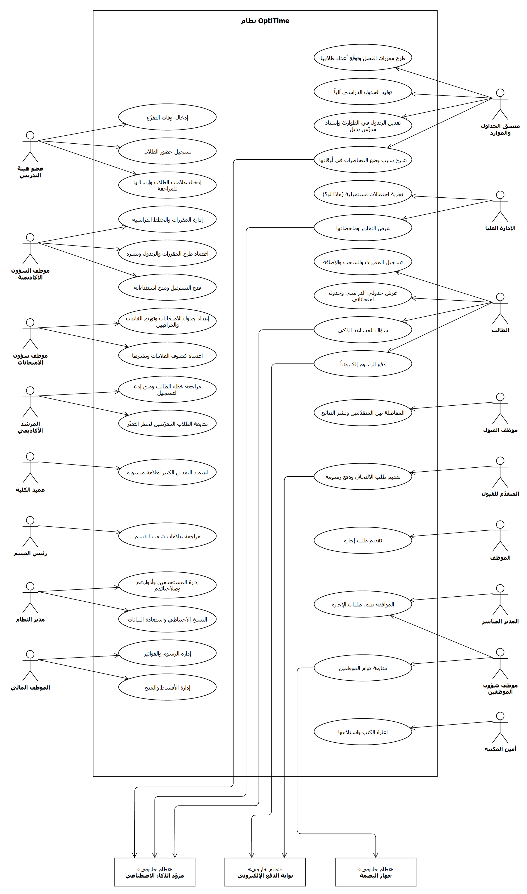

---

## 01. حالات استخدام منسق الجداول والموارد

**يوضّح المخطط:** ما يقوم به منسق الجداول والموارد: طرح مقررات الفصل وإنشاء الشعب وضبط قواعد الجدولة ومتابعة أوقات التفرّغ، ثم توليد الجدول وإرساله للاعتماد وتعديله في الطوارئ، وإدارة القاعات والأجهزة والرد على طلباتها، والاستعانة بالذكاء الاصطناعي في كتابة الشروط وشرح الجدول.

**العلاقات:**

- «حل التعارضات بحلول مقترحة» توسّع «توليد الجدول الدراسي آلياً» حين تبقى في الجدول تعارضات.

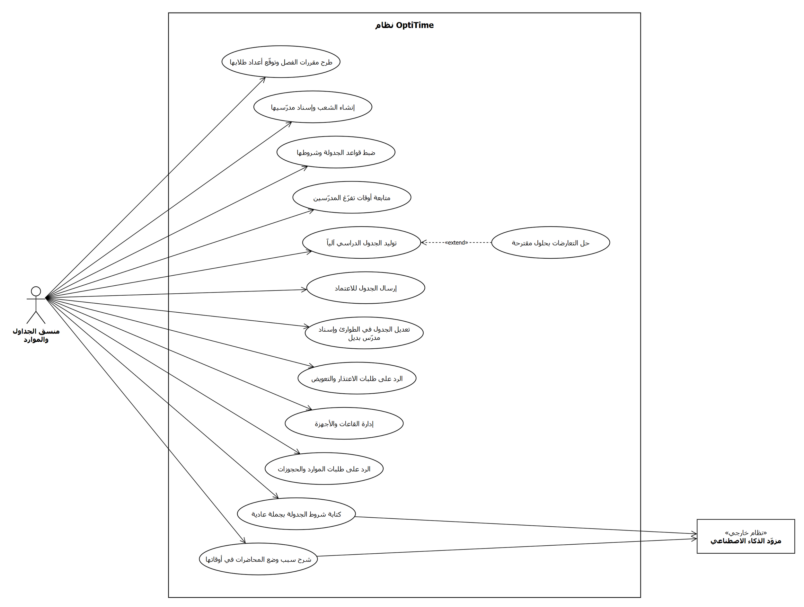

---

## 02. حالات استخدام عضو هيئة التدريس

**يوضّح المخطط:** ما يقوم به عضو هيئة التدريس: إدخال أوقات تفرّغه وعرض جدوله وطلب الاعتذار أو التعويض أو القاعة، ثم التدريس من نشر المحتوى والاختبارات القصيرة وتسجيل الحضور، وإدخال العلامات، وطلب الإجازة.

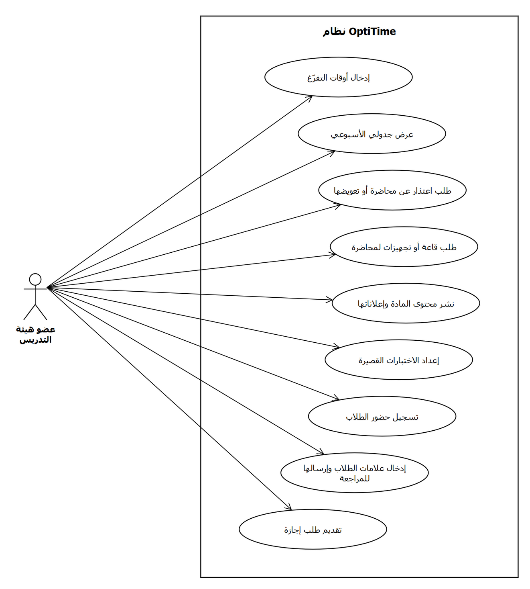

---

## 03. حالات استخدام الطالب

**يوضّح المخطط:** ما يقوم به الطالب: تقديم خطة الفصل لمرشده وتسجيل المقررات، ومتابعة جدوله وعلاماته، والتعلّم والحضور وتقييم المقررات، والطلبات الإلكترونية ودفع الرسوم، وسؤال المساعد الذكي.

**العلاقات:**

- «تسجيل المقررات والسحب والإضافة» تتضمن دائماً «التحقق من أهلية التسجيل».

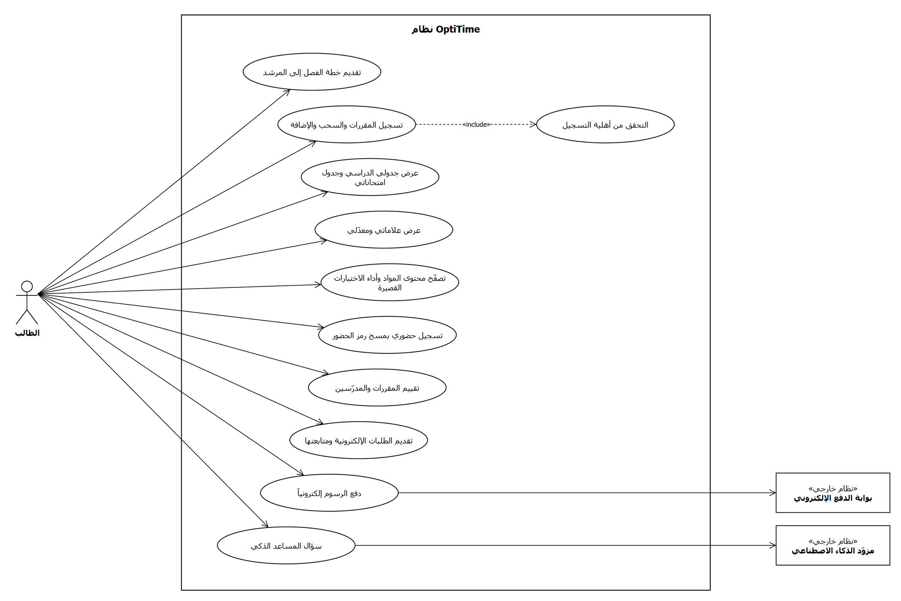

---

## 04. حالات استخدام موظف الشؤون الأكاديمية

**يوضّح المخطط:** ما يقوم به موظف الشؤون الأكاديمية: المقررات والخطط الدراسية والفصول ومراحلها، واعتماد الطرح والجدول ونشره، وفتح التسجيل واستثناءاته، واعتماد الحرمان وتعديل العلامات، وكشوف العلامات والخريجين، والطلبات الإلكترونية، ولوائح الجامعة للمساعد الذكي.

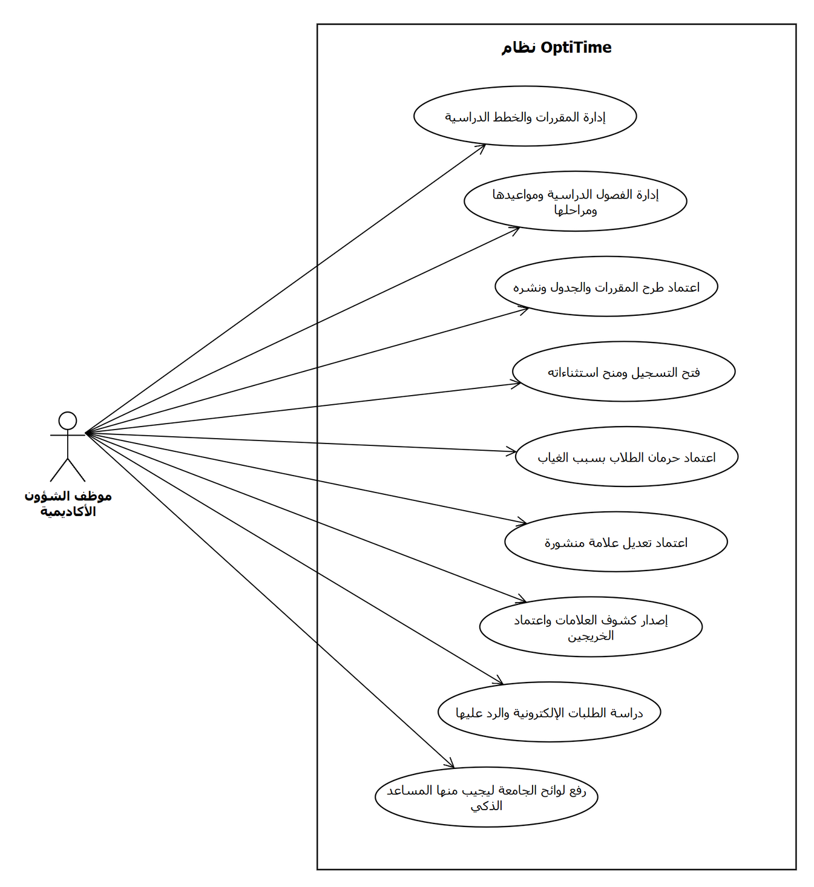

---

## 05. حالات استخدام موظف شؤون الامتحانات

**يوضّح المخطط:** ما يقوم به موظف شؤون الامتحانات: إعداد جدول الامتحانات وتوزيع القاعات والمراقبين، ومتابعة يوم الامتحان، والإدخال المزدوج لعلامة الامتحان النهائي، ثم اعتماد الكشوف ونشرها.

**العلاقات:**

- «اعتماد كشوف العلامات ونشرها» تتضمن دائماً «حساب المعدّل والوضع الأكاديمي».

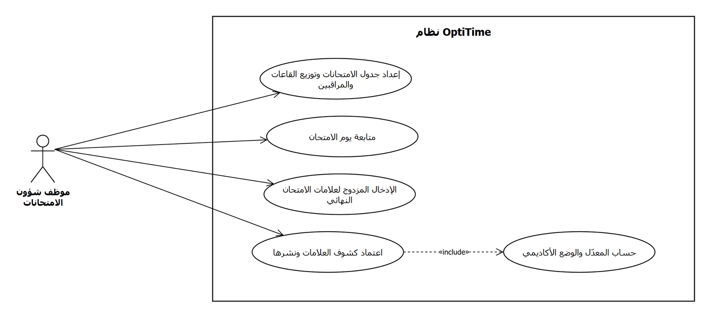

---

## 06. حالات استخدام المرشد الأكاديمي

**يوضّح المخطط:** ما يقوم به المرشد الأكاديمي: مراجعة خطط طلابه ومنحهم إذن التسجيل، ومتابعة تقدّمهم في خططهم، ومواعيد الإرشاد وملاحظاته، والإنذارات، والطلاب المعرّضين لخطر التعثّر.

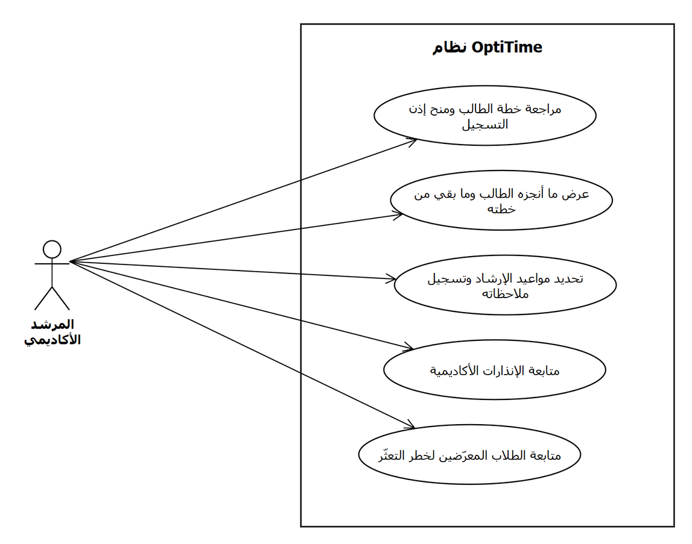

---

## 07. حالات استخدام الإدارة العليا والعميد ورئيس القسم

**يوضّح المخطط:** ما تقوم به القيادات: الإدارة العليا تطّلع على التقارير وملخصاتها وتجرّب الاحتمالات المستقبلية، والعميد ورئيس القسم يتابعان المدرّسين وأحمالهم ونتائج تقييم المقررات.

**العلاقات:**

- «عميد الكلية» و«رئيس القسم» كلاهما من «القيادة الأكاديمية» ويرثان حالاتها، وينفرد العميد باعتماد التعديل الكبير للعلامة، ورئيس القسم بمراجعة علامات شعب قسمه.

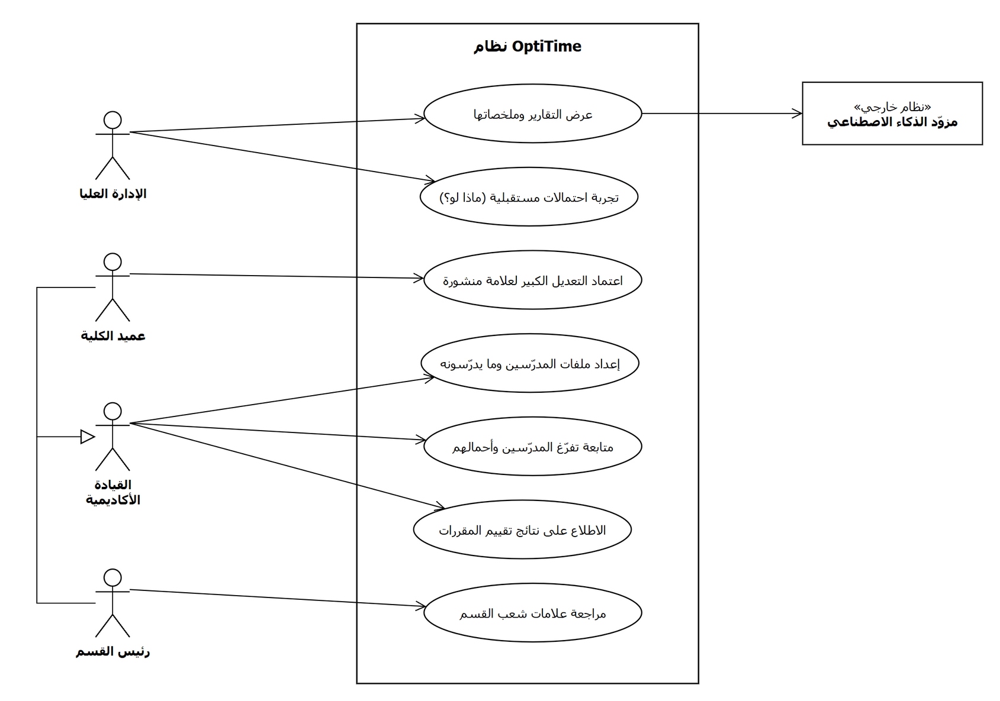

---

## 08. حالات استخدام مدير النظام

**يوضّح المخطط:** ما يقوم به مدير النظام: المستخدمون وأدوارهم وصلاحياتهم، والهيكل التنظيمي، وإعدادات النظام، واستيراد البيانات، والنسخ الاحتياطي، وسجل العمليات، وضبط خدمة الذكاء الاصطناعي.

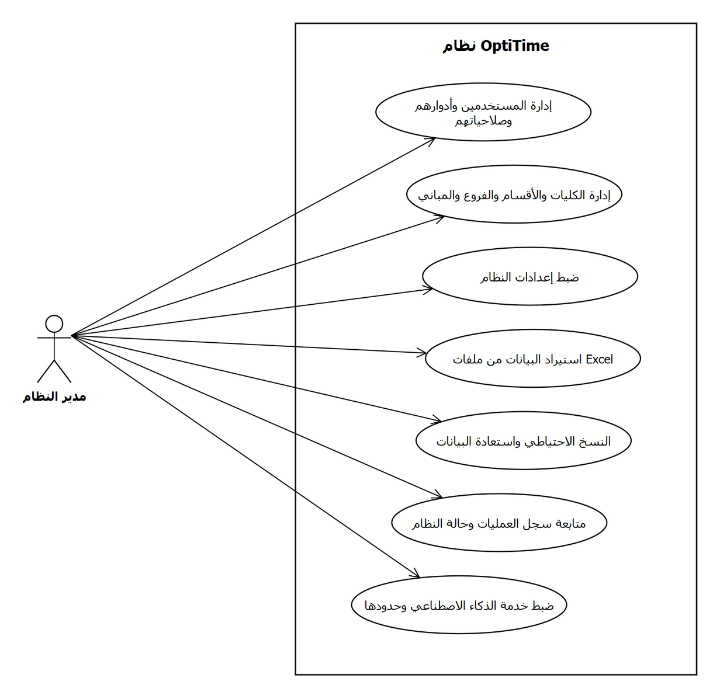

---

## 09. حالات استخدام موظف القبول والمتقدّم للقبول

**يوضّح المخطط:** ما يقوم به موظف القبول والمتقدّم: فتح دورات القبول ومراجعة الطلبات والمفاضلة ونشر النتائج وإنشاء ملفات الطلاب، وتقديم طلب الالتحاق ودفع رسومه وقبول العرض.

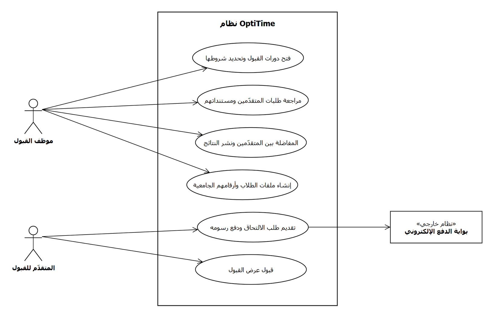

---

## 10. حالات استخدام الموظف المالي

**يوضّح المخطط:** ما يقوم به الموظف المالي: الرسوم والفواتير، والدفعات النقدية، والأقساط والمنح، والغرامات والمبالغ المستردة، والموانع المالية.

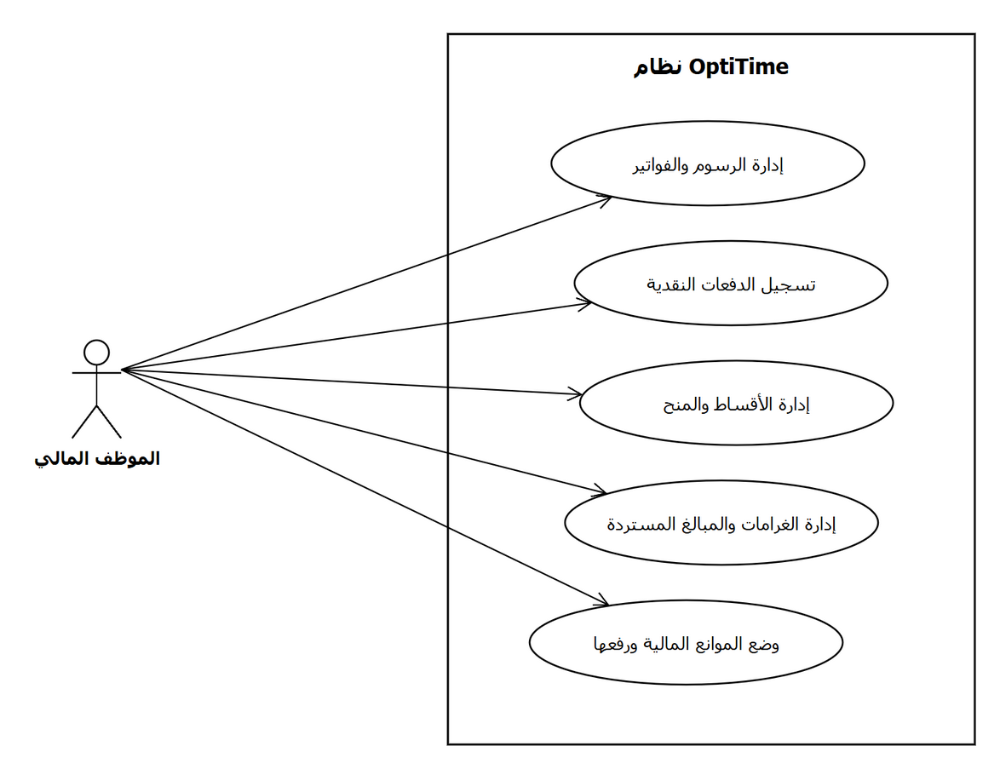

---

## 11. حالات استخدام شؤون الموظفين والمكتبة

**يوضّح المخطط:** ما يقوم به الموظفون وشؤون الموظفين والمكتبة: طلب الإجازة والموافقة عليها، والملف الوظيفي والدوام، وحجز القاعات، وملفات الموظفين وعقودهم، وكتب المكتبة وإعارتها.

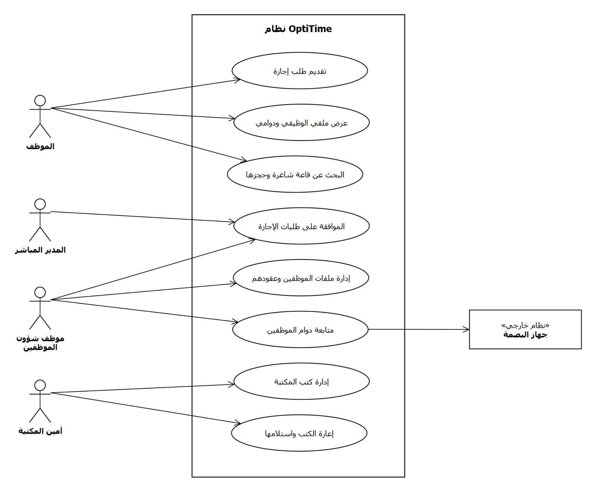

---

