

> **الوثيقة:** مخططات حالات الاستخدام (Use Case Diagrams) — **النظام:** OptiTime — **التاريخ:** 2026-11-08

# مخططات حالات الاستخدام — نظام OptiTime

تضم هذه الوثيقة ثلاثة عشر مخطط حالات استخدام تغطي وحدات النظام الثلاث والعشرين وحالات الاستخدام المئة والثلاث عشرة في وثيقة السيناريوهات. وصيغت أسماء الحالات والفاعلين بكلمات بسيطة يفهمها أي قارئ، وجُمعت عمليات الإضافة والتعديل والحذف والعرض في حالة «إدارة …» واحدة، ووُزّعت الأدوار بحسب سيناريوهات حالات الاستخدام ومصفوفة الصلاحيات (RACI) في المقترح.

**الملفات:** كود كل مخطط في مجلد `Src` وصورته في مجلد `Images` بالاسم نفسه، والكود في هذه الوثيقة مطابق حرفياً لملفات `Src`.

## قواعد الرسم

| العنصر | معناه |
|---|---|
| فاعل على اليسار | شخص يستخدم النظام |
| فاعل على اليمين | خدمة أو جهاز أو نظام خارجي يتعامل معه النظام |
| خط متصل | الفاعل ينفّذ الحالة، أو يتخذ فيها قراراً، أو يطّلع بها على ما يخصه |
| سهم متقطع «include» | يتجه من الحالة الأساسية إلى الحالة المتضمَّنة، وتُنفَّذ المتضمَّنة في كل مرة |
| سهم متقطع «extend» | يتجه من الحالة الموسِّعة إلى الحالة الأساسية، وتُنفَّذ الموسِّعة عند شرط أو اختيار فقط |
| سهم برأس مثلث فارغ | تعميم: الفاعل الفرعي نوع من الفاعل العام ويرث حالاته |
| إطار بعنوان | حدود النظام في المجال الذي يغطيه المخطط |

## الفاعلون

| الفاعل | من هو |
|---|---|
| المستخدم (أي دور) | كل من له حساب في النظام، وكل دور يرث حالاته. |
| مدير النظام | يدير الحسابات والصلاحيات والإعدادات والهيكل التنظيمي والنسخ الاحتياطي. |
| الإدارة العليا | رئاسة الجامعة: تطّلع على التقارير وتجرّب الاحتمالات المستقبلية. |
| عميد الكلية | يدير أقسام كليته ويتابع مدرّسيها ويعتمد التعديل الكبير للعلامات. |
| رئيس القسم | يراجع علامات شعب قسمه ويتابع مدرّسيه. |
| منسق الجداول والموارد | يطرح المقررات وينشئ الشعب ويبني الجدول ويدير القاعات والأجهزة. |
| موظف الشؤون الأكاديمية | يعتمد الطرح والجدول وتعديل العلامات الصغير، ويدير التقويم والخطط والتسجيل والتخرج. |
| موظف شؤون الامتحانات | يجدول الامتحانات ويطابق العلامات وينشرها. |
| موظف القبول | يدير دورات القبول والمفاضلة وملفات الطلاب. |
| المرشد الأكاديمي | يراجع خطط طلابه ويمنحهم إذن التسجيل ويتابع تعثّرهم. |
| عضو هيئة التدريس | يحدد تفرّغه ويدرّس ويسجّل الحضور ويدخل العلامات. |
| الطالب | يسجّل مقرراته ويتابع جدوله وعلاماته ورسومه وطلباته. |
| المتقدّم للقبول | يقدّم طلب الالتحاق قبل أن يصبح طالباً. |
| الموظف المالي | يدير الرسوم والفواتير والصندوق والأقساط والمنح. |
| موظف شؤون الموظفين | يدير ملفات الموظفين وعقودهم ويعتمد إجازاتهم. |
| أمين المكتبة | يعير الكتب ويستلمها. |
| الموظف | أي عامل في الجامعة: يطّلع على ملفه ودوامه ويطلب الإجازة ويحجز القاعات. |
| المدير المباشر | مسؤول الموظف الذي يوافق أولاً على إجازته. |
| خدمة البريد الإلكتروني | ترسل رمز استعادة كلمة المرور. |
| خدمة إشعارات الجوال | توصل الإشعارات الفورية إلى أجهزة المستخدمين. |
| مزوّد الذكاء الاصطناعي | النموذج اللغوي الذي يفهم النصوص ويكتب الإجابات والملخصات. |
| بوابة الدفع الإلكتروني | تنفّذ دفع رسوم التقديم والفواتير. |
| نظام خارجي | نظام آخر يتصل بالنظام بمفتاح يصدره مدير النظام. |
| جهاز البصمة | يرسل حضور الموظفين وانصرافهم. |

## تغطية وحدات النظام

| الوحدة | المخطط |
|---|---|
| الهوية والدخول | 01، 02 |
| إدارة النظام | 02 |
| التواصل والإشعارات | 01 |
| الهيكل التنظيمي | 03 |
| التقويم الأكاديمي | 03 |
| الخطط والمقررات | 04 |
| الموارد | 05 |
| الجدولة | 06 |
| سجلات الطلاب | 09، 10 |
| تسجيل المقررات | 09 |
| الحضور | 07 |
| التعلّم | 07 |
| الدرجات | 08، 10 |
| الامتحانات | 08 |
| القبول | 09 |
| الإرشاد الأكاديمي | 10 |
| المالية | 11 |
| المكتبة | 12 |
| شؤون الموظفين | 12 |
| الطلبات الإلكترونية | 11 |
| تقييم المقررات | 07 |
| التقارير والتحليلات | 13 |
| الذكاء الاصطناعي | 01، 10، 13 |

## فهرس المخططات

| الرقم | المخطط | الحالات | الفاعلون |
|---|---|---|---|
| 01 | حسابي والخدمات المشتركة | 12 | المستخدم (أي دور)، وخدمة البريد الإلكتروني، وخدمة إشعارات الجوال، ومزوّد الذكاء الاصطناعي |
| 02 | إدارة النظام | 7 | مدير النظام، وموظف الشؤون الأكاديمية، ومنسق الجداول والموارد، ونظام خارجي |
| 03 | الهيكل التنظيمي والتقويم الأكاديمي | 8 | مدير النظام، وعميد الكلية، وموظف الشؤون الأكاديمية، والمستخدم (أي دور) |
| 04 | المقررات والخطط الدراسية | 6 | موظف الشؤون الأكاديمية، ومنسق الجداول والموارد، ومدير النظام، ورئيس القسم، وعميد الكلية، وعضو هيئة التدريس |
| 05 | القاعات والموارد | 8 | منسق الجداول والموارد، ومدير النظام، والموظف، وأمين المكتبة، وعضو هيئة التدريس |
| 06 | الجدول الدراسي | 14 | منسق الجداول والموارد، وموظف الشؤون الأكاديمية، ومدير النظام، ورئيس القسم، وعميد الكلية، وعضو هيئة التدريس، والطالب |
| 07 | التدريس والحضور | 9 | عضو هيئة التدريس، والطالب، وموظف الشؤون الأكاديمية، ورئيس القسم، وعميد الكلية |
| 08 | الامتحانات والعلامات | 11 | موظف شؤون الامتحانات، وعضو هيئة التدريس، وموظف الشؤون الأكاديمية، ورئيس القسم، وعميد الكلية، والطالب |
| 09 | القبول والتسجيل | 13 | موظف القبول، والمتقدّم للقبول، وموظف الشؤون الأكاديمية، والطالب، وبوابة الدفع الإلكتروني |
| 10 | سجلات الطلاب والإرشاد | 11 | موظف القبول، ومدير النظام، وموظف الشؤون الأكاديمية، والطالب، والمرشد الأكاديمي |
| 11 | المالية والطلبات الإلكترونية | 7 | الموظف المالي، والطالب، والمرشد الأكاديمي، وموظف الشؤون الأكاديمية، وموظف شؤون الامتحانات، وبوابة الدفع الإلكتروني |
| 12 | المكتبة وشؤون الموظفين | 9 | الطالب، والموظف، وعضو هيئة التدريس، وأمين المكتبة، والمدير المباشر، وموظف شؤون الموظفين، وجهاز البصمة |
| 13 | التقارير والذكاء الاصطناعي | 10 | موظف الشؤون الأكاديمية، ومدير النظام، والإدارة العليا، ومنسق الجداول والموارد، وعضو هيئة التدريس، ومزوّد الذكاء الاصطناعي |

---

## 01. حسابي والخدمات المشتركة (My Account and Shared Services)

**الفاعلون:** المستخدم (أي دور)، وخدمة البريد الإلكتروني، وخدمة إشعارات الجوال، ومزوّد الذكاء الاصطناعي. **يوضّح المخطط:** ما يفعله كل مستخدم أياً كان دوره: الدخول والخروج، واستعادة كلمة المرور، والملف الشخصي، ولوحة التحكم، والبحث، والإشعارات، وسؤال المساعد الذكي.

**العلاقات:**

- «إدخال رمز التحقق من تطبيق الجوال» توسّع «تسجيل الدخول» حين يكون التحقق بخطوتين مفعّلاً للحساب.
- «استعادة كلمة المرور المنسية» تتضمن دائماً «التحقق من الرمز المرسل إلى البريد» ثم «تغيير كلمة المرور».
- «تغيير كلمة المرور» و«تفعيل التحقق بخطوتين» توسّعان «إدارة الملف الشخصي» حين يختارهما المستخدم.
- ترسل خدمة البريد رمز الاستعادة، وتوصل خدمة إشعارات الجوال الإشعارات، ويكتب مزوّد الذكاء الاصطناعي إجابات المساعد.
- كل أدوار النظام ترث حالات «المستخدم (أي دور)».

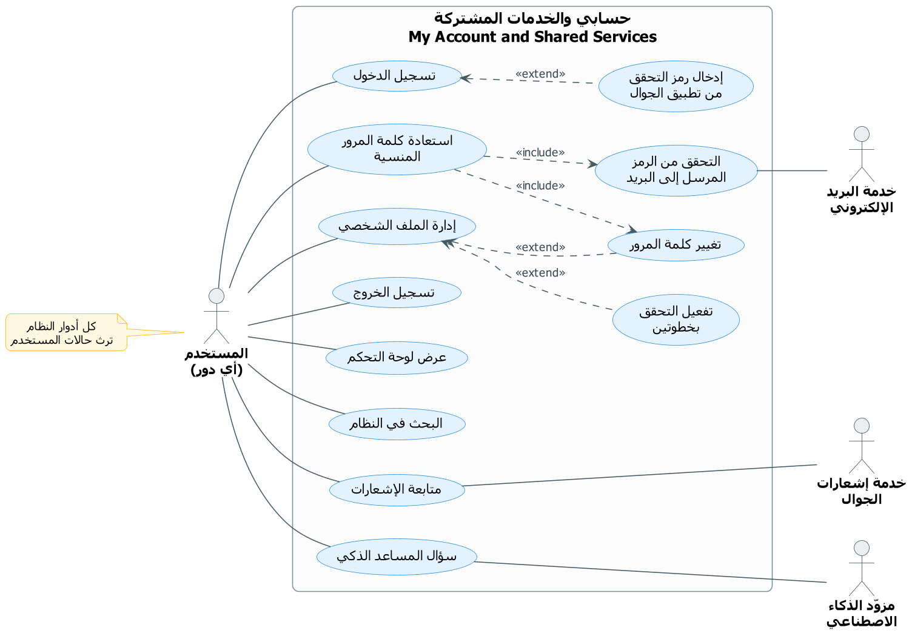

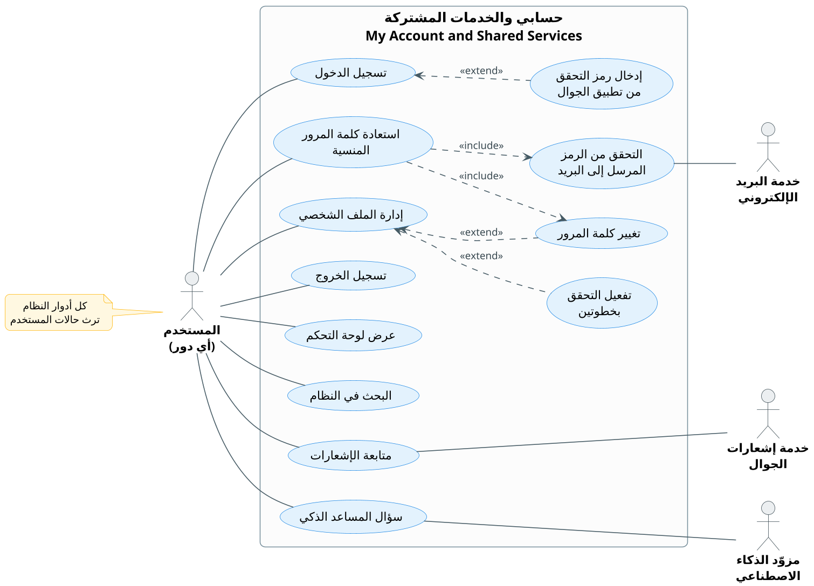

---

## 02. إدارة النظام (System Administration)

**الفاعلون:** مدير النظام، وموظف الشؤون الأكاديمية، ومنسق الجداول والموارد، ونظام خارجي. **يوضّح المخطط:** ما يتولاه مدير النظام: المستخدمون وأدوارهم، والإعدادات ووضع الصيانة، وحالة النظام وسجل العمليات، والنسخ الاحتياطي، وربط النظام بالخدمات الخارجية، واستيراد البيانات من ملفات Excel.

**العلاقات:**

- «الدخول باسم مستخدم آخر لفحص مشكلته» توسّع «إدارة المستخدمين والأدوار»، فيبدؤها المدير من حساب المستخدم عند الحاجة.
- يستورد مدير النظام وموظف الشؤون الأكاديمية ومنسق الجداول، كلٌّ ما يملك إنشاءه يدوياً فقط.
- يتصل النظام الخارجي بمفتاح يصدره مدير النظام في «ربط النظام بالخدمات والأنظمة الخارجية».

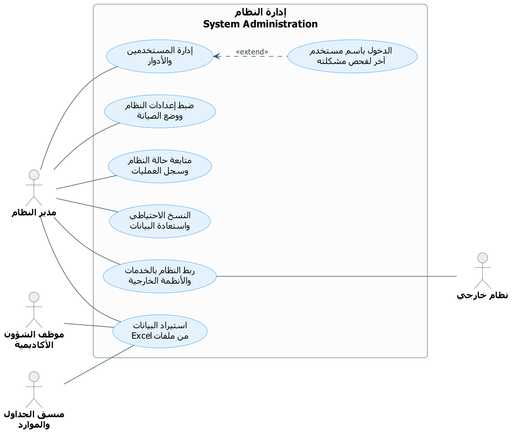

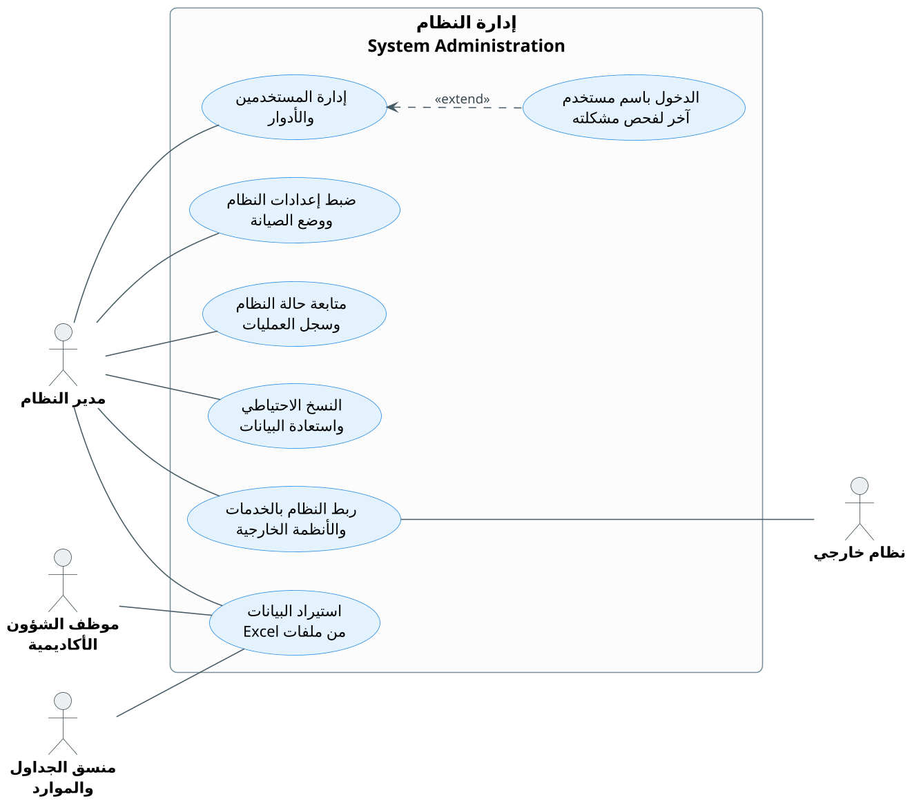

---

## 03. الهيكل التنظيمي والتقويم الأكاديمي (Organization and Academic Calendar)

**الفاعلون:** مدير النظام، وعميد الكلية، وموظف الشؤون الأكاديمية، والمستخدم (أي دور). **يوضّح المخطط:** بناء الجامعة (الفروع والمباني، والكليات والأقسام وقياداتها، والوحدات الإدارية، والبرامج الأكاديمية)، والتقويم الأكاديمي (الفصول ومواعيدها وعطلها ومراحلها)، وعرض التقويم لكل مستخدم.

**العلاقات:**

- يدير مدير النظام الكليات والأقسام كلها، ويدير العميد أقسام كليته ويعيّن رؤساءها.
- ينشئ مدير النظام البرامج الأكاديمية ويغلقها، ويعدّل موظف الشؤون الأكاديمية لوائحها.
- «نقل الفصل الدراسي إلى مرحلته التالية» يتضمن «التحقق من اكتمال شروط الانتقال»، فلا ينتقل الفصل قبل اكتمالها.
- يشارك مدير النظام موظفَ الشؤون الأكاديمية إدارة الفصول ونقلها بين مراحلها.

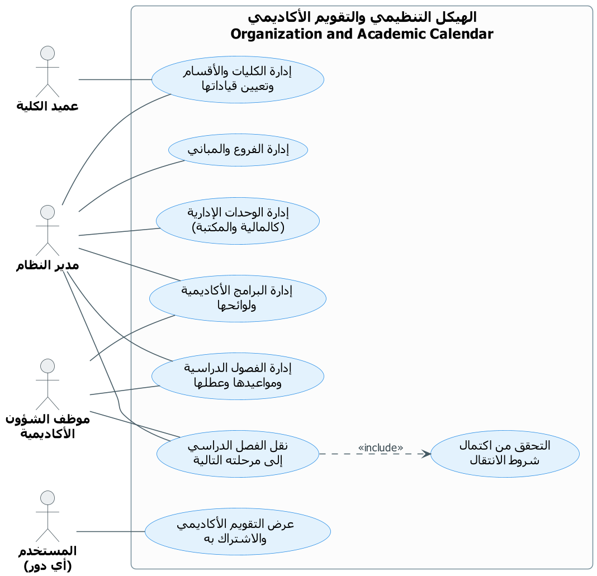

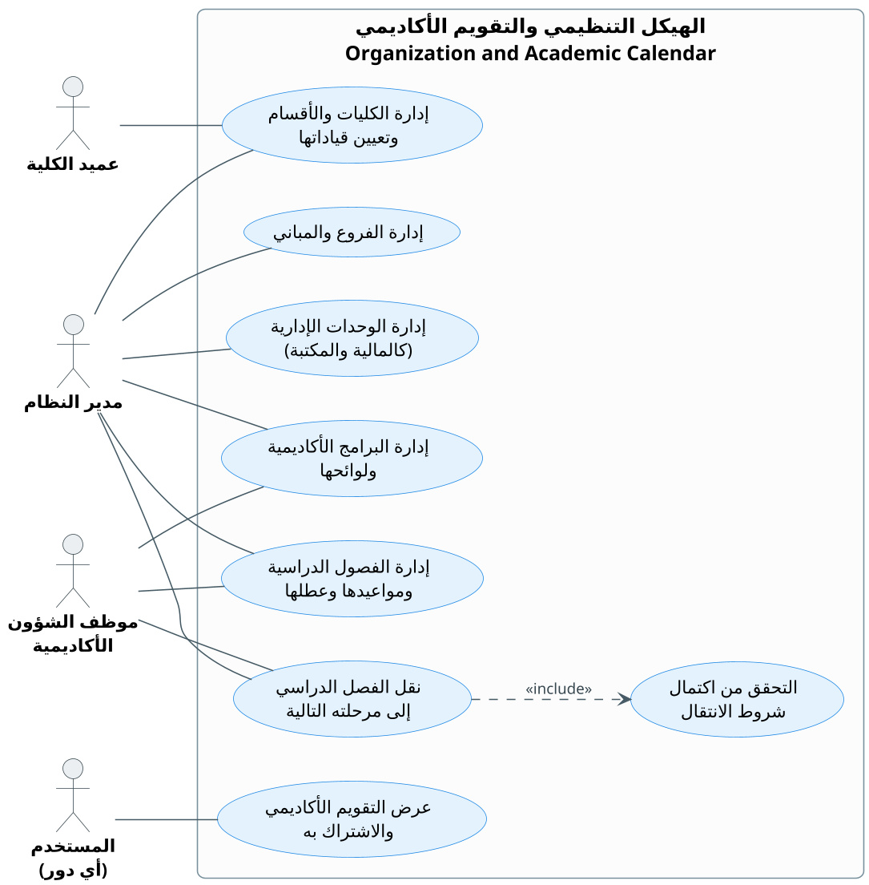

---

## 04. المقررات والخطط الدراسية (Courses and Study Plans)

**الفاعلون:** موظف الشؤون الأكاديمية، ومنسق الجداول والموارد، ومدير النظام، ورئيس القسم، وعميد الكلية، وعضو هيئة التدريس. **يوضّح المخطط:** المقررات ومتطلباتها، والخطط الدراسية، وسلالم التقدير، وملف كل مدرّس: المقررات التي يدرّسها وساعاته المكتبية ورغباته في التدريس.

**العلاقات:**

- «تحديد المتطلبات السابقة والمقررات المعادلة» توسّع «إدارة المقررات ووصف محتواها» حين يحدد المستخدم ما يلزم لأخذ المقرر، ويرفض النظام أي متطلبات تدور في حلقة.
- يعدّ موظف الشؤون الأكاديمية الخطة الدراسية ويعتمدها، ويشاركه مدير النظام إدارة سلالم التقدير.
- يعدّ موظف الشؤون الأكاديمية ملفات المدرّسين جميعاً، والعميد ورئيس القسم ملفات مدرّسي نطاقهما: الرتبة وحدود الساعات الأسبوعية والمقررات التي يدرّسها كل مدرّس. ويحدد عضو هيئة التدريس بنفسه ساعاته المكتبية ورغبته في تدريس كل مقرر.

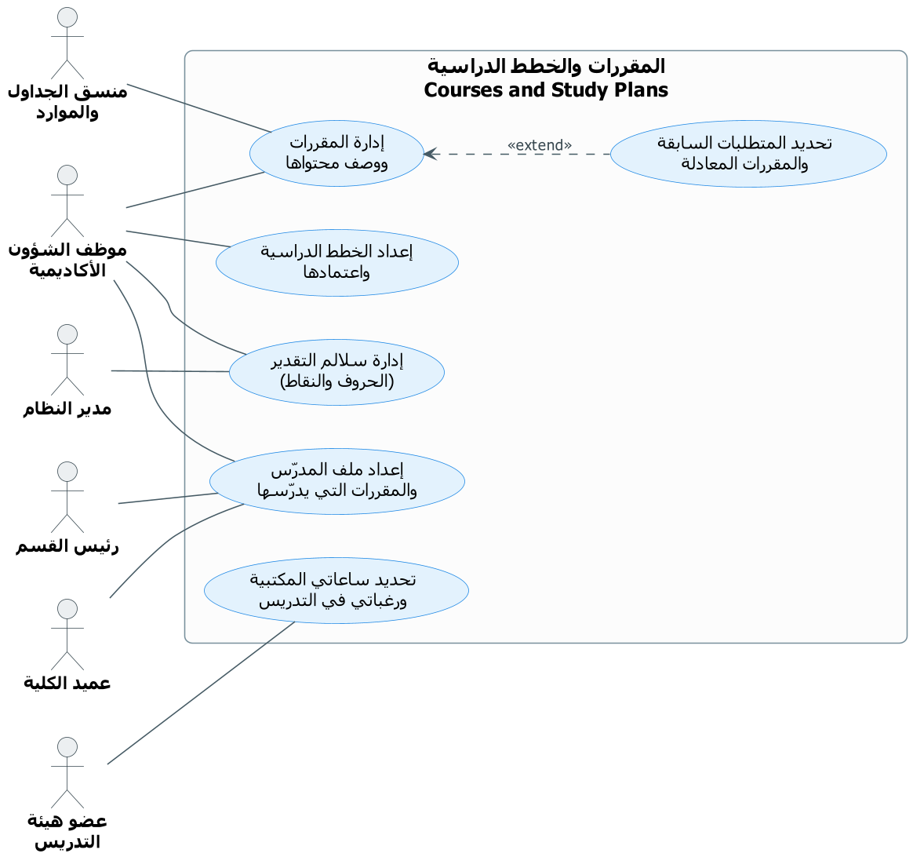

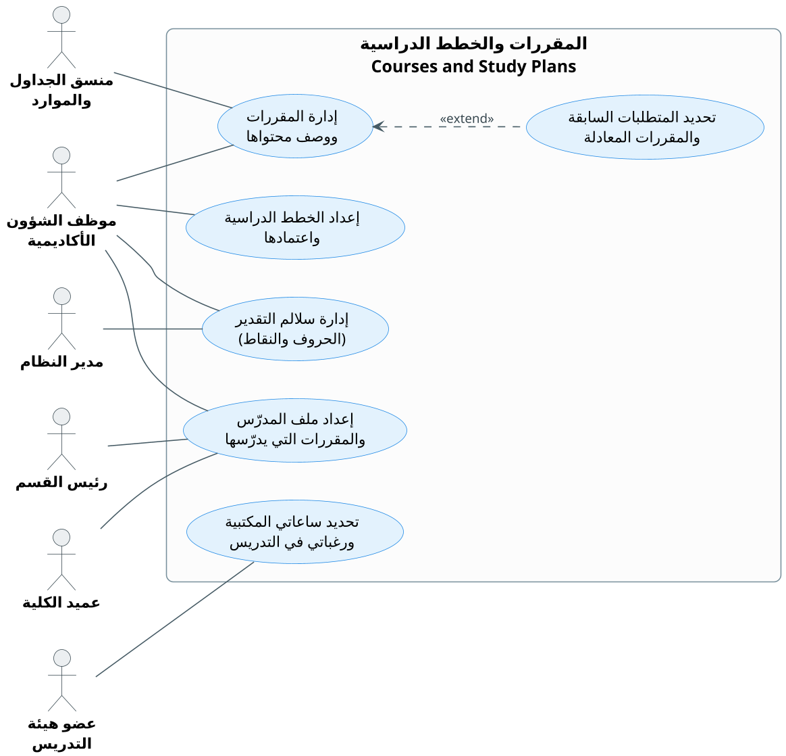

---

## 05. القاعات والموارد (Rooms and Resources)

**الفاعلون:** منسق الجداول والموارد، ومدير النظام، والموظف، وأمين المكتبة، وعضو هيئة التدريس. **يوضّح المخطط:** إدارة القاعات والمختبرات والأجهزة وأعطالها، والبحث عن قاعة شاغرة وحجزها، وطلب موارد إضافية لمحاضرة والرد على الطلبات والحجوزات.

**العلاقات:**

- أمين المكتبة وعضو هيئة التدريس نوعان من «الموظف» (تعميم)، فيرثان البحث عن قاعة شاغرة وحجزها.
- «إدارة القاعات والمختبرات» تتضمن «تحديد مقاعد الامتحان في القاعة».
- «الإبلاغ عن عطل ومتابعة إصلاحه» توسّع «إدارة القاعات والمختبرات» و«إدارة الأجهزة والتجهيزات» عند وقوع عطل.
- «حجز قاعة» توسّع «البحث عن قاعة شاغرة» حين يختار الموظف قاعة ليحجزها، ويؤكّد المنسق الحجز في القاعات غير المفتوحة للحجز ضمن «الرد على طلبات الموارد والحجوزات».
- يشارك مدير النظام المنسقَ إدارة القاعات والأجهزة.

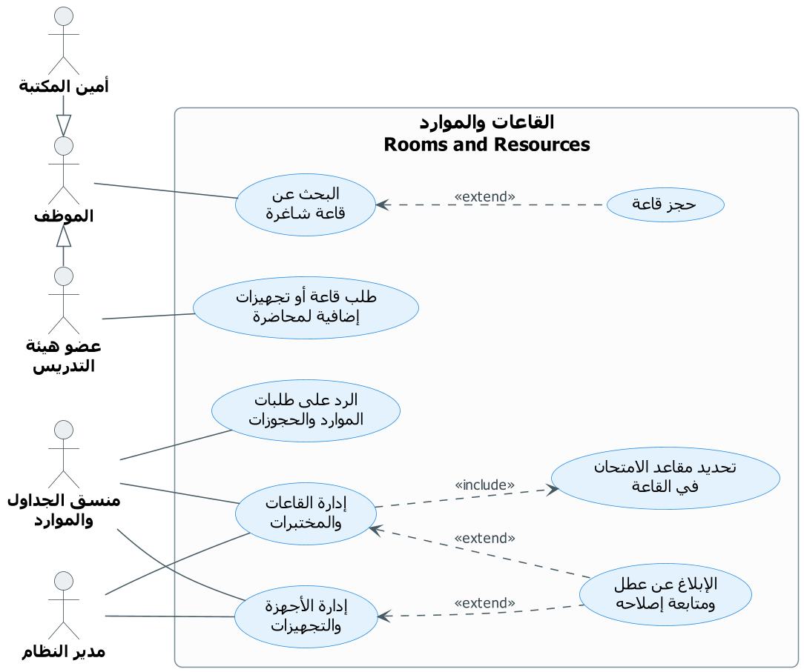

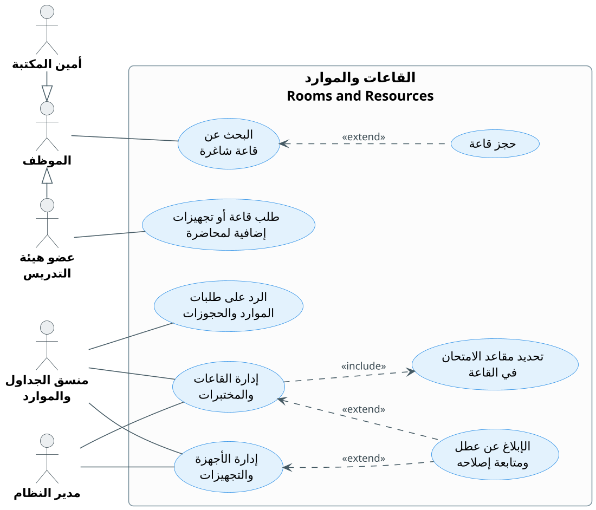

---

## 06. الجدول الدراسي (Course Timetabling)

**الفاعلون:** منسق الجداول والموارد، وموظف الشؤون الأكاديمية، ومدير النظام، ورئيس القسم، وعميد الكلية، وعضو هيئة التدريس، والطالب. **يوضّح المخطط:** طريق الجدول من طرح المقررات وإنشاء الشعب وضبط القواعد وجمع أوقات التفرّغ، إلى بنائه واعتماده ونشره، ثم عرضه وتعديله في الطوارئ.

**العلاقات:**

- «حل التعارضات بحلول مقترحة» توسّع «بناء الجدول الدراسي آلياً وتعديله» حين تبقى في الجدول تعارضات.
- «اقتراح مدرّس بديل» توسّع «تعديل الجدول في الحالات الطارئة» حين يغيب المدرّس بإجازة معتمدة.
- يبني المنسق الجدول ويرسله للاعتماد، ويعتمده موظف الشؤون الأكاديمية وينشره، كما يعتمد قبل ذلك المقررات المطروحة.
- يتابع المنسق ورئيس القسم والعميد تسليم أوقات التفرّغ، كلٌّ في نطاقه.
- يطلب عضو هيئة التدريس الاعتذار عن محاضرة أو تعويضها، ويقبل المنسق الطلب أو يرفضه في «الرد على طلبات الاعتذار والتعويض».

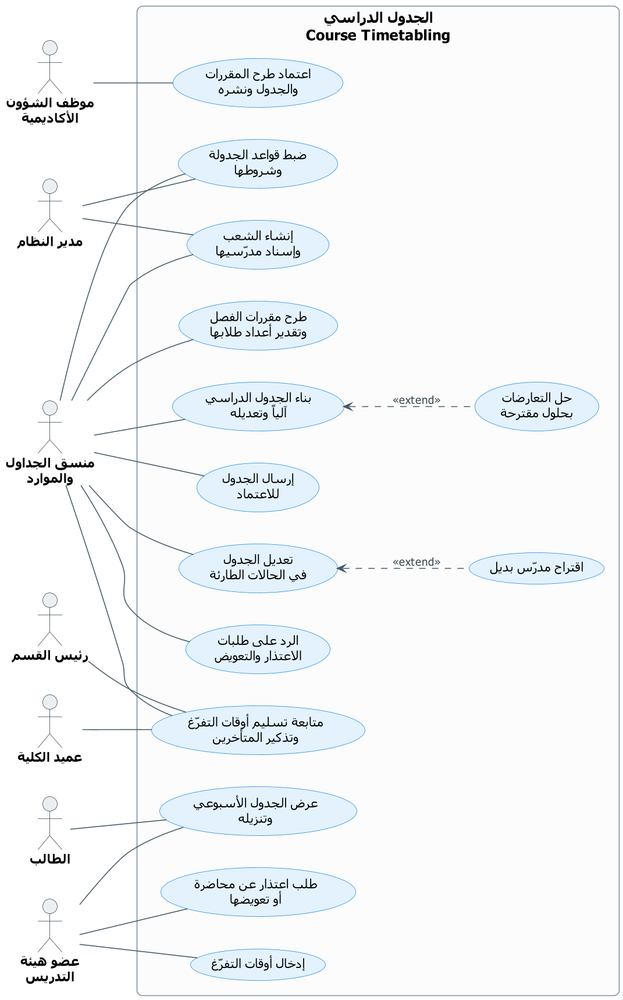

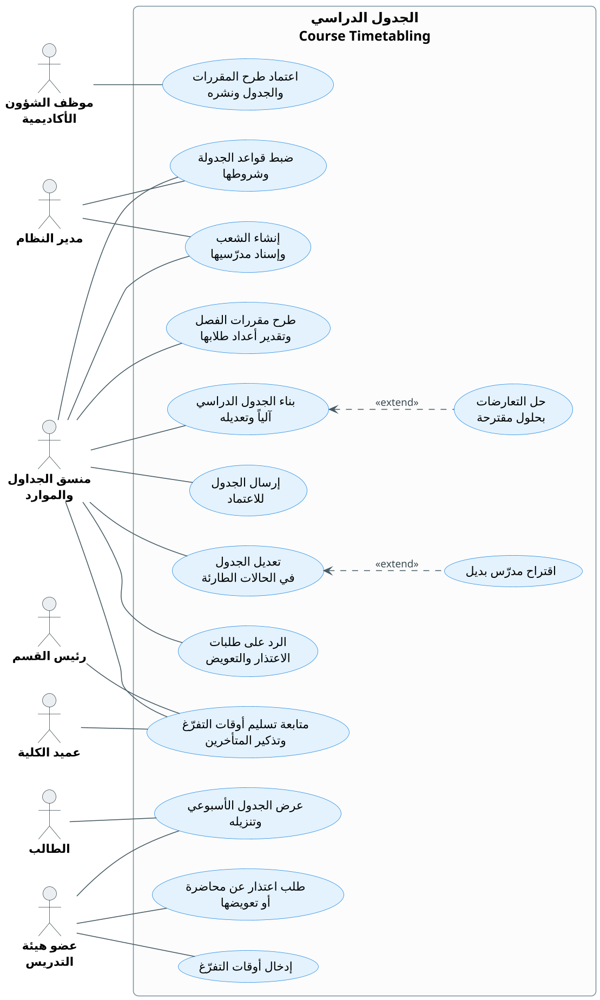

---

## 07. التدريس والحضور (Teaching and Attendance)

**الفاعلون:** عضو هيئة التدريس، والطالب، وموظف الشؤون الأكاديمية، ورئيس القسم، وعميد الكلية. **يوضّح المخطط:** محتوى المادة وإعلاناتها، والاختبارات القصيرة، والحضور والغياب والحرمان، وتقييم المقررات ونتائجه.

**العلاقات:**

- يسجّل عضو هيئة التدريس الحضور يدوياً أو يعرض رمز QR، ويسجّل الطالب حضوره بمسح الرمز بجواله.
- يطّلع الطالب على غيابه وإنذاراته، ويعتمد موظف الشؤون الأكاديمية حرمان من تجاوز غيابه الحد.
- يقيّم الطالب المقرر والمدرّس دون كشف هويته، ويطّلع المدرّس ورئيس القسم والعميد على النتائج.

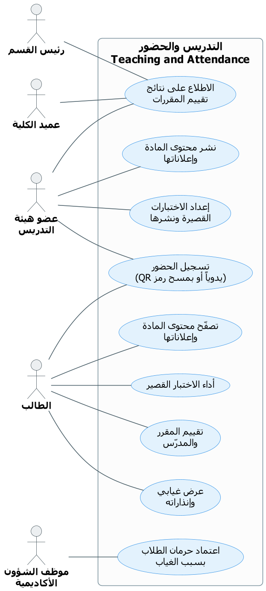

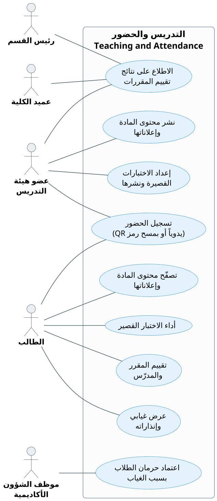

---

## 08. الامتحانات والعلامات (Exams and Marks)

**الفاعلون:** موظف شؤون الامتحانات، وعضو هيئة التدريس، وموظف الشؤون الأكاديمية، ورئيس القسم، وعميد الكلية، والطالب. **يوضّح المخطط:** جدول الامتحانات وقاعاتها ومراقبوها، ويوم الامتحان، وطريق العلامة من إدخالها إلى نشرها وتعديلها، وما يراه الطالب.

**العلاقات:**

- «إعداد جدول الامتحانات» يتضمن «توزيع القاعات والمقاعد والمراقبين».
- كل من «مطابقة العلامات واعتمادها ونشرها» و«اعتماد تعديل علامة منشورة» يتضمن «حساب المعدّل والوضع الأكاديمي».
- طريق العلامة: يدخلها المدرّس، ثم يراجعها رئيس القسم، ثم يطابقها موظف شؤون الامتحانات ويعتمدها وينشرها.
- يطلب المدرّس تعديل علامة منشورة بسبب موثّق، فيعتمد موظف الشؤون الأكاديمية التعديل الصغير، ويعتمد العميد التعديل الكبير أو الذي يحوّل النجاح رسوباً أو العكس.
- يراقب عضو هيئة التدريس قاعة الامتحان فيسجّل حضورها وحوادثها.

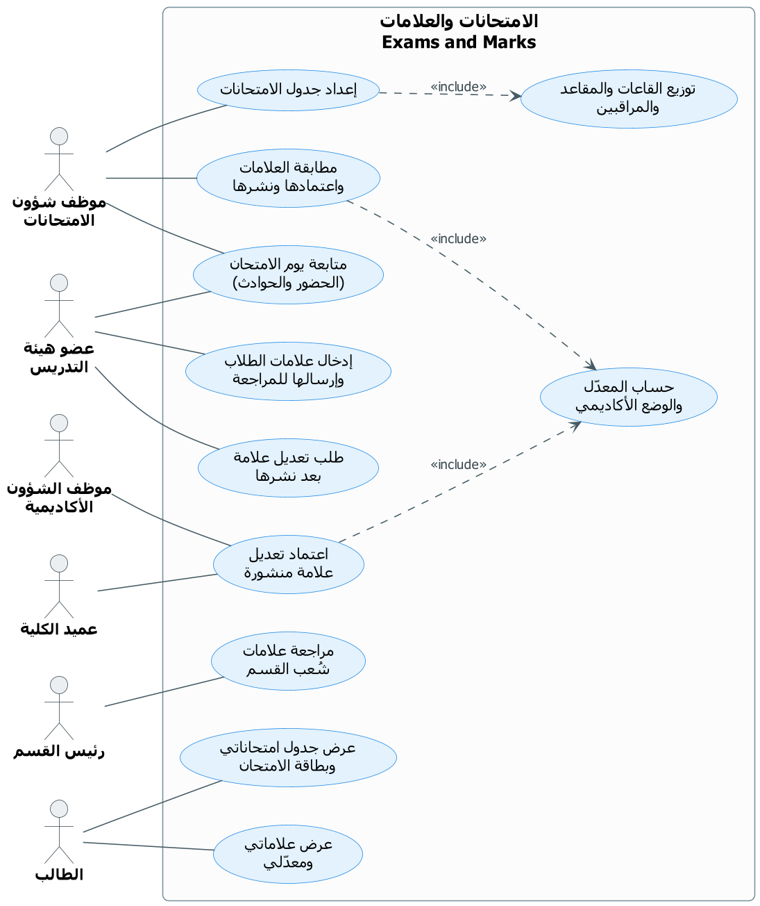

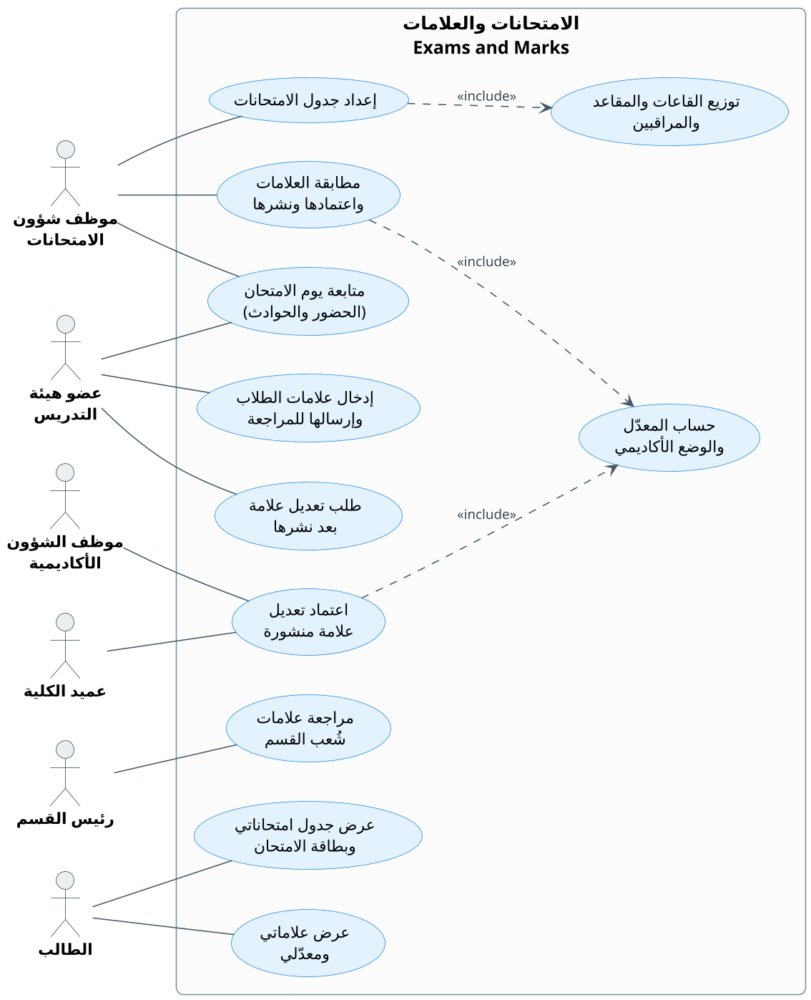

---

## 09. القبول والتسجيل (Admission and Registration)

**الفاعلون:** موظف القبول، والمتقدّم للقبول، وموظف الشؤون الأكاديمية، والطالب، وبوابة الدفع الإلكتروني. **يوضّح المخطط:** القبول من فتح دوراته إلى نشر نتائجه وتحوّل المقبول إلى طالب، ثم تسجيل المقررات والسحب والإضافة.

**العلاقات:**

- «تقديم طلب الالتحاق ومتابعته» يتضمن «دفع رسوم التقديم» عبر بوابة الدفع الإلكتروني.
- «قبول عرض القبول» يتضمن «إنشاء ملف الطالب ورقمه الجامعي»، فيصبح المتقدّم طالباً.
- كل من «تسجيل المقررات» و«السحب والإضافة» يتضمن «التحقق من أهلية التسجيل».
- «الانتظار على مقعد في شعبة ممتلئة» توسّع «تسجيل المقررات» حين تمتلئ الشعبة.

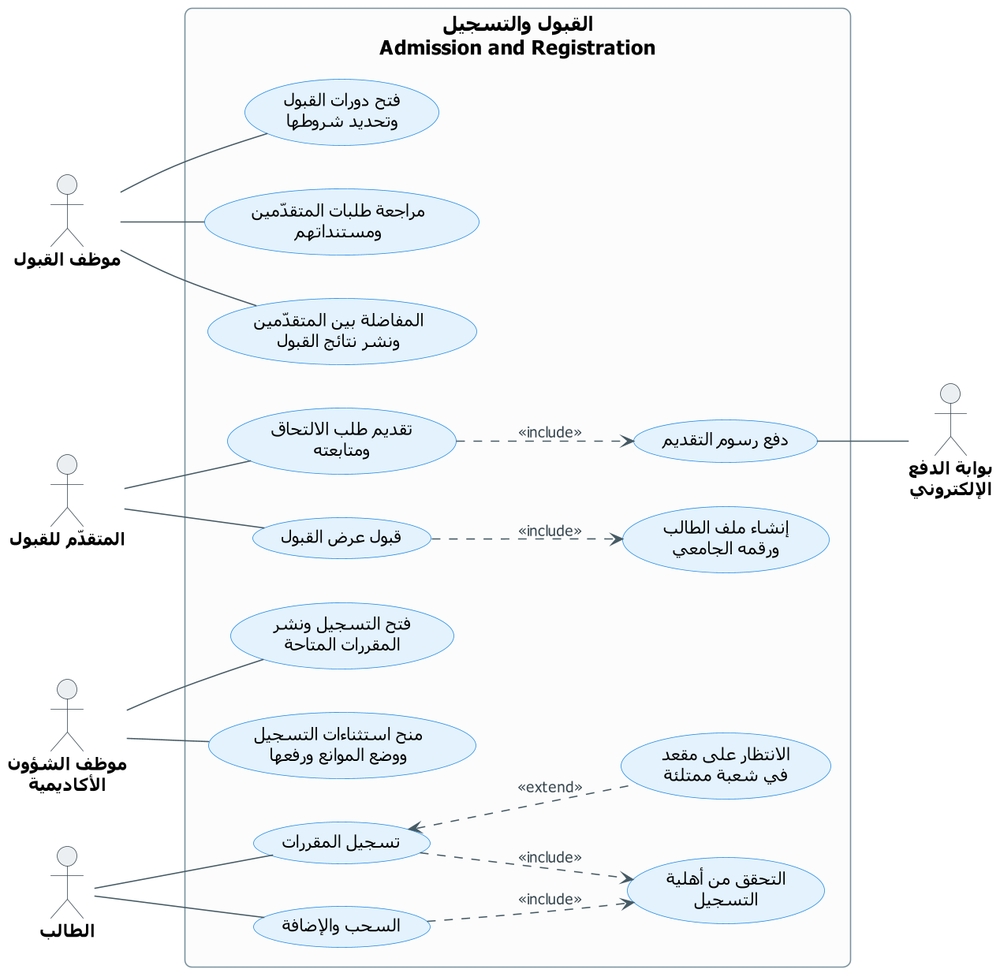

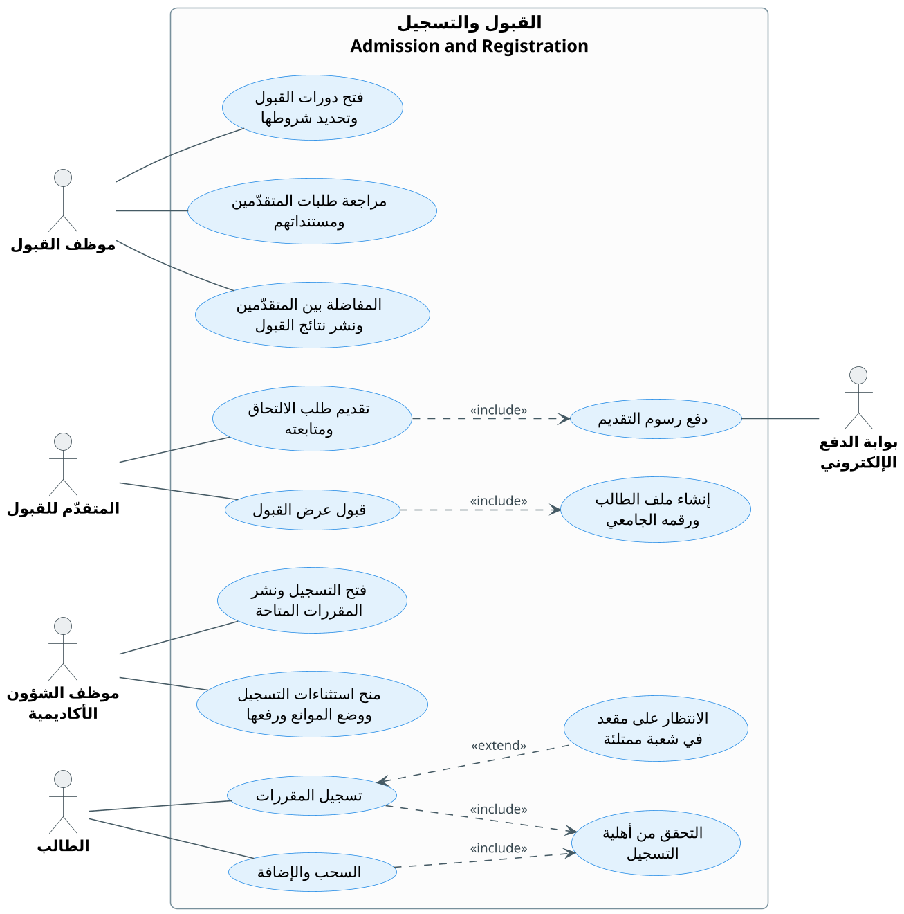

---

## 10. سجلات الطلاب والإرشاد (Student Records and Advising)

**الفاعلون:** موظف القبول، ومدير النظام، وموظف الشؤون الأكاديمية، والطالب، والمرشد الأكاديمي. **يوضّح المخطط:** ملفات الطلاب، وتقدّم كل طالب في خطته، وخطة الفصل وإذن التسجيل، ومواعيد الإرشاد وملاحظاته، والإنذارات وخطر التعثّر، وكشف العلامات والتخرج.

**العلاقات:**

- يقترح النظام لكل طالب خطة لفصله، فيعدّلها الطالب ويقدّمها في «تقديم خطتي للفصل إلى المرشد»، ثم يراجعها المرشد في «مراجعة خطة الطالب ومنح إذن التسجيل» فيمنحه الإذن أو يعيدها إليه بملاحظات. ولا يسجّل الطالب مقرراته (المخطط 09) قبل هذا الإذن.
- يحدد المرشد أوقات مواعيده ويتابعها، ويحجز الطالب موعداً منها.
- «تسجيل ملاحظات الإرشاد» توسّع «مراجعة خطة الطالب ومنح إذن التسجيل» و«تحديد مواعيد الإرشاد ومتابعتها» حين يدوّن المرشد ملاحظة على ملف الطالب.
- يطّلع على «عرض ما أنجزه الطالب وما بقي من خطته» الطالب لنفسه، والمرشد لطلابه، وموظف الشؤون الأكاديمية.
- يصدر موظف الشؤون الأكاديمية كشف العلامات الرسمي، ويصدر الطالب كشفه غير الرسمي.

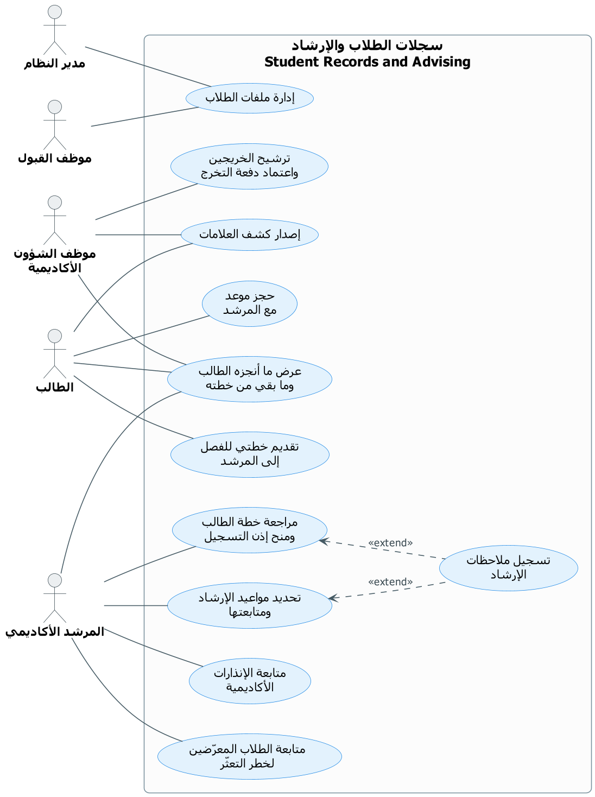

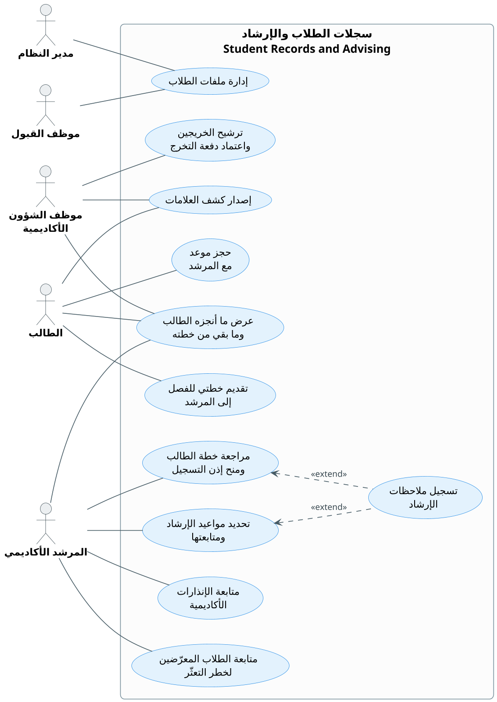

---

## 11. المالية والطلبات الإلكترونية (Finance and E-Requests)

**الفاعلون:** الموظف المالي، والطالب، والمرشد الأكاديمي، وموظف الشؤون الأكاديمية، وموظف شؤون الامتحانات، وبوابة الدفع الإلكتروني. **يوضّح المخطط:** الرسوم والفواتير والدفع والأقساط والمنح والغرامات والاسترداد، وطلبات الطالب الإلكترونية ودراستها.

**العلاقات:**

- «دفع الفاتورة إلكترونياً» توسّع «عرض رصيدي وفواتيري» حين يختار الطالب الدفع، وتنفّذه بوابة الدفع الإلكتروني.
- يدرس الطلب الإلكتروني من يحدده نوعه: المرشد الأكاديمي أو موظف الشؤون الأكاديمية أو موظف شؤون الامتحانات (كالتظلّم والامتحان البديل).
- طلب التقسيط طلب إلكتروني يبتّ فيه الموظف المالي ضمن «إدارة الأقساط والمنح والغرامات والاسترداد».

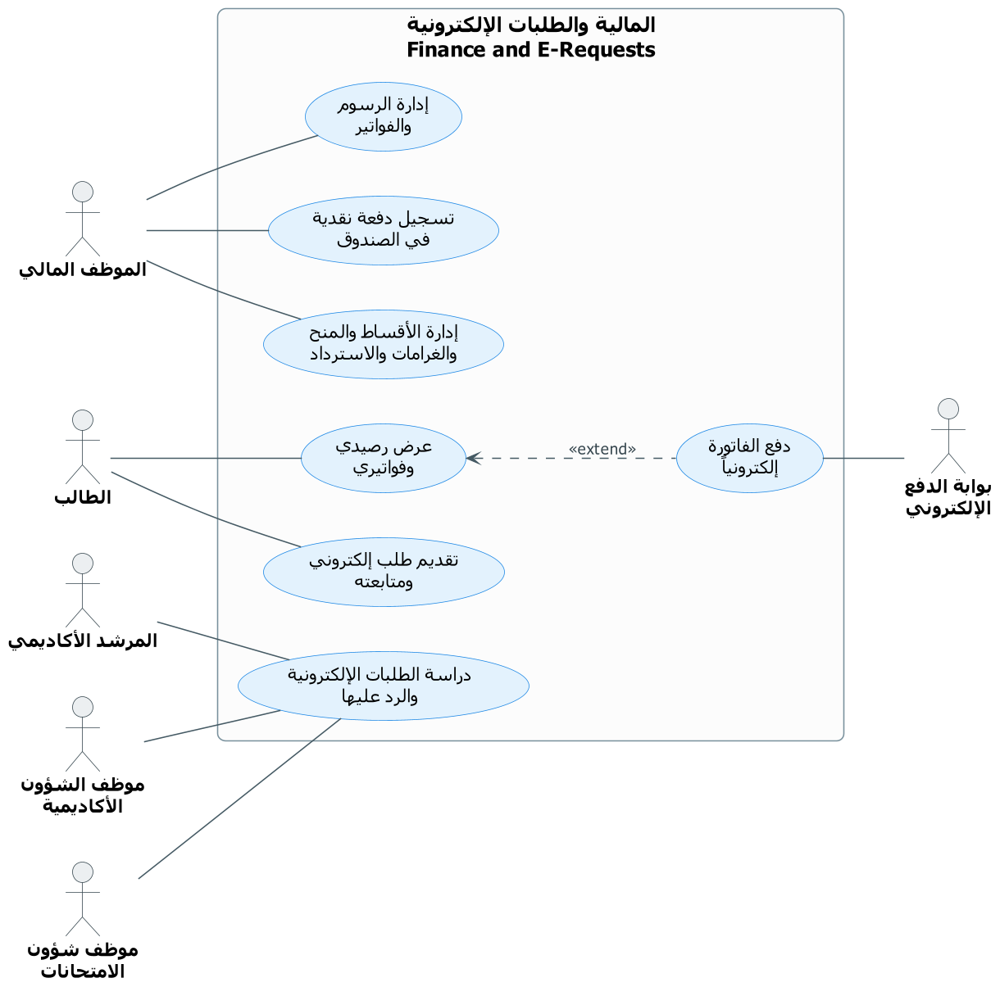

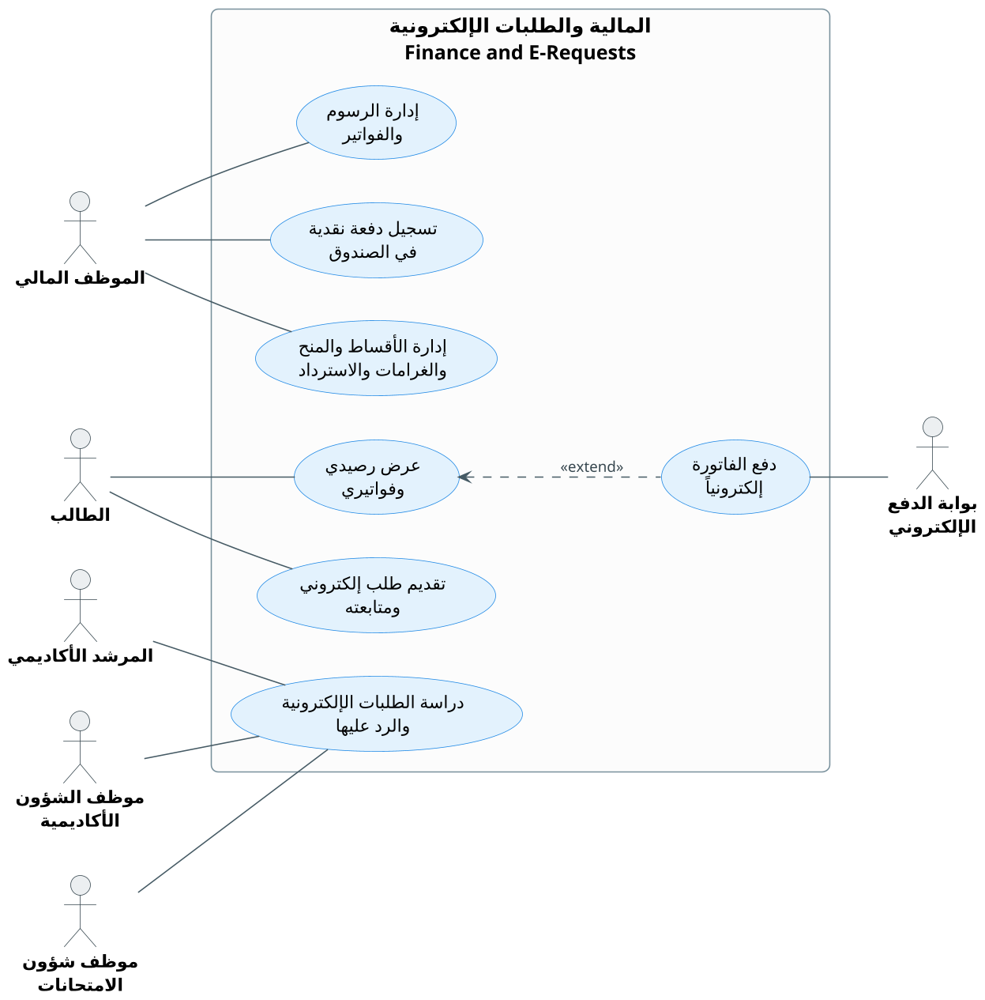

---

## 12. المكتبة وشؤون الموظفين (Library and Staff Affairs)

**الفاعلون:** الطالب، والموظف، وعضو هيئة التدريس، وأمين المكتبة، والمدير المباشر، وموظف شؤون الموظفين، وجهاز البصمة. **يوضّح المخطط:** البحث في المكتبة وحجز الكتب وإعارتها وغرامات التأخير، والخدمة الذاتية للموظف وإجازاته وملفاته ودوامه.

**العلاقات:**

- عضو هيئة التدريس نوع من «الموظف» (تعميم)، فيرث عرض ملفه وطلب الإجازة والبحث في المكتبة.
- «حجز نسخة معارة» توسّع «البحث عن كتاب في المكتبة» حين تكون النسخ كلها معارة.
- «احتساب غرامة التأخير» توسّع «إعارة الكتب واستلامها» حين يتأخر إرجاع الكتاب.
- يوافق المدير المباشر على الإجازة أولاً، ثم يعتمدها موظف شؤون الموظفين.
- يرسل جهاز البصمة الحضور والانصراف، ويطّلع عليهما الموظف في «عرض ملفي الوظيفي ودوامي».

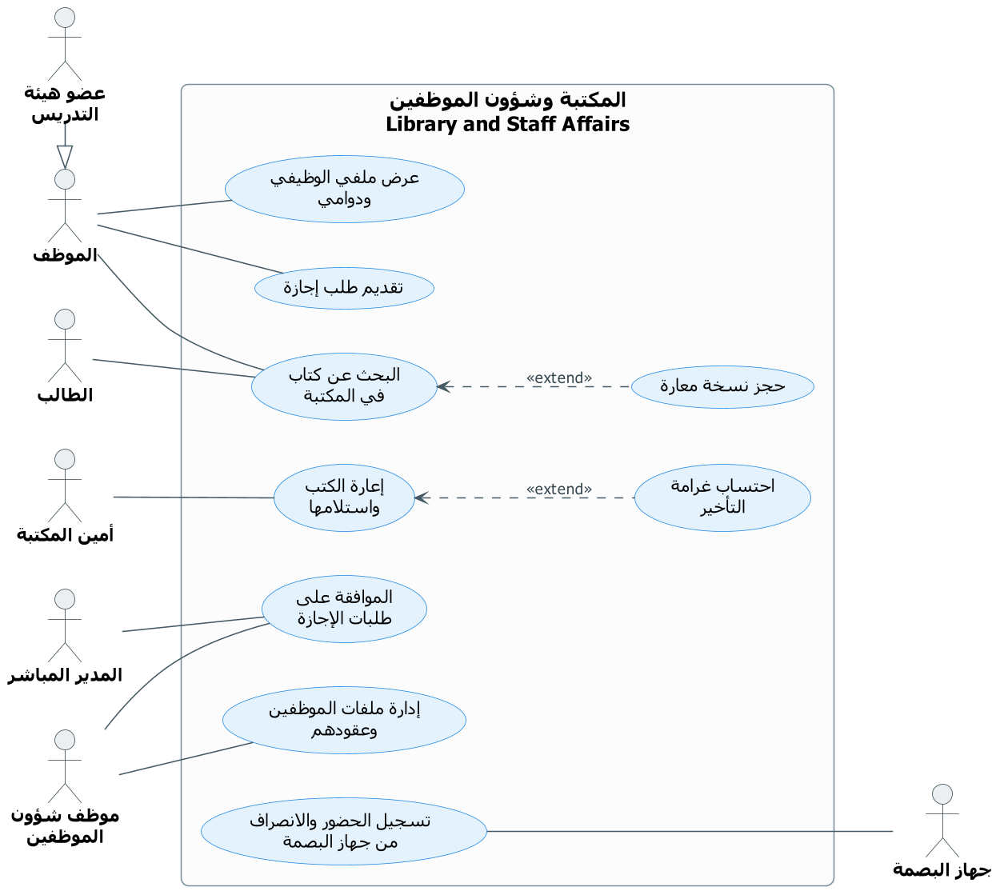

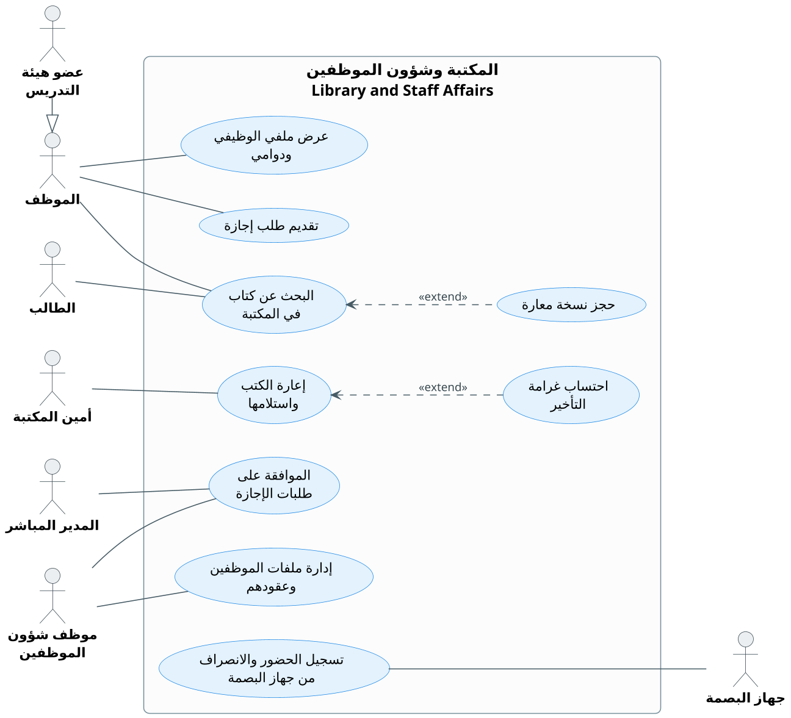

---

## 13. التقارير والذكاء الاصطناعي (Reports and AI)

**الفاعلون:** موظف الشؤون الأكاديمية، ومدير النظام، والإدارة العليا، ومنسق الجداول والموارد، وعضو هيئة التدريس، ومزوّد الذكاء الاصطناعي. **يوضّح المخطط:** تقارير الإدارة وملخصاتها، وتجربة الاحتمالات المستقبلية، وخدمات الذكاء الاصطناعي: لوائح الجامعة للمساعد الذكي، واستخراج المقررات من ملف، وتوقّع أعداد الطلاب، وشرح الجدول، وكتابة التفرّغ والشروط بجملة عادية.

**العلاقات:**

- في «رفع لوائح الجامعة ليجيب منها المساعد الذكي» يرفع موظف الشؤون الأكاديمية ملفات اللوائح، فيجيب المساعد الذكي (المخطط 01) منها ويذكر المادة التي استند إليها.
- يُعرض «توقّع أعداد الطلاب في كل مقرر» للمنسق عند طرح المقررات (المخطط 06). وفي «مقارنة دقة التوقّعات واعتماد الأفضل» يقارن مدير النظام دقة النسخة الجديدة بالحالية، ويعتمد موظف الشؤون الأكاديمية تفعيل الأدق.
- يشارك مزوّد الذكاء الاصطناعي في الحالات التي تحتاج إلى فهم نص أو كتابته؛ أما التوقّع ومقارنة الدقة وتجربة الاحتمالات فيحسبها النظام بنفسه.
- ومن خدمات الذكاء الاصطناعي أيضاً: سؤال المساعد الذكي (المخطط 01)، ومتابعة الطلاب المعرّضين لخطر التعثّر (المخطط 10).

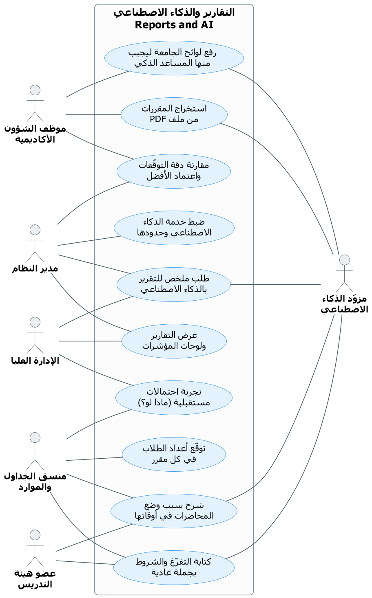

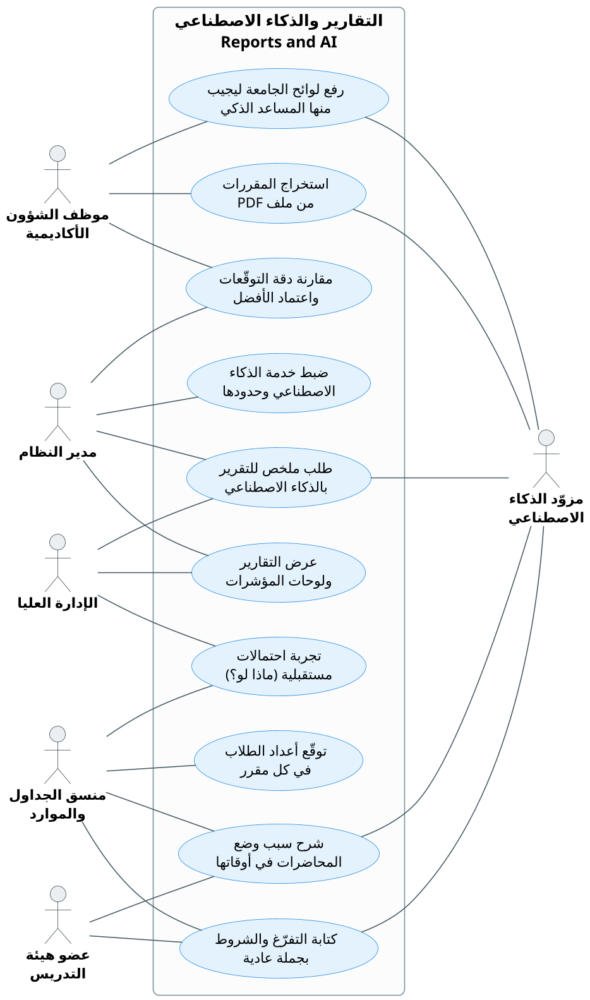

---

## ملاحظات

- **ما ليس فاعلاً:** ما هو جزء من النظام نفسه، كمحرك الجدولة والمساعد الذكي ونماذج التوقّع ونظام الإشعارات.
- **من يُربط بالحالة:** من ينفّذها أو يتخذ فيها قراراً أو يطّلع بها على ما يخصه. أما من يُبلَّغ بنتيجتها فقط فلا يُربط بها، لأن الإشعار يصله في «متابعة الإشعارات».
- **تسمية الحالة:** تُسمّى كل حالة بما يفعله الفاعلون المرتبطون بها. فإن قام شخصان بجزأين مختلفين من عمل واحد، كتقديم طلب والبت فيه، رُسمت لكل منهما حالة باسم عمله، مثل «تقديم خطتي للفصل إلى المرشد» للطالب و«مراجعة خطة الطالب ومنح إذن التسجيل» للمرشد.
- **مدير النظام:** يظهر في المخططات 03 و04 و05 و06 و10 لأن سيناريوهاتها تمنحه صلاحية المسؤول نفسه: الفصول، وسلالم التقدير، والقاعات والأجهزة، والشعب وقواعد الجدولة، وملفات الطلاب.
- **ما ليس حالة استخدام:** النتائج (كالقبول والرفض) والخطوات الداخلية (كمتابعة تقدّم التوليد) ليست أهدافاً للفاعل. أما الفحوص والحسابات التي تتكرر في أكثر من حالة، مثل «التحقق من أهلية التسجيل» و«حساب المعدّل والوضع الأكاديمي»، فتظهر حالاتٍ مضمَّنة.

