

> **الوثيقة:** مخططات حالات الاستخدام (Use Case Diagrams) — **النظام:** OptiTime — **التاريخ:** 2026-10-15

# مخططات حالات الاستخدام — نظام OptiTime

تضم هذه الوثيقة أكواد PlantUML لثمانية عشر مخطط حالات استخدام: مخطط عام للنظام، ومخطط لكل حزمة من الحزم السبع عشرة في ملف السيناريوهات (`UseCase Scenario/optitime-usecase-scenarios.md`). وتطابق المخططاتُ السيناريوهاتِ في أرقام الحالات وأسمائها وفاعليها وحزمها، وفي علاقات التضمين (include) والتوسيع (extend) المذكورة فيها. وتحافظ مخططات الحزم الثلاث الأولى على بنية مخططات الفريق الأولى (Auth_profile وUser and Roles وResources)، مع إضافة الحالتين UC-08 وUC-25.

**الملفات:** كود كل مخطط في مجلد `Src` (مثل `Src/UCD-01-auth.puml`)، وصورته المولّدة في مجلد `Images` بالاسم نفسه (مثل `Images/UCD-01-auth.png`)؛ والأسماء من UCD-00 إلى UCD-06 هي التي حجزتها وثيقة متطلبات البرمجيات لهذه المخططات. والكود في هذه الوثيقة مطابق حرفياً لملفات `Src`.

## طريقة العرض والتصدير

1. **الصور الجاهزة:** في مجلد `Images` بدقة 150 نقطة في البوصة، صالحة للطباعة مباشرة، وهي معروضة أيضاً تحت كل مخطط في هذه الوثيقة.
2. **ملف `.puml` منفرد:** افتح أي ملف من مجلد `Src` في VS Code واضغط Alt+D للمعاينة، ثم صدّره من قائمة الأوامر (Ctrl+Shift+P) بالأمر «PlantUML: Export Current Diagram» بصيغة PNG أو SVG. ويعمل ذلك بـ Java وحدها دون إنترنت.
3. **معاينة Markdown:** تعرض إضافة PlantUML (`jebbs.plantuml`) كتل الكود في هذه الوثيقة عبر خادم PlantUML يُحدَّد في الإعداد `plantuml.server`، كما في وثيقتي مخططات التسلسل والنشاط.

كل كتلة مكتفية بذاتها: تبدأ بالنمط الموحّد (أسطر `skinparam`) ثم الفاعلين وحالات الاستخدام والعلاقات، واسم المخطط بعد كلمة `startuml` هو اسم ملف الصورة عند التصدير.

## دليل الرموز

| العنصر في المخطط | معناه |
|---|---|
| شكل الشخص | فاعل: دور في النظام برمزه (مثل ADM) أو جهة خارجية |
| شكل بيضوي | حالة استخدام، ورقمها تحت اسمها |
| شكل بيضوي دون رقم | حالة جامعة تتفرع منها حالات أخرى (مثل «إدارة الملف الشخصي») |
| شكل بيضوي رمادي بإطار متقطع | حالة من حزمة أخرى تظهر لعلاقة تربطها بحالة من الحزمة، واسم حزمتها ورقمها تحت اسمها |
| إطار بعنوان | حدود الحزمة، أو حدود النظام في المخطط العام |
| خط متصل | الفاعل يشارك في حالة الاستخدام |
| سهم متقطع «include» | الحالة الأساسية تتضمن الحالة المشار إليها في كل مرة |
| سهم متقطع «extend» | الحالة توسّع الحالة المشار إليها عند شرط أو اختيار |
| عبارة «عرض فقط» على خط | الفاعل يطّلع دون تعديل |
| مستطيل أصفر بزاوية | ملاحظة |

## فهرس المخططات

| الرقم | المخطط | الحالات | الفاعلون | الصورة | الكود |
|---|---|---|---|---|---|
| UCD-00 | المخطط العام للنظام | UC-01 … UC-113 | جميع الأدوار والجهات الخارجية | `Images/UCD-00-overview.png` | `Src/UCD-00-overview.puml` |
| UCD-01 | حزمة المصادقة والملف الشخصي (Auth and Profile) | UC-01 … UC-08 | المستخدم (أي دور)، وخدمة المصادقة | `Images/UCD-01-auth.png` | `Src/UCD-01-auth.puml` |
| UCD-02 | حزمة المستخدمين والأدوار (Users and Roles) | UC-09 … UC-17 | ADM، وEXE (عرض فقط) | `Images/UCD-02-users.png` | `Src/UCD-02-users.puml` |
| UCD-03 | حزمة الموارد (Resources) | UC-18 … UC-26 | CRD، وINS، وEMP، وLIB | `Images/UCD-03-resources.png` | `Src/UCD-03-resources.puml` |
| UCD-04 | حزمة الجدولة (Scheduling) | UC-27 … UC-33 | INS، وCRD، وHOD، وDEN، وACO، وSTU | `Images/UCD-04-scheduling.png` | `Src/UCD-04-scheduling.puml` |
| UCD-05 | حزمة الامتحانات والدرجات (Exams and Grades) | UC-34 … UC-35 | EXM، وSTU | `Images/UCD-05-grades.png` | `Src/UCD-05-grades.puml` |
| UCD-06 | حزمة التقويم والتقارير والنظام (Calendar, Reports and System) | UC-36 … UC-38 | ACO، وEXE، وADM | `Images/UCD-06-system.png` | `Src/UCD-06-system.puml` |
| UCD-07 | حزمة الإدارة والمتابعة (Administration and Monitoring) | UC-39 … UC-47 | ADM، والمستخدم (أي دور)، وCRD، وACO، ونظام خارجي، وخدمة الإشعارات الفورية | `Images/UCD-07-admin.png` | `Src/UCD-07-admin.puml` |
| UCD-08 | حزمة الهيكل الأكاديمي والخطط (Academic Structure and Plans) | UC-48 … UC-56 | ADM، وDEN، وACO، وCRD | `Images/UCD-08-structure.png` | `Src/UCD-08-structure.puml` |
| UCD-09 | حزمة إعداد الجدولة وتشغيلها (Scheduling Preparation and Operations) | UC-57 … UC-62 | CRD، وADM، وACO، وDEN، وHOD، وINS | `Images/UCD-09-scheduling-ops.png` | `Src/UCD-09-scheduling-ops.puml` |
| UCD-10 | حزمة سجلات الطلاب والتسجيل (Student Records and Registration) | UC-63 … UC-71 | STU، وADM، وADO، وACO، وADV | `Images/UCD-10-registration.png` | `Src/UCD-10-registration.puml` |
| UCD-11 | حزمة الحضور والتعلّم والتقييم (Attendance, Learning and Evaluation) | UC-72 … UC-77 | INS، وSTU، وACO، وHOD، وDEN | `Images/UCD-11-learning.png` | `Src/UCD-11-learning.puml` |
| UCD-12 | حزمة سير اعتماد الدرجات (Grade Approval Workflow) | UC-78 … UC-83 | INS، وHOD، وEXM، وDEN، وSTU، وACO | `Images/UCD-12-grades-workflow.png` | `Src/UCD-12-grades-workflow.puml` |
| UCD-13 | حزمة جدولة الامتحانات وتنفيذها (Exam Scheduling and Operations) | UC-84 … UC-87 | EXM، وINS (مراقباً)، وSTU | `Images/UCD-13-exams.png` | `Src/UCD-13-exams.puml` |
| UCD-14 | حزمة القبول والإرشاد (Admission and Advising) | UC-88 … UC-92 | ADO، وAPL، وبوابة الدفع الإلكتروني، وADV، وSTU | `Images/UCD-14-admission-advising.png` | `Src/UCD-14-admission-advising.puml` |
| UCD-15 | حزمة المالية (Finance) | UC-93 … UC-96 | FIN، وSTU، وبوابة الدفع الإلكتروني | `Images/UCD-15-finance.png` | `Src/UCD-15-finance.puml` |
| UCD-16 | حزمة المكتبة وشؤون الموظفين والطلبات (Library, Staff Affairs and E-Requests) | UC-97 … UC-103 | STU، وINS، وLIB، وHRO، وEMP، وجهاز البصمة، والمدير المباشر، وACO، وEXM | `Images/UCD-16-services.png` | `Src/UCD-16-services.puml` |
| UCD-17 | حزمة الذكاء الاصطناعي والتحليلات (AI and Analytics) | UC-104 … UC-113 | ADM، وEXE، وCRD، وINS، والمستخدم (أي دور)، وACO، وADV، وHOD، ومزوّد النماذج اللغوية | `Images/UCD-17-ai.png` | `Src/UCD-17-ai.puml` |

---

## UCD-00: المخطط العام للنظام

**الحالات:** UC-01 … UC-113. **الفاعلون:** جميع الأدوار والجهات الخارجية. **يوضّح المخطط:** حدود النظام وحزمه السبع عشرة، ولكل حزمة مجال حالاتها، والفاعلين الرئيسيين في كل حزمة. ويرث كل دور حالات «المصادقة والملف الشخصي» لأنه مستخدم للنظام، ويطّلع EXE على المستخدمين والأدوار للعرض فقط. وارتباطات كل فاعل بحالات الحزمة كاملةٌ في مخطط الحزمة نفسها.

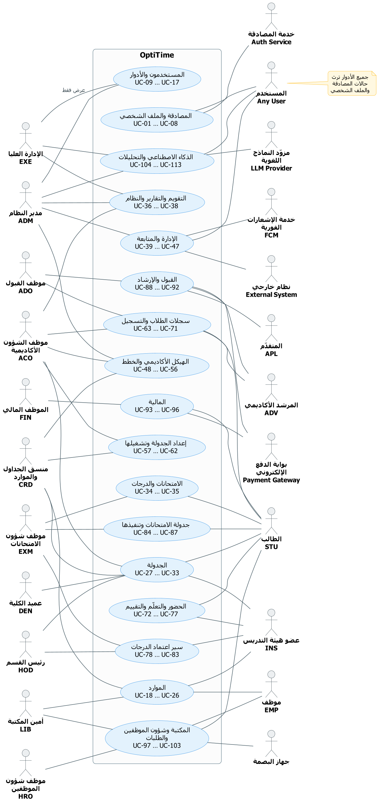

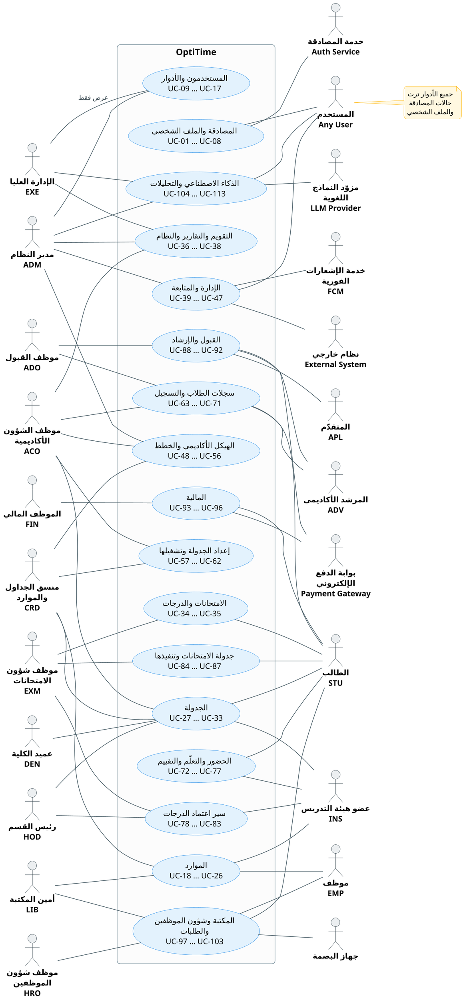

---

## UCD-01: حزمة المصادقة والملف الشخصي (Auth and Profile)

**الحالات:** UC-01 … UC-08. **الفاعلون:** المستخدم (أي دور)، وخدمة المصادقة. **يوضّح المخطط:** الدخول والخروج وإدارة الملف الشخصي واستعادة كلمة المرور والتحقق الثنائي.

**العلاقات:**

- تتضمن «نسيت كلمة المرور» UC-05 حالة «التحقق الثنائي» UC-06، التي تتضمن بدورها «تغيير كلمة المرور» UC-07.
- توسّع حالات «عرض الملف الشخصي» UC-03 و«تعديل الملف الشخصي» UC-04 و«تغيير كلمة المرور» UC-07 و«تفعيل التحقق الثنائي» UC-08 حالة «إدارة الملف الشخصي».
- تشارك «خدمة المصادقة» في تسجيل الدخول UC-01 والتحقق الثنائي UC-06.

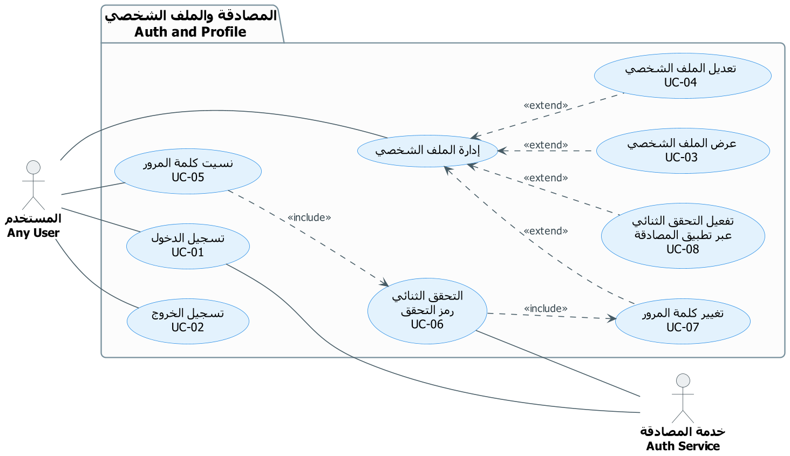

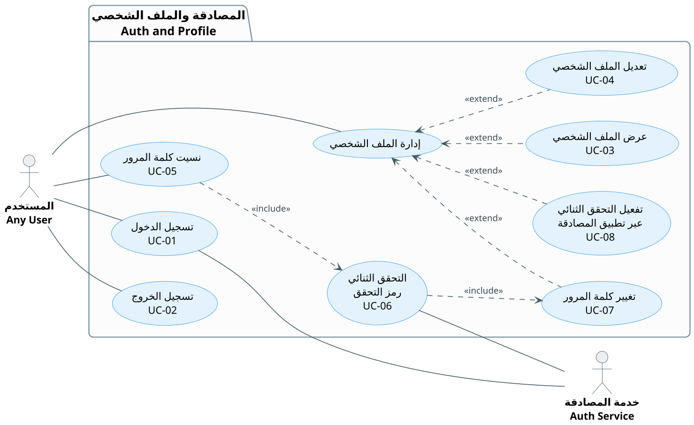

---

## UCD-02: حزمة المستخدمين والأدوار (Users and Roles)

**الحالات:** UC-09 … UC-17. **الفاعلون:** ADM، وEXE (عرض فقط). **يوضّح المخطط:** إدارة الحسابات وأدوارها، ومصفوفة الصلاحيات، وإدارة الأدوار.

**العلاقات:**

- توسّع حالات العرض والإنشاء والتعديل والحذف (UC-09 إلى UC-12) حالة «إدارة المستخدمين»، وتوسّع حالات الأدوار (UC-15 إلى UC-17) حالة «إدارة الأدوار».
- تتضمن «إنشاء مستخدم» UC-10 حالة «تعيين الأدوار» UC-13، وتوسّع UC-13 حالة «تعديل مستخدم» UC-11.
- يطّلع EXE على قائمة المستخدمين UC-09 ومصفوفة الصلاحيات UC-14 للعرض فقط.

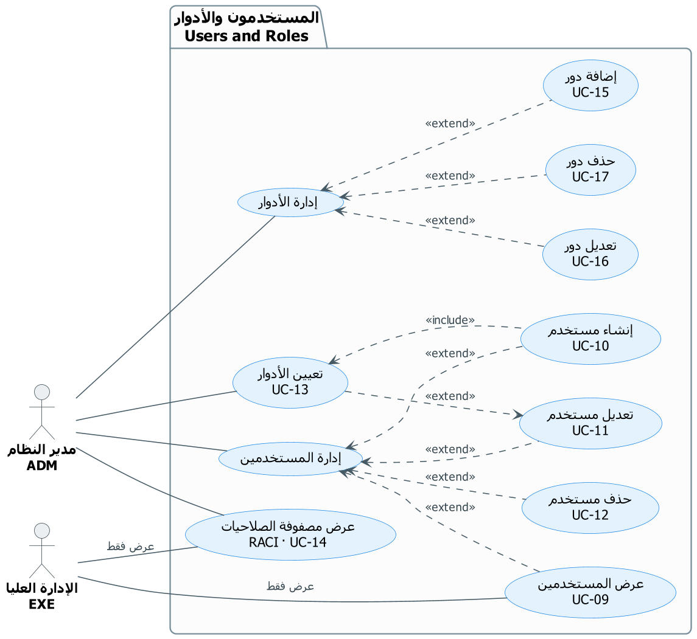

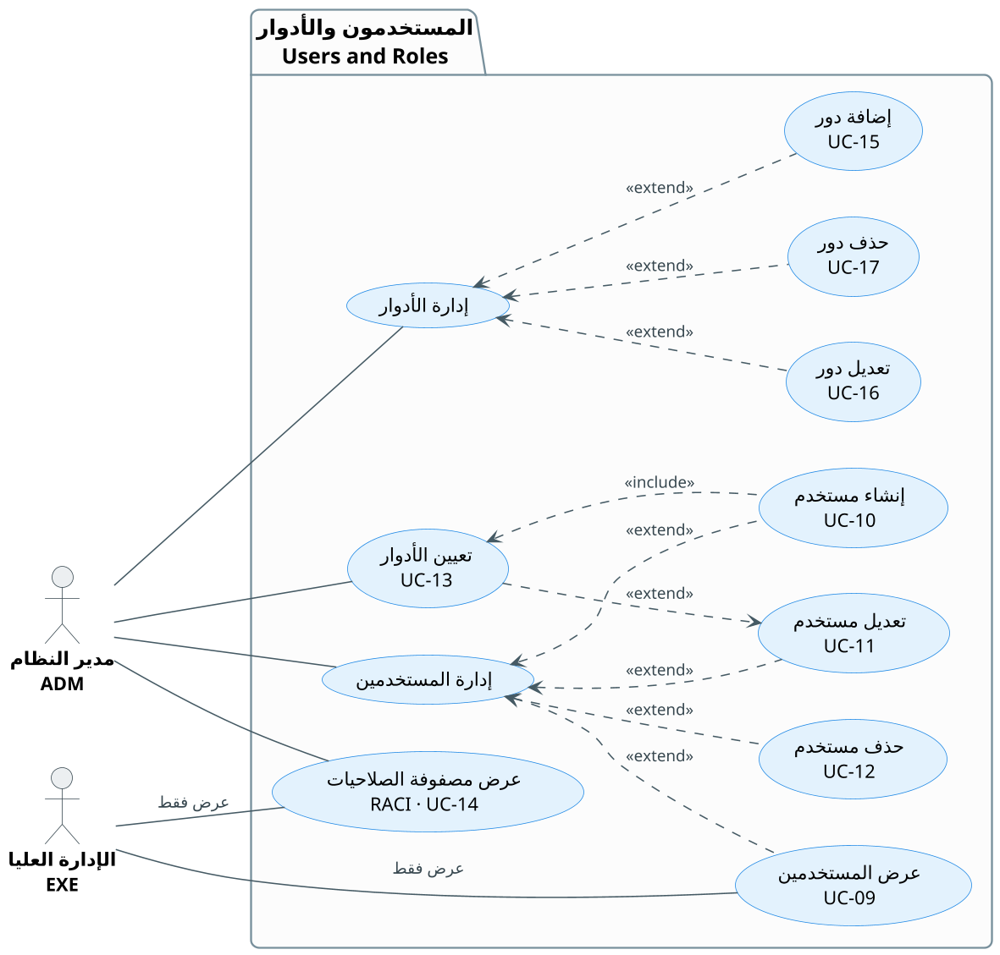

---

## UCD-03: حزمة الموارد (Resources)

**الحالات:** UC-18 … UC-26. **الفاعلون:** CRD، وINS، وEMP، وLIB. **يوضّح المخطط:** إدارة القاعات والمختبرات والأجهزة والصيانة، وعرض الموارد وطلبها وحجز القاعات.

**العلاقات:**

- تتضمن «إدارة القاعات» UC-18 حالة «تحديد سعة الامتحان» UC-19.
- توسّع «إدارة الصيانة» UC-22 حالتي «إدارة الأجهزة» UC-20 و«إدارة المختبرات» UC-21 (الإبلاغ عن عطل).
- توسّع «طلب موارد إضافية» UC-24 و«حجز قاعة دراسية» UC-26 حالة «عرض الموارد» UC-23، ويعالج المنسق الطلبات في UC-25.

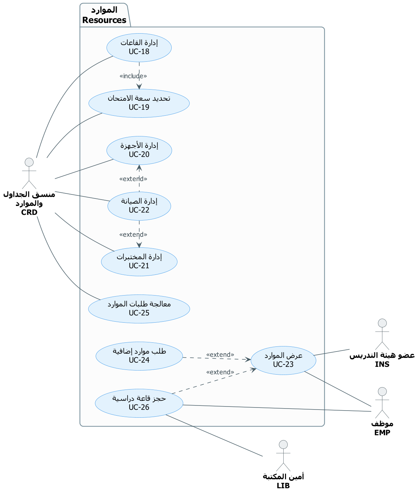

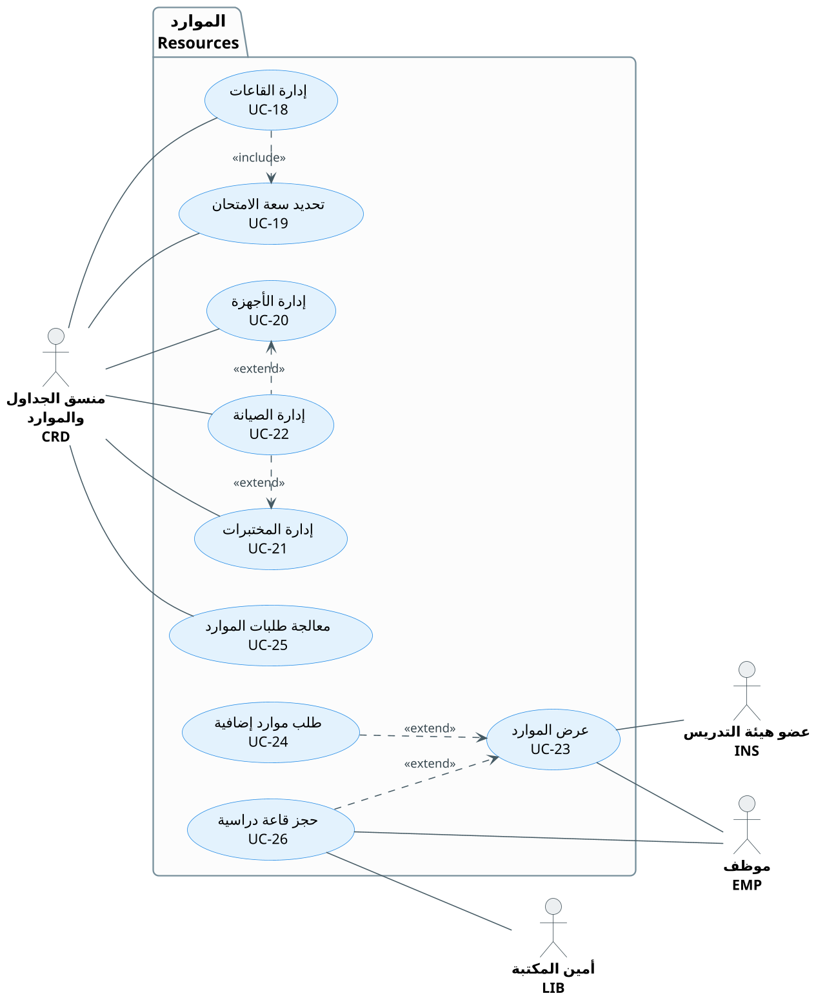

---

## UCD-04: حزمة الجدولة (Scheduling)

**الحالات:** UC-27 … UC-33. **الفاعلون:** INS، وCRD، وHOD، وDEN، وACO، وSTU. **يوضّح المخطط:** التفرّغ ومتابعته، وتوليد الجدول وإرساله للاعتماد ونشره، وعرض الجدول الأسبوعي، وطلبات الاعتذار والتعويض.

**العلاقات:**

- توسّع «تقديم طلب اعتذار أو تعويض عن محاضرة» UC-33 حالة «عرض الجدول الأسبوعي» UC-32، لأن المدرّس يبدؤها من محاضرة في جدوله.

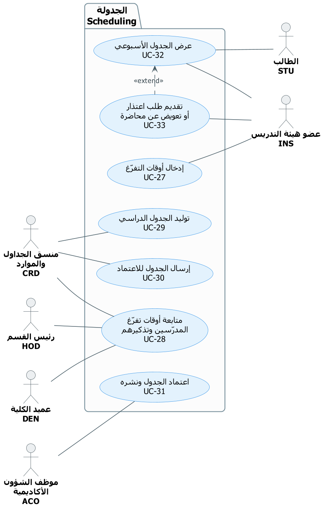

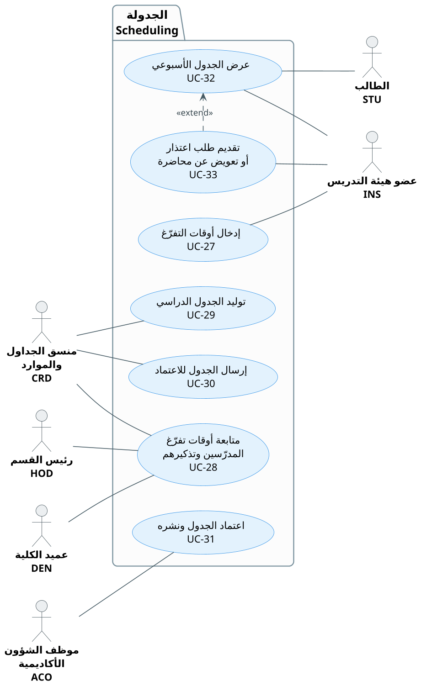

---

## UCD-05: حزمة الامتحانات والدرجات (Exams and Grades)

**الحالات:** UC-34 … UC-35. **الفاعلون:** EXM، وSTU. **يوضّح المخطط:** رصد علامات الامتحان وعرض الدرجات.

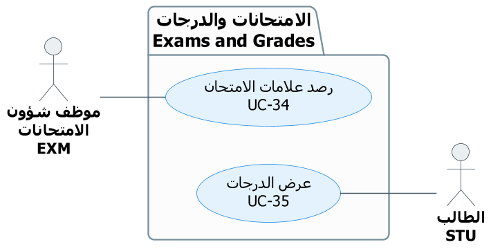

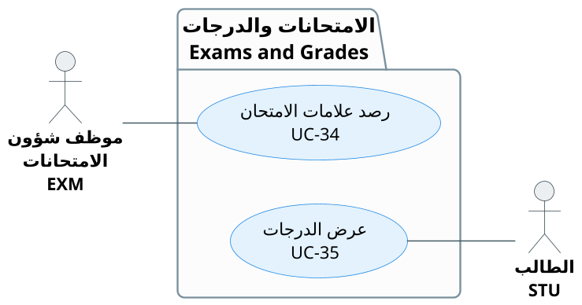

---

## UCD-06: حزمة التقويم والتقارير والنظام (Calendar, Reports and System)

**الحالات:** UC-36 … UC-38. **الفاعلون:** ACO، وEXE، وADM. **يوضّح المخطط:** نقل الفصل الدراسي بين مراحله، وتقارير الإدارة، والنسخ الاحتياطي والاستعادة.

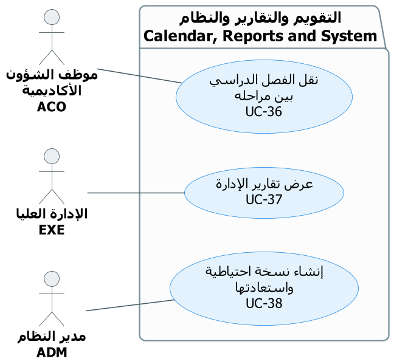

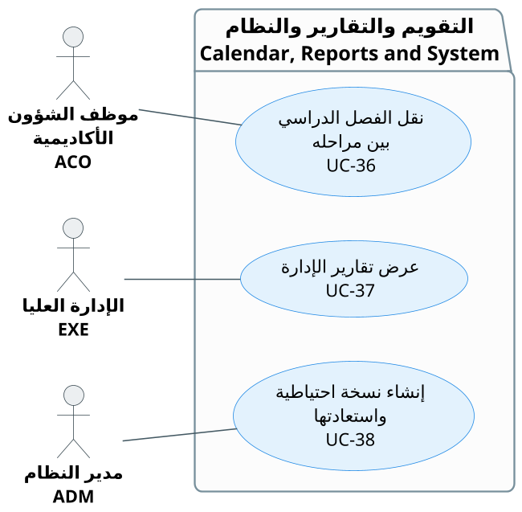

---

## UCD-07: حزمة الإدارة والمتابعة (Administration and Monitoring)

**الحالات:** UC-39 … UC-47. **الفاعلون:** ADM، والمستخدم (أي دور)، وCRD، وACO، ونظام خارجي، وخدمة الإشعارات الفورية. **يوضّح المخطط:** الدخول باسم مستخدم آخر، وسجل التدقيق، وإعدادات النظام ووضع الصيانة، وصحة النظام، والاستيراد، والتكاملات ومفاتيحها؛ ثم البحث الشامل والإشعارات ولوحة التحكم المتاحة لكل دور.

**العلاقات:**

- يستورد CRD وACO البيانات من ملف في UC-43 بحسب صلاحياتهما، كما يستوردها ADM.
- يتصل النظام الخارجي بمفتاح يصدره ADM في UC-44، وتوصل خدمة الإشعارات الفورية إشعارات UC-46 إلى أجهزة المستخدمين.

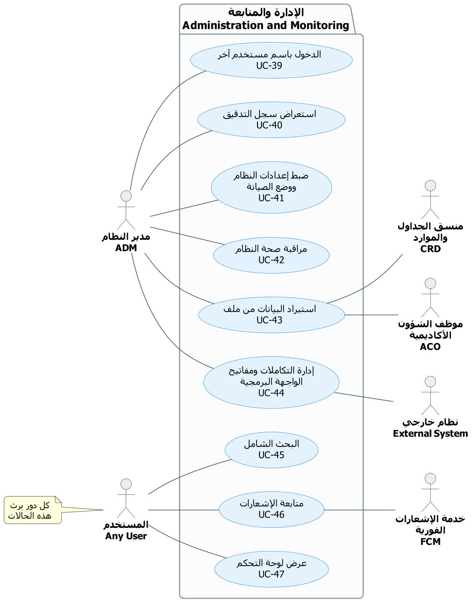

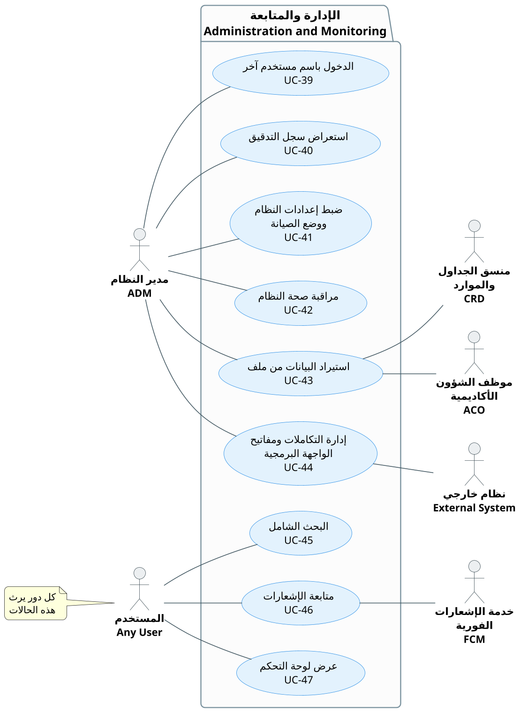

---

## UCD-08: حزمة الهيكل الأكاديمي والخطط (Academic Structure and Plans)

**الحالات:** UC-48 … UC-56. **الفاعلون:** ADM، وDEN، وACO، وCRD. **يوضّح المخطط:** الفروع والمباني، والكليات والأقسام وقياداتها، والوحدات الإدارية، والبرامج، والنوافذ الزمنية والعطل وأدوار التسجيل، والمقررات ومتطلباتها، وسلالم الدرجات، والخطط الدراسية.

**العلاقات:**

- توسّع «تحديد المتطلبات السابقة والمعادلات» UC-54 حالة «إدارة المقررات وتوصيفها» UC-53.
- يشارك DEN في UC-49، ويشارك CRD في المقررات ومتطلباتها UC-53 وUC-54.

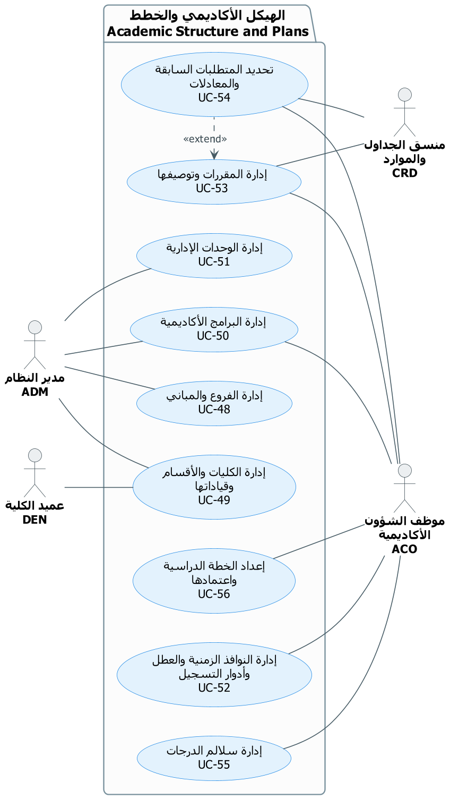

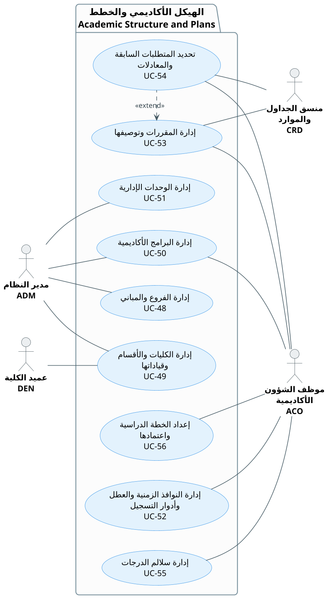

---

## UCD-09: حزمة إعداد الجدولة وتشغيلها (Scheduling Preparation and Operations)

**الحالات:** UC-57 … UC-62. **الفاعلون:** CRD، وADM، وACO، وDEN، وHOD، وINS. **يوضّح المخطط:** الملف التدريسي لعضو هيئة التدريس، وطرح المقررات وتقدير الطلب، والشعب وإسناد مدرّسيها، وقواعد الجدولة وقيودها، ومعالجة التعارضات ومؤشر الجودة، والإعادة الطارئة للجدولة.

**العلاقات:**

- توسّع «معالجة تعارضات الجدول ومؤشر الجودة» UC-61 حالة «توليد الجدول الدراسي» UC-29 من حزمة الجدولة، فتظهر UC-29 بإطار رمادي متقطع.

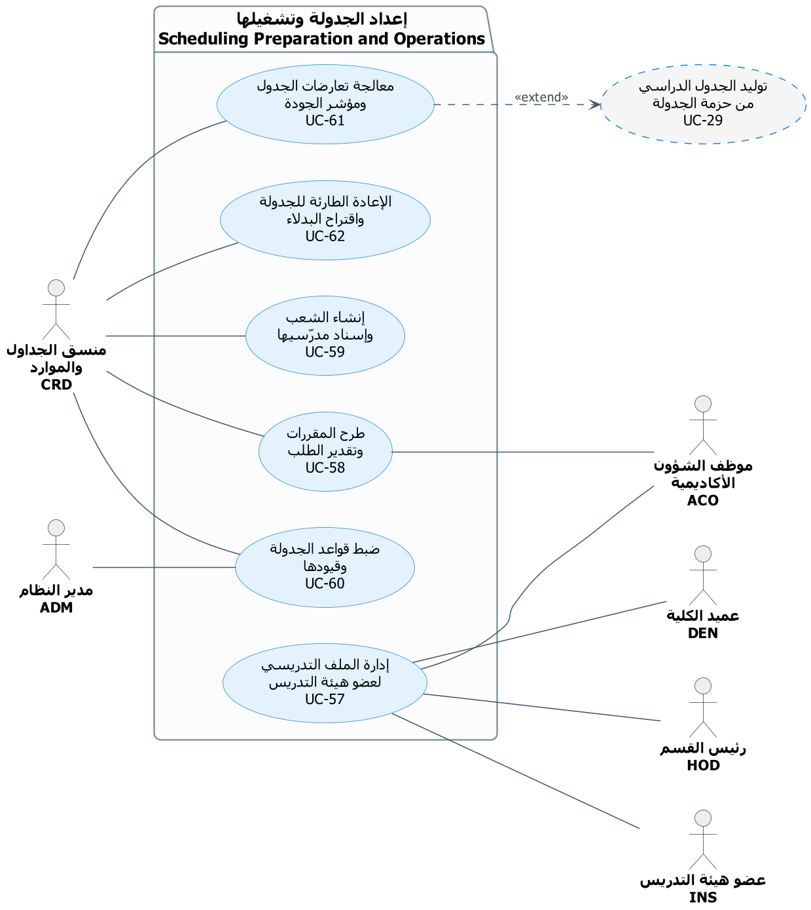

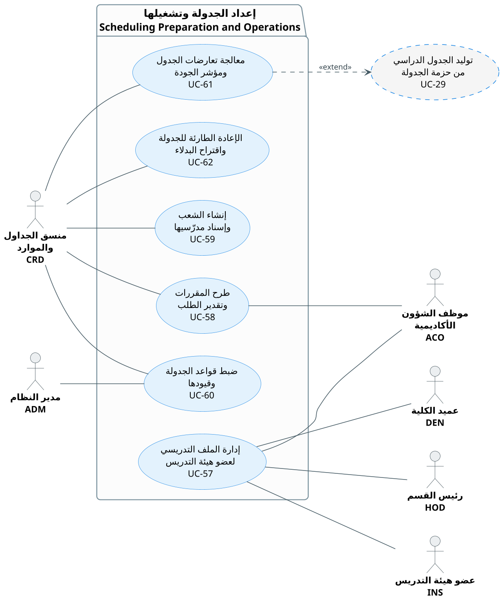

---

## UCD-10: حزمة سجلات الطلاب والتسجيل (Student Records and Registration)

**الحالات:** UC-63 … UC-71. **الفاعلون:** STU، وADM، وADO، وACO، وADV. **يوضّح المخطط:** سجلات الطلاب والتدقيق الأكاديمي والتخرج، ونشر كتالوج التسجيل، وتسجيل المقررات وأهليته وقوائم الانتظار والسحب والإضافة، واستثناءات التسجيل والعوائق.

**العلاقات:**

- تتضمن «تسجيل المقررات» UC-67 و«السحب والإضافة» UC-70 حالة «التحقق من أهلية التسجيل» UC-68.
- توسّع «الانضمام إلى قائمة الانتظار وقبول المقعد» UC-69 حالة «تسجيل المقررات» UC-67 عند امتلاء الشعبة.
- تتضمن «ترشيح المتخرجين واعتماد دفعة التخرج» UC-65 حالة «عرض التدقيق الأكاديمي» UC-64.

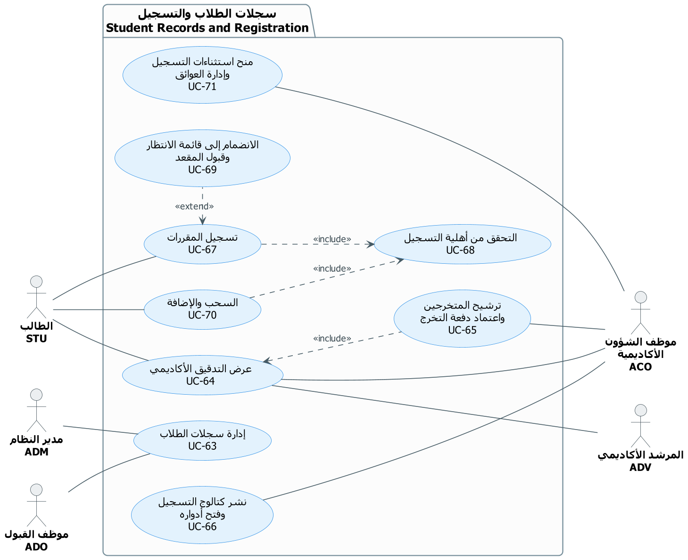

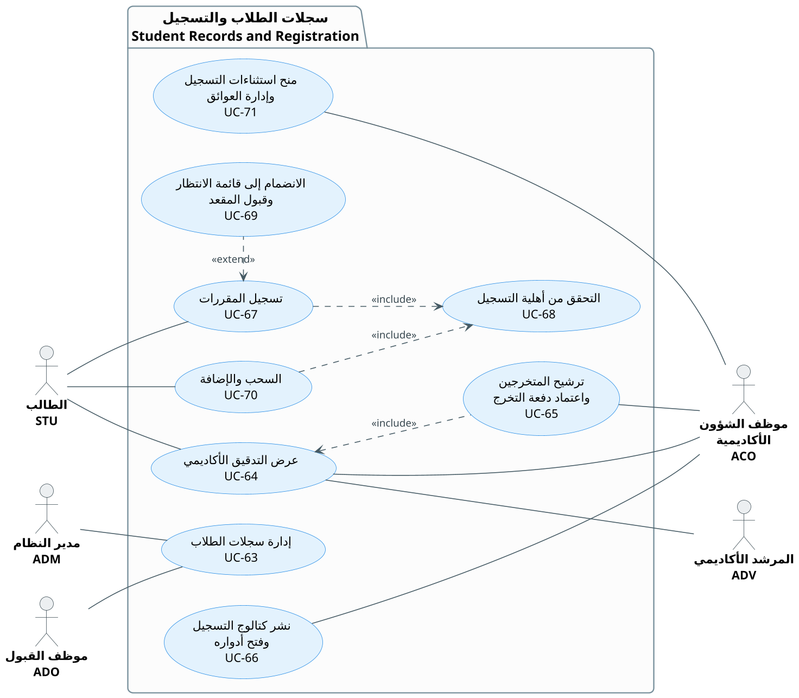

---

## UCD-11: حزمة الحضور والتعلّم والتقييم (Attendance, Learning and Evaluation)

**الحالات:** UC-72 … UC-77. **الفاعلون:** INS، وSTU، وACO، وHOD، وDEN. **يوضّح المخطط:** تسجيل حضور الجلسة ومتابعة الغياب واعتماد الحرمان، ومحتوى المادة وإعلاناتها، وإنشاء الكويزات وأداؤها، وتقييم المقرر والمدرّس.

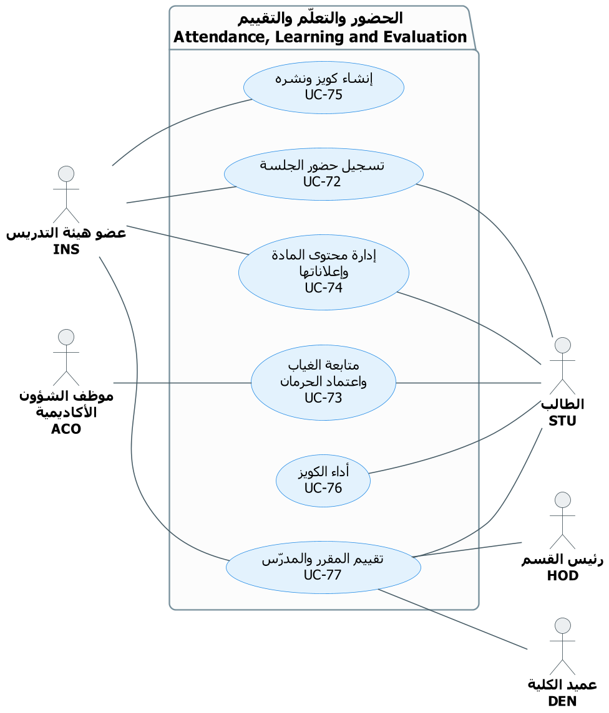

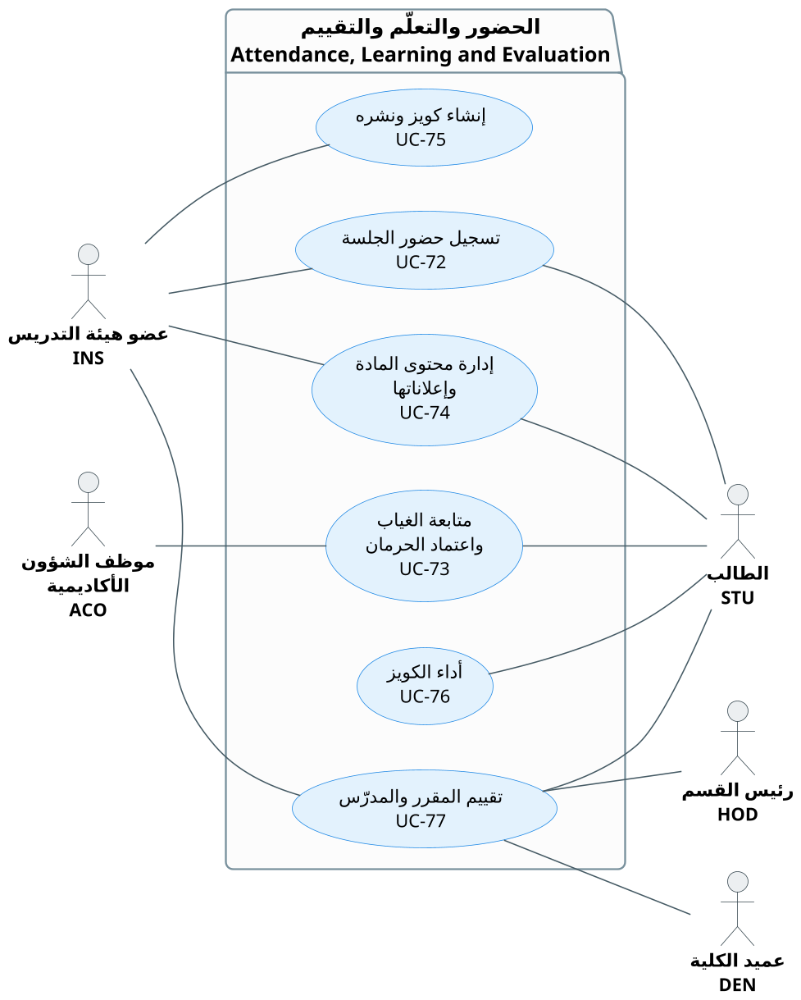

---

## UCD-12: حزمة سير اعتماد الدرجات (Grade Approval Workflow)

**الحالات:** UC-78 … UC-83. **الفاعلون:** INS، وHOD، وEXM، وDEN، وSTU، وACO. **يوضّح المخطط:** رصد كشف الدرجات ومراجعته في القسم، والإدخال المزدوج واعتماد الكشوف ونشرها، وحساب المعدل والوضع الأكاديمي، وإصدار كشف الدرجات، وطلب تعديل درجة منشورة.

**العلاقات:**

- تتضمن «الإدخال المزدوج واعتماد الكشوف ونشرها» UC-80 و«طلب تعديل درجة منشورة» UC-83 حالة «حساب المعدل والوضع الأكاديمي» UC-81.

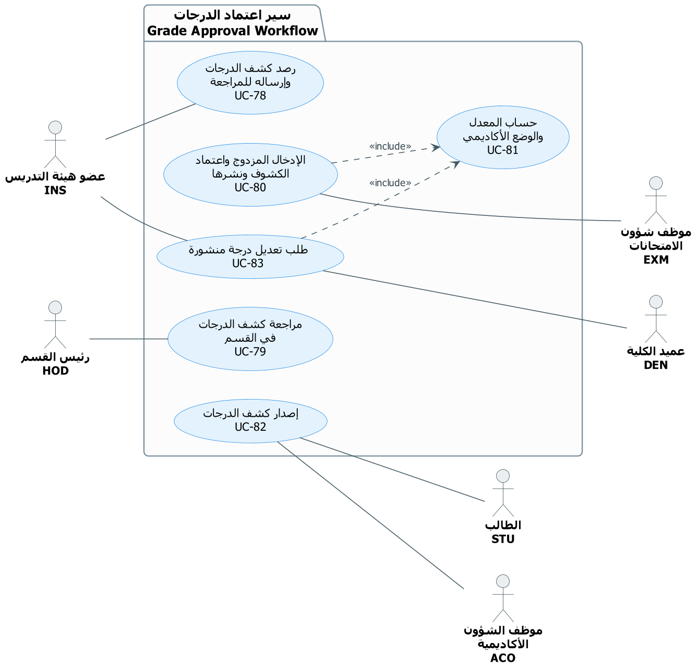

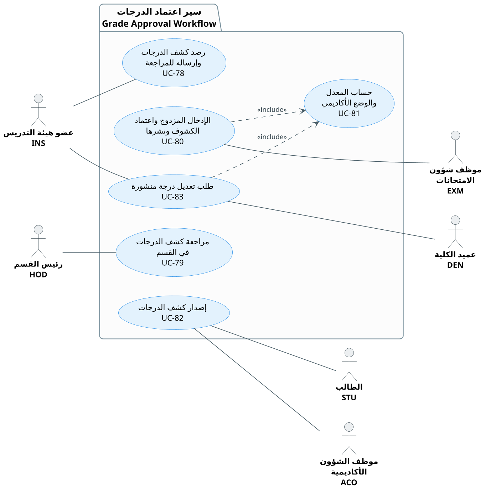

---

## UCD-13: حزمة جدولة الامتحانات وتنفيذها (Exam Scheduling and Operations)

**الحالات:** UC-84 … UC-87. **الفاعلون:** EXM، وINS (مراقباً)، وSTU. **يوضّح المخطط:** جدولة الامتحانات، وتوزيع القاعات والمقاعد والمراقبين، وجدول امتحانات الطالب وبطاقته، وإدارة يوم الامتحان.

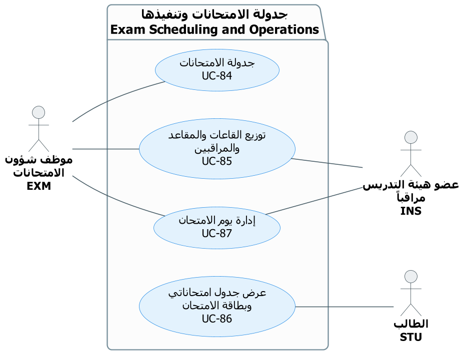

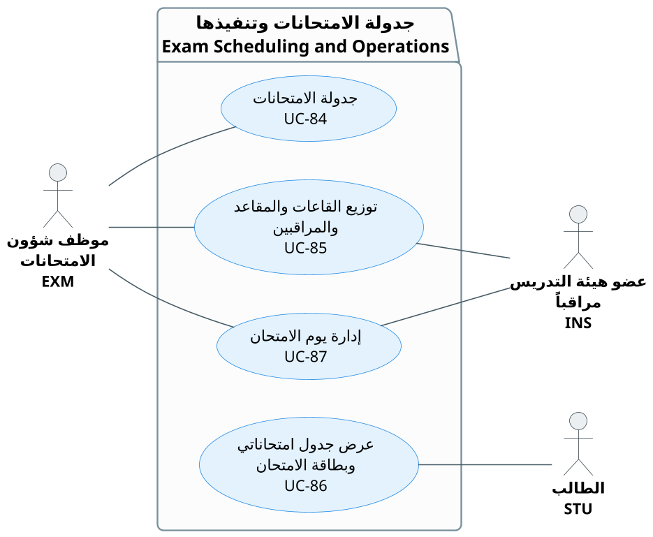

---

## UCD-14: حزمة القبول والإرشاد (Admission and Advising)

**الحالات:** UC-88 … UC-92. **الفاعلون:** ADO، وAPL، وبوابة الدفع الإلكتروني، وADV، وSTU. **يوضّح المخطط:** دورات القبول، وتقديم طلبات القبول ومتابعتها، والمفاضلة وقرارات القبول، ومراجعة الخطة الفصلية ومنح تصريح التسجيل، والإنذارات ومواعيد الإرشاد.

**العلاقات:**

- تشارك بوابة الدفع الإلكتروني في «تقديم طلب القبول ومتابعته» UC-89 لدفع رسوم الطلب.

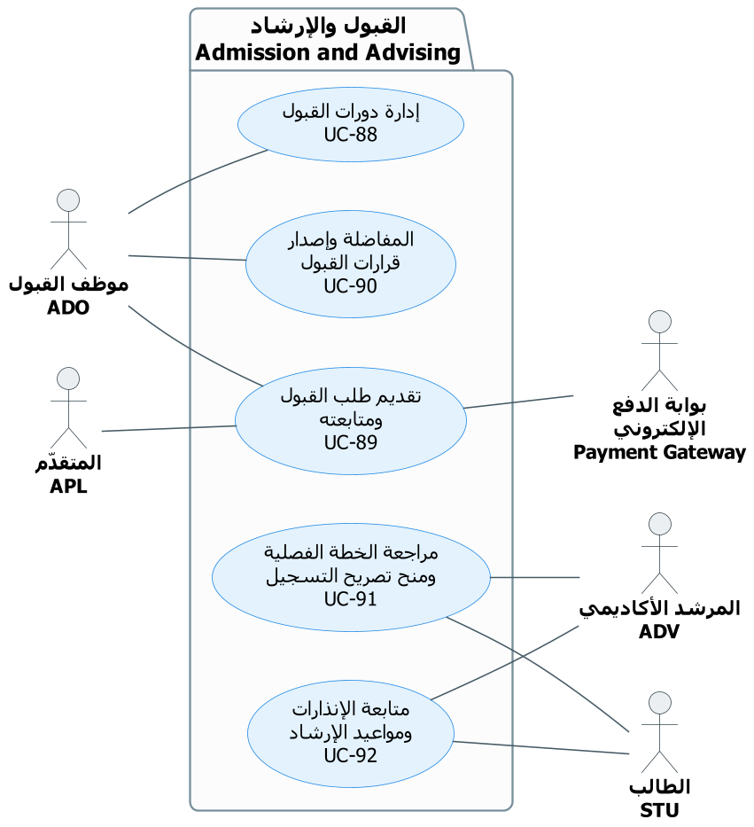

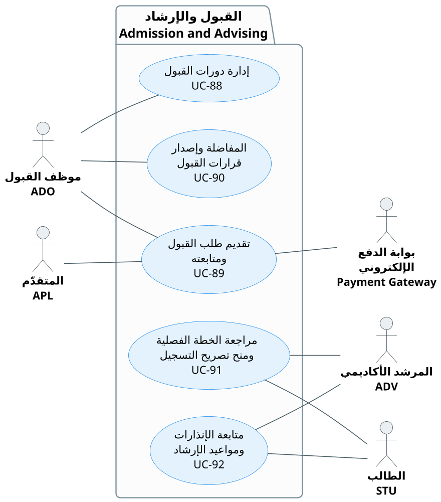

---

## UCD-15: حزمة المالية (Finance)

**الحالات:** UC-93 … UC-96. **الفاعلون:** FIN، وSTU، وبوابة الدفع الإلكتروني. **يوضّح المخطط:** الرسوم والفواتير، والرصيد والدفع الإلكتروني، وتسجيل الدفعات في الصندوق، والأقساط والمنح والغرامات والاسترداد.

**العلاقات:**

- تشارك بوابة الدفع الإلكتروني في «عرض الرصيد والدفع الإلكتروني» UC-94، ويقدّم الطالب طلب التقسيط الذي يعالجه FIN في UC-96.

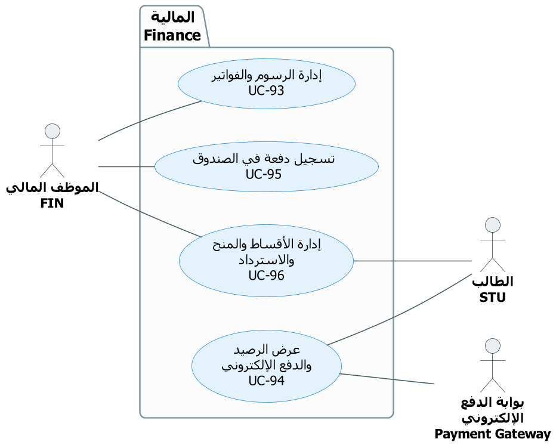

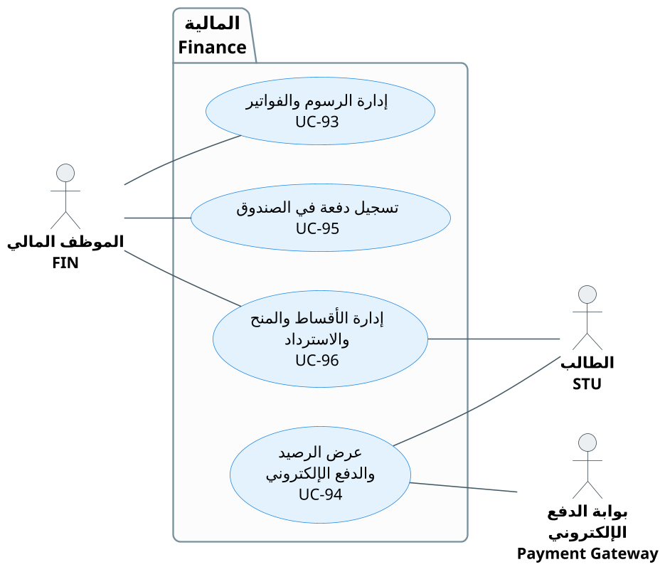

---

## UCD-16: حزمة المكتبة وشؤون الموظفين والطلبات (Library, Staff Affairs and E-Requests)

**الحالات:** UC-97 … UC-103. **الفاعلون:** STU، وINS، وLIB، وHRO، وEMP، وجهاز البصمة، والمدير المباشر، وACO، وEXM. **يوضّح المخطط:** البحث في كتالوج المكتبة والحجز والإعارة، وملفات الموظفين وعقودهم ودوامهم، وطلبات الإجازة واعتمادها، والطلبات الإلكترونية تقديماً ومعالجة.

**العلاقات:**

- توسّع «الإعادة الطارئة للجدولة واقتراح البدلاء» UC-62 من حزمة إعداد الجدولة حالة «اعتماد طلبات الإجازة» UC-101، حين تكون الإجازة لعضو هيئة تدريس له محاضرات في مدتها.
- يرسل جهاز البصمة الدوام في UC-99 بمفتاح يصدره ADM في UC-44.

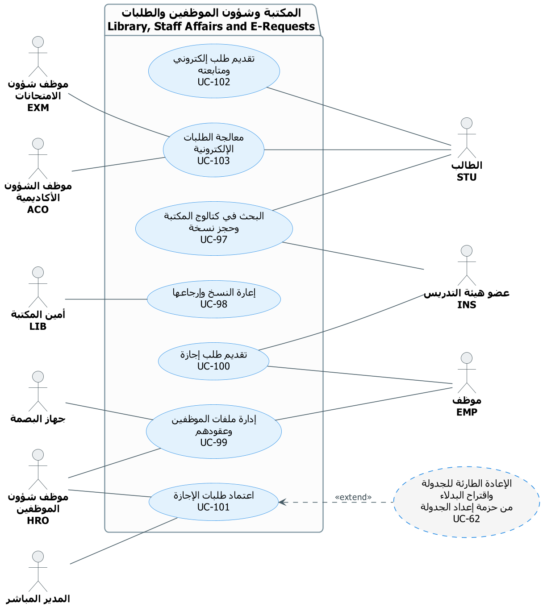

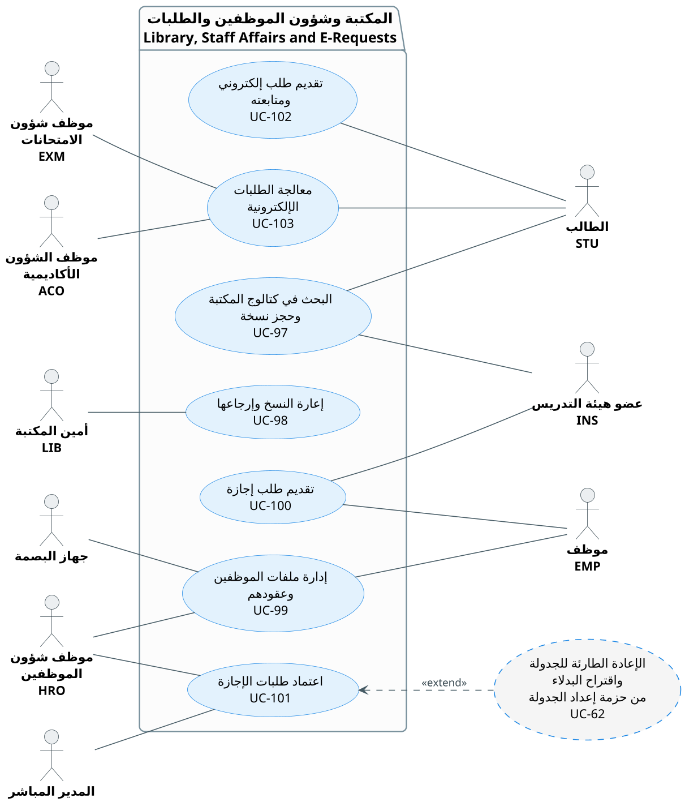

---

## UCD-17: حزمة الذكاء الاصطناعي والتحليلات (AI and Analytics)

**الحالات:** UC-104 … UC-113. **الفاعلون:** ADM، وEXE، وCRD، وINS، والمستخدم (أي دور)، وACO، وADV، وHOD، ومزوّد النماذج اللغوية. **يوضّح المخطط:** بوابة الذكاء الاصطناعي ومتابعة استخدامها، والمساعد الذكي وقاعدة معرفة اللوائح، والإدخال بلغة طبيعية وشرح نتيجة الجدولة، والتنبؤ بالطلب ومؤشر خطر التعثّر، واستخراج المقررات من ملف وملخصات التقارير، ومحاكاة السيناريوهات.

**العلاقات:**

- يشارك مزوّد النماذج اللغوية في الحالات التي تولّد نصاً أو تضمينات، عبر البوابة التي يضبطها ADM في UC-104؛ أما التنبؤ UC-109 ومؤشر الخطر UC-110 والمحاكاة UC-113 فلا تحتاج إليه.
- تُكمل حالات هذه الحزمة شاشات قائمة ولا تحل محلها: UC-107 إدخالَ التفرّغ UC-27 وقيودَ الجدولة UC-60، وUC-108 نتيجةَ التوليد UC-29، وUC-109 تقديرَ الطلب UC-58، وUC-111 استيرادَ المقررات UC-43، وUC-112 لوحةَ التحكم UC-47 وتقاريرَ الإدارة UC-37.

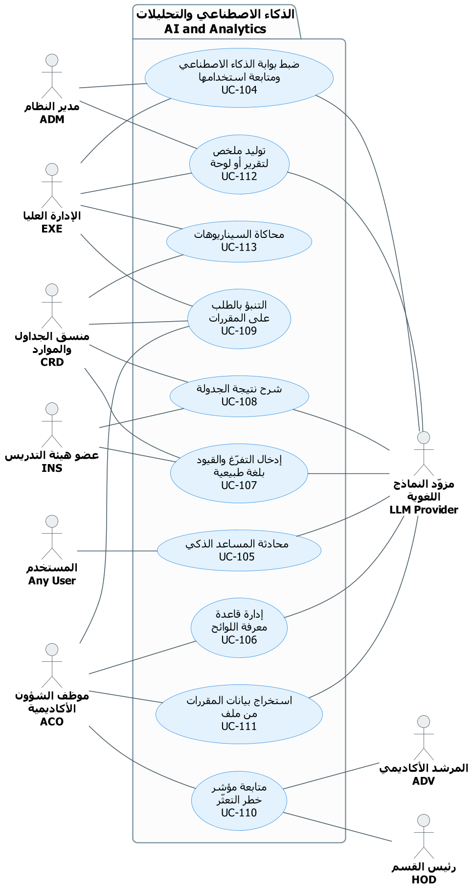

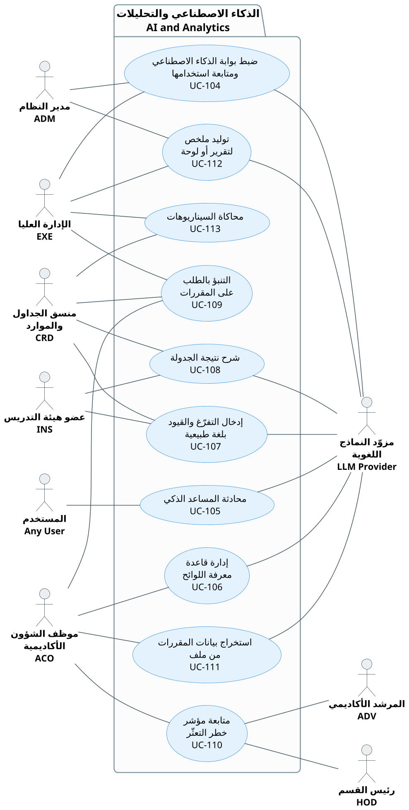

---

## ملاحظات

- اتجاه سهم «include» من الحالة التي تتضمن إلى الحالة المتضمَّنة، واتجاه سهم «extend» من الحالة الموسِّعة إلى الحالة الأساسية. لذلك يتجه السهم في مخطط الموارد من «إدارة القاعات» إلى «تحديد سعة الامتحان»، ومن «طلب موارد إضافية» إلى «عرض الموارد»، كما تنص السيناريوهات.
- الحالات الجامعة («إدارة الملف الشخصي» و«إدارة المستخدمين» و«إدارة الأدوار») مأخوذة من مخططات الفريق الأولى، وليس لها سيناريو مستقل لأن سيناريوهات الحالات المتفرعة منها تغطيها.
- يربط المخطط العام كل حزمة بفاعليها الرئيسيين فقط حتى يبقى مقروءاً، أما ارتباط كل فاعل بكل حالة فكامل في مخطط الحزمة.
- عند تغيير سيناريو أو إضافة حالة، يُعدَّل ملف `Src` المناسب وتُولَّد صورته من جديد، ثم تُحدَّث الكتلة نفسها في هذه الوثيقة.

